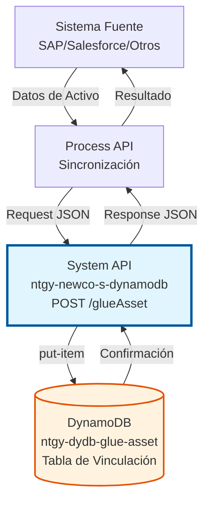
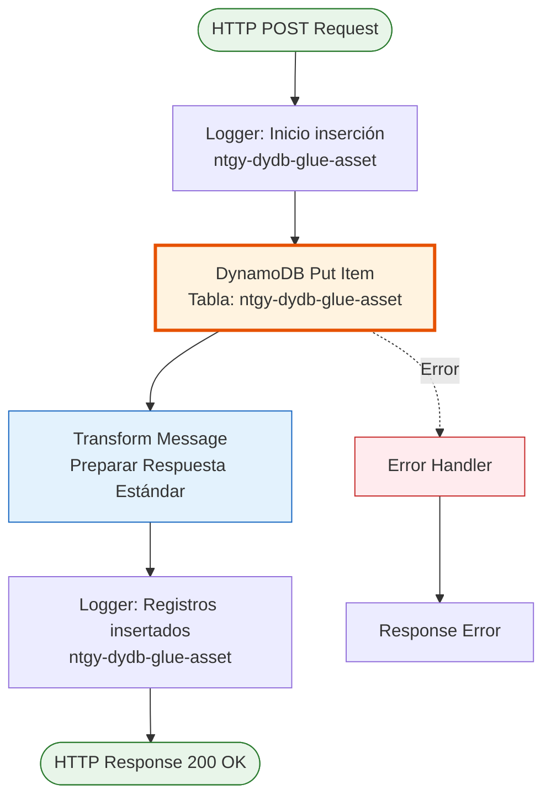
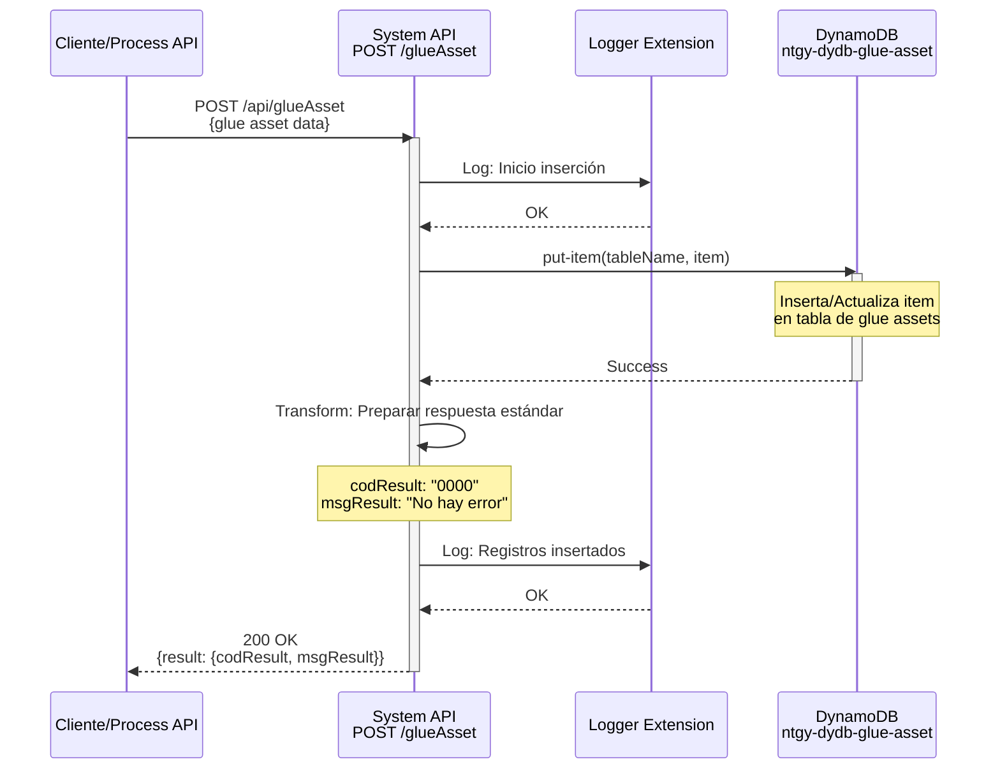
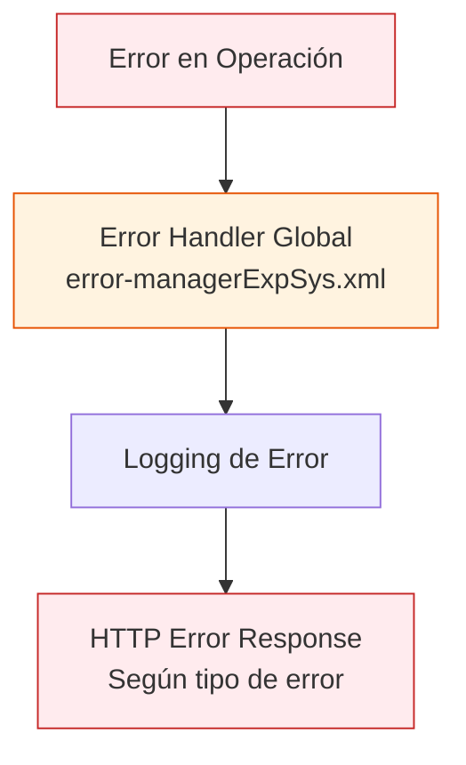

# POST /glueAsset

**⚠️ ADVERTENCIA IMPORTANTE: DOCUMENTACIÓN PARCIAL**

Esta documentación está basada únicamente en el código del flow proporcionado, que **NO incluye** la transformación de entrada ni la definición de la estructura del payload. Por lo tanto:

- ❌ La estructura del request body NO está verificada
- ❌ Los campos requeridos/opcionales NO están documentados
- ❌ La estructura de la tabla DynamoDB NO está verificada
- ✅ La respuesta de éxito SÍ está verificada en el código
- ✅ El comportamiento del endpoint (put-item idempotente) SÍ está verificado

**Para usar este endpoint, consultar:**
1. El RAML del API en `src/main/resources/api/*.raml`
2. La documentación funcional del proyecto
3. Ejemplos reales de uso en tests o logs

---

## 📌 Descripción General

### Propósito del Endpoint

Este endpoint inserta o actualiza registros de "glue asset" (activo de vinculación) en la tabla de DynamoDB (`ntgy-dydb-glue-asset`). Los glue assets actúan como conectores o puentes entre activos de diferentes sistemas, permitiendo mantener la sincronización y trazabilidad de activos relacionados a través de múltiples plataformas.

El endpoint soporta:
- **Inserción de Glue Assets**: Crea nuevos registros de vinculación de activos
- **Actualización Idempotente**: Sobrescribe registros existentes con la misma clave
- **Sincronización de Sistemas**: Mantiene relaciones entre activos de diferentes orígenes

### Tipo de API

**Capa:** System API (API-Led Connectivity)

**Función:** Integración directa con Amazon DynamoDB para gestión de registros de vinculación de activos entre sistemas.

### Patrón de Integración

**Tipo:** Request-Reply Síncrono con DynamoDB

**Descripción:** Recibe datos de glue asset en formato JSON, los inserta directamente en la tabla `ntgy-dydb-glue-asset` de DynamoDB mediante operación `put-item`, y retorna confirmación de éxito.

### Arquitectura API-Led Connectivity



---

## 💼 Propósito del Negocio

### Casos de Uso Principales

1. **Vinculación de Activos entre Sistemas**
   - Relacionar activos de SAP con activos de Salesforce
   - Mantener trazabilidad entre sistemas legacy y modernos
   - Beneficio: Visión unificada de activos en múltiples sistemas

2. **Sincronización de Datos de Activos**
   - Registrar relaciones entre identificadores de activos en diferentes sistemas
   - Facilitar procesos de integración y migración de activos
   - Beneficio: Consistencia de datos de activos entre plataformas

3. **Procesos de Migración de Activos**
   - Mapear activos antiguos con nuevos durante migraciones
   - Mantener histórico de relaciones entre sistemas
   - Beneficio: Trazabilidad completa durante transiciones

4. **Gestión de Activos Distribuidos**
   - Crear puentes entre activos en sistemas heterogéneos
   - Facilitar flujos de datos de activos entre plataformas
   - Beneficio: Interoperabilidad en gestión de activos

### Contexto Empresarial

- **Dominio:** Integración y Sincronización de Activos
- **Sector:** Energía - Utilities
- **División:** Naturgy España - NewCo
- **Proceso de Negocio:** Gestión de vinculación de activos entre sistemas empresariales
- **Tipo de Datos:** Datos de relación y mapeo entre activos

### Stakeholders

- **Equipos de Integración**: Necesitan vincular activos entre sistemas
- **Equipos de Migración**: Requieren mapeo de activos durante transiciones
- **Equipos de Gestión de Activos**: Mantienen consistencia de activos entre plataformas
- **Equipos de Desarrollo**: Consumen vinculaciones para procesos de negocio

### Valor de Negocio

- **Trazabilidad de Activos**: Seguimiento de relaciones entre activos en sistemas
- **Sincronización Eficiente**: Facilita procesos de integración de activos
- **Visión Unificada**: Activo único a través de múltiples sistemas
- **Flexibilidad**: Soporta vinculaciones entre cualquier par de sistemas

### Consumidores Potenciales

Este endpoint puede ser consumido por:
- Process APIs de sincronización de activos
- Sistemas de integración y middleware
- Procesos de migración de datos de activos
- ETL y herramientas de sincronización
- Scripts de carga y actualización de activos

---

## 🔧 Especificación Técnica

### URLs por Ambiente

| Ambiente | URL Base | URL Completa |
|----------|----------|--------------|
| **Local** | `http://localhost:8081` | `http://localhost:8081/api/glueAsset` |
| **Development** | `https://ntgy-newco-s-dynamodb-dev.us-e2.cloudhub.io` | `https://ntgy-newco-s-dynamodb-dev.us-e2.cloudhub.io/api/glueAsset` |
| **UAT** | `https://ntgy-newco-s-dynamodb-uat.us-e2.cloudhub.io` | `https://ntgy-newco-s-dynamodb-uat.us-e2.cloudhub.io/api/glueAsset` |
| **Production** | `https://ntgy-newco-s-dynamodb-pro.us-e2.cloudhub.io` | `https://ntgy-newco-s-dynamodb-pro.us-e2.cloudhub.io/api/glueAsset` |

### Método HTTP

```
POST /api/glueAsset
```

### Parámetros de Entrada

#### Headers HTTP

| Header | Tipo | Requerido | Descripción | Ejemplo |
|--------|------|-----------|-------------|---------|
| `Content-Type` | string | ✅ Sí | Tipo de contenido del request | `application/json` |
| `Accept` | string | ❌ No | Tipo de contenido esperado en response | `application/json` |
| `client_id` | string | ✅ Sí | Client ID de Anypoint Platform | `abc123...` |
| `client_secret` | string | ✅ Sí | Client Secret de Anypoint Platform | `xyz789...` |

#### Body Parameters

**⚠️ INFORMACIÓN NO DISPONIBLE EN EL CÓDIGO FUENTE**

El código proporcionado no incluye la transformación de entrada que define la estructura del payload. Por lo tanto, **no es posible documentar con certeza** qué campos son requeridos, sus tipos, o la estructura exacta del request.

**Dónde encontrar la estructura real:**
1. **RAML del API**: Archivo `src/main/resources/api/*.raml` - Define el contrato del endpoint
2. **Transformación de entrada**: Si existe un flow previo que transforma el payload antes del `put-item`
3. **Documentación del negocio**: Especificaciones funcionales del proyecto
4. **Ejemplos reales de uso**: Logs o tests del proyecto

**Lo que sabemos del código:**
- El endpoint acepta un payload en formato JSON (según Content-Type)
- El payload se inserta directamente en DynamoDB mediante `put-item`
- No hay validación de estructura visible en el flow proporcionado
- La operación es idempotente (sobrescribe si existe el mismo item)

**Recomendación:**
Consultar el RAML del API o la documentación funcional para obtener la estructura exacta del request antes de consumir este endpoint.

### Respuestas

#### Respuesta Exitosa (200 OK)

```json
{
  "result": {
    "codResult": "0000",
    "msgResult": "No hay error"
  }
}
```

**Descripción de Campos:**

| Campo | Tipo | Descripción |
|-------|------|-------------|
| `result.codResult` | string | Código de resultado (`0000` = éxito) |
| `result.msgResult` | string | Mensaje descriptivo del resultado |

**Nota:** La respuesta no incluye los datos del item insertado, solo confirma el éxito de la operación.

#### Respuesta de Error

En caso de error, el endpoint utiliza el error handler global del proyecto (`error-managerExpSys.xml`). Las respuestas de error siguen el formato estándar del sistema.

### Autenticación y Autorización

- **Tipo:** Client ID & Client Secret (Anypoint Platform)
- **Autorización DynamoDB:** El usuario de servicio debe tener permisos para:
  - Operación `PutItem` en tabla `ntgy-dydb-glue-asset`
  - Acceso de escritura a la tabla
  - Permisos IAM configurados correctamente

### Timeouts

| Tipo | Valor | Descripción |
|------|-------|-------------|
| **Request Timeout** | 30 segundos | Tiempo máximo de espera para la respuesta |
| **Connection Timeout** | 10 segundos | Tiempo máximo para establecer conexión con DynamoDB |
| **DynamoDB Operation** | 20 segundos | Tiempo máximo para operación put-item |

---

## 🏗️ Implementación Técnica

### Arquitectura del Flow



### Componentes del Flow

#### 1. Logger de Inicio
```xml
<logger level="INFO" 
        message="Inicio insercion en tabla ntgy-dydb-glue-asset"/>
```
- Registra el inicio de la operación
- Nivel INFO para trazabilidad
- Facilita troubleshooting y auditoría

#### 2. DynamoDB Put Item
```xml
<dynamodb:put-item 
    tableName="ntgy-dydb-glue-asset" 
    doc:name="Put item" 
    config-ref="Amazon_DynamoDB_Configuration"/>
```

**Análisis de la Operación:**

- **Operación:** Put Item (inserción/actualización)
- **Tabla:** `ntgy-dydb-glue-asset`
- **Comportamiento Idempotente:** Sobrescribe si existe item con misma clave
- **Payload:** Debe venir en formato adecuado desde el request

**⚠️ Nota Importante sobre el Payload:**
- El código no muestra transformación de entrada explícita
- El payload debe venir ya preparado desde el cliente
- Puede haber transformación previa en el flow principal no visible aquí
- El formato debe ser compatible con DynamoDB

**Características de Put Item:**
- **Idempotente:** Ejecutar múltiples veces con mismos datos produce mismo resultado
- **Sobrescritura:** Si existe item con misma clave primaria, se sobrescribe completamente
- **Atómico:** La operación es atómica (todo o nada)

#### 3. Transformación de Respuesta
```dataweave
%dw 2.0
output application/json
---
"result": {
    "codResult": "0000",
    "msgResult": "No hay error"
}
```

**Análisis de la Transformación:**

- **Propósito:** Generar respuesta estándar de éxito
- **Formato:** JSON simple con estructura de resultado
- **Código 0000:** Indica operación exitosa
- **Mensaje:** Genérico de éxito
- **Nota:** No incluye datos del item insertado

#### 4. Logger de Fin
```xml
<logger level="INFO" 
        message="Se han insertado registros en la tabla ntgy-dydb-glue-asset"/>
```
- Confirma finalización exitosa
- Registra operación completada
- Útil para auditoría y monitoreo

### Diagrama de Secuencia



### Tabla DynamoDB

#### ntgy-dydb-glue-asset

**Propósito:** Almacena registros de vinculación (glue) entre activos de diferentes sistemas para mantener trazabilidad y sincronización.

**⚠️ ESTRUCTURA NO VERIFICADA EN EL CÓDIGO**

El código proporcionado no incluye información sobre la estructura de la tabla. La estructura real debe ser consultada en:
- Definición de la tabla en AWS DynamoDB
- Scripts de creación de infraestructura (CloudFormation, Terraform)
- Documentación técnica del proyecto

**Lo que sabemos:**
- **Nombre de tabla:** `ntgy-dydb-glue-asset`
- **Operación:** Put Item (inserción/actualización)
- **Comportamiento:** Idempotente (sobrescribe si existe item con misma clave)

**Información requerida para uso:**
- Cuál es la clave primaria (Partition Key)
- Si existe Sort Key
- Qué índices secundarios están disponibles
- Qué atributos son obligatorios

**Capacidad:**
- Read Capacity Units (RCU): Auto-scaling
- Write Capacity Units (WCU): Auto-scaling
- Tamaño estimado: Variable según datos del activo

### Transformaciones DataWeave

#### Transformación de Respuesta

**Ubicación:** Inline en el flow XML (líneas 4-13)

**Propósito:** Generar respuesta estándar de éxito

```dataweave
%dw 2.0
output application/json
---
"result": {
    "codResult": "0000",
    "msgResult": "No hay error"
}
```

**Características:**
- Respuesta simple y consistente
- Código 0000 = operación exitosa
- Mensaje genérico de éxito
- No incluye datos del item insertado (por diseño)
- Formato consistente con otros endpoints del proyecto

### Manejo de Errores



**Estrategia de Manejo:**
- Los errores son capturados por el error handler global del proyecto
- Se registran en logs para troubleshooting y auditoría
- Se retorna respuesta de error según el tipo y configuración del error handler
- Para detalles específicos de códigos de error, consultar documentación del error handler global

### Configuración de DynamoDB

```xml
<dynamodb:config name="Amazon_DynamoDB_Configuration">
    <dynamodb:basic-connection 
        accessKey="${secure::aws.accessKey}"
        secretKey="${secure::aws.secretKey}"
        region="${aws.region}"/>
</dynamodb:config>
```

**Parámetros de Configuración:**
- `accessKey`: AWS Access Key (secure property)
- `secretKey`: AWS Secret Key (secure property)
- `region`: Región de AWS (ej: eu-west-1)

---

## 💻 Ejemplos de Uso

**⚠️ ADVERTENCIA: EJEMPLOS NO VERIFICADOS**

Los siguientes ejemplos son **ilustrativos** y **NO están basados en el código fuente real**. La estructura del payload es desconocida y debe ser consultada en el RAML del API o documentación del proyecto.

**Estos ejemplos NO deben ser usados en producción sin verificar la estructura real.**

---

### Ejemplo 1: Estructura de Request (ILUSTRATIVO - NO VERIFICADO)

#### Request

```bash
curl -X POST "https://ntgy-newco-s-dynamodb-dev.us-e2.cloudhub.io/api/glueAsset" \
  -H "Content-Type: application/json" \
  -H "client_id: your-client-id" \
  -H "client_secret: your-client-secret" \
  -d '{
    "campo1": "valor1",
    "campo2": "valor2"
  }'
```

**Nota:** La estructura real debe ser consultada en el RAML o documentación del proyecto.

#### Response (200 OK) - VERIFICADO

```json
{
  "result": {
    "codResult": "0000",
    "msgResult": "No hay error"
  }
}
```

**Nota:** Esta es la única parte verificada del código - la respuesta de éxito.

---

### Ejemplo 2: Patrón Genérico de Uso (ILUSTRATIVO)

**⚠️ La estructura del payload debe ser consultada en el RAML antes de usar**

```javascript
const axios = require('axios');

async function createGlueAsset(glueAssetData) {
  try {
    const response = await axios.post(
      'https://ntgy-newco-s-dynamodb-dev.us-e2.cloudhub.io/api/glueAsset',
      glueAssetData, // ⚠️ Estructura real debe venir del RAML
      {
        headers: {
          'Content-Type': 'application/json',
          'client_id': process.env.CLIENT_ID,
          'client_secret': process.env.CLIENT_SECRET
        }
      }
    );
    
    // Respuesta verificada del código
    if (response.data.result.codResult === '0000') {
      console.log('✓ Glue asset creado exitosamente');
      return response.data;
    }
  } catch (error) {
    console.error('✗ Error:', error.response?.data || error.message);
    throw error;
  }
}
```

### Consideraciones de Uso

#### Información Verificada del Código

**✅ Lo que SÍ sabemos:**
- La operación `put-item` es idempotente
- Si el item ya existe (misma clave primaria), se sobrescribe completamente
- No hay merge parcial de campos
- La respuesta de éxito es: `{"result": {"codResult": "0000", "msgResult": "No hay error"}}`

**❌ Lo que NO sabemos (requiere consultar RAML/documentación):**
- Cuál es la clave primaria de la tabla
- Qué campos son obligatorios
- Qué validaciones se aplican
- Qué estructura tiene el payload

#### Recomendaciones Antes de Usar

1. **Consultar el RAML**: Obtener la estructura exacta del request
2. **Verificar la tabla DynamoDB**: Conocer la clave primaria y estructura
3. **Revisar documentación funcional**: Entender el propósito de negocio de los activos
4. **Probar en ambiente de desarrollo**: Validar estructura antes de producción
5. **Implementar retry logic**: Para manejar errores transitorios (la operación es idempotente)

#### Performance

- Operación típica: < 100ms
- Incluye tiempo de red + escritura en DynamoDB
- Auto-scaling de DynamoDB maneja picos de carga
- Apropiado para operaciones individuales y batch