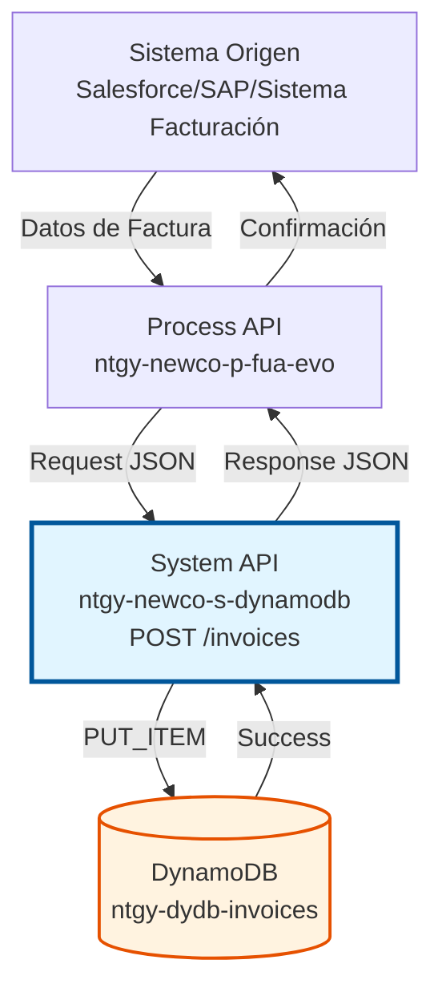
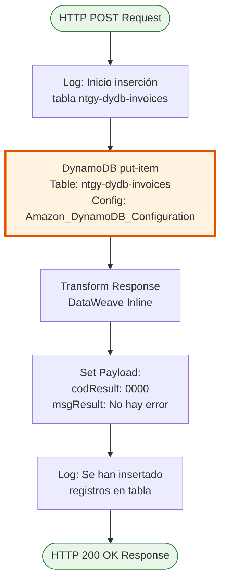
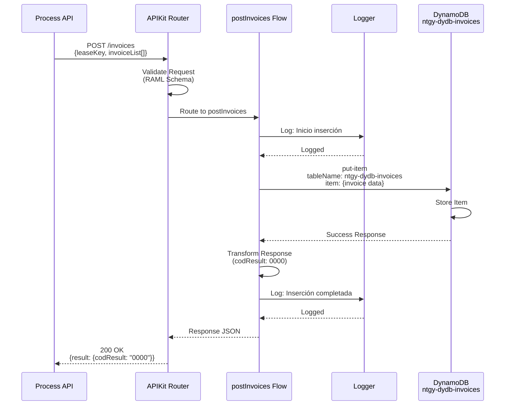
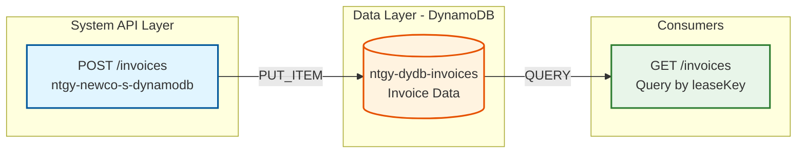

# POST /invoices

## 📌 Descripción General

### Propósito del Endpoint

Este endpoint inserta facturas en Amazon DynamoDB para su almacenamiento persistente, permitiendo mantener un histórico completo de facturación que puede ser consultado posteriormente por otros endpoints del sistema.

El endpoint soporta:
- **Inserción de facturas**: Almacenamiento de datos completos de facturación
- **Múltiples facturas**: Soporte para array de facturas en una sola petición
- **Persistencia en DynamoDB**: Uso de tabla NoSQL optimizada para consultas
- **Respuesta estándar**: Confirmación de inserción exitosa con código de resultado
- **Logging estructurado**: Trazabilidad completa de la operación

### Tipo de API

**Capa:** System API (API-Led Connectivity)

**Función:** Integración directa con Amazon DynamoDB para operaciones de escritura de datos de facturación.

### Patrón de Integración

**Tipo:** Request-Reply Síncrono con DynamoDB PUT_ITEM

**Descripción:** El endpoint recibe los datos de facturación en formato JSON, los valida mediante APIKit según el esquema RAML, ejecuta una operación PUT_ITEM en DynamoDB para insertar el registro, y retorna una respuesta estándar de confirmación.

### Arquitectura API-Led Connectivity



---

## 💼 Propósito del Negocio

### Casos de Uso Principales

1. **Almacenamiento de Facturas Generadas**
   - Sistema de facturación genera nueva factura
   - Se almacena en DynamoDB para consulta posterior
   - Permite acceso rápido desde portales web y móvil

2. **Sincronización de Facturas desde SAP**
   - Facturas generadas en SAP ISU se sincronizan a DynamoDB
   - Mejora performance de consultas vs acceso directo a SAP
   - Reduce carga en sistemas transaccionales

3. **Histórico de Facturación para Clientes**
   - Mantiene histórico completo de facturas por cliente
   - Permite consultas rápidas por leaseKey y contractAccountId
   - Soporte para portales de autoservicio

### Contexto Empresarial

- **Dominio:** Facturación y Cobros
- **Sector:** Energía - Utilities
- **División:** Naturgy España - NewCo
- **Proceso de Negocio:** Gestión de facturación y consulta de histórico
- **Integración:** Sincronización entre sistemas de facturación y DynamoDB

### Stakeholders

- **Equipos de Facturación**: Necesitan almacenar facturas generadas
- **Equipos de Atención al Cliente**: Consultan histórico de facturas
- **Sistemas de Sincronización**: AWS Glue, procesos ETL
- **Portales Web/Móvil**: Consultan facturas almacenadas

### Valor de Negocio

- **Performance Mejorado**: Consultas rápidas vs acceso directo a SAP
- **Escalabilidad**: DynamoDB auto-scaling para picos de demanda
- **Disponibilidad**: Datos disponibles 24/7 sin impactar sistemas transaccionales
- **Histórico Completo**: Mantiene todas las facturas para análisis y consulta

### Consumidores Potenciales

Este endpoint puede ser consumido por:
- Process APIs de facturación (ntgy-newco-p-fua-evo)
- Procesos de sincronización (AWS Glue)
- Sistemas de integración middleware
- Flujos de Salesforce (Platform Events)

---

## 🔧 Especificación Técnica

### URLs por Ambiente

| Ambiente | URL Base | URL Completa |
|----------|----------|--------------|
| **Local** | `http://localhost:8081` | `http://localhost:8081/api/invoices` |
| **Development** | `https://ntgy-newco-s-dynamodb-dev.us-e2.cloudhub.io` | `https://ntgy-newco-s-dynamodb-dev.us-e2.cloudhub.io/api/invoices` |
| **UAT** | `https://ntgy-newco-s-dynamodb-uat.us-e2.cloudhub.io` | `https://ntgy-newco-s-dynamodb-uat.us-e2.cloudhub.io/api/invoices` |
| **Production** | `https://ntgy-newco-s-dynamodb-pro.us-e2.cloudhub.io` | `https://ntgy-newco-s-dynamodb-pro.us-e2.cloudhub.io/api/invoices` |

### Método HTTP

```
POST /api/invoices
```

### Parámetros de Entrada

#### Headers HTTP

| Header | Tipo | Requerido | Descripción | Ejemplo |
|--------|------|-----------|-------------|---------|
| `Content-Type` | string | ✅ Sí | Tipo de contenido del request | `application/json` |
| `Accept` | string | ❌ No | Tipo de contenido esperado en response | `application/json` |

#### Body Parameters

**Estructura del Request Body (según RAML):**

Todos los campos son **opcionales** excepto `existPdfInvoice` dentro de cada item del array `invoiceList`.

| Campo | Tipo | Requerido | Descripción |
|-------|------|-----------|-------------|
| `leaseKey` | string \| nil | ❌ No | Identificador del cliente (clientId) |
| `contractAccountId` | string \| nil | ❌ No | Identificador de la cuenta contrato |
| `docNumber` | string \| nil | ❌ No | Número de documento del cliente |
| `pendingAmount` | number \| integer \| nil | ❌ No | Importe pendiente total |
| `invoiceList` | array | ❌ No | Lista de facturas a insertar |

**Estructura de cada item en `invoiceList`:**

| Campo | Tipo | Requerido | Descripción |
|-------|------|-----------|-------------|
| `invoiceId` | string \| nil | ❌ No | Identificador único de la factura |
| `invoiceNum` | string \| nil | ❌ No | Número de factura |
| `issuedDate` | string \| nil | ❌ No | Fecha de emisión (formato: YYYY-MM-DD) |
| `billingDate` | string \| nil | ❌ No | Fecha de facturación (formato: YYYY-MM-DD) |
| `status` | string \| nil | ❌ No | Estado de la factura |
| `productFamilyIdList` | array | ❌ No | Lista de IDs de familias de producto |
| `amount` | string \| nil | ❌ No | Importe de la factura (como string) |
| `interactiveInvoice` | boolean | ❌ No | Indica si es factura interactiva |
| `existPdfInvoice` | boolean | ✅ Sí | Indica si existe PDF de la factura |
| `pdfDocumentId` | string \| nil | ❌ No | Identificador del documento PDF |

**Nota Importante:** Según el RAML, `existPdfInvoice` es el único campo que no tiene `required: false`, lo que indica que es obligatorio cuando se incluye un item en `invoiceList`.

### Respuestas

#### Respuesta Exitosa (200 OK)

```json
{
  "result": {
    "codResult": "0000",
    "msgResult": "No hay error"
  }
}
```

**Descripción de Campos:**
- `codResult`: Código de resultado ("0000" = éxito)
- `msgResult`: Mensaje descriptivo del resultado

#### Respuesta de Error de Validación (400 Bad Request)

```json
{
  "message": "Bad request"
}
```

**Causas comunes:**
- Estructura JSON inválida
- Campo `existPdfInvoice` faltante en items de `invoiceList`
- Tipos de datos incorrectos

#### Respuesta de Error Técnico (500 Internal Server Error)

```json
{
  "result": {
    "codResult": "0001",
    "msgResult": "Error interno del servidor"
  }
}
```

**Causas comunes:**
- Error de conectividad con DynamoDB
- Timeout en la operación
- Error en la transformación de datos

### Autenticación y Autorización

- **Tipo:** Client ID & Client Secret (Anypoint Platform)
- **Autorización DynamoDB:** El usuario de servicio debe tener permisos IAM para:
  - Operación `dynamodb:PutItem` en tabla `ntgy-dydb-invoices`
  - Acceso a la región configurada (eu-west-1)

### Timeouts

| Tipo | Valor | Descripción |
|------|-------|-------------|
| **Request Timeout** | 30 segundos | Tiempo máximo de espera para la respuesta |
| **Connection Timeout** | 10 segundos | Tiempo máximo para establecer conexión con DynamoDB |

---

## 🏗️ Implementación Técnica

### Arquitectura del Flow



### Componentes del Flow

#### 1. Logger Inicial
```xml
<logger level="INFO" message="Inicio insercion en tabla ntgy-dydb-invoices" />
```
**Propósito:** Registrar el inicio de la operación para trazabilidad

#### 2. DynamoDB PUT_ITEM
```xml
<dynamodb:put-item 
    tableName="ntgy-dydb-invoices" 
    config-ref="Amazon_DynamoDB_Configuration" />
```
**Propósito:** Insertar el item en DynamoDB
**Configuración:** Usa conexión configurada con credenciales AWS
**Operación:** PUT_ITEM (inserta o reemplaza item completo)

#### 3. Transformación de Respuesta
```dataweave
%dw 2.0
output application/json
---
"result": {
    "codResult": "0000",
    "msgResult": "No hay error"
}
```
**Propósito:** Generar respuesta estándar de éxito
**Output:** JSON con estructura de resultado estándar

#### 4. Logger Final
```xml
<logger level="INFO" message="Se han insertado registros en la tabla ntgy-dydb-invoices"/>
```
**Propósito:** Confirmar finalización exitosa de la operación

### Diagrama de Secuencia Detallado



### Configuración de DynamoDB

#### Conexión
```xml
<dynamodb:config name="Amazon_DynamoDB_Configuration">
    <dynamodb:basic-connection 
        accessKey="${secure::aws.accessKey}"
        secretKey="${secure::aws.secretKey}"
        region="${aws.region}"/>
</dynamodb:config>
```

**Parámetros de Configuración:**
- **accessKey**: AWS Access Key (secure property)
- **secretKey**: AWS Secret Key (secure property)
- **region**: Región de AWS (ej: eu-west-1)

#### Tabla DynamoDB

**Nombre:** `ntgy-dydb-invoices`

**Estructura:**
- **Partition Key:** Por definir según diseño de tabla
- **Sort Key:** Por definir según diseño de tabla
- **Índices Secundarios:** Posiblemente por `leaseKey` y `contractAccountId` para consultas

**Capacidad:**
- **Read Capacity:** Auto-scaling habilitado
- **Write Capacity:** Auto-scaling habilitado

### Manejo de Errores

El endpoint utiliza el error handler global del API (`error-managerExpSys.xml`) que maneja:

1. **APIKIT:BAD_REQUEST (400)**
   - Request no cumple con esquema RAML
   - Campo `existPdfInvoice` faltante en items de invoiceList
   - Tipos de datos incorrectos

2. **DYNAMODB:CONNECTIVITY**
   - Error de conexión con DynamoDB
   - Timeout en la operación
   - Credenciales inválidas

3. **ANY (500)**
   - Errores no esperados
   - Transformaciones fallidas
   - Errores internos del servidor

### Diagrama de Arquitectura de Datos



### Logging y Observabilidad

**Logs Generados:**
1. **Inicio de operación**: "Inicio insercion en tabla ntgy-dydb-invoices"
2. **Fin de operación**: "Se han insertado registros en la tabla ntgy-dydb-invoices"

**Nivel de Log:** INFO

**Información Adicional:**
- Correlation ID (automático por Anypoint Platform)
- Timestamp de cada operación
- Duración de la operación DynamoDB

### Performance y Optimización

**Características de Performance:**
- **Operación Síncrona**: Respuesta inmediata tras inserción
- **Sin Transformaciones Complejas**: Mínimo overhead de procesamiento
- **DynamoDB Auto-scaling**: Maneja picos de carga automáticamente
- **Tiempo de Respuesta Esperado**: < 500ms en condiciones normales

**Consideraciones:**
- DynamoDB PUT_ITEM es idempotente (mismo key reemplaza item)
- No hay validaciones de negocio complejas (solo validación de esquema)
- Logging mínimo para reducir latencia

---

## 💻 Ejemplos de Uso

### Ejemplo 1: Inserción de Factura Básica

#### Request

```bash
curl -X POST "https://ntgy-newco-s-dynamodb-dev.us-e2.cloudhub.io/api/invoices" \
  -H "Content-Type: application/json" \
  -H "client_id: YOUR_CLIENT_ID" \
  -H "client_secret: YOUR_CLIENT_SECRET" \
  -d '{
    "leaseKey": "CLI-12345",
    "contractAccountId": "CA-67890",
    "docNumber": "12345678A",
    "pendingAmount": 125.50,
    "invoiceList": [
      {
        "invoiceId": "INV-001",
        "invoiceNum": "2024001234",
        "issuedDate": "2024-01-15",
        "billingDate": "2024-01-10",
        "status": "PENDING",
        "productFamilyIdList": ["Electricidad"],
        "amount": "125.50",
        "interactiveInvoice": false,
        "existPdfInvoice": true,
        "pdfDocumentId": "PDF-12345"
      }
    ]
  }'
```

#### Response (200 OK)

```json
{
  "result": {
    "codResult": "0000",
    "msgResult": "No hay error"
  }
}
```

---

### Ejemplo 2: Inserción de Múltiples Facturas

#### Request

```bash
curl -X POST "https://ntgy-newco-s-dynamodb-dev.us-e2.cloudhub.io/api/invoices" \
  -H "Content-Type: application/json" \
  -H "client_id: YOUR_CLIENT_ID" \
  -H "client_secret: YOUR_CLIENT_SECRET" \
  -d '{
    "leaseKey": "CLI-12345",
    "contractAccountId": "CA-67890",
    "docNumber": "12345678A",
    "pendingAmount": 371.25,
    "invoiceList": [
      {
        "invoiceId": "INV-001",
        "invoiceNum": "2024001234",
        "issuedDate": "2024-01-15",
        "billingDate": "2024-01-10",
        "status": "PENDING",
        "productFamilyIdList": ["Electricidad"],
        "amount": "125.50",
        "interactiveInvoice": true,
        "existPdfInvoice": true,
        "pdfDocumentId": "PDF-12345"
      },
      {
        "invoiceId": "INV-002",
        "invoiceNum": "2024001235",
        "issuedDate": "2024-02-15",
        "billingDate": "2024-02-10",
        "status": "PENDING",
        "productFamilyIdList": ["Gas", "Servicios"],
        "amount": "245.75",
        "interactiveInvoice": false,
        "existPdfInvoice": true,
        "pdfDocumentId": "PDF-12346"
      }
    ]
  }'
```

#### Response (200 OK)

```json
{
  "result": {
    "codResult": "0000",
    "msgResult": "No hay error"
  }
}
```

---

### Ejemplo 3: Error de Validación - Campo Obligatorio Faltante

#### Request (falta existPdfInvoice)

```bash
curl -X POST "https://ntgy-newco-s-dynamodb-dev.us-e2.cloudhub.io/api/invoices" \
  -H "Content-Type: application/json" \
  -H "client_id: YOUR_CLIENT_ID" \
  -H "client_secret: YOUR_CLIENT_SECRET" \
  -d '{
    "leaseKey": "CLI-12345",
    "contractAccountId": "CA-67890",
    "invoiceList": [
      {
        "invoiceId": "INV-003",
        "invoiceNum": "2024001236",
        "amount": "150.00"
      }
    ]
  }'
```

#### Response (400 Bad Request)

```json
{
  "message": "Bad request"
}
```

**Causa:** Falta el campo obligatorio `existPdfInvoice` en el item de invoiceList

---

### Ejemplo 4: Uso desde JavaScript/Node.js

```javascript
const axios = require('axios');

async function insertInvoices(invoiceData) {
  try {
    const response = await axios.post(
      'https://ntgy-newco-s-dynamodb-dev.us-e2.cloudhub.io/api/invoices',
      invoiceData,
      {
        headers: {
          'Content-Type': 'application/json',
          'client_id': process.env.CLIENT_ID,
          'client_secret': process.env.CLIENT_SECRET
        }
      }
    );
    
    console.log('Invoices inserted successfully:', response.data);
    return response.data;
  } catch (error) {
    console.error('Error inserting invoices:', error.response?.data || error.message);
    throw error;
  }
}

// Ejemplo de uso
const invoiceData = {
  leaseKey: 'CLI-12345',
  contractAccountId: 'CA-67890',
  docNumber: '12345678A',
  pendingAmount: 189.25,
  invoiceList: [
    {
      invoiceId: 'INV-004',
      invoiceNum: '2024001237',
      issuedDate: '2024-03-15',
      billingDate: '2024-03-10',
      status: 'PENDING',
      productFamilyIdList: ['Electricidad', 'Mantenimiento'],
      amount: '189.25',
      interactiveInvoice: true,
      existPdfInvoice: true,
      pdfDocumentId: 'PDF-12347'
    }
  ]
};

insertInvoices(invoiceData);
```

---

### Ejemplo 5: Uso desde Python

```python
import requests
import os
from datetime import datetime

def insert_invoices(invoice_data):
    url = 'https://ntgy-newco-s-dynamodb-dev.us-e2.cloudhub.io/api/invoices'
    headers = {
        'Content-Type': 'application/json',
        'client_id': os.getenv('CLIENT_ID'),
        'client_secret': os.getenv('CLIENT_SECRET')
    }
    
    try:
        response = requests.post(url, json=invoice_data, headers=headers)
        response.raise_for_status()
        print(f'Invoices inserted successfully: {response.json()}')
        return response.json()
    except requests.exceptions.RequestException as e:
        print(f'Error inserting invoices: {e}')
        raise

# Ejemplo de uso
invoice_data = {
    'leaseKey': 'CLI-12345',
    'contractAccountId': 'CA-67890',
    'docNumber': '12345678A',
    'pendingAmount': 156.80,
    'invoiceList': [
        {
            'invoiceId': 'INV-005',
            'invoiceNum': '2024001238',
            'issuedDate': datetime.now().strftime('%Y-%m-%d'),
            'billingDate': '2024-04-10',
            'status': 'PENDING',
            'productFamilyIdList': ['Gas'],
            'amount': '156.80',
            'interactiveInvoice': False,
            'existPdfInvoice': True,
            'pdfDocumentId': 'PDF-12348'
        }
    ]
}

insert_invoices(invoice_data)
```

---

### Ejemplo 6: Factura sin PDF

#### Request

```bash
curl -X POST "https://ntgy-newco-s-dynamodb-dev.us-e2.cloudhub.io/api/invoices" \
  -H "Content-Type: application/json" \
  -H "client_id: YOUR_CLIENT_ID" \
  -H "client_secret: YOUR_CLIENT_SECRET" \
  -d '{
    "leaseKey": "CLI-12345",
    "contractAccountId": "CA-67890",
    "pendingAmount": 98.50,
    "invoiceList": [
      {
        "invoiceId": "INV-006",
        "invoiceNum": "2024001239",
        "issuedDate": "2024-05-15",
        "billingDate": "2024-05-10",
        "status": "PENDING",
        "productFamilyIdList": ["Electricidad"],
        "amount": "98.50",
        "interactiveInvoice": false,
        "existPdfInvoice": false
      }
    ]
  }'
```

#### Response (200 OK)

```json
{
  "result": {
    "codResult": "0000",
    "msgResult": "No hay error"
  }
}
```

**Nota:** Cuando `existPdfInvoice` es `false`, el campo `pdfDocumentId` puede omitirse o ser `null`.