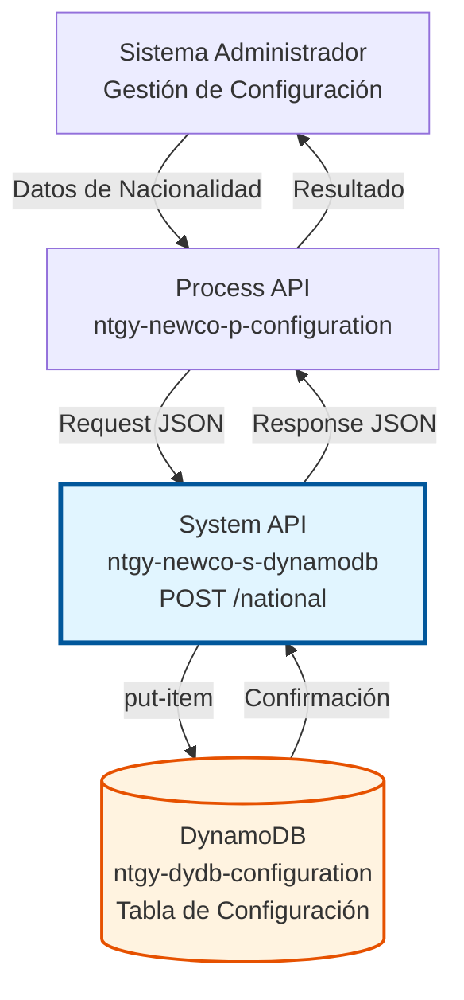
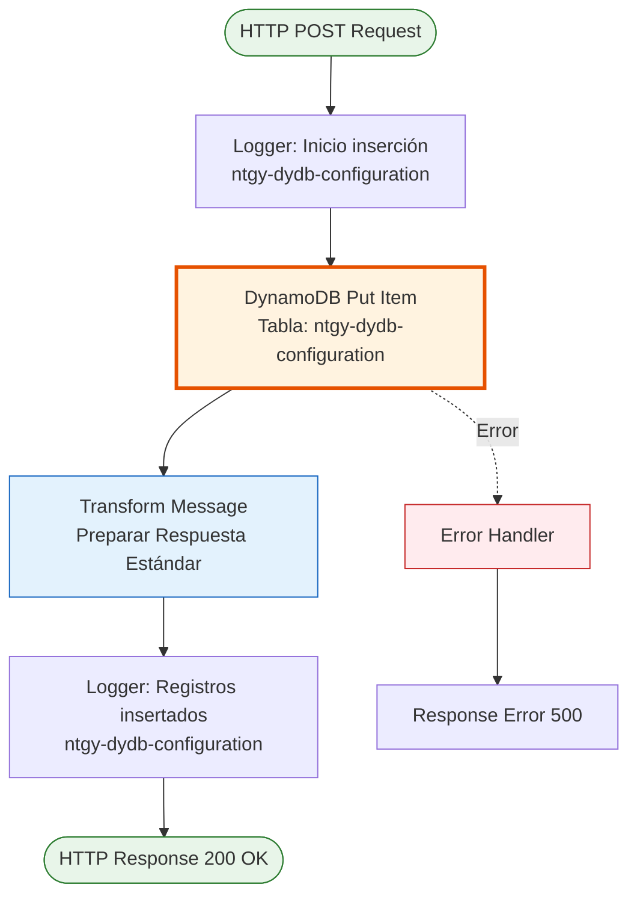
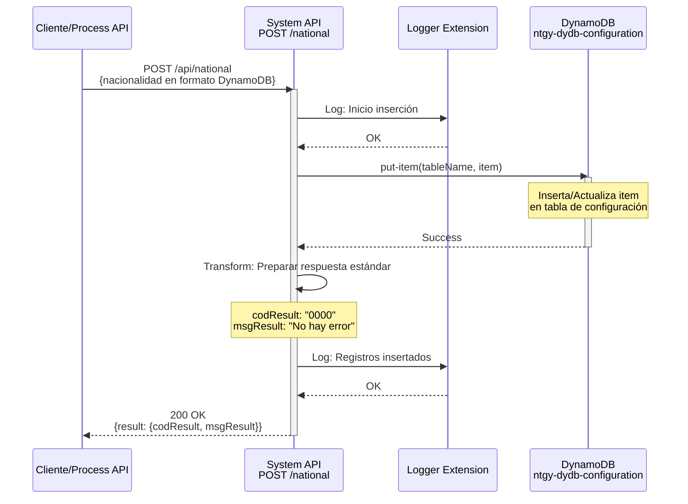
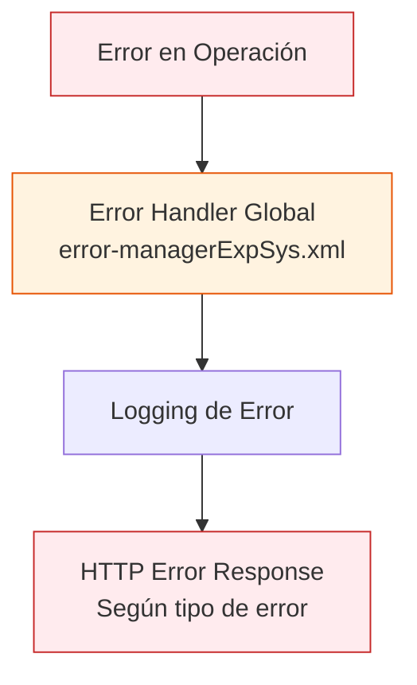

# POST /national

## 📌 Descripción General

### Propósito del Endpoint

Este endpoint permite insertar registros de nacionalidades en la tabla de configuración de DynamoDB (`ntgy-dydb-configuration`). Las nacionalidades almacenadas se utilizan posteriormente en formularios de registro, validaciones de documentos y procesos de onboarding de clientes.

El endpoint soporta:
- **Inserción de Nacionalidades**: Almacena códigos y descripciones de nacionalidades
- **Configuración de Referencia**: Mantiene datos maestros de configuración del sistema
- **Datos Estáticos**: Gestiona información de referencia que raramente cambia

### Tipo de API

**Capa:** System API (API-Led Connectivity)

**Función:** Integración directa con Amazon DynamoDB para gestión de datos de configuración de nacionalidades.

### Patrón de Integración

**Tipo:** Request-Reply Síncrono con DynamoDB

**Descripción:** Recibe datos de nacionalidad en formato JSON, los inserta directamente en la tabla `ntgy-dydb-configuration` de DynamoDB mediante operación `put-item`, y retorna confirmación de éxito.

### Arquitectura API-Led Connectivity



---

## 💼 Propósito del Negocio

### Casos de Uso Principales

1. **Carga Inicial de Nacionalidades**
   - Poblar la tabla de configuración con el catálogo completo de nacionalidades
   - Establecer datos maestros para el sistema
   - Beneficio: Sistema listo para validar documentos de identidad

2. **Actualización de Catálogo**
   - Añadir nuevas nacionalidades cuando sea necesario
   - Mantener el catálogo actualizado con cambios geopolíticos
   - Beneficio: Sistema siempre actualizado con información correcta

3. **Sincronización de Datos Maestros**
   - Sincronizar nacionalidades desde sistemas fuente (SAP, Salesforce)
   - Mantener consistencia entre sistemas
   - Beneficio: Datos unificados en toda la plataforma

### Contexto Empresarial

- **Dominio:** Gestión de Configuración y Datos Maestros
- **Sector:** Energía - Utilities
- **División:** Naturgy España - NewCo
- **Proceso de Negocio:** Gestión de datos de referencia para onboarding y validación de clientes
- **Tipo de Datos:** Datos maestros estáticos (nacionalidades)

### Stakeholders

- **Administradores de Sistema**: Necesitan mantener catálogos de datos maestros actualizados
- **Equipos de Desarrollo**: Requieren datos de referencia para validaciones en formularios
- **Equipos de Onboarding**: Utilizan nacionalidades para procesos de alta de clientes
- **Equipos de Compliance**: Necesitan validar documentos según nacionalidad del cliente

### Valor de Negocio

- **Centralización de Datos Maestros**: Fuente única de verdad para nacionalidades
- **Validación Consistente**: Mismos datos de referencia en todos los canales
- **Mantenimiento Simplificado**: Actualización centralizada de catálogos
- **Cumplimiento Normativo**: Validación correcta de documentos de identidad

### Consumidores Potenciales

Este endpoint puede ser consumido por:
- Process APIs de configuración y datos maestros
- Sistemas de administración de catálogos
- Procesos de sincronización desde SAP/Salesforce
- Herramientas de migración de datos
- Scripts de carga inicial de datos

---

## 🔧 Especificación Técnica

### URLs por Ambiente

| Ambiente | URL Base | URL Completa |
|----------|----------|--------------|
| **Local** | `http://localhost:8081` | `http://localhost:8081/api/national` |
| **Development** | `https://ntgy-newco-s-dynamodb-dev.us-e2.cloudhub.io` | `https://ntgy-newco-s-dynamodb-dev.us-e2.cloudhub.io/api/national` |
| **UAT** | `https://ntgy-newco-s-dynamodb-uat.us-e2.cloudhub.io` | `https://ntgy-newco-s-dynamodb-uat.us-e2.cloudhub.io/api/national` |
| **Production** | `https://ntgy-newco-s-dynamodb-pro.us-e2.cloudhub.io` | `https://ntgy-newco-s-dynamodb-pro.us-e2.cloudhub.io/api/national` |

### Método HTTP

```
POST /api/national
```

### Parámetros de Entrada

#### Headers HTTP

| Header | Tipo | Requerido | Descripción | Ejemplo |
|--------|------|-----------|-------------|---------|
| `Content-Type` | string | ✅ Sí | Tipo de contenido del request | `application/json` |
| `Accept` | string | ❌ No | Tipo de contenido esperado en response | `application/json` |
| `client_id` | string | ✅ Sí | Client ID de Anypoint Platform | `abc123...` |
| `client_secret` | string | ✅ Sí | Client Secret de Anypoint Platform | `xyz789...` |

#### Body Parameters

El body debe contener la estructura de nacionalidad según el esquema RAML. El endpoint acepta un formato JSON simple que internamente se transforma a formato DynamoDB.

**Estructura del Request:**

```json
{
  "leaseKey": "NATIONAL_ES",
  "Value": "ES",
  "Label": "España"
}
```

**Descripción de Campos:**

| Campo | Tipo | Requerido | Descripción | Ejemplo |
|-------|------|-----------|-------------|---------|
| `leaseKey` | string | ❌ No | Identificador único de la nacionalidad (formato: NATIONAL_\{code\}) | `"NATIONAL_ES"` |
| `Value` | string | ❌ No | Código ISO 3166-1 alpha-2 de la nacionalidad | `"ES"` |
| `Label` | string | ❌ No | Nombre completo de la nacionalidad | `"España"` |

**Notas Importantes:**
- Todos los campos son opcionales según el RAML, pero se recomienda proporcionar los tres para datos completos
- El formato es JSON simple (no requiere conocimiento de formato DynamoDB)
- Internamente, el flow transforma estos datos a formato DynamoDB antes de insertarlos
- El `leaseKey` debe seguir el patrón `NATIONAL_{código}` para mantener consistencia

### Respuestas

#### Respuesta Exitosa (200 OK)

```json
{
  "result": {
    "codResult": "0000",
    "msgResult": "No hay error"
  }
}
```

**Descripción de Campos:**
- `codResult`: Código de resultado (`0000` = éxito)
- `msgResult`: Mensaje descriptivo del resultado

#### Respuesta de Error

En caso de error, el endpoint utiliza el error handler global del proyecto (`error-managerExpSys.xml`). Las respuestas de error siguen el formato estándar del sistema.

**Nota:** Para detalles específicos sobre códigos de error y formatos de respuesta de error, consultar la documentación del error handler global del proyecto.

### Autenticación y Autorización

- **Tipo:** Client ID & Client Secret (Anypoint Platform)
- **Autorización DynamoDB:** El usuario de servicio debe tener permisos para:
  - Operación `PutItem` en tabla `ntgy-dydb-configuration`
  - Acceso de escritura a la tabla
  - Permisos IAM configurados correctamente

### Timeouts

| Tipo | Valor | Descripción |
|------|-------|-------------|
| **Request Timeout** | 30 segundos | Tiempo máximo de espera para la respuesta |
| **Connection Timeout** | 10 segundos | Tiempo máximo para establecer conexión con DynamoDB |
| **DynamoDB Operation** | 20 segundos | Tiempo máximo para operación put-item |

---

## 🏗️ Implementación Técnica

### Arquitectura del Flow



### Componentes del Flow

#### 1. Logger de Inicio
```xml
<logger level="INFO" 
        message="Inicio insercion en tabla ntgy-dydb-configuration"/>
```
- Registra el inicio de la operación
- Nivel INFO para trazabilidad
- Facilita troubleshooting

#### 2. DynamoDB Put Item
```xml
<dynamodb:put-item 
    doc:name="Put item" 
    config-ref="Amazon_DynamoDB_Configuration" 
    tableName="ntgy-dydb-configuration"/>
```
- Inserta el item en DynamoDB
- Usa configuración global de DynamoDB
- Operación idempotente (sobrescribe si existe)

**⚠️ Nota Importante sobre Transformación:**
El endpoint acepta JSON simple según el RAML (campos: `leaseKey`, `Value`, `Label`), pero internamente debe existir una transformación DataWeave que convierte este formato a la estructura nativa de DynamoDB antes de ejecutar el `put-item`. Esta transformación es transparente para el consumidor del API.

#### 3. Transformación de Respuesta
```dataweave
%dw 2.0
output application/json
---
"result": {
    "codResult": "0000",
    "msgResult": "No hay error"
}
```
- Genera respuesta estándar de éxito
- Formato consistente con otros endpoints
- Código 0000 indica operación exitosa

#### 4. Logger de Fin
```xml
<logger level="INFO" 
        message="Se han insertado registros en la tabla ntgy-dydb-configuration"/>
```
- Confirma finalización exitosa
- Registra operación completada
- Útil para auditoría

### Diagrama de Secuencia



### Tabla DynamoDB

#### ntgy-dydb-configuration

**Propósito:** Almacena datos de configuración general del sistema, incluyendo nacionalidades.

**Estructura:**

| Atributo | Tipo | Clave | Descripción |
|----------|------|-------|-------------|
| `leaseKey` | String | Partition Key | Identificador único (ej: NATIONAL_ES) |
| `Value` | String | - | Código ISO de nacionalidad |
| `Label` | String | - | Nombre completo de la nacionalidad |

**Nota:** La estructura interna de DynamoDB puede contener atributos adicionales dependiendo de la transformación aplicada por el flow.

**Índices:**
- Primary Key: `leaseKey` (Partition Key)
- Sin índices secundarios para este tipo de datos

**Capacidad:**
- Read Capacity Units (RCU): Auto-scaling
- Write Capacity Units (WCU): Auto-scaling
- Tamaño estimado: < 1 KB por item

### Transformaciones DataWeave

#### Transformación de Respuesta

**Ubicación:** Inline en el flow XML

**Propósito:** Generar respuesta estándar de éxito

```dataweave
%dw 2.0
output application/json
---
"result": {
    "codResult": "0000",
    "msgResult": "No hay error"
}
```

**Características:**
- Respuesta simple y consistente
- Código 0000 = operación exitosa
- Mensaje genérico de éxito
- No incluye datos del item insertado (por diseño)

### Manejo de Errores



**Estrategia de Manejo:**
- Los errores son capturados por el error handler global del proyecto (`error-managerExpSys.xml`)
- Se registran en logs para troubleshooting y auditoría
- Se retorna respuesta de error según el tipo y configuración del error handler
- Para detalles específicos de códigos de error, consultar documentación del error handler global

### Configuración de DynamoDB

```xml
<dynamodb:config name="Amazon_DynamoDB_Configuration">
    <dynamodb:basic-connection 
        accessKey="${secure::aws.accessKey}"
        secretKey="${secure::aws.secretKey}"
        region="${aws.region}"/>
</dynamodb:config>
```

**Parámetros de Configuración:**
- `accessKey`: AWS Access Key (secure property)
- `secretKey`: AWS Secret Key (secure property)
- `region`: Región de AWS (ej: eu-west-1)

---

## 💻 Ejemplos de Uso

### Ejemplo 1: Insertar Nacionalidad Española

#### Request

```bash
curl -X POST "https://ntgy-newco-s-dynamodb-dev.us-e2.cloudhub.io/api/national" \
  -H "Content-Type: application/json" \
  -H "client_id: your-client-id" \
  -H "client_secret: your-client-secret" \
  -d '{
    "leaseKey": "NATIONAL_ES",
    "Value": "ES",
    "Label": "España"
  }'
```

#### Response (200 OK)

```json
{
  "result": {
    "codResult": "0000",
    "msgResult": "No hay error"
  }
}
```

### Ejemplo 2: Insertar Nacionalidad Francesa

#### Request

```bash
curl -X POST "https://ntgy-newco-s-dynamodb-dev.us-e2.cloudhub.io/api/national" \
  -H "Content-Type: application/json" \
  -H "client_id: your-client-id" \
  -H "client_secret: your-client-secret" \
  -d '{
    "leaseKey": "NATIONAL_FR",
    "Value": "FR",
    "Label": "Francia"
  }'
```

#### Response (200 OK)

```json
{
  "result": {
    "codResult": "0000",
    "msgResult": "No hay error"
  }
}
```

### Ejemplo 3: Insertar Nacionalidad Alemana

#### Request

```bash
curl -X POST "https://ntgy-newco-s-dynamodb-dev.us-e2.cloudhub.io/api/national" \
  -H "Content-Type: application/json" \
  -H "client_id: your-client-id" \
  -H "client_secret: your-client-secret" \
  -d '{
    "leaseKey": "NATIONAL_DE",
    "Value": "DE",
    "Label": "Alemania"
  }'
```

#### Response (200 OK)

```json
{
  "result": {
    "codResult": "0000",
    "msgResult": "No hay error"
  }
}
```

**Nota:** En caso de error, el endpoint retorna respuestas según el error handler global del proyecto. Consultar documentación del sistema para códigos de error específicos.

### Ejemplo 4: Uso desde JavaScript

```javascript
const axios = require('axios');

async function insertNationality(nationalityData) {
  try {
    const response = await axios.post(
      'https://ntgy-newco-s-dynamodb-dev.us-e2.cloudhub.io/api/national',
      {
        leaseKey: `NATIONAL_${nationalityData.code}`,
        Value: nationalityData.code,
        Label: nationalityData.description
      },
      {
        headers: {
          'Content-Type': 'application/json',
          'client_id': process.env.CLIENT_ID,
          'client_secret': process.env.CLIENT_SECRET
        }
      }
    );
    
    console.log('Nacionalidad insertada:', response.data);
    return response.data;
  } catch (error) {
    console.error('Error al insertar nacionalidad:', error.response?.data || error.message);
    throw error;
  }
}

// Uso
insertNationality({
  code: 'IT',
  description: 'Italia'
});
```

### Ejemplo 5: Carga Masiva de Nacionalidades

```python
import requests
import json

def bulk_insert_nationalities(nationalities):
    """
    Inserta múltiples nacionalidades en DynamoDB
    """
    url = "https://ntgy-newco-s-dynamodb-dev.us-e2.cloudhub.io/api/national"
    headers = {
        "Content-Type": "application/json",
        "client_id": "your-client-id",
        "client_secret": "your-client-secret"
    }
    
    results = []
    for nat in nationalities:
        payload = {
            "leaseKey": f"NATIONAL_{nat['code']}",
            "Value": nat['code'],
            "Label": nat['description']
        }
        
        try:
            response = requests.post(url, headers=headers, json=payload)
            results.append({
                "code": nat['code'],
                "status": "success" if response.status_code == 200 else "error",
                "response": response.json()
            })
        except Exception as e:
            results.append({
                "code": nat['code'],
                "status": "error",
                "error": str(e)
            })
    
    return results

# Uso
nationalities = [
    {"code": "ES", "description": "España"},
    {"code": "FR", "description": "Francia"},
    {"code": "DE", "description": "Alemania"},
    {"code": "IT", "description": "Italia"},
    {"code": "PT", "description": "Portugal"}
]

results = bulk_insert_nationalities(nationalities)
print(json.dumps(results, indent=2))
```

### Consideraciones de Uso

#### Idempotencia
- La operación `put-item` es idempotente
- Si el item ya existe (mismo `leaseKey`), se sobrescribe
- No hay validación de duplicados en el endpoint

#### Performance
- Operación típica: < 100ms
- Incluye tiempo de red + escritura en DynamoDB
- Auto-scaling de DynamoDB maneja picos de carga

#### Mejores Prácticas
1. **Validar datos antes de enviar**: Verificar formato de códigos ISO
2. **Usar batch operations**: Para cargas masivas, considerar operaciones batch
3. **Implementar retry logic**: Para manejar errores transitorios
4. **Monitorear capacidad**: Verificar WCU consumidos en DynamoDB
5. **Mantener consistencia**: Usar siempre formato `NATIONAL_\{code\}` para leaseKey
