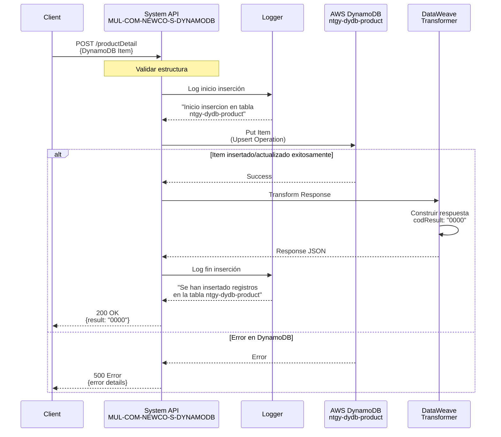
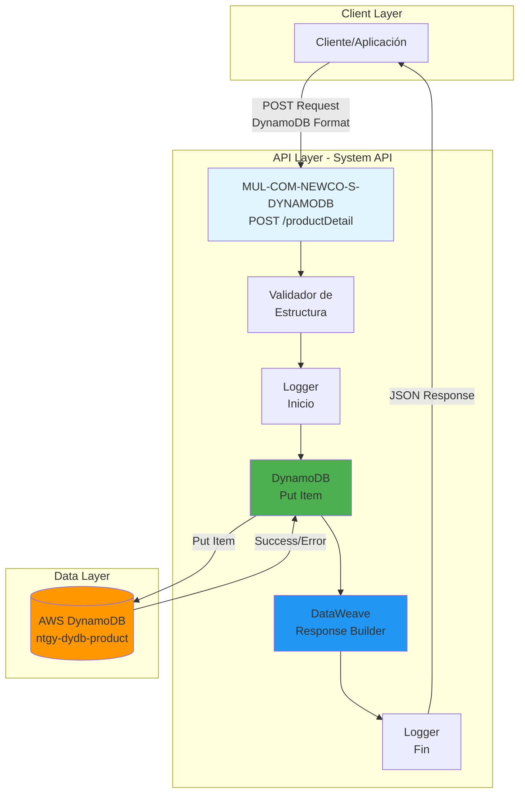
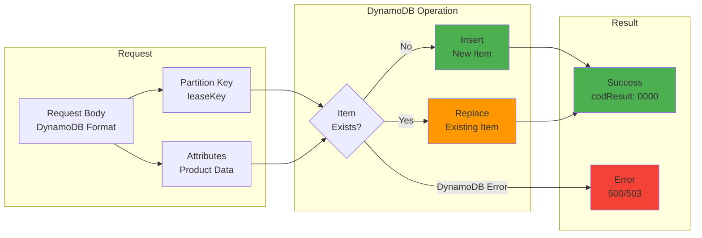

# POST /productDetail

## 📌 Descripción General

Endpoint de System API que inserta o actualiza el detalle completo de un producto en AWS DynamoDB. Realiza una operación de tipo "upsert" (insert or update) que crea un nuevo item si no existe o reemplaza completamente el item existente si la partition key ya está presente en la tabla.

**Características principales:**
- Operación atómica de escritura en DynamoDB
- Upsert: Inserta si no existe, actualiza si existe
- Reemplaza completamente el item (no es actualización parcial)
- Requiere estructura completa del productDetail en formato DynamoDB
- Respuesta estándar de éxito/error
- Logging de inicio y fin de operación
- Soporte para múltiples tipos de productos (equipamiento, renting, servicios)

## 💼 Propósito del Negocio

### Objetivo
Proporcionar un mecanismo centralizado para crear o actualizar información completa de productos, incluyendo datos de equipamiento solar, renting, precios, consumos, saldos, visitas programadas y datos comerciales en el sistema de almacenamiento DynamoDB.

### Casos de Uso
1. **Creación de Nuevo Producto**: Registrar un nuevo producto con toda su información
2. **Actualización de Producto Existente**: Modificar información completa de un producto
3. **Sincronización de Datos**: Actualizar información desde sistemas externos (CRM, ERP)
4. **Actualización de Precios**: Refrescar tarifas, IVA y términos
5. **Gestión de Equipamiento**: Actualizar datos de instalaciones solares
6. **Actualización de Saldo**: Modificar saldo disponible y historial
7. **Programación de Visitas**: Registrar o actualizar visitas de mantenimiento
8. **Actualización de Marketing**: Modificar información comercial del producto

### Valor de Negocio
- **Centralización de Datos**: Punto único de escritura para información de productos
- **Consistencia**: Garantiza estructura uniforme de datos en DynamoDB
- **Trazabilidad**: Logging completo de operaciones de escritura
- **Integración**: Facilita sincronización con sistemas externos
- **Escalabilidad**: Aprovecha capacidad de escritura de DynamoDB
- **Flexibilidad**: Soporta diferentes tipos de productos

## 🔧 Especificación Técnica

### Endpoint
```
POST /productDetail
```

### Headers Requeridos
```http
Content-Type: application/json
client-id: {clientId}
client-secret: {clientSecret}
```

### Request Body

El body debe contener la estructura completa del productDetail en formato DynamoDB. La estructura incluye tipos de datos DynamoDB (S=String, N=Number, BOOL=Boolean, M=Map, L=List).

**Estructura del Request:**
```json
{
  "leaseKey": {
    "S": "string"
  },
  "contractId": {
    "s": "string"
  },
  "productTypeId": {
    "s": "string"
  },
  "promotionDesc": {
    "s": "string"
  },
  "panelType": {
    "s": "string"
  },
  "numberPanels": {
    "n": "string"
  },
  "photovoltaicPower": {
    "n": "string"
  },
  "battery": {
    "bool": true
  },
  "chargingPoint": {
    "bool": false
  },
  "inverterPower": {
    "n": "string"
  },
  "rentingType": {
    "s": "string"
  },
  "brand": {
    "s": "string"
  },
  "model": {
    "s": "string"
  },
  "numberInstallments": {
    "n": "string"
  },
  "emergency": {
    "s": "string"
  },
  "schedule": {
    "s": "string"
  },
  "serviceType": {
    "s": "string"
  },
  "prices": {
    "m": {
      "amount": {"n": "string"},
      "dateReview": {"s": "string"},
      "power": {
        "l": [{"n": "string"}]
      },
      "energy": {
        "l": [{"n": "string"}]
      },
      "fixedTerm": {"n": "string"},
      "variableTerm": {"n": "string"},
      "iva10": {
        "m": {
          "pointPeriod": {"s": "string"},
          "plainPeriod": {"s": "string"},
          "valleyPeriod": {"s": "string"},
          "power1": {"s": "string"},
          "power2": {"s": "string"}
        }
      },
      "iva21": {
        "m": {
          "pointPeriod": {"s": "string"},
          "plainPeriod": {"s": "string"},
          "valleyPeriod": {"s": "string"},
          "power1": {"s": "string"},
          "power2": {"s": "string"}
        }
      }
    }
  },
  "choice": {
    "m": {
      "type": {"s": "string"},
      "days": {
        "l": [{"s": "string"}]
      },
      "hours": {
        "l": [{"s": "string"}]
      },
      "recommendedDays": {
        "l": [{"s": "string"}]
      },
      "recommendedHours": {
        "l": [{"s": "string"}]
      }
    }
  },
  "energy": {
    "m": {
      "consumedEnergy": {"s": "string"},
      "contractedEnergy": {"n": "string"},
      "lastBillDate": {"s": "string"},
      "validityDate": {"s": "string"},
      "anualMaxConsumption": {"n": "string"},
      "textTP": {
        "l": [{"s": "string"}]
      }
    }
  },
  "balance": {
    "m": {
      "availableBalance": {"n": "string"},
      "consumedBalance": {"n": "string"},
      "initialBalance": {"n": "string"},
      "actualValidity": {"s": "string"},
      "currency": {"s": "string"},
      "history": {
        "l": [
          {
            "m": {
              "activityDate": {"s": "string"},
              "activityType": {"s": "string"},
              "amount": {"n": "string"},
              "availableBalance": {"n": "string"},
              "validity": {"s": "string"}
            }
          }
        ]
      }
    }
  },
  "visits": {
    "l": [
      {
        "m": {
          "period": {"s": "string"},
          "state": {"s": "string"},
          "date": {"s": "string"},
          "type": {"s": "string"}
        }
      }
    ]
  },
  "marketingInfo": {
    "l": [
      {
        "m": {
          "text": {"s": "string"},
          "icon": {"s": "string"}
        }
      }
    ]
  }
}
```

### Respuestas

#### Éxito (200 OK)
```json
{
  "result": {
    "codResult": "0000",
    "msgResult": "No hay error"
  }
}
```

#### Error de Validación (400 Bad Request)
```json
{
  "error": {
    "code": "400",
    "message": "Bad Request - Estructura de datos inválida"
  }
}
```

#### Error de Autenticación (401 Unauthorized)
```json
{
  "error": {
    "code": "401",
    "message": "Unauthorized - Credenciales inválidas"
  }
}
```

#### Error de DynamoDB (500 Internal Server Error)
```json
{
  "error": {
    "code": "500",
    "message": "Internal Server Error - Error al insertar en DynamoDB"
  }
}
```

#### Error de Throttling (503 Service Unavailable)
```json
{
  "error": {
    "code": "503",
    "message": "Service Unavailable - DynamoDB throttling"
  }
}
```

## 🏗️ Implementación Técnica

### Arquitectura del Flujo



### Operación de Backend: DynamoDB Put Item

**Tabla:** `ntgy-dydb-product`

**Operación:** Put Item (Upsert)

```xml
<dynamodb:put-item 
    tableName="ntgy-dydb-product" 
    config-ref="Amazon_DynamoDB_Configuration" />
```

**Características de Put Item:**
- **Operación atómica**: La escritura es todo-o-nada
- **Upsert**: Si el item existe (misma partition key), lo reemplaza completamente
- **Reemplazo completo**: No es actualización parcial, reemplaza todos los atributos
- **Idempotente**: Múltiples llamadas con mismo payload producen mismo resultado

**Estructura de la Tabla:**
- **Partition Key:** `leaseKey` (String) - Puede ser assetId o contractId
- **Atributos:** Estructura compleja con múltiples secciones de datos del producto

### Flujo de Ejecución

#### 1. Logger Inicial
```xml
<logger level="INFO" 
        message="Inicio insercion en tabla ntgy-dydb-product" />
```
- Registra el inicio de la operación de escritura
- Nivel INFO para trazabilidad

#### 2. Put Item a DynamoDB
```xml
<dynamodb:put-item 
    tableName="ntgy-dydb-product" 
    config-ref="Amazon_DynamoDB_Configuration" />
```
- Recibe el payload directamente del request
- El payload debe estar en formato DynamoDB
- No hay transformación previa del request

#### 3. Transformación de Respuesta
```dataweave
%dw 2.0
output application/json
---
"result": {
    "codResult": "0000",
    "msgResult": "No hay error"
}
```
- Genera respuesta estándar de éxito
- Código 0000 indica operación exitosa

#### 4. Logger Final
```xml
<logger level="INFO" 
        message="Se han insertado registros en la tabla ntgy-dydb-product"/>
```
- Confirma finalización exitosa de la operación
- Nivel INFO para auditoría

### Diagrama de Arquitectura



### Diagrama de Operación Put Item



### Formato de Datos DynamoDB

**Tipos de Datos DynamoDB:**
- **S**: String (mayúscula para partition key)
- **s**: String (minúscula para atributos)
- **N**: Number (como string)
- **n**: Number (minúscula para atributos)
- **BOOL**: Boolean
- **bool**: Boolean (minúscula para atributos)
- **M**: Map (objeto anidado)
- **m**: Map (minúscula para atributos)
- **L**: List (array)
- **l**: List (minúscula para atributos)

**Ejemplo de Conversión:**

**JSON Normal:**
```json
{
  "contractId": "CONT001",
  "numberPanels": 12,
  "battery": true,
  "prices": {
    "amount": 89.50
  }
}
```

**Formato DynamoDB:**
```json
{
  "contractId": {"s": "CONT001"},
  "numberPanels": {"n": "12"},
  "battery": {"bool": true},
  "prices": {
    "m": {
      "amount": {"n": "89.50"}
    }
  }
}
```

### Validaciones

**Validaciones Implícitas:**
1. **Estructura DynamoDB**: El payload debe tener formato DynamoDB válido
2. **Partition Key**: Debe incluir el atributo `leaseKey`
3. **Tipos de Datos**: Los tipos deben coincidir con el esquema esperado
4. **Tamaño del Item**: No debe exceder 400 KB (límite de DynamoDB)

**Validaciones de Negocio:**
- Se asume que el cliente valida la estructura antes de enviar
- No hay validaciones explícitas en el código XML
- DynamoDB rechazará estructuras inválidas

### Manejo de Errores

**Errores de DynamoDB:**
- **ProvisionedThroughputExceededException**: Throttling por exceso de escrituras
- **ResourceNotFoundException**: Tabla no encontrada
- **ValidationException**: Estructura de datos inválida
- **InternalServerError**: Error interno de DynamoDB

**Errores de Conectividad:**
- Timeout de conexión
- Permisos insuficientes (IAM)
- Configuración incorrecta

**Comportamiento ante Errores:**
- El flujo no tiene manejo explícito de errores
- Los errores se propagan al cliente
- El logger no registra errores específicos

## 💻 Ejemplos de Uso

### Ejemplo 1: Inserción de Producto Solar Completo

**Request:**
```bash
curl -X POST "https://api.naturgy.com/s-dynamodb/productDetail" \
  -H "Content-Type: application/json" \
  -H "client-id: your-client-id" \
  -H "client-secret: your-client-secret" \
  -d '{
    "leaseKey": {
      "S": "ASSET123456"
    },
    "contractId": {"s": "CONT001"},
    "productTypeId": {"s": "SOLAR-001"},
    "promotionDesc": {"s": "Instalación Solar Residencial"},
    "panelType": {"s": "Monocristalino"},
    "numberPanels": {"n": "12"},
    "photovoltaicPower": {"n": "4.8"},
    "battery": {"bool": true},
    "chargingPoint": {"bool": false},
    "inverterPower": {"n": "5.0"},
    "rentingType": {"s": "RENTING"},
    "brand": {"s": "Tesla"},
    "model": {"s": "Powerwall 2"},
    "numberInstallments": {"n": "60"},
    "prices": {
      "m": {
        "amount": {"n": "89.50"},
        "dateReview": {"s": "2024-01-01"},
        "power": {
          "l": [{"n": "3.45"}, {"n": "3.45"}]
        },
        "energy": {
          "l": [{"n": "0.15"}, {"n": "0.12"}, {"n": "0.10"}]
        },
        "fixedTerm": {"n": "45.00"},
        "variableTerm": {"n": "44.50"},
        "iva10": {
          "m": {
            "pointPeriod": {"s": "0.165"},
            "plainPeriod": {"s": "0.132"},
            "valleyPeriod": {"s": "0.110"},
            "power1": {"s": "3.795"},
            "power2": {"s": "3.795"}
          }
        },
        "iva21": {
          "m": {
            "pointPeriod": {"s": "0.182"},
            "plainPeriod": {"s": "0.145"},
            "valleyPeriod": {"s": "0.121"},
            "power1": {"s": "4.175"},
            "power2": {"s": "4.175"}
          }
        }
      }
    },
    "energy": {
      "m": {
        "consumedEnergy": {"s": "2450"},
        "contractedEnergy": {"n": "3000"},
        "lastBillDate": {"s": "2024-01-15"},
        "validityDate": {"s": "2024-12-31"},
        "anualMaxConsumption": {"n": "36000"},
        "textTP": {
          "l": [{"s": "Tarifa 2.0TD"}, {"s": "Discriminación horaria"}]
        }
      }
    },
    "visits": {
      "l": [
        {
          "m": {
            "period": {"s": "Q1-2024"},
            "state": {"s": "PROGRAMADA"},
            "date": {"s": "2024-03-15"},
            "type": {"s": "MANTENIMIENTO"}
          }
        }
      ]
    },
    "marketingInfo": {
      "l": [
        {
          "m": {
            "text": {"s": "Ahorra hasta un 70% en tu factura eléctrica"},
            "icon": {"s": "solar-panel"}
          }
        },
        {
          "m": {
            "text": {"s": "Batería incluida para máxima autonomía"},
            "icon": {"s": "battery"}
          }
        }
      ]
    }
  }'
```

**Response (200 OK):**
```json
{
  "result": {
    "codResult": "0000",
    "msgResult": "No hay error"
  }
}
```

### Ejemplo 2: Actualización de Producto Existente

**Request:**
```bash
curl -X POST "https://api.naturgy.com/s-dynamodb/productDetail" \
  -H "Content-Type: application/json" \
  -H "client-id: your-client-id" \
  -H "client-secret: your-client-secret" \
  -d '{
    "leaseKey": {
      "S": "ASSET123456"
    },
    "contractId": {"s": "CONT001"},
    "productTypeId": {"s": "SOLAR-001"},
    "promotionDesc": {"s": "Instalación Solar Residencial - Actualizada"},
    "numberPanels": {"n": "15"},
    "photovoltaicPower": {"n": "6.0"},
    "battery": {"bool": true},
    "prices": {
      "m": {
        "amount": {"n": "95.00"},
        "dateReview": {"s": "2024-02-01"}
      }
    }
  }'
```

**Response (200 OK):**
```json
{
  "result": {
    "codResult": "0000",
    "msgResult": "No hay error"
  }
}
```

**Nota:** Este request reemplaza completamente el item anterior. Todos los atributos no incluidos se eliminarán.

### Ejemplo 3: Inserción de Producto de Renting

**Request:**
```bash
curl -X POST "https://api.naturgy.com/s-dynamodb/productDetail" \
  -H "Content-Type: application/json" \
  -H "client-id: your-client-id" \
  -H "client-secret: your-client-secret" \
  -d '{
    "leaseKey": {
      "S": "RENT789"
    },
    "contractId": {"s": "CONT002"},
    "productTypeId": {"s": "RENT-001"},
    "promotionDesc": {"s": "Renting Caldera Gas"},
    "rentingType": {"s": "RENTING"},
    "brand": {"s": "Vaillant"},
    "model": {"s": "ecoTEC plus"},
    "numberInstallments": {"n": "48"},
    "prices": {
      "m": {
        "amount": {"n": "35.00"},
        "dateReview": {"s": "2024-01-01"},
        "fixedTerm": {"n": "35.00"},
        "variableTerm": {"n": "0"}
      }
    },
    "marketingInfo": {
      "l": [
        {
          "m": {
            "text": {"s": "Renting sin entrada inicial"},
            "icon": {"s": "renting"}
          }
        }
      ]
    }
  }'
```

**Response (200 OK):**
```json
{
  "result": {
    "codResult": "0000",
    "msgResult": "No hay error"
  }
}
```

### Ejemplo 4: Inserción de Producto con Saldo

**Request:**
```bash
curl -X POST "https://api.naturgy.com/s-dynamodb/productDetail" \
  -H "Content-Type: application/json" \
  -H "client-id: your-client-id" \
  -H "client-secret: your-client-secret" \
  -d '{
    "leaseKey": {
      "S": "CONT003"
    },
    "contractId": {"s": "CONT003"},
    "productTypeId": {"s": "PREPAGO-001"},
    "promotionDesc": {"s": "Tarifa Prepago Flexible"},
    "balance": {
      "m": {
        "availableBalance": {"n": "200.00"},
        "consumedBalance": {"n": "0"},
        "initialBalance": {"n": "200.00"},
        "actualValidity": {"s": "2024-12-31"},
        "currency": {"s": "EUR"},
        "history": {
          "l": [
            {
              "m": {
                "activityDate": {"s": "2024-01-01"},
                "activityType": {"s": "RECARGA"},
                "amount": {"n": "200.00"},
                "availableBalance": {"n": "200.00"},
                "validity": {"s": "2024-12-31"}
              }
            }
          ]
        }
      }
    }
  }'
```

**Response (200 OK):**
```json
{
  "result": {
    "codResult": "0000",
    "msgResult": "No hay error"
  }
}
```

### Ejemplo 5: Inserción Mínima (Solo Campos Requeridos)

**Request:**
```bash
curl -X POST "https://api.naturgy.com/s-dynamodb/productDetail" \
  -H "Content-Type: application/json" \
  -H "client-id: your-client-id" \
  -H "client-secret: your-client-secret" \
  -d '{
    "leaseKey": {
      "S": "PROD999"
    },
    "contractId": {"s": "CONT999"},
    "productTypeId": {"s": "BASIC-001"}
  }'
```

**Response (200 OK):**
```json
{
  "result": {
    "codResult": "0000",
    "msgResult": "No hay error"
  }
}
```

### Ejemplo 6: Error de Estructura Inválida

**Request:**
```bash
curl -X POST "https://api.naturgy.com/s-dynamodb/productDetail" \
  -H "Content-Type: application/json" \
  -H "client-id: your-client-id" \
  -H "client-secret: your-client-secret" \
  -d '{
    "leaseKey": "ASSET123",
    "contractId": "CONT001"
  }'
```

**Response (400 Bad Request):**
```json
{
  "error": {
    "code": "400",
    "message": "Bad Request - Estructura de datos inválida. Se esperaba formato DynamoDB"
  }
}
```

### Ejemplo 7: Error de Autenticación

**Request:**
```bash
curl -X POST "https://api.naturgy.com/s-dynamodb/productDetail" \
  -H "Content-Type: application/json" \
  -H "client-id: invalid-client-id" \
  -H "client-secret: invalid-secret" \
  -d '{
    "leaseKey": {"S": "ASSET123"},
    "contractId": {"s": "CONT001"}
  }'
```

**Response (401 Unauthorized):**
```json
{
  "error": {
    "code": "401",
    "message": "Unauthorized - Credenciales inválidas"
  }
}
```

### Ejemplo 8: Comparación JSON Normal vs DynamoDB Format

**JSON Normal (NO VÁLIDO para este endpoint):**
```json
{
  "leaseKey": "ASSET123",
  "contractId": "CONT001",
  "numberPanels": 12,
  "battery": true
}
```

**Formato DynamoDB (VÁLIDO):**
```json
{
  "leaseKey": {
    "S": "ASSET123"
  },
  "contractId": {"s": "CONT001"},
  "numberPanels": {"n": "12"},
  "battery": {"bool": true}
}
```

**Nota Importante:** Este endpoint requiere formato DynamoDB. Si necesitas enviar JSON normal, deberías usar un endpoint diferente que realice la transformación.