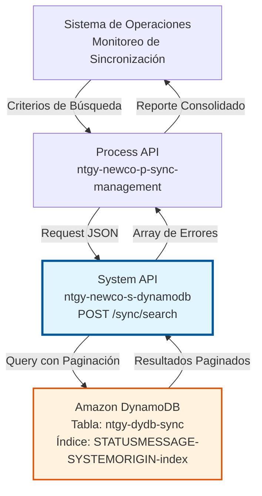
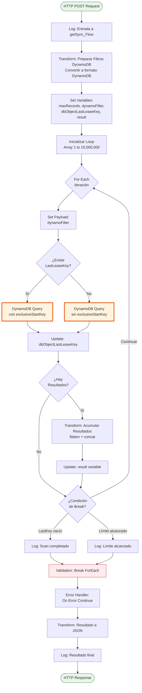
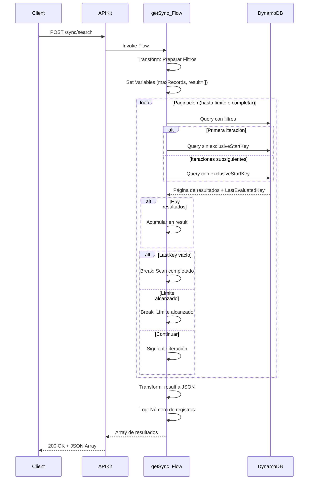

# POST /sync/search

## 📌 Descripción General

### Propósito del Endpoint

Este endpoint permite buscar y recuperar errores de sincronización almacenados en la tabla `ntgy-dydb-sync` de DynamoDB. Proporciona capacidades avanzadas de filtrado y paginación automática para gestionar grandes volúmenes de registros de errores.

El endpoint soporta:
- **Búsqueda Filtrada**: Por estado del mensaje, sistema origen y sistema destino
- **Paginación Automática**: Manejo inteligente de grandes volúmenes con límite configurable
- **Acumulación de Resultados**: Consolidación de múltiples páginas en una sola respuesta
- **Índice Secundario**: Uso de `STATUSMESSAGE-SYSTEMORIGIN-index` para queries optimizadas

### Tipo de API

**Capa:** System API (API-Led Connectivity)

**Función:** Integración directa con Amazon DynamoDB para consulta de errores de sincronización entre sistemas Imperial y Newco.

### Patrón de Integración

**Tipo:** Request-Reply Síncrono con DynamoDB Query

**Descripción:** Recibe criterios de búsqueda, ejecuta queries paginadas a DynamoDB usando índice secundario, acumula resultados hasta alcanzar el límite configurado o completar la búsqueda, y retorna el conjunto completo de registros encontrados.

### Arquitectura API-Led Connectivity



---

## 💼 Propósito del Negocio

### Casos de Uso Principales

1. **Monitoreo de Errores de Sincronización**
   - Operadores consultan errores pendientes de resolución
   - Filtrado por estado (ERROR, PENDING, RESOLVED)
   - Identificación de patrones de fallo
   - **Beneficio:** Visibilidad completa del estado de sincronización

2. **Troubleshooting de Integraciones**
   - Búsqueda de errores específicos entre sistemas
   - Análisis de errores por sistema origen/destino
   - Identificación de problemas recurrentes
   - **Beneficio:** Resolución rápida de problemas de integración

3. **Auditoría de Sincronización**
   - Revisión histórica de errores
   - Generación de reportes de calidad
   - Análisis de tendencias de errores
   - **Beneficio:** Mejora continua de procesos de sincronización

### Contexto Empresarial

- **Dominio:** Gestión de Sincronización de Datos
- **Sector:** Energía - Utilities
- **División:** Naturgy España - NewCo
- **Proceso de Negocio:** Control de calidad de sincronización entre sistemas Imperial y Newco
- **Sistemas Involucrados:** Imperial (legacy), Newco (nuevo sistema), Salesforce

### Stakeholders

- **Equipos de Operaciones**: Monitoreo diario de errores de sincronización
- **Ingenieros de Integración**: Troubleshooting y resolución de problemas
- **Arquitectos de Datos**: Análisis de calidad de datos y patrones de error
- **Equipos de Soporte**: Resolución de incidencias relacionadas con sincronización

### Valor de Negocio

- **Visibilidad Total**: Control completo sobre errores de sincronización
- **Resolución Rápida**: Identificación y corrección ágil de problemas
- **Calidad de Datos**: Garantía de integridad entre sistemas
- **Auditoría Completa**: Trazabilidad de todos los errores de sincronización

### Consumidores Potenciales

Este endpoint puede ser consumido por:
- Process APIs de gestión de sincronización
- Dashboards de monitoreo y operaciones
- Sistemas de alertas automáticas
- Herramientas de reporting y análisis
- Flujos de corrección automática de errores

---

## 🔧 Especificación Técnica

### URLs por Ambiente

| Ambiente | URL Base | URL Completa |
|----------|----------|--------------|
| **Local** | `http://localhost:8081` | `http://localhost:8081/api/sync/search` |
| **Development** | `https://ntgy-newco-s-dynamodb-dev.us-e2.cloudhub.io` | `https://ntgy-newco-s-dynamodb-dev.us-e2.cloudhub.io/api/sync/search` |
| **UAT** | `https://ntgy-newco-s-dynamodb-uat.us-e2.cloudhub.io` | `https://ntgy-newco-s-dynamodb-uat.us-e2.cloudhub.io/api/sync/search` |
| **Production** | `https://ntgy-newco-s-dynamodb-pro.us-e2.cloudhub.io` | `https://ntgy-newco-s-dynamodb-pro.us-e2.cloudhub.io/api/sync/search` |

### Método HTTP

```
POST /api/sync/search
```

### Parámetros de Entrada

#### Headers HTTP

| Header | Tipo | Requerido | Descripción | Ejemplo |
|--------|------|-----------|-------------|---------|
| `Content-Type` | string | ✅ Sí | Tipo de contenido del request | `application/json` |
| `Accept` | string | ❌ No | Tipo de contenido esperado en response | `application/json` |

#### Body Parameters

| Campo | Tipo | Requerido | Descripción | Ejemplo |
|-------|------|-----------|-------------|---------|
| `STATUSMESSAGE` | string | ✅ Sí | Estado del mensaje de sincronización | `"ERROR"` |
| `SYSTEMORIGIN` | string | ✅ Sí | Sistema origen del error | `"IMPERIAL"` |
| `SYSTEMTARGET` | string | ✅ Sí | Sistema destino del error | `"NEWCO"` |

**Estructura del Request:**

```json
{
  "STATUSMESSAGE": "ERROR",
  "SYSTEMORIGIN": "IMPERIAL",
  "SYSTEMTARGET": "NEWCO"
}
```

### Respuestas

#### Respuesta Exitosa (200 OK)

**⚠️ IMPORTANTE:** La respuesta retorna un array de objetos tal como están almacenados en DynamoDB. La estructura exacta depende del schema de la tabla `ntgy-dydb-sync`. El endpoint NO aplica transformaciones adicionales, simplemente retorna `payload.items` acumulado de las queries paginadas.

**Estructura Genérica (basada en formato DynamoDB):**

```json
[
  {
    "campo1": {
      "S": "valor_string"
    },
    "campo2": {
      "N": "123"
    },
    "STATUSMESSAGE": {
      "S": "ERROR"
    },
    "SYSTEMORIGIN": {
      "S": "IMPERIAL"
    },
    "SYSTEMTARGET": {
      "S": "NEWCO"
    }
  }
]
```

**Nota:** Los valores en DynamoDB incluyen el tipo de dato:
- `S`: String
- `N`: Number
- `BOOL`: Boolean
- `M`: Map (objeto anidado)
- `L`: List (array)
- `NULL`: Null

**Para obtener la estructura exacta de los campos, consultar:**
1. El schema de la tabla `ntgy-dydb-sync` en AWS Console
2. Ejemplos reales de registros en la tabla
3. La documentación del proceso de sincronización que inserta estos registros

#### Respuesta Sin Resultados (200 OK)

```json
[]
```

#### Respuesta de Error Técnico (500)

```json
{
  "result": {
    "codResult": "5001",
    "msgResult": "Error de conectividad con DynamoDB"
  }
}
```

### Autenticación y Autorización

- **Tipo:** Client ID & Client Secret (Anypoint Platform)
- **Autorización DynamoDB:** El usuario debe tener permisos IAM para:
  - Ejecutar operación `Query` en tabla `ntgy-dydb-sync`
  - Acceso al índice secundario `STATUSMESSAGE-SYSTEMORIGIN-index`
  - Lectura de atributos de la tabla

### Timeouts

| Tipo | Valor | Descripción |
|------|-------|-------------|
| **Request Timeout** | 60 segundos | Tiempo máximo para completar búsqueda paginada |
| **Connection Timeout** | 10 segundos | Tiempo máximo para establecer conexión con DynamoDB |
| **Query Timeout** | 30 segundos | Tiempo máximo por query individual |

### Límites y Paginación

- **Límite de Registros:** Configurable mediante propiedad `scanProcess.maxRecords`
- **Paginación Automática:** El endpoint maneja automáticamente la paginación de DynamoDB
- **Acumulación:** Los resultados de múltiples páginas se consolidan en una sola respuesta
- **Break Condition:** La búsqueda se detiene al alcanzar el límite o completar el scan

---

## 🏗️ Implementación Técnica

### Arquitectura del Flow



### Componentes del Flow

#### 1. Preparación de Filtros (DataWeave)

**Ubicación:** Líneas 4-12 del XML

**Transformación:**
```dataweave
%dw 2.0
output application/java
---
{
  ":STATUSMESSAGE": {"S": payload.STATUSMESSAGE},
  ":SYSTEMORIGIN": {"S": payload.SYSTEMORIGIN},
  ":SYSTEMTARGET": {"S": payload.SYSTEMTARGET}
}
```

**Propósito:** Convierte el payload JSON a formato de atributos DynamoDB con tipado explícito (S = String).

#### 2. Inicialización de Variables

**Variables creadas:**
- `maxRecords`: Límite de registros desde configuración `p('scanProcess.maxRecords')`
- `dynamoFilter`: Filtros preparados para DynamoDB
- `dbObjectLastLeaseKey`: Control de paginación (inicialmente null)
- `result`: Array acumulador de resultados (inicialmente vacío)
- `loopArray`: Array de 1 a 10,000,000 para control de iteraciones

#### 3. DynamoDB Query con Índice Secundario

**Configuración:**
- **Tabla:** `ntgy-dydb-sync`
- **Índice:** `STATUSMESSAGE-SYSTEMORIGIN-index`
- **KeyConditionExpression:** `STATUSMESSAGE = :STATUSMESSAGE and SYSTEMORIGIN = :SYSTEMORIGIN`
- **FilterExpression:** `SYSTEMTARGET = :SYSTEMTARGET`

**Dos variantes según paginación:**

**Sin LastLeaseKey (primera iteración):**
```xml
<dynamodb:query 
    doc:name="Query" 
    config-ref="Amazon_DynamoDB_Configuration" 
    tableName="ntgy-dydb-sync" 
    filterExpression="SYSTEMTARGET = :SYSTEMTARGET" 
    indexName="STATUSMESSAGE-SYSTEMORIGIN-index" 
    keyConditionExpression="STATUSMESSAGE = :STATUSMESSAGE and SYSTEMORIGIN = :SYSTEMORIGIN" 
    attributeValues="#[payload]"/>
```

**Con LastLeaseKey (iteraciones subsiguientes):**
```xml
<dynamodb:query 
    doc:name="Query - LastLeaseKey" 
    config-ref="Amazon_DynamoDB_Configuration" 
    tableName="ntgy-dydb-sync" 
    filterExpression="SYSTEMTARGET = :SYSTEMTARGET" 
    indexName="STATUSMESSAGE-SYSTEMORIGIN-index" 
    keyConditionExpression="STATUSMESSAGE = :STATUSMESSAGE and SYSTEMORIGIN = :SYSTEMORIGIN" 
    attributeValues="#[payload]" 
    exclusiveStartKey="#[vars.dbObjectLastLeaseKey]"/>
```

#### 4. Acumulación de Resultados (DataWeave)

**Ubicación:** Líneas 42-47 del XML

**Transformación:**
```dataweave
%dw 2.0
output application/java
---
flatten(vars.result ++ payload.items)
```

**Propósito:** Concatena los resultados de la página actual con los resultados acumulados previamente, usando `flatten` para mantener un array plano.

#### 5. Condiciones de Break

**Condición 1: Scan Completado**
```xml
<when expression="#[isEmpty(vars.dbObjectLastLeaseKey)]">
    <logger level="DEBUG" message="Scan completed, number of records found: ..." />
    <validation:is-true expression="#[vars.breakForEach contains /^(XXX)$/]" 
                        message="Scan Proccess: break of for each"/>
</when>
```

**Condición 2: Límite Alcanzado**
```xml
<when expression="#[sizeOf(vars.result) &gt; vars.maxRecords]">
    <logger level="DEBUG" message="Scan not completed, the max records retrieved are: ..." />
    <validation:is-true expression="#[vars.breakForEach contains /^(XXX)$/]" 
                        message="Scan not completed, the max records retrieved are: ..."/>
</when>
```

**Mecanismo:** Usa validación que siempre falla para forzar el break del ForEach mediante el error handler.

#### 6. Transformación de Salida (DataWeave)

**Ubicación:** Líneas 77-81 del XML

**Transformación:**
```dataweave
%dw 2.0
output application/json
---
vars.result
```

**Propósito:** Convierte el array acumulado de resultados a formato JSON para la respuesta HTTP.

### Diagrama de Secuencia



### Configuración de DynamoDB

**Connector Configuration:**
```xml
<dynamodb:config name="Amazon_DynamoDB_Configuration">
    <dynamodb:basic-connection 
        accessKey="${secure::aws.accessKey}"
        secretKey="${secure::aws.secretKey}"
        region="${aws.region}"/>
</dynamodb:config>
```

**Tabla:** `ntgy-dydb-sync`

**Índice Secundario Global:** `STATUSMESSAGE-SYSTEMORIGIN-index`
- **Partition Key:** STATUSMESSAGE
- **Sort Key:** SYSTEMORIGIN
- **Projected Attributes:** ALL

**Propósito del Índice:** Permite queries eficientes por estado y sistema origen, con filtrado adicional por sistema destino.

### Manejo de Errores

**Error Handler Global:**
```xml
<error-handler>
    <on-error-continue enableNotifications="true" logException="true" type="ANY">
        <flow-ref name="errorManagerExpSysFlow" />
    </on-error-continue>
</error-handler>
```

**Errores Manejados:**
- **DYNAMODB:CONNECTIVITY**: Error de conexión con DynamoDB
- **DYNAMODB:THROTTLING**: Límite de capacidad excedido
- **VALIDATION:***: Usado para break del ForEach (intencional)
- **ANY**: Errores inesperados

### Propiedades de Configuración

**Archivo:** `config-${mule.env}.yaml`

```yaml
scanProcess:
  maxRecords: 1000  # Límite de registros por búsqueda

aws:
  accessKey: "![encrypted]"
  secretKey: "![encrypted]"
  region: "eu-west-1"
```

---

## 💻 Ejemplos de Uso

### Ejemplo 1: Búsqueda de Errores Pendientes

**Request:**
```bash
curl -X POST "https://ntgy-newco-s-dynamodb-dev.us-e2.cloudhub.io/api/sync/search" \
  -H "Content-Type: application/json" \
  -H "client_id: your-client-id" \
  -H "client_secret: your-client-secret" \
  -d '{
    "STATUSMESSAGE": "ERROR",
    "SYSTEMORIGIN": "IMPERIAL",
    "SYSTEMTARGET": "NEWCO"
  }'
```

**Response (200 OK):**

**⚠️ NOTA:** Este es un ejemplo genérico. La estructura real depende del schema de la tabla `ntgy-dydb-sync`.

```json
[
  {
    "leaseKey": {
      "S": "sync-error-001"
    },
    "STATUSMESSAGE": {
      "S": "ERROR"
    },
    "SYSTEMORIGIN": {
      "S": "IMPERIAL"
    },
    "SYSTEMTARGET": {
      "S": "NEWCO"
    },
    "timestamp": {
      "N": "1704708600000"
    }
  },
  {
    "leaseKey": {
      "S": "sync-error-002"
    },
    "STATUSMESSAGE": {
      "S": "ERROR"
    },
    "SYSTEMORIGIN": {
      "S": "IMPERIAL"
    },
    "SYSTEMTARGET": {
      "S": "NEWCO"
    },
    "timestamp": {
      "N": "1704711300000"
    }
  }
]
```

### Ejemplo 2: Búsqueda de Errores Salesforce

**Request:**
```bash
curl -X POST "https://ntgy-newco-s-dynamodb-pro.us-e2.cloudhub.io/api/sync/search" \
  -H "Content-Type: application/json" \
  -H "client_id: your-client-id" \
  -H "client_secret: your-client-secret" \
  -d '{
    "STATUSMESSAGE": "PENDING",
    "SYSTEMORIGIN": "NEWCO",
    "SYSTEMTARGET": "SALESFORCE"
  }'
```

**Response (200 OK):**

**⚠️ NOTA:** Ejemplo genérico en formato DynamoDB.

```json
[
  {
    "leaseKey": {
      "S": "sync-pending-sf-001"
    },
    "STATUSMESSAGE": {
      "S": "PENDING"
    },
    "SYSTEMORIGIN": {
      "S": "NEWCO"
    },
    "SYSTEMTARGET": {
      "S": "SALESFORCE"
    },
    "timestamp": {
      "N": "1704715200000"
    }
  }
]
```

### Ejemplo 3: Sin Resultados

**Request:**
```bash
curl -X POST "https://ntgy-newco-s-dynamodb-dev.us-e2.cloudhub.io/api/sync/search" \
  -H "Content-Type: application/json" \
  -H "client_id: your-client-id" \
  -H "client_secret: your-client-secret" \
  -d '{
    "STATUSMESSAGE": "RESOLVED",
    "SYSTEMORIGIN": "IMPERIAL",
    "SYSTEMTARGET": "NEWCO"
  }'
```

**Response (200 OK):**
```json
[]
```

### Ejemplo 4: Error de Conectividad

**Request:**
```bash
curl -X POST "https://ntgy-newco-s-dynamodb-dev.us-e2.cloudhub.io/api/sync/search" \
  -H "Content-Type: application/json" \
  -H "client_id: your-client-id" \
  -H "client_secret: your-client-secret" \
  -d '{
    "STATUSMESSAGE": "ERROR",
    "SYSTEMORIGIN": "IMPERIAL",
    "SYSTEMTARGET": "NEWCO"
  }'
```

**Response (500 Internal Server Error):**
```json
{
  "result": {
    "codResult": "5001",
    "msgResult": "Error de conectividad con DynamoDB: Unable to execute HTTP request"
  }
}
```

### Ejemplo 5: JavaScript/Node.js

```javascript
const axios = require('axios');

async function searchSyncErrors() {
  try {
    const response = await axios.post(
      'https://ntgy-newco-s-dynamodb-pro.us-e2.cloudhub.io/api/sync/search',
      {
        STATUSMESSAGE: 'ERROR',
        SYSTEMORIGIN: 'IMPERIAL',
        SYSTEMTARGET: 'NEWCO'
      },
      {
        headers: {
          'Content-Type': 'application/json',
          'client_id': 'your-client-id',
          'client_secret': 'your-client-secret'
        }
      }
    );
    
    console.log(`Found ${response.data.length} sync errors`);
    
    // NOTA: Los datos vienen en formato DynamoDB con tipos
    response.data.forEach(item => {
      const leaseKey = item.leaseKey?.S || 'N/A';
      const status = item.STATUSMESSAGE?.S || 'N/A';
      console.log(`- ${leaseKey}: ${status}`);
    });
    
    return response.data;
  } catch (error) {
    console.error('Error searching sync errors:', error.message);
    throw error;
  }
}

searchSyncErrors();
```

### Ejemplo 6: Python

```python
import requests
import json

def search_sync_errors(status, origin, target):
    url = "https://ntgy-newco-s-dynamodb-pro.us-e2.cloudhub.io/api/sync/search"
    
    headers = {
        "Content-Type": "application/json",
        "client_id": "your-client-id",
        "client_secret": "your-client-secret"
    }
    
    payload = {
        "STATUSMESSAGE": status,
        "SYSTEMORIGIN": origin,
        "SYSTEMTARGET": target
    }
    
    try:
        response = requests.post(url, headers=headers, json=payload)
        response.raise_for_status()
        
        items = response.json()
        print(f"Found {len(items)} sync errors")
        
        # NOTA: Los datos vienen en formato DynamoDB con tipos
        for item in items:
            lease_key = item.get('leaseKey', {}).get('S', 'N/A')
            status_msg = item.get('STATUSMESSAGE', {}).get('S', 'N/A')
            print(f"- {lease_key}: {status_msg}")
        
        return items
        
    except requests.exceptions.RequestException as e:
        print(f"Error searching sync errors: {e}")
        raise

# Uso
errors = search_sync_errors("ERROR", "IMPERIAL", "NEWCO")
```

---

**Última Actualización:** 2026-01-08  
**Versión del API:** 2.0.0  
**Mantenido por:** Equipo Naturgy - Integración Newco