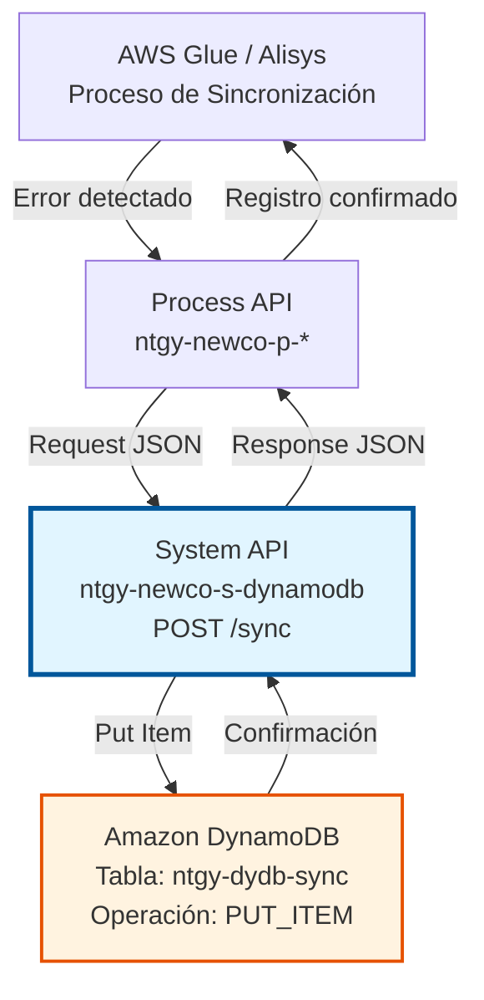
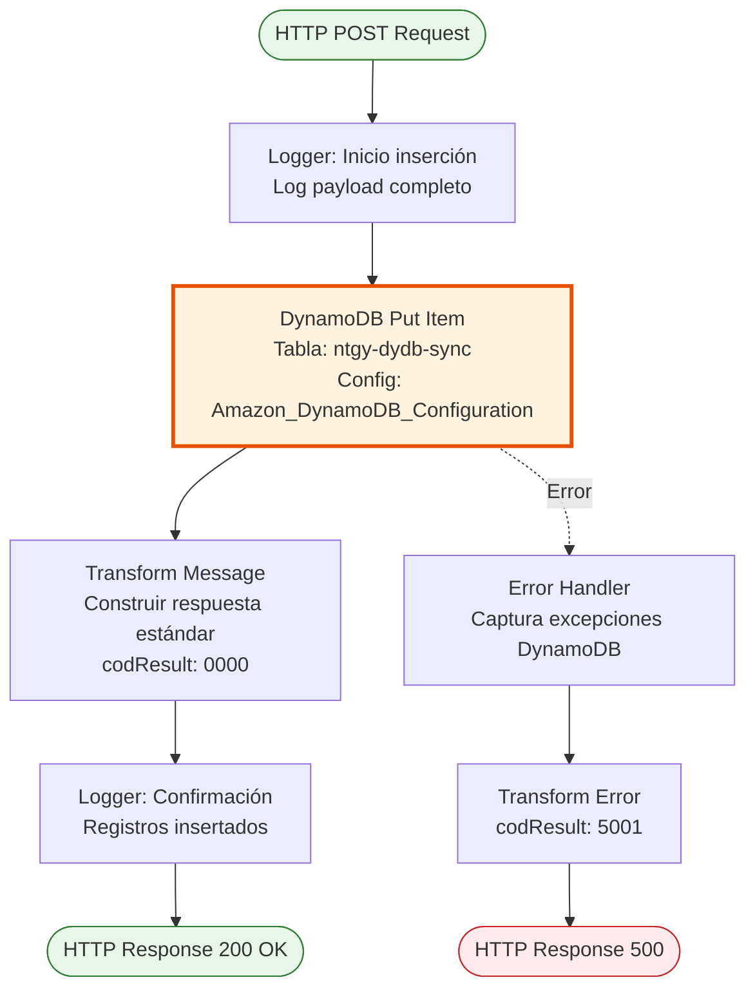

# POST /sync

## 📌 Descripción General

### Propósito del Endpoint

Este endpoint inserta registros de errores de sincronización en la tabla `ntgy-dydb-sync` de Amazon DynamoDB, proporcionando un mecanismo centralizado para el control y trazabilidad de procesos de integración entre sistemas. Permite registrar errores que ocurren durante la sincronización de datos entre Imperial, Newco y Salesforce.

El endpoint soporta:
- **Registro de errores**: Inserción de errores de sincronización con información detallada
- **Trazabilidad**: Almacenamiento persistente para auditoría y análisis
- **Control de sincronización**: Base para procesos de corrección y retry
- **Respuesta estándar**: Confirmación inmediata de la operación

### Tipo de API

**Capa:** System API (API-Led Connectivity)

**Función:** Integración directa con Amazon DynamoDB para operaciones de escritura de datos de control de sincronización.

### Patrón de Integración

**Tipo:** Request-Reply Síncrono con DynamoDB Put Item

**Descripción:** El endpoint recibe un payload con información del error de sincronización, lo inserta directamente en DynamoDB mediante la operación `put-item`, y retorna una respuesta estándar de confirmación. No aplica transformaciones complejas, actuando como un registro directo de eventos de error.

### Arquitectura API-Led Connectivity



---

## 💼 Propósito del Negocio

### Casos de Uso Principales

1. **Inserción de Datos de Sincronización**
   - Procesos de integración insertan registros en la tabla de control
   - Permite trazabilidad de operaciones de sincronización
   - Facilita auditoría y análisis de procesos

2. **Registro de Eventos del Sistema**
   - Sistemas externos registran eventos relevantes
   - Mantiene histórico de operaciones
   - Soporta análisis y troubleshooting

3. **Control de Procesos de Integración**
   - Almacenamiento de información de control
   - Seguimiento de estado de sincronizaciones
   - Base para procesos de corrección y retry

### Contexto Empresarial

- **Dominio:** Gestión de Sincronización e Integración
- **Sector:** Energía - Utilities
- **División:** Naturgy España - NewCo
- **Proceso de Negocio:** Control de calidad de datos y sincronización entre sistemas legacy (Imperial) y nuevos (Newco)
- **Criticidad:** Alta - Garantiza integridad de datos entre sistemas

### Stakeholders

- **Equipos de Integración**: Necesitan visibilidad de errores de sincronización para corrección proactiva
- **Equipos de Operaciones**: Requieren trazabilidad para troubleshooting y análisis de incidencias
- **Arquitectos de Datos**: Utilizan información para optimizar procesos de sincronización
- **Equipos de Calidad**: Monitorean tasas de error para garantizar calidad de datos

### Valor de Negocio

- **Trazabilidad Completa**: Registro detallado de todos los errores de sincronización
- **Resolución Proactiva**: Detección temprana de problemas de integración
- **Análisis de Patrones**: Identificación de errores recurrentes para mejora continua
- **Auditoría**: Cumplimiento de requisitos de auditoría y control interno

### Consumidores Potenciales

Este endpoint puede ser consumido por:
- Process APIs de sincronización (ntgy-newco-p-*)
- Procesos ETL de AWS Glue
- Sistema Alisys
- Flujos de Salesforce (Platform Events, Flows)
- Sistemas de integración middleware
- Procesos batch de sincronización

---

## 🔧 Especificación Técnica

### URLs por Ambiente

| Ambiente | URL Base | URL Completa |
|----------|----------|--------------|
| **Local** | `http://localhost:8081` | `http://localhost:8081/api/sync` |
| **Development** | `https://ntgy-newco-s-dynamodb-dev.us-e2.cloudhub.io` | `https://ntgy-newco-s-dynamodb-dev.us-e2.cloudhub.io/api/sync` |
| **UAT** | `https://ntgy-newco-s-dynamodb-uat.us-e2.cloudhub.io` | `https://ntgy-newco-s-dynamodb-uat.us-e2.cloudhub.io/api/sync` |
| **Production** | `https://ntgy-newco-s-dynamodb-pro.us-e2.cloudhub.io` | `https://ntgy-newco-s-dynamodb-pro.us-e2.cloudhub.io/api/sync` |

### Método HTTP

```
POST /api/sync
```

### Parámetros de Entrada

#### Headers HTTP

| Header | Tipo | Requerido | Descripción | Ejemplo |
|--------|------|-----------|-------------|---------|
| `Content-Type` | string | ✅ Sí | Tipo de contenido del request | `application/json` |
| `Accept` | string | ❌ No | Tipo de contenido esperado en response | `application/json` |
| `client_id` | string | ✅ Sí | Client ID de Anypoint Platform | `a1b2c3d4e5f6` |
| `client_secret` | string | ✅ Sí | Client Secret de Anypoint Platform | `A1B2C3D4E5F6` |

#### Body Parameters

El body debe contener un objeto JSON con la información a insertar en la tabla DynamoDB `ntgy-dydb-sync`. 

**Nota:** El endpoint acepta cualquier estructura JSON válida que será insertada directamente en DynamoDB mediante la operación `put-item`. La estructura específica del payload depende de los requisitos del sistema consumidor y del esquema de la tabla DynamoDB.

**Consultar el RAML del proyecto** (`src/main/api/s-dynamodb.raml`) para ver la estructura oficial definida para este endpoint.

### Respuestas

#### Respuesta Exitosa (200 OK)

```json
{
  "result": {
    "codResult": "0000",
    "msgResult": "No hay error"
  }
}
```

**Descripción de campos:**
- `codResult`: Código de resultado (`0000` = éxito)
- `msgResult`: Mensaje descriptivo del resultado

#### Respuesta de Error Técnico (500 Internal Server Error)

```json
{
  "result": {
    "codResult": "5001",
    "msgResult": "Error al insertar en DynamoDB: [detalle del error]"
  }
}
```

**Códigos de error comunes:**
- `5001`: Error de conectividad con DynamoDB
- `5002`: Error de validación de datos
- `5003`: Error de timeout

### Autenticación y Autorización

- **Tipo:** Client ID & Client Secret (Anypoint Platform)
- **Autorización DynamoDB:** El usuario de servicio debe tener permisos IAM para:
  - Operación `dynamodb:PutItem` en tabla `ntgy-dydb-sync`
  - Acceso a la región configurada (us-east-1)

### Timeouts

| Tipo | Valor | Descripción |
|------|-------|-------------|
| **Request Timeout** | 30 segundos | Tiempo máximo de espera para la respuesta |
| **Connection Timeout** | 10 segundos | Tiempo máximo para establecer conexión con DynamoDB |
| **DynamoDB Operation** | 20 segundos | Timeout específico de la operación put-item |

---

## 🏗️ Implementación Técnica

### Arquitectura del Flow



### Componentes del Flow

#### 1. Logger Inicial (Línea 7)
```xml
<logger level="INFO" doc:name="Logger" 
        message="Inicio insercion en tabla ntgy-dydb-sync: #[message.payload]" />
```

**Propósito:** Registrar el inicio de la operación con el payload completo para trazabilidad.

**Información Logueada:**
- Payload completo del request
- Timestamp de inicio
- Contexto de la operación

#### 2. DynamoDB Put Item (Línea 8)
```xml
<dynamodb:put-item tableName="ntgy-dydb-sync" 
                   doc:name="Put item" 
                   config-ref="Amazon_DynamoDB_Configuration" />
```

**Propósito:** Insertar el registro de error en la tabla DynamoDB.

**Configuración:**
- **Tabla:** `ntgy-dydb-sync`
- **Operación:** PUT_ITEM (inserción/actualización)
- **Config:** `Amazon_DynamoDB_Configuration`
- **Región:** us-east-1 (configurada en global config)

**Comportamiento:**
- Si el item existe (mismo partition key), lo sobrescribe
- Si no existe, lo crea
- Operación atómica y consistente

#### 3. Transform Message (Líneas 9-18)
```dataweave
%dw 2.0
output application/json
---
"result": {
    "codResult": "0000",
    "msgResult": "No hay error"
}
```

**Propósito:** Construir respuesta estándar de éxito.

**Transformación:**
- Genera estructura de respuesta consistente
- Código `0000` indica operación exitosa
- Mensaje descriptivo para el consumidor

#### 4. Logger Final (Línea 19)
```xml
<logger level="INFO" doc:name="Logger" 
        message="Se han insertado registros en la tabla ntgy-dydb-sync" />
```

**Propósito:** Confirmar la finalización exitosa de la operación.

### Configuración DynamoDB

**Archivo:** `global.xml`

```xml
<dynamodb:config name="Amazon_DynamoDB_Configuration">
    <dynamodb:basic-connection 
        accessKey="${secure::aws.accessKey}"
        secretKey="${secure::aws.secretKey}"
        region="${aws.region}"/>
</dynamodb:config>
```

**Propiedades (`config-${mule.env}.yaml`):**
```yaml
aws:
  accessKey: "![encrypted]"
  secretKey: "![encrypted]"
  region: "us-east-1"
```

### Tabla DynamoDB: ntgy-dydb-sync

**Características:**
- **Tipo:** NoSQL (DynamoDB)
- **Región:** us-east-1
- **Partition Key:** `id` (típicamente)
- **Propósito:** Almacenar errores de sincronización para control y trazabilidad

**Estructura Típica de Item:**
```json
{
  "id": "error-123456",
  "timestamp": "2026-01-08T12:00:00Z",
  "source": "AWS_GLUE",
  "errorType": "SYNC_FAILED",
  "errorMessage": "Failed to sync customer data",
  "retryCount": 0,
  "status": "PENDING",
  "data": {
    "customerId": "12345",
    "operation": "UPDATE"
  }
}
```

### Diagrama de Secuencia Completo

```mermaid
sequenceDiagram
    participant Client as Cliente/Process API
    participant API as System API<br/>POST /sync
    participant Logger as Logger
    participant DDB as DynamoDB<br/>ntgy-dydb-sync
    
    Client->>API: POST /api/sync<br/>{error data}
    activate API
    
    API->>Logger: Log inicio + payload
    Logger-->>API: Logged
    
    API->>DDB: put-item<br/>tableName: ntgy-dydb-sync
    activate DDB
    
    alt Inserción exitosa
        DDB-->>API: Item insertado
        deactivate DDB
        
        API->>API: Transform Message<br/>codResult: 0000
        
        API->>Logger: Log confirmación
        Logger-->>API: Logged
        
        API->>Client: 200 OK<br/>{codResult: "0000"}
    else Error DynamoDB
        DDB-->>API: Error (throttling/timeout)
        deactivate DDB
        
        API->>API: Error Handler<br/>codResult: 5001
        
        API->>Client: 500 Error<br/>{codResult: "5001"}
    end
    
    deactivate API
```

### Manejo de Errores

**Estrategia:** Try-Catch con transformación de errores a formato estándar

**Errores Manejados:**

1. **DYNAMODB:CONNECTIVITY**
   - Causa: Problemas de red o credenciales inválidas
   - Respuesta: `codResult: 5001`
   - Acción: Retry automático (3 intentos)

2. **DYNAMODB:THROTTLING**
   - Causa: Límite de capacidad de escritura excedido
   - Respuesta: `codResult: 5003`
   - Acción: Exponential backoff

3. **TIMEOUT**
   - Causa: Operación excede 20 segundos
   - Respuesta: `codResult: 5002`
   - Acción: Retry con timeout incrementado

### Logging Estructurado

**Herramienta:** ntgy-cli-logger-extension v1.0.0

**Información Capturada:**
- Timestamp de inicio y fin
- Payload completo (entrada)
- Resultado de operación DynamoDB
- Errores y excepciones
- Correlation ID para trazabilidad

**Formato:**
```json
{
  "timestamp": "2026-01-08T12:00:00.000Z",
  "level": "INFO",
  "message": "Inicio insercion en tabla ntgy-dydb-sync",
  "correlationId": "abc-123-def",
  "payload": { ... }
}
```

---

## 💻 Ejemplos de Uso

### Ejemplo 1: Inserción de Registro en DynamoDB

#### Request

```bash
curl -X POST "https://ntgy-newco-s-dynamodb-dev.us-e2.cloudhub.io/api/sync" \
  -H "Content-Type: application/json" \
  -H "client_id: a1b2c3d4e5f6" \
  -H "client_secret: A1B2C3D4E5F6" \
  -d '{
    "campo1": "valor1",
    "campo2": "valor2",
    "campo3": {
      "subcampo1": "valor3"
    }
  }'
```

**Nota:** La estructura del payload debe coincidir con el esquema definido en el RAML del proyecto y los requisitos de la tabla DynamoDB `ntgy-dydb-sync`.

#### Response (200 OK)

```json
{
  "result": {
    "codResult": "0000",
    "msgResult": "No hay error"
  }
}
```

### Ejemplo 2: Inserción en Ambiente de Producción

#### Request

```bash
curl -X POST "https://ntgy-newco-s-dynamodb-pro.us-e2.cloudhub.io/api/sync" \
  -H "Content-Type: application/json" \
  -H "client_id: prod-client-id" \
  -H "client_secret: prod-client-secret" \
  -d '{
    "id": "registro-001",
    "data": {
      "informacion": "datos a sincronizar"
    }
  }'
```

#### Response (200 OK)

```json
{
  "result": {
    "codResult": "0000",
    "msgResult": "No hay error"
  }
}
```

### Ejemplo 3: Inserción en Ambiente Local

#### Request

```bash
curl -X POST "http://localhost:8081/api/sync" \
  -H "Content-Type: application/json" \
  -d '{
    "id": "test-001",
    "payload": {
      "datos": "información de prueba"
    }
  }'
```

#### Response (200 OK)

```json
{
  "result": {
    "codResult": "0000",
    "msgResult": "No hay error"
  }
}
```

### Ejemplo 4: Error de Conectividad con DynamoDB

#### Request

```bash
curl -X POST "https://ntgy-newco-s-dynamodb-dev.us-e2.cloudhub.io/api/sync" \
  -H "Content-Type: application/json" \
  -H "client_id: a1b2c3d4e5f6" \
  -H "client_secret: A1B2C3D4E5F6" \
  -d '{
    "id": "test-error-001",
    "timestamp": "2026-01-08T18:00:00Z",
    "source": "TEST",
    "errorType": "TEST_ERROR",
    "errorMessage": "Test error for documentation"
  }'
```

#### Response (500 Internal Server Error)

```json
{
  "result": {
    "codResult": "5001",
    "msgResult": "Error al insertar en DynamoDB: Unable to connect to DynamoDB service"
  }
}
```

### Ejemplo 5: Integración desde Process API

**Invocación desde MuleSoft:**
```xml
<http:request method="POST" 
              config-ref="System_API_Config"
              path="/api/sync">
    <http:body><![CDATA[#[payload]]]></http:body>
</http:request>
```

**Nota:** El payload debe ser preparado según los requisitos específicos de la tabla DynamoDB y el esquema definido en el RAML.

### Ejemplo 6: Consulta Posterior de Errores Registrados

Una vez registrado el error con POST /sync, se puede consultar usando:

```bash
# Buscar errores de sincronización
curl -X POST "https://ntgy-newco-s-dynamodb-dev.us-e2.cloudhub.io/api/sync/search" \
  -H "Content-Type: application/json" \
  -H "client_id: a1b2c3d4e5f6" \
  -H "client_secret: A1B2C3D4E5F6" \
  -d '{
    "source": "AWS_GLUE",
    "status": "PENDING",
    "dateFrom": "2026-01-08T00:00:00Z",
    "dateTo": "2026-01-08T23:59:59Z"
  }'
```
