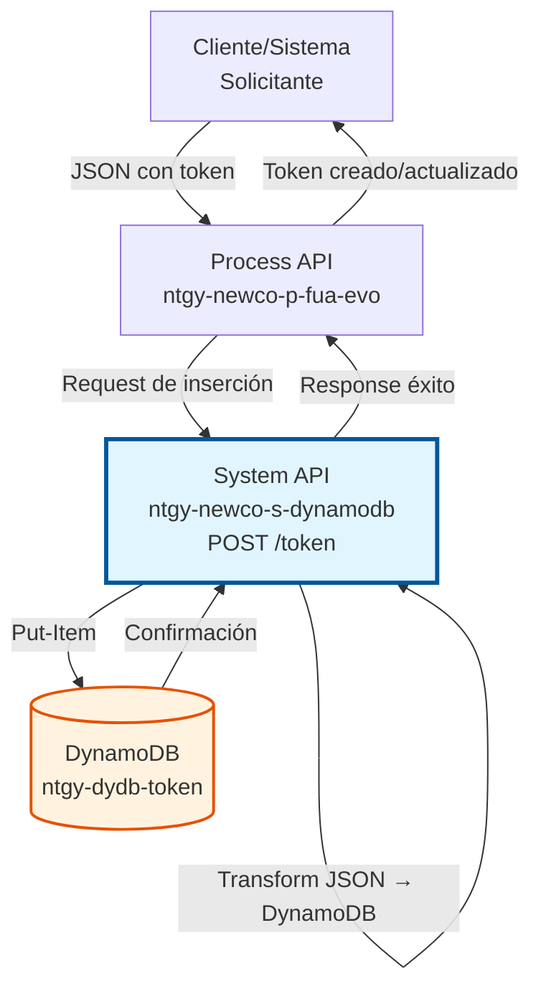
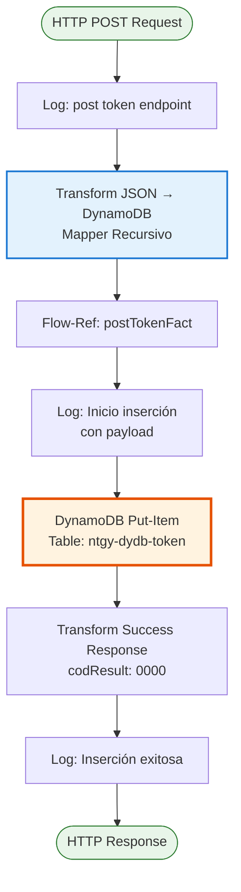
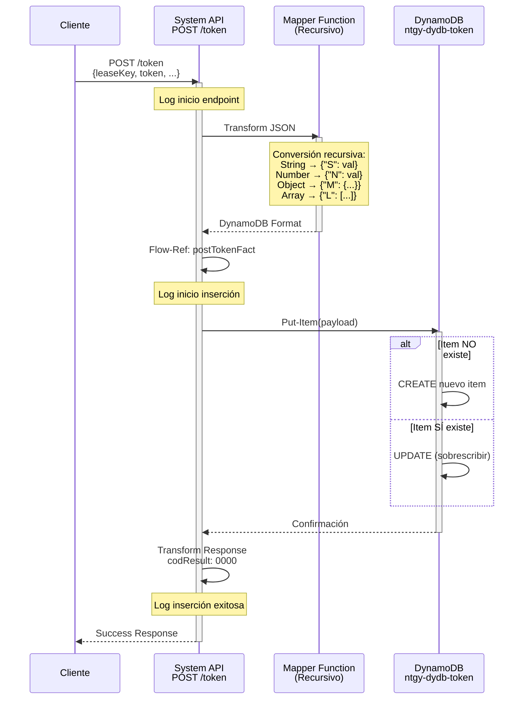
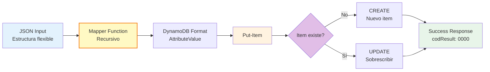

# POST /token

## 📌 Descripción General

### Propósito del Endpoint

Inserta o actualiza un token de facturación en DynamoDB mediante una operación idempotente. Este endpoint permite crear nuevos tokens o sobrescribir tokens existentes, facilitando la gestión del ciclo de vida completo de los tokens de autenticación para operaciones de facturación.

El endpoint soporta:
- **Inserción de Nuevos Tokens**: Crea tokens cuando no existen previamente
- **Actualización de Tokens Existentes**: Sobrescribe tokens cuando ya existen (operación idempotente)
- **Transformación Automática**: Convierte JSON estándar a formato DynamoDB recursivamente
- **Estructuras Complejas**: Soporta objetos anidados, arrays y tipos de datos mixtos

### Tipo de API

**Capa:** System API (API-Led Connectivity)

**Función:** Integración directa con Amazon DynamoDB para gestión de tokens de facturación.

### Patrón de Integración

**Tipo:** Request-Reply Síncrono con DynamoDB Put-Item

**Descripción:** Recibe payload JSON con datos del token, transforma automáticamente a formato DynamoDB AttributeValue usando una función recursiva, ejecuta put-item en la tabla `ntgy-dydb-token`, y retorna confirmación de éxito.

### Arquitectura API-Led Connectivity



---

## 💼 Propósito del Negocio

### Casos de Uso Principales

1. **Creación de Nuevos Tokens de Facturación**
   - Usuario completa proceso de registro o autenticación
   - Sistema genera token único para acceso a facturas
   - Token se almacena en DynamoDB para validaciones futuras

2. **Renovación de Tokens Existentes**
   - Token expira o necesita renovación por seguridad
   - Sistema genera nuevo token y actualiza el existente
   - Operación idempotente garantiza consistencia

3. **Migración de Tokens entre Sistemas**
   - Migración de tokens desde sistema legacy Imperial
   - Sincronización de tokens entre múltiples sistemas
   - Carga masiva de tokens en procesos ETL

### Contexto Empresarial

- **Dominio:** Facturación y Cobros - Gestión de Accesos
- **Sector:** Energía - Utilities
- **División:** Naturgy España - NewCo
- **Proceso de Negocio:** Gestión del ciclo de vida de tokens de autenticación
- **Criticidad:** Alta - Habilita acceso seguro a información de facturación

### Stakeholders

- **Equipos de Desarrollo**: Necesitan API simple para crear/actualizar tokens
- **Equipos de Seguridad**: Requieren gestión centralizada de tokens
- **Equipos de Facturación**: Dependen de tokens válidos para operaciones
- **Equipos de Migración**: Usan endpoint para sincronización de datos

### Valor de Negocio

- **Simplicidad**: API única para crear y actualizar tokens (idempotente)
- **Flexibilidad**: Soporta estructuras de datos complejas y anidadas
- **Automatización**: Transformación automática a formato DynamoDB
- **Escalabilidad**: DynamoDB auto-scaling para alta concurrencia
- **Trazabilidad**: Logging completo de operaciones para auditoría

### Consumidores Potenciales

Este endpoint puede ser consumido por:
- Process APIs de autenticación y facturación
- Servicios de generación de tokens
- Procesos ETL de migración de datos
- Sistemas de sincronización entre Imperial y Newco
- Servicios de renovación automática de tokens

---

## 🔧 Especificación Técnica

### URLs por Ambiente

| Ambiente | URL Base | URL Completa |
|----------|----------|--------------|
| **Local** | `http://localhost:8081` | `http://localhost:8081/api/token` |
| **Development** | `https://ntgy-newco-s-dynamodb-dev.us-e2.cloudhub.io` | `https://ntgy-newco-s-dynamodb-dev.us-e2.cloudhub.io/api/token` |
| **UAT** | `https://ntgy-newco-s-dynamodb-uat.us-e2.cloudhub.io` | `https://ntgy-newco-s-dynamodb-uat.us-e2.cloudhub.io/api/token` |
| **Production** | `https://ntgy-newco-s-dynamodb-pro.us-e2.cloudhub.io` | `https://ntgy-newco-s-dynamodb-pro.us-e2.cloudhub.io/api/token` |

### Método HTTP

```
POST /api/token
```

### Parámetros de Entrada

#### Headers HTTP

| Header | Tipo | Requerido | Descripción | Ejemplo |
|--------|------|-----------|-------------|---------|
| `Content-Type` | string | ✅ Sí | Tipo de contenido del request | `application/json` |
| `Accept` | string | ❌ No | Tipo de contenido esperado en response | `application/json` |

#### Body Parameters

**Estructura Mínima Requerida:**

```json
{
  "leaseKey": "string",
  "token": "string"
}
```

**Estructura Completa (Ejemplo):**

```json
{
  "leaseKey": "LEASE123456",
  "token": "abc123def456ghi789",
  "createdAt": "2026-01-15T10:30:00Z",
  "expiresAt": "2026-02-15T10:30:00Z",
  "metadata": {
    "userId": "USER001",
    "channel": "web",
    "ipAddress": "192.168.1.100"
  },
  "permissions": ["read_invoices", "download_pdf"],
  "active": true
}
```

**Campos del Body:**

| Campo | Tipo | Requerido | Descripción | Ejemplo |
|-------|------|-----------|-------------|---------|
| `leaseKey` | string | ✅ Sí | Identificador único del lease (partition key) | `"LEASE123456"` |
| `token` | string | ✅ Sí | Token de facturación a almacenar | `"abc123def456"` |
| `createdAt` | string | ❌ No | Fecha de creación del token (ISO 8601) | `"2026-01-15T10:30:00Z"` |
| `expiresAt` | string | ❌ No | Fecha de expiración del token | `"2026-02-15T10:30:00Z"` |
| `metadata` | object | ❌ No | Metadatos adicionales del token | `{"userId": "USER001"}` |
| `permissions` | array | ❌ No | Lista de permisos asociados | `["read", "write"]` |
| `active` | boolean | ❌ No | Estado activo/inactivo del token | `true` |

**Nota:** El endpoint acepta cualquier estructura JSON válida. Todos los campos se transforman automáticamente a formato DynamoDB.

### Respuestas

#### Respuesta Exitosa (200 OK)

```json
{
  "result": {
    "codResult": "0000",
    "msgResult": "No hay error"
  }
}
```

**Descripción:** El token fue insertado o actualizado exitosamente en DynamoDB.

**Comportamiento Idempotente:**
- Si el `leaseKey` NO existe → Se crea un nuevo item
- Si el `leaseKey` SÍ existe → Se sobrescribe completamente el item existente

#### Respuesta de Error Técnico (500)

```json
{
  "result": {
    "codResult": "0001",
    "msgResult": "Error interno del servidor"
  }
}
```

**Descripción:** Error técnico en la operación de put-item a DynamoDB.

**Causas posibles:**
- Error de conectividad con DynamoDB
- Throttling de DynamoDB (límite de escrituras excedido)
- Timeout en la operación
- Error en transformación de datos

### Códigos de Respuesta

| Código | Descripción | Escenario |
|--------|-------------|-----------|
| `0000` | Éxito | Token insertado o actualizado correctamente |
| `0001` | Error técnico | Fallo en DynamoDB o procesamiento |

### Autenticación y Autorización

- **Tipo:** Client ID & Client Secret (Anypoint Platform)
- **Autorización DynamoDB:** El usuario de servicio debe tener permisos para:
  - Ejecutar operación `PutItem` en tabla `ntgy-dydb-token`
  - Acceso de escritura (WRITE) a la tabla
  - Permisos IAM configurados en AWS

### Timeouts

| Tipo | Valor | Descripción |
|------|-------|-------------|
| **Request Timeout** | 30 segundos | Tiempo máximo de espera para la respuesta |
| **Connection Timeout** | 10 segundos | Tiempo máximo para establecer conexión con DynamoDB |
| **Put-Item Timeout** | 5 segundos | Tiempo máximo para ejecutar put-item en DynamoDB |

---

## 🏗️ Implementación Técnica

### Arquitectura del Flow



### Diagrama de Secuencia



### Componentes del Flow

#### 1. Flow Principal (ntgy-newco-s-dynamodb.xml)

**Ubicación:** `src/main/mule/ntgy-newco-s-dynamodb.xml` (líneas 469-493)

```xml
<flow name="post:\token:application\json:ntgy-newco-s-dynamodb-config">
    <logger level="INFO" message="post:\token:application\json:ntgy-newco-s-dynamodb-config" />
    
    <ee:transform doc:name="Transform Message">
        <ee:set-payload><![CDATA[%dw 2.0
output application/json
fun mapper(object) = object match {
    case attr is String -> {"S": attr}
    case attr is Number -> {"N": attr}
    case attr is Boolean -> {"Bool": attr}
    case attr is Array -> {"L": (attr map mapper($))}
    case attr is Object -> {"M": attr mapObject ($$): mapper($)}
    case attr is Null -> {"nullvalue": true}
}
---
payload mapObject ($$): mapper($)]]></ee:set-payload>
    </ee:transform>
    
    <flow-ref doc:name="Flow Reference" name="postTokenFact" />
    
    <error-handler>
        <on-error-continue type="ANY">
            <flow-ref name="errorManagerExpSysFlow" />
        </on-error-continue>
    </error-handler>
</flow>
```

**Responsabilidades:**
- Recibir request HTTP POST con JSON
- Transformar JSON a formato DynamoDB usando mapper recursivo
- Invocar subflow de implementación
- Manejar errores globalmente

#### 2. Subflow de Implementación (postTokenFact.xml)

**Ubicación:** `src/main/mule/implementation/postTokenFact.xml` (líneas 8-20)

**Paso 1: Logging de Inicio (línea 9)**
```xml
<logger level="INFO" doc:name="Logger" 
    message="Inicio insercion en tabla ntgy-dydb-token: #[message.payload]" />
```

**Paso 2: Put-Item a DynamoDB (línea 10)**
```xml
<dynamodb:put-item 
    tableName="ntgy-dydb-token" 
    config-ref="Amazon_DynamoDB_Configuration" />
```

**Paso 3: Transformar Respuesta de Éxito (líneas 11-19)**
```xml
<ee:transform doc:name="Transform Message">
    <ee:set-payload><![CDATA[%dw 2.0
output application/json
---
"result": {
    "codResult": "0000",
    "msgResult": "No hay error"
}]]></ee:set-payload>
</ee:transform>
```

**Paso 4: Logging de Fin (línea 20)**
```xml
<logger level="INFO" doc:name="Logger" 
    message="Se han insertado registros en la tabla ntgy-dydb-token" />
```

### Operación de Backend: DynamoDB Put-Item

#### Configuración de Put-Item

```xml
<dynamodb:put-item 
    tableName="ntgy-dydb-token" 
    config-ref="Amazon_DynamoDB_Configuration" />
```

**Parámetros:**
- **tableName**: `ntgy-dydb-token` - Tabla de tokens de facturación
- **payload**: Objeto transformado en formato DynamoDB AttributeValue

**Comportamiento Idempotente:**
- **Si leaseKey NO existe:** Crea nuevo item en la tabla
- **Si leaseKey SÍ existe:** Sobrescribe completamente el item existente
- **No hay validación previa:** La operación siempre tiene éxito (salvo errores técnicos)

#### Estructura de la Tabla DynamoDB

| Campo | Tipo | Descripción | Ejemplo |
|-------|------|-------------|---------|
| `leaseKey` | String (S) | Partition Key - Identificador del lease | `"LEASE123456"` |
| `token` | String (S) | Token de facturación | `"abc123def456"` |
| `*` | Varios | Cualquier campo adicional transformado | Estructura flexible |

**Índices:**
- **Primary Key:** `leaseKey` (Partition Key)
- **No hay Sort Key** en esta tabla
- **Esquema Flexible:** DynamoDB permite cualquier atributo adicional

### Transformaciones DataWeave

#### Transformación 1: Mapper Recursivo (JSON → DynamoDB)

```dataweave
%dw 2.0
output application/json

fun mapper(object) = object match {
    case attr is String -> {"S": attr}
    case attr is Number -> {"N": attr}
    case attr is Boolean -> {"Bool": attr}
    case attr is Array -> {"L": (attr map mapper($))}
    case attr is Object -> {"M": attr mapObject ($$): mapper($)}
    case attr is Null -> {"nullvalue": true}
}
---
payload mapObject ($$): mapper($)
```

**Propósito:** Convertir cualquier estructura JSON a formato DynamoDB AttributeValue recursivamente.

**Reglas de Transformación:**

| Tipo JSON | Formato DynamoDB | Ejemplo Input | Ejemplo Output |
|-----------|------------------|---------------|----------------|
| String | `{"S": "valor"}` | `"abc"` | `{"S": "abc"}` |
| Number | `{"N": valor}` | `123` | `{"N": 123}` |
| Boolean | `{"Bool": valor}` | `true` | `{"Bool": true}` |
| Array | `{"L": [items]}` | `[1, 2, 3]` | `{"L": [{"N": 1}, {"N": 2}, {"N": 3}]}` |
| Object | `{"M": {campos}}` | `{"a": 1}` | `{"M": {"a": {"N": 1}}}` |
| Null | `{"nullvalue": true}` | `null` | `{"nullvalue": true}` |

**Ejemplo de Transformación Completa:**

**Input JSON:**
```json
{
  "leaseKey": "LEASE123",
  "token": "abc123",
  "metadata": {
    "userId": "USER001",
    "count": 5,
    "active": true
  },
  "tags": ["premium", "verified"]
}
```

**Output DynamoDB:**
```json
{
  "leaseKey": {"S": "LEASE123"},
  "token": {"S": "abc123"},
  "metadata": {
    "M": {
      "userId": {"S": "USER001"},
      "count": {"N": 5},
      "active": {"Bool": true}
    }
  },
  "tags": {
    "L": [
      {"S": "premium"},
      {"S": "verified"}
    ]
  }
}
```

#### Transformación 2: Respuesta de Éxito

```dataweave
%dw 2.0
output application/json
---
"result": {
    "codResult": "0000",
    "msgResult": "No hay error"
}
```

**Propósito:** Generar respuesta estándar de éxito.

### Manejo de Errores

#### Errores Técnicos (Manejados en Error Handler)

```xml
<error-handler>
    <on-error-continue type="ANY">
        <flow-ref name="errorManagerExpSysFlow" />
    </on-error-continue>
</error-handler>
```

**Tipos de errores capturados:**
- `DYNAMODB:CONNECTIVITY` - Error de conexión con DynamoDB
- `DYNAMODB:THROTTLING` - Límite de escrituras excedido
- `DYNAMODB:TIMEOUT` - Timeout en put-item
- `DYNAMODB:VALIDATION` - Error de validación de datos
- `ANY` - Cualquier otro error no esperado

### Diagrama de Transformación de Datos



### Configuración de DynamoDB Connector

```xml
<dynamodb:config name="Amazon_DynamoDB_Configuration">
    <dynamodb:basic-connection 
        accessKey="${secure::aws.accessKey}"
        secretKey="${secure::aws.secretKey}"
        region="${aws.region}"/>
</dynamodb:config>
```

**Propiedades de Configuración:**
- **accessKey**: Credencial AWS (encriptada con secure properties)
- **secretKey**: Credencial AWS (encriptada con secure properties)
- **region**: Región AWS (ej: `eu-west-1`)

### Consideraciones de Performance

- **Operación Idempotente:** Put-item siempre tiene éxito (no requiere validación previa)
- **Sin Lectura Previa:** No se consulta si el item existe (más rápido)
- **Response Time Esperado:** < 50ms para put-item
- **Throughput:** Limitado por WCU (Write Capacity Units) de DynamoDB
- **Transformación Recursiva:** Overhead mínimo (< 10ms para estructuras típicas)

---

## 💻 Ejemplos de Uso

### Ejemplo 1: Inserción de Token Simple

#### Request

```bash
curl -X POST "https://ntgy-newco-s-dynamodb-dev.us-e2.cloudhub.io/api/token" \
  -H "Content-Type: application/json" \
  -H "Accept: application/json" \
  -d '{
    "leaseKey": "LEASE123456",
    "token": "abc123def456ghi789"
  }'
```

#### Response (200 OK)

```json
{
  "result": {
    "codResult": "0000",
    "msgResult": "No hay error"
  }
}
```

**Interpretación:** Token creado exitosamente en DynamoDB.

---

### Ejemplo 2: Inserción de Token con Metadatos

#### Request

```bash
curl -X POST "https://ntgy-newco-s-dynamodb-dev.us-e2.cloudhub.io/api/token" \
  -H "Content-Type: application/json" \
  -d '{
    "leaseKey": "LEASE789012",
    "token": "xyz789abc123def456",
    "createdAt": "2026-01-15T10:30:00Z",
    "expiresAt": "2026-02-15T10:30:00Z",
    "metadata": {
      "userId": "USER001",
      "channel": "mobile_app",
      "ipAddress": "192.168.1.100",
      "deviceId": "DEVICE_ABC123"
    },
    "permissions": ["read_invoices", "download_pdf", "view_consumption"],
    "active": true,
    "renewalCount": 0
  }'
```

#### Response (200 OK)

```json
{
  "result": {
    "codResult": "0000",
    "msgResult": "No hay error"
  }
}
```

**Interpretación:** Token con metadatos completos creado exitosamente.

---

### Ejemplo 3: Actualización de Token Existente (Idempotente)

#### Request

```bash
curl -X POST "https://ntgy-newco-s-dynamodb-dev.us-e2.cloudhub.io/api/token" \
  -H "Content-Type: application/json" \
  -d '{
    "leaseKey": "LEASE123456",
    "token": "new_token_xyz789",
    "updatedAt": "2026-01-20T15:45:00Z",
    "renewalCount": 1,
    "active": true
  }'
```

#### Response (200 OK)

```json
{
  "result": {
    "codResult": "0000",
    "msgResult": "No hay error"
  }
}
```

**Interpretación:** Token existente sobrescrito con nuevos valores. La operación es idempotente.

---

### Ejemplo 4: Integración desde JavaScript

```javascript
async function createOrUpdateToken(leaseKey, tokenData) {
  const baseUrl = 'https://ntgy-newco-s-dynamodb-dev.us-e2.cloudhub.io';
  const endpoint = '/api/token';
  
  const payload = {
    leaseKey: leaseKey,
    token: tokenData.token,
    createdAt: new Date().toISOString(),
    expiresAt: tokenData.expiresAt,
    metadata: {
      userId: tokenData.userId,
      channel: tokenData.channel || 'web',
      ipAddress: tokenData.ipAddress
    },
    permissions: tokenData.permissions || ['read_invoices'],
    active: true
  };
  
  try {
    const response = await fetch(baseUrl + endpoint, {
      method: 'POST',
      headers: {
        'Content-Type': 'application/json',
        'Accept': 'application/json'
      },
      body: JSON.stringify(payload)
    });
    
    const data = await response.json();
    
    if (data.result.codResult === '0000') {
      console.log('✅ Token creado/actualizado exitosamente');
      return { success: true, message: 'Token guardado' };
    } else {
      console.log('❌ Error al guardar token');
      return { success: false, message: data.result.msgResult };
    }
  } catch (error) {
    console.error('Error de conexión:', error);
    return { success: false, message: error.message };
  }
}

// Uso
const result = await createOrUpdateToken('LEASE123456', {
  token: 'abc123def456',
  userId: 'USER001',
  channel: 'mobile_app',
  ipAddress: '192.168.1.100',
  expiresAt: '2026-02-15T10:30:00Z',
  permissions: ['read_invoices', 'download_pdf']
});

if (result.success) {
  console.log('Token guardado correctamente');
} else {
  console.error('Error:', result.message);
}
```

---

### Ejemplo 5: Integración desde Python

```python
import requests
from datetime import datetime, timedelta
from typing import Dict, List, Optional

def create_or_update_token(
    lease_key: str,
    token: str,
    user_id: str,
    channel: str = 'web',
    permissions: Optional[List[str]] = None,
    metadata: Optional[Dict] = None
) -> Dict:
    """
    Crea o actualiza un token de facturación en DynamoDB.
    
    Args:
        lease_key: Identificador del lease
        token: Token de facturación
        user_id: ID del usuario
        channel: Canal de origen (web, mobile, etc.)
        permissions: Lista de permisos
        metadata: Metadatos adicionales
        
    Returns:
        Dict con resultado de la operación
    """
    base_url = 'https://ntgy-newco-s-dynamodb-dev.us-e2.cloudhub.io'
    endpoint = '/api/token'
    
    # Calcular fecha de expiración (30 días)
    expires_at = (datetime.now() + timedelta(days=30)).isoformat() + 'Z'
    
    payload = {
        'leaseKey': lease_key,
        'token': token,
        'createdAt': datetime.now().isoformat() + 'Z',
        'expiresAt': expires_at,
        'metadata': metadata or {
            'userId': user_id,
            'channel': channel
        },
        'permissions': permissions or ['read_invoices'],
        'active': True
    }
    
    try:
        response = requests.post(
            f'{base_url}{endpoint}',
            json=payload,
            headers={
                'Content-Type': 'application/json',
                'Accept': 'application/json'
            },
            timeout=10
        )
        
        response.raise_for_status()
        data = response.json()
        
        if data['result']['codResult'] == '0000':
            return {
                'success': True,
                'message': 'Token creado/actualizado exitosamente'
            }
        else:
            return {
                'success': False,
                'message': data['result']['msgResult']
            }
            
    except requests.exceptions.RequestException as e:
        return {
            'success': False,
            'message': f'Error de conexión: {str(e)}'
        }

# Uso
result = create_or_update_token(
    lease_key='LEASE123456',
    token='abc123def456ghi789',
    user_id='USER001',
    channel='mobile_app',
    permissions=['read_invoices', 'download_pdf', 'view_consumption'],
    metadata={
        'userId': 'USER001',
        'channel': 'mobile_app',
        'deviceId': 'DEVICE_ABC123',
        'ipAddress': '192.168.1.100'
    }
)

if result['success']:
    print(f"✅ {result['message']}")
else:
    print(f"❌ Error: {result['message']}")
```

---

### Ejemplo 6: Carga Masiva de Tokens (Batch)

```python
import requests
from typing import List, Dict

def batch_create_tokens(tokens: List[Dict]) -> Dict:
    """
    Crea múltiples tokens en lote.
    
    Args:
        tokens: Lista de diccionarios con datos de tokens
        
    Returns:
        Dict con resultados de la operación
    """
    base_url = 'https://ntgy-newco-s-dynamodb-dev.us-e2.cloudhub.io'
    endpoint = '/api/token'
    
    results = {
        'success': 0,
        'failed': 0,
        'errors': []
    }
    
    for token_data in tokens:
        try:
            response = requests.post(
                f'{base_url}{endpoint}',
                json=token_data,
                headers={'Content-Type': 'application/json'},
                timeout=10
            )
            
            data = response.json()
            
            if data['result']['codResult'] == '0000':
                results['success'] += 1
            else:
                results['failed'] += 1
                results['errors'].append({
                    'leaseKey': token_data.get('leaseKey'),
                    'error': data['result']['msgResult']
                })
                
        except Exception as e:
            results['failed'] += 1
            results['errors'].append({
                'leaseKey': token_data.get('leaseKey'),
                'error': str(e)
            })
    
    return results

# Uso
tokens_to_create = [
    {
        'leaseKey': 'LEASE001',
        'token': 'token001',
        'active': True
    },
    {
        'leaseKey': 'LEASE002',
        'token': 'token002',
        'active': True
    },
    {
        'leaseKey': 'LEASE003',
        'token': 'token003',
        'active': True
    }
]

results = batch_create_tokens(tokens_to_create)
print(f"✅ Exitosos: {results['success']}")
print(f"❌ Fallidos: {results['failed']}")
if results['errors']:
    print("Errores:", results['errors'])
```

---

### Ejemplo 7: Testing con Postman

**Pre-request Script:**
```javascript
// Generar token único
const leaseKey = pm.environment.get("test_lease_key") || "LEASE_TEST_" + Date.now();
const token = "TOKEN_" + Math.random().toString(36).substring(7);

pm.environment.set("current_lease_key", leaseKey);
pm.environment.set("current_token", token);

// Preparar payload completo
const payload = {
    leaseKey: leaseKey,
    token: token,
    createdAt: new Date().toISOString(),
    expiresAt: new Date(Date.now() + 30*24*60*60*1000).toISOString(),
    metadata: {
        userId: "TEST_USER",
        channel: "postman",
        testRun: true
    },
    permissions: ["read_invoices", "download_pdf"],
    active: true
};

pm.environment.set("token_payload", JSON.stringify(payload));
```

**Request:**
```
POST {{base_url}}/api/token
Content-Type: application/json

{{token_payload}}
```

**Tests:**
```javascript
pm.test("Status code is 200", function () {
    pm.response.to.have.status(200);
});

pm.test("Response has result object", function () {
    const jsonData = pm.response.json();
    pm.expect(jsonData).to.have.property('result');
    pm.expect(jsonData.result).to.have.property('codResult');
    pm.expect(jsonData.result).to.have.property('msgResult');
});

pm.test("Token created successfully", function () {
    const jsonData = pm.response.json();
    pm.expect(jsonData.result.codResult).to.equal('0000');
});

pm.test("Response time is acceptable", function () {
    pm.expect(pm.response.responseTime).to.be.below(1000);
});

// Guardar para validación posterior
if (pm.response.json().result.codResult === '0000') {
    pm.environment.set("last_created_lease_key", pm.environment.get("current_lease_key"));
    pm.environment.set("last_created_token", pm.environment.get("current_token"));
    console.log("✅ Token creado:", pm.environment.get("current_lease_key"));
}
```
