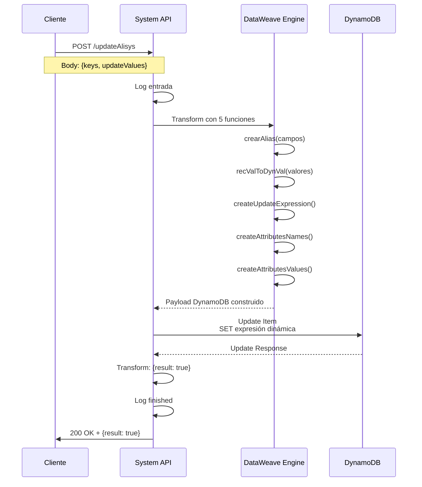

# POST /updateAlisys

## 📌 Descripción General

### Propósito del Endpoint

Este endpoint actualiza registros de Alisys en DynamoDB de forma flexible y dinámica. Permite actualizar cualquier combinación de campos en un solo request, construyendo automáticamente la expresión `SET` de DynamoDB a partir del payload.

El endpoint soporta:
- **Actualización Dinámica**: Construye expresión UPDATE según campos enviados
- **Múltiples Campos**: Actualiza uno o varios campos en una sola operación
- **Conversión Automática de Tipos**: Detecta y convierte tipos (String, Number, Boolean)
- **Manejo de Palabras Reservadas**: Usa aliases para evitar conflictos con palabras reservadas de DynamoDB
- **Identificación por LeaseKey**: Usa leaseKey como clave primaria

### Tipo de API

**Capa:** System API (API-Led Connectivity)

**Función:** Integración directa con Amazon DynamoDB para actualización flexible de registros Alisys.

### Patrón de Integración

**Tipo:** Request-Reply Síncrono con DynamoDB Update Dinámico

**Descripción:** El endpoint recibe un request POST con la estructura `{keys, updateValues}`, construye dinámicamente una expresión `SET` de DynamoDB usando funciones DataWeave auxiliares, ejecuta la actualización, y retorna confirmación de éxito.

### Arquitectura API-Led Connectivity

```mermaid
graph TB
    EXT[Sistema Externo<br/>Alisys]
    PROC[Process API<br/>Integración Alisys]
    SYS[System API<br/>ntgy-newco-s-dynamodb<br/>POST /updateAlisys]
    DDB[Amazon DynamoDB<br/>Tabla: ntgy-dydb-Alisys<br/>Operation: Update Item SET]
    
    EXT -->|Datos Alisys| PROC
    PROC -->|HTTP POST<br/>keys + updateValues| SYS
    SYS -->|Construcción Dinámica<br/>DataWeave| SYS
    SYS -->|DynamoDB Update<br/>SET expresión dinámica| DDB
    DDB -->|Update Response| SYS
    SYS -->|JSON Response<br/>{result: true}| PROC
    PROC -->|Confirmación| EXT
    
    style SYS fill:#e1f5ff,stroke:#01579b,stroke-width:3px
    style DDB fill:#fff3e0,stroke:#e65100,stroke-width:2px
```

---

## 💼 Propósito del Negocio

### Casos de Uso Principales

1. **Actualización Flexible de Datos Alisys**
   - Sistema Alisys envía actualizaciones de campos específicos
   - No requiere enviar todos los campos, solo los que cambian
   - Reduce payload y mejora eficiencia

2. **Sincronización Parcial**
   - Actualizar solo campos modificados desde última sincronización
   - Evita sobrescribir datos no relacionados
   - Mantiene integridad de datos

3. **Corrección de Datos**
   - Operadores pueden corregir campos específicos
   - Sin necesidad de reenviar registro completo
   - Auditoría de cambios por campo

### Contexto Empresarial

- **Dominio:** Integración con Sistema Externo Alisys
- **Sector:** Energía - Utilities
- **División:** Naturgy España - NewCo
- **Proceso de Negocio:** Gestión de información Alisys (facturación, pagos, gestión de deuda)
- **Criticidad:** Alta - Datos críticos para operaciones financieras

### Stakeholders

- **Equipo Alisys**: Propietarios del sistema externo
- **Equipo de Integración**: Gestión de sincronización
- **Operaciones Financieras**: Usuarios de datos Alisys

### Valor de Negocio

- **Flexibilidad**: Actualiza cualquier combinación de campos sin código adicional
- **Eficiencia**: Reduce payload al enviar solo campos modificados
- **Mantenibilidad**: No requiere cambios de código para nuevos campos
- **Confiabilidad**: Conversión automática de tipos previene errores

### Consumidores Potenciales

Este endpoint puede ser consumido por:
- Process APIs de integración Alisys
- Sistemas de sincronización batch
- Herramientas de corrección de datos
- Procesos de migración de datos

---

## 🔧 Especificación Técnica

### URLs por Ambiente

| Ambiente | URL Base | URL Completa |
|----------|----------|--------------|
| **Local** | `http://localhost:8081` | `http://localhost:8081/api/updateAlisys` |
| **Development** | `https://ntgy-newco-s-dynamodb-dev.us-e2.cloudhub.io` | `https://ntgy-newco-s-dynamodb-dev.us-e2.cloudhub.io/api/updateAlisys` |
| **UAT** | `https://ntgy-newco-s-dynamodb-uat.us-e2.cloudhub.io` | `https://ntgy-newco-s-dynamodb-uat.us-e2.cloudhub.io/api/updateAlisys` |
| **Production** | `https://ntgy-newco-s-dynamodb-pro.us-e2.cloudhub.io` | `https://ntgy-newco-s-dynamodb-pro.us-e2.cloudhub.io/api/updateAlisys` |

### Método HTTP

```
POST /api/updateAlisys
```

### Parámetros de Entrada

#### Headers HTTP

| Header | Tipo | Requerido | Descripción | Ejemplo |
|--------|------|-----------|-------------|---------|
| `Content-Type` | string | ✅ Sí | Tipo de contenido del request | `application/json` |
| `Accept` | string | ❌ No | Tipo de contenido esperado en response | `application/json` |

#### Body Parameters

El body debe contener la estructura con claves y valores a actualizar:

```json
{
  "keys": {
    "leaseKey": "valor-clave-primaria"
  },
  "updateValues": [
    {
      "name": "campo1",
      "value": "valor1"
    },
    {
      "name": "campo2",
      "value": 123
    },
    {
      "name": "campo3",
      "value": true
    }
  ]
}
```

**Estructura del Body:**

| Campo | Tipo | Requerido | Descripción |
|-------|------|-----------|-------------|
| `keys` | Object | ✅ Sí | Objeto con la clave primaria del registro |
| `keys.leaseKey` | string | ✅ Sí | Valor de la clave primaria (identificador único) |
| `updateValues` | Array | ✅ Sí | Array de objetos con campos a actualizar |
| `updateValues[].name` | string | ✅ Sí | Nombre del campo a actualizar |
| `updateValues[].value` | any | ✅ Sí | Valor del campo (String, Number, Boolean) |

**Tipos de Datos Soportados:**
- **String**: Texto (ej: `"valor"`)
- **Number**: Números enteros o decimales (ej: `123`, `45.67`)
- **Boolean**: Verdadero o falso (ej: `true`, `false`)

### Respuestas

#### Respuesta Exitosa (200 OK)

```json
{
  "result": true
}
```

#### Respuesta de Error - Registro No Encontrado (500)

```json
{
  "result": {
    "codResult": "5001",
    "msgResult": "Error: Item with specified key does not exist"
  }
}
```

#### Respuesta de Error - Payload Inválido (400)

```json
{
  "message": "Bad request"
}
```

### Autenticación y Autorización

- **Tipo:** Client ID & Client Secret (Anypoint Platform)
- **Autorización DynamoDB:** El usuario debe tener permisos IAM para:
  - Operación `dynamodb:UpdateItem` en tabla `ntgy-dydb-Alisys`
  - Acceso de escritura a la tabla

### Timeouts

| Tipo | Valor | Descripción |
|------|-------|-------------|
| **Request Timeout** | 30 segundos | Tiempo máximo de espera para la respuesta |
| **Connection Timeout** | 10 segundos | Tiempo máximo para establecer conexión con DynamoDB |

### Validaciones

- **keys.leaseKey**: Debe ser un string no vacío
- **updateValues**: Debe ser un array con al menos un elemento
- **updateValues[].name**: Debe ser un string no vacío
- **updateValues[].value**: Debe tener un valor (no null/undefined)
- **Existencia del Item**: El item con el `leaseKey` especificado debe existir en DynamoDB

---

## 🏗️ Implementación Técnica

### Arquitectura del Flow

```mermaid
flowchart TD
    Start([HTTP POST Request]) --> LogEntry[Log: Entrada updateAlisys]
    LogEntry --> Transform[Transform: Construcción Dinámica<br/>DataWeave con 5 funciones]
    Transform --> BuildKey[Construir Key DynamoDB]
    BuildKey --> BuildExpression[Construir UPDATE Expression]
    BuildExpression --> BuildNames[Construir Attribute Names]
    BuildNames --> BuildValues[Construir Attribute Values]
    BuildValues --> UpdateItem[DynamoDB Update Item<br/>Expresión SET dinámica]
    UpdateItem --> TransformSuccess[Transform: {result: true}]
    TransformSuccess --> LogExit[Log: Finished Update]
    LogExit --> End([HTTP Response 200])
    
    style Start fill:#e8f5e9,stroke:#2e7d32
    style Transform fill:#fff9c4,stroke:#f57f17,stroke-width:2px
    style UpdateItem fill:#fff3e0,stroke:#e65100,stroke-width:3px
    style End fill:#e8f5e9,stroke:#2e7d32
```

### Componentes del Flow

#### 1. Logger de Entrada (Línea 2)
```xml
<logger level="INFO" message='#["updateAlisys - Update Item in Alisys dynamo for " ++ payload.keys.leaseKey ++ "leaseKey"]' />
```
- Registra el inicio de la actualización
- Incluye el leaseKey para trazabilidad

#### 2. Transformación DataWeave Compleja (Líneas 3-37)

Esta transformación es el corazón del endpoint. Contiene 5 funciones auxiliares que construyen dinámicamente la query DynamoDB:

##### Función 1: crearAlias
```dataweave
fun crearAlias(value) = value ++ "ALIAS"
```

**Propósito:** Añade sufijo "ALIAS" a nombres de campos para evitar conflictos con palabras reservadas de DynamoDB.

**Ejemplo:**
- Input: `"amount"` → Output: `"amountALIAS"`
- Input: `"status"` → Output: `"statusALIAS"`

**Rationale:** DynamoDB tiene palabras reservadas (como `status`, `name`, `data`) que no pueden usarse directamente en expresiones UPDATE.

##### Función 2: recValToDynVal
```dataweave
fun recValToDynVal(value) = 
    if (typeOf(value) ~= "String") ({"S": value})
    else if (typeOf(value) ~= "Number") ({"N": value as String})
    else if (typeOf(value) ~= "Boolean") ({"bool": value})
    else value
```

**Propósito:** Convierte valores a formato DynamoDB según su tipo.

**Conversiones:**
- **String** → `{"S": "valor"}`
- **Number** → `{"N": "123"}` (convertido a String)
- **Boolean** → `{"bool": true}`

**Ejemplo:**
```dataweave
recValToDynVal("texto")  // {"S": "texto"}
recValToDynVal(123)      // {"N": "123"}
recValToDynVal(true)     // {"bool": true}
```

##### Función 3: createUpdateExpression
```dataweave
fun createUpdateExpression(expressions) = 
    "SET " ++ ((expressions map ((item, index) -> 
        ("#" ++ crearAlias(item.name)) ++ "=:" ++ (crearAlias(item.name))
    )) joinBy  ",")
```

**Propósito:** Construye la expresión `SET` de DynamoDB.

**Ejemplo:**
```dataweave
Input: [
  {name: "amount", value: 100},
  {name: "status", value: "active"}
]

Output: "SET #amountALIAS=:amountALIAS,#statusALIAS=:statusALIAS"
```

**Componentes:**
- `#amountALIAS`: Placeholder para nombre de atributo
- `:amountALIAS`: Placeholder para valor de atributo

##### Función 4: createAttributesNames
```dataweave
fun createAttributesNames(attributes) = 
    attributes reduce ((item, accumulator={}) -> 
        accumulator ++ ("#" ++ crearAlias(item)) : item
    )
```

**Propósito:** Crea mapeo de aliases a nombres reales de campos.

**Ejemplo:**
```dataweave
Input: ["amount", "status"]

Output: {
  "#amountALIAS": "amount",
  "#statusALIAS": "status"
}
```

##### Función 5: createAttributesValues
```dataweave
fun createAttributesValues(attributes) = 
    attributes reduce ((item, accumulator={}) -> 
        accumulator ++ {(":" ++ crearAlias(item.name)): recValToDynVal(item.value)}
    )
```

**Propósito:** Crea mapeo de aliases a valores con tipos DynamoDB.

**Ejemplo:**
```dataweave
Input: [
  {name: "amount", value: 100},
  {name: "status", value: "active"}
]

Output: {
  ":amountALIAS": {"N": "100"},
  ":statusALIAS": {"S": "active"}
}
```

#### 3. Construcción del Payload Final (Líneas 24-37)
```dataweave
{
    "key": payload.keys mapObject ((value, key, index) -> {
        (key as String):recValToDynVal(value)
    }),
    "updateExpression": createUpdateExpression(payload.updateValues),
    "attributesNames": createAttributesNames(payload.updateValues..name),
    "attributesValues": createAttributesValues(payload.updateValues)    
}
```

**Resultado:**
```json
{
  "key": {
    "leaseKey": {"S": "12345"}
  },
  "updateExpression": "SET #amountALIAS=:amountALIAS,#statusALIAS=:statusALIAS",
  "attributesNames": {
    "#amountALIAS": "amount",
    "#statusALIAS": "status"
  },
  "attributesValues": {
    ":amountALIAS": {"N": "100"},
    ":statusALIAS": {"S": "active"}
  }
}
```

#### 4. Update Item en DynamoDB (Líneas 38-40)
```xml
<dynamodb:update-item 
    config-ref="Amazon_DynamoDB_Configuration" 
    tableName="ntgy-dydb-Alisys" 
    updateExpression="#[payload.updateExpression]" 
    attributeValues="#[payload.attributesValues]" 
    attributeNames="#[payload.attributesNames]">
    <dynamodb:key><![CDATA[#[payload.key]]]></dynamodb:key>
</dynamodb:update-item>
```

**Parámetros:**
- `tableName`: `ntgy-dydb-Alisys`
- `updateExpression`: Expresión SET construida dinámicamente
- `attributeNames`: Mapeo de aliases a nombres
- `attributeValues`: Mapeo de aliases a valores con tipos
- `key`: Clave primaria del item

#### 5. Transformación de Respuesta (Líneas 41-51)
```dataweave
%dw 2.0
output application/json
---
{
    "result" : true
}
```

**Respuesta simple indicando éxito de la operación.**

#### 6. Logger de Salida (Línea 52)
```xml
<logger level="INFO" message='#["Finished Update Item Flow"]' />
```

### Diagrama de Secuencia



### Tabla DynamoDB: ntgy-dydb-Alisys

#### Estructura Ejemplo

| Campo | Tipo | Descripción | Ejemplo |
|-------|------|-------------|---------|
| `leaseKey` (PK) | String | Identificador único | `"12345"` |
| `amount` | Number | Monto | `100.50` |
| `status` | String | Estado | `"active"` |
| `invoice` | String | Número de factura | `"INV-2026-001"` |
| `idSfdc` | String | ID Salesforce | `"001XX000003DHP0"` |
| `lastUpdate` | String | Última actualización | `"2026-01-15T10:30:00Z"` |

**Nota:** La tabla puede contener cualquier campo. El endpoint es agnóstico de la estructura específica.

### Ejemplo de Transformación Completa

**Input (Request Body):**
```json
{
  "keys": {
    "leaseKey": "12345"
  },
  "updateValues": [
    {"name": "amount", "value": 150.75},
    {"name": "status", "value": "processed"},
    {"name": "paid", "value": true}
  ]
}
```

**Transformación DataWeave (Paso a Paso):**

1. **crearAlias aplicado:**
   - `"amount"` → `"amountALIAS"`
   - `"status"` → `"statusALIAS"`
   - `"paid"` → `"paidALIAS"`

2. **recValToDynVal aplicado:**
   - `150.75` → `{"N": "150.75"}`
   - `"processed"` → `{"S": "processed"}`
   - `true` → `{"bool": true}`

3. **createUpdateExpression:**
   ```
   "SET #amountALIAS=:amountALIAS,#statusALIAS=:statusALIAS,#paidALIAS=:paidALIAS"
   ```

4. **createAttributesNames:**
   ```json
   {
     "#amountALIAS": "amount",
     "#statusALIAS": "status",
     "#paidALIAS": "paid"
   }
   ```

5. **createAttributesValues:**
   ```json
   {
     ":amountALIAS": {"N": "150.75"},
     ":statusALIAS": {"S": "processed"},
     ":paidALIAS": {"bool": true}
   }
   ```

**Output (DynamoDB Update):**
```json
{
  "key": {"leaseKey": {"S": "12345"}},
  "updateExpression": "SET #amountALIAS=:amountALIAS,#statusALIAS=:statusALIAS,#paidALIAS=:paidALIAS",
  "attributesNames": {
    "#amountALIAS": "amount",
    "#statusALIAS": "status",
    "#paidALIAS": "paid"
  },
  "attributesValues": {
    ":amountALIAS": {"N": "150.75"},
    ":statusALIAS": {"S": "processed"},
    ":paidALIAS": {"bool": true}
  }
}
```

### Manejo de Errores

#### Errores de DynamoDB

| Código | Descripción | Acción |
|--------|-------------|--------|
| `5001` | Error de conectividad | Retry automático (3 intentos) |
| `5002` | Timeout | Aumentar timeout o verificar red |
| `5003` | Throttling | Backoff exponencial |
| `5004` | Item no existe | Verificar leaseKey |

#### Errores de Validación

| Escenario | Respuesta | Código HTTP |
|-----------|-----------|-------------|
| `keys` no proporcionado | Bad Request | 400 |
| `updateValues` vacío | Bad Request | 400 |
| Tipo de dato inválido | Bad Request | 400 |
| Item no existe | Error 5004 | 500 |

---

## 💻 Ejemplos de Uso

### Ejemplo 1: Actualización de Un Campo

#### Request

```bash
curl -X POST "http://localhost:8081/api/updateAlisys" \
  -H "Content-Type: application/json" \
  -H "Accept: application/json" \
  -d '{
    "keys": {
      "leaseKey": "12345"
    },
    "updateValues": [
      {
        "name": "amount",
        "value": 150.75
      }
    ]
  }'
```

#### Response (200 OK)

```json
{
  "result": true
}
```

### Ejemplo 2: Actualización de Múltiples Campos

#### Request

```bash
curl -X POST "https://ntgy-newco-s-dynamodb-pro.us-e2.cloudhub.io/api/updateAlisys" \
  -H "Content-Type: application/json" \
  -H "Accept: application/json" \
  -H "client_id: your-client-id" \
  -H "client_secret: your-client-secret" \
  -d '{
    "keys": {
      "leaseKey": "67890"
    },
    "updateValues": [
      {
        "name": "amount",
        "value": 250.00
      },
      {
        "name": "status",
        "value": "processed"
      },
      {
        "name": "paid",
        "value": true
      },
      {
        "name": "invoice",
        "value": "INV-2026-001"
      }
    ]
  }'
```

#### Response (200 OK)

```json
{
  "result": true
}
```

### Ejemplo 3: Actualización con Diferentes Tipos de Datos

#### Request

```bash
curl -X POST "http://localhost:8081/api/updateAlisys" \
  -H "Content-Type: application/json" \
  -d '{
    "keys": {
      "leaseKey": "ABC123"
    },
    "updateValues": [
      {
        "name": "customerName",
        "value": "Juan Pérez"
      },
      {
        "name": "totalAmount",
        "value": 1500.50
      },
      {
        "name": "isPaid",
        "value": false
      },
      {
        "name": "invoiceCount",
        "value": 3
      }
    ]
  }'
```

#### Response (200 OK)

```json
{
  "result": true
}
```

### Ejemplo 4: Error - Item No Encontrado

#### Request

```bash
curl -X POST "http://localhost:8081/api/updateAlisys" \
  -H "Content-Type: application/json" \
  -d '{
    "keys": {
      "leaseKey": "nonexistent-key"
    },
    "updateValues": [
      {
        "name": "amount",
        "value": 100
      }
    ]
  }'
```

#### Response (500 Internal Server Error)

```json
{
  "result": {
    "codResult": "5004",
    "msgResult": "Error: Item with specified key does not exist in ntgy-dydb-Alisys"
  }
}
```

### Ejemplo 5: Integración con JavaScript

```javascript
async function updateAlisysRecord(leaseKey, updates) {
  const url = 'https://ntgy-newco-s-dynamodb-pro.us-e2.cloudhub.io/api/updateAlisys';
  
  // Construir updateValues desde objeto de updates
  const updateValues = Object.entries(updates).map(([name, value]) => ({
    name,
    value
  }));
  
  const payload = {
    keys: {
      leaseKey
    },
    updateValues
  };
  
  try {
    const response = await fetch(url, {
      method: 'POST',
      headers: {
        'Content-Type': 'application/json',
        'Accept': 'application/json',
        'client_id': process.env.CLIENT_ID,
        'client_secret': process.env.CLIENT_SECRET
      },
      body: JSON.stringify(payload)
    });

    if (!response.ok) {
      throw new Error(`HTTP error! status: ${response.status}`);
    }

    const result = await response.json();
    
    if (result.result === true) {
      console.log(`✅ Record ${leaseKey} updated successfully`);
      return true;
    } else {
      console.error(`❌ Failed to update record ${leaseKey}:`, result);
      return false;
    }
  } catch (error) {
    console.error('Error updating Alisys record:', error);
    throw error;
  }
}

// Uso
const updates = {
  amount: 350.75,
  status: "processed",
  paid: true,
  invoice: "INV-2026-002"
};

updateAlisysRecord('12345', updates)
  .then(success => {
    if (success) {
      console.log('Update complete');
    }
  })
  .catch(error => console.error('Failed to update:', error));
```

### Ejemplo 6: Integración con Python

```python
import requests
import os
from typing import Dict, Any

def update_alisys_record(lease_key: str, updates: Dict[str, Any]) -> bool:
    """
    Actualiza un registro de Alisys en DynamoDB
    
    Args:
        lease_key: Identificador del registro
        updates: Diccionario con campos a actualizar
    
    Returns:
        bool: True si la actualización fue exitosa
    """
    url = "https://ntgy-newco-s-dynamodb-pro.us-e2.cloudhub.io/api/updateAlisys"
    
    # Construir updateValues desde diccionario
    update_values = [
        {"name": name, "value": value}
        for name, value in updates.items()
    ]
    
    payload = {
        "keys": {
            "leaseKey": lease_key
        },
        "updateValues": update_values
    }
    
    headers = {
        "Content-Type": "application/json",
        "Accept": "application/json",
        "client_id": os.getenv("CLIENT_ID"),
        "client_secret": os.getenv("CLIENT_SECRET")
    }
    
    try:
        response = requests.post(
            url,
            headers=headers,
            json=payload,
            timeout=30
        )
        response.raise_for_status()
        
        result = response.json()
        
        if result.get("result") is True:
            print(f"✅ Record {lease_key} updated successfully")
            return True
        else:
            print(f"❌ Failed to update record {lease_key}: {result}")
            return False
            
    except requests.exceptions.RequestException as e:
        print(f"Error updating Alisys record: {e}")
        raise

# Uso
if __name__ == "__main__":
    updates = {
        "amount": 450.25,
        "status": "completed",
        "paid": True,
        "invoice": "INV-2026-003",
        "customerName": "María García"
    }
    
    try:
        success = update_alisys_record("67890", updates)
        if success:
            print("Update complete")
        else:
            print("Update failed")
    except Exception as e:
        print(f"Failed to update: {e}")
```

### Ejemplo 7: Actualización Batch

```python
import requests
import time
from typing import List, Dict, Any

class AlisysBatchUpdater:
    def __init__(self, base_url: str, client_id: str, client_secret: str):
        self.base_url = base_url
        self.headers = {
            "Content-Type": "application/json",
            "Accept": "application/json",
            "client_id": client_id,
            "client_secret": client_secret
        }
    
    def update_record(self, lease_key: str, updates: Dict[str, Any]) -> bool:
        """Actualiza un registro individual"""
        update_values = [
            {"name": name, "value": value}
            for name, value in updates.items()
        ]