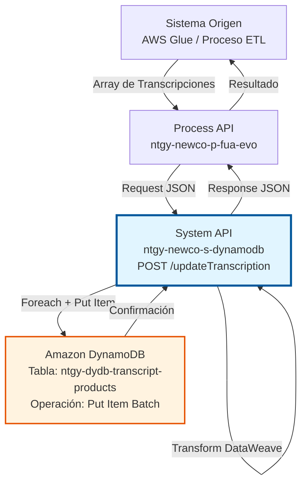
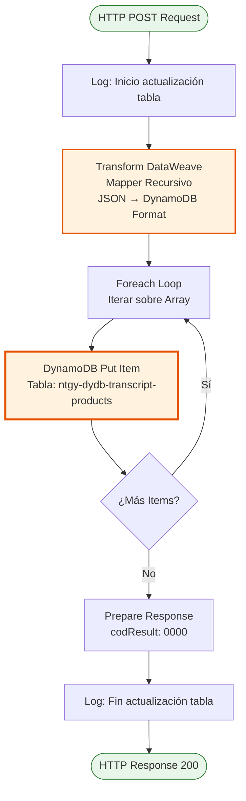
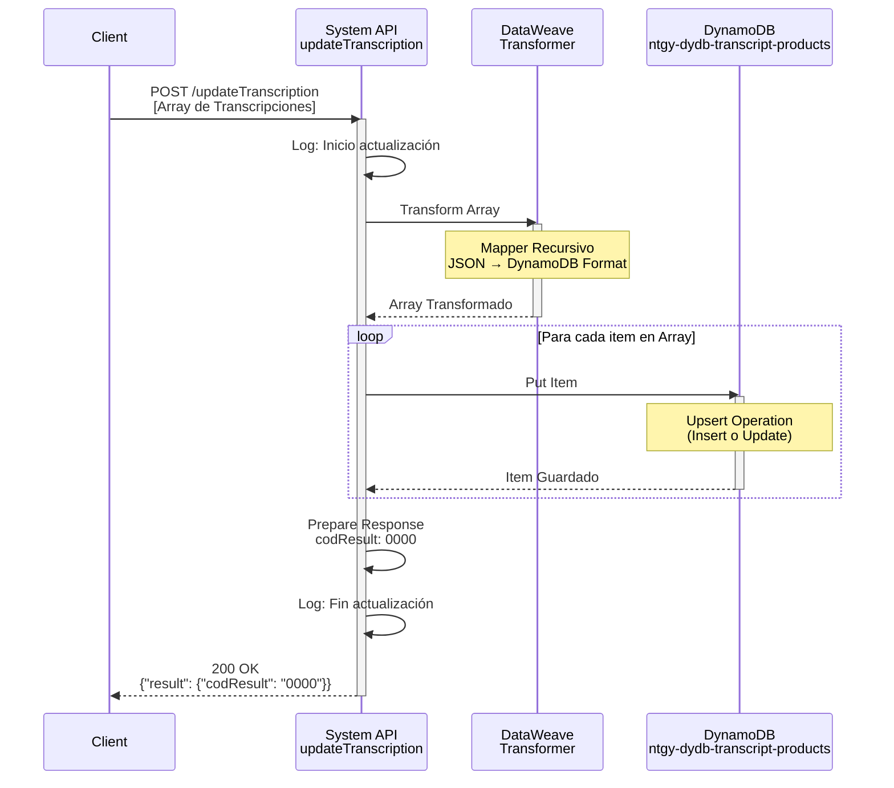
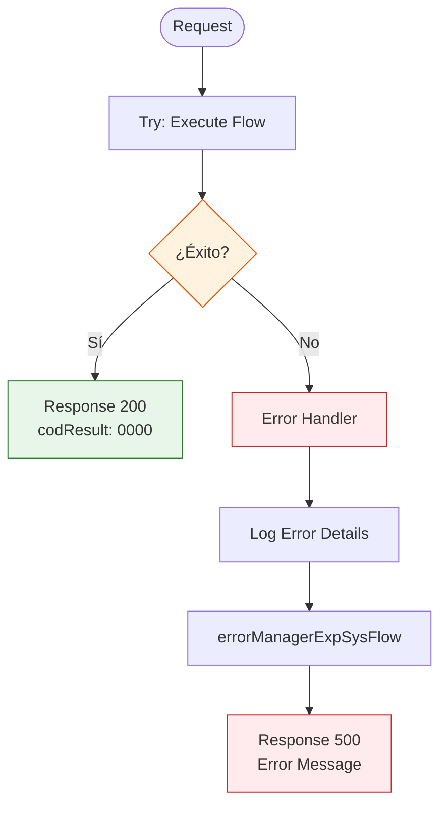

# POST /updateTranscription

## 📌 Descripción General

### Propósito del Endpoint

Este endpoint permite actualizar masivamente las transcripciones de productos en la tabla DynamoDB `ntgy-dydb-transcript-products`. Las transcripciones proporcionan descripciones de productos en múltiples idiomas, permitiendo que los sistemas consumidores muestren información localizada según el idioma del usuario.

El endpoint soporta:
- **Actualización Masiva**: Procesa múltiples transcripciones en una sola operación mediante batch processing
- **Transformación Automática**: Convierte automáticamente tipos de datos JSON a formato DynamoDB
- **Soporte Multiidioma**: Gestiona transcripciones en diferentes idiomas (ES, CA, EN, etc.)
- **Upsert Pattern**: Inserta nuevas transcripciones o actualiza existentes

### Tipo de API

**Capa:** System API (API-Led Connectivity)

**Función:** Integración directa con Amazon DynamoDB para gestión de transcripciones de productos.

### Patrón de Integración

**Tipo:** Request-Reply Síncrono con DynamoDB Batch Processing

**Descripción:** El endpoint recibe un array de objetos JSON con transcripciones, transforma cada objeto al formato DynamoDB mediante una función mapper recursiva, itera sobre el array con un foreach, y ejecuta una operación put-item por cada transcripción. El patrón put-item en DynamoDB actúa como upsert (insert o update).

### Arquitectura API-Led Connectivity



---

## 💼 Propósito del Negocio

### Casos de Uso Principales

1. **Sincronización de Catálogo Multiidioma**
   - Actualización masiva de descripciones de productos desde sistemas fuente
   - Sincronización de traducciones desde herramientas de gestión de contenido
   - Mantener consistencia entre sistemas Imperial y Newco

2. **Gestión de Traducciones**
   - Añadir nuevos idiomas al catálogo de productos
   - Actualizar descripciones existentes con mejoras de traducción
   - Corregir errores en transcripciones publicadas

3. **Integración con Procesos ETL**
   - Carga inicial de transcripciones desde AWS Glue
   - Actualización periódica desde sistemas de gestión de productos
   - Sincronización con sistemas de marketing y comunicación

### Contexto Empresarial

- **Dominio:** Gestión de Catálogo de Productos
- **Sector:** Energía - Utilities
- **División:** Naturgy España - NewCo
- **Proceso de Negocio:** Gestión de contenido multiidioma para productos energéticos
- **Módulo:** Gestión de Transcripciones

### Stakeholders

- **Equipos de Producto**: Necesitan mantener descripciones actualizadas en múltiples idiomas
- **Equipos de Marketing**: Requieren traducciones precisas para campañas
- **Equipos de Integración**: Responsables de sincronización entre sistemas
- **Equipos de Experiencia de Usuario**: Consumen transcripciones para portales web y móviles

### Valor de Negocio

- **Experiencia Multiidioma**: Permite mostrar información de productos en el idioma preferido del cliente
- **Eficiencia Operativa**: Actualización masiva reduce tiempo de gestión manual
- **Consistencia de Datos**: Fuente única de verdad para transcripciones en todo el ecosistema
- **Escalabilidad**: Soporte para crecimiento del catálogo sin impacto en performance

### Consumidores Potenciales

Este endpoint puede ser consumido por:
- Process APIs de gestión de productos (ntgy-newco-p-fua-evo)
- Procesos ETL de AWS Glue
- Sistemas de gestión de contenido (CMS)
- Herramientas de traducción y localización
- Procesos batch de sincronización

---

## 🔧 Especificación Técnica

### URLs por Ambiente

| Ambiente | URL Base | URL Completa |
|----------|----------|--------------|
| **Local** | `http://localhost:8081` | `http://localhost:8081/api/updateTranscription` |
| **Development** | `https://ntgy-newco-s-dynamodb-dev.us-e2.cloudhub.io` | `https://ntgy-newco-s-dynamodb-dev.us-e2.cloudhub.io/api/updateTranscription` |
| **UAT** | `https://ntgy-newco-s-dynamodb-uat.us-e2.cloudhub.io` | `https://ntgy-newco-s-dynamodb-uat.us-e2.cloudhub.io/api/updateTranscription` |
| **Production** | `https://ntgy-newco-s-dynamodb-pro.us-e2.cloudhub.io` | `https://ntgy-newco-s-dynamodb-pro.us-e2.cloudhub.io/api/updateTranscription` |

### Método HTTP

```
POST /api/updateTranscription
```

### Parámetros de Entrada

#### Headers HTTP

| Header | Tipo | Requerido | Descripción | Ejemplo |
|--------|------|-----------|-------------|---------|
| `Content-Type` | string | ✅ Sí | Tipo de contenido del request | `application/json` |
| `Accept` | string | ❌ No | Tipo de contenido esperado en response | `application/json` |

#### Body Parameters

**Tipo:** Array de objetos JSON

**Estructura de cada objeto:**

| Campo | Tipo | Requerido | Descripción | Ejemplo |
|-------|------|-----------|-------------|---------|
| `transcriptionListId` | string | ✅ Sí | Identificador único de la transcripción | `"PROD_TYPE_001"` |
| `language` | string | ✅ Sí | Código de idioma (ES, CA, EN, etc.) | `"ES"` |
| `description` | string | ✅ Sí | Descripción traducida del producto | `"Tarifa Luz Estable"` |
| `productType` | string | ❌ No | Tipo de producto | `"ELECTRICITY"` |
| `category` | string | ❌ No | Categoría del producto | `"TARIFF"` |

**Nota:** El endpoint acepta cualquier estructura JSON. Los campos adicionales serán transformados automáticamente al formato DynamoDB.

### Respuestas

#### Respuesta Exitosa (200 OK)

```json
{
  "result": {
    "codResult": "0000",
    "msgResult": "No hay error"
  }
}
```

#### Respuesta de Error Técnico (500)

```json
{
  "result": {
    "codResult": "0001",
    "msgResult": "Error interno del servidor"
  }
}
```

### Autenticación y Autorización

- **Tipo:** Client ID & Client Secret (Anypoint Platform)
- **Autorización DynamoDB:** El usuario debe tener permisos IAM para:
  - Operación `dynamodb:PutItem` en tabla `ntgy-dydb-transcript-products`
  - Acceso de escritura a la tabla

### Timeouts

| Tipo | Valor | Descripción |
|------|-------|-------------|
| **Request Timeout** | 30 segundos | Tiempo máximo de espera para la respuesta |
| **Connection Timeout** | 10 segundos | Tiempo máximo para establecer conexión con DynamoDB |
| **Foreach Timeout** | 60 segundos | Tiempo máximo para procesar todo el batch |

---

## 🏗️ Implementación Técnica

### Arquitectura del Flow



### Componentes del Flow

#### 1. Logger Inicial
```xml
<logger level="INFO" message="Inicio actualización tabla ntgy-dydb-transcript-products"/>
```
- **Propósito:** Registrar inicio de operación
- **Nivel:** INFO
- **Ubicación:** Línea 2 del flow `updateTranscription`

#### 2. Transformación DataWeave (Mapper Recursivo)
```dataweave
%dw 2.0
output application/java
fun mapper(object) = object match {
    case attr is String -> {"S": attr}
    case attr is Number -> {"N": attr}
    case attr is Boolean -> {"Bool": attr}
    case attr is Array -> {"L": (attr map mapper($))}
    case attr is Object -> {"M": attr mapObject ($$): mapper($)}
    case attr is Null -> {"nullvalue": true}
}
---
payload map ((item) -> item mapObject ($$): mapper($))
```

**Función del Mapper:**
- **String → `{"S": valor}`**: Convierte strings a formato DynamoDB String
- **Number → `{"N": valor}`**: Convierte números a formato DynamoDB Number
- **Boolean → `{"Bool": valor}`**: Convierte booleanos a formato DynamoDB Boolean
- **Array → `{"L": [...]}`**: Convierte arrays recursivamente a formato DynamoDB List
- **Object → `{"M": {...}}`**: Convierte objetos recursivamente a formato DynamoDB Map
- **Null → `{"nullvalue": true}`**: Maneja valores nulos

**Ejemplo de Transformación:**
```json
// Input JSON
{
  "transcriptionListId": "PROD_001",
  "language": "ES",
  "description": "Tarifa Luz",
  "active": true,
  "priority": 1
}

// Output DynamoDB Format
{
  "transcriptionListId": {"S": "PROD_001"},
  "language": {"S": "ES"},
  "description": {"S": "Tarifa Luz"},
  "active": {"Bool": true},
  "priority": {"N": 1}
}
```

#### 3. Foreach Loop
```xml
<foreach doc:name="For Each">
    <dynamodb:put-item tableName="ntgy-dydb-transcript-products" 
                       config-ref="Amazon_DynamoDB_Configuration" />
</foreach>
```
- **Propósito:** Iterar sobre cada item transformado
- **Operación:** Put Item por cada elemento del array
- **Patrón:** Batch processing síncrono

#### 4. DynamoDB Put Item
- **Tabla:** `ntgy-dydb-transcript-products`
- **Operación:** Put Item (Upsert)
- **Comportamiento:** 
  - Si el item existe (misma clave primaria) → UPDATE
  - Si el item no existe → INSERT
- **Clave Primaria:** Definida en la tabla DynamoDB (típicamente `transcriptionListId` + `language`)

#### 5. Response Transformation
```dataweave
%dw 2.0
output application/json
---
"result": {
    "codResult": "0000",
    "msgResult": "No hay error"
}
```

#### 6. Logger Final
```xml
<logger level="INFO" message="Fin actualización tabla ntgy-dydb-transcript-products"/>
```

### Diagrama de Secuencia Detallado



### Manejo de Errores



**Tipos de Errores Manejados:**
- **DynamoDB Connectivity**: Error de conexión con DynamoDB
- **DynamoDB Throttling**: Límite de capacidad excedido
- **Validation Error**: Datos inválidos en el payload
- **Transformation Error**: Error en transformación DataWeave
- **ANY**: Cualquier otro error no esperado

### Configuración DynamoDB

```xml
<dynamodb:config name="Amazon_DynamoDB_Configuration">
    <dynamodb:basic-connection 
        accessKey="${secure::aws.accessKey}"
        secretKey="${secure::aws.secretKey}"
        region="${aws.region}"/>
</dynamodb:config>
```

**Parámetros de Configuración:**
- **Access Key**: Credencial AWS (secure property)
- **Secret Key**: Credencial AWS (secure property)
- **Region**: Región AWS (ej: eu-west-1)

### Tabla DynamoDB: ntgy-dydb-transcript-products

**Estructura Típica:**
- **Clave Primaria (Partition Key):** `transcriptionListId` (String)
- **Clave de Ordenación (Sort Key):** `language` (String)
- **Atributos Adicionales:** Cualquier campo adicional en el JSON

**Índices:**
- Índice primario: `transcriptionListId` + `language`
- Permite búsquedas eficientes por producto e idioma

**Capacidad:**
- Read Capacity Units (RCU): Auto-scaling
- Write Capacity Units (WCU): Auto-scaling

---

## 💻 Ejemplos de Uso

### Ejemplo 1: Actualización de Transcripciones en Español

#### Request

```bash
curl -X POST "https://ntgy-newco-s-dynamodb-dev.us-e2.cloudhub.io/api/updateTranscription" \
  -H "Content-Type: application/json" \
  -H "client_id: YOUR_CLIENT_ID" \
  -H "client_secret: YOUR_CLIENT_SECRET" \
  -d '[
    {
      "transcriptionListId": "TARIFF_STABLE_LIGHT",
      "language": "ES",
      "description": "Tarifa Luz Estable",
      "productType": "ELECTRICITY",
      "category": "TARIFF",
      "active": true
    },
    {
      "transcriptionListId": "TARIFF_STABLE_GAS",
      "language": "ES",
      "description": "Tarifa Gas Estable",
      "productType": "GAS",
      "category": "TARIFF",
      "active": true
    }
  ]'
```

#### Response

```json
{
  "result": {
    "codResult": "0000",
    "msgResult": "No hay error"
  }
}
```

### Ejemplo 2: Actualización Multiidioma (ES, CA, EN)

#### Request

```bash
curl -X POST "https://ntgy-newco-s-dynamodb-dev.us-e2.cloudhub.io/api/updateTranscription" \
  -H "Content-Type: application/json" \
  -H "client_id: YOUR_CLIENT_ID" \
  -H "client_secret: YOUR_CLIENT_SECRET" \
  -d '[
    {
      "transcriptionListId": "SERVICE_MAINTENANCE",
      "language": "ES",
      "description": "Servicio de Mantenimiento"
    },
    {
      "transcriptionListId": "SERVICE_MAINTENANCE",
      "language": "CA",
      "description": "Servei de Manteniment"
    },
    {
      "transcriptionListId": "SERVICE_MAINTENANCE",
      "language": "EN",
      "description": "Maintenance Service"
    }
  ]'
```

#### Response

```json
{
  "result": {
    "codResult": "0000",
    "msgResult": "No hay error"
  }
}
```

### Ejemplo 3: Actualización con Estructura Compleja

#### Request

```bash
curl -X POST "https://ntgy-newco-s-dynamodb-dev.us-e2.cloudhub.io/api/updateTranscription" \
  -H "Content-Type: application/json" \
  -d '[
    {
      "transcriptionListId": "PRODUCT_SOLAR_PANEL",
      "language": "ES",
      "description": "Panel Solar Fotovoltaico",
      "metadata": {
        "category": "EQUIPMENT",
        "subcategory": "SOLAR",
        "tags": ["renovable", "autoconsumo", "sostenible"]
      },
      "pricing": {
        "basePrice": 1500.00,
        "currency": "EUR",
        "installmentOptions": [12, 24, 36]
      },
      "active": true,
      "priority": 1,
      "lastUpdated": "2026-01-08T10:30:00Z"
    }
  ]'
```

#### Response

```json
{
  "result": {
    "codResult": "0000",
    "msgResult": "No hay error"
  }
}
```

**Nota:** El mapper recursivo transforma automáticamente objetos anidados y arrays al formato DynamoDB Map y List.

### Ejemplo 4: Manejo de Error - Payload Vacío

#### Request

```bash
curl -X POST "https://ntgy-newco-s-dynamodb-dev.us-e2.cloudhub.io/api/updateTranscription" \
  -H "Content-Type: application/json" \
  -d '[]'
```

#### Response

```json
{
  "result": {
    "codResult": "0000",
    "msgResult": "No hay error"
  }
}
```

**Nota:** Un array vacío no genera error, simplemente no ejecuta ninguna operación put-item.

### Ejemplo 5: Código JavaScript (Node.js)

```javascript
const axios = require('axios');

const updateTranscriptions = async () => {
  const transcriptions = [
    {
      transcriptionListId: 'TARIFF_FLEXIBLE',
      language: 'ES',
      description: 'Tarifa Flexible',
      productType: 'ELECTRICITY',
      active: true
    },
    {
      transcriptionListId: 'TARIFF_FLEXIBLE',
      language: 'CA',
      description: 'Tarifa Flexible',
      productType: 'ELECTRICITY',
      active: true
    }
  ];

  try {
    const response = await axios.post(
      'https://ntgy-newco-s-dynamodb-dev.us-e2.cloudhub.io/api/updateTranscription',
      transcriptions,
      {
        headers: {
          'Content-Type': 'application/json',
          'client_id': process.env.CLIENT_ID,
          'client_secret': process.env.CLIENT_SECRET
        }
      }
    );

    console.log('Transcripciones actualizadas:', response.data);
    return response.data;
  } catch (error) {
    console.error('Error actualizando transcripciones:', error.response?.data || error.message);
    throw error;
  }
};

updateTranscriptions();
```

### Ejemplo 6: Código Python

```python
import requests
import json
import os

def update_transcriptions():
    url = "https://ntgy-newco-s-dynamodb-dev.us-e2.cloudhub.io/api/updateTranscription"
    
    transcriptions = [
        {
            "transcriptionListId": "SERVICE_INSTALLATION",
            "language": "ES",
            "description": "Servicio de Instalación",
            "active": True,
            "priority": 1
        },
        {
            "transcriptionListId": "SERVICE_INSTALLATION",
            "language": "EN",
            "description": "Installation Service",
            "active": True,
            "priority": 1
        }
    ]
    
    headers = {
        "Content-Type": "application/json",
        "client_id": os.getenv("CLIENT_ID"),
        "client_secret": os.getenv("CLIENT_SECRET")
    }
    
    try:
        response = requests.post(url, json=transcriptions, headers=headers)
        response.raise_for_status()
        
        print("Transcripciones actualizadas:", response.json())
        return response.json()
    except requests.exceptions.RequestException as e:
        print(f"Error actualizando transcripciones: {e}")
        raise

if __name__ == "__main__":
    update_transcriptions()