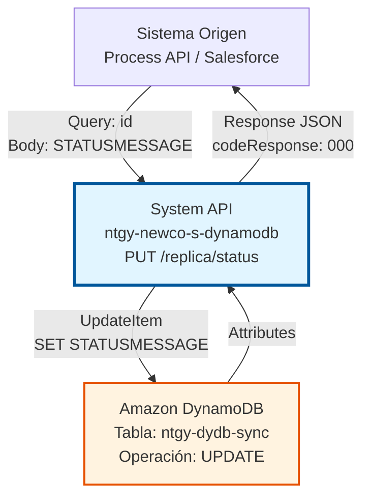
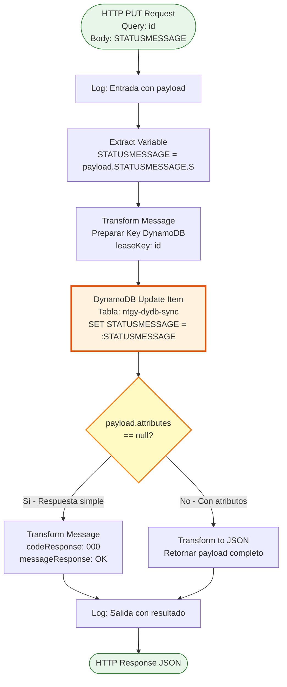
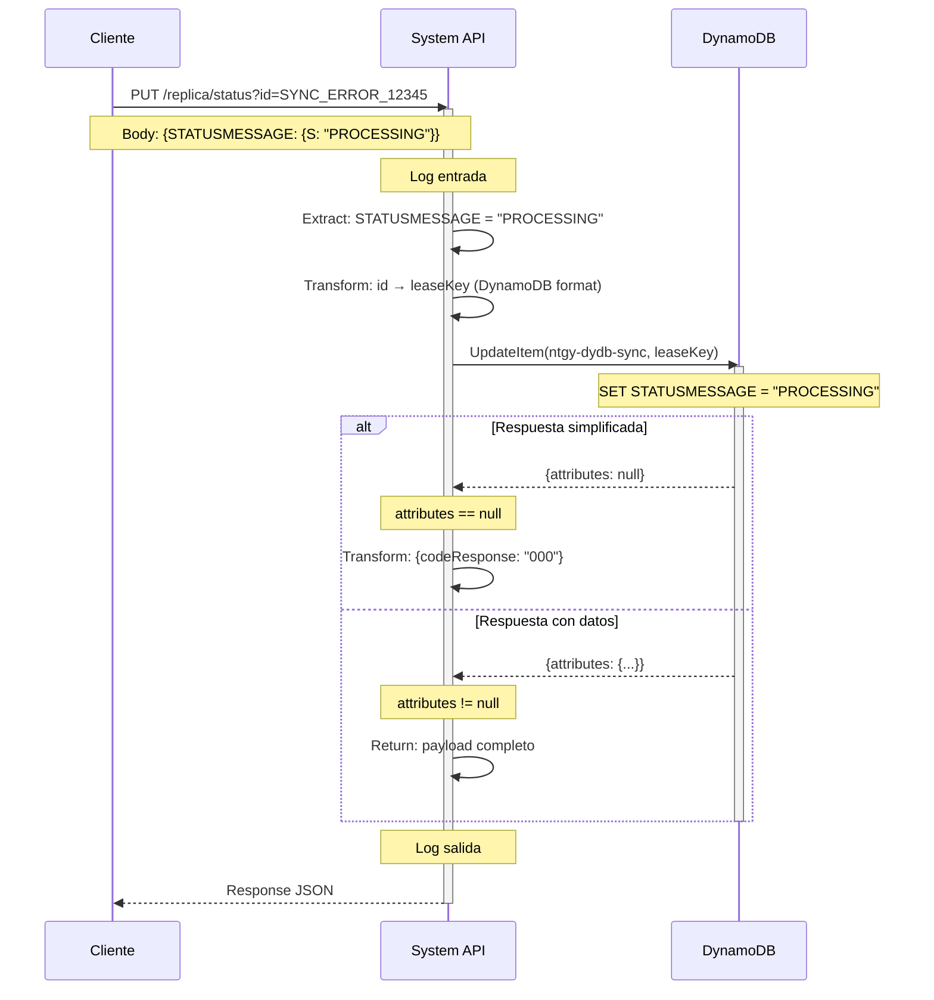
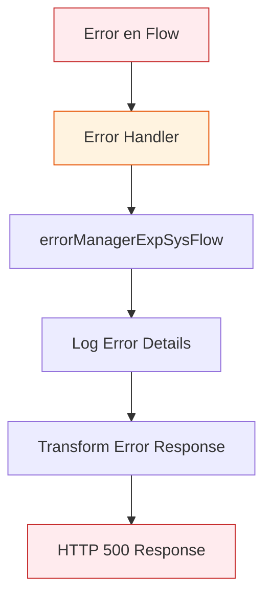

# PUT /replica/status

## 📌 Descripción General

### Propósito del Endpoint

Este endpoint actualiza el campo `STATUSMESSAGE` de un registro específico en la tabla `ntgy-dydb-sync` de DynamoDB. Se utiliza para modificar el estado de sincronización de registros existentes, permitiendo marcar errores como procesados, actualizar mensajes de estado, o cambiar el estado de sincronización sin eliminar el registro completo.

El endpoint soporta:
- **Actualización Parcial**: Modifica solo el campo `STATUSMESSAGE`, preservando otros campos
- **Actualización por ID**: Identifica el registro mediante el `leaseKey` (query parameter `id`)
- **Operación Idempotente**: Ejecutar múltiples veces con los mismos datos produce el mismo resultado

### Tipo de API

**Capa:** System API (API-Led Connectivity)

**Función:** Integración directa con Amazon DynamoDB para actualización de registros de sincronización.

### Patrón de Integración

**Tipo:** Request-Reply Síncrono con DynamoDB Update Operation

**Descripción:** Recibe el ID del registro (query parameter) y el nuevo valor de `STATUSMESSAGE` (body), transforma los datos al formato DynamoDB, ejecuta una operación de actualización parcial usando `UpdateExpression`, y retorna una respuesta confirmando la actualización.

### Arquitectura API-Led Connectivity



---

## 💼 Propósito del Negocio

### Casos de Uso Principales

1. **Actualización de Estado de Sincronización**
   - Cambiar el estado de un error de sincronización (ej: "PENDING" → "PROCESSING" → "RESOLVED")
   - Mantener trazabilidad del progreso de corrección de errores
   - Facilitar el seguimiento del ciclo de vida de errores

2. **Marcado de Errores Procesados**
   - Actualizar el mensaje de estado después de procesar un error
   - Indicar que un error está siendo atendido sin eliminarlo
   - Preservar el registro para auditoría mientras se actualiza su estado

3. **Gestión de Workflow de Sincronización**
   - Implementar estados intermedios en el proceso de sincronización
   - Coordinar entre múltiples sistemas que procesan el mismo error
   - Mantener visibilidad del estado actual de cada registro

4. **Auditoría y Trazabilidad**
   - Actualizar mensajes con información adicional de procesamiento
   - Registrar intentos de corrección sin perder el registro original
   - Mantener histórico de cambios de estado

### Contexto Empresarial

- **Dominio:** Gestión de Sincronización de Datos
- **Sector:** Energía - Utilities
- **División:** Naturgy España - NewCo
- **Proceso de Negocio:** Control y gestión del ciclo de vida de errores de sincronización entre sistemas Imperial, Newco y Salesforce
- **Tabla DynamoDB:** ntgy-dydb-sync (Control de sincronización)

### Stakeholders

- **Ingenieros de Sincronización**: Necesitan actualizar el estado de errores durante el proceso de corrección
- **Equipos de Operaciones**: Requieren visibilidad del progreso de resolución de errores
- **Desarrolladores de Process APIs**: Consumen este endpoint para gestionar el workflow de sincronización
- **Equipos de Auditoría**: Necesitan trazabilidad de cambios de estado

### Valor de Negocio

- **Trazabilidad Completa**: Mantiene histórico de estados sin eliminar registros
- **Workflow Flexible**: Permite implementar estados intermedios personalizados
- **Coordinación Multi-Sistema**: Facilita la coordinación entre sistemas que procesan errores
- **Auditoría Mejorada**: Preserva registros mientras se actualizan sus estados
- **Reducción de Duplicados**: Evita crear nuevos registros para cambios de estado

### Consumidores Potenciales

Este endpoint puede ser consumido por:
- Process APIs de sincronización (ntgy-newco-p-*)
- Flujos de Salesforce (Platform Events, Flows)
- Sistemas de integración middleware
- Herramientas de gestión de errores
- Scripts de procesamiento automatizado
- Dashboards de monitoreo

---

## 🔧 Especificación Técnica

### URLs por Ambiente

| Ambiente | URL Base | URL Completa |
|----------|----------|--------------|
| **Local** | `http://localhost:8081` | `http://localhost:8081/api/replica/status?id=:leaseKey` |
| **Development** | `https://ntgy-newco-s-dynamodb-dev.us-e2.cloudhub.io` | `https://ntgy-newco-s-dynamodb-dev.us-e2.cloudhub.io/api/replica/status?id=:leaseKey` |
| **UAT** | `https://ntgy-newco-s-dynamodb-uat.us-e2.cloudhub.io` | `https://ntgy-newco-s-dynamodb-uat.us-e2.cloudhub.io/api/replica/status?id=:leaseKey` |
| **Production** | `https://ntgy-newco-s-dynamodb-pro.us-e2.cloudhub.io` | `https://ntgy-newco-s-dynamodb-pro.us-e2.cloudhub.io/api/replica/status?id=:leaseKey` |

### Método HTTP

```
PUT /api/replica/status
```

### Parámetros de Entrada

#### Headers HTTP

| Header | Tipo | Requerido | Descripción | Ejemplo |
|--------|------|-----------|-------------|---------|
| `Content-Type` | string | ✅ Sí | Tipo de contenido del request | `application/json` |
| `Accept` | string | ❌ No | Tipo de contenido esperado en response | `application/json` |

#### Query Parameters

| Parámetro | Tipo | Requerido | Descripción | Ejemplo |
|-----------|------|-----------|-------------|---------|
| `id` | string | ✅ Sí | Identificador único del registro (leaseKey) a actualizar | `"SYNC_ERROR_12345"` |

**Nota:** El parámetro `id` corresponde al campo `leaseKey` en la tabla DynamoDB (partition key).

#### Body Parameters

**Estructura del Body:**

```json
{
  "STATUSMESSAGE": {
    "S": "NUEVO_ESTADO"
  }
}
```

| Campo | Tipo | Requerido | Descripción | Ejemplo |
|-------|------|-----------|-------------|---------|
| `STATUSMESSAGE` | Object | ✅ Sí | Objeto con formato DynamoDB | `{"S": "PROCESSING"}` |
| `STATUSMESSAGE.S` | string | ✅ Sí | Nuevo valor del mensaje de estado (tipo String en DynamoDB) | `"RESOLVED"`, `"PROCESSING"`, `"ERROR"` |

**Valores Comunes de STATUSMESSAGE:**
- `"PENDING"` - Error pendiente de procesamiento
- `"PROCESSING"` - Error en proceso de corrección
- `"RESOLVED"` - Error resuelto exitosamente
- `"FAILED"` - Intento de corrección fallido
- `"RETRY"` - Marcado para reintento
- `"CANCELLED"` - Procesamiento cancelado

### Respuestas

#### Respuesta Exitosa - Actualización Realizada (200 OK)

**Caso 1: attributes == null (respuesta simplificada)**

```json
{
  "codeResponse": "000",
  "messageResponse": "OK"
}
```

**Descripción:** El registro fue actualizado exitosamente. La respuesta simplificada indica éxito sin retornar los atributos actualizados.

**Caso 2: attributes != null (respuesta con datos)**

```json
{
  "attributes": {
    "leaseKey": {
      "S": "SYNC_ERROR_12345"
    },
    "STATUSMESSAGE": {
      "S": "PROCESSING"
    },
    "systemOrigin": {
      "S": "SALESFORCE"
    },
    "systemTarget": {
      "S": "SAP_ISU"
    },
    "timestamp": {
      "N": "1704067200000"
    }
  }
}
```

**Descripción:** El registro fue actualizado y DynamoDB retorna los atributos actualizados del item.

#### Respuesta de Error Técnico (500)

```json
{
  "result": {
    "codResult": "5001",
    "msgResult": "Error de conectividad con DynamoDB"
  }
}
```

**Descripción:** Error técnico al intentar conectar o ejecutar la operación en DynamoDB.

### Códigos de Resultado

| Código | Tipo | Descripción |
|--------|------|-------------|
| `000` | Success | Registro actualizado exitosamente |
| `5001` | Error | Error de conectividad con DynamoDB |
| `5002` | Error | Timeout en operación DynamoDB |
| `5003` | Error | Error de validación de datos |

### Autenticación y Autorización

- **Tipo:** Client ID & Client Secret (Anypoint Platform)
- **Autorización DynamoDB:** El usuario debe tener permisos para:
  - Ejecutar operación `UpdateItem` en tabla `ntgy-dydb-sync`
  - Acceso de escritura a la tabla
  - Permisos IAM configurados en AWS

### Timeouts

| Tipo | Valor | Descripción |
|------|-------|-------------|
| **Request Timeout** | 30 segundos | Tiempo máximo de espera para la respuesta |
| **Connection Timeout** | 10 segundos | Tiempo máximo para establecer conexión con DynamoDB |
| **DynamoDB Operation** | 20 segundos | Timeout específico de la operación update-item |

---

## 🏗️ Implementación Técnica

### Arquitectura del Flow



### Componentes del Flow

#### 1. Logger de Entrada
```xml
<logger level="INFO" message="Log de entrada a getRegistrosReplicaStatus_Flow: #[message.payload]"/>
```
**Propósito:** Registra el inicio de la operación con el payload completo recibido.

#### 2. Extracción de Variable STATUSMESSAGE
```dataweave
%dw 2.0
output application/java
---
payload.STATUSMESSAGE.S
```
**Propósito:** Extrae el valor del nuevo status del payload y lo almacena en la variable `STATUSMESSAGE` para uso posterior.

**Input esperado:**
```json
{
  "STATUSMESSAGE": {
    "S": "PROCESSING"
  }
}
```

**Output:** String `"PROCESSING"` almacenado en `vars.STATUSMESSAGE`

#### 3. Transformación de Key DynamoDB
```dataweave
%dw 2.0
output application/java
---
{
    "leaseKey": {"S": attributes.queryParams.id}
}
```
**Propósito:** Prepara la clave primaria para identificar el registro a actualizar en formato DynamoDB.

**Ejemplo:**
- Query param: `id=SYNC_ERROR_12345`
- Output: `{leaseKey: {S: "SYNC_ERROR_12345"}}`

#### 4. Operación DynamoDB Update Item
```xml
<dynamodb:update-item 
    config-ref="Amazon_DynamoDB_Configuration" 
    tableName="ntgy-dydb-sync" 
    updateExpression="SET STATUSMESSAGE = :STATUSMESSAGE">
    <dynamodb:attribute-values>
        <dynamodb:attribute-value 
            key=":STATUSMESSAGE" 
            value='#[{"S": vars.STATUSMESSAGE}]' />
    </dynamodb:attribute-values>
</dynamodb:update-item>
```

**Propósito:** Ejecuta la actualización parcial en DynamoDB usando UpdateExpression.

**Detalles de la Operación:**
- **UpdateExpression:** `SET STATUSMESSAGE = :STATUSMESSAGE`
- **Attribute Values:** `:STATUSMESSAGE` → valor de `vars.STATUSMESSAGE`
- **Tipo de Actualización:** Parcial (solo modifica el campo especificado)
- **Comportamiento:** Si el registro no existe, DynamoDB retorna error

**Ventajas de UpdateExpression:**
- Solo actualiza campos específicos
- Más eficiente que reemplazar el item completo
- Preserva otros campos del registro
- Soporta operaciones atómicas

#### 5. Choice - Tipo de Respuesta
```xml
<choice>
    <when expression="#[payload.attributes == null]">
        <!-- Respuesta simplificada -->
    </when>
    <otherwise>
        <!-- Respuesta con atributos completos -->
    </otherwise>
</choice>
```

**Propósito:** Determina el formato de respuesta basándose en la presencia de atributos en la respuesta de DynamoDB.

**Lógica:**
- `attributes == null` → Respuesta simplificada con código 000
- `attributes != null` → Respuesta con datos completos del item actualizado

#### 6. Transformación de Respuesta Simplificada
```dataweave
%dw 2.0
output application/json
---
{
    codeResponse: "000",
    messageResponse: "OK"
}
```
**Propósito:** Genera respuesta de éxito simplificada cuando DynamoDB no retorna atributos.

#### 7. Transformación de Respuesta Completa
```dataweave
%dw 2.0
output application/json
---
payload
```
**Propósito:** Retorna el payload completo de DynamoDB con todos los atributos actualizados.

#### 8. Logger de Salida
```xml
<logger level="INFO" message="Log Salida getItem-ntgy-dydb-sync: #[message.payload]"/>
```
**Propósito:** Registra la respuesta final antes de retornarla al cliente.

### Diagrama de Secuencia



### Tabla DynamoDB: ntgy-dydb-sync

#### Estructura de la Tabla

| Campo | Tipo | Descripción | Clave | Actualizable |
|-------|------|-------------|-------|--------------|
| `leaseKey` | String | Identificador único del registro | Partition Key | ❌ No |
| `STATUSMESSAGE` | String | Mensaje de estado del error | - | ✅ Sí |
| `systemOrigin` | String | Sistema origen del error | - | ❌ No (en este endpoint) |
| `systemTarget` | String | Sistema destino del error | - | ❌ No (en este endpoint) |
| `timestamp` | Number | Timestamp de creación | - | ❌ No (en este endpoint) |
| `errorDetails` | Map | Detalles adicionales del error | - | ❌ No (en este endpoint) |

#### Operación Update Item

**Características de la Operación:**
- **Tipo:** Actualización parcial con UpdateExpression
- **Campo Actualizado:** Solo `STATUSMESSAGE`
- **Campos Preservados:** Todos los demás campos permanecen sin cambios
- **Idempotencia:** Ejecutar múltiples veces con el mismo valor produce el mismo resultado
- **Atomicidad:** La operación es atómica (todo o nada)

**UpdateExpression Syntax:**
```
SET STATUSMESSAGE = :STATUSMESSAGE
```

**Ventajas vs PUT completo:**
- ✅ Más eficiente (solo actualiza un campo)
- ✅ Preserva campos no especificados
- ✅ Reduce consumo de WCU (Write Capacity Units)
- ✅ Menor riesgo de sobrescribir datos

### Manejo de Errores



**Tipos de Errores Manejados:**
- `DYNAMODB:CONNECTIVITY` - Error de conexión con DynamoDB
- `DYNAMODB:TIMEOUT` - Timeout en operación
- `DYNAMODB:CONDITIONAL_CHECK_FAILED` - Registro no existe
- `ANY` - Cualquier otro error no esperado

### Configuración DynamoDB

```xml
<dynamodb:config name="Amazon_DynamoDB_Configuration">
    <dynamodb:basic-connection 
        accessKey="${secure::aws.accessKey}"
        secretKey="${secure::aws.secretKey}"
        region="${aws.region}"/>
</dynamodb:config>
```

**Propiedades:**
- `aws.accessKey`: AWS Access Key (secure property)
- `aws.secretKey`: AWS Secret Key (secure property)
- `aws.region`: Región AWS (ej: eu-west-1)

### Logging Estructurado

El flow implementa logging en 2 puntos clave:
1. **Entrada:** Registra el payload completo recibido
2. **Salida:** Registra la respuesta final (simplificada o completa)

**Formato de Logs:**
```
INFO: Log de entrada a getRegistrosReplicaStatus_Flow: {STATUSMESSAGE: {S: "PROCESSING"}}
INFO: Log Salida getItem-ntgy-dydb-sync: {codeResponse: "000", messageResponse: "OK"}
```

---

## 💻 Ejemplos de Uso

### Ejemplo 1: Actualización Exitosa con Respuesta Simplificada

#### Request
```bash
curl -X PUT "https://ntgy-newco-s-dynamodb-dev.us-e2.cloudhub.io/api/replica/status?id=SYNC_ERROR_12345" \
  -H "Content-Type: application/json" \
  -H "client_id: your-client-id" \
  -H "client_secret: your-client-secret" \
  -d '{
    "STATUSMESSAGE": {
      "S": "PROCESSING"
    }
  }'
```

#### Response (200 OK)
```json
{
  "codeResponse": "000",
  "messageResponse": "OK"
}
```

**Interpretación:** El campo `STATUSMESSAGE` del registro con `leaseKey = "SYNC_ERROR_12345"` fue actualizado exitosamente a `"PROCESSING"`. La respuesta simplificada confirma el éxito de la operación.

---

### Ejemplo 2: Actualización con Respuesta Completa

#### Request
```bash
curl -X PUT "https://ntgy-newco-s-dynamodb-dev.us-e2.cloudhub.io/api/replica/status?id=SYNC_ERROR_67890" \
  -H "Content-Type: application/json" \
  -H "client_id: your-client-id" \
  -H "client_secret: your-client-secret" \
  -d '{
    "STATUSMESSAGE": {
      "S": "RESOLVED"
    }
  }'
```

#### Response (200 OK)
```json
{
  "attributes": {
    "leaseKey": {
      "S": "SYNC_ERROR_67890"
    },
    "STATUSMESSAGE": {
      "S": "RESOLVED"
    },
    "systemOrigin": {
      "S": "SALESFORCE"
    },
    "systemTarget": {
      "S": "SAP_ISU"
    },
    "timestamp": {
      "N": "1704067200000"
    },
    "errorDetails": {
      "M": {
        "errorCode": {
          "S": "SYNC_001"
        },
        "errorMessage": {
          "S": "Data mismatch"
        }
      }
    }
  }
}
```

**Interpretación:** El registro fue actualizado y DynamoDB retorna todos los atributos del item, incluyendo el campo `STATUSMESSAGE` actualizado a `"RESOLVED"`.

---

### Ejemplo 3: Uso desde JavaScript (Node.js)

```javascript
const axios = require('axios');

async function updateReplicaStatus(leaseKey, newStatus) {
  try {
    const response = await axios.put(
      'https://ntgy-newco-s-dynamodb-dev.us-e2.cloudhub.io/api/replica/status',
      {
        STATUSMESSAGE: {
          S: newStatus
        }
      },
      {
        params: { id: leaseKey },
        headers: {
          'Content-Type': 'application/json',
          'client_id': 'your-client-id',
          'client_secret': 'your-client-secret'
        }
      }
    );
    
    console.log('Response:', response.data);
    
    if (response.data.codeResponse === '000') {
      console.log(`✅ Status actualizado a: ${newStatus}`);
    } else if (response.data.attributes) {
      console.log('✅ Actualización exitosa con datos completos');
      console.log('Nuevo STATUSMESSAGE:', response.data.attributes.STATUSMESSAGE.S);
    }
    
    return response.data;
  } catch (error) {
    console.error('❌ Error:', error.response?.data || error.message);
    throw error;
  }
}

// Uso: Actualizar estado a PROCESSING
updateReplicaStatus('SYNC_ERROR_12345', 'PROCESSING');

// Uso: Marcar como resuelto
updateReplicaStatus('SYNC_ERROR_67890', 'RESOLVED');
```

---

### Ejemplo 4: Uso desde Python

```python
import requests

def update_replica_status(lease_key, new_status):
    """
    Actualiza el STATUSMESSAGE de un registro de sincronización
    
    Args:
        lease_key (str): ID del registro (leaseKey)
        new_status (str): Nuevo valor del status
    
    Returns:
        dict: Respuesta del API
    """
    url = "https://ntgy-newco-s-dynamodb-dev.us-e2.cloudhub.io/api/replica/status"
    
    headers = {
        "Content-Type": "application/json",
        "client_id": "your-client-id",
        "client_secret": "your-client-secret"
    }
    
    params = {"id": lease_key}
    
    body = {
        "STATUSMESSAGE": {
            "S": new_status
        }
    }
    
    try:
        response = requests.put(url, json=body, headers=headers, params=params)
        response.raise_for_status()
        
        data = response.json()
        print(f"Response: {data}")
        
        if data.get("codeResponse") == "000":
            print(f"✅ Status actualizado a: {new_status}")
        elif "attributes" in data:
            print("✅ Actualización exitosa con datos completos")
            print(f"Nuevo STATUSMESSAGE: {data['attributes']['STATUSMESSAGE']['S']}")
        
        return data
    except requests.exceptions.RequestException as e:
        print(f"❌ Error: {e}")
        raise

# Uso: Actualizar a PROCESSING
update_replica_status("SYNC_ERROR_12345", "PROCESSING")

# Uso: Marcar como fallido
update_replica_status("SYNC_ERROR_67890", "FAILED")
```

---

### Ejemplo 5: Workflow Completo de Gestión de Estados

```javascript
// Workflow: Buscar → Actualizar Estado → Procesar → Actualizar Estado Final

async function processSyncErrorWorkflow(systemOrigin, systemTarget) {
  // 1. Buscar errores pendientes
  const searchResponse = await axios.post(
    'https://ntgy-newco-s-dynamodb-dev.us-e2.cloudhub.io/api/sync/search',
    {
      SYSTEMORIGIN: systemOrigin,
      SYSTEMTARGET: systemTarget,
      STATUSMESSAGE: 'PENDING'
    }
  );
  
  const errors = searchResponse.data;
  console.log(`Encontrados ${errors.length} errores pendientes`);
  
  for (const error of errors) {
    try {
      // 2. Marcar como "en proceso"
      await axios.put(
        'https://ntgy-newco-s-dynamodb-dev.us-e2.cloudhub.io/api/replica/status',
        {
          STATUSMESSAGE: { S: 'PROCESSING' }
        },
        {
          params: { id: error.leaseKey }
        }
      );
      console.log(`⏳ Procesando error: ${error.leaseKey}`);
      
      // 3. Intentar corregir el error
      const correctionResult = await attemptErrorCorrection(error);
      
      // 4. Actualizar estado final según resultado
      const finalStatus = correctionResult.success ? 'RESOLVED' : 'FAILED';
      await axios.put(
        'https://ntgy-newco-s-dynamodb-dev.us-e2.cloudhub.io/api/replica/status',
        {
          STATUSMESSAGE: { S: finalStatus }
        },
        {
          params: { id: error.leaseKey }
        }
      );
      
      if (correctionResult.success) {
        console.log(`✅ Error ${error.leaseKey} resuelto`);
      } else {
        console.log(`❌ Error ${error.leaseKey} falló: ${correctionResult.reason}`);
      }
      
    } catch (err) {
      // 5. Si falla el procesamiento, marcar como error
      await axios.put(
        'https://ntgy-newco-s-dynamodb-dev.us-e2.cloudhub.io/api/replica/status',
        {
          STATUSMESSAGE: { S: 'ERROR' }
        },
        {
          params: { id: error.leaseKey }
        }
      );
      console.error(`💥 Error procesando ${error.leaseKey}:`, err.message);
    }
  }
}

async function attemptErrorCorrection(error) {
  // Lógica de corrección del error
  // Retorna {success: boolean, reason: string}
  return { success: true };
}

// Uso
processSyncErrorWorkflow('SALESFORCE', 'SAP_ISU');
```

---

### Ejemplo 6: Estados Personalizados con Timestamps

```javascript
// Implementar estados con información adicional

async function updateStatusWithTimestamp(leaseKey, status, additionalInfo = '') {
  const timestamp = new Date().toISOString();
  const statusMessage = additionalInfo 
    ? `${status} - ${additionalInfo} - ${timestamp}`
    : `${status} - ${timestamp}`;
  
  return await axios.put(
    'https://ntgy-newco-s-dynamodb-dev.us-e2.cloudhub.io/api/replica/status',
    {
      STATUSMESSAGE: {
        S: statusMessage
      }
    },
    {
      params: { id: leaseKey }
    }
  );
}

// Uso: Estados con información contextual
await updateStatusWithTimestamp('SYNC_ERROR_12345', 'PROCESSING', 'Retry attempt 1');
// STATUSMESSAGE: "PROCESSING - Retry attempt 1 - 2026-01-08T10:30:00.000Z"

await updateStatusWithTimestamp('SYNC_ERROR_67890', 'RESOLVED', 'Fixed by operator');
// STATUSMESSAGE: "RESOLVED - Fixed by operator - 2026-01-08T10:35:00.000Z"
```

---

### Consideraciones de Uso

#### ✅ Buenas Prácticas

1. **Usar Estados Consistentes**
   - Definir un conjunto estándar de estados (PENDING, PROCESSING, RESOLVED, FAILED)
   - Documentar el significado de cada estado
   - Mantener consistencia entre sistemas

2. **Incluir Información Contextual**
   - Agregar timestamps a los mensajes de estado
   - Incluir información del operador o sistema que actualiza
   - Registrar intentos de corrección

3. **Implementar Workflow de Estados**
   - PENDING → PROCESSING → RESOLVED/FAILED
   - Validar transiciones de estado permitidas
   - Mantener trazabilidad de cambios

4. **Logging y Auditoría**
   - Registrar todas las actualizaciones de estado
   - Mantener histórico de cambios (considerar tabla separada)
   - Correlacionar con logs de aplicación

5. **Idempotencia**
   - Es seguro actualizar múltiples veces con el mismo valor
   - Implementar retry logic para errores transitorios
   - Validar estado actual antes de actualizar

#### ⚠️ Precauciones

1. **Validación de Estados**
   - Verificar que el nuevo estado es válido
   - Considerar implementar validación de transiciones
   - Evitar estados ambiguos o duplicados

2. **Concurrencia**
   - Múltiples procesos pueden actualizar el mismo registro
   - Considerar usar conditional updates si se necesita control de concurrencia
   - Implementar locking optimista si es crítico

3. **Preservación de Datos**
   - Esta operación solo actualiza STATUSMESSAGE
   - Otros campos permanecen sin cambios
   - No sobrescribe información existente

4. **Longitud del Mensaje**
   - DynamoDB tiene límites de tamaño por atributo (400 KB)
   - Mantener mensajes de estado concisos
   - Evitar incluir payloads completos en STATUSMESSAGE

5. **Permisos**
   - Asegurar que las credenciales AWS tienen permisos de UPDATE
   - Verificar políticas IAM antes de ejecutar en producción
   - Considerar permisos granulares por tabla

#### 🔄 Comparación con Otros Endpoints

| Operación | Endpoint | Propósito | Campos Afectados |
|-----------|----------|-----------|------------------|
| **Crear** | POST /sync | Insertar nuevo registro de error | Todos los campos |
| **Buscar** | POST /sync/search | Buscar registros por criterios | Ninguno (solo lectura) |
| **Actualizar** | PUT /replica/status | Actualizar solo STATUSMESSAGE | Solo STATUSMESSAGE |
| **Actualizar Parcial** | PATCH /replica/status | Actualizar status específico | Campo específico |
| **Eliminar** | DELETE /replica/status | Eliminar registro completo | Todos (eliminación) |

#### 📊 Casos de Uso por Estado

**PENDING → PROCESSING:**
```javascript
// Al comenzar a procesar un error
await updateReplicaStatus('SYNC_ERROR_12345', 'PROCESSING');
```

**PROCESSING → RESOLVED:**
```javascript
// Después de corregir exitosamente
await updateReplicaStatus('SYNC_ERROR_12345', 'RESOLVED');
```

**PROCESSING → FAILED:**
```javascript
// Si la corrección falla
await updateReplicaStatus('SYNC_ERROR_12345', 'FAILED');
```

**FAILED → RETRY:**
```javascript
// Para marcar para reintento
await updateReplicaStatus('SYNC_ERROR_12345', 'RETRY');
```

**RESOLVED → CANCELLED:**
```javascript
// Si se cancela después de resolver (caso raro)
await updateReplicaStatus('SYNC_ERROR_12345', 'CANCELLED');
```

---

### Integración con Otros Endpoints

#### Workflow Completo de Gestión de Errores

```javascript
// 1. Crear error de sincronización
const createResponse = await axios.post(
  'https://ntgy-newco-s-dynamodb-dev.us-e2.cloudhub.io/api/sync',
  {
    leaseKey: 'SYNC_ERROR_NEW',
    systemOrigin: 'SALESFORCE',
    systemTarget: 'SAP_ISU',
    STATUSMESSAGE: 'PENDING',
    errorDetails: { code: 'SYNC_001', message: 'Data mismatch' }
  }
);

// 2. Buscar errores pendientes
const searchResponse = await axios.post(
  'https://ntgy-newco-s-dynamodb-dev.us-e2.cloudhub.io/api/sync/search',
  {
    SYSTEMORIGIN: 'SALESFORCE',
    SYSTEMTARGET: 'SAP_ISU',
    STATUSMESSAGE: 'PENDING'
  }
);

// 3. Actualizar a PROCESSING
await axios.put(
  'https://ntgy-newco-s-dynamodb-dev.us-e2.cloudhub.io/api/replica/status',
  { STATUSMESSAGE: { S: 'PROCESSING' } },
  { params: { id: 'SYNC_ERROR_NEW' } }
);

// 4. Procesar error...

// 5. Actualizar a RESOLVED
await axios.put(
  'https://ntgy-newco-s-dynamodb-dev.us-e2.cloudhub.io/api/replica/status',
  { STATUSMESSAGE: { S: 'RESOLVED' } },
  { params: { id: 'SYNC_ERROR_NEW' } }
);

// 6. Eliminar registro (opcional)
await axios.delete(
  'https://ntgy-newco-s-dynamodb-dev.us-e2.cloudhub.io/api/replica/status',
  { params: { id: 'SYNC_ERROR_NEW' } }
);
```

---

### Monitoreo y Métricas

#### Métricas Recomendadas

1. **Tasa de Actualización por Estado**
   - Número de actualizaciones a PROCESSING por hora
   - Número de actualizaciones a RESOLVED por hora
   - Número de actualizaciones a FAILED por hora

2. **Tiempo de Resolución**
   - Tiempo promedio entre PENDING y RESOLVED
   - Tiempo promedio entre PROCESSING y RESOLVED
   - Identificar cuellos de botella

3. **Tasa de Éxito**
   - Porcentaje de errores que llegan a RESOLVED
   - Porcentaje de errores que quedan en FAILED
   - Tasa de reintentos necesarios

4. **Volumen de Operaciones**
   - Número total de actualizaciones por día
   - Picos de actividad
   - Tendencias a lo largo del tiempo

#### Dashboard de Ejemplo

```javascript
// Consultar métricas de estados
async function getStatusMetrics() {
  const allErrors = await axios.post(
    'https://ntgy-newco-s-dynamodb-dev.us-e2.cloudhub.io/api/sync/search',
    { SYSTEMORIGIN: 'SALESFORCE', SYSTEMTARGET: 'SAP_ISU' }
  );
  
  const metrics = {
    total: allErrors.data.length,
    pending: allErrors.data.filter(e => e.STATUSMESSAGE.includes('PENDING')).length,
    processing: allErrors.data.filter(e => e.STATUSMESSAGE.includes('PROCESSING')).length,
    resolved: allErrors.data.filter(e => e.STATUSMESSAGE.includes('RESOLVED')).length,
    failed: allErrors.data.filter(e => e.STATUSMESSAGE.includes('FAILED')).length
  };
  
  console.log('📊 Métricas de Sincronización:', metrics);
  return metrics;
}
```
