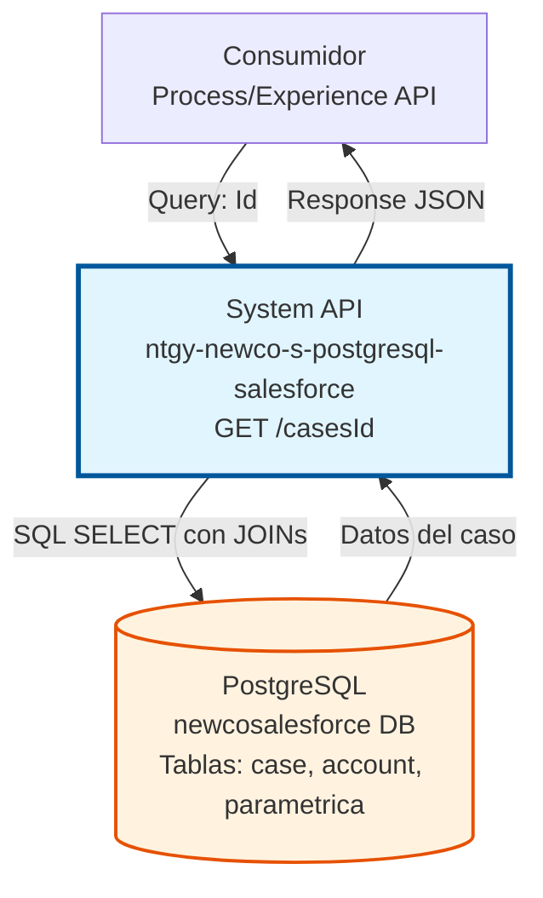
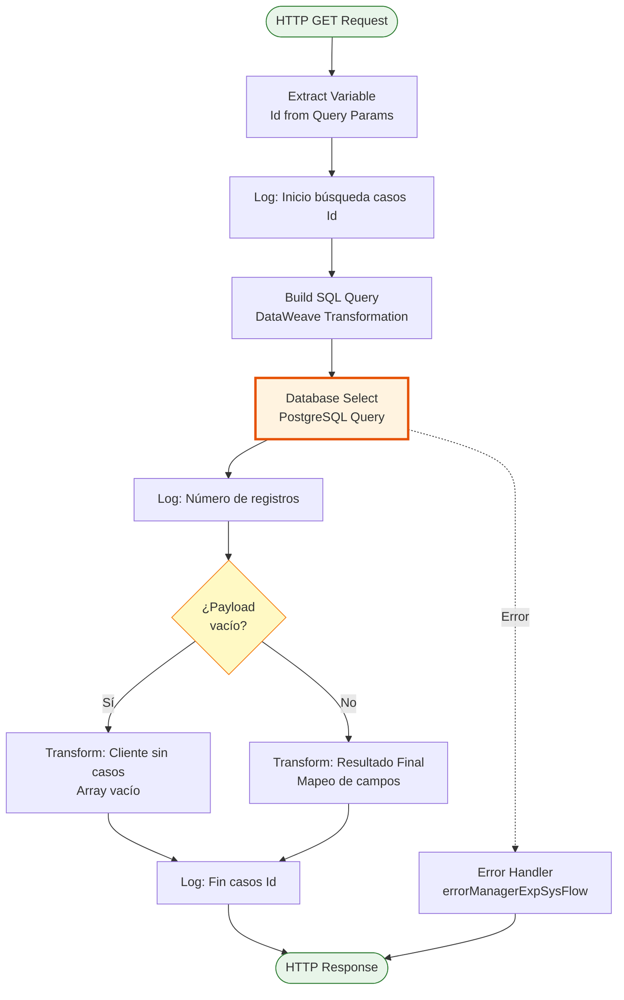
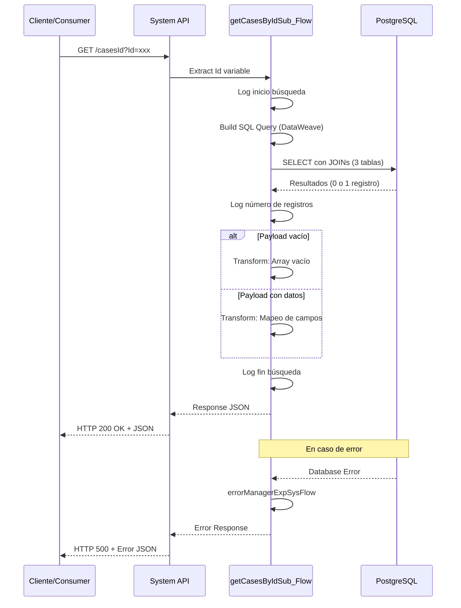

# GET /casesId

## 📌 Descripción General

### Propósito del Endpoint

Este endpoint recupera información detallada de un caso específico desde la base de datos PostgreSQL (réplica de Salesforce) utilizando el ID del caso como criterio de búsqueda. Proporciona datos esenciales del caso incluyendo código, fechas, estado, canal de creación, tipología y nombre de la cuenta asociada.

El endpoint soporta:
- **Consulta por ID**: Búsqueda directa de un caso específico mediante su identificador único (sfid)
- **Joins Relacionales**: Combina información de tres tablas (case, account, parametrica) para enriquecer los datos
- **Respuesta Estructurada**: Retorna información consolidada del caso con formato JSON estándar

### Tipo de API

**Capa:** System API (API-Led Connectivity)

**Función:** Integración directa con PostgreSQL (réplica de Salesforce) para consulta de información detallada de casos individuales.

### Patrón de Integración

**Tipo:** Request-Reply Síncrono con SQL Query

**Descripción:** El endpoint recibe el ID del caso como query parameter, construye dinámicamente una consulta SQL con joins a tres tablas, ejecuta la query en PostgreSQL y retorna los datos transformados en formato JSON.

### Arquitectura API-Led Connectivity



---

## 💼 Propósito del Negocio

### Casos de Uso Principales

1. **Consulta de Detalle de Caso**
   - Un agente de atención al cliente necesita ver información completa de un caso específico
   - Se proporciona el ID del caso y se obtienen todos los detalles relevantes
   - Permite tomar decisiones informadas sobre la gestión del caso

2. **Seguimiento de Casos**
   - Los sistemas de seguimiento necesitan obtener el estado actual de un caso
   - Se consulta por ID para verificar fechas, estado y tipología
   - Facilita el monitoreo del ciclo de vida del caso

3. **Integración con Sistemas Externos**
   - Sistemas externos necesitan sincronizar información de casos
   - Se utiliza el ID como referencia única para obtener datos actualizados
   - Garantiza consistencia de información entre sistemas

### Contexto Empresarial

- **Dominio:** Gestión de Casos y Atención al Cliente
- **Sector:** Energía - Utilities
- **División:** Naturgy España - NewCo
- **Proceso de Negocio:** Gestión de incidencias, solicitudes y reclamaciones de clientes
- **Sistema Origen:** Salesforce CRM (replicado en PostgreSQL)

### Stakeholders

- **Agentes de Atención al Cliente**: Necesitan acceso rápido a información detallada de casos
- **Supervisores de Servicio**: Requieren visibilidad del estado y tipología de casos
- **Sistemas de Integración**: Consumen datos de casos para sincronización con otros sistemas

### Valor de Negocio

- **Acceso Rápido**: Consulta eficiente de información de casos mediante ID único
- **Datos Enriquecidos**: Combina información de múltiples tablas en una sola respuesta
- **Trazabilidad**: Proporciona información completa del ciclo de vida del caso
- **Integración Simplificada**: Facilita la integración con sistemas externos mediante API REST

### Consumidores Potenciales

Este endpoint puede ser consumido por:
- Process APIs de gestión de casos
- Experience APIs de portales de clientes
- Sistemas de CRM y atención al cliente
- Herramientas de reporting y analytics
- Integraciones con sistemas de terceros

---

## 🔧 Especificación Técnica

### URLs por Ambiente

| Ambiente | URL Base | URL Completa |
|----------|----------|--------------|
| **Local** | `http://localhost:8081` | `http://localhost:8081/api/casesId?Id=valor` |
| **Development** | `https://ntgy-newco-s-postgresql-salesforce-dev.us-e2.cloudhub.io` | `https://ntgy-newco-s-postgresql-salesforce-dev.us-e2.cloudhub.io/api/casesId?Id=valor` |
| **UAT** | `https://ntgy-newco-s-postgresql-salesforce-uat.us-e2.cloudhub.io` | `https://ntgy-newco-s-postgresql-salesforce-uat.us-e2.cloudhub.io/api/casesId?Id=valor` |
| **Production** | `https://ntgy-newco-s-postgresql-salesforce-pro.us-e2.cloudhub.io` | `https://ntgy-newco-s-postgresql-salesforce-pro.us-e2.cloudhub.io/api/casesId?Id=valor` |

### Método HTTP

```
GET /api/casesId
```

### Parámetros de Entrada

#### Headers HTTP

| Header | Tipo | Requerido | Descripción | Ejemplo |
|--------|------|-----------|-------------|---------|
| `Accept` | string | ❌ No | Tipo de contenido esperado en response | `application/json` |

#### Query Parameters

| Parámetro | Tipo | Requerido | Descripción | Ejemplo |
|-----------|------|-----------|-------------|---------|
| `Id` | string | ✅ Sí | Identificador único del caso (sfid de Salesforce) | `"a1B2c3D4e5F6g7H8i9J0"` |

### Respuestas

#### Respuesta Exitosa con Datos (200 OK)

```json
{
  "result": {
    "codResult": "0000",
    "msgResult": "No hay error"
  },
  "cases": [
    {
      "caseCode": "CASE-12345",
      "fecCreacion": "2026-01-15 10:30:00.000",
      "fecFin": "2026-01-20 15:45:00.000",
      "estado": "Cerrado",
      "canalCreacion": "Web",
      "tipologia": "Consulta Facturación",
      "accountName": "Juan Pérez García",
      "contactName": null
    }
  ]
}
```

#### Respuesta Sin Datos (200 OK)

```json
{
  "result": {
    "codResult": "0000",
    "msgResult": "No hay error"
  },
  "cases": []
}
```

#### Respuesta de Error (400 Bad Request)

```json
{
  "result": {
    "codResult": "0001",
    "msgResult": "Parámetro Id requerido"
  }
}
```

#### Respuesta de Error (500 Internal Server Error)

```json
{
  "result": {
    "codResult": "0002",
    "msgResult": "Error interno del servidor"
  }
}
```

### Estructura de Campos de Respuesta

| Campo | Tipo | Descripción |
|-------|------|-------------|
| `result.codResult` | string | Código de resultado ("0000" = éxito, otros = error) |
| `result.msgResult` | string | Mensaje descriptivo del resultado |
| `cases` | array | Array de casos (vacío si no se encuentra el caso) |
| `cases[].caseCode` | string | Código calculado del caso |
| `cases[].fecCreacion` | string | Fecha de creación del caso (formato: yyyy-MM-dd HH:mm:ss.SSS) |
| `cases[].fecFin` | string | Fecha de cierre del caso (formato: yyyy-MM-dd HH:mm:ss.SSS) |
| `cases[].estado` | string | Estado actual del caso |
| `cases[].canalCreacion` | string | Canal por el cual se creó el caso (Web, Phone, Email, etc.) |
| `cases[].tipologia` | string | Tipología del caso obtenida de tabla paramétrica |
| `cases[].accountName` | string | Nombre de la cuenta asociada al caso |
| `cases[].contactName` | string | Nombre del contacto (actualmente null en implementación) |

### Autenticación y Autorización

- **Tipo:** Client ID & Client Secret (Anypoint Platform)
- **Autorización PostgreSQL:** El usuario de base de datos debe tener permisos para:
  - Ejecutar SELECT en tabla `newcosalesforce.case`
  - Ejecutar SELECT en tabla `newcosalesforce.account`
  - Ejecutar SELECT en tabla `newcosalesforce.acn_obj_ParametricaCasos__c`

### Timeouts

| Tipo | Valor | Descripción |
|------|-------|-------------|
| **Request Timeout** | 30 segundos | Tiempo máximo de espera para la respuesta |
| **Connection Timeout** | 10 segundos | Tiempo máximo para establecer conexión con PostgreSQL |
| **Query Timeout** | 20 segundos | Tiempo máximo de ejecución de la query SQL |

---

## 🏗️ Implementación Técnica

### Arquitectura del Flow



### Componentes del Flow

#### 1. Extracción de Variables (ee:transform)

**Ubicación en código:** Línea del flow principal

```xml
<ee:transform doc:name="Vars">
    <ee:variables>
        <ee:set-variable variableName="Id">
            <![CDATA[attributes.queryParams.'Id']]>
        </ee:set-variable>
    </ee:variables>
</ee:transform>
```

**Propósito:** Extrae el parámetro `Id` del query string y lo almacena en una variable para uso posterior.

#### 2. Subflow: getCasesByIdSub_Flow

**Ubicación:** `src/main/mule/cases/getCases.xml`

**Componentes principales:**

1. **Logger de Inicio**
   - Registra el inicio de la búsqueda con el Id proporcionado

2. **Construcción de Query SQL (DataWeave)**
   ```dataweave
   %dw 2.0
   output application/java
   ---
   "select tableCase.newco_calccasecode__c
           , tableCase.createddate as fecCreacion
           , tableCase.closeddate as fecFin
           , tableCase.status as estado
           , tableCase.origin as canalCreacion
           , param.name as tipologia
           , tableAcc.name as accountName
      from newcosalesforce.case as tableCase
           inner join newcosalesforce.account tableAcc 
               on tableAcc.sfid = tableCase.accountid
           inner join newcosalesforce.acn_obj_ParametricaCasos__c param 
               on tableCase.acn_fld_Tittle__c= param.sfid
    where tableCase.sfid = '" ++ vars.Id ++ "' "
   ```

3. **Database Select**
   ```xml
   <db:select config-ref="Database_Config" 
              fetchSize="${postgresql.fetchSize}">
       <db:sql><![CDATA[#[vars.casesQuery]]]></db:sql>
   </db:select>
   ```

4. **Logger de Conteo**
   - Registra el número de registros recuperados

5. **Choice: Validación de Resultados**
   - **When isEmpty(payload):** Retorna respuesta con array vacío
   - **Otherwise:** Transforma los datos al formato de respuesta

6. **Logger de Fin**
   - Registra el fin de la operación con el payload resultante

#### 3. Error Handler

```xml
<error-handler>
    <on-error-continue type="ANY">
        <flow-ref name="errorManagerExpSysFlow" />
    </on-error-continue>
</error-handler>
```

### Query SQL Detallada

```sql
SELECT 
    tableCase.newco_calccasecode__c,
    tableCase.createddate as fecCreacion,
    tableCase.closeddate as fecFin,
    tableCase.status as estado,
    tableCase.origin as canalCreacion,
    param.name as tipologia,
    tableAcc.name as accountName
FROM newcosalesforce.case as tableCase
INNER JOIN newcosalesforce.account tableAcc 
    ON tableAcc.sfid = tableCase.accountid
INNER JOIN newcosalesforce.acn_obj_ParametricaCasos__c param 
    ON tableCase.acn_fld_Tittle__c = param.sfid
WHERE tableCase.sfid = '[ID_DEL_CASO]'
```

**Tablas Involucradas:**
1. **newcosalesforce.case** (tableCase): Tabla principal de casos
2. **newcosalesforce.account** (tableAcc): Para obtener nombre de la cuenta
3. **newcosalesforce.acn_obj_ParametricaCasos__c** (param): Para obtener tipología del caso

**Joins:**
- **INNER JOIN con account:** Relaciona el caso con la cuenta mediante `accountid`
- **INNER JOIN con parametrica:** Relaciona el caso con su tipología mediante `acn_fld_Tittle__c`

### Transformación de Respuesta (DataWeave)

```dataweave
%dw 2.0
output application/json

fun formatDate(date) = 
    if(isEmpty(date)) "" 
    else date as LocalDateTime as String {format: "uuuu-MM-dd HH:mm:ss.SSS"}

---
{
  "result": {
    "codResult": "0000",
    "msgResult": "No hay error"
  },
  "cases": payload map ((item, index) -> {
      "caseCode": item.newco_calccasecode__c,
      "fecCreacion": formatDate(item.fecCreacion),
      "fecFin": formatDate(item.fecFin),
      "estado": item.estado,
      "canalCreacion": item.canalCreacion,
      "tipologia": item.tipologia,
      "accountName": item.accountName,
      "contactName": item.contactName
    }) 
}
```

**Funciones Auxiliares:**
- `formatDate()`: Formatea fechas al formato estándar o retorna string vacío si es null

**Mapeo de Campos:**
- `newco_calccasecode__c` → `caseCode`
- `createddate` → `fecCreacion` (formateada)
- `closeddate` → `fecFin` (formateada)
- `status` → `estado`
- `origin` → `canalCreacion`
- `name` (de parametrica) → `tipologia`
- `name` (de account) → `accountName`
- `contactName` → `contactName` (⚠️ campo no presente en SELECT, siempre null)

### Diagrama de Secuencia Completo



### Configuración de Base de Datos

**Archivo:** `src/main/mule/global.xml`

```xml
<db:config name="Database_Config">
    <db:generic-connection 
        url="jdbc:postgresql://${postgresql.host}:${postgresql.port}/${postgresql.database}"
        driverClassName="org.postgresql.Driver"
        user="${postgresql.username}"
        password="${secure::postgresql.password}">
        <db:pooling-profile 
            maxPoolSize="${postgresql.maxPoolSize}"
            minPoolSize="${postgresql.minPoolSize}"
            maxWaitTime="${postgresql.maxWaitTime}"
            maxIdleTime="${postgresql.maxIdleTime}"/>
    </db:generic-connection>
</db:config>
```

**Propiedades (properties-pro.yaml):**
```yaml
postgresql:
  host: "ec2-34-246-192-22.eu-west-1.compute.amazonaws.com"
  port: "5432"
  database: "d2ghjoagff485u"
  username: "udmaci1ap8m24r"
  password: "![encrypted]"
  maxPoolSize: "30"
  minPoolSize: "5"
  maxWaitTime: "20"
  maxIdleTime: "300"
  fetchSize: "100"
```

### Manejo de Errores

**Estrategia:** Centralizada mediante `errorManagerExpSysFlow`

**Tipos de errores manejados:**
- **DB:CONNECTIVITY**: Error de conexión a PostgreSQL
- **DB:QUERY_EXECUTION**: Error en ejecución de query SQL
- **DB:BAD_SQL_SYNTAX**: Error de sintaxis SQL
- **ANY**: Cualquier otro error no especificado

**Respuesta de error estándar:**
```json
{
  "result": {
    "codResult": "[código_error]",
    "msgResult": "[mensaje_error]"
  }
}
```

### Consideraciones de Performance

1. **Connection Pooling**: Pool de 5-30 conexiones para optimizar rendimiento
2. **Fetch Size**: 100 registros por batch (aunque este endpoint retorna máximo 1)
3. **Índices**: La búsqueda por `sfid` utiliza la clave primaria (óptimo)
4. **Joins**: Los joins están optimizados con índices en claves foráneas

### Observación Técnica Importante

⚠️ **Campo contactName:** El código incluye el campo `contactName` en la transformación de respuesta, pero este campo **NO está presente en el SELECT de la query SQL**. Esto significa que el campo siempre retornará `null` en la respuesta.

**Posibles soluciones:**
1. Agregar el campo al SELECT si existe en alguna de las tablas
2. Remover el campo de la transformación de respuesta
3. Documentar como limitación conocida

---

## 💻 Ejemplos de Uso

### Ejemplo 1: Consulta Exitosa con Datos

#### Request

```bash
curl -X GET "http://localhost:8081/api/casesId?Id=a1B2c3D4e5F6g7H8i9J0" \
  -H "Accept: application/json"
```

#### Response (200 OK)

```json
{
  "result": {
    "codResult": "0000",
    "msgResult": "No hay error"
  },
  "cases": [
    {
      "caseCode": "CASE-12345",
      "fecCreacion": "2026-01-15 10:30:00.000",
      "fecFin": "2026-01-20 15:45:00.000",
      "estado": "Cerrado",
      "canalCreacion": "Web",
      "tipologia": "Consulta Facturación",
      "accountName": "Juan Pérez García",
      "contactName": null
    }
  ]
}
```

### Ejemplo 2: Caso No Encontrado

#### Request

```bash
curl -X GET "http://localhost:8081/api/casesId?Id=ID_INEXISTENTE" \
  -H "Accept: application/json"
```

#### Response (200 OK)

```json
{
  "result": {
    "codResult": "0000",
    "msgResult": "No hay error"
  },
  "cases": []
}
```

### Ejemplo 3: Error - Parámetro Faltante

#### Request

```bash
curl -X GET "http://localhost:8081/api/casesId" \
  -H "Accept: application/json"
```

#### Response (400 Bad Request)

```json
{
  "result": {
    "codResult": "0001",
    "msgResult": "Parámetro Id requerido"
  }
}
```

### Ejemplo 4: Consulta desde JavaScript

```javascript
const getCaseById = async (caseId) => {
  try {
    const response = await fetch(
      `https://ntgy-newco-s-postgresql-salesforce-pro.us-e2.cloudhub.io/api/casesId?Id=${caseId}`,
      {
        method: 'GET',
        headers: {
          'Accept': 'application/json'
        }
      }
    );
    
    const data = await response.json();
    
    if (data.result.codResult === "0000" && data.cases.length > 0) {
      console.log('Caso encontrado:', data.cases[0]);
      return data.cases[0];
    } else {
      console.log('Caso no encontrado');
      return null;
    }
  } catch (error) {
    console.error('Error al consultar caso:', error);
    throw error;
  }
};

// Uso
getCaseById('a1B2c3D4e5F6g7H8i9J0')
  .then(caseData => {
    if (caseData) {
      console.log(`Código: ${caseData.caseCode}`);
      console.log(`Estado: ${caseData.estado}`);
      console.log(`Tipología: ${caseData.tipologia}`);
    }
  });
```

### Ejemplo 5: Consulta desde Python

```python
import requests
import json

def get_case_by_id(case_id):
    """
    Obtiene información de un caso por su ID
    """
    url = "https://ntgy-newco-s-postgresql-salesforce-pro.us-e2.cloudhub.io/api/casesId"
    params = {"Id": case_id}
    headers = {"Accept": "application/json"}
    
    try:
        response = requests.get(url, params=params, headers=headers)
        response.raise_for_status()
        
        data = response.json()
        
        if data["result"]["codResult"] == "0000" and len(data["cases"]) > 0:
            case = data["cases"][0]
            print(f"Caso encontrado: {case['caseCode']}")
            print(f"Estado: {case['estado']}")
            print(f"Tipología: {case['tipologia']}")
            print(f"Cuenta: {case['accountName']}")
            return case
        else:
            print("Caso no encontrado")
            return None
            
    except requests.exceptions.RequestException as e:
        print(f"Error al consultar caso: {e}")
        return None

# Uso
case_data = get_case_by_id("a1B2c3D4e5F6g7H8i9J0")
```

### Ejemplo 6: Integración con Postman

**Configuración de Request:**

```
Method: GET
URL: {{base_url}}/api/casesId
Query Params:
  - Id: a1B2c3D4e5F6g7H8i9J0

Headers:
  - Accept: application/json

Environment Variables:
  - base_url: https://ntgy-newco-s-postgresql-salesforce-pro.us-e2.cloudhub.io
```

**Test Script (Postman):**

```javascript
pm.test("Status code is 200", function () {
    pm.response.to.have.status(200);
});

pm.test("Response has correct structure", function () {
    var jsonData = pm.response.json();
    pm.expect(jsonData).to.have.property('result');
    pm.expect(jsonData).to.have.property('cases');
    pm.expect(jsonData.result).to.have.property('codResult');
    pm.expect(jsonData.result).to.have.property('msgResult');
});

pm.test("Result code is success", function () {
    var jsonData = pm.response.json();
    pm.expect(jsonData.result.codResult).to.eql("0000");
});

pm.test("Cases array is present", function () {
    var jsonData = pm.response.json();
    pm.expect(jsonData.cases).to.be.an('array');
});
```

### Ejemplo 7: Caso de Uso Real - Portal de Atención al Cliente

```javascript
// Componente React para mostrar detalle de caso
import React, { useState, useEffect } from 'react';

const CaseDetail = ({ caseId }) => {
  const [caseData, setCaseData] = useState(null);
  const [loading, setLoading] = useState(true);
  const [error, setError] = useState(null);

  useEffect(() => {
    const fetchCaseDetail = async () => {
      try {
        const response = await fetch(
          `${process.env.REACT_APP_API_URL}/api/casesId?Id=${caseId}`
        );
        const data = await response.json();
        
        if (data.result.codResult === "0000" && data.cases.length > 0) {
          setCaseData(data.cases[0]);
        } else {
          setError("Caso no encontrado");
        }
      } catch (err) {
        setError("Error al cargar el caso");
      } finally {
        setLoading(false);
      }
    };

    fetchCaseDetail();
  }, [caseId]);

  if (loading) return <div>Cargando...</div>;
  if (error) return <div>Error: {error}</div>;
  if (!caseData) return <div>No se encontró el caso</div>;

  return (
    <div className="case-detail">
      <h2>Detalle del Caso</h2>
      <div className="case-info">
        <p><strong>Código:</strong> {caseData.caseCode}</p>
        <p><strong>Estado:</strong> {caseData.estado}</p>
        <p><strong>Tipología:</strong> {caseData.tipologia}</p>
        <p><strong>Canal:</strong> {caseData.canalCreacion}</p>
        <p><strong>Cliente:</strong> {caseData.accountName}</p>
        <p><strong>Fecha Creación:</strong> {caseData.fecCreacion}</p>
        {caseData.fecFin && (
          <p><strong>Fecha Cierre:</strong> {caseData.fecFin}</p>
        )}
      </div>
    </div>
  );
};

export default CaseDetail;