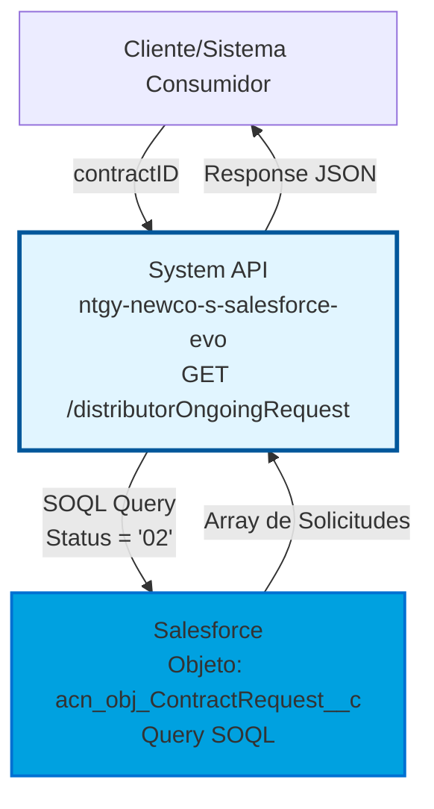
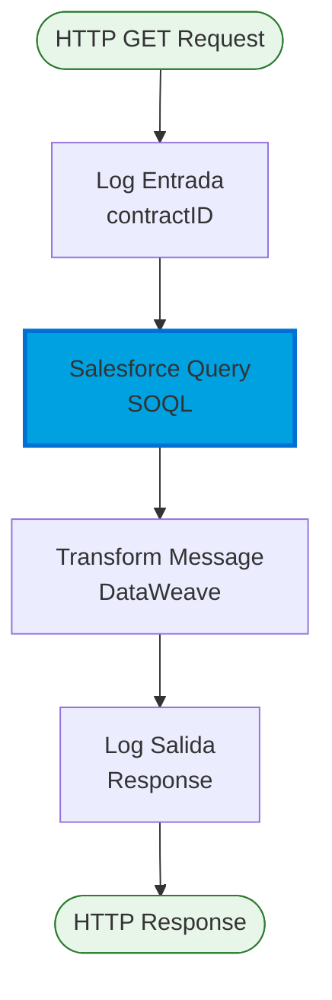
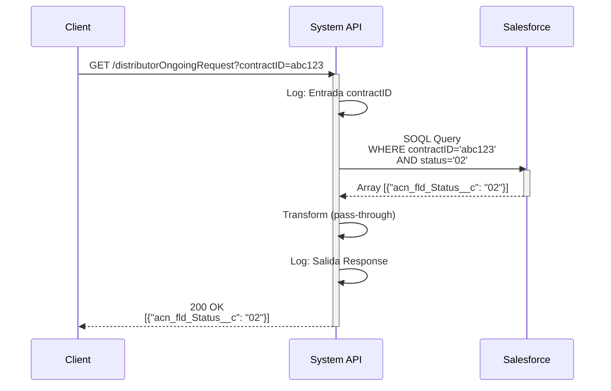
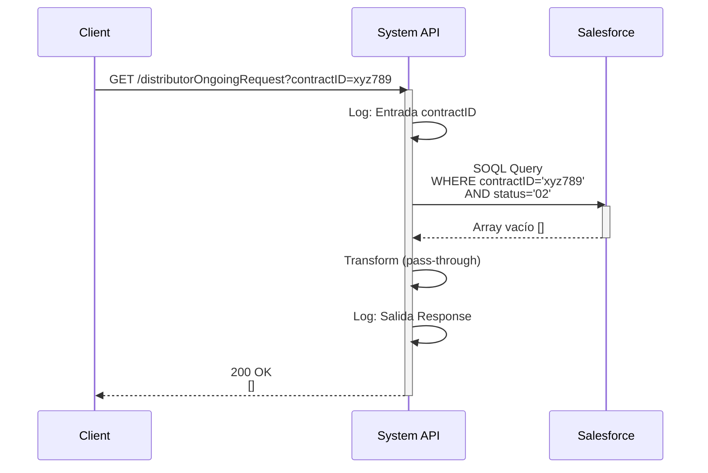
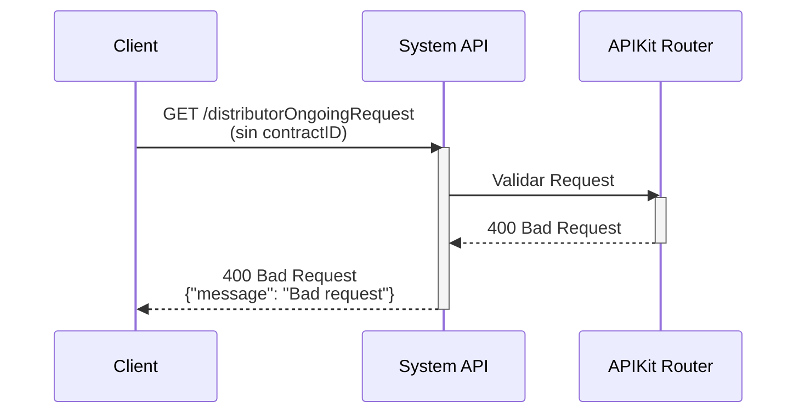

# GET /distributorOngoingRequest

## 📌 Descripción General

### Propósito del Endpoint

Este endpoint valida si existen solicitudes de contratación del distribuidor en curso para un contrato específico en Salesforce. Consulta el objeto `acn_obj_ContractRequest__c` filtrando por el ID del contrato y el estado '02' (En curso), retornando un array con las solicitudes encontradas.

El endpoint soporta:
- **Validación de Solicitudes Activas**: Verifica si hay solicitudes del distribuidor con estado '02' (En curso)
- **Prevención de Conflictos**: Permite identificar contratos con solicitudes pendientes antes de realizar modificaciones
- **Consulta Directa a Salesforce**: Acceso en tiempo real al estado de las solicitudes del distribuidor

### Tipo de API

**Capa:** System API (API-Led Connectivity)

**Función:** Integración directa con Salesforce para consultar solicitudes de contratación del distribuidor asociadas a un contrato específico.

### Patrón de Integración

**Tipo:** Request-Reply Síncrono con Salesforce Query (SOQL)

**Descripción:** El endpoint recibe un contractID como query parameter, ejecuta una consulta SOQL en Salesforce filtrando por el ID del contrato y el estado '02', y retorna un array con las solicitudes encontradas. Un array vacío indica que no hay solicitudes en curso.

### Arquitectura API-Led Connectivity



---

## 💼 Propósito del Negocio

### Casos de Uso Principales

1. **Validación Pre-Modificación de Contratos**
   - Antes de modificar un contrato, verificar si tiene solicitudes del distribuidor en curso
   - Prevenir cambios que puedan entrar en conflicto con solicitudes pendientes
   - Garantizar integridad de datos entre sistemas

2. **Verificación de Estado de Solicitudes**
   - Consultar el estado actual de solicitudes del distribuidor para un contrato
   - Identificar contratos con solicitudes activas (status '02')
   - Monitorear solicitudes pendientes de procesamiento

3. **Prevención de Operaciones Conflictivas**
   - Evitar operaciones simultáneas sobre el mismo contrato
   - Detectar solicitudes en curso antes de iniciar nuevos procesos
   - Mantener consistencia en el flujo de contratación

### Contexto Empresarial

- **Dominio:** Gestión de Contratos y Solicitudes del Distribuidor
- **Sector:** Energía - Utilities
- **División:** Naturgy España - NewCo
- **Proceso de Negocio:** Validación de solicitudes de contratación del distribuidor en curso
- **Sistema Backend:** Salesforce (CRM)

### Stakeholders

- **Equipos de Contratación**: Necesitan validar estado de solicitudes antes de modificar contratos
- **Sistemas de Distribución**: Requieren verificar solicitudes pendientes del distribuidor
- **Equipos de Operaciones**: Monitorean solicitudes en curso para gestión de contratos
- **Sistemas de Integración**: Consumen este endpoint para validaciones pre-operacionales

### Valor de Negocio

- **Prevención de Conflictos**: Evita modificaciones sobre contratos con solicitudes activas
- **Integridad de Datos**: Garantiza consistencia entre solicitudes del distribuidor y contratos
- **Visibilidad en Tiempo Real**: Acceso inmediato al estado de solicitudes en Salesforce
- **Reducción de Errores**: Previene operaciones que puedan causar inconsistencias

### Consumidores Potenciales

Este endpoint puede ser consumido por:
- Process APIs de gestión de contratos
- Sistemas de validación pre-operacional
- Portales de agentes y operadores
- Flujos de Salesforce (Platform Events, Flows)
- Sistemas de integración middleware
- APIs de orquestación de procesos de contratación

---

## 🔧 Especificación Técnica

### URLs por Ambiente

| Ambiente | URL Base | URL Completa |
|----------|----------|--------------|
| **Local** | `http://localhost:8081` | `http://localhost:8081/api/distributorOngoingRequest?contractID=:contractID` |
| **Development** | `https://ntgy-newco-s-salesforce-evo-dev.us-e2.cloudhub.io` | `https://ntgy-newco-s-salesforce-evo-dev.us-e2.cloudhub.io/api/distributorOngoingRequest?contractID=:contractID` |
| **UAT** | `https://ntgy-newco-s-salesforce-evo-uat.us-e2.cloudhub.io` | `https://ntgy-newco-s-salesforce-evo-uat.us-e2.cloudhub.io/api/distributorOngoingRequest?contractID=:contractID` |
| **Production** | `https://ntgy-newco-s-salesforce-evo-pro.us-e2.cloudhub.io` | `https://ntgy-newco-s-salesforce-evo-pro.us-e2.cloudhub.io/api/distributorOngoingRequest?contractID=:contractID` |

### Método HTTP

```
GET /api/distributorOngoingRequest
```

### Parámetros de Entrada

#### Headers HTTP

| Header | Tipo | Requerido | Descripción | Ejemplo |
|--------|------|-----------|-------------|---------|
| `Accept` | string | ❌ No | Tipo de contenido esperado en response | `application/json` |
| `client_id` | string | ✅ Sí | Client ID de Anypoint Platform | `a1b2c3d4e5f6g7h8i9j0` |
| `client_secret` | string | ✅ Sí | Client Secret de Anypoint Platform | `A1B2C3D4E5F6G7H8I9J0` |

#### Query Parameters

| Parámetro | Tipo | Requerido | Descripción | Ejemplo |
|-----------|------|-----------|-------------|---------|
| `contractID` | string | ✅ Sí | ID del contrato en Salesforce para buscar solicitudes asociadas | `"a1B2C3D4E5F6G7H8I9J0"` |

### Respuestas

#### Respuesta Exitosa con Solicitudes Encontradas (200 OK)

```json
[
  {
    "acn_fld_Status__c": "02"
  }
]
```

**Descripción:** Array con las solicitudes del distribuidor encontradas que tienen status '02' (En curso). Cada objeto contiene el campo `acn_fld_Status__c` con el valor '02'.

#### Respuesta Exitosa sin Solicitudes (200 OK)

```json
[]
```

**Descripción:** Array vacío indica que no existen solicitudes del distribuidor en curso (status '02') para el contrato especificado.

#### Respuesta de Error - contractID Faltante (400 Bad Request)

```json
{
  "message": "Bad request"
}
```

**Descripción:** El query parameter `contractID` es obligatorio y no fue proporcionado.

#### Respuesta de Error Técnico (500 Internal Server Error)

```json
{
  "message": "Internal server error"
}
```

**Descripción:** Error al conectar con Salesforce o error interno del servidor.

### Autenticación y Autorización

- **Tipo:** Client ID & Client Secret (Anypoint Platform)
- **Autorización Salesforce:** El usuario configurado debe tener permisos para:
  - Ejecutar queries SOQL en Salesforce
  - Acceso de lectura al objeto `acn_obj_ContractRequest__c`
  - Acceso a los campos `acn_fld_Status__c` y `acn_fld_Contract__c`

### Timeouts

| Tipo | Valor | Descripción |
|------|-------|-------------|
| **Request Timeout** | 30 segundos | Tiempo máximo de espera para la respuesta de Salesforce |
| **Connection Timeout** | 10 segundos | Tiempo máximo para establecer conexión con Salesforce |

---

## 🏗️ Implementación Técnica

### Arquitectura del Flow



### 🔍 Query SOQL Ejecutado

**Objeto Salesforce:** `acn_obj_ContractRequest__c` (Solicitudes de Contratación del Distribuidor)

**Query SOQL:**
```sql
SELECT acn_fld_Status__c 
FROM acn_obj_ContractRequest__c 
WHERE acn_fld_Contract__c = ':contractID' 
AND acn_fld_Status__c = '02'
```

**Descripción de la Query:**
- **SELECT**: Selecciona únicamente el campo `acn_fld_Status__c` (estado de la solicitud)
- **FROM**: Consulta el objeto `acn_obj_ContractRequest__c` (solicitudes del distribuidor)
- **WHERE**: Filtra por dos condiciones:
  - `acn_fld_Contract__c = ':contractID'`: Solicitudes asociadas al contrato especificado
  - `acn_fld_Status__c = '02'`: Solo solicitudes con estado '02' (En curso)

**Parámetros de la Query:**
```dataweave
{
  "contractID": attributes.queryParams.contractID
}
```

### 📊 Objeto Salesforce: acn_obj_ContractRequest__c

| Campo | Tipo | Descripción | Uso en Query |
|-------|------|-------------|--------------|
| `acn_fld_Status__c` | String | Estado de la solicitud del distribuidor. Código '02' = En curso | SELECT + WHERE |
| `acn_fld_Contract__c` | Reference | ID del contrato asociado a la solicitud | WHERE |

**Relaciones:**
- `acn_fld_Contract__c` → Referencia al objeto Contract en Salesforce

### 🔄 Transformación de Datos

**Transformación de Salida (Salesforce → Response):**

```dataweave
%dw 2.0
output application/json
---
payload
```

**Descripción:** La transformación es pass-through, retornando directamente el payload de Salesforce sin modificaciones. El resultado es un array de objetos con el campo `acn_fld_Status__c`.

### 📈 Diagramas de Secuencia

#### Flujo Normal - Solicitudes Encontradas



#### Flujo Normal - Sin Solicitudes



#### Flujo de Error - contractID Faltante



### 🔧 Configuración del Conector Salesforce

**Connector:** Salesforce Connector v10.22.4

**Configuración:**
```xml
<salesforce:query 
    doc:name="Query" 
    config-ref="Salesforce_Config">
    <salesforce:salesforce-query>
        SELECT acn_fld_Status__c 
        FROM acn_obj_ContractRequest__c 
        WHERE acn_fld_Contract__c = ':contractID' 
        AND acn_fld_Status__c = '02'
    </salesforce:salesforce-query>
    <salesforce:parameters>
        {
            "contractID": attributes.queryParams.contractID
        }
    </salesforce:parameters>
</salesforce:query>
```

**Autenticación:** OAuth 2.0 User-Password Flow
- Consumer Key: `${salesforce.oauthKey}`
- Consumer Secret: `${salesforce.oauthSecret}` (secured)
- Username: `${salesforce.username}`
- Password: `${salesforce.password}` (secured)
- Security Token: `${salesforce.securityToken}` (secured)
- Token Endpoint: `${salesforce.tokenEndpoint}`

### 🛡️ Manejo de Errores

**Estrategia de Error Handling:**

1. **Validación de Parámetros:** APIKit valida que `contractID` esté presente
2. **Errores de Salesforce:** Capturados y retornados como 500 Internal Server Error
3. **Logging:** Todos los requests y responses son loggeados para troubleshooting

**Error Responses:**
- **400 Bad Request:** Query parameter `contractID` faltante o inválido
- **500 Internal Server Error:** Error de conectividad con Salesforce o error interno

### 📝 Logging

**Puntos de Logging:**

1. **Entrada:** Log del contractID recibido
   ```
   Request distributorOngoingRequest contractID: [contractID]
   ```

2. **Salida:** Log de la respuesta generada
   ```
   Response distributorOngoingRequest: [payload]
   ```

**Nivel de Log:** INFO

---

## 💻 Ejemplos de Uso

### Ejemplo 1: Consulta con Solicitudes Encontradas (curl)

```bash
curl -X GET "https://ntgy-newco-s-salesforce-evo-dev.us-e2.cloudhub.io/api/distributorOngoingRequest?contractID=a1B2C3D4E5F6G7H8I9J0" \
  -H "Accept: application/json" \
  -H "client_id: your-client-id" \
  -H "client_secret: your-client-secret"
```

**Respuesta (200 OK):**
```json
[
  {
    "acn_fld_Status__c": "02"
  }
]
```

**Interpretación:** Existe al menos una solicitud del distribuidor en curso (status '02') para el contrato especificado.

---

### Ejemplo 2: Consulta sin Solicitudes (curl)

```bash
curl -X GET "https://ntgy-newco-s-salesforce-evo-dev.us-e2.cloudhub.io/api/distributorOngoingRequest?contractID=z9Y8X7W6V5U4T3S2R1Q0" \
  -H "Accept: application/json" \
  -H "client_id: your-client-id" \
  -H "client_secret: your-client-secret"
```

**Respuesta (200 OK):**
```json
[]
```

**Interpretación:** No existen solicitudes del distribuidor en curso para el contrato especificado. El contrato puede ser modificado sin conflictos.

---

### Ejemplo 3: Error - contractID Faltante (curl)

```bash
curl -X GET "https://ntgy-newco-s-salesforce-evo-dev.us-e2.cloudhub.io/api/distributorOngoingRequest" \
  -H "Accept: application/json" \
  -H "client_id: your-client-id" \
  -H "client_secret: your-client-secret"
```

**Respuesta (400 Bad Request):**
```json
{
  "message": "Bad request"
}
```

**Interpretación:** El query parameter `contractID` es obligatorio y no fue proporcionado.

---

### Ejemplo 4: Uso en JavaScript (Fetch API)

```javascript
async function checkDistributorOngoingRequest(contractID) {
  const url = `https://ntgy-newco-s-salesforce-evo-dev.us-e2.cloudhub.io/api/distributorOngoingRequest?contractID=${contractID}`;
  
  try {
    const response = await fetch(url, {
      method: 'GET',
      headers: {
        'Accept': 'application/json',
        'client_id': 'your-client-id',
        'client_secret': 'your-client-secret'
      }
    });
    
    if (!response.ok) {
      throw new Error(`HTTP error! status: ${response.status}`);
    }
    
    const data = await response.json();
    
    // Verificar si hay solicitudes en curso
    if (data.length > 0) {
      console.log('⚠️ Contrato tiene solicitudes del distribuidor en curso');
      console.log('No se recomienda modificar el contrato en este momento');
      return true; // Hay solicitudes en curso
    } else {
      console.log('✅ No hay solicitudes del distribuidor en curso');
      console.log('El contrato puede ser modificado');
      return false; // No hay solicitudes en curso
    }
    
  } catch (error) {
    console.error('Error al consultar solicitudes:', error);
    throw error;
  }
}

// Uso
checkDistributorOngoingRequest('a1B2C3D4E5F6G7H8I9J0')
  .then(hasOngoingRequests => {
    if (hasOngoingRequests) {
      // Bloquear modificaciones
      alert('El contrato tiene solicitudes pendientes del distribuidor');
    } else {
      // Permitir modificaciones
      console.log('Proceder con modificación del contrato');
    }
  })
  .catch(error => {
    console.error('Error:', error);
  });
```

---

### Ejemplo 5: Uso en Python (requests)

```python
import requests
from typing import List, Dict

def check_distributor_ongoing_request(contract_id: str) -> bool:
    """
    Verifica si un contrato tiene solicitudes del distribuidor en curso.
    
    Args:
        contract_id: ID del contrato en Salesforce
        
    Returns:
        True si hay solicitudes en curso, False si no hay
        
    Raises:
        requests.exceptions.RequestException: Error en la petición HTTP
    """
    url = "https://ntgy-newco-s-salesforce-evo-dev.us-e2.cloudhub.io/api/distributorOngoingRequest"
    
    headers = {
        "Accept": "application/json",
        "client_id": "your-client-id",
        "client_secret": "your-client-secret"
    }
    
    params = {
        "contractID": contract_id
    }
    
    try:
        response = requests.get(url, headers=headers, params=params, timeout=30)
        response.raise_for_status()
        
        data = response.json()
        
        # Verificar si hay solicitudes en curso
        has_ongoing_requests = len(data) > 0
        
        if has_ongoing_requests:
            print(f"⚠️ Contrato {contract_id} tiene solicitudes del distribuidor en curso")
            print("No se recomienda modificar el contrato en este momento")
        else:
            print(f"✅ Contrato {contract_id} no tiene solicitudes del distribuidor en curso")
            print("El contrato puede ser modificado")
        
        return has_ongoing_requests
        
    except requests.exceptions.HTTPError as e:
        if e.response.status_code == 400:
            print(f"❌ Error 400: contractID inválido o faltante")
        elif e.response.status_code == 500:
            print(f"❌ Error 500: Error interno del servidor")
        raise
    except requests.exceptions.RequestException as e:
        print(f"❌ Error de conexión: {e}")
        raise

# Uso
if __name__ == "__main__":
    contract_id = "a1B2C3D4E5F6G7H8I9J0"
    
    try:
        has_ongoing = check_distributor_ongoing_request(contract_id)
        
        if has_ongoing:
            print("\n🚫 Acción bloqueada: Contrato con solicitudes pendientes")
        else:
            print("\n✅ Acción permitida: Proceder con modificación")
            
    except Exception as e:
        print(f"\n❌ Error al verificar solicitudes: {e}")
```

---

### Ejemplo 6: Integración en Flujo de Validación

```javascript
/**
 * Flujo de validación pre-modificación de contrato
 */
async function validateContractBeforeModification(contractID, modifications) {
  console.log(`Validando contrato ${contractID} antes de modificar...`);
  
  // 1. Verificar solicitudes del distribuidor en curso
  const hasOngoingRequests = await checkDistributorOngoingRequest(contractID);
  
  if (hasOngoingRequests) {
    return {
      canModify: false,
      reason: 'El contrato tiene solicitudes del distribuidor en curso (status 02)',
      recommendation: 'Esperar a que las solicitudes sean procesadas antes de modificar'
    };
  }
  
  // 2. Otras validaciones...
  console.log('✅ Validación de solicitudes del distribuidor: OK');
  
  // 3. Proceder con modificación
  return {
    canModify: true,
    reason: 'Todas las validaciones pasaron',
    recommendation: 'Proceder con la modificación del contrato'
  };
}

// Uso en proceso de modificación
async function modifyContract(contractID, modifications) {
  try {
    // Validar antes de modificar
    const validation = await validateContractBeforeModification(contractID, modifications);
    
    if (!validation.canModify) {
      console.warn(`⚠️ Modificación bloqueada: ${validation.reason}`);
      console.warn(`💡 Recomendación: ${validation.recommendation}`);
      return {
        success: false,
        message: validation.reason
      };
    }
    
    // Proceder con modificación
    console.log('✅ Validaciones OK - Modificando contrato...');
    // ... lógica de modificación ...
    
    return {
      success: true,
      message: 'Contrato modificado exitosamente'
    };
    
  } catch (error) {
    console.error('❌ Error en proceso de modificación:', error);
    throw error;
  }
}