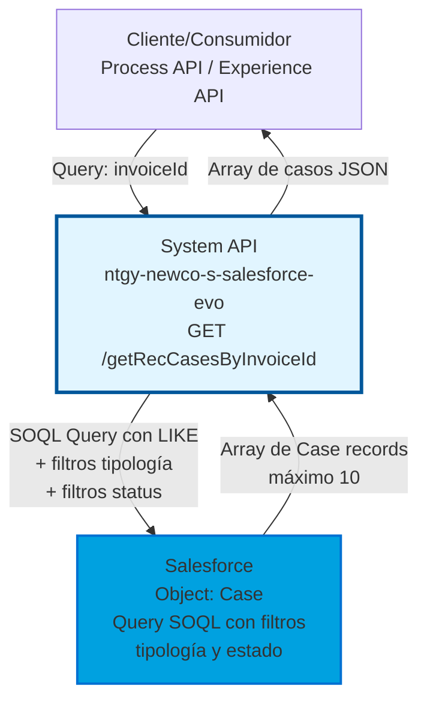
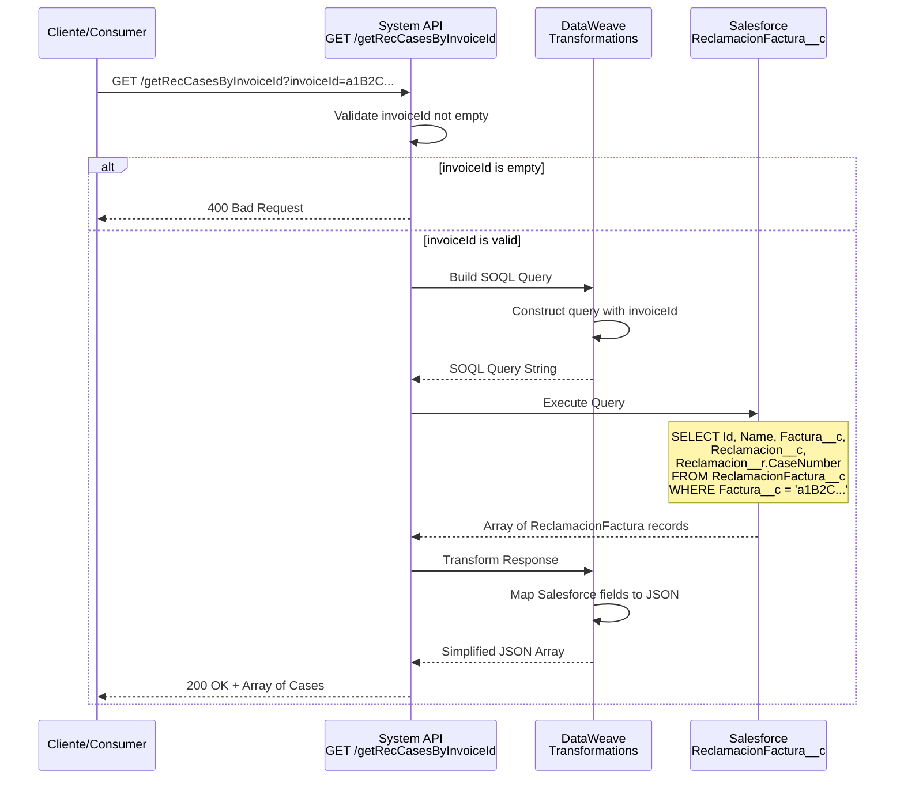
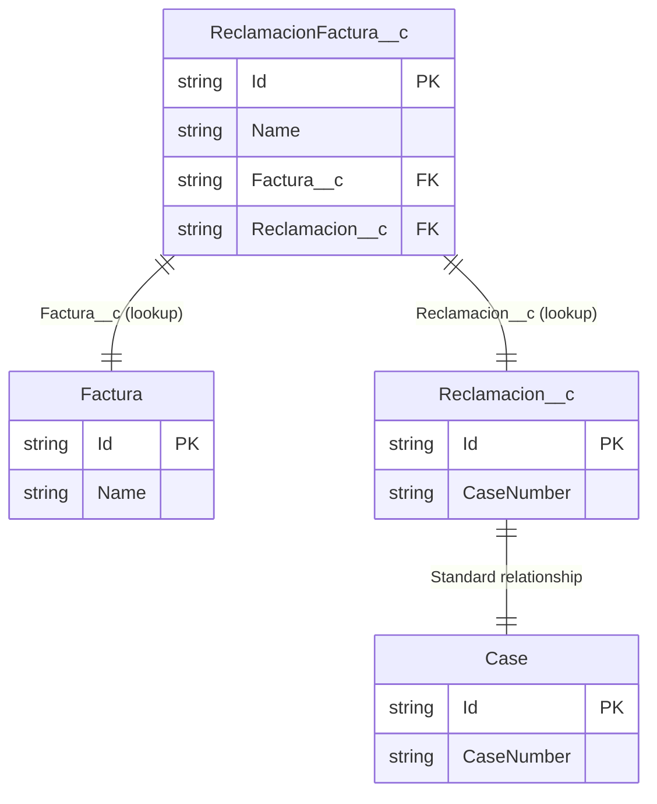

# GET /getRecCasesByInvoiceId

## 📌 Descripción General

### Propósito del Endpoint

Este endpoint consulta casos de reclamación abiertos asociados a una factura específica en Salesforce. Permite obtener información sobre reclamaciones activas relacionadas con facturas mediante queries SOQL sobre el objeto estándar `Case`, aplicando filtros específicos por tipología de reclamación y estado del caso.

El endpoint soporta:
- **Consulta por Número de Factura**: Búsqueda de casos usando el número de factura reclamada (LIKE pattern)
- **Filtrado por Tipología**: Solo casos de 5 tipologías específicas de reclamaciones de facturas
- **Exclusión de Casos Cerrados**: Filtra casos con status '06' (Cerrado) y '08' (Cancelado)
- **Límite de Resultados**: Máximo 10 casos por consulta para optimizar rendimiento

### Tipo de API

**Capa:** System API (API-Led Connectivity)

**Función:** Integración directa con Salesforce para consultar relaciones entre facturas y casos de reclamación.

### Patrón de Integración

**Tipo:** Request-Reply Síncrono con Salesforce Query

**Descripción:** El endpoint recibe un número de factura como query parameter, construye y ejecuta un query SOQL en Salesforce sobre el objeto `Case` con filtros por tipología y estado, y retorna un array de casos de reclamación abiertos (máximo 10 resultados).

### Arquitectura API-Led Connectivity



---

## 💼 Propósito del Negocio

### Casos de Uso Principales

1. **Consulta de Reclamaciones por Factura**
   - Un cliente o agente necesita verificar si una factura tiene reclamaciones asociadas
   - Se proporciona el ID de la factura y se obtienen todos los casos de reclamación relacionados
   - Permite identificar rápidamente problemas o disputas sobre una factura específica

2. **Seguimiento de Casos de Atención al Cliente**
   - El sistema de atención al cliente necesita relacionar facturas con casos abiertos
   - Se obtiene el número de caso (CaseNumber) para seguimiento y gestión
   - Facilita la trazabilidad entre facturación y reclamaciones

3. **Validación de Estado de Factura**
   - Antes de procesar una factura, se verifica si tiene reclamaciones pendientes
   - Permite tomar decisiones sobre cobros o ajustes basándose en reclamaciones activas
   - Evita acciones sobre facturas en disputa

### Contexto Empresarial

- **Dominio:** Gestión de Reclamaciones y Facturación
- **Sector:** Energía - Utilities
- **División:** Naturgy España - NewCo
- **Proceso de Negocio:** Atención al Cliente - Gestión de Reclamaciones sobre Facturas
- **Objeto Salesforce:** ReclamacionFactura__c (Custom Object)

### Stakeholders

- **Agentes de Atención al Cliente**: Necesitan consultar reclamaciones asociadas a facturas para resolver consultas
- **Departamento de Facturación**: Requieren visibilidad de reclamaciones antes de procesar cobros
- **Sistemas de Gestión de Reclamaciones**: Consumen este endpoint para relacionar facturas con casos

### Valor de Negocio

- **Trazabilidad**: Relaciona facturas con casos de reclamación para auditoría y seguimiento
- **Eficiencia Operativa**: Acceso rápido a información de reclamaciones sin navegación manual en Salesforce
- **Mejora en Atención al Cliente**: Permite a los agentes identificar rápidamente reclamaciones sobre facturas
- **Prevención de Conflictos**: Identifica facturas en disputa antes de acciones de cobro

### Consumidores Potenciales

Este endpoint puede ser consumido por:
- Process APIs de gestión de reclamaciones
- Experience APIs de portales de atención al cliente
- Sistemas de facturación y cobros
- Aplicaciones de agentes de call center
- Integraciones con sistemas de gestión de casos

---

## 🔧 Especificación Técnica

### URLs por Ambiente

| Ambiente | URL Base | URL Completa |
|----------|----------|--------------|
| **Local** | `http://localhost:8081` | `http://localhost:8081/api/getRecCasesByInvoiceId?invoiceId=:invoiceId` |
| **Development** | `https://ntgy-newco-s-salesforce-evo-dev.us-e2.cloudhub.io` | `https://ntgy-newco-s-salesforce-evo-dev.us-e2.cloudhub.io/api/getRecCasesByInvoiceId?invoiceId=:invoiceId` |
| **UAT** | `https://ntgy-newco-s-salesforce-evo-uat.us-e2.cloudhub.io` | `https://ntgy-newco-s-salesforce-evo-uat.us-e2.cloudhub.io/api/getRecCasesByInvoiceId?invoiceId=:invoiceId` |
| **Production** | `https://ntgy-newco-s-salesforce-evo-pro.us-e2.cloudhub.io` | `https://ntgy-newco-s-salesforce-evo-pro.us-e2.cloudhub.io/api/getRecCasesByInvoiceId?invoiceId=:invoiceId` |

### Método HTTP

```
GET /api/getRecCasesByInvoiceId
```

### Parámetros de Entrada

#### Headers HTTP

| Header | Tipo | Requerido | Descripción | Ejemplo |
|--------|------|-----------|-------------|---------|
| `Accept` | string | ❌ No | Tipo de contenido esperado en response | `application/json` |

#### Query Parameters

| Parámetro | Tipo | Requerido | Descripción | Ejemplo |
|-----------|------|-----------|-------------|---------|
| `invoiceId` | string | ✅ Sí | Número de factura para buscar casos de reclamación asociados. Se usa con operador LIKE en el query. Debe ser un identificador alfanumérico válido que cumpla el patrón `^[A-Za-z0-9].*` | `"FAC-2026-001234"` |

**Validaciones del parámetro invoiceId:**
- Es obligatorio (required: true)
- Debe cumplir el patrón regex: `^[A-Za-z0-9].*`
- Se usa con operador LIKE en Salesforce (búsqueda por patrón)
- Puede ser número de factura completo o parcial

### Respuestas

#### Respuesta Exitosa (200 OK)

**Con casos encontrados:**

```json
[
  {
    "Id": "5000900000123456",
    "Status": "02",
    "NewCo_Codigo_Tipologia__c": "REC001",
    "NewCo_Recordtype__c": "Reclamación",
    "NewCo_ClaimInvoiceNumber__c": "FAC-2026-001234"
  },
  {
    "Id": "5000900000123457",
    "Status": "03",
    "NewCo_Codigo_Tipologia__c": "REC002",
    "NewCo_Recordtype__c": "Reclamación",
    "NewCo_ClaimInvoiceNumber__c": "FAC-2026-001234"
  }
]
```

**Sin casos encontrados:**

```json
[]
```

**Descripción de campos de respuesta:**

| Campo | Tipo | Descripción |
|-------|------|-------------|
| `Id` | string | ID del caso en Salesforce |
| `Status` | string | Estado del caso (excluye '06' y '08') |
| `NewCo_Codigo_Tipologia__c` | string | Código de tipología del caso |
| `NewCo_Recordtype__c` | string | Tipo de registro del caso |
| `NewCo_ClaimInvoiceNumber__c` | string | Número de factura reclamada |

#### Respuesta de Error de Validación (400 Bad Request)

```json
{
  "result": {
    "codResult": "0001",
    "msgResult": "invoiceId is required and cannot be empty"
  }
}
```

#### Respuesta de Error Técnico (500 Internal Server Error)

```json
{
  "result": {
    "codResult": "0002",
    "msgResult": "Error connecting to Salesforce"
  }
}
```

### Autenticación y Autorización

- **Tipo:** Client ID & Client Secret (Anypoint Platform)
- **Autorización Salesforce:** 
  - OAuth 2.0 User-Password flow configurado en el conector
  - El usuario debe tener permisos de lectura sobre:
    - Objeto `Case` (objeto estándar de Salesforce)
    - Objeto de tipología (para acceder a `acn_fld_Tittle__r.NewCo_ExternalId__c`)
  - Permisos de campo sobre: `Id`, `Status`, `NewCo_Codigo_Tipologia__c`, `NewCo_Recordtype__c`, `NewCo_ClaimInvoiceNumber__c`

### Timeouts

| Tipo | Valor | Descripción |
|------|-------|-------------|
| **Request Timeout** | 30 segundos | Tiempo máximo de espera para la respuesta de Salesforce |
| **Connection Timeout** | 10 segundos | Tiempo máximo para establecer conexión con Salesforce |

---

## 🏗️ Implementación Técnica

### Arquitectura del Flow

```mermaid
flowchart TD
    Start([HTTP GET Request]) --> LogStart[Log: Inicio búsqueda<br/>casos por invoiceId]
    LogStart --> SFQuery[Salesforce Query<br/>Object: Case<br/>Filtros: Tipología + Status + LIKE]
    SFQuery --> Transform[Transform to JSON<br/>inline DataWeave]
    Transform --> LogEnd[Log: Fin búsqueda<br/>con payload]
    LogEnd --> Return200[Return 200 OK<br/>Array of Cases]
    
    SFQuery -->|Error| Error500[Return 500<br/>Internal Error]
    
    style Start fill:#e8f5e9,stroke:#2e7d32
    style SFQuery fill:#00a1e0,stroke:#0070d2,stroke-width:3px
    style Return200 fill:#e8f5e

### Componentes del Flow

#### 1. Validación de Entrada

**Componente:** Choice Router

**Lógica:**
```dataweave
#[isEmpty(attributes.queryParams.invoiceId)]
```

**Propósito:** Valida que el parámetro `invoiceId` no esté vacío antes de proceder con la consulta.

#### 2. Construcción del Query SOQL

**Archivo:** `getRecCasesByInvoiceId-request.dwl`

**Transformación DataWeave:**
```dataweave
%dw 2.0
output application/java
---
"SELECT Id, Name, Factura__c, Reclamacion__c, Reclamacion__r.CaseNumber FROM ReclamacionFactura__c WHERE Factura__c = '" ++ attributes.queryParams.invoiceId ++ "'"
```

**Propósito:** Construye el query SOQL dinámicamente con el parámetro `invoiceId` proporcionado.

**Query SOQL Resultante:**
```sql
SELECT Id, Name, Factura__c, Reclamacion__c, Reclamacion__r.CaseNumber 
FROM ReclamacionFactura__c 
WHERE Factura__c = 'a1B2C3D4E5F6G7H8I9J0'
```

#### 3. Ejecución del Query en Salesforce

**Conector:** Salesforce Connector (v10.22.4)

**Operación:** `salesforce:query`

**Configuración:**
- Config: `Salesforce_Config` (OAuth User-Pass)
- Query: Dinámico desde DataWeave
- Output: Array de objetos Salesforce

#### 4. Transformación de Respuesta

**Archivo:** `getRecCasesByInvoiceId-response.dwl`

**Transformación DataWeave:**
```dataweave
%dw 2.0
output application/json
---
payload map {
    id: $.Id,
    name: $.Name,
    invoiceId: $.Factura__c,
    claimId: $.Reclamacion__c,
    caseNumber: $.Reclamacion__r.CaseNumber
}
```

**Propósito:** Transforma la respuesta de Salesforce a una estructura JSON simplificada con nombres de campos en camelCase.

**Mapeo de Campos:**

| Campo Salesforce | Campo Response | Descripción |
|------------------|----------------|-------------|
| `Id` | `id` | ID del registro ReclamacionFactura |
| `Name` | `name` | Nombre auto-generado del registro |
| `Factura__c` | `invoiceId` | ID de la factura (lookup) |
| `Reclamacion__c` | `claimId` | ID de la reclamación (lookup) |
| `Reclamacion__r.CaseNumber` | `caseNumber` | Número del caso (relación) |

### Diagrama de Secuencia Completo



### Modelo de Datos Salesforce



**Descripción del Modelo:**
- `ReclamacionFactura__c` es un objeto custom que relaciona facturas con reclamaciones
- Tiene dos lookups: uno a la factura (`Factura__c`) y otro a la reclamación (`Reclamacion__c`)
- La reclamación tiene relación con el objeto estándar `Case` de Salesforce
- El query accede al `CaseNumber` a través de la relación `Reclamacion__r`

### Manejo de Errores

#### Error de Validación (invoiceId vacío)

**Condición:** `isEmpty(attributes.queryParams.invoiceId)`

**Response:**
```json
{
  "result": {
    "codResult": "0001",
    "msgResult": "invoiceId is required and cannot be empty"
  }
}
```

**HTTP Status:** 400 Bad Request

#### Error de Conexión Salesforce

**Condición:** Fallo en la conexión OAuth o timeout

**Response:**
```json
{
  "result": {
    "codResult": "0002",
    "msgResult": "Error connecting to Salesforce"
  }
}
```

**HTTP Status:** 500 Internal Server Error

#### Error de Query SOQL

**Condición:** Query inválido o permisos insuficientes

**Response:**
```json
{
  "result": {
    "codResult": "0003",
    "msgResult": "Error executing Salesforce query"
  }
}
```

**HTTP Status:** 500 Internal Server Error

### Configuración del Conector Salesforce

**Archivo:** `global.xml`

**Configuración OAuth User-Pass:**
```xml
<salesforce:sfdc-config name="Salesforce_Config">
    <salesforce:oauth-user-pass-connection 
        consumerKey="${salesforce.oauthKey}"
        consumerSecret="${salesforce.oauthSecret}"
        username="${salesforce.username}"
        password="${salesforce.password}"
        securityToken="${salesforce.securityToken}"
        tokenEndpoint="${salesforce.tokenEndpoint}"/>
</salesforce:sfdc-config>
```

**Propiedades por Ambiente:**
- `salesforce.oauthKey`: Consumer Key de Connected App
- `salesforce.oauthSecret`: Consumer Secret (secured)
- `salesforce.username`: Usuario de Salesforce
- `salesforce.password`: Contraseña (secured)
- `salesforce.securityToken`: Token de seguridad (secured)
- `salesforce.tokenEndpoint`: URL del token endpoint

---

## 💻 Ejemplos de Uso

### Ejemplo 1: Request con curl

**Consulta de casos por número de factura:**

```bash
curl -X GET "https://ntgy-newco-s-salesforce-evo-dev.us-e2.cloudhub.io/api/getRecCasesByInvoiceId?invoiceId=FAC-2026-001234" \
  -H "Accept: application/json" \
  -H "client_id: your-client-id" \
  -H "client_secret: your-client-secret"
```

**Consulta con búsqueda parcial (LIKE):**

```bash
curl -X GET "https://ntgy-newco-s-salesforce-evo-dev.us-e2.cloudhub.io/api/getRecCasesByInvoiceId?invoiceId=FAC-2026" \
  -H "Accept: application/json" \
  -H "client_id: your-client-id" \
  -H "client_secret: your-client-secret"
```

### Ejemplo 2: Response Exitoso con Casos Encontrados

**Request:**
```http
GET /api/getRecCasesByInvoiceId?invoiceId=FAC-2026-001234 HTTP/1.1
Host: ntgy-newco-s-salesforce-evo-dev.us-e2.cloudhub.io
Accept: application/json
```

**Response (200 OK):**
```json
[
  {
    "Id": "5000900000123456",
    "Status": "02",
    "NewCo_Codigo_Tipologia__c": "REC001",
    "NewCo_Recordtype__c": "Reclamación",
    "NewCo_ClaimInvoiceNumber__c": "FAC-2026-001234"
  },
  {
    "Id": "5000900000123457",
    "Status": "03",
    "NewCo_Codigo_Tipologia__c": "REC002",
    "NewCo_Recordtype__c": "Reclamación",
    "NewCo_ClaimInvoiceNumber__c": "FAC-2026-001234"
  },
  {
    "Id": "5000900000123458",
    "Status": "04",
    "NewCo_Codigo_Tipologia__c": "REC003",
    "NewCo_Recordtype__c": "Reclamación",
    "NewCo_ClaimInvoiceNumber__c": "FAC-2026-001234"
  }
]
```

**Interpretación:**
- Se encontraron 3 casos de reclamación asociados a la factura FAC-2026-001234
- Todos los casos están abiertos (Status diferente de '06' y '08')
- Cada caso tiene un código de tipología diferente (REC001, REC002, REC003)
- Todos son del tipo de registro "Reclamación"

### Ejemplo 3: Response Exitoso sin Casos Encontrados

**Request:**
```http
GET /api/getRecCasesByInvoiceId?invoiceId=FAC-2026-999999 HTTP/1.1
Host: ntgy-newco-s-salesforce-evo-dev.us-e2.cloudhub.io
Accept: application/json
```

**Response (200 OK):**
```json
[]
```

**Interpretación:**
- No se encontraron casos de reclamación para la factura FAC-2026-999999
- La factura no tiene reclamaciones abiertas o no existe
- Array vacío indica ausencia de resultados

### Ejemplo 4: Response de Error - Parámetro Faltante

**Request:**
```http
GET /api/getRecCasesByInvoiceId HTTP/1.1
Host: ntgy-newco-s-salesforce-evo-dev.us-e2.cloudhub.io
Accept: application/json
```

**Response (400 Bad Request):**
```json
{
  "result": {
    "codResult": "0001",
    "msgResult": "invoiceId is required and cannot be empty"
  }
}
```

**Interpretación:**
- El parámetro `invoiceId` es obligatorio
- La request fue rechazada por validación de entrada

### Ejemplo 5: Response de Error - Error de Salesforce

**Request:**
```http
GET /api/getRecCasesByInvoiceId?invoiceId=FAC-2026-001234 HTTP/1.1
Host: ntgy-newco-s-salesforce-evo-dev.us-e2.cloudhub.io
Accept: application/json
```

**Response (500 Internal Server Error):**
```json
{
  "result": {
    "codResult": "0002",
    "msgResult": "Error connecting to Salesforce"
  }
}
```

**Interpretación:**
- Error de conexión con Salesforce (OAuth, timeout, etc.)
- Error técnico en la ejecución del query SOQL
- Permisos insuficientes en Salesforce

### Ejemplo 6: Integración con JavaScript/Node.js

```javascript
const axios = require('axios');

async function getReclamationCasesByInvoice(invoiceId) {
  try {
    const response = await axios.get(
      'https://ntgy-newco-s-salesforce-evo-dev.us-e2.cloudhub.io/api/getRecCasesByInvoiceId',
      {
        params: { invoiceId },
        headers: {
          'Accept': 'application/json',
          'client_id': process.env.CLIENT_ID,
          'client_secret': process.env.CLIENT_SECRET
        }
      }
    );

    if (response.data.length === 0) {
      console.log(`No se encontraron casos para la factura ${invoiceId}`);
      return [];
    }

    console.log(`Se encontraron ${response.data.length} casos para la factura ${invoiceId}`);
    return response.data;

  } catch (error) {
    if (error.response) {
      console.error('Error de API:', error.response.status, error.response.data);
    } else {
      console.error('Error de conexión:', error.message);
    }
    throw error;
  }
}

// Uso
getReclamationCasesByInvoice('FAC-2026-001234')
  .then(cases => {
    cases.forEach(caso => {
      console.log(`Caso ${caso.Id}: Status ${caso.Status}, Tipología ${caso.NewCo_Codigo_Tipologia__c}`);
    });
  })
  .catch(err => console.error('Error:', err));
```

### Ejemplo 7: Integración con Python

```python
import requests
import os

def get_reclamation_cases_by_invoice(invoice_id):
    """
    Obtiene casos de reclamación asociados a una factura desde Salesforce.
    
    Args:
        invoice_id (str): Número de factura a consultar
        
    Returns:
        list: Lista de casos de reclamación encontrados
    """
    url = "https://ntgy-newco-s-salesforce-evo-dev.us-e2.cloudhub.io/api/getRecCasesByInvoiceId"
    
    headers = {
        "Accept": "application/json",
        "client_id": os.getenv("CLIENT_ID"),
        "client_secret": os.getenv("CLIENT_SECRET")
    }
    
    params = {"invoiceId": invoice_id}
    
    try:
        response = requests.get(url, headers=headers, params=params, timeout=30)
        response.raise_for_status()
        
        cases = response.json()
        
        if not cases:
            print(f"No se encontraron casos para la factura {invoice_id}")
            return []
        
        print(f"Se encontraron {len(cases)} casos para la factura {invoice_id}")
        return cases
        
    except requests.exceptions.HTTPError as http_err:
        print(f"Error HTTP: {http_err}")
        print(f"Response: {response.text}")
        raise
    except requests.exceptions.RequestException as req_err:
        print(f"Error de conexión: {req_err}")
        raise

# Uso
if __name__ == "__main__":
    invoice_id = "FAC-2026-001234"
    cases = get_reclamation_cases_by_invoice(invoice_id)
    
    for case in cases:
        print(f"Caso {case['Id']}: Status {case['Status']}, "
              f"Tipología {case['NewCo_Codigo_Tipologia__c']}, "
              f"Factura {case['NewCo_ClaimInvoiceNumber__c']}")
```

### Notas Importantes sobre los Ejemplos

1. **Búsqueda con LIKE**: El endpoint usa el operador LIKE en Salesforce, por lo que puede buscar por patrones parciales del número de factura.

2. **Límite de Resultados**: El query tiene un LIMIT de 10 casos, por lo que nunca retornará más de 10 resultados por consulta.

3. **Filtros Automáticos**: El endpoint filtra automáticamente:
   - Solo 5 tipologías específicas de reclamaciones de facturas
   - Excluye casos con Status '06' (Cerrado) y '08' (Cancelado)
   - Solo casos que coincidan con el patrón de factura

4. **Sin Transformación**: El endpoint retorna el payload directo de Salesforce sin transformación DataWeave, por lo que los nombres de campos mantienen la nomenclatura de Salesforce (con `__c` para campos custom).

5. **Autenticación**: Todos los ejemplos asumen autenticación mediante Client ID y Client Secret de Anypoint Platform. Ajustar según el mecanismo de autenticación configurado.
