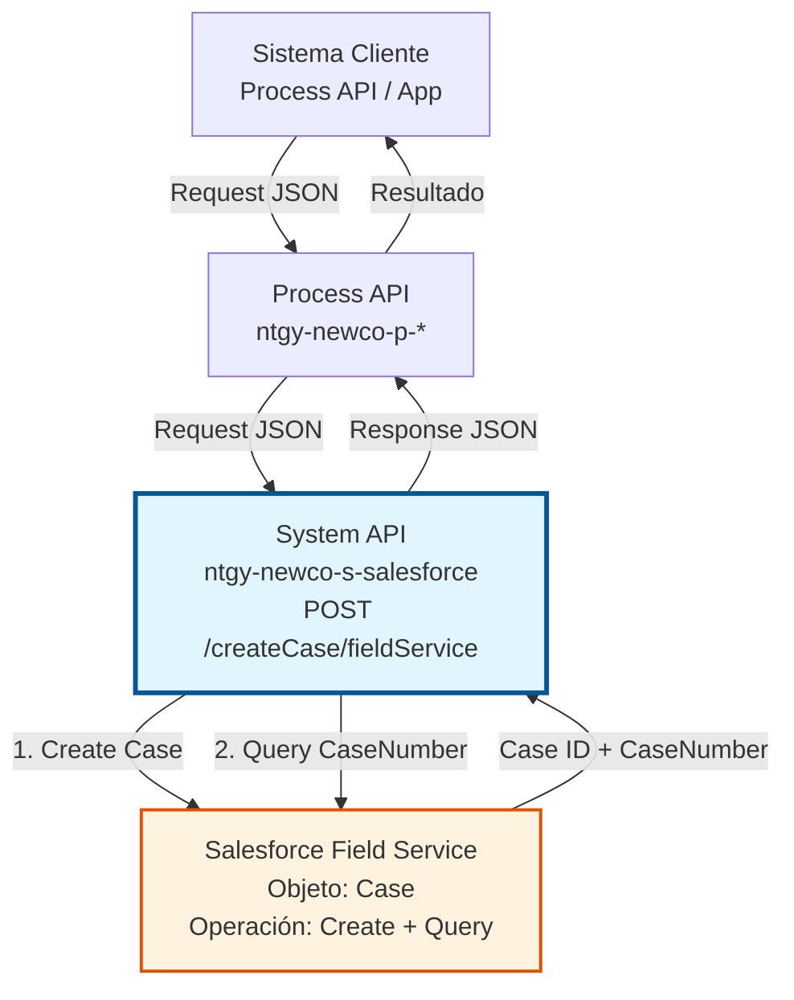
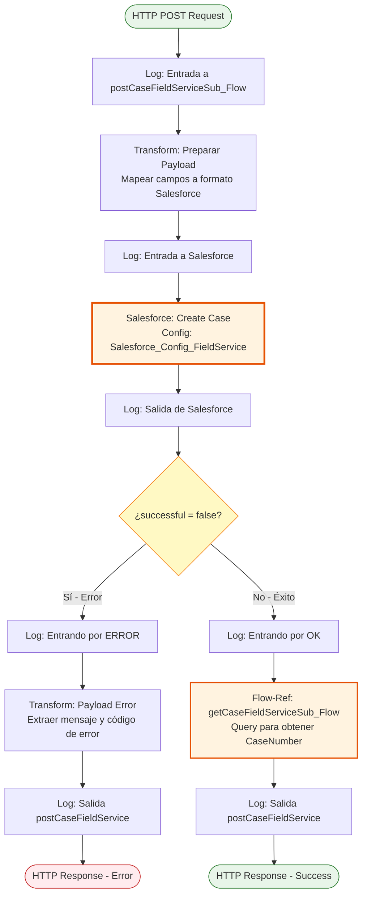
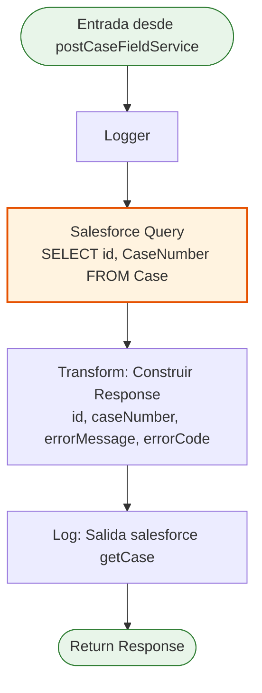
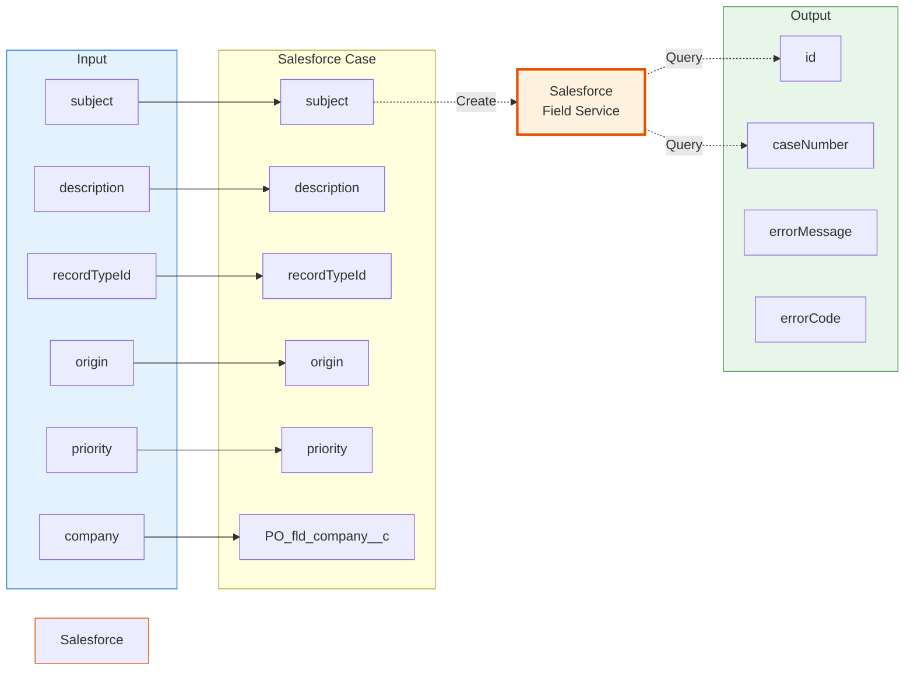

# POST /createCase/fieldService

## 📌 Descripción General

### Propósito del Endpoint

Este endpoint permite crear casos en la instancia de **Salesforce Field Service** (operaciones), separada de la instancia principal de NewCo. Está diseñado para gestionar incidencias operacionales, servicios técnicos y casos de campo que requieren atención especializada.

El endpoint soporta:
- **Creación de Casos**: Crea un nuevo caso en Salesforce Field Service con todos los campos requeridos
- **Validación Automática**: Verifica que la creación fue exitosa antes de retornar
- **Recuperación de CaseNumber**: Obtiene automáticamente el número de caso generado por Salesforce
- **Manejo de Errores**: Retorna errores detallados de Salesforce si la creación falla

### Tipo de API

**Capa:** System API (API-Led Connectivity)

**Función:** Integración directa con Salesforce Field Service para creación de casos operacionales.

### Patrón de Integración

**Tipo:** Request-Reply Síncrono con Salesforce

**Descripción:** El endpoint recibe los datos del caso, los transforma al formato de Salesforce, crea el objeto Case, y si es exitoso, ejecuta una query adicional para obtener el CaseNumber generado automáticamente por Salesforce.

### Arquitectura API-Led Connectivity



---

## 💼 Propósito del Negocio

### Casos de Uso Principales

1. **Creación de Incidencias de Campo**
   - Técnicos de campo reportan problemas en instalaciones
   - Se crea un caso para seguimiento y resolución
   - Permite asignación automática según tipo de incidencia

2. **Solicitudes de Servicio Técnico**
   - Clientes solicitan servicios técnicos (instalación, reparación, mantenimiento)
   - El caso se crea en Field Service para gestión operacional
   - Facilita la planificación y asignación de recursos

3. **Gestión de Operaciones de Campo**
   - Coordinadores crean casos para trabajos programados
   - Se registran detalles de la operación y prioridad
   - Permite tracking completo del ciclo de vida del caso

### Contexto Empresarial

- **Dominio:** Operaciones de Campo - Field Service Management
- **Sector:** Energía - Utilities
- **División:** Naturgy España - NewCo
- **Proceso de Negocio:** Gestión de servicios técnicos, mantenimiento de instalaciones, atención de incidencias operacionales
- **Instancia Salesforce:** Field Service (separada de la instancia comercial)

### Stakeholders

- **Técnicos de Campo**: Necesitan reportar incidencias y recibir asignaciones de trabajo
- **Coordinadores de Operaciones**: Gestionan la planificación y asignación de casos
- **Call Center**: Crean casos basados en llamadas de clientes
- **Sistemas de Monitoreo**: Crean casos automáticamente ante alertas o anomalías

### Valor de Negocio

- **Trazabilidad Completa**: Cada incidencia queda registrada con número de caso único
- **Automatización**: Reduce tiempo de creación manual de casos
- **Integración**: Permite que múltiples sistemas creen casos en Field Service
- **Eficiencia Operacional**: Facilita la gestión centralizada de operaciones de campo

### Consumidores Potenciales

Este endpoint puede ser consumido por:
- Process APIs de gestión de incidencias
- Aplicaciones móviles de técnicos de campo
- Sistemas de monitoreo y alertas
- Portales de autoservicio para clientes
- Integraciones con sistemas de terceros (contratistas, partners)

---

## 🔧 Especificación Técnica

### URLs por Ambiente

| Ambiente | URL Base | URL Completa |
|----------|----------|--------------|
| **Local** | `http://localhost:8081` | `http://localhost:8081/api/createCase/fieldService` |
| **Development** | `https://ntgy-newco-s-salesforce-dev.us-e2.cloudhub.io` | `https://ntgy-newco-s-salesforce-dev.us-e2.cloudhub.io/api/createCase/fieldService` |
| **UAT** | `https://ntgy-newco-s-salesforce-uat.us-e2.cloudhub.io` | `https://ntgy-newco-s-salesforce-uat.us-e2.cloudhub.io/api/createCase/fieldService` |
| **Production** | `https://ntgy-newco-s-salesforce-pro.us-e2.cloudhub.io` | `https://ntgy-newco-s-salesforce-pro.us-e2.cloudhub.io/api/createCase/fieldService` |

### Método HTTP

```
POST /api/createCase/fieldService
```

### Parámetros de Entrada

#### Headers HTTP

| Header | Tipo | Requerido | Descripción | Ejemplo |
|--------|------|-----------|-------------|---------|
| `Content-Type` | string | ✅ Sí | Tipo de contenido del request | `application/json` |
| `Accept` | string | ❌ No | Tipo de contenido esperado en response | `application/json` |

#### Body Parameters

| Campo | Tipo | Requerido | Descripción | Ejemplo |
|-------|------|-----------|-------------|---------|
| `subject` | string | ✅ Sí | Asunto del caso | `"Fallo en instalación eléctrica"` |
| `description` | string | ✅ Sí | Descripción detallada del caso | `"Cliente reporta corte intermitente de suministro"` |
| `recordTypeId` | string | ✅ Sí | ID del Record Type de Salesforce | `"0120900000XXXXX"` |
| `origin` | string | ✅ Sí | Origen del caso | `"Phone"`, `"Web"`, `"Mobile"` |
| `priority` | string | ✅ Sí | Prioridad del caso | `"High"`, `"Medium"`, `"Low"` |
| `company` | string | ✅ Sí | Compañía asociada (campo custom) | `"Naturgy"` |

**Estructura del Body:**

```json
{
  "subject": "string",
  "description": "string",
  "recordTypeId": "string",
  "origin": "string",
  "priority": "string",
  "company": "string"
}
```

### Respuestas

#### Respuesta Exitosa (200 OK)

```json
{
  "id": "5000900000XXXXX",
  "caseNumber": "00001234",
  "errorMessage": "No hay error",
  "errorCode": "0000"
}
```

**Campos de la Respuesta:**

| Campo | Tipo | Descripción |
|-------|------|-------------|
| `id` | string | ID único del caso en Salesforce |
| `caseNumber` | string | Número de caso generado automáticamente |
| `errorMessage` | string | Mensaje de estado (siempre "No hay error" en éxito) |
| `errorCode` | string | Código de estado (siempre "0000" en éxito) |

#### Respuesta de Error de Negocio (200 OK con error)

Cuando Salesforce rechaza la creación del caso:

```json
{
  "id": null,
  "caseNumber": "",
  "errorMessage": "Required fields are missing: [RecordTypeId]",
  "errorCode": "REQUIRED_FIELD_MISSING"
}
```

#### Respuesta de Error Técnico (400/500)

```json
{
  "result": {
    "codResult": "0001",
    "msgResult": "Error interno del servidor"
  }
}
```

### Autenticación y Autorización

- **Tipo:** Client ID & Client Secret (Anypoint Platform)
- **Autorización Salesforce:** El usuario debe tener permisos para:
  - Crear objetos Case en Salesforce Field Service
  - Acceso al Record Type especificado
  - Permisos sobre el campo custom `PO_fld_company__c`

### Timeouts

| Tipo | Valor | Descripción |
|------|-------|-------------|
| **Request Timeout** | 30 segundos | Tiempo máximo de espera para la respuesta |
| **Connection Timeout** | 10 segundos | Tiempo máximo para establecer conexión con Salesforce |

---

## 🏗️ Implementación Técnica

### Arquitectura del Flow



### Sub-Flow: postCaseFieldServiceSub_Flow

**Ubicación:** `src/main/mule/postCaseFieldService.xml`

**Componentes principales:**

1. **Logger de Entrada**: Registra el payload recibido
2. **Transform - Preparar Payload**: Mapea campos de entrada a estructura Salesforce
3. **Salesforce Create**: Crea el objeto Case en Field Service
4. **Choice - Validación**: Evalúa si `successful == false`
5. **Transform Error** (si falla): Extrae mensaje y código de error
6. **Flow-Ref getCaseFieldService** (si éxito): Obtiene el CaseNumber

### Sub-Flow: getCaseFieldServiceSub_Flow

**Ubicación:** `src/main/mule/getCaseFieldService.xml`

**Propósito:** Ejecutar query SOQL para obtener el CaseNumber del caso recién creado.

**Query SOQL:**
```sql
SELECT id, CaseNumber 
FROM Case 
WHERE id = ':id'
```

**Flujo:**



### Transformaciones DataWeave

#### Transformación 1: Preparar Payload para Salesforce Create

**Ubicación:** `postCaseFieldService.xml` (líneas 10-24)

```dataweave
%dw 2.0
output application/json
---
[{
    "subject": payload.subject,
    "description": payload.description,
    "recordTypeId": payload.recordTypeId,
    "origin": payload.origin,
    "priority": payload.priority,
    "PO_fld_company__c": payload.company
}]
```

**Mapeo de Campos:**

| Campo Entrada | Campo Salesforce | Tipo | Notas |
|---------------|------------------|------|-------|
| `subject` | `subject` | string | Asunto del caso |
| `description` | `description` | string | Descripción detallada |
| `recordTypeId` | `recordTypeId` | string | ID del Record Type |
| `origin` | `origin` | string | Origen del caso |
| `priority` | `priority` | string | Prioridad |
| `company` | `PO_fld_company__c` | string | Campo custom de compañía |

#### Transformación 2: Payload de Error

**Ubicación:** `postCaseFieldService.xml` (líneas 35-47)

```dataweave
%dw 2.0
output application/json
---
{
    id: payload.id,
    caseNumber: "",
    errorMessage: payload.items[0].message,
    errorCode: payload.items[0].statusCode
}
```

**Extracción de Errores:**
- `payload.items[0].message`: Mensaje de error de Salesforce
- `payload.items[0].statusCode`: Código de error de Salesforce

#### Transformación 3: Response Exitoso

**Ubicación:** `getCaseFieldService.xml` (líneas 19-31)

```dataweave
%dw 2.0
output application/json
---
{
    id: payload[0].Id,
    caseNumber: payload[0].CaseNumber,
    errorMessage: "No hay error",
    errorCode: "0000"
}
```

### Configuración de Salesforce

**Configuración Utilizada:** `Salesforce_Config_FieldService`

**Ubicación:** `src/main/mule/global.xml` (líneas 42-44)

```xml
<salesforce:sfdc-config name="Salesforce_Config_FieldService">
    <salesforce:oauth-user-pass-connection 
        consumerKey="${fieldService.salesforce.consumerkey}" 
        consumerSecret="${secure::fieldService.salesforce.consumerSecret}" 
        username="${fieldService.salesforce.user}" 
        password="${secure::fieldService.salesforce.pass}" 
        securityToken="${secure::fieldService.salesforce.securityToken}" 
        tokenEndpoint="${fieldService.salesforce.url}" />
</salesforce:sfdc-config>
```

**Características:**
- Instancia separada de Salesforce (Field Service)
- Autenticación OAuth 2.0 con usuario/contraseña
- Credenciales específicas para operaciones de campo
- Security token requerido

### Operaciones Salesforce

#### 1. Create Case

**Operación:** `salesforce:create`
**Tipo:** `Case`
**Config:** `Salesforce_Config_FieldService`

```xml
<salesforce:create 
    config-ref="Salesforce_Config_FieldService" 
    type="Case"/>
```

#### 2. Query Case

**Operación:** `salesforce:query`
**Config:** `Salesforce_Config_FieldService`

```xml
<salesforce:query config-ref="Salesforce_Config_FieldService">
    <salesforce:salesforce-query>
        SELECT id, CaseNumber FROM Case WHERE id = ':id'
    </salesforce:salesforce-query>
    <salesforce:parameters>
        #[output application/java
        ---
        {
            id : payload.items[0].id
        }]
    </salesforce:parameters>
</salesforce:query>
```

### Diagrama de Transformación de Datos



### Manejo de Errores

**Estrategia:** Validación de respuesta de Salesforce con manejo específico de errores.

**Condición de Error:**
```dataweave
payload.successful == false
```

**Errores Comunes:**

| Código Salesforce | Descripción | Causa |
|-------------------|-------------|-------|
| `REQUIRED_FIELD_MISSING` | Campo requerido faltante | RecordTypeId, Subject o Description no proporcionados |
| `INVALID_TYPE` | Tipo de dato inválido | RecordTypeId no existe o es inválido |
| `FIELD_CUSTOM_VALIDATION_EXCEPTION` | Validación custom falló | Reglas de validación de Salesforce no cumplidas |
| `INSUFFICIENT_ACCESS` | Acceso insuficiente | Usuario no tiene permisos para crear Cases |

### Logging

**Puntos de Log (nivel INFO):**

1. Entrada a `postCaseFieldServiceSub_Flow`
2. Entrada a Salesforce (antes de Create)
3. Salida de Salesforce (después de Create)
4. Entrada por ERROR (si falla)
5. Entrada por OK (si éxito)
6. Salida de `postCaseFieldServiceSub_Flow`
7. Salida de `getCaseFieldServiceSub_Flow`

**Formato de Logs:**
```
Log de entrada a postCaseFieldServiceSub_Flow: #[message.payload]
Log de entrada a Salesforce: #[message.payload]
Log de salida de Salesforce: #[message.payload]
```

---

## 💻 Ejemplos de Uso

### Ejemplo 1: Request Completo

**Endpoint:**
```
POST https://ntgy-newco-s-salesforce-pro.us-e2.cloudhub.io/api/createCase/fieldService
```

**Headers:**
```
Content-Type: application/json
Accept: application/json
```

**Body:**
```json
{
  "subject": "Fallo en medidor eléctrico",
  "description": "Cliente reporta que el medidor no registra consumo correctamente. Requiere revisión técnica urgente.",
  "recordTypeId": "0120900000ABC123",
  "origin": "Phone",
  "priority": "High",
  "company": "Naturgy"
}
```

**Response (200 OK):**
```json
{
  "id": "5000900000XYZ789",
  "caseNumber": "00012345",
  "errorMessage": "No hay error",
  "errorCode": "0000"
}
```

### Ejemplo 2: Caso de Mantenimiento Programado

**Request:**
```json
{
  "subject": "Mantenimiento preventivo instalación",
  "description": "Mantenimiento anual programado para instalación de gas. Incluye revisión de válvulas y medidores.",
  "recordTypeId": "0120900000DEF456",
  "origin": "Web",
  "priority": "Medium",
  "company": "Naturgy"
}
```

**Response (200 OK):**
```json
{
  "id": "5000900000ABC456",
  "caseNumber": "00012346",
  "errorMessage": "No hay error",
  "errorCode": "0000"
}
```

### Ejemplo 3: Error - Campo Requerido Faltante

**Request (sin recordTypeId):**
```json
{
  "subject": "Incidencia en suministro",
  "description": "Corte intermitente de suministro eléctrico",
  "origin": "Mobile",
  "priority": "High",
  "company": "Naturgy"
}
```

**Response (200 OK con error):**
```json
{
  "id": null,
  "caseNumber": "",
  "errorMessage": "Required fields are missing: [RecordTypeId]",
  "errorCode": "REQUIRED_FIELD_MISSING"
}
```

### Ejemplo 4: Comando cURL

```bash
curl -X POST "https://ntgy-newco-s-salesforce-pro.us-e2.cloudhub.io/api/createCase/fieldService" \
  -H "Content-Type: application/json" \
  -H "Accept: application/json" \
  -d '{
    "subject": "Fallo en medidor eléctrico",
    "description": "Cliente reporta que el medidor no registra consumo correctamente",
    "recordTypeId": "0120900000ABC123",
    "origin": "Phone",
    "priority": "High",
    "company": "Naturgy"
  }'
```

### Ejemplo 5: JavaScript (Node.js)

```javascript
const axios = require('axios');

async function createFieldServiceCase() {
  try {
    const response = await axios.post(
      'https://ntgy-newco-s-salesforce-pro.us-e2.cloudhub.io/api/createCase/fieldService',
      {
        subject: 'Fallo en medidor eléctrico',
        description: 'Cliente reporta que el medidor no registra consumo correctamente',
        recordTypeId: '0120900000ABC123',
        origin: 'Phone',
        priority: 'High',
        company: 'Naturgy'
      },
      {
        headers: {
          'Content-Type': 'application/json',
          'Accept': 'application/json'
        }
      }
    );
    
    console.log('Case creado exitosamente:');
    console.log('ID:', response.data.id);
    console.log('Case Number:', response.data.caseNumber);
    
    return response.data;
  } catch (error) {
    console.error('Error al crear caso:', error.response?.data || error.message);
    throw error;
  }
}

// Ejecutar
createFieldServiceCase();
```

### Ejemplo 6: Python

```python
import requests
import json

def create_field_service_case():
    url = "https://ntgy-newco-s-salesforce-pro.us-e2.cloudhub.io/api/createCase/fieldService"
    
    headers = {
        "Content-Type": "application/json",
        "Accept": "application/json"
    }
    
    payload = {
        "subject": "Fallo en medidor eléctrico",
        "description": "Cliente reporta que el medidor no registra consumo correctamente",
        "recordTypeId": "0120900000ABC123",
        "origin": "Phone",
        "priority": "High",
        "company": "Naturgy"
    }
    
    try:
        response = requests.post(url, headers=headers, json=payload)
        response.raise_for_status()
        
        data = response.json()
        print(f"Case creado exitosamente:")
        print(f"ID: {data['id']}")
        print(f"Case Number: {data['caseNumber']}")
        
        return data
    except requests.exceptions.RequestException as e:
        print(f"Error al crear caso: {e}")
        raise

# Ejecutar
if __name__ == "__main__":
    create_field_service_case()
```

### Ejemplo 7: Postman Collection

```json
{
  "info": {
    "name": "Create Field Service Case",
    "schema": "https://schema.getpostman.com/json/collection/v2.1.0/collection.json"
  },
  "item": [
    {
      "name": "Create Case - Success",
      "request": {
        "method": "POST",
        "header": [
          {
            "key": "Content-Type",
            "value": "application/json"
          }
        ],
        "body": {
          "mode": "raw",
          "raw": "{\n  \"subject\": \"Fallo en medidor eléctrico\",\n  \"description\": \"Cliente reporta que el medidor no registra consumo correctamente\",\n  \"recordTypeId\": \"0120900000ABC123\",\n  \"origin\": \"Phone\",\n  \"priority\": \"High\",\n  \"company\": \"Naturgy\"\n}"
        },
        "url": {
          "raw": "https://ntgy-newco-s-salesforce-pro.us-e2.cloudhub.io/api/createCase/fieldService",
          "protocol": "https",
          "host": [
            "ntgy-newco-s-salesforce-pro",
            "us-e2",
            "cloudhub",
            "io"
          ],
          "path": [
            "api",
            "createCase",
            "fieldService"
          ]
        }
      }
    }
  ]
}