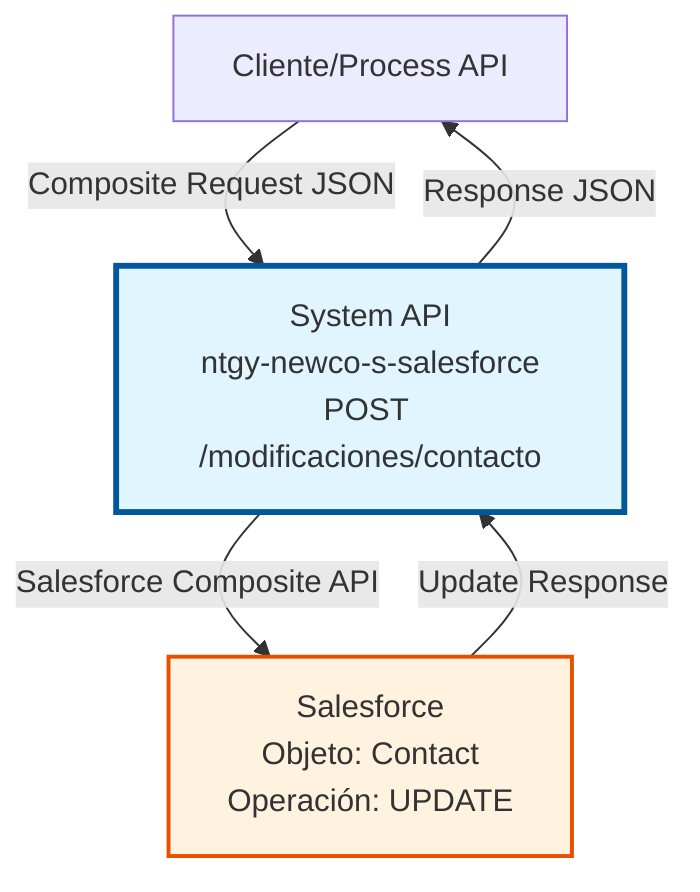
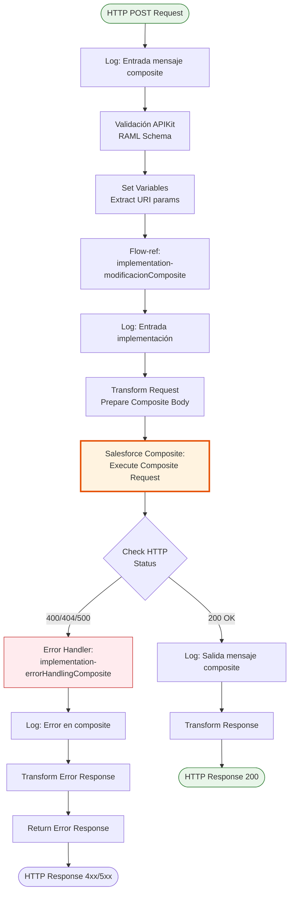
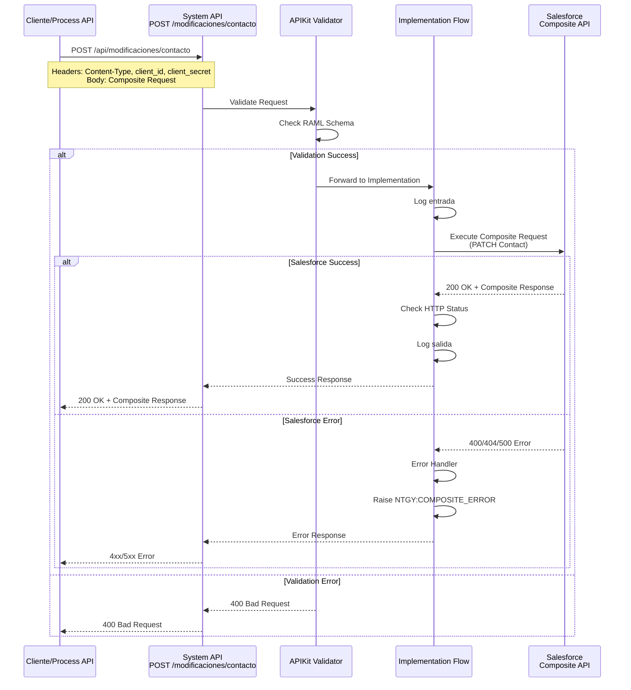

# POST /modificaciones/contacto

## 📌 Descripción General

### Propósito del Endpoint

Este endpoint permite actualizar información de contacto en Salesforce utilizando el patrón de operaciones composite. Está diseñado para modificar datos de contacto de clientes de manera eficiente, permitiendo actualizar múltiples campos en una única transacción.

El endpoint soporta:
- **Actualización de datos personales**: Nombre, apellidos, email
- **Actualización de datos de contacto**: Teléfono fijo, móvil
- **Actualización de dirección postal**: Calle, ciudad, estado, código postal, país

### Tipo de API

**Capa:** System API (API-Led Connectivity)

**Función:** Integración directa con Salesforce para actualización de objetos Contact mediante operaciones composite.

### Patrón de Integración

**Tipo:** Request-Reply Síncrono con Salesforce Composite API

**Descripción:** El endpoint recibe una solicitud composite con las modificaciones del contacto, la transforma al formato requerido por Salesforce, ejecuta la operación de actualización mediante el Salesforce Composite Connector y retorna el resultado de la operación.

### Arquitectura API-Led Connectivity



---

## 💼 Propósito del Negocio

### Casos de Uso Principales

1. **Actualización de Datos de Contacto del Cliente**
   - Un cliente actualiza su información de contacto a través del portal web o app móvil
   - Los datos se sincronizan en tiempo real con Salesforce
   - Beneficio: Mantener información actualizada para comunicaciones efectivas

2. **Corrección de Datos por Agente de Call Center**
   - Un agente detecta información incorrecta durante una llamada
   - Actualiza los datos del contacto en el sistema
   - Beneficio: Mejorar la calidad de los datos y la experiencia del cliente

3. **Actualización de Dirección Postal**
   - Cliente notifica cambio de domicilio
   - Se actualiza la dirección de correspondencia en Salesforce
   - Beneficio: Asegurar entrega correcta de facturas y comunicaciones

### Contexto Empresarial

- **Dominio:** Gestión de Clientes (CRM)
- **Sector:** Energía - Utilities
- **División:** Naturgy España - NewCo
- **Proceso de Negocio:** Mantenimiento de datos maestros de clientes
- **Objeto Salesforce:** Contact

### Stakeholders

- **Clientes finales**: Necesitan mantener sus datos actualizados
- **Agentes de atención al cliente**: Requieren actualizar información durante interacciones
- **Equipos de marketing**: Necesitan datos precisos para campañas
- **Administradores de Salesforce**: Gestionan la calidad de datos

### Valor de Negocio

- **Calidad de datos**: Mantiene información de contacto precisa y actualizada
- **Experiencia del cliente**: Permite autoservicio para actualización de datos
- **Eficiencia operativa**: Reduce errores en comunicaciones y entregas
- **Cumplimiento normativo**: Facilita mantener datos correctos según GDPR

### Consumidores Potenciales

Este endpoint puede ser consumido por:
- Process APIs de gestión de clientes
- Experience APIs de portales web y aplicaciones móviles
- Sistemas de call center y CRM
- Flujos automatizados de Salesforce
- Integraciones con sistemas de terceros

---

## 🔧 Especificación Técnica

### URLs por Ambiente

| Ambiente | URL Base | URL Completa |
|----------|----------|--------------|
| **Local** | `http://localhost:8081` | `http://localhost:8081/api/modificaciones/contacto` |
| **Development** | `https://ntgy-newco-s-salesforce-dev.us-e2.cloudhub.io` | `https://ntgy-newco-s-salesforce-dev.us-e2.cloudhub.io/api/modificaciones/contacto` |
| **UAT** | `https://ntgy-newco-s-salesforce-uat.us-e2.cloudhub.io` | `https://ntgy-newco-s-salesforce-uat.us-e2.cloudhub.io/api/modificaciones/contacto` |
| **Production** | `https://ntgy-newco-s-salesforce-pro.us-e2.cloudhub.io` | `https://ntgy-newco-s-salesforce-pro.us-e2.cloudhub.io/api/modificaciones/contacto` |

### Método HTTP

```
POST /api/modificaciones/contacto
```

### Parámetros de Entrada

#### Headers HTTP

| Header | Tipo | Requerido | Descripción | Ejemplo |
|--------|------|-----------|-------------|---------|
| `Content-Type` | string | ✅ Sí | Tipo de contenido del request | `application/json` |
| `Accept` | string | ❌ No | Tipo de contenido esperado en response | `application/json` |
| `client_id` | string | ✅ Sí | Client ID de Anypoint Platform | `abc123...` |
| `client_secret` | string | ✅ Sí | Client Secret de Anypoint Platform | `xyz789...` |

#### Body Parameters

El body debe contener una estructura composite request con las siguientes propiedades:

| Campo | Tipo | Requerido | Descripción |
|-------|------|-----------|-------------|
| `compositeRequest` | array | ✅ Sí | Array de operaciones a ejecutar |
| `compositeRequest[].method` | string | ✅ Sí | Método HTTP (PATCH para actualización) |
| `compositeRequest[].url` | string | ✅ Sí | URL del recurso Salesforce |
| `compositeRequest[].referenceId` | string | ✅ Sí | ID de referencia para la operación |
| `compositeRequest[].body` | object | ✅ Sí | Datos del contacto a actualizar |

**Campos del Contact (en body):**

| Campo | Tipo | Requerido | Descripción | Ejemplo |
|-------|------|-----------|-------------|---------|
| `Id` | string | ✅ Sí | ID del contacto en Salesforce | `"003xx000004TmiQAAS"` |
| `FirstName` | string | ❌ No | Nombre del contacto | `"Juan"` |
| `LastName` | string | ❌ No | Apellidos del contacto | `"García López"` |
| `Email` | string | ❌ No | Email del contacto | `"juan.garcia@example.com"` |
| `Phone` | string | ❌ No | Teléfono fijo | `"+34912345678"` |
| `MobilePhone` | string | ❌ No | Teléfono móvil | `"+34612345678"` |
| `MailingStreet` | string | ❌ No | Calle y número | `"Calle Mayor 123"` |
| `MailingCity` | string | ❌ No | Ciudad | `"Madrid"` |
| `MailingState` | string | ❌ No | Provincia/Estado | `"Madrid"` |
| `MailingPostalCode` | string | ❌ No | Código postal | `"28001"` |
| `MailingCountry` | string | ❌ No | País | `"España"` |

### Respuestas

#### Respuesta Exitosa (200 OK)

```json
{
  "compositeResponse": [
    {
      "body": {
        "id": "003xx000004TmiQAAS",
        "success": true,
        "errors": []
      },
      "httpHeaders": {
        "Location": "/services/data/v57.0/sobjects/Contact/003xx000004TmiQAAS"
      },
      "httpStatusCode": 200,
      "referenceId": "updateContact"
    }
  ]
}
```

#### Respuesta de Error de Negocio (200 OK con errores)

```json
{
  "compositeResponse": [
    {
      "body": [
        {
          "message": "Required fields are missing: [LastName]",
          "errorCode": "REQUIRED_FIELD_MISSING",
          "fields": ["LastName"]
        }
      ],
      "httpStatusCode": 400,
      "referenceId": "updateContact"
    }
  ]
}
```

#### Respuesta de Error Técnico (400/500)

```json
{
  "code": "400",
  "message": "Bad Request - Invalid composite request format",
  "details": "The compositeRequest array is required"
}
```

### Autenticación y Autorización

- **Tipo:** Client ID & Client Secret (Anypoint Platform)
- **Autorización Salesforce:** 
  - OAuth 2.0 con certificado JKS
  - El usuario conectado debe tener permisos para:
    - Modificar objetos Contact
    - Acceso a los campos especificados
    - Ejecutar operaciones composite

### Timeouts

| Tipo | Valor | Descripción |
|------|-------|-------------|
| **Request Timeout** | 30 segundos | Tiempo máximo de espera para la respuesta |
| **Connection Timeout** | 10 segundos | Tiempo máximo para establecer conexión con Salesforce |

---

## 🏗️ Implementación Técnica

### Arquitectura del Flow



### Componentes Principales

#### 1. Flow Principal: `post:\modificaciones\contacto:application\json:ntgy-newco-s-salesforce-config`

**Ubicación:** `src/main/mule/ntgy-newco-s-salesforce.xml`

**Responsabilidades:**
- Recibir request HTTP POST
- Validar estructura según RAML
- Extraer variables de contexto
- Invocar sub-flow de implementación
- Manejar errores globales

**Configuración:**
```xml
<flow name="post:\modificaciones\contacto:application\json:ntgy-newco-s-salesforce-config">
    <logger level="INFO" message="Entrada de mensaje tipo composite: #[payload]"/>
    <set-variable variableName="httpStatus" value="200"/>
    <flow-ref name="implementation-modificacionComposite"/>
    <logger level="INFO" message="Salida de mensaje tipo composite: #[payload]"/>
</flow>
```

#### 2. Sub-flow de Implementación: `implementation-modificacionComposite`

**Ubicación:** `src/main/mule/implementation-modificaciones.xml`

**Responsabilidades:**
- Ejecutar operación composite en Salesforce
- Manejar errores específicos de composite
- Transformar respuesta

**Configuración:**
```xml
<sub-flow name="implementation-modificacionComposite">
    <logger level="INFO" message="Entrada de implementación modificación composite"/>
    <salesforce-composite:execute-composite-request 
        config-ref="Salesforce_Composite_Config_jks">
        <reconnect/>
    </salesforce-composite:execute-composite-request>
    <flow-ref name="implementation-errorHandlingComposite"/>
</sub-flow>
```

#### 3. Error Handler: `implementation-errorHandlingComposite`

**Ubicación:** `src/main/mule/implementation-modificaciones.xml`

**Responsabilidades:**
- Detectar errores en respuesta composite
- Clasificar tipo de error (400, 404, 500)
- Lanzar excepción personalizada si es necesario

**Lógica:**
```xml
<sub-flow name="implementation-errorHandlingComposite">
    <choice>
        <when expression="#[payload.compositeResponse[0].httpStatusCode == 400]">
            <raise-exception type="NTGY:COMPOSITE_ERROR"/>
        </when>
        <when expression="#[payload.compositeResponse[0].httpStatusCode == 404]">
            <raise-exception type="NTGY:COMPOSITE_ERROR"/>
        </when>
        <when expression="#[payload.compositeResponse[0].httpStatusCode == 500]">
            <raise-exception type="NTGY:COMPOSITE_ERROR"/>
        </when>
    </choice>
</sub-flow>
```

### Configuración de Conectores

#### Salesforce Composite Connector

**Configuración:** `Salesforce_Composite_Config_jks`

**Propiedades:**
- **Tipo de autenticación:** OAuth 2.0 con certificado JKS
- **Keystore:** Específico por ambiente (dev/uat/pro)
- **Consumer Key:** Configurado en properties por ambiente
- **Token Endpoint:** Salesforce OAuth endpoint
- **Reconnect Strategy:** Habilitada para resiliencia

**Ubicación de configuración:** `src/main/mule/global.xml`

### Transformaciones de Datos

#### Request Transformation

El payload de entrada debe seguir el formato composite request de Salesforce:

```json
{
  "compositeRequest": [
    {
      "method": "PATCH",
      "url": "/services/data/v57.0/sobjects/Contact/003xx000004TmiQAAS",
      "referenceId": "updateContact",
      "body": {
        "FirstName": "Juan",
        "LastName": "García López",
        "Email": "juan.garcia@example.com",
        "Phone": "+34912345678",
        "MobilePhone": "+34612345678",
        "MailingStreet": "Calle Mayor 123",
        "MailingCity": "Madrid",
        "MailingState": "Madrid",
        "MailingPostalCode": "28001",
        "MailingCountry": "España"
      }
    }
  ]
}
```

#### Response Transformation

La respuesta de Salesforce se retorna directamente sin transformación adicional, manteniendo el formato composite response estándar.

### Diagrama de Secuencia Completo



### Manejo de Errores

#### Tipos de Errores

1. **APIKIT:BAD_REQUEST (400)**
   - Causa: Request no cumple con schema RAML
   - Acción: Retornar error de validación al cliente

2. **NTGY:COMPOSITE_ERROR**
   - Causa: Error en operación composite de Salesforce
   - Acción: Transformar error y retornar al cliente
   - Códigos HTTP: 400, 404, 500

3. **Connectivity Errors**
   - Causa: Fallo de conexión con Salesforce
   - Acción: Retry automático (reconnect strategy)

#### Estrategia de Recuperación

- **Reconnect Strategy:** Habilitada en el conector Salesforce
- **Retry Logic:** Automático para errores transitorios
- **Error Logging:** Todos los errores se registran en logs

### Logging

**Puntos de Log:**

1. **Entrada del flow principal:**
   ```
   [INFO] Entrada de mensaje tipo composite: #[payload]
   ```

2. **Entrada de implementación:**
   ```
   [INFO] Entrada de implementación modificación composite
   ```

3. **Salida exitosa:**
   ```
   [INFO] Salida de mensaje tipo composite: #[payload]
   ```

4. **Errores:**
   ```
   [ERROR] Error en operación composite: #[error.description]
   ```

---

## 💻 Ejemplos de Uso

### Ejemplo 1: Actualización Completa de Contacto

#### Request

```bash
curl -X POST "https://ntgy-newco-s-salesforce-dev.us-e2.cloudhub.io/api/modificaciones/contacto" \
  -H "Content-Type: application/json" \
  -H "client_id: abc123def456" \
  -H "client_secret: xyz789uvw012" \
  -d '{
    "compositeRequest": [
      {
        "method": "PATCH",
        "url": "/services/data/v57.0/sobjects/Contact/003xx000004TmiQAAS",
        "referenceId": "updateContact",
        "body": {
          "FirstName": "Juan",
          "LastName": "García López",
          "Email": "juan.garcia@example.com",
          "Phone": "+34912345678",
          "MobilePhone": "+34612345678",
          "MailingStreet": "Calle Mayor 123",
          "MailingCity": "Madrid",
          "MailingState": "Madrid",
          "MailingPostalCode": "28001",
          "MailingCountry": "España"
        }
      }
    ]
  }'
```

#### Response (200 OK)

```json
{
  "compositeResponse": [
    {
      "body": {
        "id": "003xx000004TmiQAAS",
        "success": true,
        "errors": []
      },
      "httpHeaders": {
        "Location": "/services/data/v57.0/sobjects/Contact/003xx000004TmiQAAS"
      },
      "httpStatusCode": 200,
      "referenceId": "updateContact"
    }
  ]
}
```

### Ejemplo 2: Actualización Solo de Email y Teléfono

#### Request

```bash
curl -X POST "https://ntgy-newco-s-salesforce-dev.us-e2.cloudhub.io/api/modificaciones/contacto" \
  -H "Content-Type: application/json" \
  -H "client_id: abc123def456" \
  -H "client_secret: xyz789uvw012" \
  -d '{
    "compositeRequest": [
      {
        "method": "PATCH",
        "url": "/services/data/v57.0/sobjects/Contact/003xx000004TmiQAAS",
        "referenceId": "updateContactInfo",
        "body": {
          "Email": "nuevo.email@example.com",
          "MobilePhone": "+34699887766"
        }
      }
    ]
  }'
```

#### Response (200 OK)

```json
{
  "compositeResponse": [
    {
      "body": {
        "id": "003xx000004TmiQAAS",
        "success": true,
        "errors": []
      },
      "httpHeaders": {
        "Location": "/services/data/v57.0/sobjects/Contact/003xx000004TmiQAAS"
      },
      "httpStatusCode": 200,
      "referenceId": "updateContactInfo"
    }
  ]
}
```

### Ejemplo 3: Error - Campo Requerido Faltante

#### Request

```bash
curl -X POST "https://ntgy-newco-s-salesforce-dev.us-e2.cloudhub.io/api/modificaciones/contacto" \
  -H "Content-Type: application/json" \
  -H "client_id: abc123def456" \
  -H "client_secret: xyz789uvw012" \
  -d '{
    "compositeRequest": [
      {
        "method": "PATCH",
        "url": "/services/data/v57.0/sobjects/Contact/003xx000004TmiQAAS",
        "referenceId": "updateContact",
        "body": {
          "LastName": null
        }
      }
    ]
  }'
```

#### Response (200 OK con error)

```json
{
  "compositeResponse": [
    {
      "body": [
        {
          "message": "Required fields are missing: [LastName]",
          "errorCode": "REQUIRED_FIELD_MISSING",
          "fields": ["LastName"]
        }
      ],
      "httpStatusCode": 400,
      "referenceId": "updateContact"
    }
  ]
}
```

### Ejemplo 4: Error de Validación RAML

#### Request

```bash
curl -X POST "https://ntgy-newco-s-salesforce-dev.us-e2.cloudhub.io/api/modificaciones/contacto" \
  -H "Content-Type: application/json" \
  -H "client_id: abc123def456" \
  -H "client_secret: xyz789uvw012" \
  -d '{
    "invalidField": "value"
  }'
```

#### Response (400 Bad Request)

```json
{
  "message": "Bad request"
}
```

### Ejemplo 5: Actualización de Dirección Completa

#### Request

```bash
curl -X POST "https://ntgy-newco-s-salesforce-dev.us-e2.cloudhub.io/api/modificaciones/contacto" \
  -H "Content-Type: application/json" \
  -H "client_id: abc123def456" \
  -H "client_secret: xyz789uvw012" \
  -d '{
    "compositeRequest": [
      {
        "method": "PATCH",
        "url": "/services/data/v57.0/sobjects/Contact/003xx000004TmiQAAS",
        "referenceId": "updateAddress",
        "body": {
          "MailingStreet": "Avenida de la Constitución 45, 3º B",
          "MailingCity": "Barcelona",
          "MailingState": "Barcelona",
          "MailingPostalCode": "08001",
          "MailingCountry": "España"
        }
      }
    ]
  }'
```

#### Response (200 OK)

```json
{
  "compositeResponse": [
    {
      "body": {
        "id": "003xx000004TmiQAAS",
        "success": true,
        "errors": []
      },
      "httpHeaders": {
        "Location": "/services/data/v57.0/sobjects/Contact/003xx000004TmiQAAS"
      },
      "httpStatusCode": 200,
      "referenceId": "updateAddress"
    }
  ]
}
```
