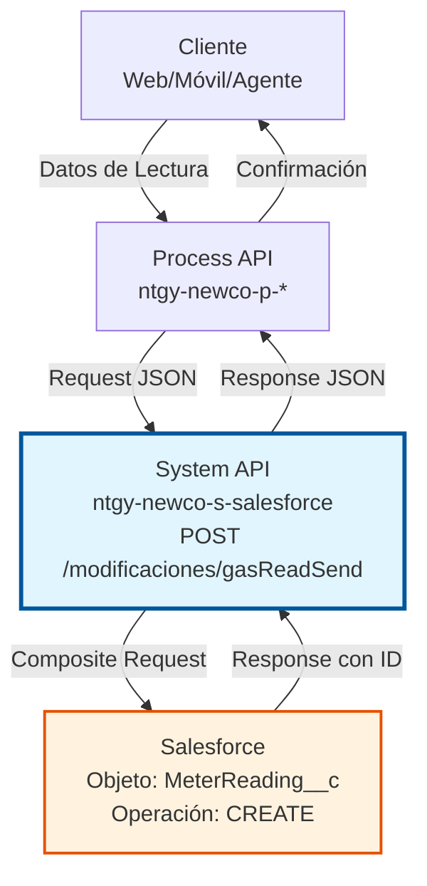
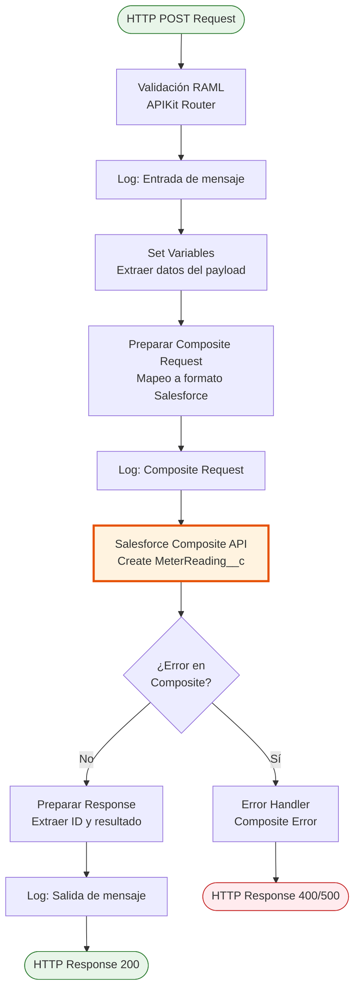
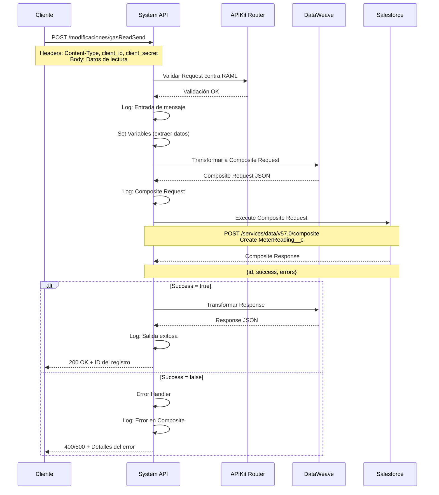

# POST /modificaciones/gasReadSend

## 📌 Descripción General

### Propósito del Endpoint

Este endpoint permite el envío y registro de lecturas de contadores de gas en Salesforce. Facilita la captura de datos de consumo desde diferentes canales (web, móvil, agentes) y los almacena en el objeto personalizado `MeterReading__c` para su posterior procesamiento y facturación.

El endpoint soporta:
- **Registro de Lecturas**: Captura de valores de lectura de contadores de gas
- **Validación de Datos**: Verificación de formato y consistencia de las lecturas
- **Trazabilidad**: Registro de fecha, hora y origen de cada lectura
- **Integración Multicanal**: Soporte para lecturas desde autoservicio, agentes y sistemas externos

### Tipo de API

**Capa:** System API (API-Led Connectivity)

**Función:** Integración directa con Salesforce para registro de lecturas de contadores de gas en el objeto personalizado `MeterReading__c`.

### Patrón de Integración

**Tipo:** Request-Reply Síncrono con Salesforce Composite API

**Descripción:** El endpoint recibe los datos de lectura en formato JSON, los transforma al formato requerido por Salesforce, ejecuta una operación composite para crear el registro en `MeterReading__c`, y retorna la confirmación de la operación con el ID del registro creado.

### Arquitectura API-Led Connectivity



---

## 💼 Propósito del Negocio

### Casos de Uso Principales

1. **Autoservicio de Clientes**
   - Los clientes envían sus lecturas de gas desde el portal web o app móvil
   - Se registra la lectura para cálculo de consumo y facturación
   - Mejora la experiencia del cliente al evitar visitas de lectura

2. **Captura por Agentes**
   - Los agentes de call center registran lecturas telefónicas
   - Se documenta la lectura con trazabilidad del agente
   - Agiliza el proceso de atención al cliente

3. **Integración con Sistemas de Medición**
   - Sistemas externos de telemetría envían lecturas automáticas
   - Se centraliza la información en Salesforce
   - Permite análisis de consumo y detección de anomalías

### Contexto Empresarial

- **Dominio:** Gestión de Consumo y Medición
- **Sector:** Energía - Utilities (Gas Natural)
- **División:** Naturgy España - NewCo
- **Proceso de Negocio:** Captura y registro de lecturas de contadores para facturación y análisis de consumo
- **Objeto Salesforce:** MeterReading__c (Objeto personalizado)

### Stakeholders

- **Clientes Finales**: Necesitan enviar sus lecturas de forma sencilla y recibir confirmación
- **Agentes de Call Center**: Requieren registrar lecturas telefónicas de forma rápida
- **Departamento de Facturación**: Necesita lecturas precisas para cálculo de consumo
- **Operaciones**: Requiere trazabilidad y auditoría de todas las lecturas recibidas

### Valor de Negocio

- **Reducción de Costes**: Disminuye la necesidad de visitas físicas para lectura de contadores
- **Mejora de Experiencia**: Permite a los clientes gestionar sus lecturas de forma autónoma
- **Precisión en Facturación**: Asegura que la facturación se base en consumos reales
- **Trazabilidad**: Mantiene registro completo de todas las lecturas y su origen

### Consumidores Potenciales

Este endpoint puede ser consumido por:
- Process APIs de gestión de clientes y consumo
- Portales de autoservicio web y móvil
- Sistemas de agentes de call center
- Plataformas de telemetría y medición inteligente
- Sistemas de integración middleware

---

## 🔧 Especificación Técnica

### URLs por Ambiente

| Ambiente | URL Base | URL Completa |
|----------|----------|--------------|
| **Local** | `http://localhost:8081` | `http://localhost:8081/api/modificaciones/gasReadSend` |
| **Development** | `https://ntgy-newco-s-salesforce-dev.us-e2.cloudhub.io` | `https://ntgy-newco-s-salesforce-dev.us-e2.cloudhub.io/api/modificaciones/gasReadSend` |
| **UAT** | `https://ntgy-newco-s-salesforce-uat.us-e2.cloudhub.io` | `https://ntgy-newco-s-salesforce-uat.us-e2.cloudhub.io/api/modificaciones/gasReadSend` |
| **Production** | `https://ntgy-newco-s-salesforce-pro.us-e2.cloudhub.io` | `https://ntgy-newco-s-salesforce-pro.us-e2.cloudhub.io/api/modificaciones/gasReadSend` |

### Método HTTP

```
POST /api/modificaciones/gasReadSend
```

### Parámetros de Entrada

#### Headers HTTP

| Header | Tipo | Requerido | Descripción | Ejemplo |
|--------|------|-----------|-------------|---------|
| `Content-Type` | string | ✅ Sí | Tipo de contenido del request | `application/json` |
| `Accept` | string | ❌ No | Tipo de contenido esperado en response | `application/json` |
| `client_id` | string | ✅ Sí | Client ID de Anypoint Platform | `abc123...` |
| `client_secret` | string | ✅ Sí | Client Secret de Anypoint Platform | `xyz789...` |

#### Body Parameters

**Estructura del Request:**

```json
{
  "meterNumber": "string",
  "readingDate": "string",
  "readingValue": "number",
  "readingType": "string",
  "accountId": "string",
  "contractId": "string",
  "channel": "string",
  "agentId": "string"
}
```

**Descripción de Campos:**

| Campo | Tipo | Requerido | Descripción | Ejemplo |
|-------|------|-----------|-------------|---------|
| `meterNumber` | string | ✅ Sí | Número del contador de gas | `"GAS123456789"` |
| `readingDate` | string | ✅ Sí | Fecha de la lectura (ISO 8601) | `"2026-07-06T10:30:00Z"` |
| `readingValue` | number | ✅ Sí | Valor de la lectura en m³ | `1234.56` |
| `readingType` | string | ✅ Sí | Tipo de lectura | `"CUSTOMER"`, `"AGENT"`, `"AUTOMATIC"` |
| `accountId` | string | ✅ Sí | ID de la cuenta en Salesforce | `"001XX000003DGb2"` |
| `contractId` | string | ❌ No | ID del contrato asociado | `"800XX000000abcd"` |
| `channel` | string | ❌ No | Canal de origen | `"WEB"`, `"MOBILE"`, `"CALLCENTER"` |
| `agentId` | string | ❌ No | ID del agente (si aplica) | `"005XX000001abcd"` |

### Respuestas

#### Respuesta Exitosa (200 OK)

```json
{
  "id": "a0BXX000000abcdEFG",
  "success": true,
  "errors": [],
  "message": "Lectura registrada exitosamente"
}
```

**Descripción de Campos de Respuesta:**

| Campo | Tipo | Descripción |
|-------|------|-------------|
| `id` | string | ID del registro MeterReading__c creado en Salesforce |
| `success` | boolean | Indica si la operación fue exitosa |
| `errors` | array | Lista de errores (vacía si success=true) |
| `message` | string | Mensaje descriptivo del resultado |

#### Respuesta de Error de Validación (400 Bad Request)

```json
{
  "message": "Bad request",
  "errors": [
    {
      "field": "meterNumber",
      "message": "El número de contador es requerido"
    }
  ]
}
```

#### Respuesta de Error de Salesforce (500 Internal Server Error)

```json
{
  "message": "Error al crear registro en Salesforce",
  "errors": [
    {
      "statusCode": "REQUIRED_FIELD_MISSING",
      "message": "Required fields are missing: [MeterNumber__c]",
      "fields": ["MeterNumber__c"]
    }
  ]
}
```

### Códigos de Estado HTTP

| Código | Descripción | Cuándo Ocurre |
|--------|-------------|---------------|
| `200` | OK | Lectura registrada exitosamente |
| `400` | Bad Request | Datos de entrada inválidos o incompletos |
| `401` | Unauthorized | Credenciales de autenticación inválidas |
| `500` | Internal Server Error | Error en Salesforce o error interno del sistema |
| `503` | Service Unavailable | Salesforce no disponible temporalmente |

### Autenticación y Autorización

- **Tipo:** Client ID & Client Secret (Anypoint Platform)
- **Autorización Salesforce:** El usuario conectado debe tener permisos para:
  - Crear registros en el objeto `MeterReading__c`
  - Acceso de lectura a objetos relacionados (Account, Contract)
  - Permisos de API habilitados en el perfil

### Timeouts

| Tipo | Valor | Descripción |
|------|-------|-------------|
| **Request Timeout** | 30 segundos | Tiempo máximo de espera para la respuesta |
| **Connection Timeout** | 10 segundos | Tiempo máximo para establecer conexión con Salesforce |

---

## 🏗️ Implementación Técnica

### Arquitectura del Flow



### Operación Salesforce

**Tipo de Operación:** Salesforce Composite Request (Create)

**Objeto Salesforce:** `MeterReading__c` (Objeto personalizado)

**Campos del Objeto MeterReading__c:**

| Campo Salesforce | Campo API | Tipo | Descripción |
|------------------|-----------|------|-------------|
| `MeterNumber__c` | meterNumber | Text | Número del contador |
| `ReadingDate__c` | readingDate | DateTime | Fecha y hora de la lectura |
| `ReadingValue__c` | readingValue | Number | Valor de la lectura en m³ |
| `ReadingType__c` | readingType | Picklist | Tipo de lectura (CUSTOMER/AGENT/AUTOMATIC) |
| `Account__c` | accountId | Lookup(Account) | Referencia a la cuenta |
| `Contract__c` | contractId | Lookup(Contract) | Referencia al contrato |
| `Channel__c` | channel | Picklist | Canal de origen |
| `Agent__c` | agentId | Lookup(User) | Agente que registró (si aplica) |

### Transformación de Datos

#### Request → Salesforce Composite

```dataweave
%dw 2.0
output application/json
---
{
  compositeRequest: [
    {
      method: "POST",
      url: "/services/data/v57.0/sobjects/MeterReading__c",
      referenceId: "newMeterReading",
      body: {
        MeterNumber__c: payload.meterNumber,
        ReadingDate__c: payload.readingDate,
        ReadingValue__c: payload.readingValue,
        ReadingType__c: payload.readingType,
        Account__c: payload.accountId,
        Contract__c: payload.contractId default null,
        Channel__c: payload.channel default null,
        Agent__c: payload.agentId default null
      }
    }
  ]
}
```

#### Salesforce Response → API Response

```dataweave
%dw 2.0
output application/json
---
{
  id: payload.compositeResponse[0].body.id,
  success: payload.compositeResponse[0].body.success,
  errors: payload.compositeResponse[0].body.errors default [],
  message: if (payload.compositeResponse[0].body.success) 
           "Lectura registrada exitosamente" 
           else "Error al registrar lectura"
}
```

### Diagrama de Secuencia Completo



### Sub-flows Utilizados

**Flow Principal:**
```xml
<flow name="post:\modificaciones\gasReadSend:application\json:ntgy-newco-s-salesforce-config">
    <logger level="INFO" message="Entrada de mensaje tipo composite: #[payload]"/>
    <flow-ref name="implementation-modificacionComposite"/>
</flow>
```

**Sub-flow de Implementación:**
```xml
<sub-flow name="implementation-modificacionComposite">
    <salesforce-composite:execute-composite-request 
        config-ref="Salesforce_Composite_Config_jks">
        <reconnect/>
    </salesforce-composite:execute-composite-request>
    <flow-ref name="implementation-errorHandlingComposite"/>
    <logger level="INFO" message="Salida de mensaje tipo composite: #[payload]"/>
</sub-flow>
```

**Sub-flow de Manejo de Errores:**
```xml
<sub-flow name="implementation-errorHandlingComposite">
    <choice>
        <when expression="#[payload.compositeResponse[0].httpStatusCode == 400 or 
                          payload.compositeResponse[0].httpStatusCode == 404 or 
                          payload.compositeResponse[0].httpStatusCode == 500]">
            <raise-error type="NTGY:COMPOSITE_ERROR" 
                         description="Error en operación composite"/>
        </when>
    </choice>
</sub-flow>
```

### Configuración de Conectores

**Salesforce Composite Connector:**
- **Versión:** 2.18.0
- **Configuración:** `Salesforce_Composite_Config_jks`
- **Autenticación:** OAuth 2.0 con certificado JKS
- **Reconnect Strategy:** Habilitada

### Manejo de Errores

**Tipos de Error Personalizados:**

1. **NTGY:COMPOSITE_ERROR**
   - Se lanza cuando la respuesta de Salesforce indica error (status 400, 404, 500)
   - Capturado por error handler global
   - Retorna detalles del error de Salesforce al cliente

2. **APIKIT:BAD_REQUEST**
   - Validación RAML fallida
   - Datos de entrada no cumplen con el schema
   - Retorna 400 con detalles de validación

**Estrategia de Retry:**
- Reconnect strategy habilitada en el conector Salesforce
- Reintentos automáticos en caso de fallos de conexión transitorios
- No se aplica retry en errores de validación de negocio

---

## 💻 Ejemplos de Uso

### Ejemplo 1: Lectura de Cliente desde Portal Web

**Request:**

```bash
curl -X POST "https://ntgy-newco-s-salesforce-dev.us-e2.cloudhub.io/api/modificaciones/gasReadSend" \
  -H "Content-Type: application/json" \
  -H "client_id: abc123def456" \
  -H "client_secret: xyz789uvw012" \
  -d '{
    "meterNumber": "GAS123456789",
    "readingDate": "2026-07-06T10:30:00Z",
    "readingValue": 1234.56,
    "readingType": "CUSTOMER",
    "accountId": "001XX000003DGb2",
    "contractId": "800XX000000abcd",
    "channel": "WEB"
  }'
```

**Response (200 OK):**

```json
{
  "id": "a0BXX000000abcdEFG",
  "success": true,
  "errors": [],
  "message": "Lectura registrada exitosamente"
}
```

### Ejemplo 2: Lectura Telefónica por Agente

**Request:**

```bash
curl -X POST "https://ntgy-newco-s-salesforce-pro.us-e2.cloudhub.io/api/modificaciones/gasReadSend" \
  -H "Content-Type: application/json" \
  -H "client_id: prod_client_id" \
  -H "client_secret: prod_client_secret" \
  -d '{
    "meterNumber": "GAS987654321",
    "readingDate": "2026-07-06T14:45:00Z",
    "readingValue": 2567.89,
    "readingType": "AGENT",
    "accountId": "001XX000003DGb3",
    "contractId": "800XX000000abce",
    "channel": "CALLCENTER",
    "agentId": "005XX000001abcd"
  }'
```

**Response (200 OK):**

```json
{
  "id": "a0BXX000000xyzABC",
  "success": true,
  "errors": [],
  "message": "Lectura registrada exitosamente"
}
```

### Ejemplo 3: Lectura Automática desde Sistema de Telemetría

**Request:**

```bash
curl -X POST "https://ntgy-newco-s-salesforce-pro.us-e2.cloudhub.io/api/modificaciones/gasReadSend" \
  -H "Content-Type: application/json" \
  -H "client_id: telemetry_client_id" \
  -H "client_secret: telemetry_secret" \
  -d '{
    "meterNumber": "GAS555666777",
    "readingDate": "2026-07-06T00:00:00Z",
    "readingValue": 3456.78,
    "readingType": "AUTOMATIC",
    "accountId": "001XX000003DGb4",
    "contractId": "800XX000000abcf",
    "channel": "TELEMETRY"
  }'
```

**Response (200 OK):**

```json
{
  "id": "a0BXX000000pqrDEF",
  "success": true,
  "errors": [],
  "message": "Lectura registrada exitosamente"
}
```

### Ejemplo 4: Error - Campo Requerido Faltante

**Request:**

```bash
curl -X POST "https://ntgy-newco-s-salesforce-dev.us-e2.cloudhub.io/api/modificaciones/gasReadSend" \
  -H "Content-Type: application/json" \
  -H "client_id: abc123def456" \
  -H "client_secret: xyz789uvw012" \
  -d '{
    "readingDate": "2026-07-06T10:30:00Z",
    "readingValue": 1234.56,
    "readingType": "CUSTOMER",
    "accountId": "001XX000003DGb2"
  }'
```

**Response (400 Bad Request):**

```json
{
  "message": "Bad request",
  "errors": [
    {
      "field": "meterNumber",
      "message": "El número de contador es requerido"
    }
  ]
}
```

### Ejemplo 5: Error - Salesforce Validation Rule

**Request:**

```bash
curl -X POST "https://ntgy-newco-s-salesforce-dev.us-e2.cloudhub.io/api/modificaciones/gasReadSend" \
  -H "Content-Type: application/json" \
  -H "client_id: abc123def456" \
  -H "client_secret: xyz789uvw012" \
  -d '{
    "meterNumber": "GAS000000000",
    "readingDate": "2026-07-06T10:30:00Z",
    "readingValue": -100,
    "readingType": "CUSTOMER",
    "accountId": "001XX000003DGb2"
  }'
```

**Response (500 Internal Server Error):**

```json
{
  "message": "Error al crear registro en Salesforce",
  "errors": [
    {
      "statusCode": "FIELD_CUSTOM_VALIDATION_EXCEPTION",
      "message": "El valor de lectura no puede ser negativo",
      "fields": ["ReadingValue__c"]
    }
  ]
}
```

### Ejemplo 6: Uso desde JavaScript (Node.js)

**Código:**

```javascript
const axios = require('axios');

async function enviarLecturaGas(datosLectura) {
  try {
    const response = await axios.post(
      'https://ntgy-newco-s-salesforce-pro.us-e2.cloudhub.io/api/modificaciones/gasReadSend',
      datosLectura,
      {
        headers: {
          'Content-Type': 'application/json',
          'client_id': process.env.CLIENT_ID,
          'client_secret': process.env.CLIENT_SECRET
        }
      }
    );
    
    console.log('Lectura registrada:', response.data.id);
    return response.data;
  } catch (error) {
    console.error('Error al enviar lectura:', error.response?.data);
    throw error;
  }
}

// Uso
const lectura = {
  meterNumber: 'GAS123456789',
  readingDate: new Date().toISOString(),
  readingValue: 1234.56,
  readingType: 'CUSTOMER',
  accountId: '001XX000003DGb2',
  channel: 'WEB'
};

enviarLecturaGas(lectura);
```
