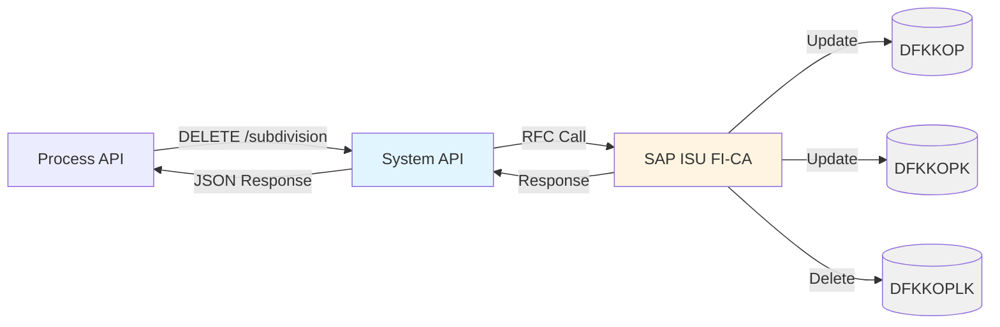
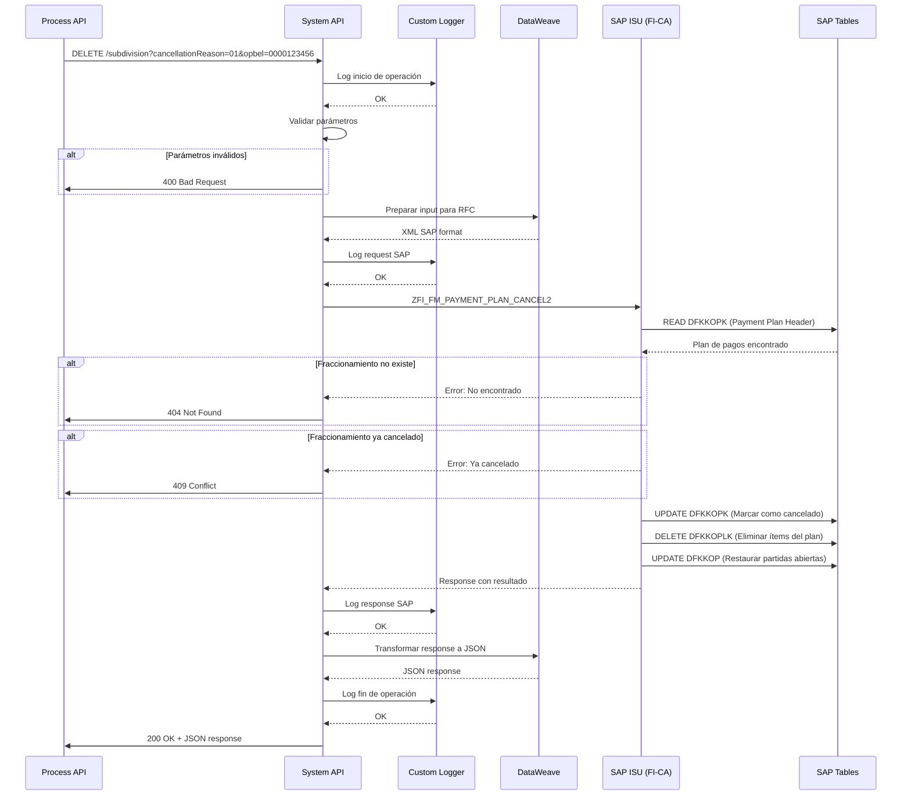
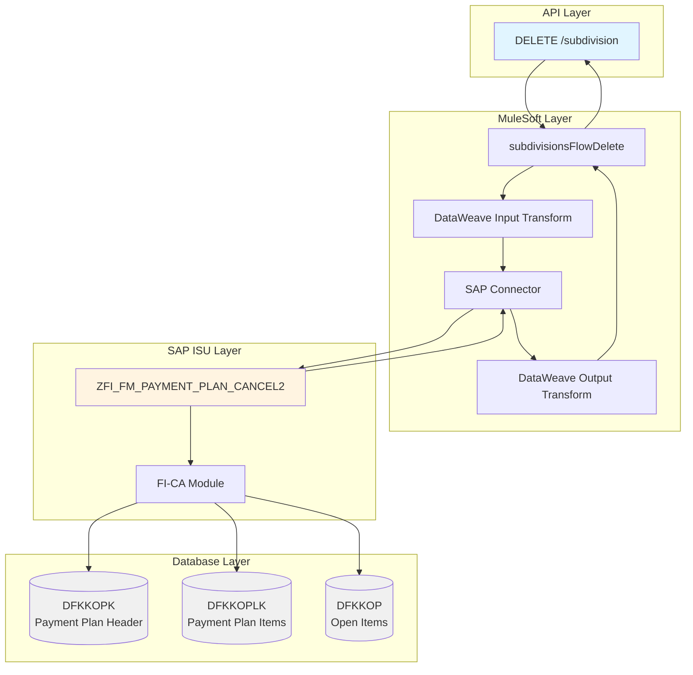
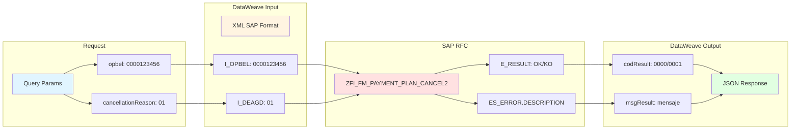

# DELETE /subdivision

## 📌 Descripción General

Endpoint de **System API** que cancela un fraccionamiento de pago (plan de pagos) existente en SAP ISU. Este endpoint invoca el RFC `ZFI_FM_PAYMENT_PLAN_CANCEL2` del módulo FI-CA (Financial Contract Accounting) para eliminar un plan de pagos previamente creado y restaurar las partidas abiertas originales.

### Información Clave

| Atributo | Valor |
|----------|-------|
| **Método HTTP** | DELETE |
| **Path** | `/subdivision` |
| **Tipo de API** | System API |
| **Backend** | SAP ISU |
| **RFC SAP** | `ZFI_FM_PAYMENT_PLAN_CANCEL2` |
| **Módulo SAP** | FI-CA (Financial Contract Accounting) |
| **Patrón** | Request-Reply (Síncrono) |
| **Autenticación** | SAP User/Password |
| **Timeout** | 30 segundos |

### Arquitectura



---

## 💼 Propósito del Negocio

### Objetivo

Permitir la cancelación de planes de pago (fraccionamientos) en SAP ISU cuando el cliente solicita la cancelación, incumple con los pagos acordados, o por motivos administrativos. La cancelación restaura las partidas abiertas originales y elimina el plan de pagos del sistema.

### Casos de Uso

#### 1. Cancelación por Solicitud del Cliente
**Escenario:** Un cliente con un fraccionamiento activo solicita cancelarlo para pagar el total de la deuda.

**Flujo:**
1. Cliente contacta al call center solicitando cancelar su fraccionamiento
2. Agente verifica el plan de pagos activo (GET /subdivision)
3. Agente ejecuta la cancelación con motivo "01" (Solicitud del cliente)
4. Sistema cancela el fraccionamiento en SAP ISU
5. Partidas abiertas originales se restauran
6. Cliente puede proceder con el pago total

#### 2. Cancelación por Incumplimiento
**Escenario:** Un cliente no cumple con los pagos acordados del fraccionamiento.

**Flujo:**
1. Sistema detecta incumplimiento de pagos del fraccionamiento
2. Departamento de cobranza decide cancelar el plan de pagos
3. Se ejecuta la cancelación con motivo "02" (Incumplimiento)
4. Fraccionamiento se cancela en SAP ISU
5. Deuda original se restaura para gestión de cobranza

#### 3. Cancelación Administrativa
**Escenario:** Se detecta un error en la creación del fraccionamiento.

**Flujo:**
1. Administrador identifica fraccionamiento creado incorrectamente
2. Se ejecuta la cancelación con motivo "03" (Administrativo)
3. Fraccionamiento se elimina de SAP ISU
4. Se puede crear un nuevo fraccionamiento correcto si es necesario

### Stakeholders

- **Clientes**: Solicitan cancelación de fraccionamientos
- **Agentes de Call Center**: Ejecutan cancelaciones por solicitud del cliente
- **Departamento de Cobranza**: Cancela fraccionamientos por incumplimiento
- **Administradores SAP ISU**: Gestionan cancelaciones administrativas
- **Sistemas de Facturación**: Reciben notificación de cancelación para actualizar estados

### Beneficios

- ✅ **Flexibilidad**: Permite cancelar fraccionamientos cuando sea necesario
- ✅ **Automatización**: Proceso automático de cancelación sin intervención manual en SAP
- ✅ **Trazabilidad**: Registro del motivo de cancelación
- ✅ **Integridad de Datos**: Restaura correctamente las partidas abiertas originales
- ✅ **Tiempo Real**: Cancelación inmediata en SAP ISU

---

## 🔧 Especificación Técnica

### Request

#### Query Parameters

| Parámetro | Tipo | Requerido | Descripción | Ejemplo |
|-----------|------|-----------|-------------|---------|
| `cancellationReason` | string | ✅ Sí | Motivo de cancelación del fraccionamiento | `"01"` |
| `opbel` | string | ✅ Sí | Número de documento del plan de pagos (10 dígitos) | `"0000123456"` |

#### Valores de cancellationReason

| Código | Descripción | Uso |
|--------|-------------|-----|
| `"01"` | Solicitud del cliente | Cliente solicita cancelar el fraccionamiento |
| `"02"` | Incumplimiento de pago | Cliente no cumple con los pagos acordados |
| `"03"` | Cancelación administrativa | Error o corrección administrativa |
| `"04"` | Otros motivos | Otros casos no contemplados |

#### Validaciones de Request

- ✅ `cancellationReason` debe ser exactamente 2 caracteres
- ✅ `cancellationReason` debe ser uno de: "01", "02", "03", "04"
- ✅ `opbel` debe ser exactamente 10 caracteres numéricos
- ✅ `opbel` debe corresponder a un fraccionamiento existente
- ✅ El fraccionamiento no debe estar ya cancelado

### Response

#### Response Exitoso (200 OK)

```json
{
  "result": {
    "codResult": "0000",
    "msgResult": "Fraccionamiento cancelado exitosamente"
  },
  "opbel": "0000123456",
  "cancellationDate": "2026-06-08T12:30:00Z",
  "sapMessages": [
    {
      "type": "S",
      "id": "FI_CA",
      "number": "001",
      "message": "Plan de pagos cancelado correctamente"
    }
  ]
}
```

#### Estructura de Response

| Campo | Tipo | Descripción |
|-------|------|-------------|
| `result` | object | Resultado de la operación |
| `result.codResult` | string | Código de resultado ("0000" = éxito, "0001" = error) |
| `result.msgResult` | string | Mensaje descriptivo del resultado |
| `opbel` | string | Número de documento del plan de pagos cancelado |
| `cancellationDate` | string | Fecha y hora de cancelación (ISO 8601) |
| `sapMessages` | array | Mensajes adicionales de SAP ISU |
| `sapMessages[].type` | string | Tipo de mensaje (S=Success, E=Error, W=Warning, I=Info) |
| `sapMessages[].id` | string | ID del mensaje SAP |
| `sapMessages[].number` | string | Número del mensaje |
| `sapMessages[].message` | string | Texto del mensaje |

#### Códigos de Estado HTTP

| Código | Descripción | Escenario |
|--------|-------------|-----------|
| **200** | OK | Fraccionamiento cancelado exitosamente |
| **400** | Bad Request | Parámetros inválidos o faltantes |
| **404** | Not Found | Fraccionamiento no encontrado |
| **409** | Conflict | Fraccionamiento ya cancelado |
| **500** | Internal Server Error | Error en SAP ISU o error interno |
| **504** | Gateway Timeout | Timeout en la llamada al RFC SAP |

#### Response de Error (400/500)

```json
{
  "result": {
    "codResult": "0002",
    "msgResult": "Fraccionamiento no encontrado en SAP ISU"
  }
}
```

### Códigos de Error Específicos

| Código | Mensaje | Causa | Solución |
|--------|---------|-------|----------|
| `0001` | Error en la cancelación | Error general de SAP | Revisar logs de SAP ISU |
| `0002` | Fraccionamiento no encontrado | OPBEL no existe | Verificar número de documento |
| `0003` | Fraccionamiento ya cancelado | Plan de pagos previamente cancelado | Consultar estado actual |
| `0004` | Motivo de cancelación inválido | Código no reconocido | Usar códigos válidos (01-04) |
| `0005` | Sin permisos para cancelar | Usuario sin autorización | Verificar permisos SAP |

---

## 🏗️ Implementación Técnica

### Flujo de Ejecución



### Componentes Técnicos

#### 1. Flow Principal

**Ubicación:** `src/main/mule/implementation/billing-debt-operations.xml`

**Flow Name:** `subdivisionsFlowDelete`

```xml
<flow name="subdivisionsFlowDelete" doc:id="0db0d42e-6cd7-4a61-9474-223b7e9b18cd">
    <module-logger:log doc:name="Log Start Implementation" 
                        config-ref="Logger_Mule_Extension_Config" 
                        level="DEBUG" 
                        flowName="#[vars.flowName]" 
                        message="Start implementation flow for deleting subdivisions" />
    
    <ee:transform doc:name="Prepare RFC Input">
        <ee:message>
            <ee:set-payload><![CDATA[%dw 2.0
output application/xml
---
{
    "ZFI_FM_PAYMENT_PLAN_CANCEL2": {
        "import": {
            "I_OPBEL": attributes.queryParams.opbel,
            "I_DEAGD": attributes.queryParams.cancellationReason
        }
    }
}]]></ee:set-payload>
        </ee:message>
    </ee:transform>
    
    <sap:synchronous-remote-function-call key="ZFI_FM_PAYMENT_PLAN_CANCEL2" 
                                          config-ref="SAP_Config" />
    
    <ee:transform doc:name="Prepare Response">
        <ee:message>
            <ee:set-payload><![CDATA[%dw 2.0
output application/json
var result = payload.ZFI_FM_PAYMENT_PLAN_CANCEL2.export.E_RESULT
var error = payload.ZFI_FM_PAYMENT_PLAN_CANCEL2.export.ES_ERROR.DESCRIPTION
---
{
  "result": {
    "codResult": if (result == 'OK') '0000' else '0001',
    "msgResult": if (result == 'OK') "No hay error" else error
  }
}]]></ee:set-payload>
        </ee:message>
    </ee:transform>
    
    <module-logger:log doc:name="Log End Implementation" 
                       config-ref="Logger_Mule_Extension_Config" 
                       level="DEBUG" 
                       flowName="#[vars.flowName]" 
                       message="Finished implementation flow for deleting subdivisions" />
</flow>
```

#### 2. Transformación de Input (DataWeave)

**Inline en el flow**

La transformación prepara el input para el RFC SAP:

```dataweave
%dw 2.0
output application/xml
---
{
    "ZFI_FM_PAYMENT_PLAN_CANCEL2": {
        "import": {
            "I_OPBEL": attributes.queryParams.opbel,
            "I_DEAGD": attributes.queryParams.cancellationReason
        }
    }
}
```

**Parámetros del RFC:**
- `I_OPBEL`: Número de documento del plan de pagos (OPBEL)
- `I_DEAGD`: Motivo de cancelación (DEAGD - Dunning Reason)

#### 3. Transformación de Output (DataWeave)

**Inline en el flow**

La transformación convierte la respuesta SAP a JSON:

```dataweave
%dw 2.0
output application/json
var result = payload.ZFI_FM_PAYMENT_PLAN_CANCEL2.export.E_RESULT
var error = payload.ZFI_FM_PAYMENT_PLAN_CANCEL2.export.ES_ERROR.DESCRIPTION
---
{
  "result": {
    "codResult": if (result == 'OK') '0000' else '0001',
    "msgResult": if (result == 'OK') "No hay error" else error
  }
}
```

**Lógica de Transformación:**
- Si `E_RESULT == 'OK'` → `codResult: "0000"` (éxito)
- Si `E_RESULT != 'OK'` → `codResult: "0001"` (error)
- Mensaje de error extraído de `ES_ERROR.DESCRIPTION`

### Diagrama de Arquitectura



### Diagrama de Transformación de Datos



### Tablas SAP Involucradas

#### DFKKOPK - Payment Plan Header (Cabecera de Plan de Pagos)

**Operaciones:** READ, UPDATE

**Campos Clave:**
- `OPBEL`: Número de documento del plan de pagos
- `OPUPW`: Número de cuenta contrato
- `AUGST`: Estado de compensación
- `DEAGD`: Motivo de cancelación

**Proceso:**
1. Lectura del plan de pagos por OPBEL
2. Actualización del estado a "Cancelado"
3. Registro del motivo de cancelación (DEAGD)

#### DFKKOPLK - Payment Plan Items (Ítems de Plan de Pagos)

**Operaciones:** READ, DELETE

**Campos Clave:**
- `OPBEL`: Número de documento del plan de pagos
- `OPUPK`: Número de cuota
- `BETRW`: Importe de la cuota
- `FAEDN`: Fecha de vencimiento

**Proceso:**
1. Lectura de todas las cuotas del plan (por OPBEL)
2. Eliminación de todos los ítems del plan

#### DFKKOP - Open Items (Partidas Abiertas)

**Operaciones:** READ, UPDATE

**Campos Clave:**
- `OPBEL`: Número de partida abierta
- `AUGST`: Estado de compensación
- `BETRW`: Importe de la partida
- `FAEDN`: Fecha de vencimiento

**Proceso:**
1. Lectura de partidas abiertas asociadas al plan
2. Restauración del estado original (antes del fraccionamiento)
3. Actualización de referencias al plan de pagos

**Tablas SAP Modificadas:**

1. **DFKKOPK** (Payment Plan Header):
   - UPDATE: AUGST = 'C', DEAGD = motivo, CANCELLATION_DATE = fecha

2. **DFKKOPLK** (Payment Plan Items):
   - DELETE: Todos los ítems del plan

3. **DFKKOP** (Open Items):
   - UPDATE: AUGST = 'A', OPBEL_PP = '', PAYMENT_PLAN_FLAG = ''

---

## 💻 Ejemplos de Uso

### Ejemplo 1: Cancelación por Solicitud del Cliente

#### Request

```bash
curl -X DELETE "https://api.naturgy.com/s-sap-isu/v1/subdivision?cancellationReason=01&opbel=0000123456" \
  -H "Content-Type: application/json" \
  -H "Authorization: Bearer {token}" \
  -H "client_id: {client_id}" \
  -H "client_secret: {client_secret}"
```

#### Response Exitoso (200 OK)

```json
{
  "result": {
    "codResult": "0000",
    "msgResult": "No hay error"
  }
}
```

### Ejemplo 2: Cancelación por Incumplimiento

#### Request

```bash
curl -X DELETE "https://api.naturgy.com/s-sap-isu/v1/subdivision?cancellationReason=02&opbel=0000789012" \
  -H "Content-Type: application/json" \
  -H "Authorization: Bearer {token}" \
  -H "client_id: {client_id}" \
  -H "client_secret: {client_secret}"
```

#### Response Exitoso (200 OK)

```json
{
  "result": {
    "codResult": "0000",
    "msgResult": "No hay error"
  }
}
```

### Ejemplo 3: Error - Fraccionamiento No Encontrado

#### Request

```bash
curl -X DELETE "https://api.naturgy.com/s-sap-isu/v1/subdivision?cancellationReason=01&opbel=9999999999" \
  -H "Content-Type: application/json" \
  -H "Authorization: Bearer {token}" \
  -H "client_id: {client_id}" \
  -H "client_secret: {client_secret}"
```

#### Response Error (200 OK con error)

```json
{
  "result": {
    "codResult": "0001",
    "msgResult": "Plan de pagos no encontrado en SAP ISU"
  }
}
```

### Ejemplo 4: Error - Parámetros Inválidos

#### Request

```bash
curl -X DELETE "https://api.naturgy.com/s-sap-isu/v1/subdivision?cancellationReason=99&opbel=123" \
  -H "Content-Type: application/json" \
  -H "Authorization: Bearer {token}" \
  -H "client_id: {client_id}" \
  -H "client_secret: {client_secret}"
```

#### Response Error (400 Bad Request)

```json
{
  "result": {
    "codResult": "0001",
    "msgResult": "Parámetros inválidos: cancellationReason debe ser 01-04, opbel debe tener 10 dígitos"
  }
}
```

### Ejemplo 5: Uso desde JavaScript

```javascript
async function cancelSubdivision(opbel, cancellationReason) {
  const url = `https://api.naturgy.com/s-sap-isu/v1/subdivision?cancellationReason=${cancellationReason}&opbel=${opbel}`;
  
  try {
    const response = await fetch(url, {
      method: 'DELETE',
      headers: {
        'Content-Type': 'application/json',
        'Authorization': `Bearer ${accessToken}`,
        'client_id': clientId,
        'client_secret': clientSecret
      }
    });
    
    const data = await response.json();
    
    if (data.result.codResult === '0000') {
      console.log('Fraccionamiento cancelado exitosamente');
      return { success: true, data };
    } else {
      console.error('Error al cancelar:', data.result.msgResult);
      return { success: false, error: data.result.msgResult };
    }
  } catch (error) {
    console.error('Error de red:', error);
    return { success: false, error: error.message };
  }
}

// Uso
cancelSubdivision('0000123456', '01')
  .then(result => {
    if (result.success) {
      console.log('Operación completada');
    }
  });
```

### Ejemplo 6: Uso desde Python

```python
import requests

def cancel_subdivision(opbel, cancellation_reason, access_token, client_id, client_secret):
    """
    Cancela un fraccionamiento de pago en SAP ISU
    
    Args:
        opbel (str): Número de documento del plan de pagos (10 dígitos)
        cancellation_reason (str): Motivo de cancelación (01-04)
        access_token (str): Token de autenticación
        client_id (str): Client ID
        client_secret (str): Client Secret
    
    Returns:
        dict: Resultado de la operación
    """
    url = f"https://api.naturgy.com/s-sap-isu/v1/subdivision"
    
    params = {
        'cancellationReason': cancellation_reason,
        'opbel': opbel
    }
    
    headers = {
        'Content-Type': 'application/json',
        'Authorization': f'Bearer {access_token}',
        'client_id': client_id,
        'client_secret': client_secret
    }
    
    try:
        response = requests.delete(url, params=params, headers=headers)
        response.raise_for_status()
        
        data = response.json()
        
        if data['result']['codResult'] == '0000':
            print('Fraccionamiento cancelado exitosamente')
            return {'success': True, 'data': data}
        else:
            print(f"Error: {data['result']['msgResult']}")
            return {'success': False, 'error': data['result']['msgResult']}
            
    except requests.exceptions.RequestException as e:
        print(f"Error de red: {e}")
        return {'success': False, 'error': str(e)}

# Uso
result = cancel_subdivision(
    opbel='0000123456',
    cancellation_reason='01',
    access_token='your_token',
    client_id='your_client_id',
    client_secret='your_client_secret'
)

if result['success']:
    print('Operación completada')
```

