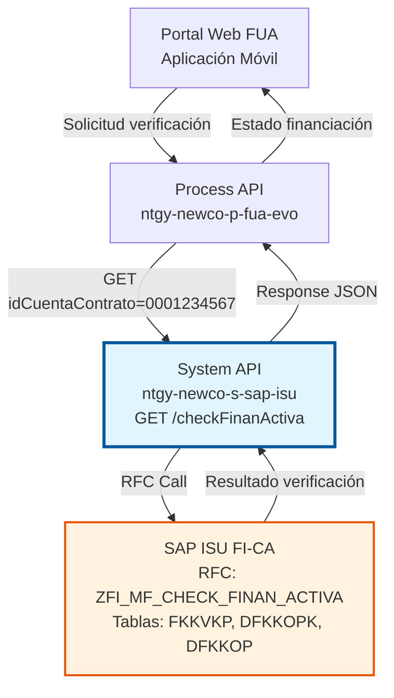
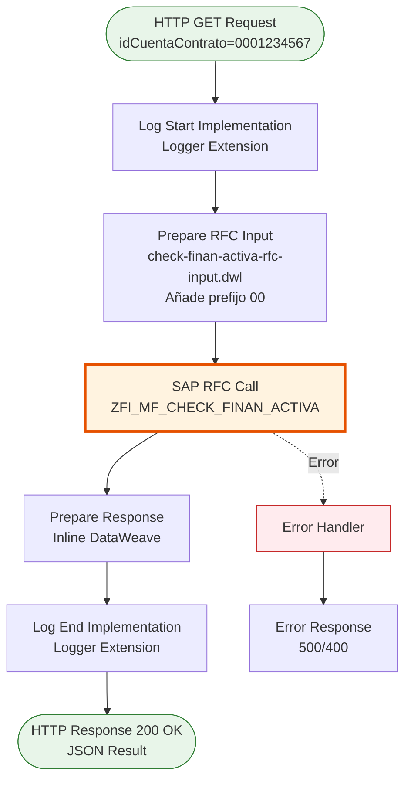
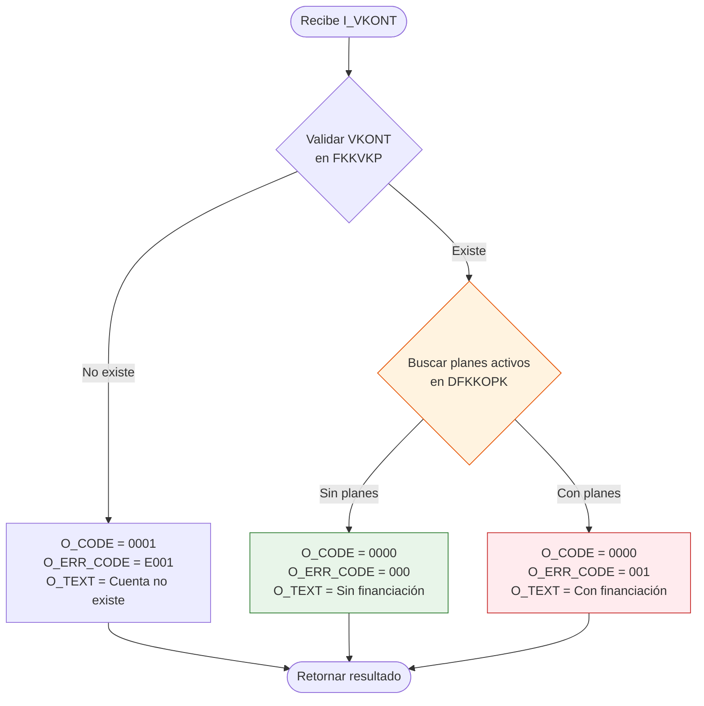
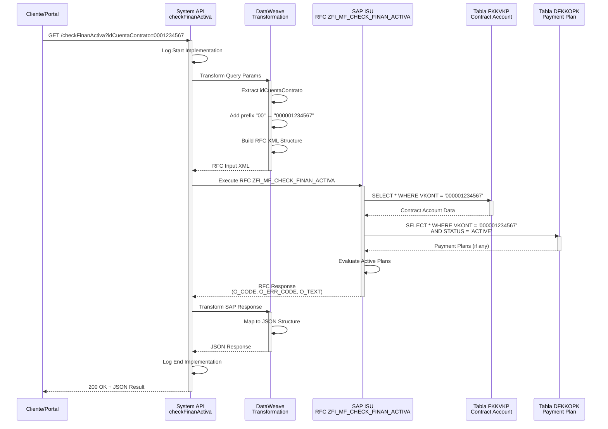

# GET /checkFinanActiva

## 📌 Descripción General

### Propósito del Endpoint

Verifica si una cuenta contrato específica tiene un plan de financiación o fraccionamiento activo en SAP ISU. Este endpoint es fundamental para validar la elegibilidad de clientes antes de permitir la creación de nuevos planes de pago, evitando duplicaciones y garantizando el cumplimiento de políticas de crédito.

El endpoint soporta:
- **Verificación en Tiempo Real**: Consulta directa a SAP ISU para obtener estado actual
- **Validación de Elegibilidad**: Determina si el cliente puede acceder a un nuevo plan de financiación
- **Prevención de Duplicados**: Evita la creación de múltiples planes activos simultáneos
- **Integración con Flujos de Cobro**: Soporte para procesos automatizados de gestión de deuda

### Tipo de API

**Capa:** System API (API-Led Connectivity)

**Función:** Integración directa con SAP ISU para verificación de financiación activa mediante RFC especializado.

### Patrón de Integración

**Tipo:** Request-Reply Síncrono con SAP RFC

**Descripción:** Recibe número de cuenta contrato (10 dígitos), añade prefijo "00" para formar VKONT de 12 dígitos, transforma al formato SAP, invoca RFC `ZFI_MF_CHECK_FINAN_ACTIVA` para verificar existencia de planes de financiación activos en tablas DFKKOPK y DFKKOP, y retorna resultado con código y mensaje descriptivo.

### Arquitectura API-Led Connectivity



---

## 💼 Propósito del Negocio

### Casos de Uso Principales

1. **Validación Previa a Creación de Plan de Fraccionamiento**
   - Cliente solicita fraccionamiento de deuda en portal web
   - Sistema verifica si ya tiene plan activo antes de proceder
   - Previene duplicación de planes y garantiza cumplimiento de políticas

2. **Verificación en Call Center**
   - Agente recibe llamada de cliente solicitando plan de pago
   - Sistema verifica elegibilidad en tiempo real durante la llamada
   - Permite respuesta inmediata al cliente sobre disponibilidad

3. **Flujos Automatizados de Gestión de Deuda**
   - Sistema de cobros identifica clientes con deuda vencida
   - Verifica automáticamente si son elegibles para financiación
   - Genera ofertas personalizadas solo para clientes elegibles

### Contexto Empresarial

- **Dominio:** Gestión Financiera y Cobros
- **Sector:** Energía - Utilities
- **División:** Naturgy España - NewCo
- **Proceso de Negocio:** Gestión de Deuda y Planes de Financiación
- **Módulo SAP:** FI-CA (Financial Contract Accounting)

### Stakeholders

- **Departamento de Cobros**: Necesita validar elegibilidad antes de ofrecer planes de pago
- **Atención al Cliente**: Requiere respuestas inmediatas sobre disponibilidad de financiación
- **Área de Riesgo**: Controla que no se otorguen múltiples financiaciones simultáneas
- **Clientes**: Buscan opciones de pago flexibles para gestionar su deuda

### Valor de Negocio

- **Reducción de Morosidad**: Facilita acceso controlado a planes de pago para clientes con dificultades
- **Mejora de Experiencia**: Respuestas inmediatas sobre elegibilidad sin esperas
- **Control de Riesgo**: Previene otorgamiento de múltiples financiaciones simultáneas
- **Eficiencia Operativa**: Automatiza validación que antes requería consulta manual en SAP
- **Cumplimiento Normativo**: Garantiza adherencia a políticas de crédito establecidas

### Consumidores Potenciales

Este endpoint puede ser consumido por:
- Process APIs de gestión de cobros y financiación
- Portales web de autoservicio (FUA)
- Aplicaciones móviles de clientes
- Sistemas de call center y CRM
- Flujos automatizados de Salesforce
- Sistemas de gestión de deuda

---

## 🔧 Especificación Técnica

### URLs por Ambiente

| Ambiente | URL Base | URL Completa |
|----------|----------|--------------|
| **Local** | `http://localhost:8081` | `http://localhost:8081/api/checkFinanActiva?idCuentaContrato=0001234567` |
| **Development** | `https://ntgy-newco-s-sap-isu-dev.us-e2.cloudhub.io` | `https://ntgy-newco-s-sap-isu-dev.us-e2.cloudhub.io/api/checkFinanActiva?idCuentaContrato=0001234567` |
| **UAT** | `https://ntgy-newco-s-sap-isu-uat.us-e2.cloudhub.io` | `https://ntgy-newco-s-sap-isu-uat.us-e2.cloudhub.io/api/checkFinanActiva?idCuentaContrato=0001234567` |
| **Production** | `https://ntgy-newco-s-sap-isu-pro.us-e2.cloudhub.io` | `https://ntgy-newco-s-sap-isu-pro.us-e2.cloudhub.io/api/checkFinanActiva?idCuentaContrato=0001234567` |

### Método HTTP

```
GET /api/checkFinanActiva
```

### Parámetros de Entrada

#### Headers HTTP

| Header | Tipo | Requerido | Descripción | Ejemplo |
|--------|------|-----------|-------------|---------|
| `Accept` | string | ❌ No | Tipo de contenido esperado en response | `application/json` |
| `client_id` | string | ✅ Sí | Client ID de Anypoint Platform | `a1b2c3d4e5f6` |
| `client_secret` | string | ✅ Sí | Client Secret de Anypoint Platform | `A1B2C3D4E5F6` |

#### Query Parameters

| Parámetro | Tipo | Requerido | Descripción | Ejemplo |
|-----------|------|-----------|-------------|---------|
| `idCuentaContrato` | string | ✅ Sí | Número de cuenta contrato en SAP ISU (10 dígitos). El sistema añadirá automáticamente el prefijo "00" para formar el VKONT de 12 dígitos. | `"0001234567"` |

### Respuestas

#### Respuesta Exitosa - Sin Financiación Activa (200 OK)

Cliente elegible para nuevo plan de financiación:

```json
{
  "result": {
    "codResult": "0000",
    "msgResult": "000",
    "text": "Cliente no tiene financiación activa"
  }
}
```

#### Respuesta Exitosa - Con Financiación Activa (200 OK)

Cliente NO elegible, ya tiene plan activo:

```json
{
  "result": {
    "codResult": "0000",
    "msgResult": "001",
    "text": "Cliente tiene financiación activa"
  }
}
```

#### Respuesta de Error de Negocio (200 OK)

Cuenta contrato no encontrada o error de validación:

```json
{
  "result": {
    "codResult": "0001",
    "msgResult": "E001",
    "text": "Cuenta contrato no existe en SAP ISU"
  }
}
```

#### Respuesta de Error Técnico (400 Bad Request)

```json
{
  "result": {
    "codResult": "0001",
    "msgResult": "Parámetro idCuentaContrato es requerido"
  }
}
```

#### Respuesta de Error Técnico (500 Internal Server Error)

```json
{
  "result": {
    "codResult": "0001",
    "msgResult": "Error interno del servidor"
  }
}
```

### Códigos de Resultado

| Código | Mensaje | Significado | Acción Recomendada |
|--------|---------|-------------|-------------------|
| `0000` + `000` | Sin financiación activa | Cliente elegible para nuevo plan | Proceder con creación de plan |
| `0000` + `001` | Con financiación activa | Cliente NO elegible | Informar al cliente sobre plan existente |
| `0001` | Error de validación | Cuenta no existe o error técnico | Verificar datos y reintentar |

### Autenticación y Autorización

- **Tipo:** Client ID & Client Secret (Anypoint Platform)
- **Autorización SAP:** El usuario SAP debe tener permisos para:
  - Ejecutar RFC `ZFI_MF_CHECK_FINAN_ACTIVA`
  - Acceso de lectura a tabla `FKKVKP` (Contract Account)
  - Acceso de lectura a tabla `DFKKOPK` (Payment Plan Header)
  - Acceso de lectura a tabla `DFKKOP` (Open Items)
  - Objeto de autorización `F_FICA_KOP` (FI-CA Open Items)

### Timeouts

| Tipo | Valor | Descripción |
|------|-------|-------------|
| **Request Timeout** | 30 segundos | Tiempo máximo de espera para la respuesta |
| **SAP RFC Timeout** | 60 segundos | Tiempo máximo para ejecución del RFC |
| **Connection Timeout** | 10 segundos | Tiempo máximo para establecer conexión con SAP |

---

## 🏗️ Implementación Técnica

### Arquitectura del Flow



### Componentes del Flow

#### 1. HTTP Listener
- **Configuración:** `HTTP_Listener_config`
- **Path:** `/api/checkFinanActiva`
- **Método:** GET
- **Puerto:** 8081 (local), 8082 (CloudHub)

#### 2. Log Start Implementation
```xml
<module-logger:log 
    config-ref="Logger_Mule_Extension_Config" 
    level="DEBUG" 
    flowName="#[vars.flowName]" 
    message="Start implementation flow for check finan activa" 
    content="#[vars.loggerContext]" />
```

#### 3. Prepare RFC Input (DataWeave)
**Archivo:** `check-finan-activa-rfc-input.dwl`

```dataweave
%dw 2.0
output application/xml
---
{
    ZFI_MF_CHECK_FINAN_ACTIVA: {
        "import": {
            I_VKONT: "00" ++ attributes.queryParams.idCuentaContrato
        }
    }
}
```

**Transformación:**
- Extrae parámetro `idCuentaContrato` de query parameters
- Añade prefijo "00" para formar VKONT de 12 dígitos
- Mapea a parámetro de importación `I_VKONT` del RFC
- Genera estructura XML para SAP JCo Connector

#### 4. SAP RFC Call
```xml
<sap:synchronous-remote-function-call 
    key="ZFI_MF_CHECK_FINAN_ACTIVA" 
    config-ref="SAP_Config" />
```

**RFC:** `ZFI_MF_CHECK_FINAN_ACTIVA`
- **Módulo:** FI-CA (Financial Contract Accounting)
- **Función:** Verificar existencia de financiación activa
- **Parámetros de Entrada:**
  - `I_VKONT`: Número de cuenta contrato (12 dígitos con prefijo "00")
- **Parámetros de Salida:**
  - `O_CODE`: Código de resultado ("0000" = OK, "0001" = Error)
  - `O_ERR_CODE`: Código de error específico ("000" = Sin financiación, "001" = Con financiación)
  - `O_TEXT`: Texto descriptivo del resultado

#### 5. Prepare Response (DataWeave Inline)
```dataweave
%dw 2.0
output application/json
---
{
    "result": {
        "codResult": payload.ZFI_MF_CHECK_FINAN_ACTIVA.export.O_CODE,
        "msgResult": payload.ZFI_MF_CHECK_FINAN_ACTIVA.export.O_ERR_CODE,
        "text": payload.ZFI_MF_CHECK_FINAN_ACTIVA.export.O_TEXT default ""
    }
}
```

**Transformación:**
- Extrae campos de salida del RFC
- Mapea a estructura JSON estándar
- Aplica valor por defecto para campo `text` si es null

#### 6. Log End Implementation
```xml
<module-logger:log 
    config-ref="Logger_Mule_Extension_Config" 
    level="DEBUG" 
    flowName="#[vars.flowName]" 
    message="Finished implementation flow for check finan activa" 
    content="#[vars.loggerContext]" />
```

### Lógica de Negocio en SAP

El RFC `ZFI_MF_CHECK_FINAN_ACTIVA` ejecuta la siguiente lógica en SAP ISU:



**Tablas SAP Consultadas:**

1. **FKKVKP (Contract Account)**
   - Valida existencia de cuenta contrato
   - Verifica estado de la cuenta

2. **DFKKOPK (Payment Plan Header)**
   - Busca planes de pago activos
   - Filtra por VKONT y estado activo
   - Verifica fechas de vigencia

3. **DFKKOP (Open Items)**
   - Consulta partidas abiertas asociadas
   - Verifica si están incluidas en plan de pago

### Diagrama de Secuencia Completo



### Manejo de Errores

```mermaid
flowchart TD
    Error[Error Detectado] --> TypeCheck{Tipo de Error}
    TypeCheck -->|SAP Connectivity| SAPConn[Error de Conexión SAP<br/>HTTP 500]
    TypeCheck -->|SAP Timeout| SAPTime[Timeout SAP RFC<br/>HTTP 504]
    TypeCheck -->|Validation| Valid[Error de Validación<br/>HTTP 400]
    TypeCheck -->|Business Logic| Business[Error de Negocio<br/>HTTP 200 + codResult=0001]
    
    SAPConn --> LogError[Log Error Details]
    SAPTime --> LogError
    Valid --> LogError
    Business --> LogError
    
    LogError --> Response[Return Error Response]
    
    style Error fill:#ffebee,stroke:#c62828
    style Response fill:#