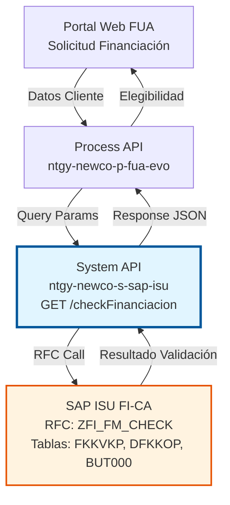
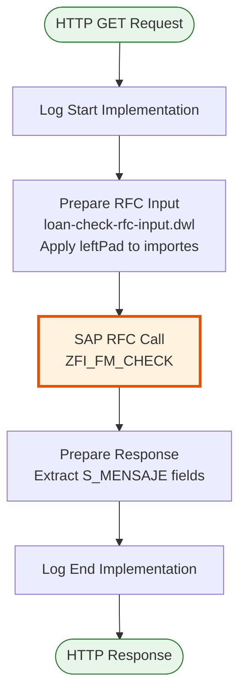
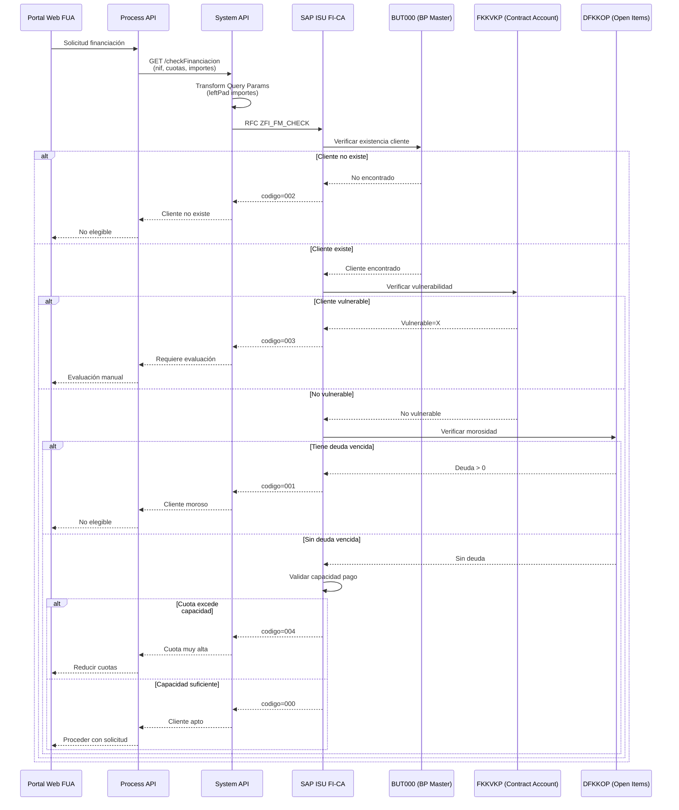

# GET /checkFinanciacion

## 📌 Descripción General

### Propósito del Endpoint

Valida la elegibilidad de un cliente para acceder a un plan de financiación de deuda en SAP ISU. Este endpoint realiza validaciones exhaustivas para determinar si un cliente cumple con los criterios necesarios para solicitar financiación, incluyendo verificación de morosidad, existencia en SAP, condición de vulnerabilidad y capacidad de pago.

El endpoint soporta:
- **Validación de Existencia**: Verifica que el cliente (NIF) exista en SAP ISU
- **Validación de Morosidad**: Comprueba si el cliente tiene deudas vencidas
- **Validación de Vulnerabilidad**: Verifica si el cliente está marcado como vulnerable
- **Validación de Capacidad de Pago**: Evalúa si el cliente puede asumir las cuotas propuestas
- **Validación de Financiación Activa**: Comprueba si ya tiene un plan de financiación activo

### Tipo de API

**Capa:** System API (API-Led Connectivity)

**Función:** Integración directa con SAP ISU para validar elegibilidad de clientes para financiación de deuda.

### Patrón de Integración

**Tipo:** Request-Reply Síncrono con SAP RFC

**Descripción:** Recibe parámetros de validación (NIF, CUPS, importes, cuotas), transforma los datos al formato SAP (aplicando padding a importes), invoca el RFC ZFI_FM_CHECK que ejecuta las validaciones de elegibilidad en SAP ISU, y retorna el resultado con código y mensaje descriptivo.

### Arquitectura API-Led Connectivity



---

## 💼 Propósito del Negocio

### Casos de Uso Principales

1. **Validación Previa a Solicitud de Financiación**
   - Cliente solicita financiación en portal web FUA
   - Sistema valida elegibilidad antes de mostrar opciones
   - Evita solicitudes que serán rechazadas

2. **Verificación de Elegibilidad en Call Center**
   - Agente consulta si cliente puede acceder a financiación
   - Obtiene respuesta inmediata durante la llamada
   - Puede ofrecer alternativas si no es elegible

3. **Evaluación Automática en Flujos de Cobro**
   - Sistema de cobros identifica clientes con deuda
   - Valida automáticamente elegibilidad para financiación
   - Genera ofertas personalizadas para clientes elegibles

### Contexto Empresarial

- **Dominio:** Gestión Financiera y Cobros
- **Sector:** Energía - Utilities
- **División:** Naturgy España - NewCo
- **Proceso de Negocio:** Gestión de Deuda y Financiación
- **Módulo SAP:** FI-CA (Financial Contract Accounting)

### Stakeholders

- **Clientes**: Necesitan conocer si pueden acceder a financiación para gestionar su deuda
- **Agentes de Call Center**: Requieren validación rápida para ofrecer soluciones de pago
- **Departamento de Cobros**: Necesita identificar clientes elegibles para planes de financiación
- **Área de Riesgos**: Requiere validaciones automáticas de capacidad de pago

### Valor de Negocio

- **Reducción de Morosidad**: Facilita el pago de deudas mediante planes de financiación
- **Mejora de Experiencia del Cliente**: Respuesta inmediata sobre elegibilidad
- **Optimización de Cobros**: Identifica automáticamente clientes elegibles para financiación
- **Reducción de Riesgo**: Valida capacidad de pago antes de aprobar financiación
- **Eficiencia Operativa**: Automatiza validaciones que antes eran manuales

### Consumidores Potenciales

Este endpoint puede ser consumido por:
- Process APIs de gestión financiera (ntgy-newco-p-fua-evo)
- Portales web de autoservicio (FUA)
- Aplicaciones móviles de clientes
- Sistemas de call center
- Flujos automatizados de gestión de cobros

---

## 🔧 Especificación Técnica

### URLs por Ambiente

| Ambiente | URL Base | URL Completa |
|----------|----------|--------------|
| **Local** | `http://localhost:8081` | `http://localhost:8081/api/checkFinanciacion?nif=12345678A&carga=X&cuotas=12&cups=ES0021000000000001AA&impCuota=50.00&importe=600.00&impTotal=650.00` |
| **Development** | `https://ntgy-newco-s-sap-isu-dev.us-e2.cloudhub.io` | `https://ntgy-newco-s-sap-isu-dev.us-e2.cloudhub.io/api/checkFinanciacion` |
| **UAT** | `https://ntgy-newco-s-sap-isu-uat.us-e2.cloudhub.io` | `https://ntgy-newco-s-sap-isu-uat.us-e2.cloudhub.io/api/checkFinanciacion` |
| **Production** | `https://ntgy-newco-s-sap-isu-pro.us-e2.cloudhub.io` | `https://ntgy-newco-s-sap-isu-pro.us-e2.cloudhub.io/api/checkFinanciacion` |

### Método HTTP

```
GET /api/checkFinanciacion
```

### Parámetros de Entrada

#### Headers HTTP

| Header | Tipo | Requerido | Descripción | Ejemplo |
|--------|------|-----------|-------------|---------|
| `Accept` | string | ❌ No | Tipo de contenido esperado en response | `application/json` |

#### Query Parameters

| Parámetro | Tipo | Requerido | Descripción | Ejemplo |
|-----------|------|-----------|-------------|---------|
| `nif` | string | ✅ Sí | NIF/CIF del cliente a validar | `"12345678A"` |
| `carga` | string | ✅ Sí | Indicador de carga (tipo de validación) | `"X"` |
| `cuotas` | string | ✅ Sí | Número de cuotas solicitadas para el plan de financiación | `"12"` |
| `cups` | string | ✅ Sí | Código Universal del Punto de Suministro | `"ES0021000000000001AA"` |
| `impCuota` | string | ✅ Sí | Importe de cada cuota (será formateado con padding a 14 caracteres) | `"50.00"` |
| `importe` | string | ✅ Sí | Importe total a financiar (será formateado con padding a 14 caracteres) | `"600.00"` |
| `impTotal` | string | ✅ Sí | Importe total incluyendo intereses (será formateado con padding a 14 caracteres) | `"650.00"` |

**Nota sobre Importes:** Los importes son transformados internamente aplicando `leftPad` a 14 caracteres con ceros a la izquierda antes de enviarlos a SAP.

### Respuestas

#### Respuesta Exitosa - Cliente Apto (200 OK)

```json
{
  "version": "1.0",
  "tipo": "S",
  "clase": "ZFI",
  "codigo": "000",
  "mensaje": "Cliente apto para financiación"
}
```

#### Respuesta Exitosa - Cliente No Apto por Morosidad (200 OK)

```json
{
  "version": "1.0",
  "tipo": "E",
  "clase": "ZFI",
  "codigo": "001",
  "mensaje": "Cliente moroso - no apto para financiación"
}
```

#### Respuesta Exitosa - Cliente No Existe (200 OK)

```json
{
  "version": "1.0",
  "tipo": "E",
  "clase": "ZFI",
  "codigo": "002",
  "mensaje": "Cliente no existe en SAP ISU"
}
```

#### Respuesta Exitosa - Cliente Vulnerable (200 OK)

```json
{
  "version": "1.0",
  "tipo": "W",
  "clase": "ZFI",
  "codigo": "003",
  "mensaje": "Cliente vulnerable - requiere evaluación especial"
}
```

#### Respuesta de Error Técnico (400/500)

```json
{
  "result": {
    "codResult": "0001",
    "msgResult": "Error interno del servidor"
  }
}
```

### Códigos de Resultado

| Código | Tipo | Descripción | Acción Recomendada |
|--------|------|-------------|-------------------|
| `000` | Success | Cliente apto para financiación | Proceder con solicitud |
| `001` | Error | Cliente moroso - no apto | Ofrecer plan de pago alternativo |
| `002` | Error | Cliente no existe en SAP ISU | Verificar datos del cliente |
| `003` | Warning | Cliente vulnerable - requiere evaluación especial | Derivar a evaluación manual |
| `004` | Error | Importe de cuota excede capacidad de pago | Reducir número de cuotas o importe |
| `005` | Error | Ya tiene financiación activa | Informar sobre plan existente |

### Autenticación y Autorización

- **Tipo:** Client ID & Client Secret (Anypoint Platform)
- **Autorización SAP:** El usuario debe tener permisos para:
  - Ejecutar RFC `ZFI_FM_CHECK`
  - Acceso de lectura a tablas FKKVKP, DFKKOP, BUT000
  - Objeto de autorización F_FICA_KON (Contract Account)

### Timeouts

| Tipo | Valor | Descripción |
|------|-------|-------------|
| **Request Timeout** | 30 segundos | Tiempo máximo de espera para la respuesta |
| **Connection Timeout** | 10 segundos | Tiempo máximo para establecer conexión con SAP |

---

## 🏗️ Implementación Técnica

### Arquitectura del Flow



### Componentes del Flow

**Flow Name:** `loanCheckFlow`

**Ubicación:** `src/main/mule/implementation/payment-financial-operations.xml`

**Componentes:**

1. **Log Start Implementation**
   - Logger personalizado (ntgy-cli-logger-extension)
   - Registra inicio de ejecución con contexto

2. **Prepare RFC Input** (DataWeave Transformation)
   - Archivo: `src/main/resources/dw/loan-check-rfc-input.dwl`
   - Transforma query parameters a formato SAP XML
   - Aplica `leftPad` a importes (14 caracteres con ceros)

3. **SAP RFC Call**
   - RFC: `ZFI_FM_CHECK`
   - Config: `SAP_Config`
   - Timeout: Configurable por ambiente

4. **Prepare Response** (DataWeave Transformation)
   - Extrae campos de `S_MENSAJE` del response SAP
   - Transforma a formato JSON estándar
   - Maneja valores nulos con `default ""`

5. **Log End Implementation**
   - Registra fin de ejecución
   - Incluye resultado de validación

### Transformación de Entrada (DataWeave)

**Archivo:** `src/main/resources/dw/loan-check-rfc-input.dwl`

```dataweave
%dw 2.0
import * from dw::core::Strings
output application/xml

---
{
	ZFI_FM_CHECK: {
		"import": {
			IM_CARGA: attributes.queryParams.carga,
			IM_CUOTAS: attributes.queryParams.cuotas,
			IM_CUPS: attributes.queryParams.cups,
			IM_IMPCUOTA: leftPad(attributes.queryParams.impCuota, 14, "0"),
			IM_IMPORTE: leftPad(attributes.queryParams.importe, 14, "0"),
			IM_IMPTOTAL: leftPad(attributes.queryParams.impTotal, 14, "0"),
			IM_NIF: attributes.queryParams.nif,
		}
	}
}
```

**Características:**
- Importa funciones de `dw::core::Strings` para `leftPad`
- Aplica padding de 14 caracteres con ceros a la izquierda en importes
- Mapea query parameters directamente a campos de importación del RFC
- Output en formato XML para SAP

### Transformación de Salida (DataWeave)

**Ubicación:** Inline en el flow XML

```dataweave
%dw 2.0
output application/json
var out = payload.ZFI_FM_CHECK.export.S_MENSAJE
---
{
	"version": out.VERSION default "",
	"tipo": out.TIPO default "",
	"clase": out.CLASE default "",
	"codigo": out.CODIGO default "",
	"mensaje": out.MENSAJE default "",
}
```

**Características:**
- Extrae estructura `S_MENSAJE` del response SAP
- Aplica `default ""` para manejar valores nulos
- Transforma a JSON con nombres de campos en minúsculas
- Mantiene todos los campos del mensaje SAP

### RFC SAP: ZFI_FM_CHECK

**Módulo SAP:** FI-CA (Financial Contract Accounting)

**Parámetros de Importación:**

| Parámetro | Tipo | Descripción |
|-----------|------|-------------|
| `IM_NIF` | CHAR(20) | NIF/CIF del cliente |
| `IM_CARGA` | CHAR(1) | Indicador de tipo de carga |
| `IM_CUOTAS` | NUMC(2) | Número de cuotas solicitadas |
| `IM_CUPS` | CHAR(22) | Código Universal del Punto de Suministro |
| `IM_IMPCUOTA` | CHAR(14) | Importe de cada cuota (con padding) |
| `IM_IMPORTE` | CHAR(14) | Importe total a financiar (con padding) |
| `IM_IMPTOTAL` | CHAR(14) | Importe total con intereses (con padding) |

**Parámetros de Exportación:**

| Parámetro | Tipo | Descripción |
|-----------|------|-------------|
| `S_MENSAJE.VERSION` | CHAR(10) | Versión del mensaje |
| `S_MENSAJE.TIPO` | CHAR(1) | Tipo de mensaje (S=Success, E=Error, W=Warning) |
| `S_MENSAJE.CLASE` | CHAR(20) | Clase de mensaje |
| `S_MENSAJE.CODIGO` | CHAR(3) | Código de resultado |
| `S_MENSAJE.MENSAJE` | CHAR(220) | Mensaje descriptivo |

---

### Resumen de Tablas SAP Consultadas

| Tabla | Descripción | Operación | Propósito |
|-------|-------------|-----------|-----------|
| `BUT000` | Business Partner Master | SELECT SINGLE | Verificar existencia del cliente |
| `FKKVKP` | Contract Account | SELECT SINGLE | Verificar vulnerabilidad |
| `DFKKOP` | Open Items | SELECT SUM | Calcular deuda vencida |
| `DFKKOPK` | Payment Plan Header | SELECT SINGLE | Verificar financiación activa |
| `EVER` | Contract Master | SELECT (indirecto) | Calcular capacidad de pago |

### Diagrama de Secuencia



### Diagrama de Transformación de Datos

```mermaid
flowchart LR
    subgraph Input["Query Parameters"]
        A1[nif: 12345678A]
        A2[carga: X]
        A3[cuotas: 12]
        A4[cups: ES0021...]
        A5[impCuota: 50.00]
        A6[importe: 600.00]
        A7[impTotal: 650.00]
    end
    
    subgraph Transform["DataWeave Transform"]
        B1[leftPad impCuota<br/>→ 00000000050.00]
        B2[leftPad importe<br/>→ 00000000600.00]
        B3[leftPad impTotal<br/>→ 00000000650.00]
        B4[Map to XML]
    end
    
    subgraph SAP["RFC Input"]
        C1[IM_NIF: 12345678A]
        C2[IM_CARGA: X]
        C3[IM_CUOTAS: 12]
        C4[IM_CUPS: ES0021...]
        C5[IM_IMPCUOTA: 00000000050.00]
        C6[IM_IMPORTE: 00000000600.00]
        C7[IM_IMPTOTAL: 00000000650.00]
    end
    
    subgraph Output["JSON Response"]
        D1[version: 1.0]
        D2[tipo: S]
        D3[clase: ZFI]
        D4[codigo: 000]
        D5[mensaje: Cliente apto...]
    end
    
    Input --> Transform
    Transform --> SAP
    SAP --> Output
    
    style Transform fill:#fff3e0,stroke:#e65100
    style SAP fill:#e1f5ff,stroke:#01579b
```



---

## 💻 Ejemplos de Uso

### Ejemplo 1: Request - Cliente Apto

```bash
curl -X GET "https://ntgy-newco-s-sap-isu-pro.us-e2.cloudhub.io/api/checkFinanciacion?nif=12345678A&carga=X&cuotas=12&cups=ES0021000000000001AA&impCuota=50.00&importe=600.00&impTotal=650.00" \
  -H "Accept: application/json" \
  -H "client_id: YOUR_CLIENT_ID" \
  -H "client_secret: YOUR_CLIENT_SECRET"
```

**Response (200 OK):**
```json
{
  "version": "1.0",
  "tipo": "S",
  "clase": "ZFI",
  "codigo": "000",
  "mensaje": "Cliente apto para financiación"
}
```

### Ejemplo 2: Request - Cliente Moroso

```bash
curl -X GET "https://ntgy-newco-s-sap-isu-pro.us-e2.cloudhub.io/api/checkFinanciacion?nif=98765432B&carga=X&cuotas=12&cups=ES0021000000000002BB&impCuota=50.00&importe=600.00&impTotal=650.00" \
  -H "Accept: application/json" \
  -H "client_id: YOUR_CLIENT_ID" \
  -H "client_secret: YOUR_CLIENT_SECRET"
```

**Response (200 OK):**
```json
{
  "version": "1.0",
  "tipo": "E",
  "clase": "ZFI",
  "codigo": "001",
  "mensaje": "Cliente moroso - no apto para financiación"
}
```

### Ejemplo 3: Request - Cliente Vulnerable

```bash
curl -X GET "https://ntgy-newco-s-sap-isu-pro.us-e2.cloudhub.io/api/checkFinanciacion?nif=11223344C&carga=X&cuotas=12&cups=ES0021000000000003CC&impCuota=50.00&importe=600.00&impTotal=650.00" \
  -H "Accept: application/json" \
  -H "client_id: YOUR_CLIENT_ID" \
  -H "client_secret: YOUR_CLIENT_SECRET"
```

**Response (200 OK):**
```json
{
  "version": "1.0",
  "tipo": "W",
  "clase": "ZFI",
  "codigo": "003",
  "mensaje": "Cliente vulnerable - requiere evaluación especial"
}
```

### Ejemplo 4: Request - Cliente No Existe

```bash
curl -X GET "https://ntgy-newco-s-sap-isu-pro.us-e2.cloudhub.io/api/checkFinanciacion?nif=99999999Z&carga=X&cuotas=12&cups=ES0021000000000004DD&impCuota=50.00&importe=600.00&impTotal=650.00" \
  -H "Accept: application/json" \
  -H "client_id: YOUR_CLIENT_ID" \
  -H "client_secret: YOUR_CLIENT_SECRET"
```

**Response (200 OK):**
```json
{
  "version": "1.0",
  "tipo": "E",
  "clase": "ZFI",
  "codigo": "002",
  "mensaje": "Cliente no existe en SAP ISU"
}
```

### Ejemplo 5: Error Técnico

```bash
curl -X GET "https://ntgy-newco-s-sap-isu-pro.us-e2.cloudhub.io/api/checkFinanciacion?nif=12345678A" \
  -H "Accept: application/json" \
  -H "client_id: YOUR_CLIENT_ID" \
  -H "client_secret: YOUR_CLIENT_SECRET"
```

**Response (400 Bad Request):**
```json
{
  "result": {
    "codResult": "0001",
    "msgResult": "Parámetros requeridos faltantes: carga, cuotas, cups, impCuota, importe, impTotal"
  }
}
```

### Ejemplo 6: JavaScript/Node.js

```javascript
const axios = require('axios');

async function checkFinanciacion(clientData) {
  try {
    const response = await axios.get('https://ntgy-newco-s-sap-isu-pro.us-e2.cloudhub.io/api/checkFinanciacion', {
      params: {
        nif: clientData.nif,
        carga: 'X',
        cuotas: clientData.cuotas,
        cups: clientData.cups,
        impCuota: clientData.impCuota,
        importe: clientData.importe,
        impTotal: clientData.impTotal
      },
      headers: {
        'Accept': 'application/json',
        'client_id': process.env.CLIENT_ID,
        'client_secret': process.env.CLIENT_SECRET
      }
    });
    
    if (response.data.codigo === '000') {
      console.log('✅ Cliente apto para financiación');
      return { eligible: true, message: response.data.mensaje };
    } else {
      console.log('❌ Cliente no apto:', response.data.mensaje);
      return { eligible: false, message: response.data.mensaje, code: response.data.codigo };
    }
  } catch (error) {
    console.error('Error al validar financiación:', error.message);
    throw error;
  }
}

// Uso
const clientData = {
  nif: '12345678A',
  cuotas: '12',
  cups: 'ES0021000000000001AA',
  impCuota: '50.00',
  importe: '600.00',
  impTotal: '650.00'
};

checkFinanciacion(clientData)
  .then(result => console.log('Resultado:', result))
  .catch(error => console.error('Error:', error));
```

### Ejemplo 7: Python

```python
import requests
import os

def check_financiacion(client_data):
    """
    Valida elegibilidad de cliente para financiación
    """
    url = "https://ntgy-newco-s-sap-isu-pro.us-e2.cloudhub.io/api/checkFinanciacion"
    
    params = {
        'nif': client_data['nif'],
        'carga': 'X',
        'cuotas': client_data['cuotas'],
        'cups': client_data['cups'],
        'impCuota': client_data['impCuota'],
        'importe': client_data['importe'],
        'impTotal': client_data['impTotal']
    }
    
    headers = {
        'Accept': 'application/json',
        'client_id': os.getenv('CLIENT_ID'),
        'client_secret': os.getenv('CLIENT_SECRET')
    }
    
    try:
        response = requests.get(url, params=params, headers=headers)
        response.raise_for_status()
        
        data = response.json()
        
        if data['codigo'] == '000':
            print('✅ Cliente apto para financiación')
            return {'eligible': True, 'message': data['mensaje']}
        else:
            print(f"❌ Cliente no apto: {data['mensaje']}")
            return {'eligible': False, 'message': data['mensaje'], 'code': data['codigo']}
            
    except requests.exceptions.RequestException as e:
        print(f"Error al validar financiación: {str(e)}")
        raise

# Uso
client_data = {
    'nif': '12345678A',
    'cuotas': '12',
    'cups': 'ES0021000000000001AA',
    'impCuota': '50.00',
    'importe': '600.00',
    'impTotal': '650.00'
}

result = check_financiacion(client_data)
print('Resultado:', result)
```
