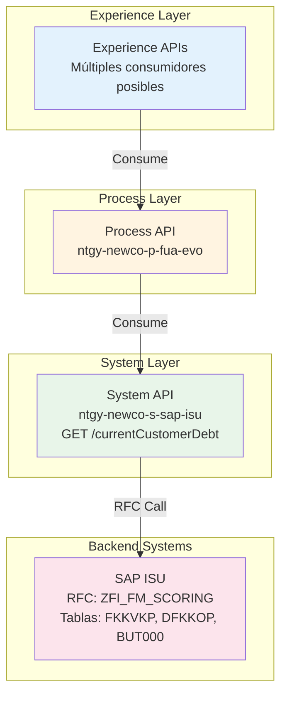
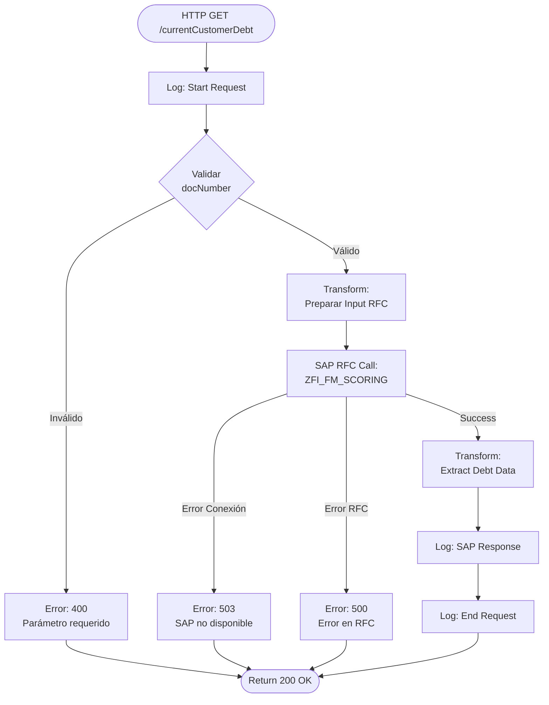
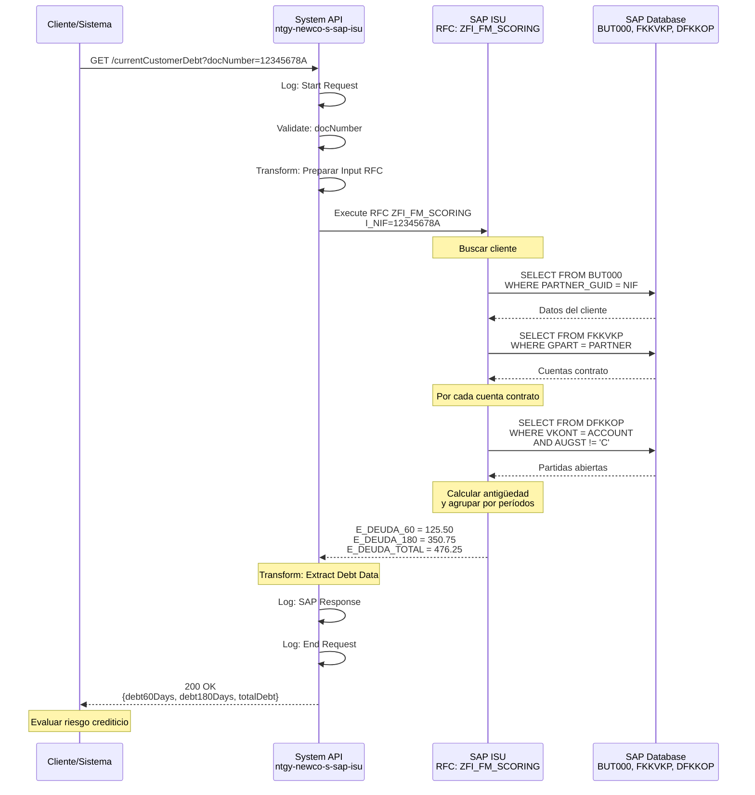
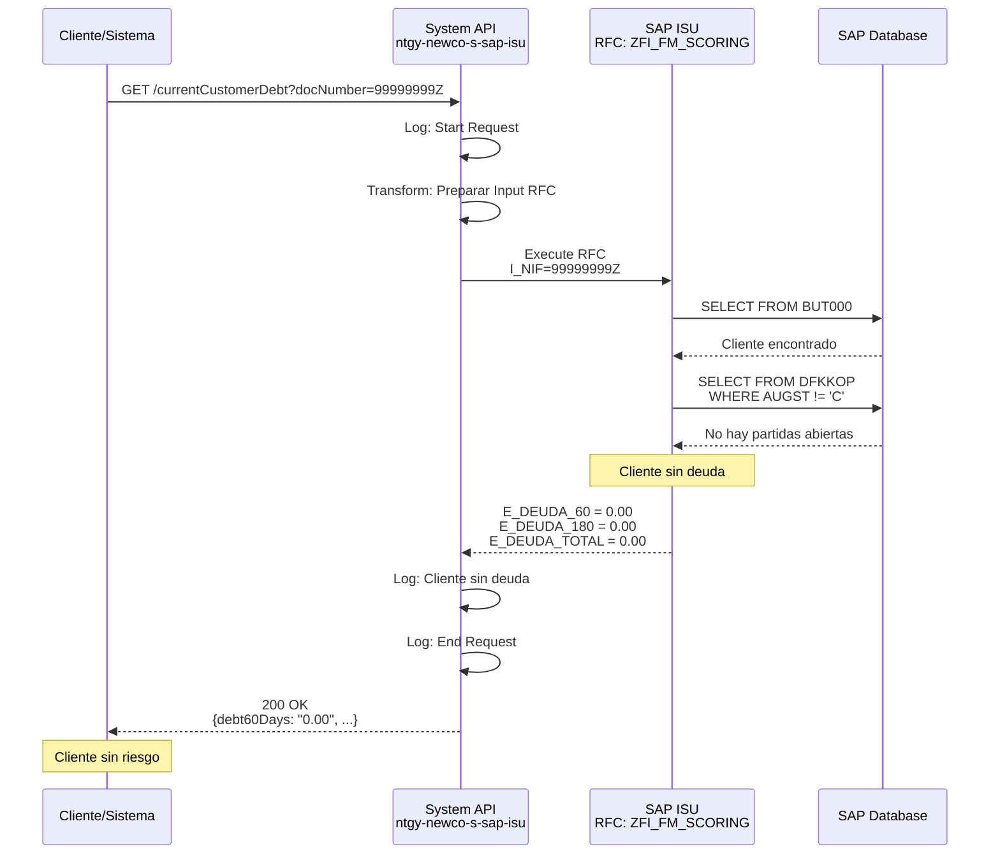
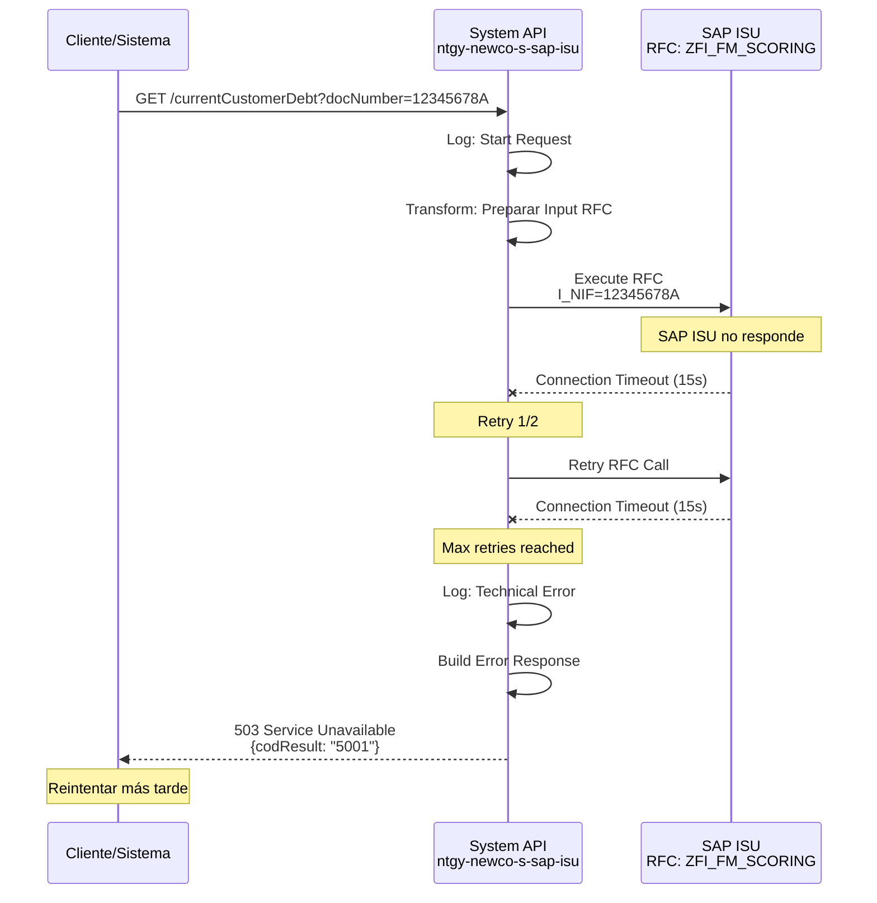

# GET /currentCustomerDebt

## 📌 Descripción General

### Propósito del Endpoint

Este endpoint consulta la deuda total de un cliente en SAP ISU, incluyendo desglose por períodos de antigüedad (60 días, 180 días y deuda total). Proporciona información completa sobre el estado de morosidad del cliente, permitiendo a los sistemas consumidores evaluar el riesgo crediticio y tomar decisiones sobre gestión de cobros.

### Tipo de API

**Capa:** System API (Integración Directa con SAP ISU)

### Patrón de Integración

**Tipo:** Request-Reply Síncrono con SAP ISU - Scoring de Deuda

Este endpoint implementa un patrón de consulta de scoring crediticio mediante RFC (Remote Function Call). La comunicación es síncrona y proporciona información agregada de deuda del cliente.

**Características del Patrón:**
- ✅ Comunicación síncrona con SAP ISU
- ✅ Invocación de RFC `ZFI_FM_SCORING`
- ✅ Cálculo de deuda por períodos de antigüedad
- ✅ Respuesta con scoring de morosidad
- ✅ Tiempo de respuesta < 5 segundos

### Arquitectura API-Led Connectivity



**Flujo de Datos:**
1. Experience API solicita deuda total del cliente
2. Process API orquesta la petición
3. System API invoca RFC de scoring en SAP ISU
4. SAP ISU calcula deuda por períodos de antigüedad
5. System API retorna deuda a 60, 180 días y total
6. Respuesta se propaga hacia arriba en la arquitectura

---

## 💼 Propósito del Negocio

### Casos de Uso Principales

#### 1. Evaluación de Riesgo Crediticio
**Actor:** Departamento de crédito y cobranza  
**Objetivo:** Evaluar el nivel de riesgo del cliente  
**Flujo:**
- Sistema consulta deuda total del cliente
- Analiza antigüedad de la deuda (60, 180 días)
- Clasifica cliente según nivel de riesgo
- Toma decisiones sobre gestión de cobros

#### 2. Gestión de Cobranza
**Actor:** Agente de cobranza  
**Objetivo:** Priorizar gestiones de cobro  
**Flujo:**
- Sistema identifica clientes con deuda vencida
- Consulta antigüedad de deuda por cliente
- Prioriza gestiones según antigüedad
- Ejecuta acciones de cobranza

#### 3. Aprobación de Nuevos Servicios
**Actor:** Sistema de ventas o contratación  
**Objetivo:** Validar elegibilidad para nuevos servicios  
**Flujo:**
- Cliente solicita nuevo servicio
- Sistema consulta deuda total del cliente
- Valida si cumple requisitos crediticios
- Aprueba o rechaza solicitud

#### 4. Scoring Crediticio
**Actor:** Sistema de análisis de riesgo  
**Objetivo:** Calcular score crediticio del cliente  
**Flujo:**
- Sistema solicita información de deuda
- Analiza patrones de pago y morosidad
- Calcula score crediticio
- Actualiza perfil de riesgo del cliente

### Contexto Empresarial

- **Dominio:** Gestión de Crédito y Cobranza
- **Sector:** Energía - Utilities (Gas y Electricidad)
- **División:** Naturgy NewCo
- **Proceso de Negocio:** Credit Risk Management & Collections
- **Sistema Backend:** SAP ISU (Industry Solution Utilities)

### Stakeholders

#### Stakeholders Primarios
- **Departamento de Crédito:** Evalúan riesgo crediticio
- **Departamento de Cobranza:** Gestionan recuperación de deuda
- **Área de Ventas:** Validan elegibilidad para servicios

#### Stakeholders Secundarios
- **Dirección Financiera:** Monitorean cartera de clientes
- **Auditoría Interna:** Verifican políticas de crédito
- **Sistemas de BI:** Analizan tendencias de morosidad

### Valor de Negocio

#### Beneficios Cuantitativos
- 💰 **Reducción de Morosidad:** 20% mejora en tasa de cobro
- ⏱️ **Tiempo de Evaluación:** 95% reducción en tiempo de análisis
- 📊 **Mejora en DSO:** 15% reducción en días de cobro
- 🎯 **Eficiencia en Cobranza:** 40% mejora en priorización

#### Beneficios Cualitativos
- ✅ Mejor gestión de riesgo crediticio
- ✅ Decisiones basadas en datos en tiempo real
- ✅ Priorización efectiva de gestiones de cobro
- ✅ Reducción de pérdidas por incobrables
- ✅ Mejora en políticas de crédito

### Consumidores Potenciales

Este endpoint puede ser consumido por:
- **Sistemas de Crédito y Cobranza:** Evaluación de riesgo
- **Sistemas de Ventas:** Validación de elegibilidad
- **Portales de Gestión:** Monitoreo de cartera
- **Sistemas de BI:** Análisis de morosidad
- **Sistemas de Scoring:** Cálculo de riesgo crediticio
- **Aplicaciones de Agentes:** Gestión de cobranza

---

## 🔧 Especificación Técnica

### URLs por Ambiente

| Ambiente | URL Base | URL Completa |
|----------|----------|--------------|
| **Local** | `http://localhost:8081` | `http://localhost:8081/api/currentCustomerDebt` |
| **Development** | `https://ntgy-newco-s-sap-isu-dev.cloudhub.io` | `https://ntgy-newco-s-sap-isu-dev.cloudhub.io/api/currentCustomerDebt` |
| **UAT** | `https://ntgy-newco-s-sap-isu-uat.cloudhub.io` | `https://ntgy-newco-s-sap-isu-uat.cloudhub.io/api/currentCustomerDebt` |
| **UAT00** | `https://ntgy-newco-s-sap-isu-uat00.cloudhub.io` | `https://ntgy-newco-s-sap-isu-uat00.cloudhub.io/api/currentCustomerDebt` |
| **Production** | `https://ntgy-newco-s-sap-isu.cloudhub.io` | `https://ntgy-newco-s-sap-isu.cloudhub.io/api/currentCustomerDebt` |

### Método HTTP

```
GET /api/currentCustomerDebt
```

### Parámetros de Entrada

#### Query Parameters

| Parámetro | Tipo | Requerido | Descripción | Ejemplo | Validación |
|-----------|------|-----------|-------------|---------|------------|
| `docNumber` | String | ✅ Sí | Número de documento del cliente (NIF/CIF) | `12345678A` | Alfanumérico, 9 caracteres |

**Notas sobre Parámetros:**
- El `docNumber` debe corresponder a un cliente válido en SAP ISU
- Formato típico: 8 dígitos + 1 letra (NIF) o letra + 8 dígitos (CIF)
- Si el cliente no existe, se retorna error de negocio

#### Headers HTTP

| Header | Tipo | Requerido | Descripción | Ejemplo |
|--------|------|-----------|-------------|---------|
| `Content-Type` | String | ✅ Sí | Tipo de contenido de la respuesta | `application/json` |
| `Accept` | String | ⚠️ Recomendado | Tipo de contenido aceptado | `application/json` |

### Respuestas

#### Respuesta Exitosa (200 OK)

**Estructura de Respuesta:**

```json
{
  "result": {
    "codResult": "0000",
    "msgResult": "OK"
  },
  "debt60Days": "125.50",
  "debt180Days": "350.75",
  "totalDebt": "476.25"
}
```

**Descripción de Campos:**

| Campo | Tipo | Descripción | Unidad |
|-------|------|-------------|--------|
| `result.codResult` | String | Código de resultado ("0000" = éxito) | - |
| `result.msgResult` | String | Mensaje descriptivo del resultado | - |
| `debt60Days` | String | Deuda con antigüedad hasta 60 días | EUR |
| `debt180Days` | String | Deuda con antigüedad hasta 180 días | EUR |
| `totalDebt` | String | Deuda total del cliente | EUR |

**Interpretación de Períodos:**
- **debt60Days:** Deuda vencida hace menos de 60 días (morosidad reciente)
- **debt180Days:** Deuda vencida hace menos de 180 días (morosidad media)
- **totalDebt:** Suma total de toda la deuda del cliente (incluye > 180 días)

**Clasificación de Riesgo:**

| Deuda Total | Antigüedad | Nivel de Riesgo |
|-------------|------------|-----------------|
| < 100 EUR | Cualquiera | Bajo |
| 100-500 EUR | < 60 días | Medio |
| 100-500 EUR | > 60 días | Alto |
| > 500 EUR | < 60 días | Alto |
| > 500 EUR | > 60 días | Crítico |

#### Respuestas de Error

##### Error 400 - Bad Request

**Causa:** Parámetros inválidos o faltantes

```json
{
  "result": {
    "codResult": "0001",
    "msgResult": "Parámetro docNumber es requerido"
  }
}
```

##### Error 500 - Internal Server Error

**Causa:** Error en SAP ISU o error técnico del API

```json
{
  "result": {
    "codResult": "9999",
    "msgResult": "Error al consultar deuda del cliente en SAP ISU"
  }
}
```

##### Error 503 - Service Unavailable

**Causa:** SAP ISU no disponible

```json
{
  "result": {
    "codResult": "5001",
    "msgResult": "SAP ISU temporalmente no disponible"
  }
}
```

### Autenticación y Autorización

#### Tipo de Autenticación

**Método:** Client ID & Client Secret (OAuth 2.0 Client Credentials)

**Headers Requeridos:**
- `client_id`: Identificador de la aplicación cliente
- `client_secret`: Secreto de la aplicación cliente

**Nota:** La autenticación se gestiona a nivel de Anypoint Platform API Manager.

#### Autorización SAP

El usuario SAP configurado en el conector debe tener los siguientes permisos:
- Objeto de autorización: `F_FICA_REC` (Receivables Management)
- Actividad: `03` (Display)
- RFC: `ZFI_FM_SCORING` (Execute permission)

### Timeouts Configurados

| Tipo | Valor | Descripción |
|------|-------|-------------|
| **Request Timeout** | 20 segundos | Timeout total de la petición HTTP |
| **SAP RFC Timeout** | 15 segundos | Timeout de ejecución del RFC en SAP |
| **Connection Timeout** | 5 segundos | Timeout de establecimiento de conexión SAP |

**Estrategia de Retry:**
- Reintentos automáticos: 2 intentos
- Intervalo entre reintentos: 2 segundos
- Solo para errores de conexión (no para errores de negocio)

### Protocolo

- **Protocolo:** HTTPS (TLS 1.2+)
- **Puerto:** 443 (HTTPS)
- **Método de Compresión:** gzip (opcional)

---

## 🏗️ Implementación Técnica

### Arquitectura del Flow



### RFC SAP Invocado

#### RFC: `ZFI_FM_SCORING`

**Descripción:** Función RFC personalizada de SAP ISU para calcular el scoring de deuda de un cliente, incluyendo desglose por períodos de antigüedad.

**Módulo SAP:** Financial Contract Accounting (FI-CA)

**Tablas SAP Consultadas:**
- `BUT000`: Business Partner Master Data (Datos Maestros de Cliente)
- `FKKVKP`: Contract Account (Cuenta Contrato)
- `DFKKOP`: Open Items (Partidas Abiertas)
- `DFKKKO`: Document Header (Cabecera de Documento)

**Parámetros de Entrada:**

| Parámetro | Tipo ABAP | Descripción | Ejemplo |
|-----------|-----------|-------------|---------|
| `I_NIF` | CHAR(20) | Número de documento del cliente | `12345678A` |
| `I_DEUDA_60` | CHAR(1) | Flag para calcular deuda a 60 días | `X` |
| `I_DEUDA_180` | CHAR(1) | Flag para calcular deuda a 180 días | `X` |
| `I_DEUDA_TOTAL` | CHAR(1) | Flag para calcular deuda total | `X` |
| `I_DEUDA_DIAS` | INT4 | Días adicionales para cálculo | `0` |

**Parámetros de Salida:**

| Parámetro | Tipo ABAP | Descripción | Formato |
|-----------|-----------|-------------|---------|
| `E_DEUDA_60` | CURR(15,2) | Deuda hasta 60 días | Decimal |
| `E_DEUDA_180` | CURR(15,2) | Deuda hasta 180 días | Decimal |
| `E_DEUDA_TOTAL` | CURR(15,2) | Deuda total | Decimal |

**Lógica de Cálculo:**
1. Busca cliente por número de documento
2. Obtiene todas las cuentas contrato del cliente
3. Consulta partidas abiertas (facturas pendientes)
4. Calcula antigüedad de cada partida
5. Agrupa deuda por períodos (60, 180 días, total)
6. Retorna importes calculados

### Transformaciones DataWeave

#### Transformación 1: Preparar Input RFC

**Archivo:** `src/main/resources/dw/current-customer-debt-rfc-input.dwl`

```dataweave
%dw 2.0
output application/xml
---
{
    "ZFI_FM_SCORING": {
        "import": {
            "I_NIF": attributes.queryParams.docNumber,
            "I_DEUDA_60": "X",
            "I_DEUDA_180": "X",
            "I_DEUDA_TOTAL": "X",
            "I_DEUDA_DIAS": 0
        }
    }
}
```

**Mapeo de Campos:**

| Campo Origen (HTTP) | Campo Destino (SAP) | Transformación |
|---------------------|---------------------|----------------|
| `queryParams.docNumber` | `I_NIF` | Directo (String) |
| Constante "X" | `I_DEUDA_60` | Flag activado |
| Constante "X" | `I_DEUDA_180` | Flag activado |
| Constante "X" | `I_DEUDA_TOTAL` | Flag activado |
| Constante 0 | `I_DEUDA_DIAS` | Sin días adicionales |

#### Transformación 2: Procesar Output RFC

**Archivo:** Inline en flow XML (líneas 424-438)

```dataweave
%dw 2.0
output application/json
var msg = payload.ZFI_FM_SCORING."export"
---
{
  "result": 
    {
      "codResult": "0000",
      "msgResult": "OK"
    },
  "debt60Days": msg.E_DEUDA_60,
  "debt180Days": msg.E_DEUDA_180,
  "totalDebt": msg.E_DEUDA_TOTAL
}
```

**Mapeo de Campos:**

| Campo SAP | Campo JSON | Transformación |
|-----------|------------|----------------|
| `E_DEUDA_60` | `debt60Days` | Directo (String con decimales) |
| `E_DEUDA_180` | `debt180Days` | Directo (String con decimales) |
| `E_DEUDA_TOTAL` | `totalDebt` | Directo (String con decimales) |

**Nota:** Los importes se retornan como String para preservar precisión decimal.

### Patrones de Diseño

**Patrón Principal:** Request-Reply Síncrono con Agregación

**Justificación:**
- Requiere cálculo agregado de múltiples partidas
- Datos deben ser en tiempo real
- Respuesta debe incluir desglose por períodos
- Ideal para scoring crediticio

**Patrones Adicionales:**
- **Aggregation Pattern:** Agregación de deuda por períodos
- **Scoring Pattern:** Cálculo de métricas de riesgo
- **Data Enrichment:** Enriquecimiento con antigüedad

### Diagramas de Secuencia

#### 1. Flujo Normal de Éxito



#### 2. Flujo con Cliente Sin Deuda



#### 3. Flujo con Error Técnico



### Connection Pooling y Optimizaciones

#### Optimizaciones de Performance

1. **Cálculo Agregado Eficiente:**
   - SAP calcula todos los períodos en una sola llamada
   - No requiere múltiples consultas
   - Tiempo de respuesta < 5 segundos

2. **Flags de Control:**
   - Permite activar/desactivar cálculos específicos
   - Flexibilidad en uso del RFC
   - Optimización de recursos SAP

3. **Cache de Scoring:**
   - Candidato para caching (TTL: 15 minutos)
   - Reducción de carga en SAP
   - Mejora en performance para consultas frecuentes

### Manejo de Errores

#### Estrategia de Error Handling

```xml
<error-handler>
    <on-error-propagate type="SAP:CONNECTIVITY">
        <ee:transform>
            <ee:set-payload>
                {
                  "result": {
                    "codResult": "5001",
                    "msgResult": "SAP ISU temporalmente no disponible"
                  }
                }
            </ee:set-payload>
            <ee:set-attributes>
                <ee:set-attribute attributeName="httpStatus">503</ee:set-attribute>
            </ee:set-attributes>
        </ee:transform>
    </on-error-propagate>
    
    <on-error-propagate type="SAP:EXECUTION">
        <ee:transform>
            <ee:set-payload>
                {
                  "result": {
                    "codResult": "9999",
                    "msgResult": "Error ejecutando scoring en SAP ISU"
                  }
                }
            </ee:set-payload>
            <ee:set-attributes>
                <ee:set-attribute attributeName="httpStatus">500</ee:set-attribute>
            </ee:set-attributes>
        </ee:transform>
    </on-error-propagate>
</error-handler>
```

---

## 💻 Ejemplos de Uso

### Ejemplo 1: Consulta Exitosa - Cliente con Deuda

#### cURL

```bash
curl -X GET "https://ntgy-newco-s-sap-isu.cloudhub.io/api/currentCustomerDebt?docNumber=12345678A" \
  -H "Content-Type: application/json" \
  -H "client_id: your-client-id" \
  -H "client_secret: your-client-secret"
```

#### Respuesta (200 OK)

```json
{
  "result": {
    "codResult": "0000",
    "msgResult": "OK"
  },
  "debt60Days": "125.50",
  "debt180Days": "350.75",
  "totalDebt": "476.25"
}
```

### Ejemplo 2: Cliente Sin Deuda

#### cURL

```bash
curl -X GET "https://ntgy-newco-s-sap-isu.cloudhub.io/api/currentCustomerDebt?docNumber=99999999Z" \
  -H "Content-Type: application/json" \
  -H "client_id: your-client-id" \
  -H "client_secret: your-client-secret"
```

#### Respuesta (200 OK)

```json
{
  "result": {
    "codResult": "0000",
    "msgResult": "OK"
  },
  "debt60Days": "0.00",
  "debt180Days": "0.00",
  "totalDebt": "0.00"
}
```

### Ejemplo 3: JavaScript (Fetch API) con Evaluación de Riesgo

```javascript
async function evaluateCustomerRisk(docNumber) {
  const url = `https://ntgy-newco-s-sap-isu.cloudhub.io/api/currentCustomerDebt?docNumber=${docNumber}`;
  
  try {
    const response = await fetch(url, {
      method: 'GET',
      headers: {
        'Content-Type': 'application/json',
        'client_id': 'your-client-id',
        'client_secret': 'your-client-secret'
      }
    });
    
    if (!response.ok) {
      throw new Error(`HTTP error! status: ${response.status}`);
    }
    
    const data = await response.json();
    
    if (data.result.codResult === '0000') {
      const debt60 = parseFloat(data.debt60Days);
      const debt180 = parseFloat(data.debt180Days);
      const totalDebt = parseFloat(data.totalDebt);
      
      // Evaluar nivel de riesgo
      let riskLevel = 'LOW';
      let riskScore = 0;
      
      if (totalDebt === 0) {
        riskLevel = 'NONE';
        riskScore = 0;
      } else if (totalDebt < 100) {
        riskLevel = 'LOW';
        riskScore = 1;
      } else if (totalDebt < 500 && debt60 > 0) {
        riskLevel = 'MEDIUM';
        riskScore = 2;
      } else if (totalDebt < 500 && debt180 > debt60) {
        riskLevel = 'HIGH';
        riskScore = 3;
      } else if (totalDebt >= 500) {
        riskLevel = 'CRITICAL';
        riskScore = 4;
      }
      
      console.log(`Cliente ${docNumber}:`);
      console.log(`  Deuda 60 días: ${debt60} EUR`);
      console.log(`  Deuda 180 días: ${debt180} EUR`);
      console.log(`  Deuda total: ${totalDebt} EUR`);
      console.log(`  Nivel de riesgo: ${riskLevel} (Score: ${riskScore})`);
      
      return {
        docNumber,
        debt: { debt60, debt180, totalDebt },
        risk: { level: riskLevel, score: riskScore }
      };
    } else {
      console.error('Error de negocio:', data.result.msgResult);
      return null;
    }
  } catch (error) {
    console.error('Error técnico:', error);
    throw error;
  }
}

// Uso
evaluateCustomerRisk('12345678A')
  .then(result => {
    if (result && result.risk.level === 'CRITICAL') {
      console.log('⚠️ ALERTA: Cliente con riesgo crítico');
    }
  });
```

### Ejemplo 4: Python (requests) con Clasificación de Riesgo

```python
import requests
from enum import Enum

class RiskLevel(Enum):
    NONE = 0
    LOW = 1
    MEDIUM = 2
    HIGH = 3
    CRITICAL = 4

def evaluate_customer_risk(doc_number):
    """
    Evalúa el riesgo crediticio de un cliente
    
    Args:
        doc_number (str): Número de documento del cliente
        
    Returns:
        dict: Información de deuda y clasificación de riesgo
    """
    url = "https://ntgy-newco-s-sap-isu.cloudhub.io/api/currentCustomerDebt"
    
    headers = {
        "Content-Type": "application/json",
        "client_id": "your-client-id",
        "client_secret": "your-client-secret"
    }
    
    params = {"docNumber": doc_number}
    
    try:
        response = requests.get(url, headers=headers, params=params, timeout=20)
        response.raise_for_status()
        
        data = response.json()
        
        if data['result']['codResult'] == '0000':
            debt60 = float(data['debt60Days'])
            debt180 = float(data['debt180Days'])
            total_debt = float(data['totalDebt'])
            
            # Clasificar riesgo
            if total_debt == 0:
                risk_level = RiskLevel.NONE
            elif total_debt < 100:
                risk_level = RiskLevel.LOW
            elif total_debt < 500 and debt60 > 0:
                risk_level = RiskLevel.MEDIUM
            elif total_debt < 500 and debt180 > debt60:
                risk_level = RiskLevel.HIGH
            else:
                risk_level = RiskLevel.CRITICAL
            
            print(f"✓ Cliente {doc_number}:")
            print(f"  Deuda 60 días: {debt60:.2f} EUR")
            print(f"  Deuda 180 días: {debt180:.2f} EUR")
            print(f"  Deuda total: {total_debt:.2f} EUR")
            print(f"  Riesgo: {risk_level.name}")
            
            return {
                'doc_number': doc_number,
                'debt': {
                    'debt60': debt60,
                    'debt180': debt180,
                    'total': total_debt
                },
                'risk': {
                    'level': risk_level.name,
                    'score': risk_level.value
                }
            }
        else:
            print(f"✗ Error: {data['result']['msgResult']}")
            return None
            
    except requests.exceptions.Timeout:
        print("✗ Timeout: SAP ISU no respondió")
        return None
    except requests.exceptions.RequestException as e:
        print(f"✗ Error técnico: {str(e)}")
        return None

# Uso
result = evaluate_customer_risk("12345678A")

if result and result['risk']['level'] == 'CRITICAL':
    print("⚠️ ALERTA: Iniciar gestión de cobranza urgente")
```

### Ejemplo 5: Postman Collection

```json
{
  "info": {
    "name": "SAP ISU System API - Customer Debt Scoring",
    "schema": "https://schema.getpostman.com/json/collection/v2.1.0/collection.json"
  },
  "item": [
    {
      "name": "GET Customer Debt - With Debt",
      "request": {
        "method": "GET",
        "header": [
          {
            "key": "Content-Type",
            "value": "application/json"
          },
          {
            "key": "client_id",
            "value": "{{client_id}}"
          },
          {
            "key": "client_secret",
            "value": "{{client_secret}}"
          }
        ],
        "url": {
          "raw": "{{base_url}}/api/currentCustomerDebt?docNumber=12345678A",
          "host": ["{{base_url}}"],
          "path": ["api", "currentCustomerDebt"],
          "query": [
            {
              "key": "docNumber",
              "value": "12345678A"
            }
          ]
        }
      },
      "response": []
    },
    {
      "name": "GET Customer Debt - No Debt",
      "request": {
        "method": "GET",
        "header": [
          {
            "key": "Content-Type",
            "value": "application/json"
          },
          {
            "key": "client_id",
            "value": "{{client_id}}"
          },
          {
            "key": "client_secret",
            "value": "{{client_secret}}"
          }
        ],
        "url": {
          "raw": "{{base_url}}/api/currentCustomerDebt?docNumber=99999999Z",
          "host": ["{{base_url}}"],
          "path": ["api", "currentCustomerDebt"],
          "query": [
            {
              "key": "docNumber",
              "value": "99999999Z"
            }
          ]
        }
      },
      "response": []
    }
  ]
}
```

---

## 🗄️ Base de Datos SAP ISU

### Detalles de Tablas SAP

#### Tabla: `FKKVKP`

**Descripción:** Tabla maestra de cuentas contrato en SAP ISU FI-CA. Contiene información principal de cada cuenta contrato asociada a un cliente.

**Campos Utilizados:**

| Campo | Tipo ABAP | Descripción | Ejemplo |
|-------|-----------|-------------|---------|
| `VKONT` | CHAR(12) | Número de cuenta contrato | `200001234567` |
| `GPART` | CHAR(10) | Business Partner (Cliente) | `1000123456` |
| `VKTYP` | CHAR(2) | Tipo de cuenta contrato | `01` |

**Relaciones:**
- `FKKVKP.GPART` → `BUT000.PARTNER` (Relación N:1 con Business Partner)
- `FKKVKP.VKONT` → `DFKKOP.VKONT` (Relación 1:N con partidas abiertas)

**Índices Conocidos:**
- Primary Key: `VKONT`
- Secondary Index: `GPART`

**Notas de Performance:**
- Tabla de volumen medio-alto (cientos de miles de registros)
- Búsqueda por `GPART` es eficiente con índice secundario

#### Tabla: `DFKKOP`

**Descripción:** Partidas abiertas (Open Items) en FI-CA. Contiene todas las facturas y documentos financieros pendientes de pago.

**Campos Utilizados:**

| Campo | Tipo ABAP | Descripción | Ejemplo |
|-------|-----------|-------------|---------|
| `OPBEL` | CHAR(12) | Número de documento | `100012345678` |
| `VKONT` | CHAR(12) | Cuenta contrato | `200001234567` |
| `BETRW` | CURR(15,2) | Importe en moneda local | `125.50` |
| `FAEDN` | DATS | Fecha de vencimiento | `20240115` |
| `AUGST` | CHAR(1) | Estado de compensación | ` ` (vacío=abierto) |
| `WAERS` | CHAR(5) | Código de moneda | `EUR` |

**Relaciones:**
- `DFKKOP.VKONT` → `FKKVKP.VKONT` (Relación N:1 con cuenta contrato)

**Índices Conocidos:**
- Primary Key: `OPBEL`
- Secondary Index: `VKONT`, `FAEDN`, `AUGST`

**Notas de Performance:**
- Tabla de muy alto volumen (millones de registros)
- Filtrar por `AUGST = ' '` para partidas abiertas es crítico
- Índice en `VKONT + FAEDN` optimiza búsqueda por antigüedad

#### Tabla: `FKKVK`

**Descripción:** Cabecera de cuenta contrato. Información adicional de la cuenta contrato.

**Campos Utilizados:**

| Campo | Tipo ABAP | Descripción | Ejemplo |
|-------|-----------|-------------|---------|
| `VKONT` | CHAR(12) | Número de cuenta contrato | `200001234567` |
| `VKTYP` | CHAR(2) | Tipo de cuenta | `01` |

**Relaciones:**
- `FKKVK.VKONT` → `FKKVKP.VKONT` (Relación 1:1)

**Índices Conocidos:**
- Primary Key: `VKONT`

