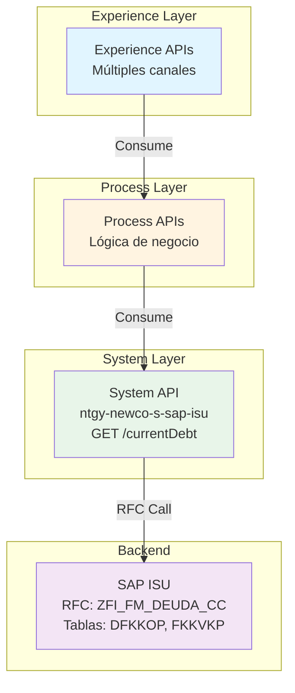
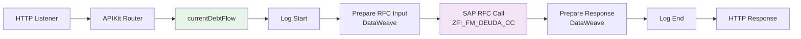
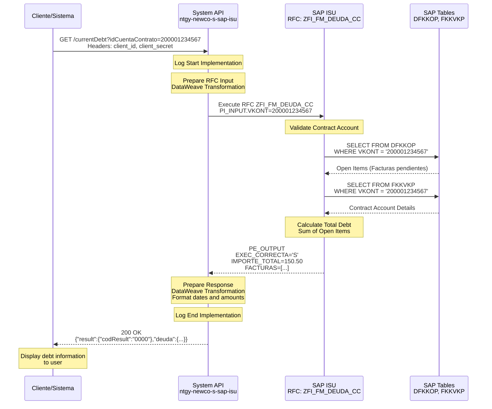
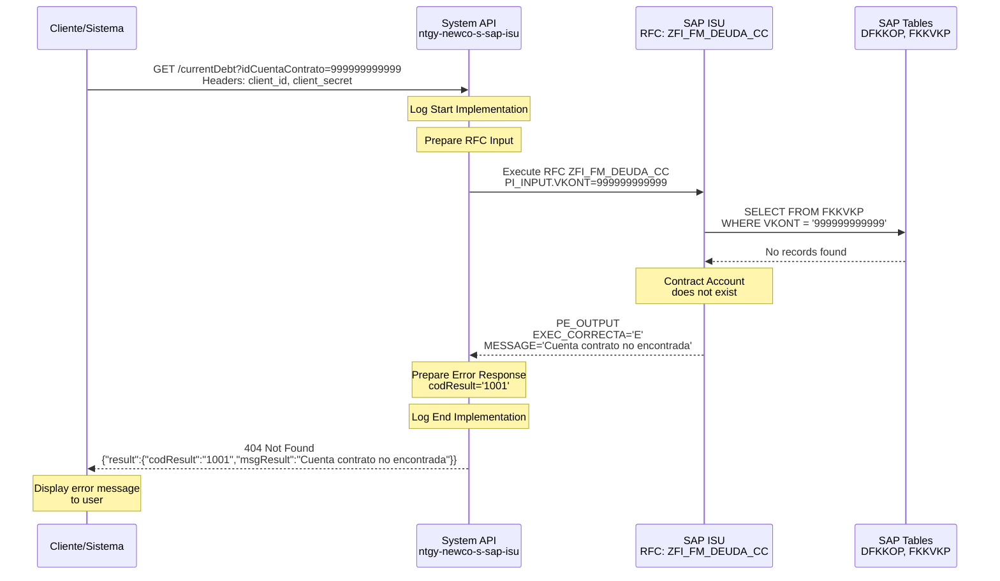
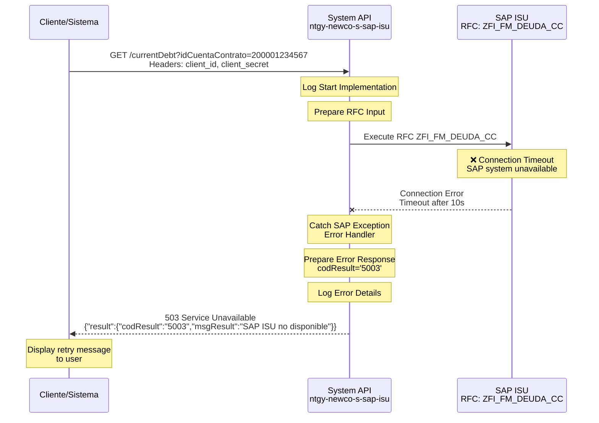

# GET /currentDebt

## 📌 Descripción General

### Propósito del Endpoint

Este endpoint obtiene la **deuda actual** de una cuenta contrato específica desde SAP ISU. Proporciona información en tiempo real sobre el saldo pendiente, facturas vencidas y estado de la deuda del cliente.

### Tipo de API

**Capa:** System API (API-Led Connectivity)

**Responsabilidad:** Integración directa con SAP ISU mediante RFC para consulta de deuda.

### Patrón de Integración

**Tipo:** Request-Reply Síncrono con SAP ISU

**Características:**
- Consulta directa a SAP ISU mediante RFC `ZFI_FM_DEUDA_CC`
- Transformación de datos SAP ABAP a JSON
- Respuesta en tiempo real (< 5 segundos)
- Sin caching (datos siempre actualizados)

### Arquitectura API-Led Connectivity



### Contexto Técnico

- **Ubicación:** System API - Capa de integración con SAP ISU
- **Protocolo:** HTTP/HTTPS
- **Formato:** JSON
- **Autenticación:** Client ID/Secret (Anypoint Platform)
- **Deployment:** CloudHub 2.0

---

## 💼 Propósito del Negocio

### Casos de Uso Principales

1. **Consulta de Deuda para Pago**
   - Cliente consulta su deuda antes de realizar un pago
   - Agente verifica deuda durante atención telefónica
   - Portal web muestra deuda pendiente en dashboard

2. **Validación de Estado Financiero**
   - Verificar si cliente tiene deudas pendientes
   - Comprobar elegibilidad para nuevos servicios
   - Validar estado antes de operaciones comerciales

3. **Gestión de Cobranza**
   - Departamento de cobranza consulta deudas vencidas
   - Generación de reportes de morosidad
   - Seguimiento de cuentas con saldo pendiente

### Contexto Empresarial

- **Dominio:** Gestión Financiera y Cobranza
- **Sector:** Energía - Utilities
- **División:** Naturgy España - NewCo
- **Proceso:** Billing & Debt Management

### Stakeholders

- **Clientes finales**: Consultan su deuda pendiente para realizar pagos
- **Agentes de call center**: Verifican deuda durante atención al cliente
- **Departamento de cobranza**: Gestionan cuentas con morosidad
- **Sistemas de pago**: Validan monto a pagar antes de procesar transacción
- **Portales web/móvil**: Muestran información de deuda en tiempo real

### Valor de Negocio

- **Transparencia financiera**: Cliente conoce su deuda exacta en tiempo real
- **Reducción de errores**: Datos directos desde SAP ISU (fuente de verdad)
- **Mejora en cobranza**: Información actualizada para gestión de morosidad
- **Experiencia del cliente**: Acceso inmediato a información financiera
- **Eficiencia operativa**: Reduce consultas manuales en SAP GUI

### Consumidores Potenciales

Este endpoint puede ser consumido por:
- **Portales web de autoservicio**: Clientes consultan su deuda
- **Aplicaciones móviles**: App de clientes para gestión de cuenta
- **Sistemas de agentes de call center**: Consulta durante atención telefónica
- **Sistemas de pago**: Validación de monto antes de procesar pago
- **Sistemas de cobranza**: Gestión de cuentas morosas
- **Integraciones de terceros autorizados**: Partners comerciales

---

## 🔧 Especificación Técnica

### URLs por Ambiente

| Ambiente | URL Base | URL Completa |
|----------|----------|--------------|
| **Local** | `http://localhost:8081` | `http://localhost:8081/api/currentDebt` |
| **Dev** | `https://ntgy-newco-s-sap-isu-dev.us-e2.cloudhub.io` | `https://ntgy-newco-s-sap-isu-dev.us-e2.cloudhub.io/api/currentDebt` |
| **UAT** | `https://ntgy-newco-s-sap-isu-uat.us-e2.cloudhub.io` | `https://ntgy-newco-s-sap-isu-uat.us-e2.cloudhub.io/api/currentDebt` |
| **UAT00** | `https://ntgy-newco-s-sap-isu-uat00.us-e2.cloudhub.io` | `https://ntgy-newco-s-sap-isu-uat00.us-e2.cloudhub.io/api/currentDebt` |
| **Prod** | `https://ntgy-newco-s-sap-isu.us-e2.cloudhub.io` | `https://ntgy-newco-s-sap-isu.us-e2.cloudhub.io/api/currentDebt` |

### Método HTTP

```
GET /currentDebt
```

### Parámetros de Entrada

#### Query Parameters

| Parámetro | Tipo | Requerido | Descripción | Ejemplo | Validación |
|-----------|------|-----------|-------------|---------|------------|
| `idCuentaContrato` | string | ✅ Sí | ID de cuenta contrato en SAP ISU | `200001234567` | Numérico, 12 dígitos |

#### Headers HTTP

| Header | Tipo | Requerido | Descripción | Ejemplo |
|--------|------|-----------|-------------|---------|
| `Content-Type` | string | ✅ Sí | Tipo de contenido | `application/json` |
| `client_id` | string | ✅ Sí | Client ID de Anypoint Platform | `a1b2c3d4e5f6g7h8` |
| `client_secret` | string | ✅ Sí | Client Secret de Anypoint Platform | `A1B2C3D4E5F6G7H8` |

### Respuestas

#### Respuesta Exitosa (200 OK)

**Estructura de Respuesta:**

```json
{
  "result": {
    "codResult": "000",
    "msgResult": "Success"
  },
  "pendingAmount": 150.50
}
```

**Campos de Respuesta:**

| Campo | Tipo | Descripción |
|-------|------|-------------|
| `result.codResult` | string | Código de resultado: "0" + código SAP (ej: "000" = éxito, "001" = error) |
| `result.msgResult` | string | Mensaje descriptivo del resultado desde SAP |
| `pendingAmount` | number | Monto total de deuda pendiente en euros (suma de items abiertos) |

**⚠️ Nota sobre codResult:**
El código de resultado se construye concatenando "0" + el código de error de SAP (`ES_ERROR.CODE`):
- Si SAP retorna `CODE = "00"` → `codResult = "000"` (éxito)
- Si SAP retorna `CODE = "01"` → `codResult = "001"` (error)
- Si SAP retorna `CODE = "99"` → `codResult = "099"` (error)

#### Respuestas de Error

**400 Bad Request - Parámetro Faltante**

```json
{
  "result": {
    "codResult": "0001",
    "msgResult": "Parámetro requerido 'idCuentaContrato' no proporcionado"
  }
}
```

**404 Not Found - Cuenta Contrato No Existe**

```json
{
  "result": {
    "codResult": "1001",
    "msgResult": "Cuenta contrato no encontrada en SAP ISU"
  }
}
```

**500 Internal Server Error - Error SAP**

```json
{
  "result": {
    "codResult": "5000",
    "msgResult": "Error al consultar SAP ISU: [detalle del error]"
  }
}
```

**503 Service Unavailable - SAP No Disponible**

```json
{
  "result": {
    "codResult": "5003",
    "msgResult": "SAP ISU no disponible. Intente nuevamente más tarde"
  }
}
```

### Códigos de Resultado (codResult)

| Código | Tipo | Descripción |
|--------|------|-------------|
| `0000` | Éxito | Consulta exitosa |
| `0001` | Error de validación | Parámetros inválidos o faltantes |
| `1001` | Error de negocio | Cuenta contrato no encontrada |
| `5000` | Error técnico | Error en SAP ISU |
| `5003` | Error de conectividad | SAP ISU no disponible |

### Autenticación y Autorización

**Tipo:** Client Credentials (OAuth 2.0)

**Headers Requeridos:**
- `client_id`: Proporcionado por Anypoint Platform
- `client_secret`: Proporcionado por Anypoint Platform

**Autorización SAP:**
- Usuario SAP configurado en el conector debe tener autorización para ejecutar RFC `ZFI_FM_DEUDA_CC`
- Objeto de autorización SAP: `S_RFC` con actividad `16` (Execute)

### Timeouts Configurados

| Timeout | Valor | Descripción |
|---------|-------|-------------|
| **Request Timeout** | 30 segundos | Timeout total de la petición HTTP |
| **SAP Connection Timeout** | 10 segundos | Timeout de conexión al sistema SAP |
| **SAP RFC Timeout** | 20 segundos | Timeout de ejecución del RFC |

### Protocolo

- **Protocolo:** HTTPS (TLS 1.2+)
- **Puerto:** 443 (HTTPS)
- **Método:** GET

---

## 🏗️ Implementación Técnica

### Arquitectura del Flow



### RFC Invocado en SAP ISU

**Función RFC:** `ZFI_FM_DEUDA_CC`

**Módulo SAP:** FI-CA (Financial Contract Accounting)

**Descripción:** Consulta la deuda actual (suma de items abiertos) de una cuenta contrato en SAP ISU.

**Parámetros de Entrada:**

| Parámetro | Tipo | Descripción |
|-----------|------|-------------|
| `I_VKONT` | CHAR(12) | ID de cuenta contrato |

**Parámetros de Salida:**

| Parámetro | Tipo | Descripción |
|-----------|------|-------------|
| `ES_ERROR.CODE` | CHAR(2) | Código de error SAP ("00" = éxito) |
| `ES_ERROR.DESCRIPTION` | STRING | Descripción del error o mensaje de éxito |
| `E_SUM_OPENITEMS` | DEC(15,2) | Suma total de items abiertos (deuda pendiente) |

---

## 🗄️ Base de Datos SAP ISU

### Detalles de Tablas SAP

#### Tabla: `FKKVKP`

**Descripción:** Tabla maestra de cuentas contrato en SAP ISU. Contiene información principal de cada cuenta contrato, incluyendo el business partner asociado y datos de facturación.

**Campos Utilizados:**

| Campo | Tipo ABAP | Descripción | Ejemplo |
|-------|-----------|-------------|---------|
| `VKONT` | CHAR(12) | Número de cuenta contrato | `200001234567` |
| `GPART` | CHAR(10) | Business Partner | `1000123456` |
| `VKTYP` | CHAR(2) | Tipo de cuenta contrato | `01` |
| `VTREF` | CHAR(12) | Cuenta contrato de referencia | `200001234567` |

**Relaciones:**
- `FKKVKP.VKONT` → `DFKKOP.VKONT` (Relación 1:N con partidas abiertas)
- `FKKVKP.GPART` → `BUT000.PARTNER` (Relación con Business Partner)

**Índices Conocidos:**
- Primary Key: `VKONT`
- Secondary Index: `GPART`

**Notas de Performance:**
- Tabla de volumen medio (cientos de miles de registros)
- Búsqueda por `VKONT` es muy eficiente (PK)
- Validación de existencia de cuenta contrato es rápida

#### Tabla: `DFKKOP`

**Descripción:** Partidas abiertas (Open Items) de cuentas contrato. Almacena todas las facturas, pagos y ajustes pendientes de liquidación.

**Campos Utilizados:**

| Campo | Tipo ABAP | Descripción | Ejemplo |
|-------|-----------|-------------|---------|
| `OPBEL` | CHAR(12) | Número de partida abierta | `100012345678` |
| `VKONT` | CHAR(12) | Cuenta contrato | `200001234567` |
| `BETRW` | CURR(15,2) | Importe en moneda de documento | `125.50` |
| `WAERS` | CHAR(5) | Código de moneda | `EUR` |
| `FAEDN` | DATS | Fecha de vencimiento | `20240315` |
| `BUDAT` | DATS | Fecha de contabilización | `20240215` |
| `AUGST` | CHAR(1) | Estado de compensación | `` (vacío = abierta) |
| `AUGRD` | CHAR(3) | Motivo de compensación | `001` |

**Relaciones:**
- `DFKKOP.VKONT` → `FKKVKP.VKONT` (Relación N:1 con cuenta contrato)
- `DFKKOP.OPBEL` → `ERCH.OPBEL` (Relación 1:1 con documento de factura)

**Índices Conocidos:**
- Primary Key: `OPBEL`
- Secondary Index: `VKONT`, `FAEDN`, `AUGST`

**Notas de Performance:**
- Tabla de alto volumen (millones de registros)
- Búsqueda por `VKONT` es eficiente con índice secundario
- Filtrar por `AUGST = ''` para obtener solo partidas abiertas
- Ordenar por `FAEDN` para identificar facturas vencidas

---

### Transformaciones DataWeave

#### Transformación de Entrada (RFC Input)

**Archivo:** `src/main/resources/dw/current-debt-rfc-input.dwl`

```dataweave
%dw 2.0
output application/xml
---
{
    "ZFI_FM_DEUDA_CC": {
        "import": {
            "PI_INPUT": {
                "VKONT": attributes.queryParams.idCuentaContrato
            }
        }
    }
}
```

**Mapeo:**
- `attributes.queryParams.idCuentaContrato` → `PI_INPUT.VKONT`

#### Transformación de Salida (Response)

**Implementación:** Inline en flow XML

```dataweave
%dw 2.0
output application/json skipNullOn="everywhere"

var out = payload.ZFI_FM_DEUDA_CC.export.PE_OUTPUT
var facturas = out.FACTURAS.*row default []

fun formatoFecha(fecha: String|Null) = 
    if(!isEmpty(fecha)) 
        fecha as Date {format: "yyyyMMdd"} as String {format: "yyyy-MM-dd"} 
    else null

fun formatoImporte(importe: String|Null) = 
    if(!isEmpty(importe)) 
        (importe replace "." with ",") 
    else "0,00"

---
{
    "result": {
        "codResult": if (out.EXEC_CORRECTA == 'S') '0000' else '0001',
        "msgResult": if (out.EXEC_CORRECTA == 'S') "Success" else out.MESSAGE
    },
    "deuda": {
        "idCuentaContrato": out.VKONT,
        "importeTotal": formatoImporte(out.IMPORTE_TOTAL),
        "moneda": out.WAERS default "EUR",
        "fechaConsulta": now() as String {format: "yyyy-MM-dd"},
        "detalleDeuda": facturas map {
            "numeroFactura": $.OPBEL,
            "fechaEmision": formatoFecha($.BUDAT),
            "fechaVencimiento": formatoFecha($.FAEDN),
            "importe": formatoImporte($.BETRW),
            "estado": if ($.FAEDN < now()) "VENCIDA" else "PENDIENTE"
        }
    }
}
```

**Mapeo de Campos:**

| Campo SAP (Origen) | Campo JSON (Destino) | Transformación |
|--------------------|----------------------|----------------|
| `PE_OUTPUT.EXEC_CORRECTA` | `result.codResult` | 'S' → '0000', otros → '0001' |
| `PE_OUTPUT.VKONT` | `deuda.idCuentaContrato` | Directo |
| `PE_OUTPUT.IMPORTE_TOTAL` | `deuda.importeTotal` | Formato decimal: "." → "," |
| `PE_OUTPUT.WAERS` | `deuda.moneda` | Directo, default "EUR" |
| `PE_OUTPUT.FACTURAS[].OPBEL` | `deuda.detalleDeuda[].numeroFactura` | Directo |
| `PE_OUTPUT.FACTURAS[].BUDAT` | `deuda.detalleDeuda[].fechaEmision` | Formato: yyyyMMdd → yyyy-MM-dd |
| `PE_OUTPUT.FACTURAS[].FAEDN` | `deuda.detalleDeuda[].fechaVencimiento` | Formato: yyyyMMdd → yyyy-MM-dd |
| `PE_OUTPUT.FACTURAS[].BETRW` | `deuda.detalleDeuda[].importe` | Formato decimal |

### Patrones de Diseño Utilizados

**Patrón Principal:** Request-Reply Síncrono

**Justificación:**
- Consulta en tiempo real requerida por el negocio
- Datos financieros deben estar siempre actualizados
- No se puede usar caching por naturaleza de los datos
- Respuesta rápida (< 5 segundos) es aceptable para el usuario

**Patrones Adicionales:**
- **Error Translation Pattern**: Errores SAP convertidos a formato JSON estándar
- **Data Transformation Pattern**: Transformación de estructuras SAP ABAP a JSON
- **Logging Pattern**: Logging consistente en inicio y fin de operación

### Diagramas de Secuencia

#### 1. Flujo Normal de Éxito



#### 2. Flujo con Error de Negocio (Cuenta No Encontrada)



#### 3. Flujo con Error Técnico (SAP No Disponible)



### Connection Pooling y Optimizaciones

**SAP JCo Connection Pool:**

```xml
<sap:config name="SAP_Config">
    <sap:simple-connection-provider-connection 
        applicationServerHost="${sap.messageServerHost}"
        username="${sap.username}"
        password="${sap.password}"
        systemNumber="${sap.sapSystemNumber}"
        client="${sap.sapClientId}"
        language="ES">
        <reconnection>
            <reconnect frequency="${sap.reconnection.retryInterval}" 
                       count="${sap.reconnection.retryAttempts}"/>
        </reconnection>
    </sap:simple-connection-provider-connection>
</sap:config>
```

**Configuración:**
- **Pool Size**: Configurado por ambiente (típicamente 10-50 conexiones)
- **Connection Reuse**: Habilitado
- **Reconnection Strategy**: Retry con intervalo configurable
- **Connection Validation**: Antes de cada uso

**Optimizaciones:**
- DataWeave transformations optimizadas (skipNullOn="everywhere")
- Logging condicional (solo en DEBUG mode)
- Sin operaciones bloqueantes en el flow
- Timeout configurado para evitar bloqueos

### Manejo de Errores

**Estrategia de Error Handling:**

1. **Validación de Parámetros**: Antes de invocar SAP
2. **Try-Catch en SAP Call**: Captura errores de conexión y RFC
3. **Error Translation**: Convierte errores SAP a formato JSON estándar
4. **Logging de Errores**: Todos los errores se registran con contexto
5. **HTTP Status Codes**: Códigos HTTP apropiados según tipo de error

**Error Handler Global:**
```xml
<error-handler>
    <on-error-propagate type="SAP:CONNECTIVITY">
        <set-variable variableName="httpStatus" value="503"/>
        <set-variable variableName="errorCode" value="5003"/>
    </on-error-propagate>
    <on-error-propagate type="SAP:EXECUTION">
        <set-variable variableName="httpStatus" value="500"/>
        <set-variable variableName="errorCode" value="5000"/>
    </on-error-propagate>
</error-handler>
```

---

## 💻 Ejemplos de Uso

### Ejemplo 1: Consulta Exitosa de Deuda

#### cURL

```bash
curl -X GET "https://ntgy-newco-s-sap-isu.us-e2.cloudhub.io/api/currentDebt?idCuentaContrato=200001234567" \
  -H "Content-Type: application/json" \
  -H "client_id: a1b2c3d4e5f6g7h8" \
  -H "client_secret: A1B2C3D4E5F6G7H8"
```

#### Respuesta (200 OK)

```json
{
  "result": {
    "codResult": "0000",
    "msgResult": "Success"
  },
  "deuda": {
    "idCuentaContrato": "200001234567",
    "importeTotal": "150,50",
    "moneda": "EUR",
    "fechaConsulta": "2024-03-15",
    "detalleDeuda": [
      {
        "numeroFactura": "1234567890",
        "fechaEmision": "2024-02-15",
        "fechaVencimiento": "2024-03-01",
        "importe": "75,25",
        "estado": "VENCIDA"
      },
      {
        "numeroFactura": "1234567891",
        "fechaEmision": "2024-03-01",
        "fechaVencimiento": "2024-03-15",
        "importe": "75,25",
        "estado": "PENDIENTE"
      }
    ]
  }
}
```

### Ejemplo 2: Cuenta Contrato No Encontrada

#### cURL

```bash
curl -X GET "https://ntgy-newco-s-sap-isu.us-e2.cloudhub.io/api/currentDebt?idCuentaContrato=999999999999" \
  -H "Content-Type: application/json" \
  -H "client_id: a1b2c3d4e5f6g7h8" \
  -H "client_secret: A1B2C3D4E5F6G7H8"
```

#### Respuesta (404 Not Found)

```json
{
  "result": {
    "codResult": "1001",
    "msgResult": "Cuenta contrato no encontrada en SAP ISU"
  }
}
```

### Ejemplo 3: Parámetro Faltante

#### cURL

```bash
curl -X GET "https://ntgy-newco-s-sap-isu.us-e2.cloudhub.io/api/currentDebt" \
  -H "Content-Type: application/json" \
  -H "client_id: a1b2c3d4e5f6g7h8" \
  -H "client_secret: A1B2C3D4E5F6G7H8"
```

#### Respuesta (400 Bad Request)

```json
{
  "result": {
    "codResult": "0001",
    "msgResult": "Parámetro requerido 'idCuentaContrato' no proporcionado"
  }
}
```

### Ejemplo 4: JavaScript (Fetch API)

```javascript
// Consulta de deuda actual
async function getCurrentDebt(contractAccountId) {
  const url = `https://ntgy-newco-s-sap-isu.us-e2.cloudhub.io/api/currentDebt?idCuentaContrato=${contractAccountId}`;
  
  try {
    const response = await fetch(url, {
      method: 'GET',
      headers: {
        'Content-Type': 'application/json',
        'client_id': 'a1b2c3d4e5f6g7h8',
        'client_secret': 'A1B2C3D4E5F6G7H8'
      }
    });
    
    if (!response.ok) {
      throw new Error(`HTTP error! status: ${response.status}`);
    }
    
    const data = await response.json();
    
    if (data.result.codResult === '0000') {
      console.log('Deuda total:', data.deuda.importeTotal, data.deuda.moneda);
      console.log('Facturas pendientes:', data.deuda.detalleDeuda.length);
      return data.deuda;
    } else {
      console.error('Error:', data.result.msgResult);
      return null;
    }
  } catch (error) {
    console.error('Error al consultar deuda:', error);
    throw error;
  }
}

// Uso
getCurrentDebt('200001234567')
  .then(deuda => {
    if (deuda) {
      console.log('Consulta exitosa:', deuda);
    }
  })
  .catch(error => {
    console.error('Error:', error);
  });
```

### Ejemplo 5: JavaScript (Axios)

```javascript
const axios = require('axios');

// Configuración de cliente Axios
const apiClient = axios.create({
  baseURL: 'https://ntgy-newco-s-sap-isu.us-e2.cloudhub.io/api',
  headers: {
    'Content-Type': 'application/json',
    'client_id': 'a1b2c3d4e5f6g7h8',
    'client_secret': 'A1B2C3D4E5F6G7H8'
  },
  timeout: 30000 // 30 segundos
});

// Función para consultar deuda
async function getCurrentDebt(contractAccountId) {
  try {
    const response = await apiClient.get('/currentDebt', {
      params: {
        idCuentaContrato: contractAccountId
      }
    });
    
    const { result, deuda } = response.data;
    
    if (result.codResult === '0000') {
      console.log('✅ Consulta exitosa');
      console.log(`Deuda total: ${deuda.importeTotal} ${deuda.moneda}`);
      
      // Mostrar facturas vencidas
      const vencidas = deuda.detalleDeuda.filter(f => f.estado === 'VENCIDA');
      if (vencidas.length > 0) {
        console.log(`⚠️ Facturas vencidas: ${vencidas.length}`);
      }
      
      return deuda;
    } else {
      console.error('❌ Error:', result.msgResult);
      return null;
    }
  } catch (error) {
    if (error.response) {
      // Error de respuesta del servidor
      console.error('Error del servidor:', error.response.status);
      console.error('Detalle:', error.response.data);
    } else if (error.request) {
      // No se recibió respuesta
      console.error('No se recibió respuesta del servidor');
    } else {
      // Error en la configuración de la petición
      console.error('Error:', error.message);
    }
    throw error;
  }
}

// Uso con manejo de errores
getCurrentDebt('200001234567')
  .then(deuda => {
    if (deuda) {
      // Procesar deuda
      console.log('Deuda obtenida correctamente');
    }
  })
  .catch(error => {
    console.error('Error fatal:', error);
  });
```

### Ejemplo 6: Python (requests)

```python
import requests
from typing import Optional, Dict
import json

class SAPISUClient:
    """Cliente para interactuar con SAP ISU System API"""
    
    def __init__(self, base_url: str, client_id: str, client_secret: str):
        self.base_url = base_url
        self.headers = {
            'Content-Type': 'application/json',
            'client_id': client_id,
            'client_secret': client_secret
        }
        self.timeout = 30  # segundos
    
    def get_current_debt(self, contract_account_id: str) -> Optional[Dict]:
        """
        Consulta la deuda actual de una cuenta contrato
        
        Args:
            contract_account_id: ID de cuenta contrato en SAP ISU
            
        Returns:
            Dict con información de deuda o None si hay error
        """
        url = f"{self.base_url}/currentDebt"
        params = {'idCuentaContrato': contract_account_id}
        
        try:
            response = requests.get(
                url,
                headers=self.headers,
                params=params,
                timeout=self.timeout
            )
            
            # Verificar status code
            response.raise_for_status()
            
            data = response.json()
            
            # Verificar resultado de negocio
            if data['result']['codResult'] == '000':
                print(f"✅ Consulta exitosa")
                pending_amount = data['pendingAmount']
                print(f"Deuda total: {pending_amount} EUR")
                
                return pending_amount
            else:
                print(f"❌ Error de negocio: {data['result']['msgResult']}")
                return None
                
        except requests.exceptions.Timeout:
            print("❌ Timeout: El servidor no respondió a tiempo")
            return None
        except requests.exceptions.ConnectionError:
            print("❌ Error de conexión: No se pudo conectar al servidor")
            return None
        except requests.exceptions.HTTPError as e:
            print(f"❌ Error HTTP {e.response.status_code}: {e.response.text}")
            return None
        except Exception as e:
            print(f"❌ Error inesperado: {str(e)}")
            return None

# Uso
if __name__ == "__main__":
    # Configuración
    client = SAPISUClient(
        base_url='https://ntgy-newco-s-sap-isu.us-e2.cloudhub.io/api',
        client_id='a1b2c3d4e5f6g7h8',
        client_secret='A1B2C3D4E5F6G7H8'
    )
    
    # Consultar deuda
    deuda = client.get_current_debt('200001234567')
    
    if deuda:
        print("\n📊 Detalle de deuda:")
        print(json.dumps(deuda, indent=2, ensure_ascii=False))
```

### Ejemplo 7: Postman Collection

```json
{
  "info": {
    "name": "SAP ISU System API - Current Debt",
    "description": "Colección para consultar deuda actual en SAP ISU",
    "schema": "https://schema.getpostman.com/json/collection/v2.1.0/collection.json"
  },
  "item": [
    {
      "name": "GET Current Debt - Success",
      "request": {
        "method": "GET",
        "header": [
          {
            "key": "Content-Type",
            "value": "application/json"
          },
          {
            "key": "client_id",
            "value": "{{client_id}}"
          },
          {
            "key": "client_secret",
            "value": "{{client_secret}}"
          }
        ],
        "url": {
          "raw": "{{base_url}}/currentDebt?idCuentaContrato=200001234567",
          "host": ["{{base_url}}"],
          "path": ["currentDebt"],
          "query": [
            {
              "key": "idCuentaContrato",
              "value": "200001234567",
              "description": "ID de cuenta contrato"
            }
          ]
        },
        "description": "Consulta exitosa de deuda actual"
      },
      "response": []
    },
    {
      "name": "GET Current Debt - Not Found",
      "request": {
        "method": "GET",
        "header": [
          {
            "key": "Content-Type",
            "value": "application/json"
          },
          {
            "key": "client_id",
            "value": "{{client_id}}"
          },
          {
            "key": "client_secret",
            "value": "{{client_secret}}"
          }
        ],
        "url": {
          "raw": "{{base_url}}/currentDebt?idCuentaContrato=999999999999",
          "host": ["{{base_url}}"],
          "path": ["currentDebt"],
          "query": [
            {
              "key": "idCuentaContrato",
              "value": "999999999999",
              "description": "ID de cuenta contrato inexistente"
            }
          ]
        },
        "description": "Cuenta contrato no encontrada"
      },
      "response": []
    }
  ],
  "variable": [
    {
      "key": "base_url",
      "value": "https://ntgy-newco-s-sap-isu.us-e2.cloudhub.io/api",
      "type": "string"
    },
    {
      "key": "client_id",
      "value": "your_client_id_here",
      "type": "string"
    },
    {
      "key": "client_secret",
      "value": "your_client_secret_here",
      "type": "string"
    }
  ]
}
```
