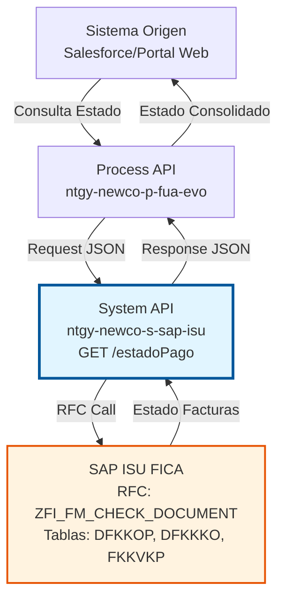
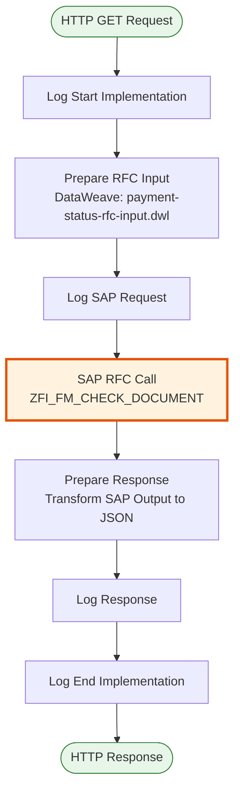
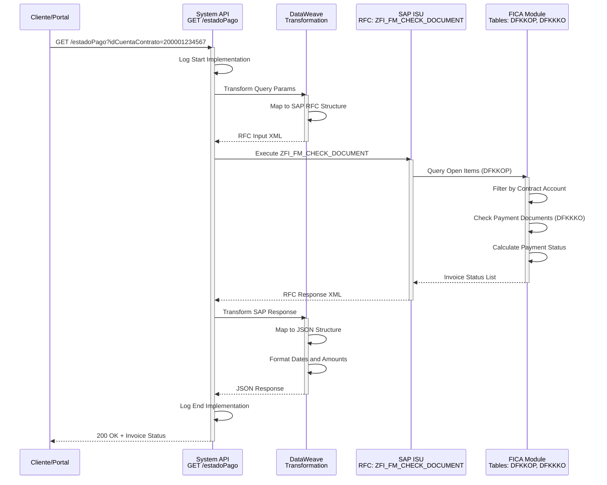
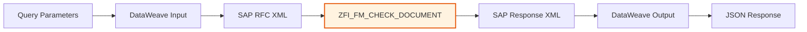

# GET /estadoPago

## 📌 Descripción General

### Propósito del Endpoint

Consulta el estado de pago de facturas en tiempo real desde el módulo FICA (Financial Contract Accounting) de SAP ISU. Este endpoint permite verificar si las facturas están pagadas, pendientes o parcialmente pagadas, proporcionando información detallada sobre importes, fechas de vencimiento y pagos realizados.

El endpoint soporta:
- **Consulta por Cliente**: Obtiene estado de todas las facturas de un Business Partner
- **Consulta por Cuenta Contrato**: Obtiene estado de facturas de una cuenta contrato específica
- **Consulta por Factura**: Obtiene estado de una factura específica
- **Consulta Flexible**: Permite combinar parámetros para consultas más específicas
- **Estado en Tiempo Real**: Información actualizada directamente desde FICA

### Tipo de API

**Capa:** System API (API-Led Connectivity)

**Función:** Integración directa con SAP ISU FICA para consultar el estado de pago de facturas y partidas abiertas.

### Patrón de Integración

**Tipo:** Request-Reply Síncrono con SAP RFC

**Descripción:** Recibe parámetros de consulta (cliente, cuenta contrato o factura), transforma los datos al formato SAP, invoca el RFC `ZFI_FM_CHECK_DOCUMENT` para consultar el estado de partidas abiertas en FICA, y retorna el estado consolidado de pago de las facturas.

### Arquitectura API-Led Connectivity



---

## 💼 Propósito del Negocio

### Casos de Uso Principales

1. **Verificación de Estado de Pago en Portal Web**
   - Cliente accede al portal de autoservicio
   - Consulta el estado de sus facturas pendientes
   - Visualiza importes pagados y pendientes
   - **Beneficio**: Transparencia y autoservicio para el cliente

2. **Gestión de Cobros por Agentes**
   - Agente de call center consulta estado de facturas del cliente
   - Identifica facturas pendientes de pago
   - Ofrece opciones de pago o fraccionamiento
   - **Beneficio**: Mejora en la gestión de cobros y atención al cliente

3. **Validación Pre-Pago**
   - Sistema valida estado de facturas antes de procesar un pago
   - Verifica que las facturas no estén ya pagadas
   - Evita pagos duplicados
   - **Beneficio**: Prevención de errores en procesamiento de pagos

4. **Monitoreo de Deuda en Tiempo Real**
   - Sistemas de gestión de riesgo consultan estado de deuda
   - Identifican clientes con facturas vencidas
   - Activan procesos de gestión de cobros
   - **Beneficio**: Gestión proactiva de la morosidad

### Contexto Empresarial

- **Dominio:** Gestión de Cobros y Facturación
- **Sector:** Energía - Utilities
- **División:** Naturgy España - NewCo
- **Proceso de Negocio:** Consulta de Estado de Pago y Gestión de Cobros
- **Módulo SAP:** FI-CA (Financial Contract Accounting)

### Stakeholders

- **Clientes Finales**: Necesitan conocer el estado de sus facturas y deuda pendiente
- **Agentes de Call Center**: Requieren información actualizada para atención al cliente
- **Departamento de Cobros**: Necesita identificar facturas pendientes para gestión de cobros
- **Sistemas de Riesgo**: Requieren información de morosidad para análisis de riesgo crediticio

### Valor de Negocio

- **Transparencia**: Clientes pueden consultar estado de pago en tiempo real
- **Eficiencia Operativa**: Reduce consultas manuales en SAP GUI
- **Prevención de Errores**: Evita pagos duplicados mediante validación previa
- **Gestión Proactiva**: Permite identificar y gestionar morosidad tempranamente
- **Mejora en Experiencia del Cliente**: Información actualizada disponible 24/7

### Consumidores Potenciales

Este endpoint puede ser consumido por:
- Process APIs de gestión de pagos (ntgy-newco-p-fua-evo)
- Portales web de autoservicio de clientes
- Aplicaciones móviles de clientes
- Sistemas de agentes de call center
- Sistemas de gestión de cobros y riesgo
- Integraciones con pasarelas de pago

---

## 🔧 Especificación Técnica

### URLs por Ambiente

| Ambiente | URL Base | URL Completa |
|----------|----------|--------------|
| **Local** | `http://localhost:8081` | `http://localhost:8081/api/estadoPago` |
| **Development** | `https://ntgy-newco-s-sap-isu-dev.us-e2.cloudhub.io` | `https://ntgy-newco-s-sap-isu-dev.us-e2.cloudhub.io/api/estadoPago` |
| **UAT** | `https://ntgy-newco-s-sap-isu-uat.us-e2.cloudhub.io` | `https://ntgy-newco-s-sap-isu-uat.us-e2.cloudhub.io/api/estadoPago` |
| **Production** | `https://ntgy-newco-s-sap-isu-pro.us-e2.cloudhub.io` | `https://ntgy-newco-s-sap-isu-pro.us-e2.cloudhub.io/api/estadoPago` |

### Método HTTP

```
GET /api/estadoPago
```

### Parámetros de Entrada

#### Headers HTTP

| Header | Tipo | Requerido | Descripción | Ejemplo |
|--------|------|-----------|-------------|---------|
| `Accept` | string | ❌ No | Tipo de contenido esperado en response | `application/json` |

#### Query Parameters

| Parámetro | Tipo | Requerido | Descripción | Ejemplo |
|-----------|------|-----------|-------------|---------|
| `idCliente` | string | ❌ No* | Número de Business Partner en SAP ISU | `"0001234567"` |
| `idCuentaContrato` | string | ❌ No* | Número de cuenta contrato en SAP ISU | `"200001234567"` |
| `idFactura` | string | ❌ No* | Número de factura en SAP ISU | `"1234567890"` |

**Nota:** Al menos uno de los tres parámetros debe ser proporcionado.

### Respuestas

#### Respuesta Exitosa (200 OK)

```json
{
  "result": {
    "codResult": "0000",
    "msgResult": "Consulta exitosa"
  },
  "invoices": [
    {
      "invoiceNumber": "1234567890",
      "contractAccount": "200001234567",
      "businessPartner": "0001234567",
      "paymentStatus": "PAID",
      "amount": 125.50,
      "paidAmount": 125.50,
      "pendingAmount": 0.00,
      "dueDate": "2024-01-31",
      "paymentDate": "2024-01-15"
    },
    {
      "invoiceNumber": "1234567891",
      "contractAccount": "200001234567",
      "businessPartner": "0001234567",
      "paymentStatus": "UNPAID",
      "amount": 98.75,
      "paidAmount": 0.00,
      "pendingAmount": 98.75,
      "dueDate": "2024-02-28",
      "paymentDate": null
    }
  ]
}
```

#### Respuesta Sin Facturas (200 OK)

```json
{
  "result": {
    "codResult": "0000",
    "msgResult": "No se encontraron facturas"
  },
  "invoices": []
}
```

#### Respuesta de Error de Negocio (200 OK)

```json
{
  "result": {
    "codResult": "0001",
    "msgResult": "Cliente no encontrado en SAP ISU"
  },
  "invoices": []
}
```

#### Respuesta de Error Técnico (400/500)

```json
{
  "result": {
    "codResult": "0001",
    "msgResult": "Error al consultar estado de pago: [detalle del error]"
  }
}
```

### Autenticación y Autorización

- **Tipo:** Client ID & Client Secret (Anypoint Platform)
- **Autorización SAP:** El usuario SAP debe tener permisos para:
  - Ejecutar RFC `ZFI_FM_CHECK_DOCUMENT`
  - Acceso de lectura a tabla `DFKKOP` (Open Items)
  - Acceso de lectura a tabla `DFKKKO` (Payment Documents)
  - Acceso de lectura a tabla `FKKVKP` (Contract Account)
  - Objeto de autorización: `F_FICA_ROP` (Read Open Items)

### Timeouts

| Tipo | Valor | Descripción |
|------|-------|-------------|
| **Request Timeout** | 30 segundos | Tiempo máximo de espera para la respuesta |
| **Connection Timeout** | 10 segundos | Tiempo máximo para establecer conexión con SAP |
| **RFC Timeout** | 25 segundos | Tiempo máximo de ejecución del RFC en SAP |

---

## 🏗️ Implementación Técnica

### Arquitectura del Flow



### Componentes del Flow

#### 1. Log Start Implementation
```xml
<module-logger:log 
    doc:name="Log Start Implementation" 
    config-ref="Logger_Mule_Extension_Config" 
    level="DEBUG" 
    flowName="#[vars.flowName]" 
    message="Start implementation flow for payment status" 
    content="#[vars.loggerContext]" />
```

#### 2. Prepare RFC Input (DataWeave)
```xml
<ee:transform doc:name="Prepare RFC Input">
    <ee:message>
        <ee:set-payload resource="dw/payment-status-rfc-input.dwl" />
    </ee:message>
</ee:transform>
```

**Transformación DataWeave** (`payment-status-rfc-input.dwl`):
```dataweave
%dw 2.0
output application/xml
---
{
    "ZFI_FM_CHECK_DOCUMENT": {
        "import": {
            "I_GPART": attributes.queryParams.idCliente default "",
            "I_VKONT": attributes.queryParams.idCuentaContrato default "",
            "I_OPBEL": attributes.queryParams.idFactura default ""
        }
    }
}
```

#### 3. SAP RFC Call
```xml
<sap:synchronous-remote-function-call 
    key="ZFI_FM_CHECK_DOCUMENT" 
    doc:name="Synchronous Remote Function Call" 
    config-ref="SAP_Config" />
```

#### 4. Prepare Response (DataWeave)
```xml
<ee:transform doc:name="Transform Message">
    <ee:message>
        <ee:set-payload><![CDATA[
%dw 2.0
output application/json
---
payload
        ]]></ee:set-payload>
    </ee:message>
</ee:transform>
```

#### 5. Log End Implementation
```xml
<module-logger:log 
    doc:name="Log End Implementation" 
    config-ref="Logger_Mule_Extension_Config" 
    level="DEBUG" 
    flowName="#[vars.flowName]" 
    message="Finished implementation flow for payment status" 
    content="#[vars.loggerContext]" />
```

### Diagrama de Secuencia



### Diagrama de Transformación de Datos



### Tablas SAP Involucradas

#### DFKKOP - Open Items (Partidas Abiertas)

**Descripción:** Contiene todas las partidas abiertas (documentos de pago pendientes) en el módulo FI-CA de SAP ISU. Esta tabla es fundamental para el control de cuentas por cobrar y gestión de deuda.

**Campos Relevantes:**

| Campo | Tipo | Descripción | Uso en el Endpoint |
|-------|------|-------------|-------------------|
| `OPBEL` | CHAR(12) | Número de documento de partida abierta | Identificador único de la factura |
| `VKONT` | CHAR(12) | Número de cuenta contrato | Filtro principal de búsqueda |
| `GPART` | CHAR(10) | Número de Business Partner | Filtro alternativo por cliente |
| `BETRW` | CURR(15,2) | Importe en moneda del documento | Importe total de la factura |
| `WAERS` | CHAR(5) | Clave de moneda | Moneda de la factura (EUR) |
| `AUGST` | CHAR(1) | Estado de compensación | Determina si está pagada (C=Compensada) |
| `AUGBL` | CHAR(12) | Número de documento de compensación | Referencia al pago |
| `AUGDT` | DATS(8) | Fecha de compensación | Fecha en que se pagó |
| `FAEDN` | DATS(8) | Fecha de vencimiento | Fecha límite de pago |
| `BLDAT` | DATS(8) | Fecha del documento | Fecha de emisión |
| `BUDAT` | DATS(8) | Fecha de contabilización | Fecha de registro contable |

**Operaciones:**
- `READ`: Consulta de partidas abiertas por cuenta contrato, cliente o factura
- Índices utilizados: DFKKOP~0 (por OPBEL), DFKKOP~VKONT (por cuenta contrato)

#### DFKKKO - Payment Document Header (Cabecera de Documentos de Pago)

**Descripción:** Contiene la información de cabecera de los documentos de pago y compensación en FI-CA. Se utiliza para verificar el estado de pago de las facturas.

**Campos Relevantes:**

| Campo | Tipo | Descripción | Uso en el Endpoint |
|-------|------|-------------|-------------------|
| `AUGBL` | CHAR(12) | Número de documento de compensación | Relaciona con DFKKOP |
| `AUGDT` | DATS(8) | Fecha de compensación | Fecha del pago |
| `VKONT` | CHAR(12) | Cuenta contrato | Validación de pertenencia |
| `BETRW` | CURR(15,2) | Importe compensado | Monto pagado |
| `WAERS` | CHAR(5) | Moneda | Moneda del pago |
| `BUDAT` | DATS(8) | Fecha de contabilización | Fecha de registro |

**Operaciones:**
- `READ`: Consulta de documentos de pago asociados a partidas abiertas
- Índices utilizados: DFKKKO~0 (por AUGBL)

#### FKKVKP - Contract Account (Cuenta Contrato)

**Descripción:** Tabla maestra de cuentas contrato en SAP ISU. Contiene la información principal de las cuentas de clientes.

**Campos Relevantes:**

| Campo | Tipo | Descripción | Uso en el Endpoint |
|-------|------|-------------|-------------------|
| `VKONT` | CHAR(12) | Número de cuenta contrato | Validación de existencia |
| `GPART` | CHAR(10) | Business Partner | Relación cliente-cuenta |
| `VKTYP` | CHAR(2) | Tipo de cuenta contrato | Clasificación de cuenta |
| `ERDAT` | DATS(8) | Fecha de creación | Información de auditoría |

**Operaciones:**
- `READ`: Validación de que la cuenta contrato existe y pertenece al cliente
- Índices utilizados: FKKVKP~0 (por VKONT), FKKVKP~GPART (por Business Partner)

#### BUT000 - Business Partner Master (Datos Maestros de Business Partner)

**Descripción:** Tabla maestra de Business Partners en SAP. Contiene la información básica de clientes y proveedores.

**Campos Relevantes:**

| Campo | Tipo | Descripción | Uso en el Endpoint |
|-------|------|-------------|-------------------|
| `PARTNER` | CHAR(10) | Número de Business Partner | Identificador del cliente |
| `PARTNER_GUID` | RAW(16) | GUID del Business Partner | Identificador único global |
| `TYPE` | CHAR(4) | Tipo de Business Partner | Clasificación (persona/empresa) |
| `NAME_ORG1` | CHAR(40) | Nombre de la organización | Nombre del cliente |

**Operaciones:**
- `READ`: Validación de existencia del cliente
- Índices utilizados: BUT000~0 (por PARTNER)

---

## 💻 Ejemplos de Uso

### Ejemplo 1: Consulta por Cuenta Contrato

**Request:**
```bash
curl -X GET "https://ntgy-newco-s-sap-isu-dev.us-e2.cloudhub.io/api/estadoPago?idCuentaContrato=200001234567" \
  -H "Accept: application/json" \
  -H "client_id: YOUR_CLIENT_ID" \
  -H "client_secret: YOUR_CLIENT_SECRET"
```

**Response (200 OK):**
```json
{
  "result": {
    "codResult": "0000",
    "msgResult": "Consulta exitosa"
  },
  "invoices": [
    {
      "invoiceNumber": "1234567890",
      "contractAccount": "200001234567",
      "businessPartner": "0001234567",
      "paymentStatus": "PAID",
      "amount": 125.50,
      "paidAmount": 125.50,
      "pendingAmount": 0.00,
      "dueDate": "2024-01-31",
      "paymentDate": "2024-01-15"
    },
    {
      "invoiceNumber": "1234567891",
      "contractAccount": "200001234567",
      "businessPartner": "0001234567",
      "paymentStatus": "UNPAID",
      "amount": 98.75,
      "paidAmount": 0.00,
      "pendingAmount": 98.75,
      "dueDate": "2024-02-28",
      "paymentDate": null
    }
  ]
}
```

### Ejemplo 2: Consulta por Cliente

**Request:**
```bash
curl -X GET "https://ntgy-newco-s-sap-isu-dev.us-e2.cloudhub.io/api/estadoPago?idCliente=0001234567" \
  -H "Accept: application/json" \
  -H "client_id: YOUR_CLIENT_ID" \
  -H "client_secret: YOUR_CLIENT_SECRET"
```

**Response (200 OK):**
```json
{
  "result": {
    "codResult": "0000",
    "msgResult": "Consulta exitosa"
  },
  "invoices": [
    {
      "invoiceNumber": "1234567890",
      "contractAccount": "200001234567",
      "businessPartner": "0001234567",
      "paymentStatus": "PAID",
      "amount": 125.50,
      "paidAmount": 125.50,
      "pendingAmount": 0.00,
      "dueDate": "2024-01-31",
      "paymentDate": "2024-01-15"
    }
  ]
}
```

### Ejemplo 3: Consulta por Factura Específica

**Request:**
```bash
curl -X GET "https://ntgy-newco-s-sap-isu-dev.us-e2.cloudhub.io/api/estadoPago?idFactura=1234567890" \
  -H "Accept: application/json" \
  -H "client_id: YOUR_CLIENT_ID" \
  -H "client_secret: YOUR_CLIENT_SECRET"
```

**Response (200 OK):**
```json
{
  "result": {
    "codResult": "0000",
    "msgResult": "Consulta exitosa"
  },
  "invoices": [
    {
      "invoiceNumber": "1234567890",
      "contractAccount": "200001234567",
      "businessPartner": "0001234567",
      "paymentStatus": "PAID",
      "amount": 125.50,
      "paidAmount": 125.50,
      "pendingAmount": 0.00,
      "dueDate": "2024-01-31",
      "paymentDate": "2024-01-15"
    }
  ]
}
```

### Ejemplo 4: Error - Cliente No Encontrado

**Request:**
```bash
curl -X GET "https://ntgy-newco-s-sap-isu-dev.us-e2.cloudhub.io/api/estadoPago?idCliente=9999999999" \
  -H "Accept: application/json" \
  -H "client_id: YOUR_CLIENT_ID" \
  -H "client_secret: YOUR_CLIENT_SECRET"
```

**Response (200 OK):**
```json
{
  "result": {
    "codResult": "0001",
    "msgResult": "Cliente no encontrado en SAP ISU"
  },
  "invoices": []
}
```

### Ejemplo 5: Uso desde JavaScript/Node.js

```javascript
const axios = require('axios');

async function consultarEstadoPago(idCuentaContrato) {
  try {
    const response = await axios.get(
      'https://ntgy-newco-s-sap-isu-dev.us-e2.cloudhub.io/api/estadoPago',
      {
        params: {
          idCuentaContrato: idCuentaContrato
        },
        headers: {
          'Accept': 'application/json',
          'client_id': process.env.CLIENT_ID,
          'client_secret': process.env.CLIENT_SECRET
        }
      }
    );

    console.log('Estado de pago:', response.data);
    
    // Procesar facturas
    response.data.invoices.forEach(invoice => {
      console.log(`Factura ${invoice.invoiceNumber}: ${invoice.paymentStatus}`);
      console.log(`  Importe: ${invoice.amount}€`);
      console.log(`  Pendiente: ${invoice.pendingAmount}€`);
    });

    return response.data;
  } catch (error) {
    console.error('Error al consultar estado de pago:', error.message);
    throw error;
  }
}

// Uso
consultarEstadoPago('200001234567');
```

### Ejemplo 6: Uso desde Python

```python
import requests
import os

def consultar_estado_pago(id_cuenta_contrato):
    """
    Consulta el estado de pago de facturas de una cuenta contrato
    """
    url = 'https://ntgy-newco-s-sap-isu-dev.us-e2.cloudhub.io/api/estadoPago'
    
    headers = {
        'Accept': 'application/json',
        'client_id': os.getenv('CLIENT_ID'),
        'client_secret': os.getenv('CLIENT_SECRET')
    }
    
    params = {
        'idCuentaContrato': id_cuenta_contrato
    }
    
    try:
        response = requests.get(url, headers=headers, params=params)
        response.raise_for_status()
        
        data = response.json()
        print(f"Resultado: {data['result']['msgResult']}")
        
        # Procesar facturas
        for invoice in data.get('invoices', []):
            print(f"\nFactura {invoice['invoiceNumber']}:")
            print(f"  Estado: {invoice['paymentStatus']}")
            print(f"  Importe: {invoice['amount']}€")
            print(f"  Pendiente: {invoice['pendingAmount']}€")
            print(f"  Vencimiento: {invoice['dueDate']}")
        
        return data
        
    except requests.exceptions.RequestException as e:
        print(f"Error al consultar estado de pago: {e}")
        raise

# Uso
consultar_estado_pago('200001234567')
```
