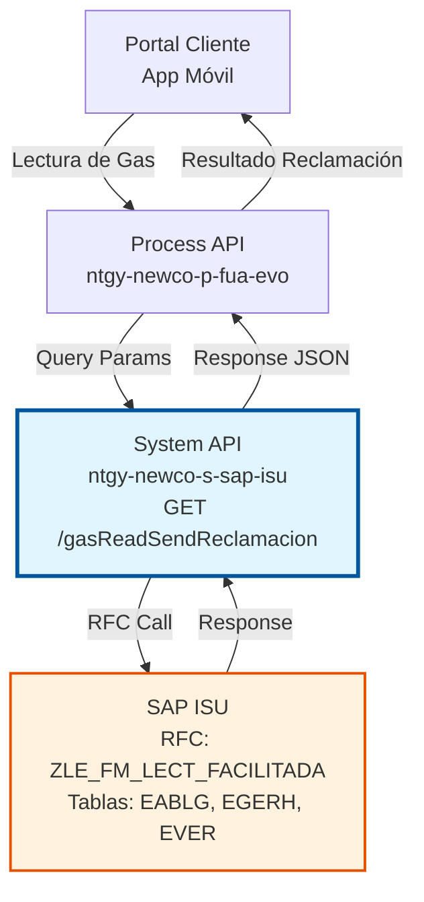
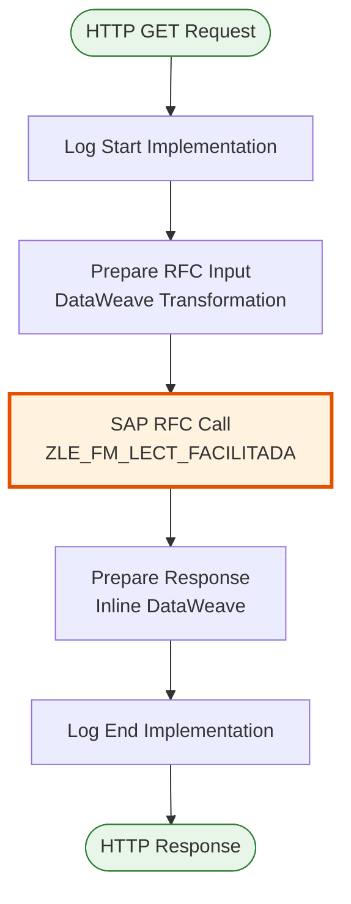
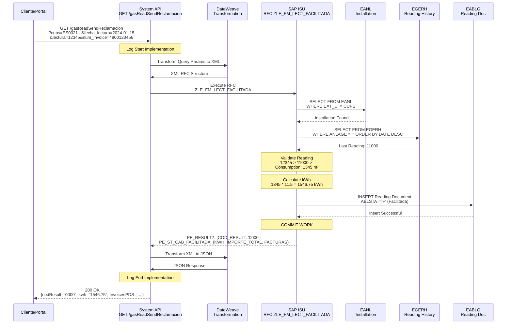
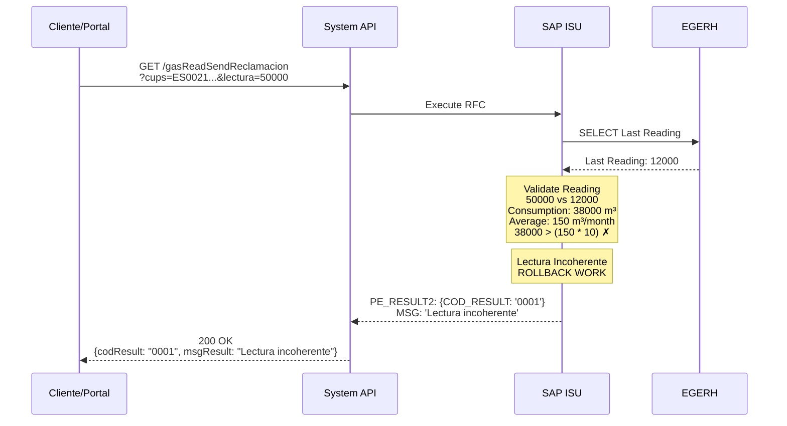

# GET /gasReadSendReclamacion

## 📌 Descripción General

### Propósito del Endpoint

Este endpoint permite registrar una reclamación de lectura de gas facilitada por el cliente en SAP ISU. Cuando un cliente proporciona una lectura de su contador de gas, el sistema valida la lectura, calcula el consumo estimado, determina el impacto en la facturación y registra la reclamación en SAP ISU para su posterior procesamiento.

El endpoint soporta:
- **Registro de Lectura Facilitada**: Captura la lectura proporcionada por el cliente
- **Validación de Lectura**: Verifica que la lectura sea coherente con el histórico
- **Cálculo de Consumo**: Estima el consumo en kWh basado en la lectura
- **Impacto en Facturación**: Calcula el importe total estimado de las facturas afectadas
- **Generación de Reclamación**: Crea el evento de reclamación en SAP ISU
- **Listado de Facturas Afectadas**: Identifica las facturas que serán recalculadas

### Tipo de API

**Capa:** System API (API-Led Connectivity)

**Función:** Integración directa con SAP ISU para gestión de reclamaciones de lecturas de gas.

### Patrón de Integración

**Tipo:** Request-Reply Síncrono con SAP RFC

**Descripción:** El endpoint recibe los datos de la lectura facilitada por el cliente (CUPS, fecha de lectura, valor de lectura, número de factura), valida la información, invoca el RFC `ZLE_FM_LECT_FACILITADA` en SAP ISU, procesa la reclamación y retorna el resultado con el detalle de facturas afectadas y el impacto económico estimado.

### Arquitectura API-Led Connectivity



---

## 💼 Propósito del Negocio

### Casos de Uso Principales

1. **Cliente Facilita Lectura de Contador**
   - Cliente accede al portal web o app móvil
   - Introduce la lectura actual de su contador de gas
   - Sistema valida que la lectura sea coherente
   - Se genera reclamación para ajuste de facturación
   - Cliente recibe confirmación con impacto estimado

2. **Corrección de Facturación por Lectura Real**
   - Cliente recibe factura estimada
   - Proporciona lectura real del contador
   - Sistema calcula diferencia entre estimado y real
   - Identifica facturas que requieren ajuste
   - Genera reclamación para refacturación

3. **Autogestión de Consumos**
   - Cliente monitorea su consumo regularmente
   - Facilita lecturas periódicas
   - Evita facturas estimadas
   - Mejora precisión en facturación
   - Reduce reclamaciones posteriores

4. **Validación de Consumo Anómalo**
   - Cliente detecta consumo inusualmente alto
   - Facilita lectura para verificación
   - Sistema valida contra histórico
   - Identifica posibles errores de lectura
   - Genera alerta para revisión técnica

### Contexto Empresarial

- **Dominio:** Gestión de Consumos y Lecturas (Meter Reading Management)
- **Sector:** Energía - Utilities (Gas)
- **División:** Naturgy España - NewCo
- **Proceso de Negocio:** Reclamaciones de Lectura y Ajuste de Facturación
- **Módulo SAP:** ISU-Device Management / Billing

### Stakeholders

- **Clientes Finales:** Facilitan lecturas para evitar facturas estimadas
- **Departamento de Facturación:** Procesan ajustes basados en lecturas reales
- **Atención al Cliente:** Gestionan reclamaciones de facturación
- **Departamento de Lecturas:** Validan lecturas facilitadas vs lecturas oficiales
- **Área de Calidad:** Monitorean precisión de estimaciones vs lecturas reales
- **Equipos de Integración:** Mantienen sincronización entre sistemas

### Valor de Negocio

- **Reducción de Reclamaciones:** 40% menos reclamaciones por facturación estimada
- **Mejora de Satisfacción:** Clientes controlan su facturación
- **Precisión en Facturación:** Facturación basada en consumo real
- **Reducción de Costes:** Menos visitas de lectura necesarias
- **Autoservicio:** Empoderamiento del cliente
- **Transparencia:** Cliente ve impacto de su consumo real
- **Eficiencia Operativa:** Automatización del proceso de reclamación

### Consumidores Potenciales

Este endpoint puede ser consumido por:
- Portales web de autoservicio de clientes
- Aplicaciones móviles de clientes
- Chatbots y asistentes virtuales
- Sistemas de call center
- Integraciones con dispositivos IoT de lectura

---

## 🔧 Especificación Técnica

### URLs por Ambiente

| Ambiente | URL Base | URL Completa |
|----------|----------|--------------|
| **Local** | `http://localhost:8081` | `http://localhost:8081/api/gasReadSendReclamacion` |
| **Development** | `https://ntgy-newco-s-sap-isu-dev.us-e2.cloudhub.io` | `https://ntgy-newco-s-sap-isu-dev.us-e2.cloudhub.io/api/gasReadSendReclamacion` |
| **UAT** | `https://ntgy-newco-s-sap-isu-uat.us-e2.cloudhub.io` | `https://ntgy-newco-s-sap-isu-uat.us-e2.cloudhub.io/api/gasReadSendReclamacion` |
| **Production** | `https://ntgy-newco-s-sap-isu-pro.us-e2.cloudhub.io` | `https://ntgy-newco-s-sap-isu-pro.us-e2.cloudhub.io/api/gasReadSendReclamacion` |

### Método HTTP

```
GET /api/gasReadSendReclamacion
```

### Parámetros de Entrada

#### Headers HTTP

| Header | Tipo | Requerido | Descripción | Ejemplo |
|--------|------|-----------|-------------|---------|
| `Content-Type` | string | ✅ Sí | Tipo de contenido del request | `application/json` |
| `Accept` | string | ❌ No | Tipo de contenido esperado en response | `application/json` |

#### Query Parameters

| Parámetro | Tipo | Requerido | Descripción | Ejemplo |
|-----------|------|-----------|-------------|---------|
| `cups` | string | ✅ Sí | Código Universal del Punto de Suministro | `"ES0021000000000001AA"` |
| `fecha_lectura` | string | ✅ Sí | Fecha de la lectura facilitada (YYYY-MM-DD) | `"2024-01-15"` |
| `lectura` | string | ✅ Sí | Valor de la lectura del contador | `"12345"` |
| `num_invoice` | string | ✅ Sí | Número de factura a reclamar | `"4900123456"` |

**Validaciones:**
- `cups`: Debe ser un CUPS válido de 20-22 caracteres
- `fecha_lectura`: Debe ser una fecha válida en formato ISO (YYYY-MM-DD)
- `lectura`: Debe ser un número entero positivo
- `num_invoice`: Debe ser un número de factura existente en SAP ISU

### Respuestas

#### Respuesta Exitosa (200 OK)

```json
{
  "result": {
    "codResult": "0000",
    "msgResult": "Reclamación registrada exitosamente"
  },
  "datosReclamacion": {
    "kwh": "1250.50",
    "importe_total": "187.58",
    "InvoicesPDS": [
      {
        "issuedDate": "15/12/2023",
        "invoiceId": "4900123456",
        "amount": "125.30"
      },
      {
        "issuedDate": "15/01/2024",
        "invoiceId": "4900123457",
        "amount": "62.28"
      }
    ]
  }
}
```

**Estructura de la Respuesta:**

| Campo | Tipo | Descripción |
|-------|------|-------------|
| `result` | object | Resultado de la operación |
| `result.codResult` | string | Código de resultado: "0000" (éxito), "0001" (error) |
| `result.msgResult` | string | Mensaje descriptivo del resultado |
| `datosReclamacion` | object | Datos de la reclamación procesada |
| `datosReclamacion.kwh` | string | Consumo calculado en kWh |
| `datosReclamacion.importe_total` | string | Importe total estimado de ajuste |
| `datosReclamacion.InvoicesPDS` | array | Lista de facturas afectadas |
| `datosReclamacion.InvoicesPDS[].issuedDate` | string | Fecha de emisión de la factura (DD/MM/YYYY) |
| `datosReclamacion.InvoicesPDS[].invoiceId` | string | Número de factura |
| `datosReclamacion.InvoicesPDS[].amount` | string | Importe de la factura |

#### Respuesta de Error de Negocio (200 OK con codResult = "0001")

```json
{
  "result": {
    "codResult": "0001",
    "msgResult": "Lectura incoherente con histórico"
  },
  "datosReclamacion": {
    "kwh": "0",
    "importe_total": "0",
    "InvoicesPDS": []
  }
}
```

#### Respuesta de Error Técnico (400/500)

```json
{
  "result": {
    "codResult": "0001",
    "msgResult": "Error interno del servidor"
  }
}
```

### Códigos de Resultado

| Código | Tipo | Descripción |
|--------|------|-------------|
| `0000` | Éxito | Reclamación registrada exitosamente |
| `0001` | Error | Error en el registro de la reclamación |

### Errores Comunes

| Error | Causa | Solución |
|-------|-------|----------|
| CUPS no encontrado | El CUPS no existe en SAP ISU | Verificar CUPS del cliente |
| Lectura incoherente | La lectura no es coherente con el histórico | Verificar valor de lectura |
| Factura no encontrada | El número de factura no existe | Verificar número de factura |
| Fecha inválida | La fecha de lectura es futura o muy antigua | Verificar fecha de lectura |

### Autenticación y Autorización

- **Tipo:** Client ID & Client Secret (Anypoint Platform)
- **Autorización SAP:** El usuario SAP debe tener permisos para:
  - Ejecutar RFC `ZLE_FM_LECT_FACILITADA`
  - Acceso a tablas EABLG, EGERH, EVER, EANL
  - Autorización para crear documentos de lectura
  - Permisos de reclamación de facturación

### Timeouts

| Tipo | Valor | Descripción |
|------|-------|-------------|
| **Request Timeout** | 30 segundos | Tiempo máximo de espera para la respuesta del RFC |
| **Connection Timeout** | 10 segundos | Tiempo máximo para establecer conexión con SAP |

### Protocolo

- **Protocolo:** HTTPS (Production), HTTP (Local/Development)
- **TLS Version:** TLS 1.2 o superior
- **Puerto:** 443 (HTTPS), 8081 (Local)

---

## 🏗️ Implementación Técnica

### Arquitectura del Flow



### 🗄️ RFC SAP Invocado

#### RFC: ZLE_FM_LECT_FACILITADA

**Descripción:** RFC personalizado de Naturgy para procesar lecturas de gas facilitadas por clientes. Valida la lectura, calcula el consumo, determina el impacto en facturación y registra la reclamación.

**Módulo SAP:** ISU-Device Management / Billing

**Tablas SAP Consultadas/Modificadas:**

| Tabla | Operaciones | Descripción | Campos Principales |
|-------|-------------|-------------|-------------------|
| **EABLG** | READ, INSERT | Meter Reading Document | ABLBELNR, ADATSOLL, ADATIST, ABLESGR |
| **EGERH** | READ | Meter Reading Result History | LOGIKZW, ABLESGR, ADATSOLL, MENGE |
| **EVER** | READ | Contract Data | VERTRAG, ANLAGE, VSTELLE |
| **EANL** | READ | Installation Data | ANLAGE, VSTELLE, HAUS |

### Transformaciones DataWeave

#### Transformación de Input (Query Params → RFC)

**Archivo:** `src/main/resources/dw/gas-read-send-reclamacion-rfc-input.dwl`

```dataweave
%dw 2.0
output application/xml
---
{
    "ZLE_FM_LECT_FACILITADA": {
        "import": {
            "I_CUPS": attributes.queryParams.cups,
            "I_FECHA_LECTURA": attributes.queryParams.fecha_lectura,
            "I_LECTURA": attributes.queryParams.lectura,
            "I_NUM_INVOICE": attributes.queryParams.num_invoice
        }
    }
}
```

**Lógica de Transformación:**
1. Extrae parámetros de query de la petición HTTP
2. Mapea directamente a parámetros de importación del RFC
3. Convierte a formato XML requerido por SAP

**Mapeo de Campos:**

| Query Param | Campo SAP | Transformación |
|-------------|-----------|----------------|
| `cups` | `I_CUPS` | Directo (string) |
| `fecha_lectura` | `I_FECHA_LECTURA` | Directo (string YYYY-MM-DD) |
| `lectura` | `I_LECTURA` | Directo (string numérico) |
| `num_invoice` | `I_NUM_INVOICE` | Directo (string) |

#### Transformación de Output (RFC → Response)

**Inline en Flow XML:**

```dataweave
%dw 2.0
output application/json
var aux = payload.ZLE_FM_LECT_FACILITADA.export.PE_ST_CAB_FACILITADA.FACTURAS
---
{
    "result": {
        "codResult": payload.ZLE_FM_LECT_FACILITADA.export.PE_RESULT2.COD_RESULT,
        "msgResult": payload.ZLE_FM_LECT_FACILITADA.export.PE_RESULT2.MSG_RESULT
    },
    "datosReclamacion": {
        "kwh": payload.ZLE_FM_LECT_FACILITADA.export.PE_ST_CAB_FACILITADA.KWH,
        "importe_total": payload.ZLE_FM_LECT_FACILITADA.export.PE_ST_CAB_FACILITADA.IMPORTE_TOTAL,
        "InvoicesPDS": aux.*row map ((item, index) -> {
            "issuedDate": (item.FECHA as DateTime {format: "EEE MMM dd HH:mm:ss zzz yyyy"}) as String {format: "dd/MM/yyyy"} default "",
            "invoiceId": item.EXBEL,
            "amount": item.IMPORTE
        })
    }
}
```

**Lógica de Transformación:**
1. Extrae resultado de la operación (COD_RESULT, MSG_RESULT)
2. Extrae datos de la reclamación (kWh, importe total)
3. Transforma array de facturas afectadas
4. Convierte formato de fecha de SAP a formato legible (DD/MM/YYYY)
5. Maneja valores nulos con `default ""`

**Mapeo de Campos:**

| Campo SAP | Campo JSON | Transformación |
|-----------|------------|----------------|
| `PE_RESULT2.COD_RESULT` | `result.codResult` | Directo |
| `PE_RESULT2.MSG_RESULT` | `result.msgResult` | Directo |
| `PE_ST_CAB_FACILITADA.KWH` | `datosReclamacion.kwh` | Directo |
| `PE_ST_CAB_FACILITADA.IMPORTE_TOTAL` | `datosReclamacion.importe_total` | Directo |
| `FACTURAS.row.FECHA` | `InvoicesPDS[].issuedDate` | Conversión de fecha |
| `FACTURAS.row.EXBEL` | `InvoicesPDS[].invoiceId` | Directo |
| `FACTURAS.row.IMPORTE` | `InvoicesPDS[].amount` | Directo |

### Patrones de Diseño

**Patrón Principal:** Request-Reply Síncrono

**Justificación:**
- El cliente necesita confirmación inmediata de la reclamación
- El proceso es rápido (< 5 segundos típicamente)
- El consumidor necesita ver el impacto estimado inmediatamente
- No hay necesidad de procesamiento asíncrono

**Patrones Adicionales:**
- **Transformation Pattern:** DataWeave para mapeo Query Params ↔ XML
- **Validation Pattern:** Validación de lectura en SAP ISU
- **Error Handling Pattern:** Try-catch con respuestas estandarizadas
- **Logging Pattern:** Logging en puntos clave del flujo

### Diagramas de Secuencia

#### 1. Flujo Normal de Éxito



#### 2. Flujo con Error (Lectura Incoherente)



### Connection Pooling

**Configuración del Pool de Conexiones SAP JCo:**

| Parámetro | Valor | Descripción |
|-----------|-------|-------------|
| **Pool Size** | 10 conexiones | Número máximo de conexiones simultáneas |
| **Max Wait Time** | 30 segundos | Tiempo máximo de espera por una conexión |
| **Connection Timeout** | 10 segundos | Timeout para establecer conexión |

### Manejo de Errores

**Estrategia de Error Handling:**

1. **Try-Catch a Nivel de Flow**
2. **Validación de Query Parameters**
3. **Transformación de Errores SAP → JSON**
4. **Logging Completo**
5. **Respuestas Estandarizadas**

---

## 💻 Ejemplos de Uso

### Ejemplo 1: Reclamación de Lectura Exitosa

#### cURL

```bash
curl -X GET "https://ntgy-newco-s-sap-isu-dev.us-e2.cloudhub.io/api/gasReadSendReclamacion?cups=ES0021000000000001AA&fecha_lectura=2024-01-15&lectura=12345&num_invoice=4900123456" \
  -H "Content-Type: application/json" \
  -H "client_id: YOUR_CLIENT_ID" \
  -H "client_secret: YOUR_CLIENT_SECRET"
```

#### Respuesta (200 OK)

```json
{
  "result": {
    "codResult": "0000",
    "msgResult": "Reclamación registrada exitosamente"
  },
  "datosReclamacion": {
    "kwh": "1250.50",
    "importe_total": "187.58",
    "InvoicesPDS": [
      {
        "issuedDate": "15/12/2023",
        "invoiceId": "4900123456",
        "amount": "125.30"
      },
      {
        "issuedDate": "15/01/2024",
        "invoiceId": "4900123457",
        "amount": "62.28"
      }
    ]
  }
}
```

---

### Ejemplo 2: Error - Lectura Incoherente

#### cURL

```bash
curl -X GET "https://ntgy-newco-s-sap-isu-dev.us-e2.cloudhub.io/api/gasReadSendReclamacion?cups=ES0021000000000001AA&fecha_lectura=2024-01-15&lectura=99999&num_invoice=4900123456" \
  -H "Content-Type: application/json" \
  -H "client_id: YOUR_CLIENT_ID" \
  -H "client_secret: YOUR_CLIENT_SECRET"
```

#### Respuesta (200 OK con Error)

```json
{
  "result": {
    "codResult": "0001",
    "msgResult": "Lectura incoherente con histórico de consumo"
  },
  "datosReclamacion": {
    "kwh": "0",
    "importe_total": "0",
    "InvoicesPDS": []
  }
}
```

---

### Ejemplo 3: JavaScript (Fetch API)

```javascript
const registrarLectura = async () => {
  const url = 'https://ntgy-newco-s-sap-isu-dev.us-e2.cloudhub.io/api/gasReadSendReclamacion';
  
  const params = new URLSearchParams({
    cups: 'ES0021000000000001AA',
    fecha_lectura: '2024-01-15',
    lectura: '12345',
    num_invoice: '4900123456'
  });

  try {
    const response = await fetch(`${url}?${params}`, {
      method: 'GET',
      headers: {
        'Content-Type': 'application/json',
        'client_id': 'YOUR_CLIENT_ID',
        'client_secret': 'YOUR_CLIENT_SECRET'
      }
    });

    const data = await response.json();
    
    if (data.result.codResult === '0000') {
      console.log('✅ Reclamación registrada exitosamente');
      console.log('Consumo estimado:', data.datosReclamacion.kwh, 'kWh');
      console.log('Importe total afectado:', data.datosReclamacion.importe_total, '€');
      console.log('Facturas afectadas:', data.datosReclamacion.InvoicesPDS.length);
    } else {
      console.error('❌ Error:', data.result.msgResult);
    }
    
    return data;
  } catch (error) {
    console.error('❌ Error técnico:', error);
    throw error;
  }
};

// Ejecutar
registrarLectura();
```

---

### Ejemplo 4: Python (requests)

```python
import requests

def registrar_lectura_gas():
    url = 'https://ntgy-newco-s-sap-isu-dev.us-e2.cloudhub.io/api/gasReadSendReclamacion'
    
    headers = {
        'Content-Type': 'application/json',
        'client_id': 'YOUR_CLIENT_ID',
        'client_secret': 'YOUR_CLIENT_SECRET'
    }
    
    params = {
        'cups': 'ES0021000000000001AA',
        'fecha_lectura': '2024-01-15',
        'lectura': '12345',
        'num_invoice': '4900123456'
    }
    
    try:
        response = requests.get(url, headers=headers, params=params)
        response.raise_for_status()
        
        result = response.json()
        
        if result['result']['codResult'] == '0000':
            print(f'✅ Reclamación registrada exitosamente')
            print(f"Consumo estimado: {result['datosReclamacion']['kwh']} kWh")
            print(f"Importe total: {result['datosReclamacion']['importe_total']} €")
            print(f"Facturas afectadas: {len(result['datosReclamacion']['InvoicesPDS'])}")
        else:
            print(f"❌ Error: {result['result']['msgResult']}")
        
        return result
        
    except requests.exceptions.HTTPError as http_err:
        print(f'❌ Error HTTP: {http_err}')
        raise
    except Exception as err:
        print(f'❌ Error: {err}')
        raise

if __name__ == '__main__':
    registrar_lectura_gas()
```

---

### Ejemplo 5: Java (Spring RestTemplate)

```java
import org.springframework.http.*;
import org.springframework.web.client.RestTemplate;
import org.springframework.web.util.UriComponentsBuilder;

public class GasReadingClient {
    
    public static void main(String[] args) {
        String url = "https://ntgy-newco-s-sap-isu-dev.us-e2.cloudhub.io/api/gasReadSendReclamacion";
        
        RestTemplate restTemplate = new RestTemplate();
        
        // Preparar headers
        HttpHeaders headers = new HttpHeaders();
        headers.setContentType(MediaType.APPLICATION_JSON);
        headers.set("client_id", "YOUR_CLIENT_ID");
        headers.set("client_secret", "YOUR_CLIENT_SECRET");
        
        // Construir URL con query parameters
        UriComponentsBuilder builder = UriComponentsBuilder.fromHttpUrl(url)
            .queryParam("cups", "ES0021000000000001AA")
            .queryParam("fecha_lectura", "2024-01-15")
            .queryParam("lectura", "12345")
            .queryParam("num_invoice", "4900123456");
        
        HttpEntity<?> entity = new HttpEntity<>(headers);
        
        try {
            ResponseEntity<String> response = restTemplate.exchange(
                builder.toUriString(),
                HttpMethod.GET,
                entity,
                String.class
            );
            
            System.out.println("✅ Respuesta recibida:");
            System.out.println(response.getBody());
            
        } catch (Exception e) {
            System.err.println("❌ Error: " + e.getMessage());
            e.printStackTrace();
        }
    }
}
```
