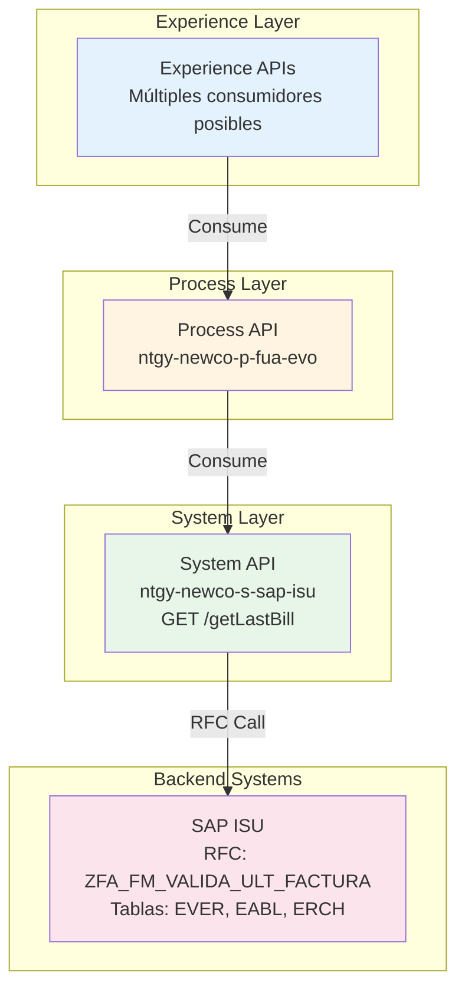
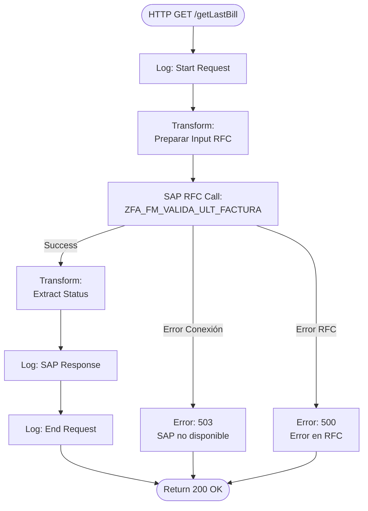
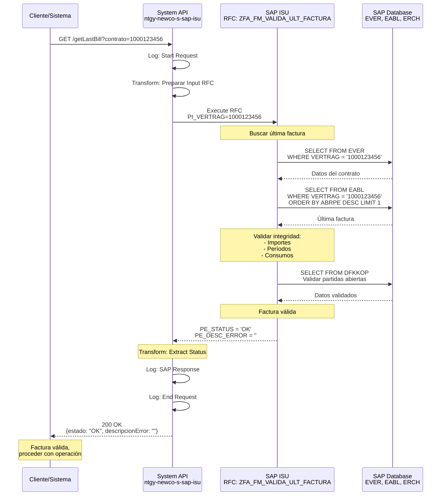
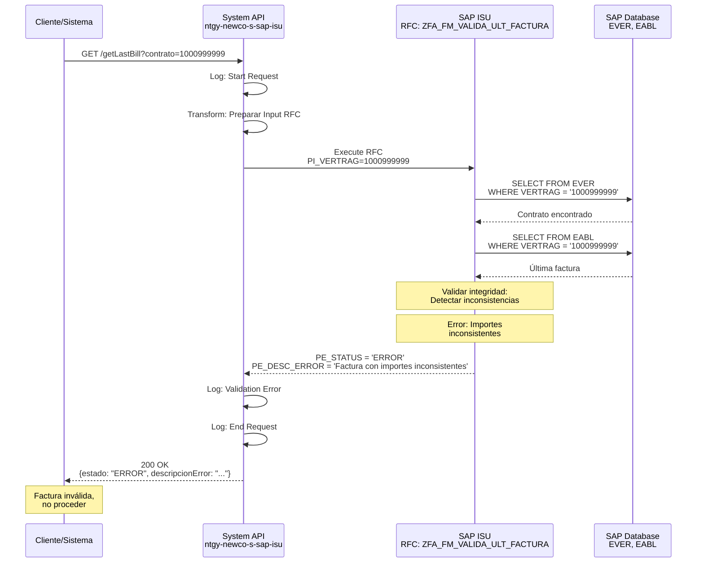
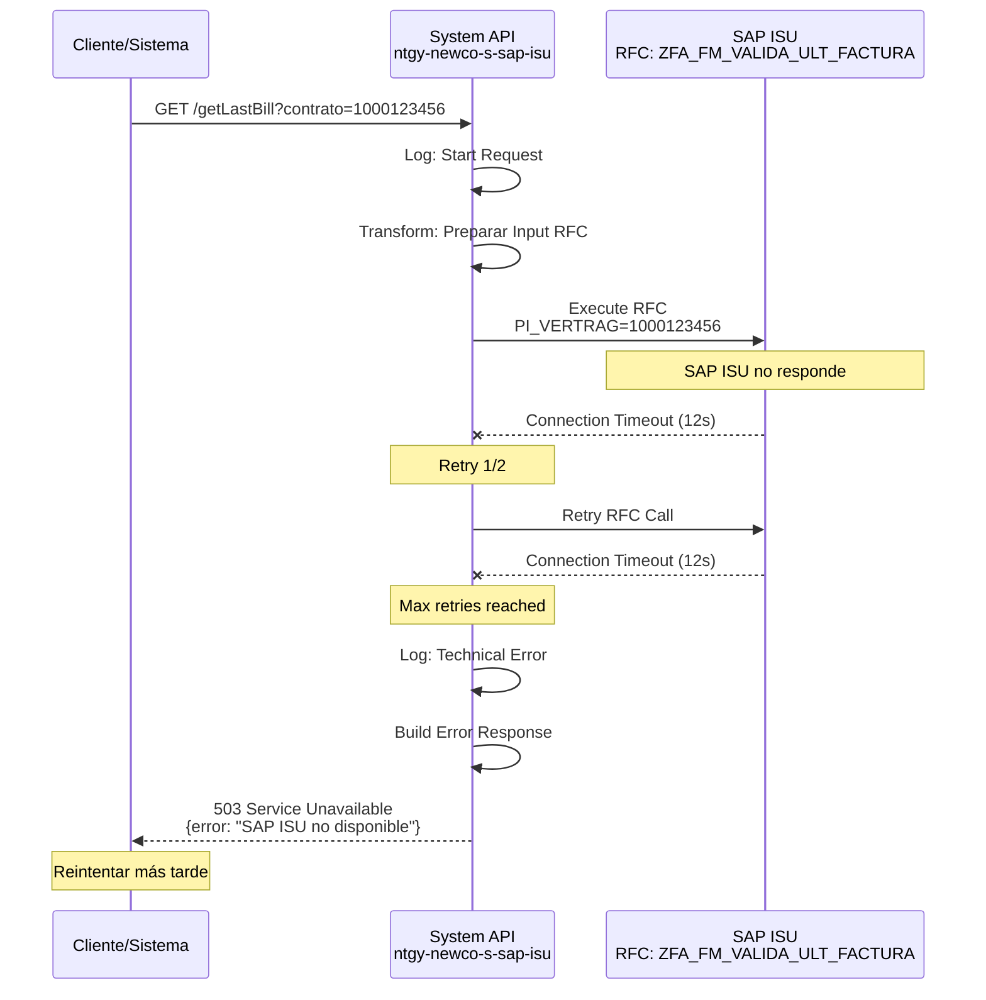

# GET /getLastBill

## 📌 Descripción General

### Propósito del Endpoint

Este endpoint valida el estado de la última factura emitida para un contrato específico en SAP ISU. Proporciona información sobre si la factura es válida y retorna una descripción del estado o error, permitiendo a los sistemas consumidores verificar la integridad de la última facturación.

### Tipo de API

**Capa:** System API (Integración Directa con SAP ISU)

### Patrón de Integración

**Tipo:** Request-Reply Síncrono con SAP ISU - Validación

Este endpoint implementa un patrón de validación mediante RFC (Remote Function Call). La comunicación es síncrona y está optimizada para verificaciones rápidas del estado de facturación.

**Características del Patrón:**
- ✅ Comunicación síncrona con SAP ISU
- ✅ Invocación de RFC `ZFA_FM_VALIDA_ULT_FACTURA`
- ✅ Validación de integridad de factura
- ✅ Respuesta ligera (estado + descripción)
- ✅ Tiempo de respuesta rápido (< 3 segundos)

### Arquitectura API-Led Connectivity



**Flujo de Datos:**
1. Experience API solicita validación de última factura
2. Process API orquesta la petición
3. System API invoca RFC de validación en SAP ISU
4. SAP ISU valida integridad de la última factura
5. System API retorna estado y descripción
6. Respuesta se propaga hacia arriba en la arquitectura

---

## 💼 Propósito del Negocio

### Casos de Uso Principales

#### 1. Validación de Integridad de Factura
**Actor:** Sistema de facturación o control de calidad  
**Objetivo:** Verificar que la última factura emitida es válida  
**Flujo:**
- Sistema necesita validar factura antes de procesamiento
- Consulta estado de última factura por contrato
- Verifica integridad y procede según resultado

#### 2. Control de Calidad de Facturación
**Actor:** Departamento de facturación  
**Objetivo:** Detectar facturas con errores o inconsistencias  
**Flujo:**
- Sistema ejecuta validación periódica
- Identifica facturas con problemas
- Genera alertas para corrección

#### 3. Validación Pre-Pago
**Actor:** Sistema de pagos  
**Objetivo:** Validar factura antes de procesar pago  
**Flujo:**
- Cliente intenta pagar factura
- Sistema valida que factura sea correcta
- Permite o bloquea el pago según validación

#### 4. Auditoría de Facturación
**Actor:** Auditoría interna o compliance  
**Objetivo:** Verificar calidad de facturas emitidas  
**Flujo:**
- Auditoría solicita validación de facturas
- Sistema verifica estado de facturas
- Genera reporte de facturas válidas/inválidas

### Contexto Empresarial

- **Dominio:** Control de Calidad de Facturación
- **Sector:** Energía - Utilities (Gas y Electricidad)
- **División:** Naturgy NewCo
- **Proceso de Negocio:** Billing Quality Assurance
- **Sistema Backend:** SAP ISU (Industry Solution Utilities)

### Stakeholders

#### Stakeholders Primarios
- **Departamento de Facturación:** Validan calidad de facturas
- **Control de Calidad:** Monitorean integridad de facturación
- **Sistemas de Pagos:** Validan facturas antes de cobro

#### Stakeholders Secundarios
- **Auditoría Interna:** Verifican cumplimiento de procesos
- **Área de Atención al Cliente:** Gestionan reclamaciones por facturas erróneas
- **Sistemas de Compliance:** Aseguran cumplimiento normativo

### Valor de Negocio

#### Beneficios Cuantitativos
- ⏱️ **Tiempo de Validación:** < 3 segundos (validación rápida)
- 🎯 **Reducción de Errores:** 40% menos facturas con errores
- 💰 **Ahorro en Correcciones:** 25% reducción en costos de corrección
- 📊 **Mejora en Calidad:** 95% de facturas válidas al primer intento

#### Beneficios Cualitativos
- ✅ Detección temprana de errores de facturación
- ✅ Mejora en calidad de datos de facturación
- ✅ Reducción de reclamaciones de clientes
- ✅ Mayor confianza en proceso de facturación
- ✅ Cumplimiento de estándares de calidad

### Consumidores Potenciales

Este endpoint puede ser consumido por:
- **Sistemas de Control de Calidad:** Validación automática
- **Sistemas de Facturación:** Verificación pre-emisión
- **Sistemas de Pagos:** Validación pre-cobro
- **Sistemas de Auditoría:** Verificación de compliance
- **Portales de Administración:** Monitoreo de calidad
- **Sistemas de Alertas:** Detección de anomalías

---

## 🔧 Especificación Técnica

### URLs por Ambiente

| Ambiente | URL Base | URL Completa |
|----------|----------|--------------|
| **Local** | `http://localhost:8081` | `http://localhost:8081/api/getLastBill` |
| **Development** | `https://ntgy-newco-s-sap-isu-dev.cloudhub.io` | `https://ntgy-newco-s-sap-isu-dev.cloudhub.io/api/getLastBill` |
| **UAT** | `https://ntgy-newco-s-sap-isu-uat.cloudhub.io` | `https://ntgy-newco-s-sap-isu-uat.cloudhub.io/api/getLastBill` |
| **UAT00** | `https://ntgy-newco-s-sap-isu-uat00.cloudhub.io` | `https://ntgy-newco-s-sap-isu-uat00.cloudhub.io/api/getLastBill` |
| **Production** | `https://ntgy-newco-s-sap-isu.cloudhub.io` | `https://ntgy-newco-s-sap-isu.cloudhub.io/api/getLastBill` |

### Método HTTP

```
GET /api/getLastBill
```

### Parámetros de Entrada

#### Query Parameters

| Parámetro | Tipo | Requerido | Descripción | Ejemplo | Validación |
|-----------|------|-----------|-------------|---------|------------|
| `contrato` | String | ⚠️ Opcional | Identificador único del contrato en SAP ISU | `1000123456` | Numérico, 10 dígitos |

**Notas sobre Parámetros:**
- El parámetro `contrato` es opcional según el RAML (type: string|nil)
- Si no se proporciona, puede validar el último contrato procesado
- Si el contrato no existe, se retorna descripción de error

#### Headers HTTP

| Header | Tipo | Requerido | Descripción | Ejemplo |
|--------|------|-----------|-------------|---------|
| `Content-Type` | String | ✅ Sí | Tipo de contenido de la respuesta | `application/json` |
| `Accept` | String | ⚠️ Recomendado | Tipo de contenido aceptado | `application/json` |

### Respuestas

#### Respuesta Exitosa (200 OK)

**Estructura de Respuesta:**

```json
{
  "estado": "OK",
  "descripcionError": ""
}
```

**Descripción de Campos:**

| Campo | Tipo | Descripción | Valores Posibles |
|-------|------|-------------|------------------|
| `estado` | String | Estado de validación de la factura | `OK`, `ERROR`, `WARNING` |
| `descripcionError` | String | Descripción del error o advertencia (vacío si OK) | Texto descriptivo del error |

**Estados Posibles:**

| Estado | Significado | Descripción Error |
|--------|-------------|-------------------|
| `OK` | Factura válida | Campo vacío |
| `ERROR` | Factura inválida | Descripción del error encontrado |
| `WARNING` | Factura con advertencias | Descripción de la advertencia |

#### Ejemplos de Respuestas

##### Factura Válida

```json
{
  "estado": "OK",
  "descripcionError": ""
}
```

##### Factura con Error

```json
{
  "estado": "ERROR",
  "descripcionError": "Factura con importes inconsistentes"
}
```

##### Factura con Advertencia

```json
{
  "estado": "WARNING",
  "descripcionError": "Factura pendiente de validación final"
}
```

#### Respuestas de Error

##### Error 500 - Internal Server Error

**Causa:** Error en SAP ISU o error técnico del API

```json
{
  "error": "Error al validar última factura en SAP ISU"
}
```

##### Error 503 - Service Unavailable

**Causa:** SAP ISU no disponible

```json
{
  "error": "SAP ISU temporalmente no disponible"
}
```

### Autenticación y Autorización

#### Tipo de Autenticación

**Método:** Client ID & Client Secret (OAuth 2.0 Client Credentials)

**Headers Requeridos:**
- `client_id`: Identificador de la aplicación cliente
- `client_secret`: Secreto de la aplicación cliente

**Nota:** La autenticación se gestiona a nivel de Anypoint Platform API Manager.

#### Autorización SAP

El usuario SAP configurado en el conector debe tener los siguientes permisos:
- Objeto de autorización: `V_VERTRAG` (Contract Display)
- Actividad: `03` (Display)
- RFC: `ZFA_FM_VALIDA_ULT_FACTURA` (Execute permission)

### Timeouts Configurados

| Tipo | Valor | Descripción |
|------|-------|-------------|
| **Request Timeout** | 15 segundos | Timeout total de la petición HTTP |
| **SAP RFC Timeout** | 12 segundos | Timeout de ejecución del RFC en SAP |
| **Connection Timeout** | 5 segundos | Timeout de establecimiento de conexión SAP |

**Estrategia de Retry:**
- Reintentos automáticos: 2 intentos
- Intervalo entre reintentos: 2 segundos
- Solo para errores de conexión (no para errores de negocio)

### Protocolo

- **Protocolo:** HTTPS (TLS 1.2+)
- **Puerto:** 443 (HTTPS)
- **Método de Compresión:** gzip (opcional)

---

## 🏗️ Implementación Técnica

### Arquitectura del Flow



### RFC SAP Invocado

#### RFC: `ZFA_FM_VALIDA_ULT_FACTURA`

**Descripción:** Función RFC personalizada de SAP ISU para validar la integridad y consistencia de la última factura emitida para un contrato.

**Módulo SAP:** Billing & Invoicing (FI-CA)

**Tablas SAP Consultadas:**
- `EVER`: Contract Master Data (Datos Maestros de Contrato)
- `EABL`: Billing Document (Documento de Facturación)
- `ERCH`: Invoice Document (Documento de Factura)
- `DFKKOP`: Open Items (Partidas Abiertas)

**Parámetros de Entrada:**

| Parámetro | Tipo ABAP | Descripción | Ejemplo |
|-----------|-----------|-------------|---------|
| `PI_VERTRAG` | CHAR(10) | Número de contrato (opcional) | `1000123456` |

**Parámetros de Salida:**

| Parámetro | Tipo ABAP | Descripción | Valores |
|-----------|-----------|-------------|---------|
| `PE_STATUS` | CHAR(10) | Estado de validación | `OK`, `ERROR`, `WARNING` |
| `PE_DESC_ERROR` | CHAR(255) | Descripción del error o advertencia | Texto descriptivo |

**Validaciones Realizadas por el RFC:**
- Consistencia de importes de factura
- Validación de períodos de facturación
- Verificación de datos de consumo
- Comprobación de estado de cuenta
- Validación de reglas de negocio

---

## 🗄️ Base de Datos SAP ISU

### Detalles de Tablas SAP

#### Tabla: `ERCH`

**Descripción:** Tabla de documentos de factura en SAP ISU. Contiene información de cabecera de cada factura emitida, incluyendo fechas, importes y estado de validación.

**Campos Utilizados:**

| Campo | Tipo ABAP | Descripción | Ejemplo |
|-------|-----------|-------------|---------|
| `OPBEL` | CHAR(12) | Número de documento de factura | `100012345678` |
| `ERCHZ` | CHAR(4) | Contador de documento | `0001` |
| `ADATSOLL` | DATS | Fecha programada de facturación | `20240215` |
| `BETRW` | CURR(15,2) | Importe de factura | `125.50` |
| `WAERS` | CHAR(5) | Código de moneda | `EUR` |
| `FAKST` | CHAR(2) | Estado de factura | `01` |

**Relaciones:**
- `ERCH.OPBEL` → `EABLG.OPBEL` (Relación 1:1 con documento de lectura)
- `ERCH.OPBEL` → `DFKKOP.OPBEL` (Relación 1:1 con partida abierta)

**Índices Conocidos:**
- Primary Key: `OPBEL + ERCHZ`
- Secondary Index: `ADATSOLL`, `FAKST`

**Notas de Performance:**
- Tabla de alto volumen (millones de registros)
- Búsqueda por `OPBEL` es muy eficiente (PK)
- Filtrar por `FAKST` para validar estado

#### Tabla: `EABLG`

**Descripción:** Documentos de lectura de contadores asociados a facturación. Almacena la relación entre lecturas y facturas emitidas.

**Campos Utilizados:**

| Campo | Tipo ABAP | Descripción | Ejemplo |
|-------|-----------|-------------|---------|
| `ABLBELNR` | CHAR(12) | Número de documento de lectura | `100012345678` |
| `VERTRAG` | CHAR(10) | Número de contrato | `1000123456` |
| `OPBEL` | CHAR(12) | Número de documento de factura | `100012345678` |
| `ADATSOLL` | DATS | Fecha programada de lectura | `20240215` |
| `ABLSTAT` | CHAR(2) | Estado de lectura | `01` |

**Relaciones:**
- `EABLG.VERTRAG` → `EVER.VERTRAG` (Relación N:1 con contrato)
- `EABLG.OPBEL` → `ERCH.OPBEL` (Relación 1:1 con factura)

**Índices Conocidos:**
- Primary Key: `ABLBELNR`
- Secondary Index: `VERTRAG`, `OPBEL`, `ADATSOLL`

**Notas de Performance:**
- Tabla de alto volumen (millones de registros)
- Búsqueda por `VERTRAG` es eficiente con índice secundario
- Ordenar por `ADATSOLL DESC` para obtener última factura

#### Tabla: `FKKVKP`

**Descripción:** Tabla maestra de cuentas contrato en SAP ISU. Contiene información principal de cada cuenta contrato.

**Campos Utilizados:**

| Campo | Tipo ABAP | Descripción | Ejemplo |
|-------|-----------|-------------|---------|
| `VKONT` | CHAR(12) | Número de cuenta contrato | `200001234567` |
| `GPART` | CHAR(10) | Business Partner | `1000123456` |
| `VKTYP` | CHAR(2) | Tipo de cuenta contrato | `01` |

**Relaciones:**
- `FKKVKP.VKONT` → `EVER.VKONT` (Relación 1:N con contratos)

**Índices Conocidos:**
- Primary Key: `VKONT`
- Secondary Index: `GPART`

**Notas de Performance:**
- Tabla de volumen medio (cientos de miles de registros)
- Búsqueda por `VKONT` es muy eficiente (PK)

---

### Transformaciones DataWeave

#### Transformación 1: Preparar Input RFC

**Archivo:** `src/main/resources/dw/valida-ultima-factura-rfc-input.dwl`

```dataweave
%dw 2.0
output application/xml
---
{
    ZFA_FM_VALIDA_ULT_FACTURA: {
        "import": {
            PI_VERTRAG: attributes.queryParams.contrato
        }
    }
}
```

**Mapeo de Campos:**

| Campo Origen (HTTP) | Campo Destino (SAP) | Transformación |
|---------------------|---------------------|----------------|
| `queryParams.contrato` | `PI_VERTRAG` | Directo (String, opcional) |

#### Transformación 2: Procesar Output RFC

**Archivo:** Inline en flow XML (líneas 274-283)

```dataweave
%dw 2.0
output application/json
var out = payload.ZFA_FM_VALIDA_ULT_FACTURA.export
---
{
    estado: out.PE_STATUS,
    descripcionError: out.PE_DESC_ERROR
}
```

**Mapeo de Campos:**

| Campo SAP | Campo JSON | Transformación |
|-----------|------------|----------------|
| `PE_STATUS` | `estado` | Directo |
| `PE_DESC_ERROR` | `descripcionError` | Directo |

### Patrones de Diseño

**Patrón Principal:** Request-Reply Síncrono con Validación

**Justificación:**
- Validación requiere procesamiento en SAP
- Respuesta debe ser inmediata para decisiones
- No requiere almacenamiento de estado
- Ideal para validaciones en tiempo real

**Patrones Adicionales:**
- **Validation Pattern:** Validación de integridad de datos
- **Error Translation:** Conversión de errores SAP a formato estándar
- **Fast Fail:** Retorno rápido en caso de error

### Diagramas de Secuencia

#### 1. Flujo Normal - Factura Válida



#### 2. Flujo con Factura Inválida



#### 3. Flujo con Error Técnico



---

## 💻 Ejemplos de Uso

### Ejemplo 1: Validación Exitosa - Factura Válida

#### cURL

```bash
curl -X GET "https://ntgy-newco-s-sap-isu.cloudhub.io/api/getLastBill?contrato=1000123456" \
  -H "Content-Type: application/json" \
  -H "client_id: your-client-id" \
  -H "client_secret: your-client-secret"
```

#### Respuesta (200 OK)

```json
{
  "estado": "OK",
  "descripcionError": ""
}
```

### Ejemplo 2: Factura con Error

#### cURL

```bash
curl -X GET "https://ntgy-newco-s-sap-isu.cloudhub.io/api/getLastBill?contrato=1000999999" \
  -H "Content-Type: application/json" \
  -H "client_id: your-client-id" \
  -H "client_secret: your-client-secret"
```

#### Respuesta (200 OK)

```json
{
  "estado": "ERROR",
  "descripcionError": "Factura con importes inconsistentes"
}
```

### Ejemplo 3: JavaScript (Fetch API)

```javascript
async function validateLastBill(contractId) {
  const url = `https://ntgy-newco-s-sap-isu.cloudhub.io/api/getLastBill?contrato=${contractId}`;
  
  try {
    const response = await fetch(url, {
      method: 'GET',
      headers: {
        'Content-Type': 'application/json',
        'client_id': 'your-client-id',
        'client_secret': 'your-client-secret'
      }
    });
    
    if (!response.ok) {
      throw new Error(`HTTP error! status: ${response.status}`);
    }
    
    const data = await response.json();
    
    if (data.estado === 'OK') {
      console.log('✓ Factura válida');
      return true;
    } else {
      console.log(`✗ Factura inválida: ${data.descripcionError}`);
      return false;
    }
  } catch (error) {
    console.error('Error:', error);
    throw error;
  }
}

// Uso
validateLastBill('1000123456')
  .then(isValid => {
    if (isValid) {
      console.log('Proceder con operación');
    } else {
      console.log('No proceder - factura inválida');
    }
  });
```

### Ejemplo 4: Python (requests)

```python
import requests

def validate_last_bill(contract_id):
    """
    Valida la última factura de un contrato
    
    Args:
        contract_id (str): ID del contrato
        
    Returns:
        tuple: (is_valid: bool, error_description: str)
    """
    url = "https://ntgy-newco-s-sap-isu.cloudhub.io/api/getLastBill"
    
    headers = {
        "Content-Type": "application/json",
        "client_id": "your-client-id",
        "client_secret": "your-client-secret"
    }
    
    params = {
        "contrato": contract_id
    }
    
    try:
        response = requests.get(url, headers=headers, params=params, timeout=15)
        response.raise_for_status()
        
        data = response.json()
        
        estado = data.get('estado')
        descripcion = data.get('descripcionError', '')
        
        if estado == 'OK':
            print(f"✓ Factura válida para contrato {contract_id}")
            return (True, '')
        else:
            print(f"✗ Factura inválida: {descripcion}")
            return (False, descripcion)
            
    except requests.exceptions.Timeout:
        print("✗ Timeout: SAP ISU no respondió a tiempo")
        return (False, "Timeout")
    except requests.exceptions.RequestException as e:
        print(f"✗ Error técnico: {str(e)}")
        return (False, str(e))

# Uso
is_valid, error = validate_last_bill("1000123456")

if is_valid:
    print("Proceder con operación")
else:
    print(f"No proceder: {error}")
```

### Ejemplo 5: Postman Collection

```json
{
  "info": {
    "name": "SAP ISU System API - Validate Last Bill",
    "schema": "https://schema.getpostman.com/json/collection/v2.1.0/collection.json"
  },
  "item": [
    {
      "name": "GET Last Bill - Valid",
      "request": {
        "method": "GET",
        "header": [
          {
            "key": "Content-Type",
            "value": "application/json"
          },
          {
            "key": "client_id",
            "value": "{{client_id}}"
          },
          {
            "key": "client_secret",
            "value": "{{client_secret}}"
          }
        ],
        "url": {
          "raw": "{{base_url}}/api/getLastBill?contrato=1000123456",
          "host": ["{{base_url}}"],
          "path": ["api", "getLastBill"],
          "query": [
            {
              "key": "contrato",
              "value": "1000123456"
            }
          ]
        }
      },
      "response": []
    },
    {
      "name": "GET Last Bill - Invalid",
      "request": {
        "method": "GET",
        "header": [
          {
            "key": "Content-Type",
            "value": "application/json"
          },
          {
            "key": "client_id",
            "value": "{{client_id}}"
          },
          {
            "key": "client_secret",
            "value": "{{client_secret}}"
          }
        ],
        "url": {
          "raw": "{{base_url}}/api/getLastBill?contrato=1000999999",
          "host": ["{{base_url}}"],
          "path": ["api", "getLastBill"],
          "query": [
            {
              "key": "contrato",
              "value": "1000999999"
            }
          ]
        }
      },
      "response": []
    }
  ]
}
```
