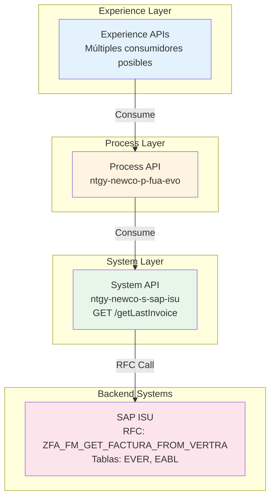
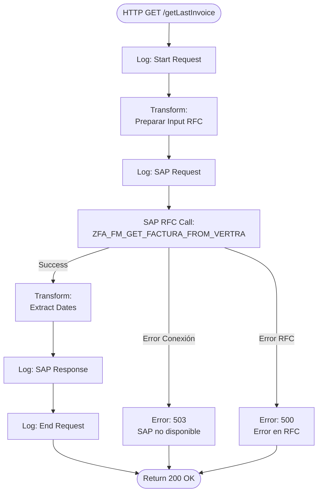
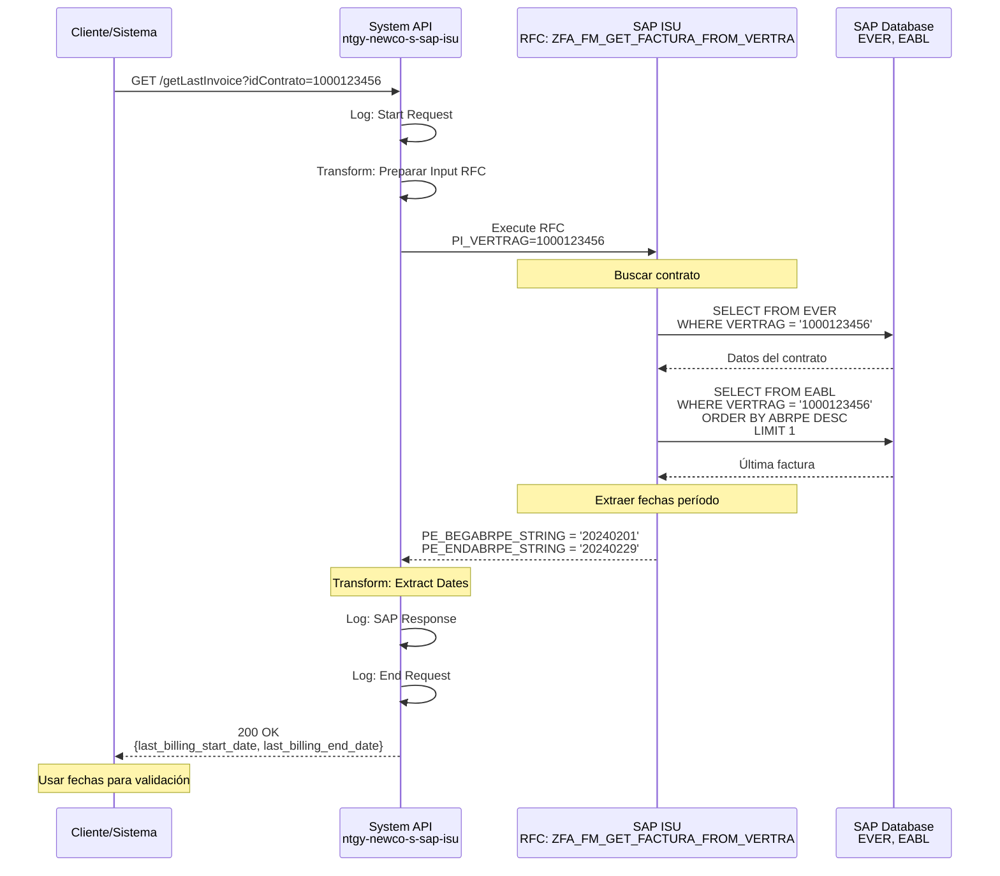
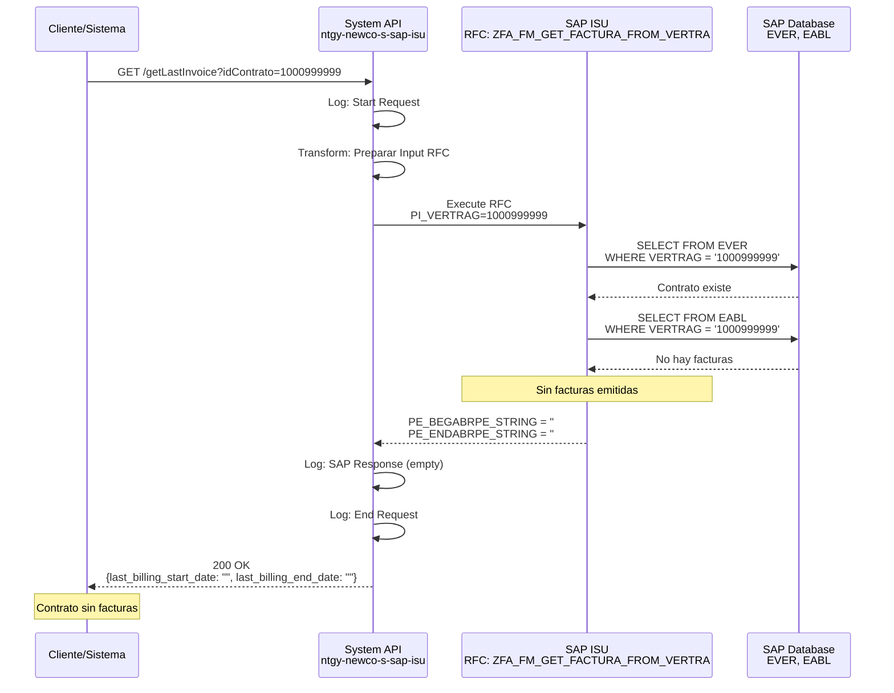
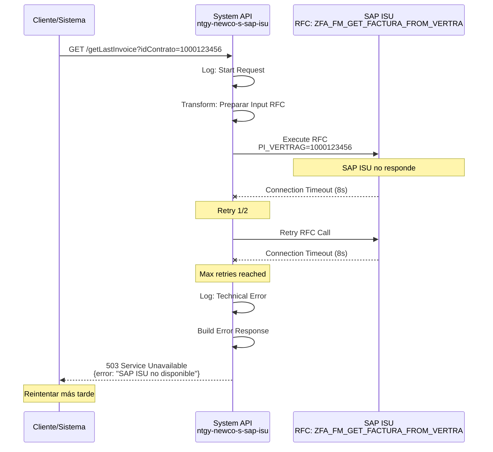

# GET /getLastInvoice

## 📌 Descripción General

### Propósito del Endpoint

Este endpoint recupera las fechas del período de facturación de la última factura emitida para un contrato específico en SAP ISU. Proporciona información sobre el inicio y fin del último período facturado, permitiendo a los sistemas consumidores conocer el rango de fechas de la facturación más reciente.

### Tipo de API

**Capa:** System API (Integración Directa con SAP ISU)

### Patrón de Integración

**Tipo:** Request-Reply Síncrono con SAP ISU

Este endpoint implementa un patrón de integración directa con SAP ISU mediante RFC (Remote Function Call). La comunicación es síncrona y optimizada para consultas rápidas de fechas de facturación.

**Características del Patrón:**
- ✅ Comunicación síncrona con SAP ISU
- ✅ Invocación de RFC `ZFA_FM_GET_FACTURA_FROM_VERTRA`
- ✅ Respuesta ligera (solo fechas)
- ✅ Tiempo de respuesta rápido (< 2 segundos)
- ✅ Manejo de errores SAP estandarizado

### Arquitectura API-Led Connectivity



**Flujo de Datos:**
1. Experience API solicita fecha de última factura
2. Process API orquesta la petición
3. System API invoca RFC en SAP ISU
4. SAP ISU consulta tablas de contratos y facturación (EVER, EABL)
5. System API retorna fechas del período de facturación
6. Respuesta se propaga hacia arriba en la arquitectura

---

## 💼 Propósito del Negocio

### Casos de Uso Principales

#### 1. Validación de Período de Facturación
**Actor:** Sistema de facturación o agente de atención al cliente  
**Objetivo:** Verificar el período de la última factura emitida  
**Flujo:**
- Sistema necesita validar período de facturación
- Consulta fecha de última factura por contrato
- Verifica que el período sea correcto

#### 2. Cálculo de Próxima Facturación
**Actor:** Sistema de billing o planificación  
**Objetivo:** Determinar cuándo corresponde la próxima factura  
**Flujo:**
- Sistema consulta fecha fin de última factura
- Calcula fecha estimada de próxima facturación
- Informa al cliente sobre próxima factura

#### 3. Consulta de Estado de Facturación
**Actor:** Cliente final o agente de call center  
**Objetivo:** Conocer el período de la última factura emitida  
**Flujo:**
- Cliente pregunta por su última factura
- Agente consulta período de facturación
- Informa al cliente sobre el período facturado

#### 4. Validación de Reclamaciones
**Actor:** Departamento de atención al cliente  
**Objetivo:** Validar reclamaciones sobre períodos de facturación  
**Flujo:**
- Cliente reclama sobre período facturado
- Sistema verifica fechas de última factura
- Valida si la reclamación es procedente

### Contexto Empresarial

- **Dominio:** Facturación y Gestión de Contratos
- **Sector:** Energía - Utilities (Gas y Electricidad)
- **División:** Naturgy NewCo
- **Proceso de Negocio:** Billing Period Management
- **Sistema Backend:** SAP ISU (Industry Solution Utilities)

### Stakeholders

#### Stakeholders Primarios
- **Departamento de Facturación:** Validan períodos de facturación
- **Agentes de Call Center:** Consultan información de facturación
- **Sistemas de Billing:** Calculan próximas facturas

#### Stakeholders Secundarios
- **Clientes Finales:** Consultan período de última factura
- **Área de Atención al Cliente:** Gestionan reclamaciones
- **Sistemas de Planificación:** Planifican ciclos de facturación

### Valor de Negocio

#### Beneficios Cuantitativos
- ⏱️ **Tiempo de Respuesta:** < 2 segundos (consulta muy rápida)
- 📞 **Reducción de Consultas:** 20% menos llamadas sobre períodos de facturación
- 🎯 **Eficiencia:** 90% reducción en tiempo de validación de períodos
- 💰 **Ahorro Operativo:** Automatización de consultas de fechas

#### Beneficios Cualitativos
- ✅ Información precisa de períodos de facturación
- ✅ Validación automática de reclamaciones
- ✅ Mejor planificación de ciclos de facturación
- ✅ Reducción de errores en cálculos de fechas
- ✅ Transparencia en información de facturación

### Consumidores Potenciales

Este endpoint puede ser consumido por:
- **Sistemas de Facturación:** Validación de períodos
- **Portales Web de Autoservicio:** Información de última factura
- **Aplicaciones Móviles:** Consulta de períodos
- **Sistemas de Call Center:** Atención de consultas
- **Sistemas de Planificación:** Cálculo de próximas facturas
- **Sistemas de Reclamaciones:** Validación de períodos

---

## 🔧 Especificación Técnica

### URLs por Ambiente

| Ambiente | URL Base | URL Completa |
|----------|----------|--------------|
| **Local** | `http://localhost:8081` | `http://localhost:8081/api/getLastInvoice` |
| **Development** | `https://ntgy-newco-s-sap-isu-dev.cloudhub.io` | `https://ntgy-newco-s-sap-isu-dev.cloudhub.io/api/getLastInvoice` |
| **UAT** | `https://ntgy-newco-s-sap-isu-uat.cloudhub.io` | `https://ntgy-newco-s-sap-isu-uat.cloudhub.io/api/getLastInvoice` |
| **UAT00** | `https://ntgy-newco-s-sap-isu-uat00.cloudhub.io` | `https://ntgy-newco-s-sap-isu-uat00.cloudhub.io/api/getLastInvoice` |
| **Production** | `https://ntgy-newco-s-sap-isu.cloudhub.io` | `https://ntgy-newco-s-sap-isu.cloudhub.io/api/getLastInvoice` |

### Método HTTP

```
GET /api/getLastInvoice
```

### Parámetros de Entrada

#### Query Parameters

| Parámetro | Tipo | Requerido | Descripción | Ejemplo | Validación |
|-----------|------|-----------|-------------|---------|------------|
| `idContrato` | String | ✅ Sí | Identificador único del contrato en SAP ISU | `1000123456` | Numérico, 10 dígitos |

**Notas sobre Parámetros:**
- El `idContrato` debe corresponder a un contrato válido en SAP ISU
- Si el contrato no existe, se retorna respuesta vacía o error
- El parámetro puede ser null según el RAML (type: string|nil)

#### Headers HTTP

| Header | Tipo | Requerido | Descripción | Ejemplo |
|--------|------|-----------|-------------|---------|
| `Content-Type` | String | ✅ Sí | Tipo de contenido de la respuesta | `application/json` |
| `Accept` | String | ⚠️ Recomendado | Tipo de contenido aceptado | `application/json` |

### Respuestas

#### Respuesta Exitosa (200 OK)

**Estructura de Respuesta:**

```json
{
  "last_billing_start_date": "20240201",
  "last_billing_end_date": "20240229"
}
```

**Descripción de Campos:**

| Campo | Tipo | Descripción | Formato |
|-------|------|-------------|---------|
| `last_billing_start_date` | String | Fecha de inicio del último período de facturación | yyyyMMdd |
| `last_billing_end_date` | String | Fecha de fin del último período de facturación | yyyyMMdd |

**Notas sobre el Formato:**
- Las fechas se retornan en formato SAP (yyyyMMdd)
- No incluyen separadores (guiones o barras)
- Representan el período completo de la última factura emitida
- Si no hay facturas, los campos pueden estar vacíos

#### Respuestas de Error

##### Error 400 - Bad Request

**Causa:** Parámetros inválidos o faltantes

```json
{
  "error": "Parámetro idContrato es requerido"
}
```

##### Error 500 - Internal Server Error

**Causa:** Error en SAP ISU o error técnico del API

```json
{
  "error": "Error al consultar última factura en SAP ISU"
}
```

##### Error 503 - Service Unavailable

**Causa:** SAP ISU no disponible

```json
{
  "error": "SAP ISU temporalmente no disponible"
}
```

### Autenticación y Autorización

#### Tipo de Autenticación

**Método:** Client ID & Client Secret (OAuth 2.0 Client Credentials)

**Headers Requeridos:**
- `client_id`: Identificador de la aplicación cliente
- `client_secret`: Secreto de la aplicación cliente

**Nota:** La autenticación se gestiona a nivel de Anypoint Platform API Manager.

#### Autorización SAP

El usuario SAP configurado en el conector debe tener los siguientes permisos:
- Objeto de autorización: `V_VERTRAG` (Contract Display)
- Actividad: `03` (Display)
- RFC: `ZFA_FM_GET_FACTURA_FROM_VERTRA` (Execute permission)

### Timeouts Configurados

| Tipo | Valor | Descripción |
|------|-------|-------------|
| **Request Timeout** | 10 segundos | Timeout total de la petición HTTP |
| **SAP RFC Timeout** | 8 segundos | Timeout de ejecución del RFC en SAP |
| **Connection Timeout** | 5 segundos | Timeout de establecimiento de conexión SAP |

**Estrategia de Retry:**
- Reintentos automáticos: 2 intentos
- Intervalo entre reintentos: 1 segundo
- Solo para errores de conexión (no para errores de negocio)

### Protocolo

- **Protocolo:** HTTPS (TLS 1.2+)
- **Puerto:** 443 (HTTPS)
- **Método de Compresión:** gzip (opcional)

---

## 🏗️ Implementación Técnica

### Arquitectura del Flow



### RFC SAP Invocado

#### RFC: `ZFA_FM_GET_FACTURA_FROM_VERTRA`

**Descripción:** Función RFC personalizada de SAP ISU para obtener fechas del período de facturación de la última factura emitida para un contrato.

**Módulo SAP:** Billing & Invoicing (FI-CA)

**Tablas SAP Consultadas:**
- `EVER`: Contract Master Data (Datos Maestros de Contrato)
- `EABL`: Billing Document (Documento de Facturación)
- `ERCH`: Invoice Document (Documento de Factura)

**Parámetros de Entrada:**

| Parámetro | Tipo ABAP | Descripción | Ejemplo |
|-----------|-----------|-------------|---------|
| `PI_ULTIMO` | CHAR(1) | Flag para obtener última factura | `X` |
| `PI_VERTRAG` | CHAR(10) | Número de contrato | `1000123456` |

**Parámetros de Salida:**

| Parámetro | Tipo ABAP | Descripción | Formato |
|-----------|-----------|-------------|---------|
| `PE_BEGABRPE_STRING` | CHAR(8) | Fecha inicio período facturación | yyyyMMdd |
| `PE_ENDABRPE_STRING` | CHAR(8) | Fecha fin período facturación | yyyyMMdd |

---

## 🗄️ Base de Datos SAP ISU

### Detalles de Tablas SAP

#### Tabla: `ERCH`

**Descripción:** Tabla de documentos de factura en SAP ISU. Contiene información de cabecera de cada factura emitida, incluyendo fechas de período de facturación y datos del documento.

**Campos Utilizados:**

| Campo | Tipo ABAP | Descripción | Ejemplo |
|-------|-----------|-------------|---------|
| `OPBEL` | CHAR(12) | Número de documento de factura | `100012345678` |
| `ERCHZ` | CHAR(4) | Contador de documento | `0001` |
| `ADATSOLL` | DATS | Fecha programada de facturación | `20240215` |
| `ABRPE_VON` | DATS | Fecha inicio período facturación | `20240201` |
| `ABRPE_BIS` | DATS | Fecha fin período facturación | `20240229` |

**Relaciones:**
- `ERCH.OPBEL` → `EABLG.OPBEL` (Relación 1:1 con documento de lectura)

**Índices Conocidos:**
- Primary Key: `OPBEL + ERCHZ`
- Secondary Index: `ADATSOLL`

**Notas de Performance:**
- Tabla de alto volumen (millones de registros)
- Búsqueda por `OPBEL` es muy eficiente (PK)
- Ordenar por `ADATSOLL DESC` para obtener última factura

#### Tabla: `EABLG`

**Descripción:** Documentos de lectura de contadores asociados a facturación. Almacena la relación entre lecturas y facturas emitidas.

**Campos Utilizados:**

| Campo | Tipo ABAP | Descripción | Ejemplo |
|-------|-----------|-------------|---------|
| `ABLBELNR` | CHAR(12) | Número de documento de lectura | `100012345678` |
| `VERTRAG` | CHAR(10) | Número de contrato | `1000123456` |
| `OPBEL` | CHAR(12) | Número de documento de factura | `100012345678` |
| `ADATSOLL` | DATS | Fecha programada de lectura | `20240215` |
| `ABRPE_VON` | DATS | Fecha inicio período | `20240201` |
| `ABRPE_BIS` | DATS | Fecha fin período | `20240229` |

**Relaciones:**
- `EABLG.VERTRAG` → `EVER.VERTRAG` (Relación N:1 con contrato)
- `EABLG.OPBEL` → `ERCH.OPBEL` (Relación 1:1 con factura)

**Índices Conocidos:**
- Primary Key: `ABLBELNR`
- Secondary Index: `VERTRAG`, `OPBEL`, `ADATSOLL`

**Notas de Performance:**
- Tabla de alto volumen (millones de registros)
- Búsqueda por `VERTRAG` es eficiente con índice secundario
- Ordenar por `ADATSOLL DESC` para obtener última factura

---

### Transformaciones DataWeave

#### Transformación 1: Preparar Input RFC

**Archivo:** `src/main/resources/dw/get-last-invoice-rfc-input.dwl`

```dataweave
%dw 2.0
output application/xml
---
{
    ZFA_FM_GET_FACTURA_FROM_VERTRA: {
        "import": {
            PI_ULTIMO: "X",
            PI_VERTRAG: attributes.queryParams.idContrato
        }
    }
}
```

**Mapeo de Campos:**

| Campo Origen (HTTP) | Campo Destino (SAP) | Transformación |
|---------------------|---------------------|----------------|
| Constante "X" | `PI_ULTIMO` | Flag para última factura |
| `queryParams.idContrato` | `PI_VERTRAG` | Directo (String) |

#### Transformación 2: Procesar Output RFC

**Archivo:** Inline en flow XML (líneas 226-233)

```dataweave
%dw 2.0
output application/json
---
{
    "last_billing_start_date": payload.ZFA_FM_GET_FACTURA_FROM_VERTRA.export.PE_BEGABRPE_STRING,
    "last_billing_end_date": payload.ZFA_FM_GET_FACTURA_FROM_VERTRA.export.PE_ENDABRPE_STRING
}
```

**Mapeo de Campos:**

| Campo SAP | Campo JSON | Transformación |
|-----------|------------|----------------|
| `PE_BEGABRPE_STRING` | `last_billing_start_date` | Directo (formato SAP yyyyMMdd) |
| `PE_ENDABRPE_STRING` | `last_billing_end_date` | Directo (formato SAP yyyyMMdd) |

**Nota:** Las fechas se mantienen en formato SAP (yyyyMMdd) sin conversión adicional.

### Patrones de Diseño

**Patrón Principal:** Request-Reply Síncrono Ligero

**Justificación:**
- Consulta muy simple (solo fechas)
- Respuesta rápida (< 2 segundos)
- No requiere transformaciones complejas
- Ideal para validaciones rápidas

**Patrones Adicionales:**
- **Connection Pooling:** Reutilización de conexiones SAP JCo
- **Minimal Transformation:** Transformación mínima de datos
- **Fast Response:** Optimizado para respuestas rápidas

### Diagramas de Secuencia

#### 1. Flujo Normal de Éxito



#### 2. Flujo con Contrato Sin Facturas



#### 3. Flujo con Error Técnico



---

## 💻 Ejemplos de Uso

### Ejemplo 1: Consulta Exitosa

#### cURL

```bash
curl -X GET "https://ntgy-newco-s-sap-isu.cloudhub.io/api/getLastInvoice?idContrato=1000123456" \
  -H "Content-Type: application/json" \
  -H "client_id: your-client-id" \
  -H "client_secret: your-client-secret"
```

#### Respuesta (200 OK)

```json
{
  "last_billing_start_date": "20240201",
  "last_billing_end_date": "20240229"
}
```

### Ejemplo 2: Contrato Sin Facturas

#### cURL

```bash
curl -X GET "https://ntgy-newco-s-sap-isu.cloudhub.io/api/getLastInvoice?idContrato=1000999999" \
  -H "Content-Type: application/json" \
  -H "client_id: your-client-id" \
  -H "client_secret: your-client-secret"
```

#### Respuesta (200 OK)

```json
{
  "last_billing_start_date": "",
  "last_billing_end_date": ""
}
```

### Ejemplo 3: JavaScript (Fetch API)

```javascript
async function getLastInvoice(contractId) {
  const url = `https://ntgy-newco-s-sap-isu.cloudhub.io/api/getLastInvoice?idContrato=${contractId}`;
  
  try {
    const response = await fetch(url, {
      method: 'GET',
      headers: {
        'Content-Type': 'application/json',
        'client_id': 'your-client-id',
        'client_secret': 'your-client-secret'
      }
    });
    
    if (!response.ok) {
      throw new Error(`HTTP error! status: ${response.status}`);
    }
    
    const data = await response.json();
    
    // Convertir fechas SAP a formato legible
    const formatSAPDate = (sapDate) => {
      if (!sapDate) return null;
      const year = sapDate.substring(0, 4);
      const month = sapDate.substring(4, 6);
      const day = sapDate.substring(6, 8);
      return `${day}/${month}/${year}`;
    };
    
    console.log('Período de facturación:');
    console.log(`Desde: ${formatSAPDate(data.last_billing_start_date)}`);
    console.log(`Hasta: ${formatSAPDate(data.last_billing_end_date)}`);
    
    return data;
  } catch (error) {
    console.error('Error:', error);
    throw error;
  }
}

// Uso
getLastInvoice('1000123456')
  .then(data => console.log('Fechas obtenidas:', data));
```

### Ejemplo 4: Python (requests)

```python
import requests
from datetime import datetime

def get_last_invoice(contract_id):
    """
    Obtiene las fechas del período de la última factura
    
    Args:
        contract_id (str): ID del contrato
        
    Returns:
        dict: Fechas de inicio y fin del período
    """
    url = "https://ntgy-newco-s-sap-isu.cloudhub.io/api/getLastInvoice"
    
    headers = {
        "Content-Type": "application/json",
        "client_id": "your-client-id",
        "client_secret": "your-client-secret"
    }
    
    params = {
        "idContrato": contract_id
    }
    
    try:
        response = requests.get(url, headers=headers, params=params, timeout=10)
        response.raise_for_status()
        
        data = response.json()
        
        # Convertir fechas SAP a formato Python
        def parse_sap_date(sap_date):
            if not sap_date:
                return None
            return datetime.strptime(sap_date, '%Y%m%d').strftime('%d/%m/%Y')
        
        start_date = parse_sap_date(data.get('last_billing_start_date'))
        end_date = parse_sap_date(data.get('last_billing_end_date'))
        
        print(f"✓ Período de facturación:")
        print(f"  Desde: {start_date}")
        print(f"  Hasta: {end_date}")
        
        return data
            
    except requests.exceptions.Timeout:
        print("✗ Timeout: SAP ISU no respondió a tiempo")
        return None
    except requests.exceptions.RequestException as e:
        print(f"✗ Error técnico: {str(e)}")
        return None

# Uso
result = get_last_invoice("1000123456")
```

### Ejemplo 5: Postman Collection

```json
{
  "info": {
    "name": "SAP ISU System API - Get Last Invoice",
    "schema": "https://schema.getpostman.com/json/collection/v2.1.0/collection.json"
  },
  "item": [
    {
      "name": "GET Last Invoice - Success",
      "request": {
        "method": "GET",
        "header": [
          {
            "key": "Content-Type",
            "value": "application/json"
          },
          {
            "key": "client_id",
            "value": "{{client_id}}"
          },
          {
            "key": "client_secret",
            "value": "{{client_secret}}"
          }
        ],
        "url": {
          "raw": "{{base_url}}/api/getLastInvoice?idContrato=1000123456",
          "host": ["{{base_url}}"],
          "path": ["api", "getLastInvoice"],
          "query": [
            {
              "key": "idContrato",
              "value": "1000123456"
            }
          ]
        }
      },
      "response": []
    }
  ]
}
```
