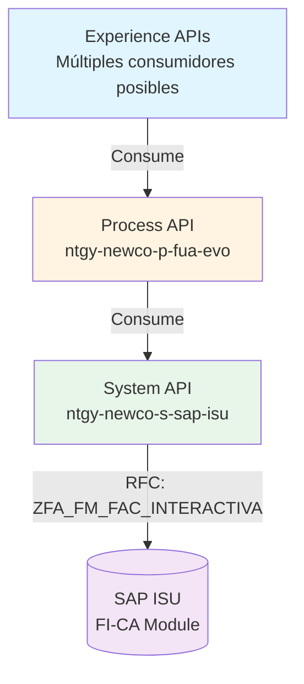
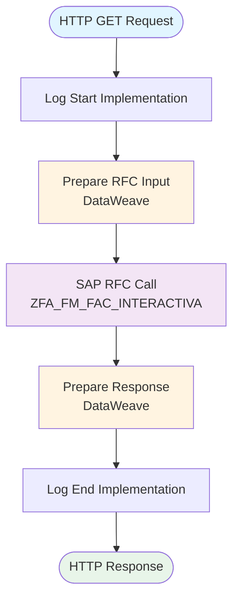
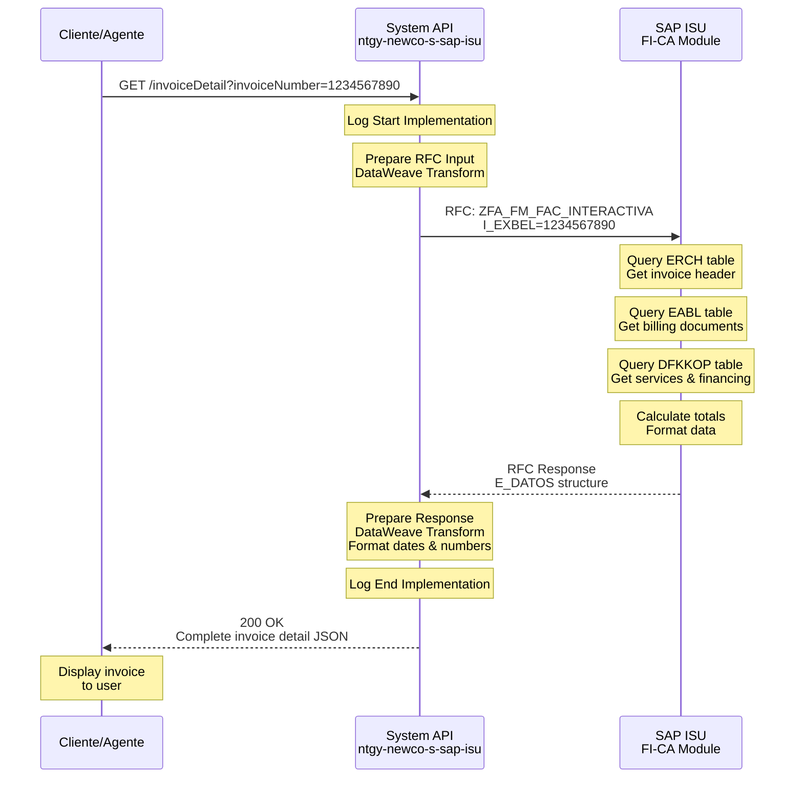
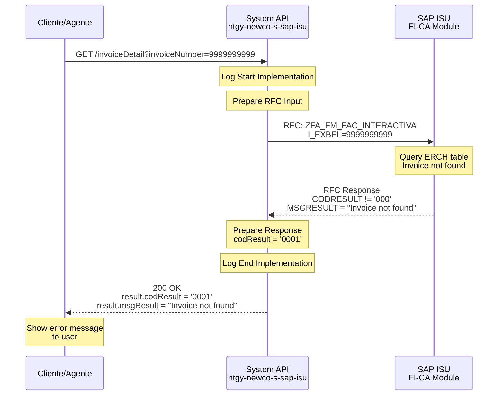
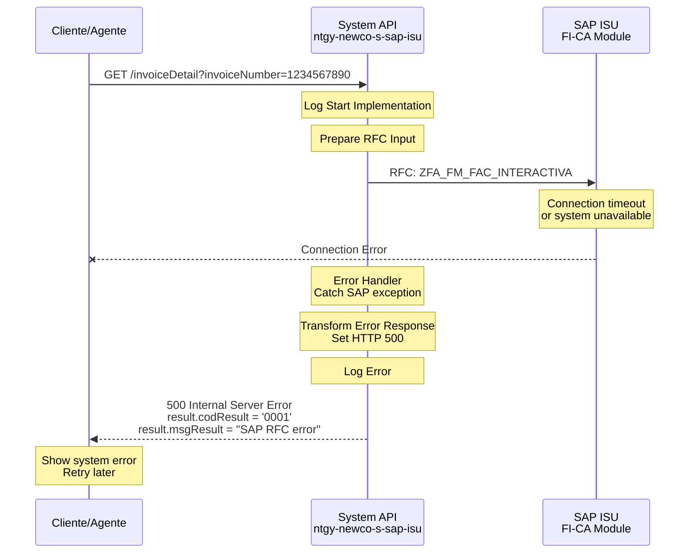

# GET /invoiceDetail

## 📌 Descripción General

### Propósito del Endpoint
Obtiene el detalle completo de una factura específica desde SAP ISU, incluyendo información de productos, servicios, financiaciones, promociones, contactos y notificaciones asociadas a la factura.

### Tipo de API
**Capa:** System API (Integración directa con SAP ISU)

### Patrón de Integración
**Tipo:** Request-Reply con SAP ISU mediante RFC

### Arquitectura API-Led Connectivity



---

## 💼 Propósito del Negocio

### Casos de Uso Principales

1. **Consulta Detallada de Factura**: Agentes de call center consultan el detalle completo de una factura durante atención al cliente
2. **Visualización de Factura Interactiva**: Clientes acceden al detalle de sus facturas a través del portal web
3. **Análisis de Consumo**: Revisión detallada de consumos, servicios y cargos de una factura específica
4. **Verificación de Financiaciones**: Consulta de planes de financiación asociados a una factura
5. **Auditoría de Facturación**: Revisión de componentes de factura para resolución de incidencias

### Contexto Empresarial
- **Dominio:** Facturación y Gestión de Deuda
- **Sector:** Energía - Utilities
- **División:** Naturgy España - NewCo
- **Proceso de Negocio:** Billing & Invoicing

### Stakeholders
- **Agentes de Call Center**: Consultan detalles de facturas durante atención telefónica
- **Clientes Finales**: Acceden a detalles de sus facturas vía portal web o app móvil
- **Departamento de Facturación**: Revisan componentes de facturación para auditorías
- **Sistemas de Terceros**: Integraciones autorizadas que requieren información de facturación

### Valor de Negocio
- **Transparencia**: Proporciona visibilidad completa de todos los componentes de una factura
- **Autoservicio**: Permite a clientes consultar detalles sin necesidad de contactar call center
- **Eficiencia Operativa**: Reduce tiempo de agentes en consultas de facturación
- **Resolución de Incidencias**: Facilita identificación y resolución de problemas de facturación
- **Cumplimiento Normativo**: Proporciona información detallada requerida por regulación energética

### Consumidores Potenciales
Este endpoint puede ser consumido por:
- Portales web de autoservicio de clientes
- Aplicaciones móviles (iOS/Android)
- Sistemas de agentes de call center (ATC)
- Integraciones de terceros autorizados
- Sistemas de auditoría y reporting

---

## 🔧 Especificación Técnica

### URLs por Ambiente

| Ambiente | URL Base | URL Completa |
|----------|----------|--------------|
| Local | `http://localhost:8081` | `http://localhost:8081/api/invoiceDetail?invoiceNumber={invoiceNumber}` |
| Desarrollo | `https://dev-ntgy-newco-s-sap-isu.cloudhub.io` | `https://dev-ntgy-newco-s-sap-isu.cloudhub.io/api/invoiceDetail?invoiceNumber={invoiceNumber}` |
| UAT | `https://uat-ntgy-newco-s-sap-isu.cloudhub.io` | `https://uat-ntgy-newco-s-sap-isu.cloudhub.io/api/invoiceDetail?invoiceNumber={invoiceNumber}` |
| Producción | `https://ntgy-newco-s-sap-isu.cloudhub.io` | `https://ntgy-newco-s-sap-isu.cloudhub.io/api/invoiceDetail?invoiceNumber={invoiceNumber}` |

### Método HTTP
```
GET /api/invoiceDetail
```

### Parámetros de Entrada

#### Query Parameters

| Parámetro | Tipo | Requerido | Descripción | Ejemplo | Validaciones |
|-----------|------|-----------|-------------|---------|--------------|
| `invoiceNumber` | string | ✅ Sí | Número de factura a consultar | `1234567890` | Longitud: 10 dígitos |

#### Headers HTTP

| Header | Tipo | Requerido | Descripción | Ejemplo |
|--------|------|-----------|-------------|---------|
| `Content-Type` | string | ✅ Sí | Tipo de contenido | `application/json` |
| `Accept` | string | ❌ No | Formato de respuesta esperado | `application/json` |

### Respuestas

#### Respuesta Exitosa (200 OK)

**Estructura de Respuesta:**

```json
{
  "result": {
    "codResult": "0000",
    "msgResult": "Success"
  },
  "detalleFactura": {
    "cuentaContrato": "200001234567",
    "fecEmision": "15.01.2024",
    "fecCargo": "20.01.2024",
    "numFactura": "1234567890",
    "impTotFactura": "125,50",
    "impTotImpuestos": "26,26",
    "invoice_amount": "100,00",
    "invoice_discharge": "25,50",
    "invoice_discharge02": "0,00",
    "current_total": "125,50",
    "tipoImpuesto": "IVA",
    "ALIANZ_EXISTE": true,
    "contactos": {
      "contacAtc": "912345678",
      "contacEle": "900123456",
      "contacGas": "900654321",
      "contacSer": "900111222"
    },
    "producto": {
      "codProd": "ELEC",
      "sector": "E",
      "fechaInicio": "01.01.2024",
      "fechaFin": "31.01.2024",
      "fechaInicioTP": "01.01.2024",
      "fechaFinTP": "31.01.2024",
      "consAcumulado": "350",
      "consPeriodo": "350",
      "consLimite": "500",
      "impBrutoEne": "75,00",
      "impBrutoEneSin": "75,00",
      "impTotEne": "75,00",
      "impReguladoPea": "20,00",
      "impReguladoAlq": "5,00",
      "impTotReg": "25,00",
      "impImpuestoEsp": "5,00",
      "impImpuestoInd": "21,26",
      "impTotImp": "26,26",
      "impTotProd": "126,26",
      "numDias": "31",
      "tipoSubSec": "01",
      "indECO": "X",
      "indTP": ""
    },
    "servicios": {
      "desgloseSer": [
        {
          "codProd": "MANT",
          "impBruto": "10,00",
          "impDescuento": "0,00"
        }
      ],
      "impTotBrutoSer": "10,00",
      "impTotBrutoSerSin": "10,00",
      "impImpuestoInd": "2,10",
      "impTotSer": "12,10"
    },
    "financiaciones": {
      "desgloseFin": [
        {
          "codProd": "FIN01",
          "impFin": "15,00"
        }
      ],
      "impTotFin": "15,00"
    },
    "promociones": {
      "desgloseProm": [
        {
          "sector": "E",
          "impProm": "-5,00"
        }
      ],
      "impTotProm": "-5,00"
    },
    "notificaciones": {
      "desgloseNot": [
        {
          "codMensaje": "INFO01",
          "info": "Factura emitida correctamente"
        }
      ]
    }
  }
}
```

**Descripción de Campos Principales:**

| Campo | Tipo | Descripción |
|-------|------|-------------|
| `result.codResult` | string | Código de resultado: `0000` = éxito, `0001` = error |
| `result.msgResult` | string | Mensaje descriptivo del resultado |
| `detalleFactura.cuentaContrato` | string | Número de cuenta contrato |
| `detalleFactura.fecEmision` | string | Fecha de emisión (formato: dd.MM.yyyy) |
| `detalleFactura.fecCargo` | string | Fecha de cargo (formato: dd.MM.yyyy) |
| `detalleFactura.numFactura` | string | Número de factura |
| `detalleFactura.impTotFactura` | string | Importe total de la factura (formato: xxx,xx) |
| `detalleFactura.impTotImpuestos` | string | Importe total de impuestos |
| `detalleFactura.producto` | object | Detalle del producto energético facturado |
| `detalleFactura.servicios` | object | Detalle de servicios adicionales |
| `detalleFactura.financiaciones` | object | Planes de financiación asociados |
| `detalleFactura.promociones` | object | Promociones y descuentos aplicados |
| `detalleFactura.contactos` | object | Números de contacto por canal |
| `detalleFactura.notificaciones` | object | Notificaciones y mensajes informativos |

#### Respuestas de Error

**400 Bad Request - Parámetro Faltante:**
```json
{
  "result": {
    "codResult": "0001",
    "msgResult": "Missing required parameter: invoiceNumber"
  }
}
```

**404 Not Found - Factura No Encontrada:**
```json
{
  "result": {
    "codResult": "0001",
    "msgResult": "Invoice not found"
  }
}
```

**500 Internal Server Error - Error SAP:**
```json
{
  "result": {
    "codResult": "0001",
    "msgResult": "SAP RFC error: Connection timeout"
  }
}
```

**503 Service Unavailable - SAP No Disponible:**
```json
{
  "result": {
    "codResult": "0001",
    "msgResult": "SAP ISU system temporarily unavailable"
  }
}
```

### Códigos de Resultado (codResult)

| Código | Significado | Descripción |
|--------|-------------|-------------|
| `0000` | Éxito | Factura encontrada y retornada correctamente |
| `0001` | Error General | Error en la consulta o factura no encontrada |
| `000` | Éxito SAP | Código de éxito retornado por SAP (convertido a 0000) |

### Autenticación y Autorización

- **Tipo de Autenticación**: SAP User/Password (configurado en SAP Connector)
- **Headers Requeridos**: Ninguno (autenticación manejada internamente)
- **Roles SAP Requeridos**: 
  - Acceso a RFC `ZFA_FM_FAC_INTERACTIVA`
  - Permisos de lectura en tablas ERCH, FKKVKP, DFKKOP

### Timeouts

| Tipo | Valor | Descripción |
|------|-------|-------------|
| Request Timeout | 30 segundos | Timeout máximo para la llamada RFC |
| Connection Timeout | 10 segundos | Timeout de conexión al sistema SAP |

### Protocolo
- **Protocolo**: HTTPS (Producción), HTTP (Local)
- **TLS Version**: TLS 1.2+

---

## 🏗️ Implementación Técnica

### Arquitectura del Flow



### 🗄️ Base de Datos SAP ISU

#### RFC SAP Invocado

**RFC:** `ZFA_FM_FAC_INTERACTIVA`

**Descripción:** Función RFC que obtiene el detalle completo de una factura interactiva desde SAP ISU, incluyendo todos los componentes de facturación, servicios, productos, financiaciones y promociones.

**Módulo SAP:** FI-CA (Financial Contract Accounting) - Billing & Invoicing

**Tablas SAP Consultadas:**

| Tabla | Descripción | Operación |
|-------|-------------|-----------|
| `ERCH` | Invoice Document Header | SELECT |
| `FKKVKP` | Contract Account | SELECT |
| `DFKKOP` | Open Items | SELECT |
| `EABL` | Billing Document | SELECT |
| `EGERH` | Meter Reading Result Header | SELECT |

### Detalles de Tablas SAP

#### Tabla: `ERCH`

**Descripción:** Cabecera de documento de factura en SAP ISU

**Campos Utilizados:**

| Campo | Tipo ABAP | Descripción | Ejemplo |
|-------|-----------|-------------|---------|
| `INVOICEID` | CHAR(12) | ID único de factura | `001234567890` |
| `INVOICENUM` | CHAR(10) | Número de factura | `1234567890` |
| `ISSUEDATE` | DATS | Fecha de emisión | `20240115` |
| `BILLINGDATE` | DATS | Fecha de cargo | `20240120` |
| `AMOUNT` | CURR(15,2) | Importe total | `125.50` |

**Relaciones:**
- `ERCH.VKONT` → `FKKVKP.VKONT` (Cuenta contrato)
- `ERCH.OPBEL` → `DFKKOP.OPBEL` (Partida abierta)

**Índices Conocidos:**
- Primary Key: `INVOICEID`
- Secondary Index: `INVOICENUM`, `VKONT`

**Notas de Performance:**
- Índice por número de factura optimiza búsquedas directas
- Consulta típica retorna 1 registro

#### Tabla: `FKKVKP`

**Descripción:** Datos maestros de cuenta contrato

**Campos Utilizados:**

| Campo | Tipo ABAP | Descripción | Ejemplo |
|-------|-----------|-------------|---------|
| `VKONT` | CHAR(12) | Número de cuenta contrato | `200001234567` |
| `GPART` | CHAR(10) | Business Partner | `0001234567` |
| `VTREF` | CHAR(12) | Referencia de contrato | `1000123456` |

#### Tabla: `DFKKOP`

**Descripción:** Partidas abiertas (Open Items) en FI-CA

**Campos Utilizados:**

| Campo | Tipo ABAP | Descripción | Ejemplo |
|-------|-----------|-------------|---------|
| `OPBEL` | CHAR(12) | Número de partida abierta | `001234567890` |
| `AUGST` | CHAR(1) | Estado de compensación | `A` |
| `BETRW` | CURR(15,2) | Importe en moneda documento | `125.50` |

**Relaciones:**
- `DFKKOP.VKONT` → `FKKVKP.VKONT` (Cuenta contrato)

**Índices Conocidos:**
- Primary Key: `OPBEL`
- Secondary Index: `VKONT`, `AUGST`

**Notas de Performance:**
- Consulta optimizada por cuenta contrato
- Filtrado por estado de compensación mejora performance

---

### Transformaciones DataWeave

#### Transformación de Entrada (RFC Input)

**Archivo:** `src/main/resources/dw/invoice-detail-rfc-input.dwl`

```dataweave
%dw 2.0
output application/xml
---
{
    ZFA_FM_FAC_INTERACTIVA: {
        "import": {
            I_EXBEL: attributes.queryParams.invoiceNumber,
            I_NIF: attributes.queryParams.clientId
        }
    }
}
```

**Mapeo de Campos:**

| Campo Entrada (HTTP) | Campo Salida (SAP RFC) | Transformación |
|----------------------|------------------------|----------------|
| `queryParams.invoiceNumber` | `I_EXBEL` | Directo |
| `queryParams.clientId` | `I_NIF` | Directo (opcional) |

#### Transformación de Salida (Response)

**Ubicación:** Inline en flow (líneas 19-121 del XML)

**Funciones Clave:**

```dataweave
// Formateo de fechas SAP a formato español
fun formatoFecha(fecha: String|Null) = 
    if(!isEmpty(fecha)) 
        fecha as Date {format: "yyyyMMdd"} as String {format : "dd.MM.yyyy"} 
    else null

// Conversión de formato numérico (punto a coma)
fun mappingObject(data) = data mapObject ((value, key, index) -> 
    value match {
        case value is String|Null -> 
            (key) : (value replace /(^[0-9]*|-[0-9]*)\.([0-9]*$)/ with ($[1] ++ "," ++ $[2]))
        else -> (key) : value
    }
)
```

**Mapeo de Campos Principales:**

| Campo SAP | Campo JSON | Transformación |
|-----------|------------|----------------|
| `CONTRATO` | `cuentaContrato` | Directo |
| `FECEMISION` | `fecEmision` | Formato fecha: yyyyMMdd → dd.MM.yyyy |
| `FECCARGO` | `fecCargo` | Formato fecha: yyyyMMdd → dd.MM.yyyy |
| `NUMFACTURA` | `numFactura` | Directo |
| `IMPTOTFACTURA` | `impTotFactura` | Formato número: punto → coma |
| `CODRESULT = '000'` | `codResult = '0000'` | Normalización código |

---

### Patrones de Diseño

**Patrón:** Request-Reply con Transformación Compleja

**Justificación:**
- **Request-Reply**: Operación síncrona requerida para consultas en tiempo real
- **Transformación Compleja**: Necesaria para convertir estructura SAP compleja a JSON consumible
- **Mapeo Recursivo**: Manejo de objetos anidados (productos, servicios, financiaciones)
- **Formato Localizado**: Adaptación de formatos numéricos y fechas para España

**Componentes del Patrón:**
1. **Input Transformation**: Preparación de parámetros RFC
2. **SAP RFC Call**: Invocación síncrona a SAP ISU
3. **Output Transformation**: Conversión compleja SAP XML → JSON
4. **Error Handling**: Manejo de errores SAP y transformación

---

### Diagramas de Secuencia

#### 1. Flujo Normal de Éxito



#### 2. Flujo con Error de Negocio (Factura No Encontrada)



#### 3. Flujo con Error Técnico (SAP No Disponible)



---

### Connection Pooling

**Configuración SAP JCo:**
- **Pool Size**: Configurado en `global.xml`
- **Max Connections**: Definido por ambiente
- **Connection Timeout**: 10 segundos
- **Idle Timeout**: 300 segundos

**Optimizaciones:**
- Reutilización de conexiones SAP entre requests
- Validación de conexión antes de uso
- Liberación automática después de RFC call

---

### Manejo de Errores

**Estrategia de Error Handling:**

1. **Errores de Validación** (400):
   - Parámetro `invoiceNumber` faltante
   - Formato de parámetro inválido

2. **Errores de Negocio** (200 con codResult='0001'):
   - Factura no encontrada en SAP
   - Cliente sin permisos para ver factura

3. **Errores Técnicos** (500):
   - Timeout de conexión SAP
   - Error en RFC execution
   - Error en transformación DataWeave

4. **Errores de Disponibilidad** (503):
   - Sistema SAP ISU no disponible
   - Mantenimiento programado

**Error Handler Global:**
- Captura todas las excepciones no manejadas
- Transforma errores a formato JSON estándar
- Registra errores en logs para troubleshooting

---

## 💻 Ejemplos de Uso

### Ejemplo 1: Consulta Exitosa de Factura

#### cURL
```bash
curl -X GET "http://localhost:8081/api/invoiceDetail?invoiceNumber=1234567890" \
  -H "Content-Type: application/json" \
  -H "Accept: application/json"
```

#### Respuesta
```json
{
  "result": {
    "codResult": "0000",
    "msgResult": "Success"
  },
  "detalleFactura": {
    "cuentaContrato": "200001234567",
    "fecEmision": "15.01.2024",
    "fecCargo": "20.01.2024",
    "numFactura": "1234567890",
    "impTotFactura": "125,50",
    "impTotImpuestos": "26,26",
    "producto": {
      "codProd": "ELEC",
      "sector": "E",
      "consAcumulado": "350",
      "impTotProd": "126,26"
    }
  }
}
```

### Ejemplo 2: Factura No Encontrada

#### cURL
```bash
curl -X GET "http://localhost:8081/api/invoiceDetail?invoiceNumber=9999999999" \
  -H "Content-Type: application/json"
```

#### Respuesta
```json
{
  "result": {
    "codResult": "0001",
    "msgResult": "Invoice not found in SAP ISU"
  }
}
```

### Ejemplo 3: JavaScript (Fetch API)

```javascript
const invoiceNumber = '1234567890';

fetch(`https://ntgy-newco-s-sap-isu.cloudhub.io/api/invoiceDetail?invoiceNumber=${invoiceNumber}`, {
  method: 'GET',
  headers: {
    'Content-Type': 'application/json',
    'Accept': 'application/json'
  }
})
.then(response => response.json())
.then(data => {
  if (data.result.codResult === '0000') {
    console.log('Factura encontrada:', data.detalleFactura);
    console.log('Importe total:', data.detalleFactura.impTotFactura);
  } else {
    console.error('Error:', data.result.msgResult);
  }
})
.catch(error => {
  console.error('Error de conexión:', error);
});
```

### Ejemplo 4: Python (requests)

```python
import requests

invoice_number = '1234567890'
url = f'https://ntgy-newco-s-sap-isu.cloudhub.io/api/invoiceDetail'

params = {
    'invoiceNumber': invoice_number
}

headers = {
    'Content-Type': 'application/json',
    'Accept': 'application/json'
}

try:
    response = requests.get(url, params=params, headers=headers, timeout=30)
    response.raise_for_status()
    
    data = response.json()
    
    if data['result']['codResult'] == '0000':
        print(f"Factura encontrada: {data['detalleFactura']['numFactura']}")
        print(f"Importe total: {data['detalleFactura']['impTotFactura']}")
        print(f"Fecha emisión: {data['detalleFactura']['fecEmision']}")
    else:
        print(f"Error: {data['result']['msgResult']}")
        
except requests.exceptions.Timeout:
    print("Error: Timeout al consultar SAP ISU")
except requests.exceptions.RequestException as e:
    print(f"Error de conexión: {e}")
```

### Ejemplo 5: Postman Collection

```json
{
  "info": {
    "name": "SAP ISU System API - Invoice Detail",
    "schema": "https://schema.getpostman.com/json/collection/v2.1.0/collection.json"
  },
  "item": [
    {
      "name": "GET Invoice Detail - Success",
      "request": {
        "method": "GET",
        "header": [
          {
            "key": "Content-Type",
            "value": "application/json"
          }
        ],
        "url": {
          "raw": "{{baseUrl}}/api/invoiceDetail?invoiceNumber=1234567890",
          "host": ["{{baseUrl}}"],
          "path": ["api", "invoiceDetail"],
          "query": [
            {
              "key": "invoiceNumber",
              "value": "1234567890"
            }
          ]
        }
      }
    },
    {
      "name": "GET Invoice Detail - Not Found",
      "request": {
        "method": "GET",
        "header": [
          {
            "key": "Content-Type",
            "value": "application/json"
          }
        ],
        "url": {
          "raw": "{{baseUrl}}/api/invoiceDetail?invoiceNumber=9999999999",
          "host": ["{{baseUrl}}"],
          "path": ["api", "invoiceDetail"],
          "query": [
            {
              "key": "invoiceNumber",
              "value": "9999999999"
            }
          ]
        }
      }
    }
  ],
  "variable": [
    {
      "key": "baseUrl",
      "value": "https://ntgy-newco-s-sap-isu.cloudhub.io"
    }
  ]
}
```

