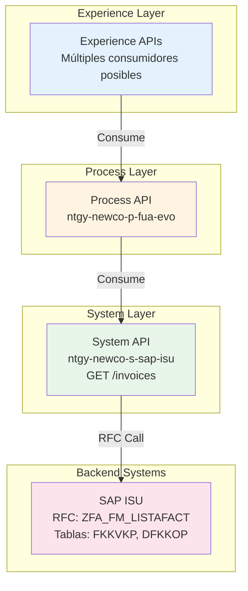
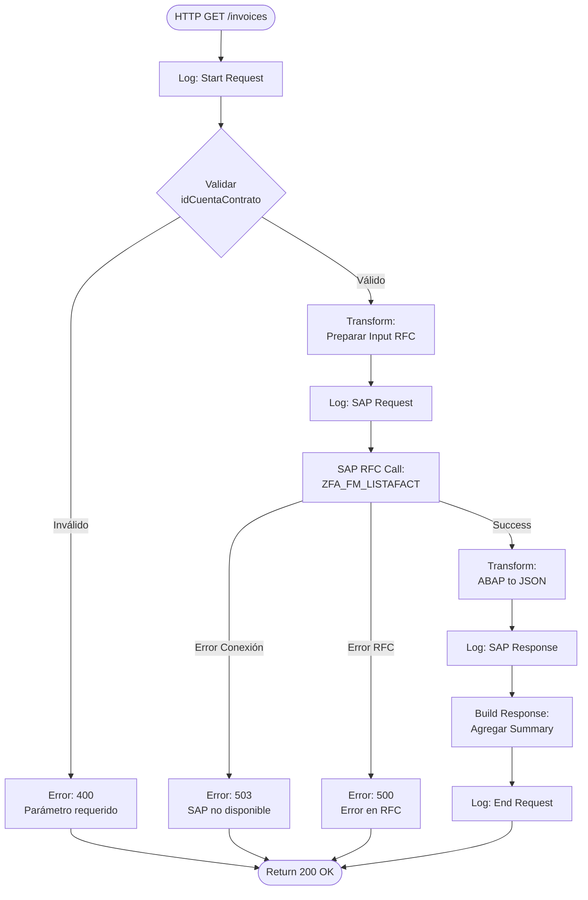
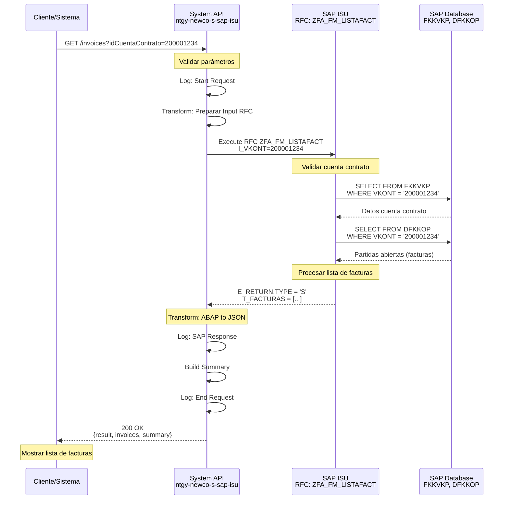
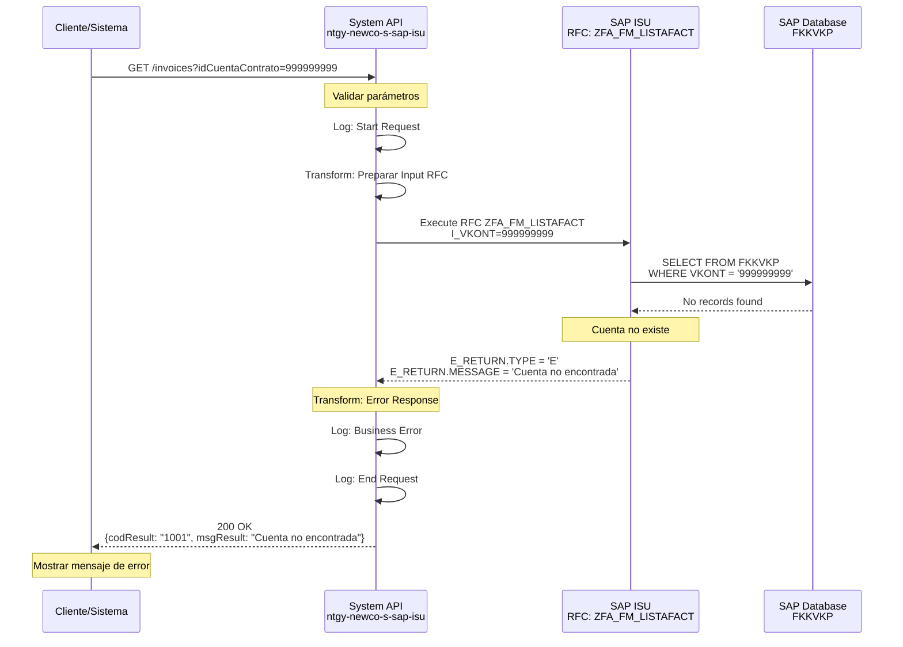
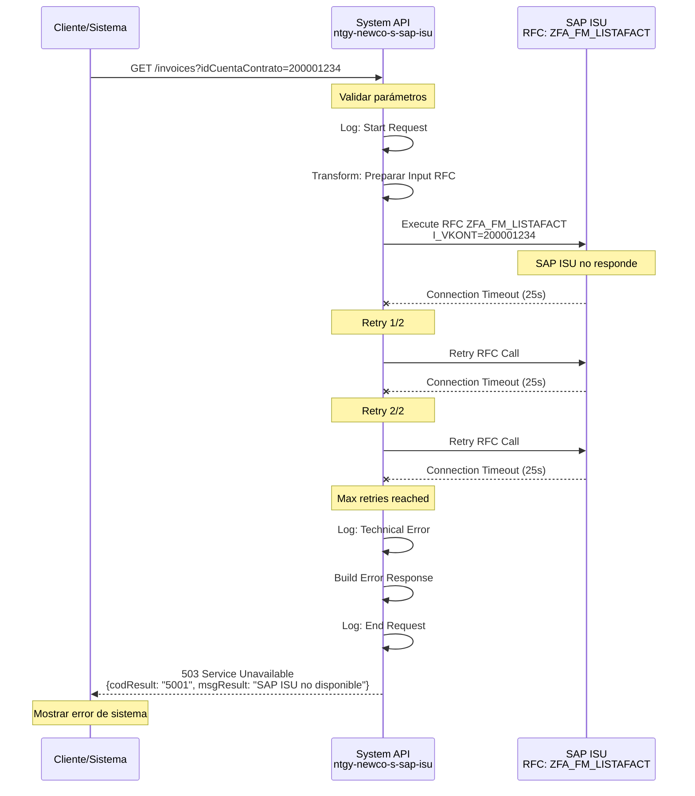

# GET /invoices

## 📌 Descripción General

### Propósito del Endpoint

Este endpoint recupera la lista completa de facturas de un cliente desde SAP ISU, incluyendo el estado de deuda asociado a cada factura. Proporciona información detallada sobre todas las facturas emitidas para una cuenta contrato específica, permitiendo a los sistemas consumidores mostrar el historial de facturación completo.

### Tipo de API

**Capa:** System API (Integración Directa con SAP ISU)

### Patrón de Integración

**Tipo:** Request-Reply Síncrono con SAP ISU

Este endpoint implementa un patrón de integración directa con SAP ISU mediante RFC (Remote Function Call). La comunicación es síncrona, donde el API espera la respuesta del sistema SAP antes de retornar los datos al consumidor.

**Características del Patrón:**
- ✅ Comunicación síncrona con SAP ISU
- ✅ Invocación de RFC `ZFA_FM_LISTAFACT`
- ✅ Transformación de estructuras ABAP a JSON
- ✅ Manejo de errores SAP estandarizado
- ✅ Connection pooling para optimización

### Arquitectura API-Led Connectivity



**Flujo de Datos:**
1. Experience API solicita lista de facturas
2. Process API orquesta la petición
3. System API invoca RFC en SAP ISU
4. SAP ISU consulta tablas de facturación (FKKVKP, DFKKOP)
5. System API transforma respuesta ABAP a JSON
6. Respuesta se propaga hacia arriba en la arquitectura

---

## 💼 Propósito del Negocio

### Casos de Uso Principales

#### 1. Consulta de Historial de Facturación
**Actor:** Cliente final o Agente de atención al cliente  
**Objetivo:** Visualizar todas las facturas emitidas para una cuenta contrato  
**Flujo:**
- Cliente accede a portal web o app móvil
- Sistema solicita lista de facturas por cuenta contrato
- Se muestra historial completo con estados de pago

#### 2. Verificación de Estado de Deuda
**Actor:** Agente de call center  
**Objetivo:** Verificar facturas pendientes de pago durante atención telefónica  
**Flujo:**
- Agente recibe llamada de cliente
- Consulta facturas por cuenta contrato
- Identifica facturas pendientes y montos adeudados

#### 3. Gestión de Pagos
**Actor:** Sistema de pagos online  
**Objetivo:** Obtener facturas pendientes para procesamiento de pago  
**Flujo:**
- Cliente inicia proceso de pago
- Sistema recupera facturas pendientes
- Cliente selecciona facturas a pagar

#### 4. Análisis de Consumo y Facturación
**Actor:** Sistema de Business Intelligence  
**Objetivo:** Analizar patrones de facturación y consumo  
**Flujo:**
- Sistema BI solicita datos de facturación
- Procesa información para reportes
- Genera insights de negocio

### Contexto Empresarial

- **Dominio:** Facturación y Gestión de Deuda
- **Sector:** Energía - Utilities (Gas y Electricidad)
- **División:** Naturgy NewCo
- **Proceso de Negocio:** Billing & Revenue Management
- **Sistema Backend:** SAP ISU (Industry Solution Utilities)

### Stakeholders

#### Stakeholders Primarios
- **Clientes Finales:** Consultan sus facturas y estado de cuenta
- **Agentes de Call Center:** Atienden consultas sobre facturación
- **Departamento de Facturación:** Monitorean emisión y cobro de facturas

#### Stakeholders Secundarios
- **Departamento de Cobranza:** Gestionan facturas vencidas
- **Área de Atención al Cliente:** Resuelven disputas de facturación
- **Sistemas de BI:** Analizan datos de facturación

### Valor de Negocio

#### Beneficios Cuantitativos
- ⏱️ **Reducción de Tiempo de Consulta:** 80% menos tiempo vs consulta manual en SAP GUI
- 📞 **Reducción de Llamadas:** 30% menos llamadas por consultas de facturación
- 💰 **Mejora en Cobro:** 15% mejora en tasa de cobro por visibilidad en tiempo real
- 🎯 **Eficiencia Operativa:** 50% reducción en tiempo de agentes para consultas

#### Beneficios Cualitativos
- ✅ Acceso en tiempo real a información de facturación
- ✅ Experiencia de cliente mejorada con self-service
- ✅ Consistencia de datos en todos los canales digitales
- ✅ Reducción de errores por consultas manuales
- ✅ Habilitación de canales digitales (web, móvil)

### Consumidores Potenciales

Este endpoint puede ser consumido por:
- **Portales Web de Autoservicio:** Clientes consultan sus facturas online
- **Aplicaciones Móviles:** Apps iOS/Android para clientes
- **Sistemas de Call Center:** Herramientas de agentes telefónicos
- **Sistemas de Pagos Online:** Plataformas de pago digital
- **Chatbots y Asistentes Virtuales:** Consultas automatizadas
- **Sistemas de Business Intelligence:** Análisis y reportería
- **Integraciones de Terceros:** Partners autorizados

---

## 🔧 Especificación Técnica

### URLs por Ambiente

| Ambiente | URL Base | URL Completa |
|----------|----------|--------------|
| **Local** | `http://localhost:8081` | `http://localhost:8081/api/invoices` |
| **Development** | `https://ntgy-newco-s-sap-isu-dev.cloudhub.io` | `https://ntgy-newco-s-sap-isu-dev.cloudhub.io/api/invoices` |
| **UAT** | `https://ntgy-newco-s-sap-isu-uat.cloudhub.io` | `https://ntgy-newco-s-sap-isu-uat.cloudhub.io/api/invoices` |
| **UAT00** | `https://ntgy-newco-s-sap-isu-uat00.cloudhub.io` | `https://ntgy-newco-s-sap-isu-uat00.cloudhub.io/api/invoices` |
| **Production** | `https://ntgy-newco-s-sap-isu.cloudhub.io` | `https://ntgy-newco-s-sap-isu.cloudhub.io/api/invoices` |

### Método HTTP

```
GET /api/invoices
```

### Parámetros de Entrada

#### Query Parameters

| Parámetro | Tipo | Requerido | Descripción | Ejemplo | Validación |
|-----------|------|-----------|-------------|---------|------------|
| `idCuentaContrato` | String | ✅ Sí | Identificador único de la cuenta contrato en SAP ISU | `200001234` | Numérico, 9-10 dígitos |

**Notas sobre Parámetros:**
- El `idCuentaContrato` debe corresponder a una cuenta contrato válida en SAP ISU
- Si la cuenta no existe, se retorna error de negocio (codResult != "0000")
- El parámetro es case-sensitive y debe ser numérico

#### Headers HTTP

| Header | Tipo | Requerido | Descripción | Ejemplo |
|--------|------|-----------|-------------|---------|
| `Content-Type` | String | ✅ Sí | Tipo de contenido de la respuesta | `application/json` |
| `Accept` | String | ⚠️ Recomendado | Tipo de contenido aceptado | `application/json` |

### Respuestas

#### Respuesta Exitosa (200 OK)

**Estructura de Respuesta:**

```json
{
  "result": {
    "codResult": "0000",
    "msgResult": "Operación exitosa"
  },
  "InvoicesPDS": [
    {
      "cuentaContrato": "200001234",
      "invoiceId": "INV-2024-001",
      "invoiceNum": "1234567890",
      "issuedDate": "2024-03-15 00:00:00",
      "billingDate": "2024-03-20 00:00:00",
      "periodFrom": "2024-02-01 00:00:00",
      "periodEnd": "2024-02-29 00:00:00",
      "status": "PENDING",
      "isFinan": false,
      "pendingAmount": 125.50,
      "amount": 125.50,
      "interactiveInvoice": "Y",
      "documentType": "INVOICE",
      "pdfDocumentId": "PDF-123456",
      "pendingInvoiceStatus": [
        {
          "opbel": "1234567890",
          "opupw": "EUR",
          "opupk": "01",
          "opupz": "001",
          "status": "OPEN"
        }
      ],
      "productInvoiceRelationList": [
        {
          "productFamilyId": "Electricidad",
          "isSolarInvoice": false,
          "invoice": "1234567890",
          "contractNumber": "1000123456"
        }
      ],
      "agentConsumptionInfo": [
        {
          "type": "ELECTRICITY",
          "consumption": "350",
          "period": "2024-02",
          "readFrom": "1000",
          "readDateFrom": "2024-02-01 00:00:00",
          "readTo": "1350",
          "readDateTo": "2024-02-29 00:00:00",
          "readTypeFrom": "REAL",
          "readTypeTo": "REAL",
          "magnitude": "kWh"
        }
      ],
      "agentDueInfo": []
    }
  ]
}
```

**Descripción de Campos:**

| Campo | Tipo | Descripción |
|-------|------|-------------|
| `result.codResult` | String | Código de resultado ("0000" = éxito) |
| `result.msgResult` | String | Mensaje descriptivo del resultado |
| `InvoicesPDS` | Array | Lista de facturas |
| `InvoicesPDS[].cuentaContrato` | String | Número de cuenta contrato |
| `InvoicesPDS[].invoiceId` | String | Identificador único de factura |
| `InvoicesPDS[].invoiceNum` | String | Número de factura |
| `InvoicesPDS[].issuedDate` | String | Fecha de emisión (formato: yyyy-MM-dd HH:mm:ss) |
| `InvoicesPDS[].billingDate` | String | Fecha de cargo (formato: yyyy-MM-dd HH:mm:ss) |
| `InvoicesPDS[].periodFrom` | String | Inicio período facturación (formato: yyyy-MM-dd HH:mm:ss) |
| `InvoicesPDS[].periodEnd` | String | Fin período facturación (formato: yyyy-MM-dd HH:mm:ss) |
| `InvoicesPDS[].status` | String | Estado de la factura |
| `InvoicesPDS[].isFinan` | Boolean | Indica si tiene financiación |
| `InvoicesPDS[].pendingAmount` | Number | Importe pendiente |
| `InvoicesPDS[].amount` | Number | Importe total de la factura |
| `InvoicesPDS[].interactiveInvoice` | String | Indicador de factura interactiva |
| `InvoicesPDS[].documentType` | String | Tipo de documento |
| `InvoicesPDS[].pdfDocumentId` | String | ID del documento PDF |
| `InvoicesPDS[].pendingInvoiceStatus` | Array | Estados de partidas pendientes |
| `InvoicesPDS[].pendingInvoiceStatus[].opbel` | String | Número de partida |
| `InvoicesPDS[].pendingInvoiceStatus[].opupw` | String | Moneda |
| `InvoicesPDS[].pendingInvoiceStatus[].opupk` | String | Clave de partida |
| `InvoicesPDS[].pendingInvoiceStatus[].opupz` | String | Contador de partida |
| `InvoicesPDS[].pendingInvoiceStatus[].status` | String | Estado de la partida |
| `InvoicesPDS[].productInvoiceRelationList` | Array | Relación de productos facturados |
| `InvoicesPDS[].productInvoiceRelationList[].productFamilyId` | String | ID familia de producto |
| `InvoicesPDS[].productInvoiceRelationList[].isSolarInvoice` | Boolean | Indica si es factura solar |
| `InvoicesPDS[].productInvoiceRelationList[].invoice` | String | Número de factura |
| `InvoicesPDS[].productInvoiceRelationList[].contractNumber` | String | Número de contrato |
| `InvoicesPDS[].agentConsumptionInfo` | Array | Información de consumos |
| `InvoicesPDS[].agentConsumptionInfo[].type` | String | Tipo de consumo |
| `InvoicesPDS[].agentConsumptionInfo[].consumption` | String | Valor del consumo |
| `InvoicesPDS[].agentConsumptionInfo[].period` | String | Período del consumo |
| `InvoicesPDS[].agentConsumptionInfo[].readFrom` | String | Lectura inicial |
| `InvoicesPDS[].agentConsumptionInfo[].readDateFrom` | String | Fecha lectura inicial |
| `InvoicesPDS[].agentConsumptionInfo[].readTo` | String | Lectura final |
| `InvoicesPDS[].agentConsumptionInfo[].readDateTo` | String | Fecha lectura final |
| `InvoicesPDS[].agentConsumptionInfo[].readTypeFrom` | String | Tipo lectura inicial |
| `InvoicesPDS[].agentConsumptionInfo[].readTypeTo` | String | Tipo lectura final |
| `InvoicesPDS[].agentConsumptionInfo[].magnitude` | String | Magnitud (kWh, m3, etc.) |
| `InvoicesPDS[].agentDueInfo` | Array | Información de vencimientos |
| `InvoicesPDS[].agentDueInfo[].unpaidDate` | String | Fecha de impago |
| `InvoicesPDS[].agentDueInfo[].trakingState` | String | Estado de seguimiento |
| `InvoicesPDS[].agentDueInfo[].trakingDate` | String | Fecha de seguimiento |
| `InvoicesPDS[].agentDueInfo[].trakingFirm` | String | Firma de seguimiento |
| `InvoicesPDS[].agentDueInfo[].responsability` | String | Responsabilidad |
| `InvoicesPDS[].agentDueInfo[].step` | String | Paso del proceso |

#### Respuestas de Error

##### Error 400 - Bad Request

**Causa:** Parámetros inválidos o faltantes

```json
{
  "result": {
    "codResult": "0001",
    "msgResult": "Parámetro idCuentaContrato es requerido"
  }
}
```

**Códigos de Error de Negocio:**

| Código | Mensaje | Descripción |
|--------|---------|-------------|
| `0001` | Parámetro idCuentaContrato es requerido | Falta el parámetro obligatorio |
| `0002` | Formato de idCuentaContrato inválido | El formato no es numérico |
| `1001` | Cuenta contrato no encontrada en SAP ISU | La cuenta no existe |
| `1002` | No hay facturas para la cuenta especificada | Cuenta válida pero sin facturas |

##### Error 500 - Internal Server Error

**Causa:** Error en SAP ISU o error técnico del API

```json
{
  "result": {
    "codResult": "9999",
    "msgResult": "Error al consultar facturas en SAP ISU: [detalle del error]"
  }
}
```

**Códigos de Error Técnico:**

| Código | Mensaje | Descripción |
|--------|---------|-------------|
| `9001` | Error de conexión con SAP ISU | Timeout o conexión rechazada |
| `9002` | RFC ZFA_FM_LISTAFACT no disponible | RFC no existe en SAP |
| `9003` | Error en transformación de datos | Error en DataWeave |
| `9999` | Error interno del servidor | Error no clasificado |

##### Error 503 - Service Unavailable

**Causa:** SAP ISU no disponible

```json
{
  "result": {
    "codResult": "5001",
    "msgResult": "SAP ISU temporalmente no disponible"
  }
}
```

### Autenticación y Autorización

#### Tipo de Autenticación

**Método:** Client ID & Client Secret (OAuth 2.0 Client Credentials)

**Headers Requeridos:**
- `client_id`: Identificador de la aplicación cliente
- `client_secret`: Secreto de la aplicación cliente

**Nota:** La autenticación se gestiona a nivel de Anypoint Platform API Manager.

#### Autorización SAP

El usuario SAP configurado en el conector debe tener los siguientes permisos:
- Objeto de autorización: `F_FICA_REC` (Receivables Management)
- Actividad: `03` (Display)
- RFC: `ZFA_FM_LISTAFACT` (Execute permission)

### Timeouts Configurados

| Tipo | Valor | Descripción |
|------|-------|-------------|
| **Request Timeout** | 30 segundos | Timeout total de la petición HTTP |
| **SAP RFC Timeout** | 25 segundos | Timeout de ejecución del RFC en SAP |
| **Connection Timeout** | 10 segundos | Timeout de establecimiento de conexión SAP |

**Estrategia de Retry:**
- Reintentos automáticos: 2 intentos
- Intervalo entre reintentos: 2 segundos
- Solo para errores de conexión (no para errores de negocio)

### Protocolo

- **Protocolo:** HTTPS (TLS 1.2+)
- **Puerto:** 443 (HTTPS)
- **Método de Compresión:** gzip (opcional)

---

## 🏗️ Implementación Técnica

### Arquitectura del Flow



### RFC SAP Invocado

#### RFC: `ZFA_FM_LISTAFACT`

**Descripción:** Función RFC personalizada de SAP ISU para obtener lista de facturas con estado de deuda.

**Módulo SAP:** Billing & Invoicing (FI-CA)

**Tablas SAP Consultadas:**
- `FKKVKP`: Contract Account (Cuenta Contrato)
- `DFKKOP`: Open Items (Partidas Abiertas)
- `ERCH`: Invoice Document (Documento de Factura)
- `EABLG`: Billing Document (Documento de Facturación)

**Parámetros de Entrada:**

| Parámetro | Tipo ABAP | Descripción | Ejemplo |
|-----------|-----------|-------------|---------|
| `I_VKONT` | CHAR(12) | Número de cuenta contrato | `200001234` |
| `I_FECHA_DESDE` | DATS(8) | Fecha desde (opcional) | `20240101` |
| `I_FECHA_HASTA` | DATS(8) | Fecha hasta (opcional) | `20241231` |

**Parámetros de Salida:**

| Parámetro | Tipo ABAP | Descripción |
|-----------|-----------|-------------|
| `E_RETURN` | BAPIRET2 | Estructura de retorno con código y mensaje |
| `T_FACTURAS` | Table | Tabla con lista de facturas |

**Estructura de `T_FACTURAS` (según código real):**

| Campo SAP | Tipo | Campo JSON Mapeado |
|-----------|------|-------------------|
| `INVOICEID` | String | `invoiceId` |
| `INVOICENUM` | String | `invoiceNum` |
| `ISSUEDATE` | DATS(8) | `issuedDate` |
| `BILLINGDATE` | DATS(8) | `billingDate` |
| `PERIODFROM` | DATS(8) | `periodFrom` |
| `PERIODEND` | DATS(8) | `periodEnd` |
| `STATUS` | String | `status` |
| `FINAN` | CHAR(1) | `isFinan` |
| `PENDINGAMOUNT` | Number | `pendingAmount` |
| `AMOUNT` | Number | `amount` |
| `INTERACTIVEINVOICE` | String | `interactiveInvoice` |
| `DOCUMENTTYPE` | String | `documentType` |
| `PDFDOCUMENTID` | String | `pdfDocumentId` |
| `PENDINGINVOICESTATUS` | Table | `pendingInvoiceStatus` |
| `PRODUCINVOICERELATIONLIST` | Table | `productInvoiceRelationList` |
| `AGENTCONSUMPTIONINFO` | Table | `agentConsumptionInfo` |
| `AGENTDUEINFO` | Table | `agentDueInfo` |

### Transformaciones DataWeave

#### Transformación 1: Preparar Input RFC

**Archivo:** `src/main/resources/dw/invoices-rfc-input.dwl`

```dataweave
%dw 2.0
output application/xml
ns sap http://www.sap.com/rfc/functions
---
{
  sap#ZFA_FM_LISTAFACT: {
    I_VKONT: attributes.queryParams.idCuentaContrato,
    I_FECHA_DESDE: "",  // Opcional: filtrar por fecha
    I_FECHA_HASTA: ""   // Opcional: filtrar por fecha
  }
}
```

**Mapeo de Campos:**

| Campo Origen (HTTP) | Campo Destino (SAP) | Transformación |
|---------------------|---------------------|----------------|
| `queryParams.idCuentaContrato` | `I_VKONT` | Directo (String) |

#### Transformación 2: Procesar Output RFC

**Archivo:** Inline en flow XML (billing-debt-operations.xml, líneas 137-213)

```dataweave
%dw 2.0
output application/json

fun formatDate(fecha : String|Null) = 
    fecha as Date {format: 'yyyyMMdd'} as String {format: 'yyyy-MM-dd'} ++ " 00:00:00" default ""

fun cambioSignoNegativo(numero:String) =
    if(!isEmpty(dw::core::Strings::substringBefore(numero, "-")))
        -round(trim(dw::core::Strings::substringBefore(numero, "-")))
    else
        round(trim(numero))
    
var salida = payload.ZFA_FM_LISTAFACT.export.E_DATOS
	
---
{
  "result": {
    "codResult": salida.RESULT.CODRESULT,
    "msgResult": salida.RESULT.MSGRESULT
  },
  "InvoicesPDS": salida.INVOICESPDS.*row map {
  	  "cuentaContrato": vars.cuentaContrato,
      "invoiceId": $.INVOICEID,
      "invoiceNum": $.INVOICENUM,
      "issuedDate": formatDate($.ISSUEDATE),
      "billingDate": formatDate($.BILLINGDATE),
      "periodFrom": formatDate($.PERIODFROM),
      "periodEnd": formatDate($.PERIODEND),
      "status":  $.STATUS,
      "isFinan":if($.FINAN == "X") true else false,
      "pendingAmount": $.PENDINGAMOUNT as Number,
      "amount": $.AMOUNT as Number,
      "interactiveInvoice": $.INTERACTIVEINVOICE,
      "documentType": $.DOCUMENTTYPE,
      "pdfDocumentId": $.PDFDOCUMENTID,
      "pendingInvoiceStatus": $.PENDINGINVOICESTATUS.*row map
        {
          "opbel": $.OPBEL,
          "opupw": $.OPUPW,
          "opupk": $.OPUPK,
          "opupz": $.OPUPZ,
          "status": $.STATUS
        }
      ,
      "productInvoiceRelationList": $.PRODUCINVOICERELATIONLIST.*row map
        {
          "productFamilyId": if($.PRODUCTFAMILYID == "Solar") "servicios" else $.PRODUCTFAMILYID,
          "isSolarInvoice" : $.PRODUCTFAMILYID == "Solar",
          "invoice": $.INVOICE,
          "contractNumber": $.CONTRACTNUMBER
        },
      "agentConsumptionInfo": $.AGENTCONSUMPTIONINFO.*row map
        {
          "type": $.TYPE,
          "consumption": if(isBlank($.CONSUMPTION)) "0" else cambioSignoNegativo($.CONSUMPTION) as String,
          "period": $.PERIOD,
          "readFrom": round(trim($.READFROM) as Number) as String default "",
          "readDateFrom": formatDate($.READDATEFROM),
          "readTo": round(trim($.READTO) as Number) as String default "",
          "readDateTo": formatDate($.READDATETO),
          "readTypeFrom": $.READTYPEFROM,
          "readTypeTo": $.READTYPETO,
          "magnitude": $.MAGNITUD
        },
      "agentDueInfo": $.AGENTDUEINFO.*row map
        {
          "unpaidDate": formatDate($.UNPAIDDATE),
          "trakingState": $.TRAKINGSTATE,
          "trakingDate": formatDate($.TRAKINGDATE),
          "trakingFirm": $.TRAKINGFIRM,
          "responsability": $.RESPONSABILITY,
          "step":$.STEP
        }                                    
  }
}
```

**Mapeo de Campos (según código real):**

| Campo SAP | Campo JSON | Transformación |
|-----------|------------|----------------|
| `vars.cuentaContrato` | `cuentaContrato` | Variable (query param sin ceros a la izquierda) |
| `INVOICEID` | `invoiceId` | Directo |
| `INVOICENUM` | `invoiceNum` | Directo |
| `ISSUEDATE` | `issuedDate` | Formato: yyyyMMdd → yyyy-MM-dd HH:mm:ss |
| `BILLINGDATE` | `billingDate` | Formato: yyyyMMdd → yyyy-MM-dd HH:mm:ss |
| `PERIODFROM` | `periodFrom` | Formato: yyyyMMdd → yyyy-MM-dd HH:mm:ss |
| `PERIODEND` | `periodEnd` | Formato: yyyyMMdd → yyyy-MM-dd HH:mm:ss |
| `STATUS` | `status` | Directo |
| `FINAN` | `isFinan` | "X" → true, else → false |
| `PENDINGAMOUNT` | `pendingAmount` | String → Number |
| `AMOUNT` | `amount` | String → Number |
| `INTERACTIVEINVOICE` | `interactiveInvoice` | Directo |
| `DOCUMENTTYPE` | `documentType` | Directo |
| `PDFDOCUMENTID` | `pdfDocumentId` | Directo |
| `PENDINGINVOICESTATUS.*row` | `pendingInvoiceStatus` | Array mapping |
| `PRODUCINVOICERELATIONLIST.*row` | `productInvoiceRelationList` | Array mapping (Solar → "servicios") |
| `AGENTCONSUMPTIONINFO.*row` | `agentConsumptionInfo` | Array mapping con manejo de signos negativos |
| `AGENTDUEINFO.*row` | `agentDueInfo` | Array mapping |

### Patrones de Diseño

**Patrón Principal:** Request-Reply Síncrono

**Justificación:**
- Los datos de facturación deben ser en tiempo real desde SAP ISU
- No se requiere procesamiento asíncrono
- El tiempo de respuesta es aceptable (< 5 segundos)
- La consistencia de datos es crítica

**Patrones Adicionales:**
- **Connection Pooling:** Reutilización de conexiones SAP JCo
- **Error Translation:** Conversión de errores SAP a formato estándar JSON
- **Data Transformation:** Mapeo de estructuras ABAP a JSON

### Diagramas de Secuencia

#### 1. Flujo Normal de Éxito



#### 2. Flujo con Error de Negocio (Cuenta No Encontrada)



#### 3. Flujo con Error Técnico (SAP No Disponible)



### Connection Pooling y Optimizaciones

#### Configuración de Connection Pool SAP JCo

```xml
<sap:config name="SAP_Config">
    <sap:simple-connection-provider-connection 
        applicationServerHost="${sap.messageServerHost}"
        username="${sap.username}"
        password="${sap.password}"
        systemNumber="${sap.sapSystemNumber}"
        client="${sap.sapClientId}"
        language="ES">
        
        <reconnection>
            <reconnect frequency="${sap.reconnection.retryInterval}" 
                       count="${sap.reconnection.retryAttempts}"/>
        </reconnection>
        
        <sap:pool-connection-provider 
            maxPoolSize="10" 
            maxIdleTime="300000"/>
    </sap:simple-connection-provider-connection>
</sap:config>
```

**Parámetros de Optimización:**
- **Max Pool Size:** 10 conexiones simultáneas
- **Max Idle Time:** 5 minutos (300000 ms)
- **Connection Validation:** Automática antes de uso
- **Connection Recycling:** Después de 100 usos o 1 hora

#### Optimizaciones de Performance

1. **Eliminación de Ceros a la Izquierda:**
   ```dataweave
   vars.cuentaContrato = attributes.queryParams.idCuentaContrato replace /^0+/ with ""
   ```

2. **Transformación Eficiente de Fechas:**
   ```dataweave
   fun formatDate(fecha: String|Null) = 
       fecha as Date {format: 'yyyyMMdd'} as String {format: 'yyyy-MM-dd'} ++ " 00:00:00" default ""
   ```

3. **Manejo de Números con Signo:**
   ```dataweave
   fun cambioSignoNegativo(numero:String) =
       if(!isEmpty(dw::core::Strings::substringBefore(numero, "-")))
           -round(trim(dw::core::Strings::substringBefore(numero, "-")))
       else
           round(trim(numero))
   ```

### Manejo de Errores

#### Estrategia de Error Handling

```xml
<error-handler>
    <on-error-propagate type="SAP:CONNECTIVITY">
        <ee:transform>
            <ee:set-payload>
                {
                  "result": {
                    "codResult": "5001",
                    "msgResult": "SAP ISU temporalmente no disponible"
                  }
                }
            </ee:set-payload>
            <ee:set-attributes>
                <ee:set-attribute attributeName="httpStatus">503</ee:set-attribute>
            </ee:set-attributes>
        </ee:transform>
    </on-error-propagate>
    
    <on-error-propagate type="SAP:EXECUTION">
        <ee:transform>
            <ee:set-payload>
                {
                  "result": {
                    "codResult": "9002",
                    "msgResult": "Error ejecutando RFC en SAP ISU"
                  }
                }
            </ee:set-payload>
            <ee:set-attributes>
                <ee:set-attribute attributeName="httpStatus">500</ee:set-attribute>
            </ee:set-attributes>
        </ee:transform>
    </on-error-propagate>
</error-handler>
```

**Tipos de Errores Manejados:**
- `SAP:CONNECTIVITY`: Errores de conexión con SAP
- `SAP:EXECUTION`: Errores de ejecución de RFC
- `SAP:TIMEOUT`: Timeouts de RFC
- `TRANSFORMATION`: Errores de DataWeave

---

## 💻 Ejemplos de Uso

### Ejemplo 1: Consulta Exitosa de Facturas

#### cURL

```bash
curl -X GET "https://ntgy-newco-s-sap-isu.cloudhub.io/api/invoices?idCuentaContrato=200001234" \
  -H "Content-Type: application/json" \
  -H "client_id: your-client-id" \
  -H "client_secret: your-client-secret"
```

#### Respuesta (200 OK)

```json
{
  "result": {
    "codResult": "0000",
    "msgResult": "Operación exitosa"
  },
  "InvoicesPDS": [
    {
      "cuentaContrato": "200001234",
      "invoiceId": "INV-2024-001",
      "invoiceNum": "1234567890",
      "issuedDate": "2024-03-15 00:00:00",
      "billingDate": "2024-03-20 00:00:00",
      "periodFrom": "2024-02-01 00:00:00",
      "periodEnd": "2024-02-29 00:00:00",
      "status": "PENDING",
      "isFinan": false,
      "pendingAmount": 125.50,
      "amount": 125.50,
      "interactiveInvoice": "Y",
      "documentType": "INVOICE",
      "pdfDocumentId": "PDF-123456",
      "pendingInvoiceStatus": [
        {
          "opbel": "1234567890",
          "opupw": "EUR",
          "opupk": "01",
          "opupz": "001",
          "status": "OPEN"
        }
      ],
      "productInvoiceRelationList": [
        {
          "productFamilyId": "Electricidad",
          "isSolarInvoice": false,
          "invoice": "1234567890",
          "contractNumber": "1000123456"
        }
      ],
      "agentConsumptionInfo": [
        {
          "type": "ELECTRICITY",
          "consumption": "350",
          "period": "2024-02",
          "readFrom": "1000",
          "readDateFrom": "2024-02-01 00:00:00",
          "readTo": "1350",
          "readDateTo": "2024-02-29 00:00:00",
          "readTypeFrom": "REAL",
          "readTypeTo": "REAL",
          "magnitude": "kWh"
        }
      ],
      "agentDueInfo": []
    }
  ]
}
```

### Ejemplo 2: Cuenta Contrato No Encontrada

#### cURL

```bash
curl -X GET "https://ntgy-newco-s-sap-isu.cloudhub.io/api/invoices?idCuentaContrato=999999999" \
  -H "Content-Type: application/json" \
  -H "client_id: your-client-id" \
  -H "client_secret: your-client-secret"
```

#### Respuesta (200 OK - Error de Negocio)

```json
{
  "result": {
    "codResult": "1001",
    "msgResult": "Cuenta contrato no encontrada en SAP ISU"
  },
  "InvoicesPDS": []
}
```

### Ejemplo 3: Parámetro Faltante

#### cURL

```bash
curl -X GET "https://ntgy-newco-s-sap-isu.cloudhub.io/api/invoices" \
  -H "Content-Type: application/json" \
  -H "client_id: your-client-id" \
  -H "client_secret: your-client-secret"
```

#### Respuesta (400 Bad Request)

```json
{
  "result": {
    "codResult": "0001",
    "msgResult": "Parámetro idCuentaContrato es requerido"
  }
}
```

### Ejemplo 4: JavaScript (Fetch API)

```javascript
async function getInvoices(contractAccountId) {
  const url = `https://ntgy-newco-s-sap-isu.cloudhub.io/api/invoices?idCuentaContrato=${contractAccountId}`;
  
  try {
    const response = await fetch(url, {
      method: 'GET',
      headers: {
        'Content-Type': 'application/json',
        'client_id': 'your-client-id',
        'client_secret': 'your-client-secret'
      }
    });
    
    if (!response.ok) {
      throw new Error(`HTTP error! status: ${response.status}`);
    }
    
    const data = await response.json();
    
    if (data.result.codResult === '0000') {
      console.log('Facturas obtenidas:', data.InvoicesPDS);
      return data.InvoicesPDS;
    } else {
      console.error('Error de negocio:', data.result.msgResult);
      return null;
    }
  } catch (error) {
    console.error('Error técnico:', error);
    throw error;
  }
}

// Uso
getInvoices('200001234')
  .then(invoices => {
    if (invoices) {
      invoices.forEach(invoice => {
        console.log(`Factura ${invoice.invoiceNum}: ${invoice.amount} EUR`);
      });
    }
  });
```

### Ejemplo 5: Python (requests)

```python
import requests
import json

def get_invoices(contract_account_id):
    """
    Obtiene la lista de facturas para una cuenta contrato
    
    Args:
        contract_account_id (str): ID de la cuenta contrato
        
    Returns:
        dict: Respuesta con lista de facturas o None si hay error
    """
    url = "https://ntgy-newco-s-sap-isu.cloudhub.io/api/invoices"
    
    headers = {
        "Content-Type": "application/json",
        "client_id": "your-client-id",
        "client_secret": "your-client-secret"
    }
    
    params = {
        "idCuentaContrato": contract_account_id
    }
    
    try:
        response = requests.get(url, headers=headers, params=params, timeout=30)
        response.raise_for_status()
        
        data = response.json()
        
        if data['result']['codResult'] == '0000':
            print(f"✓ Facturas obtenidas: {len(data['InvoicesPDS'])}")
            return data['InvoicesPDS']
        else:
            print(f"✗ Error de negocio: {data['result']['msgResult']}")
            return None
            
    except requests.exceptions.Timeout:
        print("✗ Timeout: SAP ISU no respondió a tiempo")
        return None
    except requests.exceptions.RequestException as e:
        print(f"✗ Error técnico: {str(e)}")
        return None

# Uso
invoices = get_invoices("200001234")

if invoices:
    for invoice in invoices:
        print(f"Factura {invoice['invoiceNum']}: {invoice['amount']} EUR - {invoice['status']}")
```

### Ejemplo 6: Postman Collection

```json
{
  "info": {
    "name": "SAP ISU System API - Invoices",
    "schema": "https://schema.getpostman.com/json/collection/v2.1.0/collection.json"
  },
  "item": [
    {
      "name": "GET Invoices - Success",
      "request": {
        "method": "GET",
        "header": [
          {
            "key": "Content-Type",
            "value": "application/json"
          },
          {
            "key": "client_id",
            "value": "{{client_id}}"
          },
          {
            "key": "client_secret",
            "value": "{{client_secret}}"
          }
        ],
        "url": {
          "raw": "{{base_url}}/api/invoices?idCuentaContrato=200001234",
          "host": ["{{base_url}}"],
          "path": ["api", "invoices"],
          "query": [
            {
              "key": "idCuentaContrato",
              "value": "200001234"
            }
          ]
        }
      },
      "response": []
    },
    {
      "name": "GET Invoices - Not Found",
      "request": {
        "method": "GET",
        "header": [
          {
            "key": "Content-Type",
            "value": "application/json"
          },
          {
            "key": "client_id",
            "value": "{{client_id}}"
          },
          {
            "key": "client_secret",
            "value": "{{client_secret}}"
          }
        ],
        "url": {
          "raw": "{{base_url}}/api/invoices?idCuentaContrato=999999999",
          "host": ["{{base_url}}"],
          "path": ["api", "invoices"],
          "query": [
            {
              "key": "idCuentaContrato",
              "value": "999999999"
            }
          ]
        }
      },
      "response": []
    }
  ],
  "variable": [
    {
      "key": "base_url",
      "value": "https://ntgy-newco-s-sap-isu.cloudhub.io"
    },
    {
      "key": "client_id",
      "value": "your-client-id"
    },
    {
      "key": "client_secret",
      "value": "your-client-secret"
    }
  ]
}
```

---

## 🗄️ Base de Datos SAP ISU

### Detalles de Tablas SAP

#### Tabla: `FKKVKP`

**Descripción:** Tabla maestra de cuentas contrato en SAP ISU FI-CA.

**Campos Utilizados:**

| Campo | Tipo ABAP | Descripción | Ejemplo |
|-------|-----------|-------------|---------|
| `VKONT` | CHAR(12) | Número de cuenta contrato | `200001234567` |
| `GPART` | CHAR(10) | Business Partner | `1000123456` |

**Relaciones:**
- `FKKVKP.VKONT` → `DFKKOP.VKONT` (1:N con partidas abiertas)

**Índices:** Primary Key: `VKONT`

#### Tabla: `DFKKOP`

**Descripción:** Partidas abiertas (facturas pendientes).

**Campos Utilizados:**

| Campo | Tipo ABAP | Descripción | Ejemplo |
|-------|-----------|-------------|---------|
| `OPBEL` | CHAR(12) | Número de factura | `100012345678` |
| `VKONT` | CHAR(12) | Cuenta contrato | `200001234567` |
| `BETRW` | CURR(15,2) | Importe | `125.50` |
| `FAEDN` | DATS | Fecha vencimiento | `20240115` |
| `AUGST` | CHAR(1) | Estado compensación | `C` |

**Índices:** Primary Key: `OPBEL`, Secondary: `VKONT + FAEDN`

#### Tabla: `ERCH`

**Descripción:** Documentos de factura.

**Campos Utilizados:**

| Campo | Tipo ABAP | Descripción | Ejemplo |
|-------|-----------|-------------|---------|
| `OPBEL` | CHAR(12) | Número factura | `100012345678` |
| `ADATSOLL` | DATS | Fecha factura | `20240115` |

