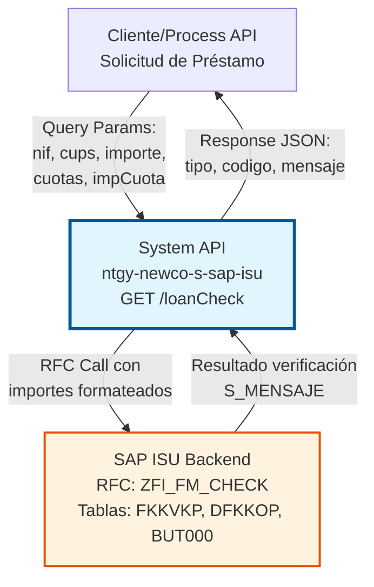
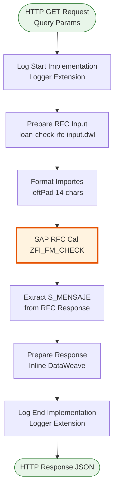
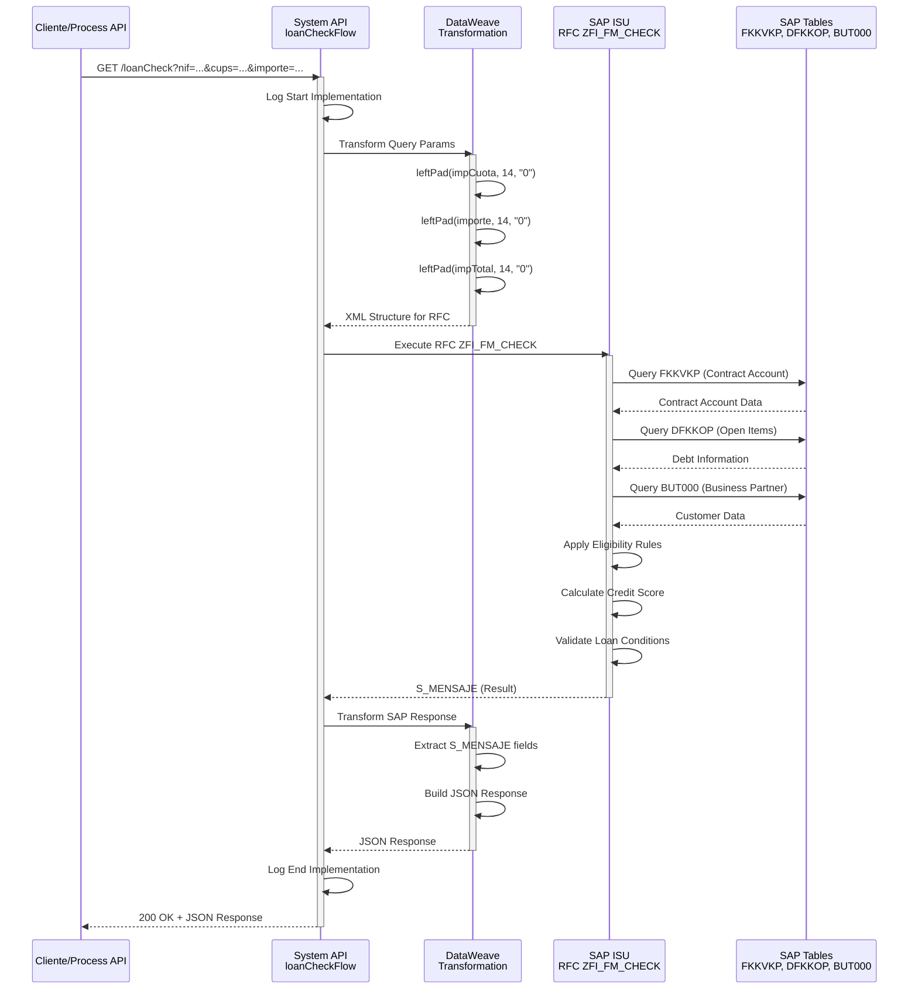
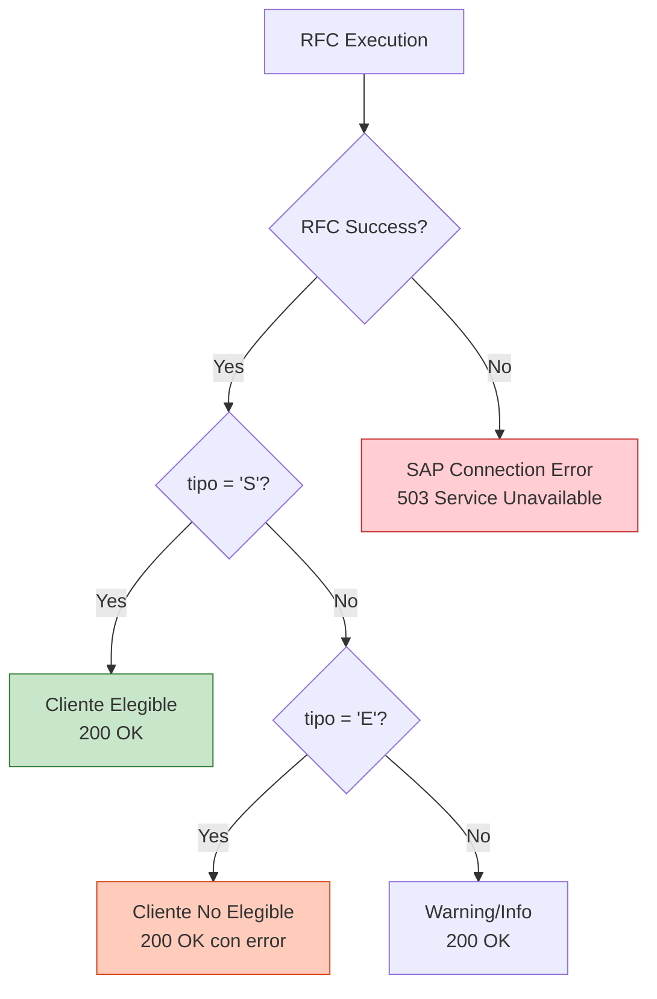
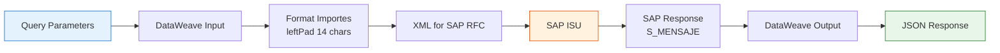

# GET /loanCheck

## 📌 Descripción General

### Propósito del Endpoint

Este endpoint verifica la elegibilidad de un cliente para obtener un préstamo o financiación mediante la validación de su historial crediticio, deuda pendiente y condiciones del contrato en SAP ISU. Permite evaluar si un cliente cumple con los requisitos necesarios para acceder a un plan de financiación antes de procesar la solicitud.

El endpoint soporta:
- **Verificación de Elegibilidad**: Valida si el cliente puede acceder a un préstamo basándose en criterios de SAP ISU
- **Análisis de Deuda**: Evalúa el estado de deuda actual del cliente y su historial de pagos
- **Validación de Condiciones**: Verifica que los parámetros del préstamo (importe, cuotas, CUPS) sean válidos
- **Scoring Crediticio**: Aplica reglas de negocio de SAP para determinar la viabilidad del préstamo

### Tipo de API

**Capa:** System API (API-Led Connectivity)

**Función:** Integración directa con SAP ISU para verificación de elegibilidad de préstamos mediante RFC estándar de Financial Accounting.

### Patrón de Integración

**Tipo:** Request-Reply Síncrono con SAP RFC

**Descripción:** El endpoint recibe los parámetros del préstamo solicitado vía query parameters, transforma los datos al formato SAP (aplicando padding a importes), invoca el RFC `ZFI_FM_CHECK` que ejecuta las validaciones de elegibilidad en SAP ISU, y retorna el resultado de la verificación con el mensaje correspondiente.

### Arquitectura API-Led Connectivity



---

## 💼 Propósito del Negocio

### Casos de Uso Principales

1. **Validación Pre-Solicitud de Préstamo**
   - Un cliente solicita un préstamo a través del portal web o app móvil
   - El sistema verifica automáticamente su elegibilidad antes de procesar la solicitud
   - Se evita crear solicitudes que serán rechazadas, mejorando la experiencia del cliente

2. **Evaluación de Financiación en Call Center**
   - Un agente de atención al cliente recibe una consulta sobre financiación
   - Verifica en tiempo real si el cliente es elegible para el préstamo solicitado
   - Proporciona respuesta inmediata al cliente sobre su capacidad de financiación

3. **Validación de Condiciones de Préstamo**
   - El sistema valida que los parámetros del préstamo (importe, cuotas, CUPS) sean correctos
   - Verifica que el importe total coincida con el cálculo de cuotas
   - Asegura la consistencia de datos antes de crear el préstamo en SAP

### Contexto Empresarial

- **Dominio:** Gestión Financiera - Préstamos y Financiación
- **Sector:** Energía - Utilities
- **División:** Naturgy España - NewCo
- **Proceso de Negocio:** Evaluación y aprobación de préstamos para clientes de energía
- **Módulo SAP:** FI-CA (Financial Contract Accounting)

### Stakeholders

- **Clientes Finales**: Necesitan conocer su elegibilidad para préstamos de forma rápida y transparente
- **Agentes de Call Center**: Requieren herramientas para evaluar solicitudes de financiación en tiempo real
- **Departamento de Crédito y Cobranza**: Necesitan asegurar que solo clientes elegibles accedan a financiación
- **Área Comercial**: Utilizan la información para ofrecer productos de financiación a clientes calificados

### Valor de Negocio

- **Reducción de Rechazos**: Validación previa evita solicitudes que serán rechazadas, mejorando la satisfacción del cliente
- **Automatización de Procesos**: Elimina validaciones manuales, reduciendo tiempos de respuesta de horas a segundos
- **Gestión de Riesgo**: Aplica criterios de SAP ISU para minimizar riesgo crediticio
- **Mejora de Experiencia**: Respuesta inmediata al cliente sobre su capacidad de financiación

### Consumidores Potenciales

Este endpoint puede ser consumido por:
- Process APIs de gestión de préstamos y financiación
- Portales web de autoservicio de clientes
- Aplicaciones móviles de clientes
- Sistemas de agentes de call center
- Flujos de Salesforce para evaluación de crédito
- Sistemas de CRM para ofertas personalizadas

---

## 🔧 Especificación Técnica

### URLs por Ambiente

| Ambiente | URL Base | URL Completa |
|----------|----------|--------------|
| **Local** | `http://localhost:8081` | `http://localhost:8081/api/loanCheck?nif=...&cups=...&importe=...&cuotas=...&impCuota=...&impTotal=...&carga=...` |
| **Development** | `https://ntgy-newco-s-sap-isu-dev.us-e2.cloudhub.io` | `https://ntgy-newco-s-sap-isu-dev.us-e2.cloudhub.io/api/loanCheck?nif=...&cups=...&importe=...&cuotas=...&impCuota=...&impTotal=...&carga=...` |
| **UAT** | `https://ntgy-newco-s-sap-isu-uat.us-e2.cloudhub.io` | `https://ntgy-newco-s-sap-isu-uat.us-e2.cloudhub.io/api/loanCheck?nif=...&cups=...&importe=...&cuotas=...&impCuota=...&impTotal=...&carga=...` |
| **Production** | `https://ntgy-newco-s-sap-isu-pro.us-e2.cloudhub.io` | `https://ntgy-newco-s-sap-isu-pro.us-e2.cloudhub.io/api/loanCheck?nif=...&cups=...&importe=...&cuotas=...&impCuota=...&impTotal=...&carga=...` |

### Método HTTP

```
GET /api/loanCheck
```

### Parámetros de Entrada

#### Headers HTTP

| Header | Tipo | Requerido | Descripción | Ejemplo |
|--------|------|-----------|-------------|---------|
| `Accept` | string | ❌ No | Tipo de contenido esperado en response | `application/json` |
| `client_id` | string | ✅ Sí | Client ID de Anypoint Platform | `a1b2c3d4e5f6g7h8i9j0` |
| `client_secret` | string | ✅ Sí | Client Secret de Anypoint Platform | `A1B2C3D4E5F6G7H8I9J0` |

#### Query Parameters

| Parámetro | Tipo | Requerido | Descripción | Ejemplo | Validación |
|-----------|------|-----------|-------------|---------|------------|
| `nif` | string | ✅ Sí | NIF del cliente solicitante | `12345678A` | Formato NIF español válido |
| `cups` | string | ✅ Sí | Código Universal del Punto de Suministro | `ES0021000000000001AA` | 20-22 caracteres, formato CUPS |
| `importe` | string | ✅ Sí | Importe del préstamo solicitado (sin padding) | `600.00` | Numérico, máximo 2 decimales |
| `cuotas` | string | ✅ Sí | Número de cuotas del préstamo | `12` | Entero positivo |
| `impCuota` | string | ✅ Sí | Importe de cada cuota (sin padding) | `50.00` | Numérico, máximo 2 decimales |
| `impTotal` | string | ✅ Sí | Importe total del préstamo (sin padding) | `600.00` | Debe coincidir con importe |
| `carga` | string | ✅ Sí | Indicador de carga | `X` | Valor fijo: "X" |

**Nota Importante sobre Importes:**
- Los importes se envían sin padding en el query parameter
- La transformación DataWeave aplica `leftPad` de 14 caracteres con ceros a la izquierda
- Ejemplo: `600.00` → `00000000600.00` antes de enviar a SAP

### Respuestas

#### Respuesta Exitosa - Cliente Elegible (200 OK)

```json
{
  "version": "1",
  "tipo": "S",
  "clase": "ZFI",
  "codigo": "000",
  "mensaje": "Cliente elegible para préstamo"
}
```

**Campos de Respuesta:**

| Campo | Tipo | Descripción | Valores Posibles |
|-------|------|-------------|------------------|
| `version` | string | Versión del mensaje SAP | "1", "2", etc. |
| `tipo` | string | Tipo de mensaje | "S" (Success), "E" (Error), "W" (Warning), "I" (Info) |
| `clase` | string | Clase del mensaje SAP | "ZFI" (Financial Accounting) |
| `codigo` | string | Código del mensaje SAP | "000" (éxito), otros códigos de error |
| `mensaje` | string | Texto descriptivo del resultado | Mensaje en español |

#### Respuesta - Cliente No Elegible (200 OK)

```json
{
  "version": "1",
  "tipo": "E",
  "clase": "ZFI",
  "codigo": "001",
  "mensaje": "Cliente con deuda pendiente superior al límite permitido"
}
```

#### Respuesta - Error de Validación (200 OK)

```json
{
  "version": "1",
  "tipo": "E",
  "clase": "ZFI",
  "codigo": "002",
  "mensaje": "CUPS no encontrado en el sistema"
}
```

#### Respuesta - Error Técnico (500 Internal Server Error)

```json
{
  "error": {
    "code": "SAP_CONNECTION_ERROR",
    "message": "Error al conectar con SAP ISU",
    "timestamp": "2026-06-10T08:30:00Z"
  }
}
```

### Códigos de Estado HTTP

| Código | Descripción | Cuándo Ocurre |
|--------|-------------|---------------|
| `200 OK` | Verificación completada | Siempre que el RFC se ejecute correctamente (incluso si el cliente no es elegible) |
| `400 Bad Request` | Parámetros inválidos | Query parameters faltantes o con formato incorrecto |
| `500 Internal Server Error` | Error del servidor | Error de conexión con SAP o error interno del RFC |
| `503 Service Unavailable` | Servicio no disponible | SAP ISU no disponible |

### Autenticación y Autorización

- **Tipo:** Client ID & Client Secret (Anypoint Platform)
- **Autorización SAP:** El usuario SAP configurado debe tener permisos para:
  - Ejecutar RFC `ZFI_FM_CHECK`
  - Acceso de lectura a tabla `FKKVKP` (Contract Account)
  - Acceso de lectura a tabla `DFKKOP` (Open Items)
  - Acceso de lectura a tabla `BUT000` (Business Partner)
  - Objeto de autorización `F_BUPA_GRP` (Business Partner)

### Timeouts

| Tipo | Valor | Descripción |
|------|-------|-------------|
| **Request Timeout** | 30 segundos | Tiempo máximo de espera para la respuesta |
| **SAP RFC Timeout** | 60 segundos | Tiempo máximo para ejecución del RFC |
| **Connection Timeout** | 10 segundos | Tiempo máximo para establecer conexión con SAP |

---

## 🏗️ Implementación Técnica

### Arquitectura del Flow



### Componentes del Flow

#### 1. Log Start Implementation
```xml
<module-logger:log 
    doc:name="Log Start Implementation" 
    config-ref="Logger_Mule_Extension_Config" 
    level="DEBUG" 
    flowName="#[vars.flowName]" 
    message="Start implementation flow for loan check" 
    content="#[vars.loggerContext]" />
```

#### 2. Prepare RFC Input (DataWeave)

**Archivo:** `src/main/resources/dw/loan-check-rfc-input.dwl`

```dataweave
%dw 2.0
import * from dw::core::Strings
output application/xml

---
{
    ZFI_FM_CHECK: {
        "import": {
            IM_CARGA: attributes.queryParams.carga,
            IM_CUOTAS: attributes.queryParams.cuotas,
            IM_CUPS: attributes.queryParams.cups,
            IM_IMPCUOTA: leftPad(attributes.queryParams.impCuota, 14, "0"),
            IM_IMPORTE: leftPad(attributes.queryParams.importe, 14, "0"),
            IM_IMPTOTAL: leftPad(attributes.queryParams.impTotal, 14, "0"),
            IM_NIF: attributes.queryParams.nif
        }
    }
}
```

**Transformaciones Aplicadas:**
- **leftPad**: Aplica padding de 14 caracteres con ceros a la izquierda a los importes
- **Mapeo directo**: Los demás campos se mapean directamente desde query params

#### 3. SAP RFC Call

```xml
<sap:synchronous-remote-function-call 
    key="ZFI_FM_CHECK" 
    doc:name="Synchronous Remote Function Call" 
    config-ref="SAP_Config" />
```

**RFC Details:**
- **Nombre:** `ZFI_FM_CHECK`
- **Módulo:** FI-CA (Financial Contract Accounting)
- **Tipo:** Synchronous RFC
- **Timeout:** 60 segundos

#### 4. Prepare Response (Inline DataWeave)

```dataweave
%dw 2.0
output application/json
var out = payload.ZFI_FM_CHECK.export.S_MENSAJE
---
{
    "version": out.VERSION default "",
    "tipo": out.TIPO default "",
    "clase": out.CLASE default "",
    "codigo": out.CODIGO default "",
    "mensaje": out.MENSAJE default ""
}
```

**Estructura SAP Response:**
- `S_MENSAJE`: Estructura de mensaje SAP con resultado de verificación
  - `VERSION`: Versión del mensaje
  - `TIPO`: Tipo de mensaje (S/E/W/I)
  - `CLASE`: Clase del mensaje
  - `CODIGO`: Código del mensaje
  - `MENSAJE`: Texto descriptivo

#### 5. Log End Implementation
```xml
<module-logger:log 
    doc:name="Log End Implementation" 
    config-ref="Logger_Mule_Extension_Config" 
    level="DEBUG" 
    flowName="#[vars.flowName]" 
    message="Finished implementation flow for loan check" 
    content="#[vars.loggerContext]" />
```

### Diagrama de Secuencia Detallado



### Tablas SAP Consultadas

| Tabla | Descripción | Campos Clave | Operación |
|-------|-------------|--------------|-----------|
| **FKKVKP** | Contract Account | VKONT (Contract Account Number), GPART (Business Partner) | READ |
| **DFKKOP** | Open Items | OPBEL (Open Item), BETRW (Amount), FAEDN (Due Date) | READ |
| **BUT000** | Business Partner | PARTNER (BP Number), NAME_ORG1 (Name), TAXNUM (Tax ID) | READ |

### Lógica de Negocio del RFC

El RFC `ZFI_FM_CHECK` ejecuta las siguientes validaciones:

1. **Validación de Cliente:**
   - Verifica que el NIF exista en SAP ISU (tabla BUT000)
   - Valida que el cliente esté activo

2. **Validación de CUPS:**
   - Verifica que el CUPS exista y esté asociado al cliente
   - Valida que el punto de suministro esté activo

3. **Análisis de Deuda:**
   - Consulta partidas abiertas en DFKKOP
   - Calcula deuda total pendiente
   - Verifica que la deuda no supere límites establecidos

4. **Validación de Condiciones del Préstamo:**
   - Verifica que importe total = importe
   - Valida que impCuota * cuotas ≈ impTotal
   - Verifica que el número de cuotas esté dentro de límites permitidos

5. **Scoring Crediticio:**
   - Aplica reglas de negocio de SAP para calcular score
   - Evalúa historial de pagos
   - Determina elegibilidad final

### Manejo de Errores



**Tipos de Errores:**

1. **Errores de Conexión SAP:**
   - Error de conectividad con SAP ISU
   - Timeout en RFC call
   - Credenciales inválidas
   - **Response:** 503 Service Unavailable

2. **Errores de Negocio (tipo = 'E'):**
   - Cliente no elegible para préstamo
   - CUPS no encontrado
   - Deuda excede límite permitido
   - **Response:** 200 OK con tipo='E' y mensaje descriptivo

3. **Warnings (tipo = 'W'):**
   - Condiciones especiales aplicables
   - Verificación adicional requerida
   - **Response:** 200 OK con tipo='W'

### Transformación de Datos



**Ejemplo de Transformación de Importes:**

| Input (Query Param) | Transformación | Output (SAP RFC) |
|---------------------|----------------|------------------|
| `importe=600.00` | `leftPad(14, "0")` | `00000000600.00` |
| `impCuota=50.00` | `leftPad(14, "0")` | `00000000050.00` |
| `impTotal=600.00` | `leftPad(14, "0")` | `00000000600.00` |

---

## 💻 Ejemplos de Uso

### Ejemplo 1: Cliente Elegible para Préstamo

#### Request (cURL)

```bash
curl -X GET "https://ntgy-newco-s-sap-isu-dev.us-e2.cloudhub.io/api/loanCheck?nif=12345678A&cups=ES0021000000000001AA&importe=600.00&cuotas=12&impCuota=50.00&impTotal=600.00&carga=X" \
  -H "Accept: application/json" \
  -H "client_id: a1b2c3d4e5f6g7h8i9j0" \
  -H "client_secret: A1B2C3D4E5F6G7H8I9J0"
```

#### Response (200 OK)

```json
{
  "version": "1",
  "tipo": "S",
  "clase": "ZFI",
  "codigo": "000",
  "mensaje": "Cliente elegible para préstamo"
}
```

**Interpretación:**
- ✅ Cliente aprobado para préstamo
- Puede proceder con la solicitud de financiación
- No hay restricciones de crédito

---

### Ejemplo 2: Cliente No Elegible - Deuda Excesiva

#### Request (cURL)

```bash
curl -X GET "https://ntgy-newco-s-sap-isu-dev.us-e2.cloudhub.io/api/loanCheck?nif=98765432B&cups=ES0021000000000002BB&importe=1200.00&cuotas=24&impCuota=50.00&impTotal=1200.00&carga=X" \
  -H "Accept: application/json" \
  -H "client_id: a1b2c3d4e5f6g7h8i9j0" \
  -H "client_secret: A1B2C3D4E5F6G7H8I9J0"
```

#### Response (200 OK)

```json
{
  "version": "1",
  "tipo": "E",
  "clase": "ZFI",
  "codigo": "001",
  "mensaje": "Cliente con deuda pendiente superior al límite permitido"
}
```

**Interpretación:**
- ❌ Cliente rechazado para préstamo
- Tiene deuda pendiente que excede límites
- Debe regularizar deuda antes de solicitar financiación

---

### Ejemplo 3: CUPS No Encontrado

#### Request (cURL)

```bash
curl -X GET "https://ntgy-newco-s-sap-isu-dev.us-e2.cloudhub.io/api/loanCheck?nif=11223344C&cups=ES0021000000000099ZZ&importe=800.00&cuotas=16&impCuota=50.00&impTotal=800.00&carga=X" \
  -H "Accept: application/json" \
  -H "client_id: a1b2c3d4e5f6g7h8i9j0" \
  -H "client_secret: A1B2C3D4E5F6G7H8I9J0"
```

#### Response (200 OK)

```json
{
  "version": "1",
  "tipo": "E",
  "clase": "ZFI",
  "codigo": "002",
  "mensaje": "CUPS no encontrado en el sistema"
}
```

**Interpretación:**
- ❌ CUPS inválido o no existe en SAP ISU
- Verificar que el CUPS sea correcto
- El punto de suministro debe estar registrado

---

### Ejemplo 4: Error de Conexión SAP

#### Request (cURL)

```bash
curl -X GET "https://ntgy-newco-s-sap-isu-dev.us-e2.cloudhub.io/api/loanCheck?nif=12345678A&cups=ES0021000000000001AA&importe=600.00&cuotas=12&impCuota=50.00&impTotal=600.00&carga=X" \
  -H "Accept: application/json" \
  -H "client_id: a1b2c3d4e5f6g7h8i9j0" \
  -H "client_secret: A1B2C3D4E5F6G7H8I9J0"
```

#### Response (503 Service Unavailable)

```json
{
  "error": {
    "code": "SAP_CONNECTION_ERROR",
    "message": "Error al conectar con SAP ISU",
    "timestamp": "2026-06-10T08:30:00Z"
  }
}
```

**Interpretación:**
- ⚠️ Error técnico de conectividad
- SAP ISU no disponible temporalmente
- Reintentar la operación más tarde

---

### Ejemplo 5: Parámetros Faltantes

#### Request (cURL)

```bash
curl -X GET "https://ntgy-newco-s-sap-isu-dev.us-e2.cloudhub.io/api/loanCheck?nif=12345678A&cups=ES0021000000000001AA" \
  -H "Accept: application/json" \
  -H "client_id: a1b2c3d4e5f6g7h8i9j0" \
  -H "client_secret: A1B2C3D4E5F6G7H8I9J0"
```

#### Response (400 Bad Request)

```json
{
  "error": {
    "code": "VALIDATION_ERROR",
    "message": "Parámetros requeridos faltantes: importe, cuotas, impCuota, impTotal, carga",
    "timestamp": "2026-06-10T08:30:00Z"
  }
}
```

**Interpretación:**
- ❌ Request inválido
- Faltan parámetros obligatorios
- Revisar documentación de query parameters

---

### Ejemplo 6: Integración con JavaScript/TypeScript

```typescript
interface LoanCheckParams {
  nif: string;
  cups: string;
  importe: string;
  cuotas: string;
  impCuota: string;
  impTotal: string;
  carga: string;
}

interface LoanCheckResponse {
  version: string;
  tipo: string;
  clase: string;
  codigo: string;
  mensaje: string;
}

async function checkLoanEligibility(params: LoanCheckParams): Promise<LoanCheckResponse> {
  const queryString = new URLSearchParams(params).toString();
  const url = `https://ntgy-newco-s-sap-isu-dev.us-e2.cloudhub.io/api/loanCheck?${queryString}`;
  
  const response = await fetch(url, {
    method: 'GET',
    headers: {
      'Accept': 'application/json',
      'client_id': process.env.ANYPOINT_CLIENT_ID!,
      'client_secret': process.env.ANYPOINT_CLIENT_SECRET!
    }
  });
  
  if (!response.ok) {
    throw new Error(`HTTP error! status: ${response.status}`);
  }
  
  return await response.json();
}

// Uso
const result = await checkLoanEligibility({
  nif: '12345678A',
  cups: 'ES0021000000000001AA',
  importe: '600.00',
  cuotas: '12',
  impCuota: '50.00',
  impTotal: '600.00',
  carga: 'X'
});

if (result.tipo === 'S') {
  console.log('✅ Cliente elegible:', result.mensaje);
} else {
  console.log('❌ Cliente no elegible:', result.mensaje);
}
```

---

### Ejemplo 7: Integración con Python

```python
import requests
import os
from typing import Dict, Any

def check_loan_eligibility(
    nif: str,
    cups: str,
    importe: str,
    cuotas: str,
    imp_cuota: str,
    imp_total: str,
    carga: str = "X"
) -> Dict[str, Any]:
    """
    Verifica la elegibilidad de un cliente para préstamo.
    
    Args:
        nif: NIF del cliente
        cups: Código Universal del Punto de Suministro
        importe: Importe del préstamo
        cuotas: Número de cuotas
        imp_cuota: Importe de cada cuota
        imp_total: Importe total
        carga: Indicador de carga (default: "X")
    
    Returns:
        Dict con la respuesta de SAP ISU
    """
    url = "https://ntgy-newco-s-sap-isu-dev.us-e2.cloudhub.io/api/loanCheck"
    
    params = {
        "nif": nif,
        "cups": cups,
        "importe": importe,
        "cuotas": cuotas,
        "impCuota": imp_cuota,
        "impTotal": imp_total,
        "carga": carga
    }
    
    headers = {
        "Accept": "application/json",
        "client_id": os.getenv("ANYPOINT_CLIENT_ID"),
        "client_secret": os.getenv("ANYPOINT_CLIENT_SECRET")
    }
    
    response = requests.get(url, params=params, headers=headers)
    response.raise_for_status()
    
    return response.json()

# Uso
try:
    result = check_loan_eligibility(
        nif="12345678A",
        cups="ES0021000000000001AA",
        importe="600.00",
        cuotas="12",
        imp_cuota="50.00",
        imp_total="600.00"
    )
    
    if result["tipo"] == "S":
        print(f"✅ Cliente elegible: {result['mensaje']}")
    else:
        print(f"❌ Cliente no elegible: {result['mensaje']}")
        
except requests.exceptions.HTTPError as e:
    print(f"Error HTTP: {e}")
except Exception as e:
    print(f"Error: {e}")
```
