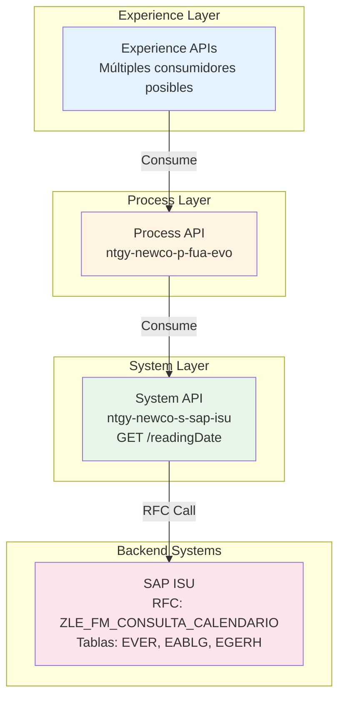
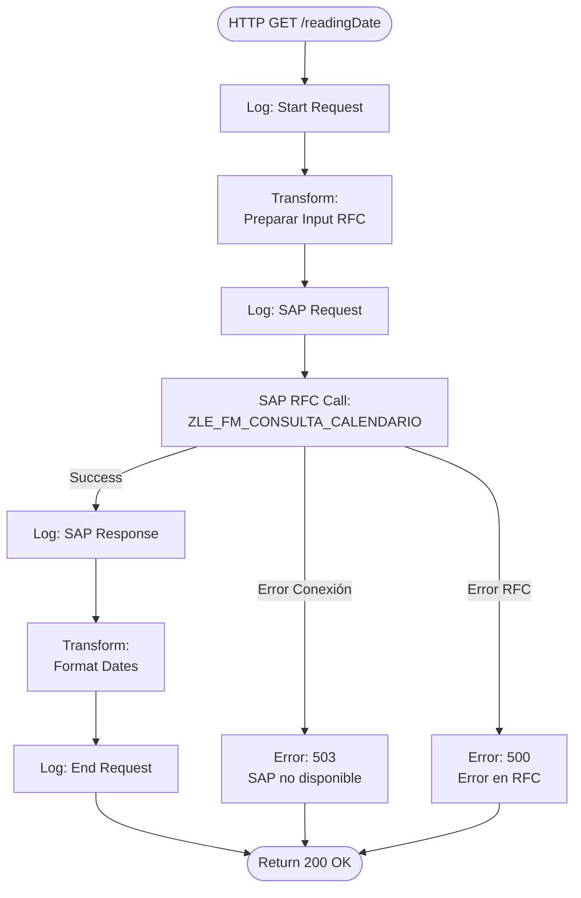
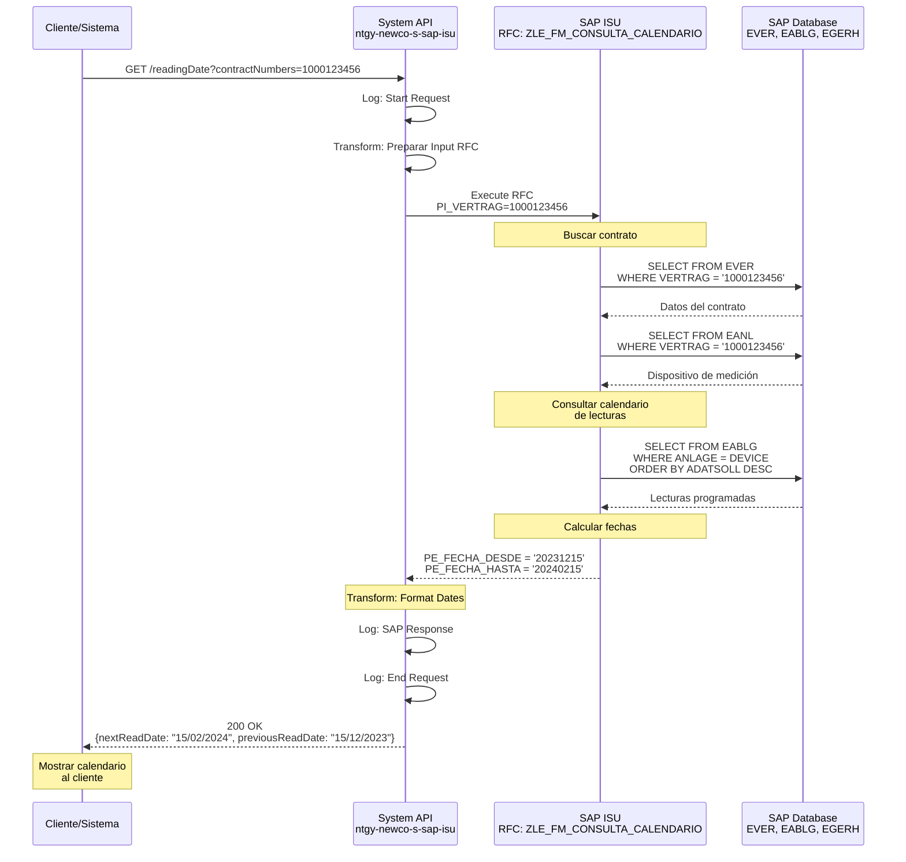
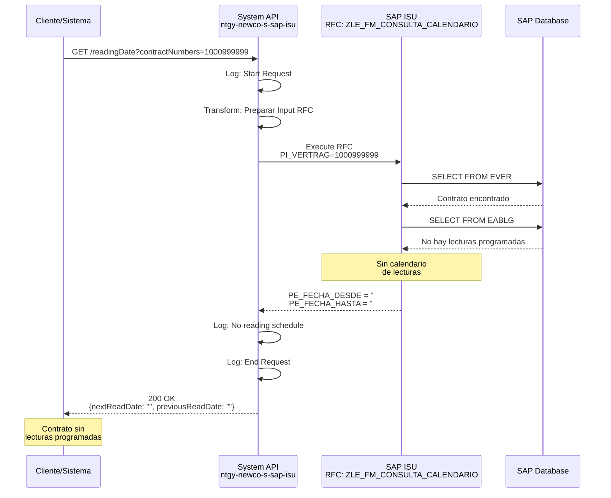
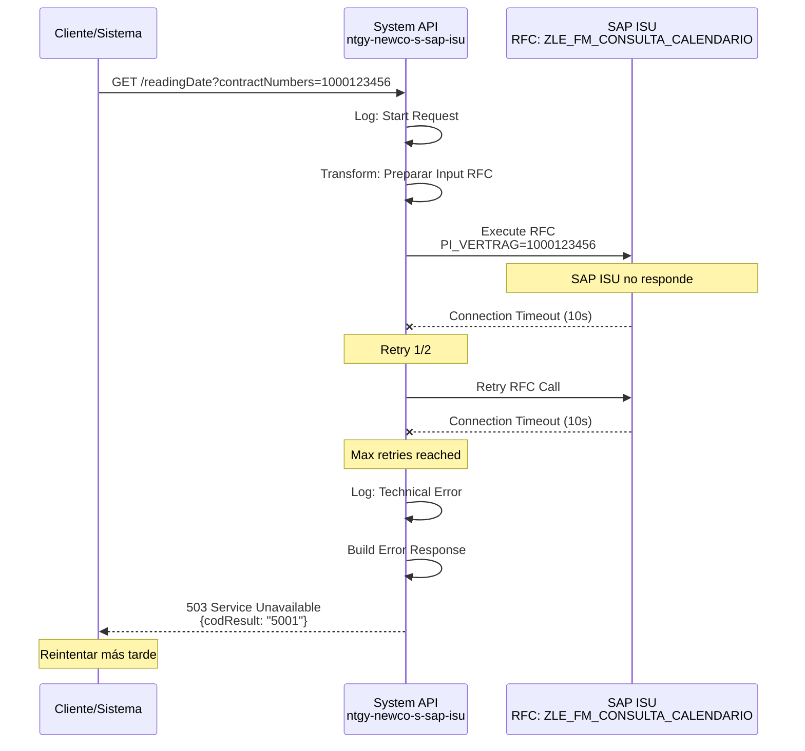

# GET /readingDate

## 📌 Descripción General

### Propósito del Endpoint

Este endpoint consulta las fechas del calendario de lecturas para un contrato específico en SAP ISU. Proporciona información sobre la fecha de la lectura anterior y la próxima fecha de lectura programada, permitiendo a los sistemas consumidores conocer el ciclo de lecturas del contador.

### Tipo de API

**Capa:** System API (Integración Directa con SAP ISU)

### Patrón de Integración

**Tipo:** Request-Reply Síncrono con SAP ISU - Consulta de Calendario

Este endpoint implementa un patrón de consulta de calendario de lecturas mediante RFC (Remote Function Call). La comunicación es síncrona y proporciona fechas de lectura anterior y próxima.

**Características del Patrón:**
- ✅ Comunicación síncrona con SAP ISU
- ✅ Invocación de RFC `ZLE_FM_CONSULTA_CALENDARIO`
- ✅ Consulta de calendario de lecturas
- ✅ Respuesta con fechas formateadas
- ✅ Tiempo de respuesta < 3 segundos

### Arquitectura API-Led Connectivity



**Flujo de Datos:**
1. Experience API solicita fechas de lectura
2. Process API orquesta la petición
3. System API invoca RFC de calendario en SAP ISU
4. SAP ISU consulta calendario de lecturas del contrato
5. System API retorna fechas anterior y próxima
6. Respuesta se propaga hacia arriba en la arquitectura

---

## 💼 Propósito del Negocio

### Casos de Uso Principales

#### 1. Información al Cliente sobre Lecturas
**Actor:** Cliente final o agente de atención al cliente  
**Objetivo:** Informar al cliente sobre el calendario de lecturas  
**Flujo:**
- Cliente consulta cuándo será su próxima lectura
- Sistema consulta calendario de lecturas en SAP
- Informa al cliente la fecha programada
- Cliente puede planificar acceso al contador

#### 2. Planificación de Lecturas
**Actor:** Departamento de operaciones o distribuidora  
**Objetivo:** Planificar rutas de lectura de contadores  
**Flujo:**
- Sistema consulta fechas de lectura de contratos
- Agrupa contratos por zona y fecha
- Optimiza rutas de lectura
- Programa visitas de lectores

#### 3. Validación de Lecturas Facilitadas
**Actor:** Sistema de autogestión o app móvil  
**Objetivo:** Validar si el cliente puede facilitar lectura  
**Flujo:**
- Cliente intenta facilitar lectura
- Sistema verifica si está en período válido
- Compara con fecha de próxima lectura
- Permite o rechaza la lectura facilitada

#### 4. Alertas de Lectura Próxima
**Actor:** Sistema de notificaciones  
**Objetivo:** Notificar al cliente sobre próxima lectura  
**Flujo:**
- Sistema consulta próximas lecturas programadas
- Identifica lecturas en los próximos 7 días
- Envía notificación al cliente
- Cliente prepara acceso al contador

### Contexto Empresarial

- **Dominio:** Gestión de Lecturas y Medición
- **Sector:** Energía - Utilities (Gas y Electricidad)
- **División:** Naturgy NewCo
- **Proceso de Negocio:** Meter Reading Management
- **Sistema Backend:** SAP ISU (Industry Solution Utilities)

### Stakeholders

#### Stakeholders Primarios
- **Departamento de Operaciones:** Planifican lecturas
- **Distribuidoras:** Ejecutan lecturas de contadores
- **Agentes de Call Center:** Informan a clientes

#### Stakeholders Secundarios
- **Clientes Finales:** Consultan calendario de lecturas
- **Sistemas de Notificaciones:** Envían alertas
- **Área de Facturación:** Coordinan lecturas con facturación

### Valor de Negocio

#### Beneficios Cuantitativos
- ⏱️ **Tiempo de Consulta:** < 3 segundos (respuesta rápida)
- 📞 **Reducción de Llamadas:** 15% menos consultas sobre lecturas
- 🎯 **Mejora en Planificación:** 30% optimización de rutas
- 💰 **Ahorro Operativo:** Reducción de visitas fallidas

#### Beneficios Cualitativos
- ✅ Mejor experiencia del cliente
- ✅ Transparencia en calendario de lecturas
- ✅ Optimización de rutas de lectura
- ✅ Reducción de visitas fallidas
- ✅ Facilita autogestión del cliente

### Consumidores Potenciales

Este endpoint puede ser consumido por:
- **Portales de Autoservicio:** Información de lecturas
- **Aplicaciones Móviles:** Consulta de calendario
- **Sistemas de Call Center:** Atención de consultas
- **Sistemas de Planificación:** Optimización de rutas
- **Sistemas de Notificaciones:** Alertas de lectura
- **Distribuidoras:** Coordinación de lecturas

---

## 🔧 Especificación Técnica

### URLs por Ambiente

| Ambiente | URL Base | URL Completa |
|----------|----------|--------------|
| **Local** | `http://localhost:8081` | `http://localhost:8081/api/readingDate` |
| **Development** | `https://ntgy-newco-s-sap-isu-dev.cloudhub.io` | `https://ntgy-newco-s-sap-isu-dev.cloudhub.io/api/readingDate` |
| **UAT** | `https://ntgy-newco-s-sap-isu-uat.cloudhub.io` | `https://ntgy-newco-s-sap-isu-uat.cloudhub.io/api/readingDate` |
| **UAT00** | `https://ntgy-newco-s-sap-isu-uat00.cloudhub.io` | `https://ntgy-newco-s-sap-isu-uat00.cloudhub.io/api/readingDate` |
| **Production** | `https://ntgy-newco-s-sap-isu.cloudhub.io` | `https://ntgy-newco-s-sap-isu.cloudhub.io/api/readingDate` |

### Método HTTP

```
GET /api/readingDate
```

### Parámetros de Entrada

#### Query Parameters

| Parámetro | Tipo | Requerido | Descripción | Ejemplo | Validación |
|-----------|------|-----------|-------------|---------|------------|
| `contractNumbers` | String | ⚠️ Opcional | Número de contrato | `1000123456` | Numérico, 10 dígitos |
| `docNumber` | String | ⚠️ Opcional | Número de documento del cliente (NIF/CIF) | `12345678A` | Alfanumérico, 9 caracteres |

**Notas sobre Parámetros:**
- Al menos uno de los dos parámetros debe ser proporcionado
- Si se proporciona `contractNumbers`, se consulta por contrato específico
- Si se proporciona `docNumber`, se consulta por cliente (puede tener múltiples contratos)
- Si ambos se proporcionan, `contractNumbers` tiene prioridad

#### Headers HTTP

| Header | Tipo | Requerido | Descripción | Ejemplo |
|--------|------|-----------|-------------|---------|
| `Content-Type` | String | ✅ Sí | Tipo de contenido de la respuesta | `application/json` |
| `Accept` | String | ⚠️ Recomendado | Tipo de contenido aceptado | `application/json` |

### Respuestas

#### Respuesta Exitosa (200 OK)

**Estructura de Respuesta:**

```json
{
  "result": {
    "codResult": "0000",
    "msgResult": "OK"
  },
  "readingDetail": {
    "nextReadDate": "15/02/2024",
    "previousReadDate": "15/12/2023"
  }
}
```

**Descripción de Campos:**

| Campo | Tipo | Descripción | Formato |
|-------|------|-------------|---------|
| `result.codResult` | String | Código de resultado ("0000" = éxito) | - |
| `result.msgResult` | String | Mensaje descriptivo del resultado | - |
| `readingDetail.nextReadDate` | String | Fecha de próxima lectura programada | dd/MM/yyyy |
| `readingDetail.previousReadDate` | String | Fecha de lectura anterior | dd/MM/yyyy |

**Interpretación de Fechas:**
- **previousReadDate:** Última fecha en que se realizó lectura del contador
- **nextReadDate:** Próxima fecha programada para lectura del contador
- Las fechas se calculan según el calendario de lecturas configurado en SAP ISU
- Pueden estar vacías si no hay lecturas programadas

#### Respuestas de Error

##### Error 400 - Bad Request

**Causa:** Parámetros inválidos o faltantes

```json
{
  "result": {
    "codResult": "0001",
    "msgResult": "Se requiere contractNumbers o docNumber"
  }
}
```

##### Error 500 - Internal Server Error

**Causa:** Error en SAP ISU o error técnico del API

```json
{
  "result": {
    "codResult": "9999",
    "msgResult": "Error al consultar calendario de lecturas en SAP ISU"
  }
}
```

##### Error 503 - Service Unavailable

**Causa:** SAP ISU no disponible

```json
{
  "result": {
    "codResult": "5001",
    "msgResult": "SAP ISU temporalmente no disponible"
  }
}
```

### Autenticación y Autorización

#### Tipo de Autenticación

**Método:** Client ID & Client Secret (OAuth 2.0 Client Credentials)

**Headers Requeridos:**
- `client_id`: Identificador de la aplicación cliente
- `client_secret`: Secreto de la aplicación cliente

**Nota:** La autenticación se gestiona a nivel de Anypoint Platform API Manager.

#### Autorización SAP

El usuario SAP configurado en el conector debe tener los siguientes permisos:
- Objeto de autorización: `V_VERTRAG` (Contract Display)
- Actividad: `03` (Display)
- RFC: `ZLE_FM_CONSULTA_CALENDARIO` (Execute permission)

### Timeouts Configurados

| Tipo | Valor | Descripción |
|------|-------|-------------|
| **Request Timeout** | 15 segundos | Timeout total de la petición HTTP |
| **SAP RFC Timeout** | 10 segundos | Timeout de ejecución del RFC en SAP |
| **Connection Timeout** | 5 segundos | Timeout de establecimiento de conexión SAP |

**Estrategia de Retry:**
- Reintentos automáticos: 2 intentos
- Intervalo entre reintentos: 1 segundo
- Solo para errores de conexión (no para errores de negocio)

### Protocolo

- **Protocolo:** HTTPS (TLS 1.2+)
- **Puerto:** 443 (HTTPS)
- **Método de Compresión:** gzip (opcional)

---

## 🏗️ Implementación Técnica

### Arquitectura del Flow



### RFC SAP Invocado

#### RFC: `ZLE_FM_CONSULTA_CALENDARIO`

**Descripción:** Función RFC personalizada de SAP ISU para consultar el calendario de lecturas de un contrato, retornando las fechas de lectura anterior y próxima lectura programada.

**Módulo SAP:** Meter Reading (EL-MD)

**Tablas SAP Consultadas:**
- `EVER`: Contract Master Data (Datos Maestros de Contrato)
- `EABLG`: Meter Reading Document (Documento de Lectura)
- `EGERH`: Meter Reading Header (Cabecera de Lectura)
- `EANL`: Device Location (Ubicación del Dispositivo)

**Parámetros de Entrada:**

| Parámetro | Tipo ABAP | Descripción | Ejemplo |
|-----------|-----------|-------------|---------|
| `PI_VERTRAG` | CHAR(10) | Número de contrato (opcional) | `1000123456` |
| `PI_TAXNUM` | CHAR(20) | Número de documento del cliente (opcional) | `12345678A` |

**Parámetros de Salida:**

| Parámetro | Tipo ABAP | Descripción | Formato |
|-----------|-----------|-------------|---------|
| `PE_RESULTADO` | CHAR(4) | Código de resultado | `0000` = OK |
| `PE_DESCRIPCION` | CHAR(255) | Descripción del resultado | Texto |
| `PE_FECHA_DESDE` | DATS | Fecha de lectura anterior | yyyyMMdd |
| `PE_FECHA_HASTA` | DATS | Fecha de próxima lectura | yyyyMMdd |

**Lógica de Cálculo:**
1. Busca contrato por número o por documento de cliente
2. Obtiene dispositivo de medición asociado al contrato
3. Consulta calendario de lecturas configurado
4. Identifica última lectura realizada
5. Calcula próxima fecha de lectura según periodicidad
6. Retorna ambas fechas

---

## 🗄️ Base de Datos SAP ISU

### Detalles de Tablas SAP

#### Tabla: `EVER`

**Descripción:** Tabla maestra de contratos en SAP ISU. Contiene información principal de cada contrato de suministro, incluyendo el punto de suministro asociado y datos de facturación.

**Campos Utilizados:**

| Campo | Tipo ABAP | Descripción | Ejemplo |
|-------|-----------|-------------|---------|
| `VERTRAG` | CHAR(10) | Número de contrato | `1000123456` |
| `ANLAGE` | CHAR(10) | Punto de suministro (Installation) | `1000567890` |
| `VKONT` | CHAR(12) | Cuenta contrato | `200001234567` |
| `VSTELLE` | CHAR(4) | División de ventas | `0001` |

**Relaciones:**
- `EVER.ANLAGE` → `EANL.ANLAGE` (Relación con ubicación del dispositivo)
- `EVER.VERTRAG` → `EABLG.VERTRAG` (Relación con documentos de lectura)

**Índices Conocidos:**
- Primary Key: `VERTRAG`
- Secondary Index: `ANLAGE`, `VKONT`

**Notas de Performance:**
- Tabla de alto volumen (millones de registros)
- Búsqueda por `VERTRAG` es muy eficiente (PK)
- Búsqueda por `ANLAGE` usa índice secundario

#### Tabla: `EABLG`

**Descripción:** Documentos de lectura de contadores. Almacena cada lectura programada o realizada, con fechas y motivos de lectura.

**Campos Utilizados:**

| Campo | Tipo ABAP | Descripción | Ejemplo |
|-------|-----------|-------------|---------|
| `ABLBELNR` | CHAR(12) | Número de documento de lectura | `100012345678` |
| `VERTRAG` | CHAR(10) | Número de contrato | `1000123456` |
| `ANLAGE` | CHAR(10) | Punto de suministro | `1000567890` |
| `ADATSOLL` | DATS | Fecha programada de lectura | `20240215` |
| `ADATVON` | DATS | Fecha desde (período) | `20231215` |
| `ADATBIS` | DATS | Fecha hasta (período) | `20240215` |
| `ABLESGR` | CHAR(2) | Motivo de lectura | `01` |

**Relaciones:**
- `EABLG.VERTRAG` → `EVER.VERTRAG` (Contrato asociado)
- `EABLG.ABLBELNR` → `EGERH.ABLBELNR` (Cabecera de lectura)

**Índices Conocidos:**
- Primary Key: `ABLBELNR`
- Secondary Index: `VERTRAG`, `ANLAGE`, `ADATSOLL`

**Notas de Performance:**
- Ordenar por `ADATSOLL DESC` para obtener última lectura
- Filtrar por `VERTRAG` es eficiente con índice secundario

#### Tabla: `EGERH`

**Descripción:** Cabecera de documentos de lectura. Contiene información adicional sobre el proceso de lectura, incluyendo estado y motivo.

**Campos Utilizados:**

| Campo | Tipo ABAP | Descripción | Ejemplo |
|-------|-----------|-------------|---------|
| `ABLBELNR` | CHAR(12) | Número de documento de lectura | `100012345678` |
| `ABLESGR` | CHAR(2) | Motivo de lectura | `01` |
| `ABLSTAT` | CHAR(1) | Estado de lectura | `A` (Activo) |
| `ADATSOLL` | DATS | Fecha programada | `20240215` |

**Relaciones:**
- `EGERH.ABLBELNR` → `EABLG.ABLBELNR` (Documento de lectura)

**Índices Conocidos:**
- Primary Key: `ABLBELNR`

**Notas de Performance:**
- Tabla de cabecera, acceso directo por `ABLBELNR`
- Usualmente se consulta en JOIN con `EABLG`

#### Tabla: `EANL`

**Descripción:** Ubicación del dispositivo de medición. Contiene información sobre la instalación física del contador y su ubicación.

**Campos Utilizados:**

| Campo | Tipo ABAP | Descripción | Ejemplo |
|-------|-----------|-------------|---------|
| `ANLAGE` | CHAR(10) | Punto de suministro | `1000567890` |
| `VSTELLE` | CHAR(4) | División de ventas | `0001` |
| `HAUS` | CHAR(10) | Número de edificio | `123` |
| `ABLEINH` | CHAR(3) | Unidad de lectura | `KWH` |

**Relaciones:**
- `EANL.ANLAGE` → `EVER.ANLAGE` (Contrato asociado)

**Índices Conocidos:**
- Primary Key: `ANLAGE`

**Notas de Performance:**
- Acceso directo por `ANLAGE` es muy eficiente
- Tabla relativamente pequeña comparada con `EABLG`

---

### Transformaciones DataWeave

#### Transformación 1: Preparar Input RFC

**Archivo:** Inline en flow XML (líneas 103-115)

```dataweave
%dw 2.0
output application/xml
---
{
    ZLE_FM_CONSULTA_CALENDARIO: {
        "import": {
            PI_VERTRAG: attributes.queryParams.contractNumbers,
            PI_TAXNUM: attributes.queryParams.docNumber
        }
    }
}
```

**Mapeo de Campos:**

| Campo Origen (HTTP) | Campo Destino (SAP) | Transformación |
|---------------------|---------------------|----------------|
| `queryParams.contractNumbers` | `PI_VERTRAG` | Directo (String, opcional) |
| `queryParams.docNumber` | `PI_TAXNUM` | Directo (String, opcional) |

#### Transformación 2: Procesar Output RFC

**Archivo:** Inline en flow XML (líneas 122-141)

```dataweave
%dw 2.0
output application/json

fun formatDate(fecha : String|Null) =
    (fecha as DateTime { format: "EEE MMM dd HH:mm:ss z yyyy" })
    as String { format: "dd/MM/yyyy" } default null

---
{
    "result": {
        "codResult": payload.ZLE_FM_CONSULTA_CALENDARIO.export.PE_RESULTADO,
        "msgResult": payload.ZLE_FM_CONSULTA_CALENDARIO.export.PE_DESCRIPCION
    },
    "readingDetail": {
        "nextReadDate": formatDate(payload.ZLE_FM_CONSULTA_CALENDARIO.export.PE_FECHA_HASTA) default "",
        "previousReadDate": formatDate(payload.ZLE_FM_CONSULTA_CALENDARIO.export.PE_FECHA_DESDE) default ""
    }
}
```

**Mapeo de Campos:**

| Campo SAP | Campo JSON | Transformación |
|-----------|------------|----------------|
| `PE_RESULTADO` | `result.codResult` | Directo |
| `PE_DESCRIPCION` | `result.msgResult` | Directo |
| `PE_FECHA_HASTA` | `readingDetail.nextReadDate` | Formato dd/MM/yyyy |
| `PE_FECHA_DESDE` | `readingDetail.previousReadDate` | Formato dd/MM/yyyy |

**Nota:** Las fechas SAP se convierten de formato SAP (yyyyMMdd) a formato legible (dd/MM/yyyy).

### Patrones de Diseño

**Patrón Principal:** Request-Reply Síncrono con Formateo de Fechas

**Justificación:**
- Consulta simple de calendario
- Respuesta debe ser inmediata
- Requiere formateo de fechas SAP
- Ideal para consultas de información

**Patrones Adicionales:**
- **Date Formatting Pattern:** Conversión de formatos de fecha
- **Optional Parameters:** Flexibilidad en parámetros de entrada
- **Fast Response:** Optimizado para respuestas rápidas

### Diagramas de Secuencia

#### 1. Flujo Normal de Éxito



#### 2. Flujo con Contrato Sin Lecturas Programadas



#### 3. Flujo con Error Técnico



### Connection Pooling y Optimizaciones

#### Optimizaciones de Performance

1. **Consulta Ligera:**
   - Solo retorna 2 fechas
   - No requiere cálculos complejos
   - Tiempo de respuesta < 3 segundos

2. **Parámetros Flexibles:**
   - Permite consulta por contrato o cliente
   - Optimiza búsquedas según parámetro
   - Reduce llamadas innecesarias

3. **Cache de Calendario:**
   - Candidato para caching (TTL: 1 hora)
   - Calendario de lecturas es relativamente estático
   - Reducción de carga en SAP

### Manejo de Errores

#### Estrategia de Error Handling

```xml
<error-handler>
    <on-error-propagate type="SAP:CONNECTIVITY">
        <ee:transform>
            <ee:set-payload>
                {
                  "result": {
                    "codResult": "5001",
                    "msgResult": "SAP ISU temporalmente no disponible"
                  }
                }
            </ee:set-payload>
            <ee:set-attributes>
                <ee:set-attribute attributeName="httpStatus">503</ee:set-attribute>
            </ee:set-attributes>
        </ee:transform>
    </on-error-propagate>
    
    <on-error-propagate type="SAP:EXECUTION">
        <ee:transform>
            <ee:set-payload>
                {
                  "result": {
                    "codResult": "9999",
                    "msgResult": "Error consultando calendario de lecturas en SAP ISU"
                  }
                }
            </ee:set-payload>
            <ee:set-attributes>
                <ee:set-attribute attributeName="httpStatus">500</ee:set-attribute>
            </ee:set-attributes>
        </ee:transform>
    </on-error-propagate>
</error-handler>
```

---

## 💻 Ejemplos de Uso

### Ejemplo 1: Consulta por Número de Contrato

#### cURL

```bash
curl -X GET "https://ntgy-newco-s-sap-isu.cloudhub.io/api/readingDate?contractNumbers=1000123456" \
  -H "Content-Type: application/json" \
  -H "client_id: your-client-id" \
  -H "client_secret: your-client-secret"
```

#### Respuesta (200 OK)

```json
{
  "result": {
    "codResult": "0000",
    "msgResult": "OK"
  },
  "readingDetail": {
    "nextReadDate": "15/02/2024",
    "previousReadDate": "15/12/2023"
  }
}
```

### Ejemplo 2: Consulta por Documento de Cliente

#### cURL

```bash
curl -X GET "https://ntgy-newco-s-sap-isu.cloudhub.io/api/readingDate?docNumber=12345678A" \
  -H "Content-Type: application/json" \
  -H "client_id: your-client-id" \
  -H "client_secret: your-client-secret"
```

#### Respuesta (200 OK)

```json
{
  "result": {
    "codResult": "0000",
    "msgResult": "OK"
  },
  "readingDetail": {
    "nextReadDate": "20/02/2024",
    "previousReadDate": "20/11/2023"
  }
}
```

### Ejemplo 3: JavaScript (Fetch API) con Cálculo de Días

```javascript
async function getReadingSchedule(contractNumber) {
  const url = `https://ntgy-newco-s-sap-isu.cloudhub.io/api/readingDate?contractNumbers=${contractNumber}`;
  
  try {
    const response = await fetch(url, {
      method: 'GET',
      headers: {
        'Content-Type': 'application/json',
        'client_id': 'your-client-id',
        'client_secret': 'your-client-secret'
      }
    });
    
    if (!response.ok) {
      throw new Error(`HTTP error! status: ${response.status}`);
    }
    
    const data = await response.json();
    
    if (data.result.codResult === '0000') {
      const nextDate = data.readingDetail.nextReadDate;
      const prevDate = data.readingDetail.previousReadDate;
      
      // Calcular días hasta próxima lectura
      const parseDate = (dateStr) => {
        const [day, month, year] = dateStr.split('/');
        return new Date(year, month - 1, day);
      };
      
      const today = new Date();
      const nextReadDate = parseDate(nextDate);
      const daysUntilReading = Math.ceil((nextReadDate - today) / (1000 * 60 * 60 * 24));
      
      console.log(`Contrato ${contractNumber}:`);
      console.log(`  Lectura anterior: ${prevDate}`);
      console.log(`  Próxima lectura: ${nextDate}`);
      console.log(`  Días hasta próxima lectura: ${daysUntilReading}`);
      
      // Alertar si la lectura es próxima
      if (daysUntilReading <= 7 && daysUntilReading > 0) {
        console.log('⚠️ ALERTA: Lectura programada en menos de 7 días');
      }
      
      return {
        contractNumber,
        nextDate,
        prevDate,
        daysUntilReading
      };
    } else {
      console.error('Error de negocio:', data.result.msgResult);
      return null;
    }
  } catch (error) {
    console.error('Error técnico:', error);
    throw error;
  }
}

// Uso
getReadingSchedule('1000123456')
  .then(schedule => {
    if (schedule && schedule.daysUntilReading <= 7) {
      // Enviar notificación al cliente
      console.log('Enviando notificación de lectura próxima...');
    }
  });
```

### Ejemplo 4: Python (requests) con Notificaciones

```python
import requests
from datetime import datetime, timedelta

def get_reading_schedule(contract_number=None, doc_number=None):
    """
    Obtiene el calendario de lecturas de un contrato
    
    Args:
        contract_number (str): Número de contrato (opcional)
        doc_number (str): Número de documento (opcional)
        
    Returns:
        dict: Información de calendario de lecturas
    """
    url = "https://ntgy-newco-s-sap-isu.cloudhub.io/api/readingDate"
    
    headers = {
        "Content-Type": "application/json",
        "client_id": "your-client-id",
        "client_secret": "your-client-secret"
    }
    
    params = {}
    if contract_number:
        params["contractNumbers"] = contract_number
    if doc_number:
        params["docNumber"] = doc_number
    
    try:
        response = requests.get(url, headers=headers, params=params, timeout=15)
        response.raise_for_status()
        
        data = response.json()
        
        if data['result']['codResult'] == '0000':
            next_date_str = data['readingDetail']['nextReadDate']
            prev_date_str = data['readingDetail']['previousReadDate']
            
            # Parsear fechas
            def parse_date(date_str):
                if not date_str:
                    return None
                return datetime.strptime(date_str, '%d/%m/%Y')
            
            next_date = parse_date(next_date_str)
            prev_date = parse_date(prev_date_str)
            
            # Calcular días hasta próxima lectura
            if next_date:
                today = datetime.now()
                days_until = (next_date - today).days
                
                print(f"✓ Calendario de lecturas:")
                print(f"  Lectura anterior: {prev_date_str if prev_date_str else 'N/A'}")
                print(f"  Próxima lectura: {next_date_str}")
                print(f"  Días hasta próxima lectura: {days_until}")
                
                # Enviar notificación si es próxima
                if 0 < days_until <= 7:
                    print("⚠️ ALERTA: Lectura próxima - Enviar notificación")
                    return {
                        'contract_number': contract_number,
                        'next_date': next_date_str,
                        'prev_date': prev_date_str,
                        'days_until': days_until,
                        'alert': True
                    }
            
            return {
                'contract_number': contract_number,
                'next_date': next_date_str,
                'prev_date': prev_date_str,
                'alert': False
            }
        else:
            print(f"✗ Error: {data['result']['msgResult']}")
            return None
            
    except requests.exceptions.Timeout:
        print("✗ Timeout: SAP ISU no respondió")
        return None
    except requests.exceptions.RequestException as e:
        print(f"✗ Error técnico: {str(e)}")
        return None

# Uso
schedule = get_reading_schedule(contract_number="1000123456")

if schedule and schedule['alert']:
    print("Enviando notificación al cliente...")
```

### Ejemplo 5: Postman Collection

```json
{
  "info": {
    "name": "SAP ISU System API - Reading Schedule",
    "schema": "https://schema.getpostman.com/json/collection/v2.1.0/collection.json"
  },
  "item": [
    {
      "name": "GET Reading Date - By Contract",
      "request": {
        "method": "GET",
        "header": [
          {
            "key": "Content-Type",
            "value": "application/json"
          },
          {
            "key": "client_id",
            "value": "{{client_id}}"
          },
          {
            "key": "client_secret",
            "value": "{{client_secret}}"
          }
        ],
        "url": {
          "raw": "{{base_url}}/api/readingDate?contractNumbers=1000123456",
          "host": ["{{base_url}}"],
          "path": ["api", "readingDate"],
          "query": [
            {
              "key": "contractNumbers",
              "value": "1000123456"
            }
          ]
        }
      },
      "response": []
    },
    {
      "name": "GET Reading Date - By Document",
      "request": {
        "method": "GET",
        "header": [
          {
            "key": "Content-Type",
            "value": "application/json"
          },
          {
            "key": "client_id",
            "value": "{{client_id}}"
          },
          {
            "key": "client_secret",
            "value": "{{client_secret}}"
          }
        ],
        "url": {
          "raw": "{{base_url}}/api/readingDate?docNumber=12345678A",
          "host": ["{{base_url}}"],
          "path": ["api", "readingDate"],
          "query": [
            {
              "key": "docNumber",
              "value": "12345678A"
            }
          ]
        }
      },
      "response": []
    }
  ]
}
```
