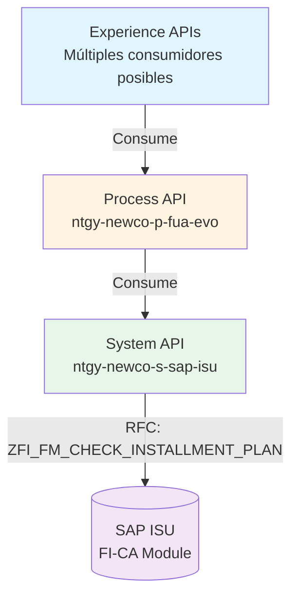
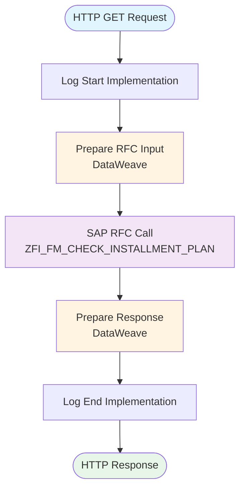
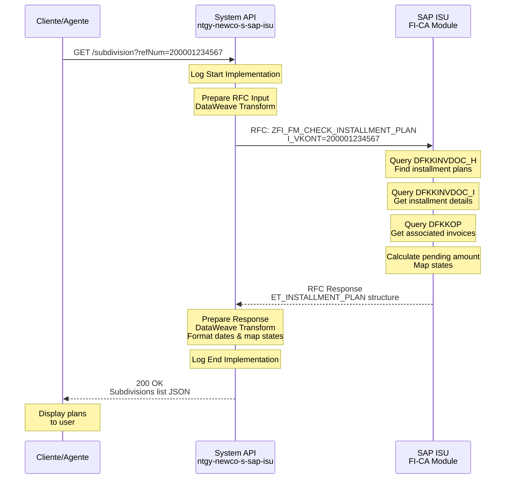
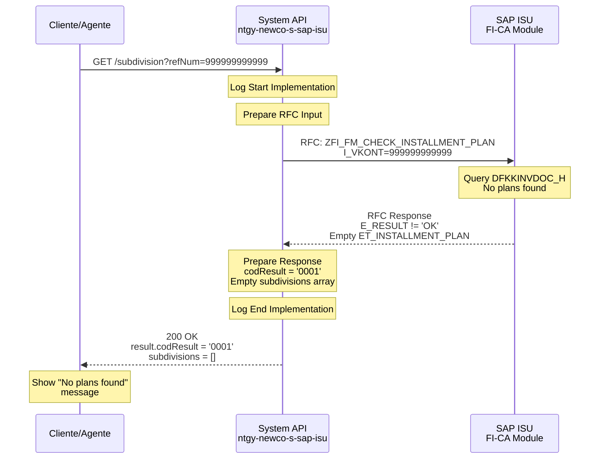
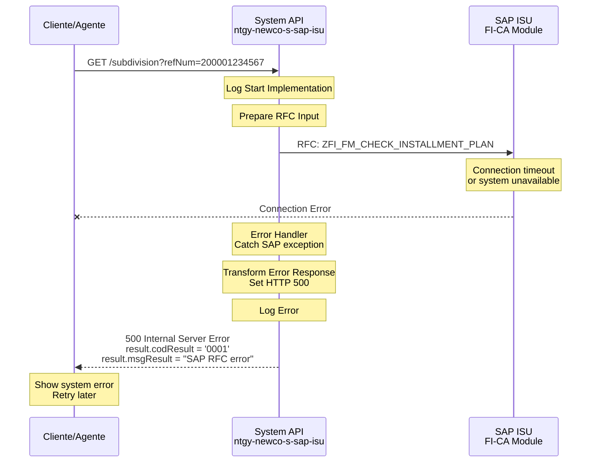

# GET /subdivision

## 📌 Descripción General

### Propósito del Endpoint
Consulta información detallada de fraccionamientos (planes de pago) existentes en SAP ISU, incluyendo cuotas, importes, fechas de vencimiento y estado de cada plan de pago asociado a un cliente o cuenta contrato.

### Tipo de API
**Capa:** System API (Integración directa con SAP ISU)

### Patrón de Integración
**Tipo:** Request-Reply con SAP ISU mediante RFC

### Arquitectura API-Led Connectivity



---

## 💼 Propósito del Negocio

### Casos de Uso Principales

1. **Consulta de Planes de Pago Activos**: Clientes consultan sus fraccionamientos vigentes
2. **Verificación de Cuotas Pendientes**: Agentes verifican estado de pagos fraccionados
3. **Seguimiento de Deuda Fraccionada**: Monitoreo de importes pendientes en planes de pago
4. **Validación de Elegibilidad**: Verificar si cliente tiene fraccionamientos activos antes de crear uno nuevo
5. **Auditoría de Pagos**: Revisión histórica de planes de pago y su cumplimiento

### Contexto Empresarial
- **Dominio:** Gestión de Deuda y Financiación
- **Sector:** Energía - Utilities
- **División:** Naturgy España - NewCo
- **Proceso de Negocio:** Financial Contract Accounting (FI-CA)

### Stakeholders
- **Clientes Finales**: Consultan estado de sus planes de pago
- **Agentes de Call Center**: Verifican fraccionamientos durante atención al cliente
- **Departamento de Cobranzas**: Monitorean cumplimiento de planes de pago
- **Sistemas de Terceros**: Integraciones que requieren información de financiación

### Valor de Negocio
- **Transparencia Financiera**: Visibilidad completa de planes de pago activos
- **Autoservicio**: Clientes pueden consultar sus fraccionamientos sin llamar
- **Gestión de Cobranza**: Facilita seguimiento de pagos fraccionados
- **Prevención de Duplicados**: Evita crear múltiples fraccionamientos para misma deuda
- **Cumplimiento Normativo**: Registro auditable de acuerdos de pago

### Consumidores Potenciales
Este endpoint puede ser consumido por:
- Portales web de autoservicio de clientes
- Aplicaciones móviles (iOS/Android)
- Sistemas de agentes de call center (ATC)
- Sistemas de gestión de cobranzas
- Integraciones de terceros autorizados

---

## 🔧 Especificación Técnica

### URLs por Ambiente

| Ambiente | URL Base | URL Completa |
|----------|----------|--------------|
| Local | `http://localhost:8081` | `http://localhost:8081/api/subdivision?refNum={refNum}&clientId={clientId}` |
| Desarrollo | `https://dev-ntgy-newco-s-sap-isu.cloudhub.io` | `https://dev-ntgy-newco-s-sap-isu.cloudhub.io/api/subdivision?refNum={refNum}` |
| UAT | `https://uat-ntgy-newco-s-sap-isu.cloudhub.io` | `https://uat-ntgy-newco-s-sap-isu.cloudhub.io/api/subdivision?refNum={refNum}` |
| Producción | `https://ntgy-newco-s-sap-isu.cloudhub.io` | `https://ntgy-newco-s-sap-isu.cloudhub.io/api/subdivision?refNum={refNum}` |

### Método HTTP
```
GET /api/subdivision
```

### Parámetros de Entrada

#### Query Parameters

| Parámetro | Tipo | Requerido | Descripción | Ejemplo | Validaciones |
|-----------|------|-----------|-------------|---------|--------------|
| `refNum` | string | ❌ No | Número de referencia de la cuenta contrato | `200001234567` | Longitud: 12 dígitos |
| `clientId` | string | ❌ No | ID del cliente (Business Partner) | `0001234567` | Longitud: 10 dígitos |
| `clientCode` | string | ❌ No | Código de cliente (NIF/CIF) | `12345678A` | Formato: NIF/CIF español |

**Nota:** Al menos uno de los tres parámetros debe ser proporcionado.

#### Headers HTTP

| Header | Tipo | Requerido | Descripción | Ejemplo |
|--------|------|-----------|-------------|---------|
| `Content-Type` | string | ✅ Sí | Tipo de contenido | `application/json` |
| `Accept` | string | ❌ No | Formato de respuesta esperado | `application/json` |

### Respuestas

#### Respuesta Exitosa (200 OK)

**Estructura de Respuesta:**

```json
{
  "result": {
    "codResult": "0000",
    "msgResult": "No hay error"
  },
  "maxCancel": false,
  "maxSubdivision": false,
  "subdivisions": [
    {
      "numRef": "1000123456",
      "numAgreement": "0001234567",
      "totalAmount": 500.00,
      "pendingAmount": 300.00,
      "state": "Activo",
      "dues": [
        {
          "idDue": "001",
          "numberDue": "1",
          "endDate": "2024-02-15 00:00:00",
          "amount": 100.00,
          "state": "Pagado"
        },
        {
          "idDue": "002",
          "numberDue": "2",
          "endDate": "2024-03-15 00:00:00",
          "amount": 100.00,
          "state": "Pagado"
        },
        {
          "idDue": "003",
          "numberDue": "3",
          "endDate": "2024-04-15 00:00:00",
          "amount": 100.00,
          "state": "Pendiente"
        },
        {
          "idDue": "004",
          "numberDue": "4",
          "endDate": "2024-05-15 00:00:00",
          "amount": 100.00,
          "state": "Pendiente"
        },
        {
          "idDue": "005",
          "numberDue": "5",
          "endDate": "2024-06-15 00:00:00",
          "amount": 100.00,
          "state": "Pendiente"
        }
      ],
      "associatedInvoicesId": [
        "1234567890",
        "1234567891"
      ]
    }
  ]
}
```

**Descripción de Campos Principales:**

| Campo | Tipo | Descripción |
|-------|------|-------------|
| `result.codResult` | string | Código de resultado: `0000` = éxito, `0001` = error |
| `result.msgResult` | string | Mensaje descriptivo del resultado |
| `maxCancel` | boolean | Flag que indica si se alcanzó el máximo de cancelaciones permitidas (E_FLAG_026 en SAP) |
| `maxSubdivision` | boolean | Flag que indica si se alcanzó el máximo de fraccionamientos permitidos (E_FLAG_027 en SAP) |
| `subdivisions` | array | Lista de planes de fraccionamiento |
| `subdivisions[].numRef` | string | Número de referencia del plan |
| `subdivisions[].numAgreement` | string | Número de acuerdo de fraccionamiento |
| `subdivisions[].totalAmount` | number | Importe total del plan de pago |
| `subdivisions[].pendingAmount` | number | Importe pendiente de pago |
| `subdivisions[].state` | string | Estado del plan: Activo, Completado, Cancelado |
| `subdivisions[].dues` | array | Lista de cuotas del plan |
| `subdivisions[].dues[].idDue` | string | ID de la cuota |
| `subdivisions[].dues[].numberDue` | string | Número de cuota (1, 2, 3...) |
| `subdivisions[].dues[].endDate` | string | Fecha de vencimiento (formato: yyyy-MM-dd HH:mm:ss) |
| `subdivisions[].dues[].amount` | number | Importe de la cuota |
| `subdivisions[].dues[].state` | string | Estado de la cuota: Pagado, Pendiente, Vencido |
| `subdivisions[].associatedInvoicesId` | array | IDs de facturas asociadas al plan |

#### Respuestas de Error

**400 Bad Request - Parámetros Faltantes:**
```json
{
  "result": {
    "codResult": "0001",
    "msgResult": "At least one parameter required: refNum, clientId, or clientCode"
  }
}
```

**404 Not Found - Sin Fraccionamientos:**
```json
{
  "result": {
    "codResult": "0001",
    "msgResult": "No installment plans found"
  },
  "subdivisions": []
}
```

**500 Internal Server Error - Error SAP:**
```json
{
  "result": {
    "codResult": "0001",
    "msgResult": "SAP RFC error: Connection timeout"
  }
}
```

**503 Service Unavailable - SAP No Disponible:**
```json
{
  "result": {
    "codResult": "0001",
    "msgResult": "SAP ISU system temporarily unavailable"
  }
}
```

### Códigos de Resultado (codResult)

| Código | Significado | Descripción |
|--------|-------------|-------------|
| `0000` | Éxito | Fraccionamientos encontrados y retornados correctamente |
| `0001` | Error General | Error en la consulta o sin fraccionamientos |

### Autenticación y Autorización

- **Tipo de Autenticación**: SAP User/Password (configurado en SAP Connector)
- **Headers Requeridos**: Ninguno (autenticación manejada internamente)
- **Roles SAP Requeridos**: 
  - Acceso a RFC `ZFI_FM_CHECK_INSTALLMENT_PLAN`
  - Permisos de lectura en tablas DFKKOP, DFKKINVDOC_H

### Timeouts

| Tipo | Valor | Descripción |
|------|-------|-------------|
| Request Timeout | 30 segundos | Timeout máximo para la llamada RFC |
| Connection Timeout | 10 segundos | Timeout de conexión al sistema SAP |

### Protocolo
- **Protocolo**: HTTPS (Producción), HTTP (Local)
- **TLS Version**: TLS 1.2+

---

## 🏗️ Implementación Técnica

### Arquitectura del Flow



### 🗄️ Base de Datos SAP ISU

#### RFC SAP Invocado

**RFC:** `ZFI_FM_CHECK_INSTALLMENT_PLAN`

**Descripción:** Función RFC que consulta planes de fraccionamiento (installment plans) existentes en SAP ISU, retornando información detallada de cuotas, importes y estado de cada plan.

**Módulo SAP:** FI-CA (Financial Contract Accounting)

**Tablas SAP Consultadas:**

| Tabla | Descripción | Operación |
|-------|-------------|-----------|
| `DFKKOP` | Open Items | SELECT |
| `DFKKINVDOC_H` | Installment Plan Header | SELECT |
| `DFKKINVDOC_I` | Installment Plan Items | SELECT |
| `FKKVKP` | Contract Account | SELECT |

### Detalles de Tablas SAP

#### Tabla: `DFKKOP`

**Descripción:** Partidas abiertas (Open Items) en FI-CA

**Campos Utilizados:**

| Campo | Tipo ABAP | Descripción | Ejemplo |
|-------|-----------|-------------|---------|
| `OPBEL` | CHAR(12) | Número de partida abierta | `001234567890` |
| `VKONT` | CHAR(12) | Cuenta contrato | `200001234567` |
| `BETRW` | CURR(15,2) | Importe en moneda documento | `100.00` |
| `AUGST` | CHAR(1) | Estado de compensación | `A` = Compensado |
| `FAEDN` | DATS | Fecha de vencimiento | `20240215` |

**Relaciones:**
- `DFKKOP.VKONT` → `FKKVKP.VKONT` (Cuenta contrato)
- `DFKKOP.OPBEL` → `DFKKINVDOC_H.OPBEL` (Plan de fraccionamiento)

**Índices Conocidos:**
- Primary Key: `OPBEL`
- Secondary Index: `VKONT`, `AUGST`

**Notas de Performance:**
- Consulta optimizada por cuenta contrato
- Filtrado por estado mejora performance

#### Tabla: `DFKKINVDOC_H`

**Descripción:** Cabecera de planes de fraccionamiento

**Campos Utilizados:**

| Campo | Tipo ABAP | Descripción | Ejemplo |
|-------|-----------|-------------|---------|
| `INVDOC` | CHAR(12) | Número de plan de fraccionamiento | `0001234567` |
| `VKONT` | CHAR(12) | Cuenta contrato | `200001234567` |
| `GPART` | CHAR(10) | Business Partner | `0001234567` |
| `TOTAL_AMOUNT` | CURR(15,2) | Importe total del plan | `500.00` |
| `OPEN_AMOUNT` | CURR(15,2) | Importe pendiente | `300.00` |
| `STATUS` | CHAR(2) | Estado del plan | `01` = Activo |

**Relaciones:**
- `DFKKINVDOC_H.VKONT` → `FKKVKP.VKONT` (Cuenta contrato)
- `DFKKINVDOC_H.INVDOC` → `DFKKINVDOC_I.INVDOC` (Cuotas del plan)

**Índices Conocidos:**
- Primary Key: `INVDOC`
- Secondary Index: `VKONT`, `GPART`, `STATUS`

#### Tabla: `DFKKINVDOC_I`

**Descripción:** Detalle de cuotas de planes de fraccionamiento

**Campos Utilizados:**

| Campo | Tipo ABAP | Descripción | Ejemplo |
|-------|-----------|-------------|---------|
| `INVDOC` | CHAR(12) | Número de plan | `0001234567` |
| `INSTALLMENT_NUMBER` | NUMC(3) | Número de cuota | `001` |
| `INSTALLMENT_REPETITION` | NUMC(3) | Repetición de cuota | `1` |
| `INSTALLMENT_AMOUNT` | CURR(15,2) | Importe de cuota | `100.00` |
| `INSTALLMENT_DUE_DATE2` | DATS | Fecha de vencimiento | `20240215` |
| `INSTALLMENT_STATUS` | CHAR(2) | Estado de cuota | `01` = Pendiente, `02` = Pagado |

**Relaciones:**
- `DFKKINVDOC_I.INVDOC` → `DFKKINVDOC_H.INVDOC` (Plan padre)

**Índices Conocidos:**
- Primary Key: `INVDOC`, `INSTALLMENT_NUMBER`

**Notas de Performance:**
- Consulta optimizada por número de plan
- Ordenamiento por número de cuota

---

### Transformaciones DataWeave

#### Transformación de Entrada (RFC Input)

**Ubicación:** Inline en flow (líneas 311-322 del XML)

```dataweave
%dw 2.0
output application/xml
---
{
    "ZFI_FM_CHECK_INSTALLMENT_PLAN": {
        "import": {
            I_BPEXT: attributes.queryParams.clientId,
            I_VKONT: attributes.queryParams.refNum,
            I_NIF: attributes.queryParams.clientCode
        }
    }
}
```

**Mapeo de Campos:**

| Campo Entrada (HTTP) | Campo Salida (SAP RFC) | Transformación |
|----------------------|------------------------|----------------|
| `queryParams.clientId` | `I_BPEXT` | Directo |
| `queryParams.refNum` | `I_VKONT` | Directo |
| `queryParams.clientCode` | `I_NIF` | Directo |

#### Transformación de Salida (Response)

**Archivo:** `src/main/resources/dw/get-subdivisions-response.dwl`

```dataweave
%dw 2.0
output application/json
import dueStateMap, planStateMap from modules::commonMappings

var base = payload.ZFI_FM_CHECK_INSTALLMENT_PLAN.export

fun formatDate(fecha : String|Null) = 
    fecha as Date {format: 'yyyyMMdd'} as String {format: 'yyyy-MM-dd'} ++ " 00:00:00" default ""

---
{
  "result": {
    "codResult": if (base.E_RESULT == 'OK') '0000' else '0001',
    "msgResult": if (base.E_RESULT == 'OK') "No hay error" else base.ES_ERROR.DESCRIPTION
  },
  "subdivisions": base.ET_INSTALLMENT_PLAN.*row map {
    numRef: $.INSTALLMENT_PLAN_NUMBER default "",
    numAgreement: $.INSTALLMENT_PLAN_NUMBER default "",
    dues: $.INSTALLMENTS.*row map (item01) -> {
      idDue: item01.INSTALLMENT_NUMBER default "",
      numberDue: item01.INSTALLMENT_REPETITION default "",
      endDate: formatDate(item01.INSTALLMENT_DUE_DATE2),
      amount: item01.INSTALLMENT_AMOUNT as Number default 0,
      state: dueStateMap[item01.INSTALLMENT_STATUS] default ""
    },
    associatedInvoicesId: $.DOCUMENT_REFERENCE.*row map (item01) -> item01,
    totalAmount: $.TOTAL_INSTALLMENT_PLAN_AMOUNT as Number default 0,
    pendingAmount: $.OPEN_INSTALLMENT_PLAN_AMOUNT as Number default 0,
    state: planStateMap[$.INSTALLMENT_PLAN_STATUS] default ""
  }
}
```

**Funciones Clave:**

- `formatDate()`: Convierte fechas SAP (yyyyMMdd) a formato ISO (yyyy-MM-dd HH:mm:ss)
- `dueStateMap`: Mapea códigos de estado de cuota a descripciones
- `planStateMap`: Mapea códigos de estado de plan a descripciones

**Mapeo de Campos Principales:**

| Campo SAP | Campo JSON | Transformación |
|-----------|------------|----------------|
| `INSTALLMENT_PLAN_NUMBER` | `numRef` | Directo |
| `INSTALLMENT_NUMBER` | `idDue` | Directo |
| `INSTALLMENT_DUE_DATE2` | `endDate` | Formato fecha: yyyyMMdd → yyyy-MM-dd HH:mm:ss |
| `INSTALLMENT_AMOUNT` | `amount` | Conversión a Number |
| `INSTALLMENT_STATUS` | `state` | Mapeo con dueStateMap |
| `TOTAL_INSTALLMENT_PLAN_AMOUNT` | `totalAmount` | Conversión a Number |
| `OPEN_INSTALLMENT_PLAN_AMOUNT` | `pendingAmount` | Conversión a Number |

---

### Patrones de Diseño

**Patrón:** Request-Reply con Mapeo de Estados

**Justificación:**
- **Request-Reply**: Operación síncrona para consultas en tiempo real
- **Mapeo de Estados**: Traducción de códigos SAP a descripciones legibles
- **Transformación Modular**: Uso de módulos reutilizables (commonMappings)
- **Formato Estandarizado**: Fechas y números en formato consistente

**Componentes del Patrón:**
1. **Input Transformation**: Preparación de parámetros RFC
2. **SAP RFC Call**: Invocación síncrona a SAP ISU
3. **Output Transformation**: Conversión SAP XML → JSON con mapeos
4. **Error Handling**: Manejo de errores SAP

---

### Diagramas de Secuencia

#### 1. Flujo Normal de Éxito



#### 2. Flujo con Error de Negocio (Sin Fraccionamientos)



#### 3. Flujo con Error Técnico (SAP No Disponible)



---

### Connection Pooling

**Configuración SAP JCo:**
- **Pool Size**: Configurado en `global.xml`
- **Max Connections**: Definido por ambiente
- **Connection Timeout**: 10 segundos
- **Idle Timeout**: 300 segundos

**Optimizaciones:**
- Reutilización de conexiones SAP entre requests
- Validación de conexión antes de uso
- Liberación automática después de RFC call

---

### Manejo de Errores

**Estrategia de Error Handling:**

1. **Errores de Validación** (400):
   - Ningún parámetro proporcionado
   - Formato de parámetro inválido

2. **Errores de Negocio** (200 con codResult='0001'):
   - Sin fraccionamientos encontrados
   - Cliente sin permisos

3. **Errores Técnicos** (500):
   - Timeout de conexión SAP
   - Error en RFC execution
   - Error en transformación DataWeave

4. **Errores de Disponibilidad** (503):
   - Sistema SAP ISU no disponible
   - Mantenimiento programado

**Error Handler Global:**
- Captura todas las excepciones no manejadas
- Transforma errores a formato JSON estándar
- Registra errores en logs para troubleshooting

---

## 💻 Ejemplos de Uso

### Ejemplo 1: Consulta Exitosa por Cuenta Contrato

#### cURL
```bash
curl -X GET "http://localhost:8081/api/subdivision?refNum=200001234567" \
  -H "Content-Type: application/json" \
  -H "Accept: application/json"
```

#### Respuesta
```json
{
  "result": {
    "codResult": "0000",
    "msgResult": "No hay error"
  },
  "subdivisions": [
    {
      "numRef": "1000123456",
      "numAgreement": "0001234567",
      "totalAmount": 500.00,
      "pendingAmount": 300.00,
      "state": "Activo",
      "dues": [
        {
          "idDue": "001",
          "numberDue": "1",
          "endDate": "2024-02-15 00:00:00",
          "amount": 100.00,
          "state": "Pagado"
        },
        {
          "idDue": "002",
          "numberDue": "2",
          "endDate": "2024-03-15 00:00:00",
          "amount": 100.00,
          "state": "Pendiente"
        }
      ],
      "associatedInvoicesId": ["1234567890"]
    }
  ]
}
```

### Ejemplo 2: Sin Fraccionamientos Encontrados

#### cURL
```bash
curl -X GET "http://localhost:8081/api/subdivision?clientId=9999999999" \
  -H "Content-Type: application/json"
```

#### Respuesta
```json
{
  "result": {
    "codResult": "0001",
    "msgResult": "No installment plans found"
  },
  "subdivisions": []
}
```

### Ejemplo 3: JavaScript (Fetch API)

```javascript
const refNum = '200001234567';

fetch(`https://ntgy-newco-s-sap-isu.cloudhub.io/api/subdivision?refNum=${refNum}`, {
  method: 'GET',
  headers: {
    'Content-Type': 'application/json',
    'Accept': 'application/json'
  }
})
.then(response => response.json())
.then(data => {
  if (data.result.codResult === '0000' && data.subdivisions.length > 0) {
    console.log('Fraccionamientos encontrados:', data.subdivisions.length);
    data.subdivisions.forEach(plan => {
      console.log(`Plan ${plan.numRef}:`);
      console.log(`  Total: ${plan.totalAmount}`);
      console.log(`  Pendiente: ${plan.pendingAmount}`);
      console.log(`  Estado: ${plan.state}`);
      console.log(`  Cuotas: ${plan.dues.length}`);
    });
  } else {
    console.log('No se encontraron fraccionamientos');
  }
})
.catch(error => {
  console.error('Error de conexión:', error);
});
```

### Ejemplo 4: Python (requests)

```python
import requests

ref_num = '200001234567'
url = 'https://ntgy-newco-s-sap-isu.cloudhub.io/api/subdivision'

params = {
    'refNum': ref_num
}

headers = {
    'Content-Type': 'application/json',
    'Accept': 'application/json'
}

try:
    response = requests.get(url, params=params, headers=headers, timeout=30)
    response.raise_for_status()
    
    data = response.json()
    
    if data['result']['codResult'] == '0000' and len(data['subdivisions']) > 0:
        print(f"Fraccionamientos encontrados: {len(data['subdivisions'])}")
        
        for plan in data['subdivisions']:
            print(f"\nPlan {plan['numRef']}:")
            print(f"  Total: {plan['totalAmount']}")
            print(f"  Pendiente: {plan['pendingAmount']}")
            print(f"  Estado: {plan['state']}")
            print(f"  Cuotas: {len(plan['dues'])}")
            
            # Mostrar cuotas pendientes
            pending_dues = [d for d in plan['dues'] if d['state'] == 'Pendiente']
            print(f"  Cuotas pendientes: {len(pending_dues)}")
    else:
        print("No se encontraron fraccionamientos")
        
except requests.exceptions.Timeout:
    print("Error: Timeout al consultar SAP ISU")
except requests.exceptions.RequestException as e:
    print(f"Error de conexión: {e}")
```

### Ejemplo 5: Postman Collection

```json
{
  "info": {
    "name": "SAP ISU System API - Subdivisions",
    "schema": "https://schema.getpostman.com/json/collection/v2.1.0/collection.json"
  },
  "item": [
    {
      "name": "GET Subdivision by RefNum - Success",
      "request": {
        "method": "GET",
        "header": [
          {
            "key": "Content-Type",
            "value": "application/json"
          }
        ],
        "url": {
          "raw": "{{baseUrl}}/api/subdivision?refNum=200001234567",
          "host": ["{{baseUrl}}"],
          "path": ["api", "subdivision"],
          "query": [
            {
              "key": "refNum",
              "value": "200001234567"
            }
          ]
        }
      }
    },
    {
      "name": "GET Subdivision by ClientId",
      "request": {
        "method": "GET",
        "header": [
          {
            "key": "Content-Type",
            "value": "application/json"
          }
        ],
        "url": {
          "raw": "{{baseUrl}}/api/subdivision?clientId=0001234567",
          "host": ["{{baseUrl}}"],
          "path": ["api", "subdivision"],
          "query": [
            {
              "key": "clientId",
              "value": "0001234567"
            }
          ]
        }
      }
    },
    {
      "name": "GET Subdivision by ClientCode (NIF)",
      "request": {
        "method": "GET",
        "header": [
          {
            "key": "Content
