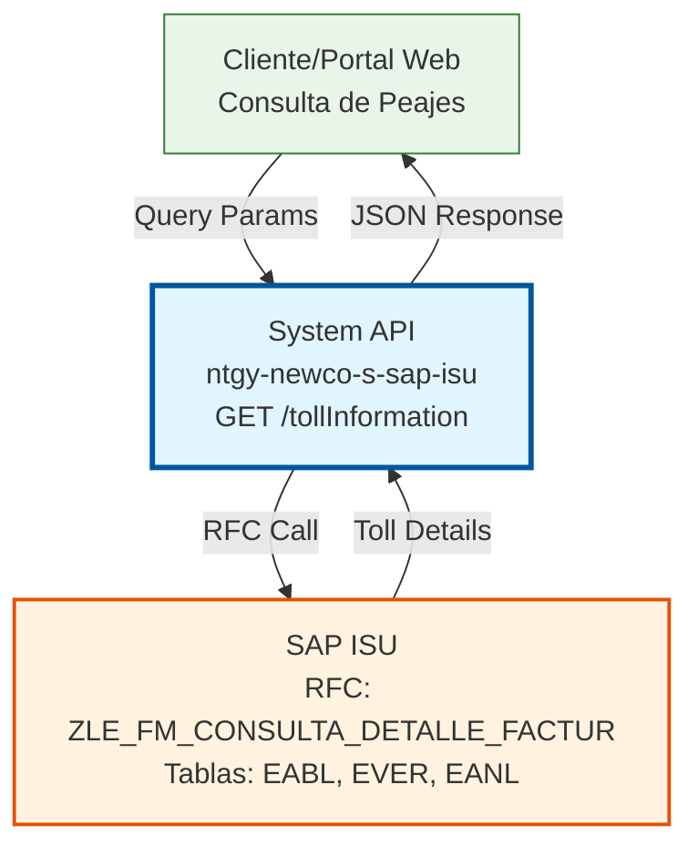
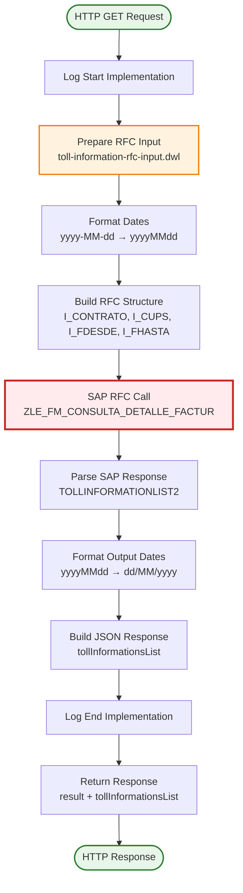
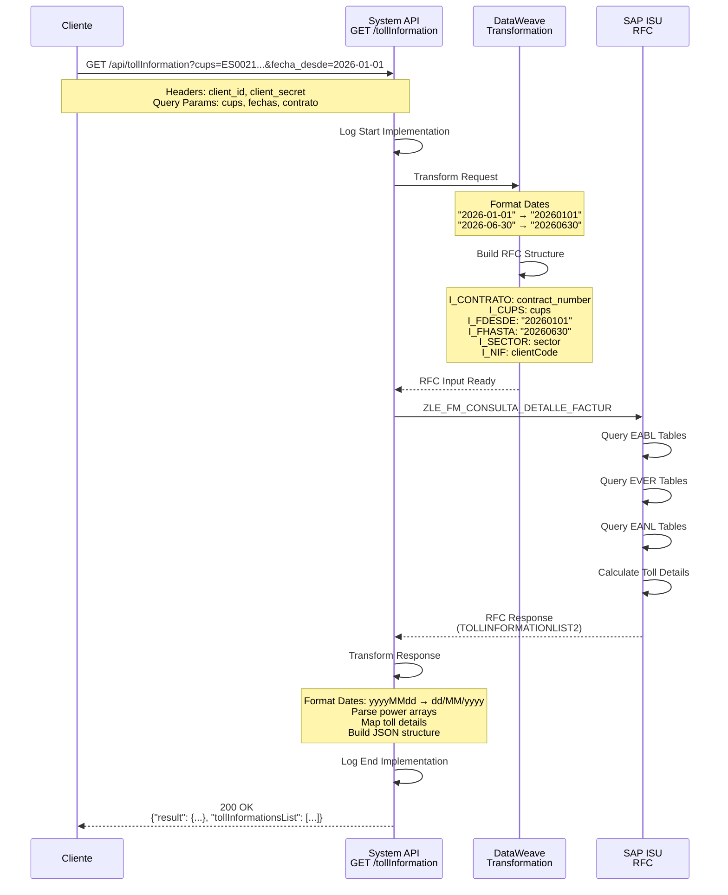

# GET /tollInformation

## 📌 Descripción General

### Propósito del Endpoint

El endpoint **GET /tollInformation** consulta el detalle de peajes de facturación desde SAP ISU. Este endpoint proporciona información completa sobre los peajes aplicados en las facturas, incluyendo períodos de facturación, lecturas de contadores, consumos y detalles de distribución.

El endpoint soporta:
- **Consulta de Peajes por Período**: Información de peajes entre fechas específicas
- **Detalle de Lecturas ATR**: Lecturas de contadores y procedencia
- **Información de Consumo**: Consumos por período y magnitud
- **Datos de Distribución**: Información del distribuidor y tarifa ATR
- **Múltiples Períodos**: Soporte para consulta de varios períodos de facturación

### Tipo de API

**Capa:** System API (API-Led Connectivity)

**Función:** Integración directa con SAP ISU para consultar información detallada de peajes de facturación.

### Patrón de Integración

**Tipo:** Request-Reply Síncrono con SAP RFC

**Descripción:** Recibe parámetros de consulta (contrato, CUPS, fechas), transforma los datos al formato SAP, invoca el RFC `ZLE_FM_CONSULTA_DETALLE_FACTUR` y retorna el detalle de peajes con información de lecturas y consumos.

### Arquitectura API-Led Connectivity



---

## 💼 Propósito del Negocio

### Casos de Uso Principales

1. **Consulta de Detalle de Facturación**
   - Clientes consultan el detalle de peajes aplicados en sus facturas
   - Se obtiene información de períodos de facturación y tarifas ATR
   - Permite entender la composición de los costos de peajes

2. **Análisis de Consumo por Período**
   - Consulta de consumos desglosados por período tarifario
   - Información de lecturas de contadores (origen y destino)
   - Análisis de ajustes y factores de conversión aplicados

3. **Verificación de Lecturas ATR**
   - Validación de lecturas de contadores registradas
   - Información de procedencia de lecturas (real, estimada, etc.)
   - Fechas de registro de lecturas

4. **Información de Distribución**
   - Datos del distribuidor eléctrico
   - Tarifa ATR aplicada
   - Información de autoconsumo y dispositivos

### Contexto Empresarial

- **Dominio:** Facturación y Consumo Energético
- **Sector:** Energía - Utilities
- **División:** Naturgy España - NewCo
- **Proceso de Negocio:** Consulta de detalle de facturación y peajes
- **Módulo SAP:** ISU (Industry Solution for Utilities) - Billing

### Stakeholders

- **Clientes Finales**: Necesitan entender el detalle de sus facturas y peajes
- **Atención al Cliente**: Requieren información detallada para resolver consultas
- **Operaciones de Facturación**: Necesitan validar cálculos de peajes
- **Auditoría**: Requieren trazabilidad de lecturas y consumos

### Valor de Negocio

- **Transparencia**: Información detallada de peajes y consumos para clientes
- **Trazabilidad**: Registro completo de lecturas y períodos de facturación
- **Resolución de Consultas**: Información precisa para atención al cliente
- **Cumplimiento Normativo**: Información ATR según normativa del sector eléctrico

### Consumidores Potenciales

Este endpoint puede ser consumido por:
- Portales web de autoservicio de clientes
- Aplicaciones móviles de clientes
- Sistemas de atención al cliente (call center)
- Process APIs de facturación y consumo
- Sistemas de análisis y reporting

---

## 🔧 Especificación Técnica

### URLs por Ambiente

| Ambiente | URL Base | URL Completa |
|----------|----------|--------------|
| **Local** | `http://localhost:8081` | `http://localhost:8081/api/tollInformation` |
| **Development** | `https://ntgy-newco-s-sap-isu-dev.us-e2.cloudhub.io` | `https://ntgy-newco-s-sap-isu-dev.us-e2.cloudhub.io/api/tollInformation` |
| **UAT** | `https://ntgy-newco-s-sap-isu-uat.us-e2.cloudhub.io` | `https://ntgy-newco-s-sap-isu-uat.us-e2.cloudhub.io/api/tollInformation` |
| **Production** | `https://ntgy-newco-s-sap-isu-pro.us-e2.cloudhub.io` | `https://ntgy-newco-s-sap-isu-pro.us-e2.cloudhub.io/api/tollInformation` |

### Método HTTP

```
GET /api/tollInformation
```

### Parámetros de Entrada

#### Headers HTTP

| Header | Tipo | Requerido | Descripción | Ejemplo |
|--------|------|-----------|-------------|---------|
| `Content-Type` | string | ✅ Sí | Tipo de contenido del request | `application/json` |
| `Accept` | string | ❌ No | Tipo de contenido esperado en response | `application/json` |
| `client_id` | string | ✅ Sí | Client ID de Anypoint Platform | `a1b2c3d4e5f6` |
| `client_secret` | string | ✅ Sí | Client Secret de Anypoint Platform | `A1B2C3D4E5F6` |

#### Query Parameters

| Parámetro | Tipo | Requerido | Descripción | Ejemplo |
|-----------|------|-----------|-------------|---------|
| `contract_number` | string | ❌ No | Número de contrato | `"1000123456"` |
| `cups` | string | ❌ No | Código Universal del Punto de Suministro | `"ES0021000000000001AA"` |
| `fecha_desde` | date | ❌ No | Fecha inicio del período (yyyy-MM-dd) | `"2026-01-01"` |
| `fecha_hasta` | date | ❌ No | Fecha fin del período (yyyy-MM-dd) | `"2026-06-30"` |
| `sector` | string | ❌ No | Sector energético | `"Electricidad"` |
| `clientCode` | string | ❌ No | NIF/CIF del cliente | `"12345678A"` |

**Nota:** Al menos uno de los parámetros debe ser proporcionado para realizar la consulta.

### Respuestas

#### Respuesta Exitosa (200 OK)

```json
{
  "result": {
    "codResult": "0000",
    "msgResult": "No hay error"
  },
  "tollInformationsList": [
    {
      "atrDate": "09/06/2026",
      "endDate": "30/06/2026",
      "startDate": "01/06/2026",
      "billingReason": "01",
      "invoiceType": "NORMAL",
      "cups": "ES0021000000000001AA",
      "atrRate": "2.0TD",
      "atrInvoiceId": "F2026060001",
      "coversionFactor": "1.0",
      "distribuitor": "DIST001",
      "autoCons": "N",
      "device": "CONTADOR001",
      "power": ["4.6", "4.6"],
      "demandedPower": ["4.6", "4.6"],
      "tollInformationDetailList": [
        {
          "magnitude": "AE",
          "period": "P1",
          "procedenceTo": "REAL",
          "procedenceFrom": "REAL",
          "readingValueTo": "12345",
          "readingValueFrom": "12000",
          "adjust": "0.0",
          "integer": "345",
          "decimal": "0",
          "registerDate": "09/06/2026",
          "consumption": "345",
          "energyRevert": "0"
        }
      ]
    }
  ]
}
```

#### Respuesta de Error de Negocio (200 OK con codResult != "0000")

```json
{
  "result": {
    "codResult": "0001",
    "msgResult": "No se encontraron datos para los parámetros proporcionados"
  },
  "tollInformationsList": []
}
```

#### Respuesta de Error Técnico (400/500)

```json
{
  "error": {
    "code": "SAP_ERROR",
    "message": "Error al consultar información de peajes en SAP ISU",
    "timestamp": "2026-06-09T15:00:00Z"
  }
}
```

### Códigos de Estado HTTP

| Código | Descripción | Escenario |
|--------|-------------|-----------|
| **200** | OK | Operación procesada (verificar codResult en body) |
| **400** | Bad Request | Parámetros inválidos o faltantes |
| **401** | Unauthorized | Credenciales inválidas o ausentes |
| **500** | Internal Server Error | Error en SAP ISU o error técnico interno |

### Autenticación y Autorización

- **Tipo:** Client ID & Client Secret (Anypoint Platform)
- **Autorización SAP:** El usuario debe tener permisos para:
  - Ejecutar RFC `ZLE_FM_CONSULTA_DETALLE_FACTUR`
  - Acceso a tablas EABL (Billing Documents), EVER (Contract Data), EANL (Meter Reading)
  - Consulta de información de facturación y consumo

### Timeouts

| Tipo | Valor | Descripción |
|------|-------|-------------|
| **Request Timeout** | 30 segundos | Tiempo máximo de espera para la respuesta |
| **SAP RFC Timeout** | 60 segundos | Tiempo máximo para ejecución del RFC |
| **Connection Timeout** | 10 segundos | Tiempo máximo para establecer conexión con SAP |

---

## 🏗️ Implementación Técnica

### Arquitectura del Flow



### Diagrama de Secuencia



### Transformación de Datos

```mermaid
graph LR
    subgraph Input["Query Parameters"]
        I1[contract_number]
        I2[cups: ES0021...]
        I3[fecha_desde: 2026-01-01]
        I4[fecha_hasta: 2026-06-30]
        I5[sector: Electricidad]
        I6[clientCode: 12345678A]
    end
    
    subgraph Transform["DataWeave Transformation"]
        T1[Format Dates]
        T2[Map Fields]
        T3[Build RFC XML]
    end
    
    subgraph Output["RFC Response → JSON"]
        O1[tollInformationsList]
        O2[atrDate, endDate, startDate]
        O3[cups, atrRate, distribuitor]
        O4[tollInformationDetailList]
        O5[magnitude, period, consumption]
    end
    
    Input --> Transform
    Transform --> Output
    
    style Input fill:#e3f2fd,stroke:#1976d2
    style Transform fill:#fff3e0,stroke:#f57c00
    style Output fill:#e8f5e9,stroke:#2e7d32
```



### Código DataWeave

**Archivo:** `src/main/resources/dw/toll-information-rfc-input.dwl`

```dataweave
%dw 2.0
output application/xml

fun formatDate(fecha : String|Null) = 
    fecha as Date {format: 'yyyy-MM-dd'} as String {format: 'yyyyMMdd'} default ""

---
{
	ZLE_FM_CONSULTA_DETALLE_FACTUR: {
		"import": {
			I_CONTRATO: attributes.queryParams.contract_number,
			I_CUPS: attributes.queryParams.cups,
			I_FDESDE: formatDate(attributes.queryParams.fecha_desde),
			I_FHASTA: formatDate(attributes.queryParams.fecha_hasta),
			I_SECTOR: attributes.queryParams.sector,
			I_NIF: attributes.queryParams.clientCode
		}
	}
}
```

**Explicación del Código:**

1. **Función formatDate**: Convierte fechas de formato ISO (yyyy-MM-dd) a formato SAP (yyyyMMdd)
2. **Mapeo de Parámetros**: Cada query parameter se mapea a un campo de importación del RFC
3. **Manejo de Nulos**: La función formatDate retorna string vacío si el parámetro es null

**Transformación de Response (Inline en subflow):**

```dataweave
%dw 2.0
output application/json

var salida = payload.ZLE_FM_CONSULTA_DETALLE_FACTUR.export

fun formatDate(fecha : String|Null) = 
    fecha as Date {format: 'yyyyMMdd'} as String {format: 'dd/MM/yyyy'} default "00/00/0000"

---
      
{
    "result": {
        "codResult": salida.RESULT2.COD_RESULT default "0000",
        "msgResult": salida.RESULT2.MSG_RESULT default "No hay error"
    },
    "tollInformationsList": salida.TOLLINFORMATIONLIST2.*row map ((item, index) -> {
        "atrDate": formatDate(item.ATRDATE),
        "endDate":  formatDate(item.ENDDATE),
        "startDate":  formatDate(item.STARTDATE),
        "billingReason": item.BILLINGREASON,
        "invoiceType": item.INVOICETYPE,
        "cups": item.CUPS,
        "atrRate": item.ATRRATE,
        "atrInvoiceId": item.ATRINVOICEID,
        "coversionFactor": item.COVERSIONFACTOR,
        "distribuitor": item.DISTRIBUITOR,
        "autoCons": item.AUTOCONS,
        "device": item.DEVICE,
        "power": item.POWER splitBy "," default [],
        "demandedPower": item.POWER_DEMAND splitBy "," default [],        
        "tollInformationDetailList": item.TOLLINFORMATIONDETAILLIST.*row map ((item2, index) -> {
            "magnitude": item2.MAGNITUDE,
            "period": item2.PERIOD,
            "procedenceTo": item2.PROCEDENCETO,
            "procedenceFrom": item2.PROCEDENCEFROM,
            "readingValueTo": item2.READINGVALUETO,
            "readingValueFrom": item2.READINGVALUEFROM,
            "adjust": item2.ADJUST  default "0.0",
            "integer": item2.INTEGER_ATR,
            "decimal": item2.DECIMAL_ATR,
            "registerDate":  formatDate(item2.REGISTERDATE),
            "consumption": item2.CONSUMPTION  default "0",
            "energyRevert": item2.ENERGYREVERT
        } mapObject ((value, key, index) -> (key) : if(isEmpty(value)) "" else value)
        ) 
    } mapObject ((value, key, index) -> (key) : if(value ~= null) "" else value))
}
```

**Explicación del Código:**

1. **Función formatDate**: Convierte fechas SAP (yyyyMMdd) a formato legible (dd/MM/yyyy)
2. **Mapeo de Lista Principal**: Itera sobre TOLLINFORMATIONLIST2 para crear tollInformationsList
3. **Split de Arrays**: Convierte strings separados por comas en arrays (power, demandedPower)
4. **Mapeo de Detalles**: Itera sobre TOLLINFORMATIONDETAILLIST para crear tollInformationDetailList
5. **Limpieza de Nulos**: Convierte valores null en strings vacíos para consistencia

### Configuración SAP

**RFC:** `ZLE_FM_CONSULTA_DETALLE_FACTUR`

**Parámetros de Importación:**
- `I_CONTRATO` (string): Número de contrato
- `I_CUPS` (string): Código Universal del Punto de Suministro
- `I_FDESDE` (string): Fecha desde (yyyyMMdd)
- `I_FHASTA` (string): Fecha hasta (yyyyMMdd)
- `I_SECTOR` (string): Sector energético
- `I_NIF` (string): NIF/CIF del cliente

**Parámetros de Exportación:**
- `RESULT2` (estructura): Código y mensaje de resultado
- `TOLLINFORMATIONLIST2` (tabla): Lista de información de peajes

**Tablas Consultadas:**
- `EABL`: Billing Documents - Documentos de facturación
- `EVER`: Contract Data - Datos de contratos
- `EANL`: Meter Reading - Lecturas de contadores

### Manejo de Errores

| Escenario | Código | Mensaje | Acción |
|-----------|--------|---------|--------|
| Sin datos encontrados | 0001 | "No se encontraron datos" | Verificar parámetros de consulta |
| RFC timeout | 01 | "Timeout en conexión SAP" | Reintentar operación |
| Error de conexión SAP | 01 | "Error de conexión con SAP ISU" | Verificar conectividad |
| Parámetros inválidos | 01 | "Formato de fecha inválido" | Verificar formato yyyy-MM-dd |
| Operación exitosa | 0000 | "No hay error" | Continuar flujo |

---

## 💻 Ejemplos de Uso

### Ejemplo 1: Request Completo con Todos los Parámetros

```bash
curl -X GET "https://ntgy-newco-s-sap-isu-dev.us-e2.cloudhub.io/api/tollInformation?contract_number=1000123456&cups=ES0021000000000001AA&fecha_desde=2026-01-01&fecha_hasta=2026-06-30&sector=Electricidad&clientCode=12345678A" \
  -H "Content-Type: application/json" \
  -H "client_id: a1b2c3d4e5f6g7h8i9j0" \
  -H "client_secret: A1B2C3D4E5F6G7H8I9J0K1L2M3N4O5P6"
```

### Ejemplo 2: Response Exitoso con Datos

```json
{
  "result": {
    "codResult": "0000",
    "msgResult": "No hay error"
  },
  "tollInformationsList": [
    {
      "atrDate": "09/06/2026",
      "endDate": "30/06/2026",
      "startDate": "01/06/2026",
      "billingReason": "01",
      "invoiceType": "NORMAL",
      "cups": "ES0021000000000001AA",
      "atrRate": "2.0TD",
      "atrInvoiceId": "F2026060001",
      "coversionFactor": "1.0",
      "distribuitor": "DIST001",
      "autoCons": "N",
      "device": "CONTADOR001",
      "power": ["4.6", "4.6"],
      "demandedPower": ["4.6", "4.6"],
      "tollInformationDetailList": [
        {
          "magnitude": "AE",
          "period": "P1",
          "procedenceTo": "REAL",
          "procedenceFrom": "REAL",
          "readingValueTo": "12345",
          "readingValueFrom": "12000",
          "adjust": "0.0",
          "integer": "345",
          "decimal": "0",
          "registerDate": "09/06/2026",
          "consumption": "345",
          "energyRevert": "0"
        },
        {
          "magnitude": "AE",
          "period": "P2",
          "procedenceTo": "REAL",
          "procedenceFrom": "REAL",
          "readingValueTo": "8765",
          "readingValueFrom": "8500",
          "adjust": "0.0",
          "integer": "265",
          "decimal": "0",
          "registerDate": "09/06/2026",
          "consumption": "265",
          "energyRevert": "0"
        }
      ]
    }
  ]
}
```

### Ejemplo 3: Request Solo con CUPS

```bash
curl -X GET "https://ntgy-newco-s-sap-isu-dev.us-e2.cloudhub.io/api/tollInformation?cups=ES0021000000000001AA" \
  -H "Content-Type: application/json" \
  -H "client_id: a1b2c3d4e5f6g7h8i9j0" \
  -H "client_secret: A1B2C3D4E5F6G7H8I9J0K1L2M3N4O5P6"
```

### Ejemplo 4: Response Sin Datos Encontrados

```json
{
  "result": {
    "codResult": "0001",
    "msgResult": "No se encontraron datos para los parámetros proporcionados"
  },
  "tollInformationsList": []
}
```

### Ejemplo 5: Request con Rango de Fechas

```bash
curl -X GET "https://ntgy-newco-s-sap-isu-dev.us-e2.cloudhub.io/api/tollInformation?contract_number=1000123456&fecha_desde=2026-01-01&fecha_hasta=2026-03-31" \
  -H "Content-Type: application/json" \
  -H "client_id: a1b2c3d4e5f6g7h8i9j0" \
  -H "client_secret: A1B2C3D4E5F6G7H8I9J0K1L2M3N4O5P6"
```

### Ejemplo 6: Response de Error Técnico

```json
{
  "error": {
    "code": "SAP_TIMEOUT",
    "message": "Timeout al consultar información de peajes en SAP ISU",
    "timestamp": "2026-06-09T15:30:00Z"
  }
}
```

### Ejemplo 7: Request con Cliente Code

```bash
curl -X GET "https://ntgy-newco-s-sap-isu-dev.us-e2.cloudhub.io/api/tollInformation?clientCode=12345678A&fecha_desde=2026-05-01&fecha_hasta=2026-05-31" \
  -H "Content-Type: application/json" \
  -H "client_id: a1b2c3d4e5f6g7h8i9j0" \
  -H "client_secret: A1B2C3D4E5F6G7H8I9J0K1L2M3N4O5P6"