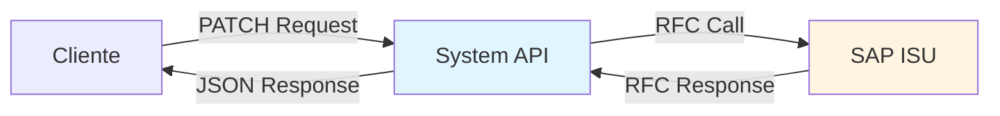
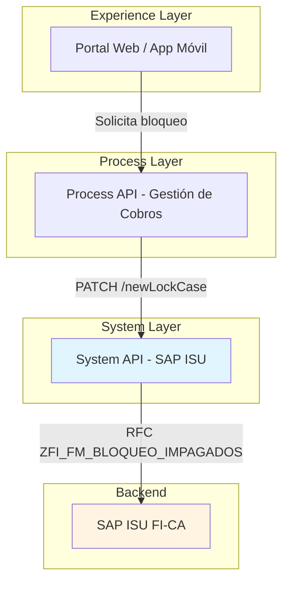
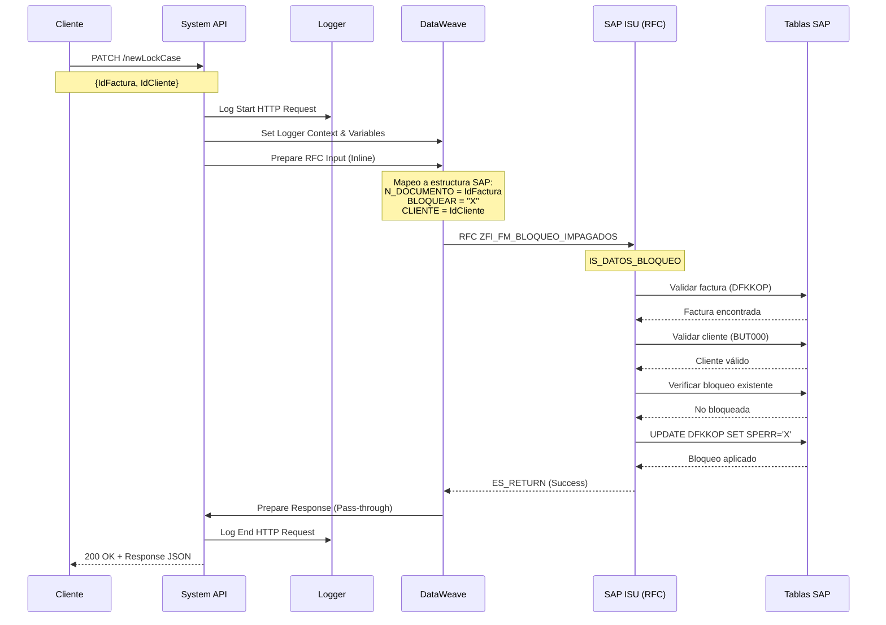
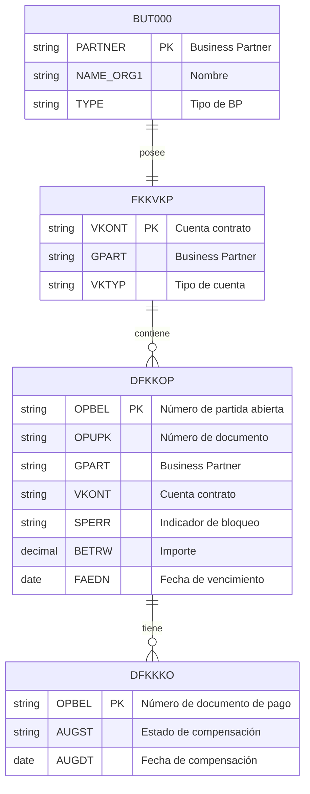

# PATCH /newLockCase

## 📌 Descripción General

### Propósito
Bloquea un caso de impago en SAP ISU aplicando restricciones operativas sobre una factura impagada. Este endpoint permite crear un nuevo bloqueo que restringe las operaciones comerciales del cliente hasta que se regularice la situación de impago.

### Tipo de API
**System API** - Capa de integración directa con SAP ISU

### Patrón de Integración
**Request-Reply Síncrono** con SAP ISU mediante RFC



### Arquitectura de Capas



---

## 💼 Propósito del Negocio

### Problema que Resuelve
- **Gestión de Morosidad**: Permite bloquear operaciones de clientes con facturas impagadas
- **Control de Riesgo**: Restringe servicios adicionales hasta regularización de deuda
- **Proceso de Cobro**: Automatiza el bloqueo como parte del proceso de gestión de cobros
- **Prevención de Fraude**: Bloquea cuentas con comportamiento sospechoso

### Casos de Uso

#### 1. Bloqueo por Impago de Facturas
```
Escenario: Cliente con factura vencida sin pagar
1. Sistema detecta factura vencida > 30 días
2. Proceso de cobros solicita bloqueo
3. API bloquea factura en SAP ISU
4. Cliente no puede contratar nuevos servicios
5. Se notifica al cliente del bloqueo
```

#### 2. Bloqueo Preventivo por Riesgo
```
Escenario: Cliente con historial de impagos
1. Sistema de scoring detecta alto riesgo
2. Departamento de riesgos solicita bloqueo preventivo
3. API bloquea facturas pendientes
4. Se restringe acceso a servicios adicionales
```

#### 3. Bloqueo por Incumplimiento de Acuerdo
```
Escenario: Cliente incumple plan de fraccionamiento
1. Sistema detecta cuota impagada del plan
2. Proceso automático solicita bloqueo
3. API bloquea todas las facturas del plan
4. Se cancela el plan de fraccionamiento
5. Cliente debe regularizar situación
```

### Stakeholders
- **Departamento de Cobros**: Gestión de morosidad y recuperación de deuda
- **Departamento de Riesgos**: Control de exposición crediticia
- **Atención al Cliente**: Información sobre bloqueos activos
- **Sistemas Automatizados**: Procesos de cobro automatizados

---

## 🔧 Especificación Técnica

### Endpoint
```
PATCH /api/s-sap-isu/newLockCase
```

### Headers Requeridos
```http
Content-Type: application/json
Accept: application/json
```

### Request Body

#### Estructura
```json
{
  "IdFactura": "string",
  "IdCliente": "string"
}
```

#### Parámetros

| Campo | Tipo | Requerido | Descripción | Ejemplo |
|-------|------|-----------|-------------|---------|
| `IdFactura` | string | Sí | Número de documento de factura a bloquear (máx. 12 caracteres) | "1234567890" |
| `IdCliente` | string | Sí | Número de Business Partner en SAP ISU (máx. 10 caracteres) | "0001234567" |

#### Validaciones
- `IdFactura`: Debe existir en SAP ISU (tabla DFKKOP)
- `IdFactura`: No debe estar previamente bloqueada (SPERR ≠ 'X')
- `IdFactura`: Debe estar en estado abierto (no pagada)
- `IdCliente`: Debe existir en SAP ISU (tabla BUT000)
- `IdCliente`: Debe ser el titular de la factura

### Response Body

#### Estructura de Éxito (200 OK)
```json
{
  "ZFI_FM_BLOQUEO_IMPAGADOS": {
    "export": {
      "ES_RETURN": {
        "TYPE": "S",
        "ID": "ZFI",
        "NUMBER": "001",
        "MESSAGE": "Bloqueo realizado correctamente",
        "LOG_NO": "",
        "LOG_MSG_NO": "000000",
        "MESSAGE_V1": "",
        "MESSAGE_V2": "",
        "MESSAGE_V3": "",
        "MESSAGE_V4": "",
        "PARAMETER": "",
        "ROW": 0,
        "FIELD": "",
        "SYSTEM": "ISU"
      }
    }
  }
}
```

#### Campos de Respuesta

| Campo | Tipo | Descripción |
|-------|------|-------------|
| `TYPE` | string | Tipo de mensaje: 'S' (Success), 'E' (Error), 'W' (Warning), 'I' (Info) |
| `ID` | string | ID de la clase de mensaje SAP |
| `NUMBER` | string | Número del mensaje SAP |
| `MESSAGE` | string | Texto descriptivo del resultado |
| `LOG_NO` | string | Número de log de aplicación |
| `LOG_MSG_NO` | string | Número de mensaje en el log |
| `MESSAGE_V1-V4` | string | Variables de mensaje adicionales |
| `PARAMETER` | string | Parámetro relacionado con el mensaje |
| `ROW` | integer | Número de fila (para mensajes de tabla) |
| `FIELD` | string | Campo relacionado con el mensaje |
| `SYSTEM` | string | Sistema SAP que generó el mensaje |

#### Códigos de Estado HTTP

| Código | Descripción | Escenario |
|--------|-------------|-----------|
| 200 | OK | Bloqueo procesado (verificar TYPE en respuesta) |
| 400 | Bad Request | Parámetros inválidos o faltantes |
| 500 | Internal Server Error | Error en SAP ISU o conectividad |

---

## 🏗️ Implementación Técnica

### Flujo de Ejecución



### Componentes Técnicos

#### 1. Flow Principal (s-sap-isu.xml)
```xml
<flow name="patch:\newLockCase:application\json:s-sap-isu-config">
    <!-- Set Logger Context & Variables -->
    <ee:transform doc:name="Set Logger Context & Variables">
        <ee:variables>
            <ee:set-variable variableName="loggerContext">
                <!-- Logger context setup -->
            </ee:set-variable>
            <ee:set-variable variableName="flowName">
                flow.name
            </ee:set-variable>
        </ee:variables>
    </ee:transform>
    
    <!-- Log Start -->
    <module-logger:log 
        doc:name="Log Start HTTP Request"
        flowName="#[vars.flowName]"
        message="Starting to process the received HTTP Request"
        content="#[vars.loggerContext]" />
    
    <!-- Call Implementation Flow -->
    <flow-ref 
        doc:name="lockCasesSubscribe" 
        name="lockCasesSubscribe" />
</flow>
```

#### 2. Flow de Implementación (payment-financial-operations.xml)
```xml
<flow name="lockCasesSubscribe">
    <!-- Log Start Implementation -->
    <module-logger:log 
        doc:name="Log Start Implementation"
        message="Start implementation flow for lock cases subscribe" />
    
    <!-- Prepare RFC Input (Inline DataWeave) -->
    <ee:transform doc:name="Prepare RFC Input">
        <ee:set-payload><![CDATA[
            %dw 2.0
            output application/xml
            ---
            {
                "ZFI_FM_BLOQUEO_IMPAGADOS": {
                    "import": {
                        "IS_DATOS_BLOQUEO": {
                            "N_DOCUMENTO": payload.IdFactura,
                            "BLOQUEAR": "X",
                            "CLIENTE": payload.IdCliente
                        }
                    }
                }
            }
        ]]></ee:set-payload>
    </ee:transform>
    
    <!-- Call Shared Subflow -->
    <flow-ref 
        doc:name="lockCasesSapRfcSubflow" 
        name="lockCasesSapRfcSubflow" />
    
    <!-- Prepare Response (Pass-through) -->
    <ee:transform doc:name="Prepare Response">
        <ee:set-payload><![CDATA[
            %dw 2.0
            output application/json
            ---
            payload
        ]]></ee:set-payload>
    </ee:transform>
    
    <!-- Log End Implementation -->
    <module-logger:log 
        doc:name="Log End Implementation"
        message="Finished implementation flow for lock cases subscribe" />
</flow>
```

#### 3. Subflow Compartido (payment-financial-operations.xml)
```xml
<sub-flow name="lockCasesSapRfcSubflow">
    <!-- SAP RFC Call -->
    <sap:synchronous-remote-function-call 
        key="ZFI_FM_BLOQUEO_IMPAGADOS"
        config-ref="SAP_Config" />
</sub-flow>
```

### Transformación de Datos

#### Request → SAP RFC (Inline DataWeave)
```dataweave
%dw 2.0
output application/xml
---
{
    "ZFI_FM_BLOQUEO_IMPAGADOS": {
        "import": {
            "IS_DATOS_BLOQUEO": {
                "N_DOCUMENTO": payload.IdFactura,      // Número de factura
                "BLOQUEAR": "X",                        // Flag de bloqueo (X = bloquear)
                "CLIENTE": payload.IdCliente            // Business Partner
            }
        }
    }
}
```

**Mapeo de Campos:**
| Campo JSON | Campo SAP | Tipo | Descripción |
|------------|-----------|------|-------------|
| `IdFactura` | `N_DOCUMENTO` | String | Número de documento de factura |
| `"X"` (constante) | `BLOQUEAR` | String | Flag que indica operación de bloqueo |
| `IdCliente` | `CLIENTE` | String | Número de Business Partner |

#### SAP RFC → Response (Pass-through)
```dataweave
%dw 2.0
output application/json
---
payload
```

**Nota:** La respuesta del RFC se retorna tal cual (pass-through) sin transformación adicional.

### Operaciones en Base de Datos SAP

#### Tablas Involucradas



#### Operaciones SQL Equivalentes

**1. Validación de Factura:**
```sql
SELECT OPBEL, OPUPK, GPART, VKONT, SPERR, BETRW, FAEDN
FROM DFKKOP
WHERE OPUPK = :IdFactura
  AND GPART = :IdCliente
  AND SPERR <> 'X'  -- No debe estar bloqueada
  AND AUGST = ' '   -- Debe estar abierta (no pagada)
```

**2. Validación de Cliente:**
```sql
SELECT PARTNER, NAME_ORG1, TYPE
FROM BUT000
WHERE PARTNER = :IdCliente
```

**3. Aplicación de Bloqueo:**
```sql
UPDATE DFKKOP
SET SPERR = 'X',           -- Marca como bloqueada
    AEDAT = CURRENT_DATE,  -- Fecha de modificación
    AENAM = :Usuario       -- Usuario que bloquea
WHERE OPUPK = :IdFactura
  AND GPART = :IdCliente
  AND SPERR <> 'X'
```

**4. Registro de Auditoría:**
```sql
INSERT INTO ZCUSTOM_LOCK_LOG (
    OPBEL,
    OPUPK,
    GPART,
    LOCK_TYPE,
    LOCK_DATE,
    LOCK_USER,
    LOCK_REASON
) VALUES (
    :OPBEL,
    :IdFactura,
    :IdCliente,
    'BLOQUEAR',
    CURRENT_TIMESTAMP,
    :Usuario,
    'Bloqueo por impago'
)
```

### Manejo de Errores

#### Errores de Negocio (TYPE='E')

| Código Error | Mensaje | Causa | Solución |
|--------------|---------|-------|----------|
| ZFI-001 | Factura no encontrada | IdFactura no existe en DFKKOP | Verificar número de factura |
| ZFI-002 | Cliente no encontrado | IdCliente no existe en BUT000 | Verificar número de cliente |
| ZFI-003 | Factura ya bloqueada | SPERR='X' en DFKKOP | Verificar estado actual |
| ZFI-004 | Cliente no es titular | GPART ≠ IdCliente | Verificar titularidad |
| ZFI-005 | Factura ya pagada | AUGST='C' en DFKKOP | No se puede bloquear factura pagada |
| ZFI-006 | Proceso de cobro activo | Existe proceso en ejecución | Esperar finalización del proceso |

#### Errores Técnicos

| Código HTTP | Error Type | Descripción | Acción Recomendada |
|-------------|------------|-------------|-------------------|
| 500 | SAP:CONNECTIVITY | Error de conexión con SAP ISU | Verificar conectividad de red |
| 500 | SAP:TIMEOUT | Timeout en llamada RFC | Reintentar operación |
| 500 | SAP:INVALID_CREDENTIALS | Credenciales SAP inválidas | Verificar configuración |
| 400 | VALIDATION:INVALID_REQUEST | Parámetros faltantes o inválidos | Revisar estructura del request |

---

## 💻 Ejemplos de Uso

### Ejemplo 1: Request Completo

```json
{
  "IdFactura": "4900123456",
  "IdCliente": "0001234567"
}
```

**Descripción de Campos:**
- `IdFactura`: Número de documento de la factura impagada (máximo 12 caracteres)
- `IdCliente`: Número de Business Partner del cliente titular (máximo 10 caracteres)

### Ejemplo 2: Response Exitoso (200 OK)

```json
{
  "ZFI_FM_BLOQUEO_IMPAGADOS": {
    "export": {
      "ES_RETURN": {
        "TYPE": "S",
        "ID": "ZFI",
        "NUMBER": "001",
        "MESSAGE": "Bloqueo realizado correctamente para factura 4900123456",
        "LOG_NO": "",
        "LOG_MSG_NO": "000000",
        "MESSAGE_V1": "4900123456",
        "MESSAGE_V2": "0001234567",
        "MESSAGE_V3": "",
        "MESSAGE_V4": "",
        "PARAMETER": "OPUPK",
        "ROW": 0,
        "FIELD": "SPERR",
        "SYSTEM": "ISU"
      }
    }
  }
}
```

**Interpretación:**
- `TYPE: "S"` → Operación exitosa
- `MESSAGE` → Confirmación del bloqueo aplicado
- `MESSAGE_V1` → Número de factura bloqueada
- `MESSAGE_V2` → Cliente asociado

### Ejemplo 3: Comando cURL

```bash
curl -X PATCH "https://api.naturgy.com/s-sap-isu/newLockCase" \
  -H "Content-Type: application/json" \
  -H "Accept: application/json" \
  -H "Authorization: Bearer YOUR_ACCESS_TOKEN" \
  -d '{
    "IdFactura": "4900123456",
    "IdCliente": "0001234567"
  }'
```

**Notas:**
- Reemplazar `YOUR_ACCESS_TOKEN` con token válido
- El endpoint requiere autenticación
- Timeout recomendado: 60 segundos

### Ejemplo 4: Response de Error - Factura No Encontrada

```json
{
  "ZFI_FM_BLOQUEO_IMPAGADOS": {
    "export": {
      "ES_RETURN": {
        "TYPE": "E",
        "ID": "ZFI",
        "NUMBER": "001",
        "MESSAGE": "Factura 4900123456 no encontrada en el sistema",
        "LOG_NO": "",
        "LOG_MSG_NO": "000001",
        "MESSAGE_V1": "4900123456",
        "MESSAGE_V2": "",
        "MESSAGE_V3": "",
        "MESSAGE_V4": "",
        "PARAMETER": "OPUPK",
        "ROW": 0,
        "FIELD": "OPUPK",
        "SYSTEM": "ISU"
      }
    }
  }
}
```

### Ejemplo 5: Response de Error - Factura Ya Bloqueada

```json
{
  "ZFI_FM_BLOQUEO_IMPAGADOS": {
    "export": {
      "ES_RETURN": {
        "TYPE": "E",
        "ID": "ZFI",
        "NUMBER": "003",
        "MESSAGE": "La factura 4900123456 ya está bloqueada",
        "LOG_NO": "",
        "LOG_MSG_NO": "000003",
        "MESSAGE_V1": "4900123456",
        "MESSAGE_V2": "X",
        "MESSAGE_V3": "",
        "MESSAGE_V4": "",
        "PARAMETER": "SPERR",
        "ROW": 0,
        "FIELD": "SPERR",
        "SYSTEM": "ISU"
      }
    }
  }
}
```

### Ejemplo 6: Integración JavaScript/TypeScript

```typescript
interface NewLockCaseRequest {
  IdFactura: string;
  IdCliente: string;
}

interface NewLockCaseResponse {
  ZFI_FM_BLOQUEO_IMPAGADOS: {
    export: {
      ES_RETURN: {
        TYPE: string;
        ID: string;
        NUMBER: string;
        MESSAGE: string;
        LOG_NO: string;
        LOG_MSG_NO: string;
        MESSAGE_V1: string;
        MESSAGE_V2: string;
        MESSAGE_V3: string;
        MESSAGE_V4: string;
        PARAMETER: string;
        ROW: number;
        FIELD: string;
        SYSTEM: string;
      };
    };
  };
}

async function bloquearFactura(
  idFactura: string,
  idCliente: string
): Promise<NewLockCaseResponse> {
  const url = 'https://api.naturgy.com/s-sap-isu/newLockCase';
  
  const request: NewLockCaseRequest = {
    IdFactura: idFactura,
    IdCliente: idCliente
  };

  try {
    const response = await fetch(url, {
      method: 'PATCH',
      headers: {
        'Content-Type': 'application/json',
        'Accept': 'application/json',
        'Authorization': `Bearer ${process.env.API_TOKEN}`
      },
      body: JSON.stringify(request)
    });

    if (!response.ok) {
      throw new Error(`HTTP error! status: ${response.status}`);
    }

    const data: NewLockCaseResponse = await response.json();
    
    // Verificar resultado
    if (data.ZFI_FM_BLOQUEO_IMPAGADOS.export.ES_RETURN.TYPE === 'S') {
      console.log('✅ Bloqueo exitoso:', data.ZFI_FM_BLOQUEO_IMPAGADOS.export.ES_RETURN.MESSAGE);
    } else {
      console.error('❌ Error en bloqueo:', data.ZFI_FM_BLOQUEO_IMPAGADOS.export.ES_RETURN.MESSAGE);
    }

    return data;
  } catch (error) {
    console.error('Error al bloquear factura:', error);
    throw error;
  }
}

// Uso
bloquearFactura('4900123456', '0001234567')
  .then(response => {
    console.log('Respuesta:', response);
  })
  .catch(error => {
    console.error('Error:', error);
  });
```

### Ejemplo 7: Integración Python

```python
import requests
import os
from typing import Dict, Any

def bloquear_factura(id_factura: str, id_cliente: str) -> Dict[str, Any]:
    """
    Bloquea una factura impagada en SAP ISU.
    
    Args:
        id_factura: Número de documento de la factura
        id_cliente: Número de Business Partner del cliente
        
    Returns:
        Respuesta del RFC ZFI_FM_BLOQUEO_IMPAGADOS
        
    Raises:
        requests.exceptions.RequestException: Error en la petición HTTP
        ValueError: Error en la validación de parámetros
    """
    url = 'https://api.naturgy.com/s-sap-isu/newLockCase'
    
    # Validar parámetros
    if not id_factura or len(id_factura) > 12:
        raise ValueError("IdFactura debe tener entre 1 y 12 caracteres")
    
    if not id_cliente or len(id_cliente) > 10:
        raise ValueError("IdCliente debe tener entre 1 y 10 caracteres")
    
    # Preparar request
    headers = {
        'Content-Type': 'application/json',
        'Accept': 'application/json',
        'Authorization': f'Bearer {os.getenv("API_TOKEN")}'
    }
    
    payload = {
        'IdFactura': id_factura,
        'IdCliente': id_cliente
    }
    
    try:
        # Realizar petición
        response = requests.patch(
            url,
            json=payload,
            headers=headers,
            timeout=60
        )
        
        # Verificar status code
        response.raise_for_status()
        
        # Parsear respuesta
        data = response.json()
        es_return = data['ZFI_FM_BLOQUEO_IMPAGADOS']['export']['ES_RETURN']
        
        # Verificar resultado
        if es_return['TYPE'] == 'S':
            print(f"✅ Bloqueo exitoso: {es_return['MESSAGE']}")
        elif es_return['TYPE'] == 'E':
            print(f"❌ Error en bloqueo: {es_return['MESSAGE']}")
        elif es_return['TYPE'] == 'W':
            print(f"⚠️ Advertencia: {es_return['MESSAGE']}")
        
        return data
        
    except requests.exceptions.Timeout:
        print("❌ Timeout en la petición")
        raise
    except requests.exceptions.ConnectionError:
        print("❌ Error de conexión con el servidor")
        raise
    except requests.exceptions.HTTPError as e:
        print(f"❌ Error HTTP {e.response.status_code}: {e.response.text}")
        raise
    except KeyError as e:
        print(f"❌ Estructura de respuesta inválida: {e}")
        raise

# Ejemplo de uso
if __name__ == "__main__":
    try:
        resultado = bloquear_factura(
            id_factura='4900123456',
            id_cliente='0001234567'
        )
        print("Respuesta completa:", resultado)
    except Exception as e:
        print(f"Error: {e}")
```

### Ejemplo 8: Response con Warning (TYPE='W')

```json
{
  "ZFI_FM_BLOQUEO_IMPAGADOS": {
    "export": {
      "ES_RETURN": {
        "TYPE": "W",
        "ID": "ZFI",
        "NUMBER": "010",
        "MESSAGE": "Bloqueo aplicado. Cliente tiene plan de fraccionamiento activo",
        "LOG_NO": "",
        "LOG_MSG_NO": "000010",
        "MESSAGE_V1": "4900123456",
        "MESSAGE_V2": "0001234567",
        "MESSAGE_V3": "PLAN_ACTIVO",
        "MESSAGE_V4": "",
        "PARAMETER": "OPBEL",
        "ROW": 0,
        "FIELD": "SPERR",
        "SYSTEM": "ISU"
      }
    }
  }
}
```

**Interpretación:**
- `TYPE: "W"` → Operación completada con advertencia
- El bloqueo se aplicó correctamente
- Existe un plan de fraccionamiento que podría verse afectado
- Se recomienda revisar el plan de fraccionamiento

### Ejemplo 9: Manejo de Errores Completo (TypeScript)

```typescript
class LockCaseError extends Error {
  constructor(
    message: string,
    public code: string,
    public sapMessage: string
  ) {
    super(message);
    this.name = 'LockCaseError';
  }
}

async function bloquearFacturaConManejo(
  idFactura: string,
  idCliente: string
): Promise<void> {
  try {
    const response = await bloquearFactura(idFactura, idCliente);
    const esReturn = response.ZFI_FM_BLOQUEO_IMPAGADOS.export.ES_RETURN;
    
    switch (esReturn.TYPE) {
      case 'S':
        console.log('✅ Bloqueo exitoso');
        // Notificar al cliente
        await notificarClienteBloqueo(idCliente, idFactura);
        break;
        
      case 'W':
        console.warn('⚠️ Bloqueo con advertencia:', esReturn.MESSAGE);
        // Registrar advertencia pero continuar
        await registrarAdvertencia(idFactura, esReturn.MESSAGE);
        break;
        
      case 'E':
        // Manejar errores específicos
        if (esReturn.NUMBER === '001') {
          throw new LockCaseError(
            'Factura no encontrada',
            'FACTURA_NO_ENCONTRADA',
            esReturn.MESSAGE
          );
        } else if (esReturn.NUMBER === '003') {
          throw new LockCaseError(
            'Factura ya bloqueada',
            'FACTURA_YA_BLOQUEADA',
            esReturn.MESSAGE
          );
        } else {
          throw new LockCaseError(
            'Error desconocido',
            'ERROR_DESCONOCIDO',
            esReturn.MESSAGE
          );
        }
        
      default:
        throw new Error(`Tipo de respuesta desconocido: ${esReturn.TYPE}`);
    }
  } catch (error) {
    if (error instanceof LockCaseError) {
      console.error(`Error de negocio [${error.code}]:`, error.sapMessage);
      // Manejar error de negocio
      await registrarErrorNegocio(idFactura, error);
    } else {
      console.error('Error técnico:', error);
      // Manejar error técnico
      await registrarErrorTecnico(idFactura, error);
    }
    throw error;
  }
}

// Funciones auxiliares
async function notificarClienteBloqueo(idCliente: string, idFactura: string): Promise<void> {
  console.log(`Notificando a cliente ${idCliente} sobre bloqueo de factura ${idFactura}`);
  // Implementar lógica de notificación
}

async function registrarAdvertencia(idFactura: string, mensaje: string): Promise<void> {
  console.log(`Registrando advertencia para factura ${idFactura}: ${mensaje}`);
  // Implementar lógica de registro
}

async function registrarErrorNegocio(idFactura: string, error: LockCaseError): Promise<void> {
  console.log(`Registrando error de negocio para factura ${idFactura}:`, error);
  // Implementar lógica de registro
}

async function registrarErrorTecnico(idFactura: string, error: any): Promise<void> {
  console.log(`Registrando error técnico para factura ${idFactura}:`, error);
  // Implementar lógica de registro
}
```

---

## 📊 Comparación con Endpoint Relacionado

### PATCH /newLockCase vs PATCH /unsubscribeLockCase

| Aspecto | /newLockCase (Bloquear) | /unsubscribeLockCase (Desbloquear) |
|---------|------------------------|-----------------------------------|
| **RFC** | ZFI_FM_BLOQUEO_IMPAGADOS | ZFI_FM_BLOQUEO_IMPAGADOS |
| **Flag SAP** | `BLOQUEAR="X"` | `DESBLOQUEAR="X"` |
| **Operación** | Crear nuevo bloqueo | Liberar bloqueo existente |
| **Estado Inicial** | SPERR = ' ' (sin bloqueo) | SPERR = 'X' (bloqueada) |
| **Estado Final** | SPERR = 'X' (bloqueada) | SPERR = ' ' (sin bloqueo) |
| **Validación** | Factura NO debe estar bloqueada | Factura DEBE estar bloqueada |
| **Caso de Uso** | Impago detectado | Pago regularizado |
| **Flow MuleSoft** | lockCasesSubscribe | lockCasesUnsubscribe |
| **Subflow Compartido** | lockCasesSapRfcSubflow | lockCasesSapRfcSubflow |

**Nota Importante:** Ambos endpoints comparten el mismo RFC y subflow, diferenciándose únicamente en el flag que se envía (`BLOQUEAR` vs `DESBLOQUEAR`).
