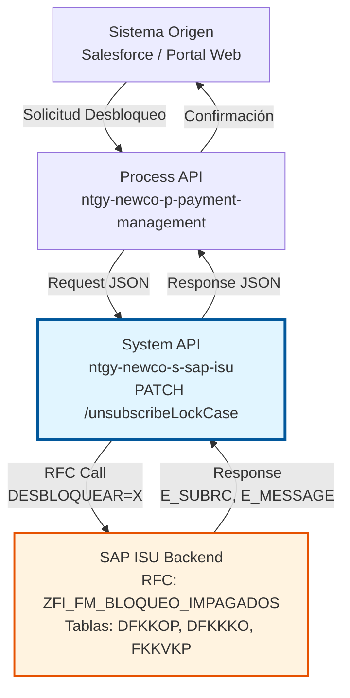
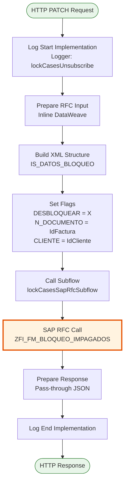
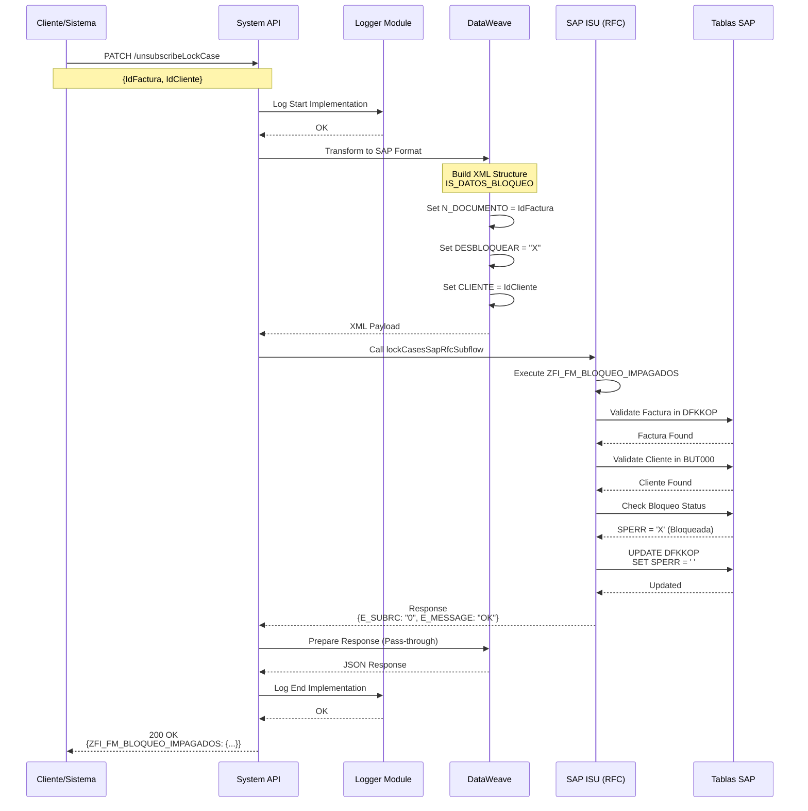
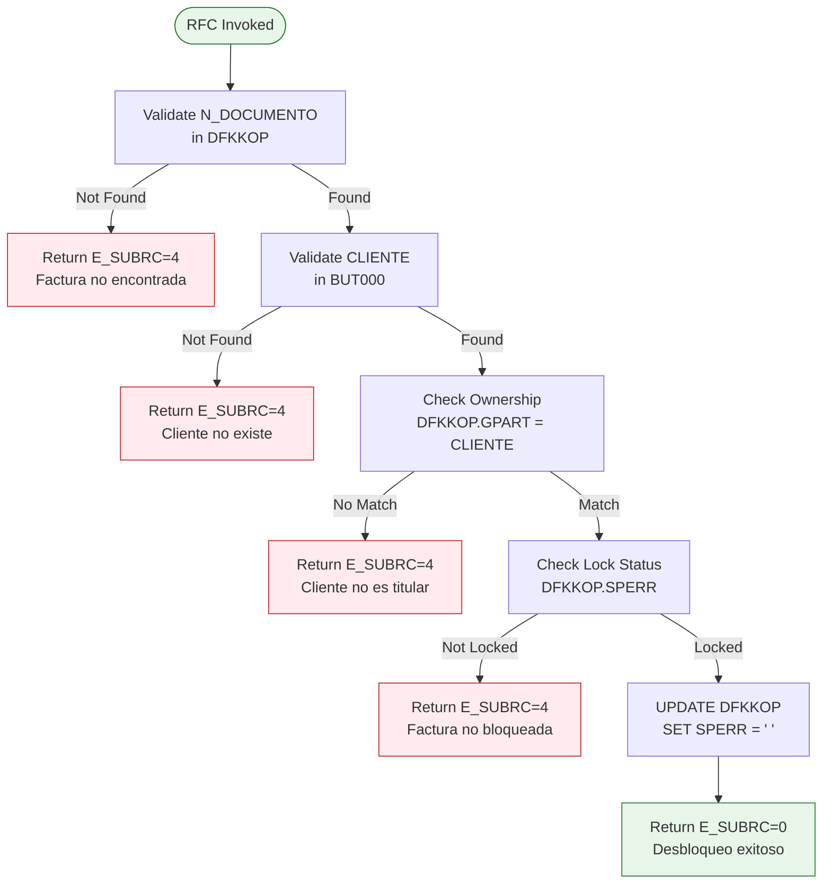
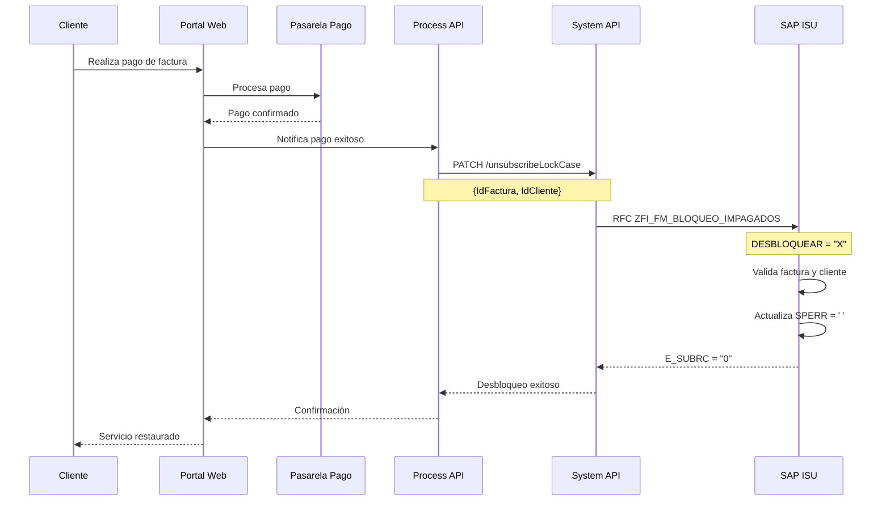

# PATCH /unsubscribeLockCase

## 📌 Descripción General

### Propósito del Endpoint

Desbloquea casos de impago previamente bloqueados en SAP ISU, permitiendo que el cliente pueda volver a realizar operaciones normales tras regularizar su situación de pago. Este endpoint es el complemento del endpoint de bloqueo (`/newLockCase`), formando parte del ciclo completo de gestión de impagos.

El endpoint soporta:
- **Desbloqueo Individual**: Libera el bloqueo de una factura específica
- **Validación de Titular**: Verifica que el cliente sea el propietario de la factura
- **Actualización de Estado**: Modifica el estado de bloqueo en partidas abiertas
- **Trazabilidad**: Registra la operación de desbloqueo en SAP ISU

### Tipo de API

**Capa:** System API (API-Led Connectivity)

**Función:** Integración directa con SAP ISU para gestión de desbloqueos de casos de impago en el módulo FI-CA (Financial Contract Accounting).

### Patrón de Integración

**Tipo:** Request-Reply Síncrono con SAP RFC

**Descripción:** Recibe datos de la factura y cliente a desbloquear, transforma al formato SAP, invoca el RFC `ZFI_FM_BLOQUEO_IMPAGADOS` con flag de desbloqueo, actualiza el estado en SAP ISU y retorna el resultado de la operación.

### Arquitectura API-Led Connectivity



---

## 💼 Propósito del Negocio

### Casos de Uso Principales

1. **Desbloqueo tras Regularización de Pago**
   - Cliente realiza el pago de factura impagada
   - Sistema valida el pago y solicita desbloqueo
   - Se libera el bloqueo permitiendo operaciones normales
   - **Beneficio:** Restauración inmediata del servicio tras pago

2. **Desbloqueo por Acuerdo de Pago**
   - Cliente alcanza acuerdo de fraccionamiento con empresa
   - Agente de cobros solicita desbloqueo administrativo
   - Se libera el bloqueo mientras se cumple el acuerdo
   - **Beneficio:** Flexibilidad en gestión de cobros

3. **Corrección de Bloqueos Erróneos**
   - Se detecta bloqueo aplicado por error
   - Administrador solicita desbloqueo correctivo
   - Se restaura el estado normal de la factura
   - **Beneficio:** Corrección rápida de errores operativos

### Contexto Empresarial

- **Dominio:** Gestión de Cobros y Deuda
- **Sector:** Energía - Utilities
- **División:** Naturgy España - NewCo
- **Proceso de Negocio:** Ciclo de Gestión de Impagos - Fase de Desbloqueo
- **Módulo SAP:** FI-CA (Financial Contract Accounting)

### Stakeholders

- **Departamento de Cobros**: Gestiona el ciclo completo de impagos y desbloqueos
- **Agentes de Atención al Cliente**: Procesan solicitudes de desbloqueo tras regularización
- **Administradores de Crédito**: Autorizan desbloqueos por acuerdos especiales
- **Clientes**: Beneficiarios del desbloqueo tras regularizar su situación

### Valor de Negocio

- **Agilidad Operativa**: Desbloqueo inmediato sin intervención manual en SAP GUI
- **Mejora de Experiencia**: Cliente recupera servicios rápidamente tras pago
- **Trazabilidad**: Registro completo de operaciones de desbloqueo
- **Reducción de Costes**: Automatización del proceso de desbloqueo

### Consumidores Potenciales

Este endpoint puede ser consumido por:
- Process APIs de gestión de pagos y cobros
- Flujos de Salesforce (Platform Events tras confirmación de pago)
- Portales de autoservicio (tras pago online)
- Sistemas de agentes de call center
- Aplicaciones de gestión de cobros

---

## 🔧 Especificación Técnica

### URLs por Ambiente

| Ambiente | URL Base | URL Completa |
|----------|----------|--------------|
| **Local** | `http://localhost:8081` | `http://localhost:8081/api/unsubscribeLockCase` |
| **Development** | `https://ntgy-newco-s-sap-isu-dev.us-e2.cloudhub.io` | `https://ntgy-newco-s-sap-isu-dev.us-e2.cloudhub.io/api/unsubscribeLockCase` |
| **UAT** | `https://ntgy-newco-s-sap-isu-uat.us-e2.cloudhub.io` | `https://ntgy-newco-s-sap-isu-uat.us-e2.cloudhub.io/api/unsubscribeLockCase` |
| **Production** | `https://ntgy-newco-s-sap-isu-pro.us-e2.cloudhub.io` | `https://ntgy-newco-s-sap-isu-pro.us-e2.cloudhub.io/api/unsubscribeLockCase` |

### Método HTTP

```
PATCH /api/unsubscribeLockCase
```

### Parámetros de Entrada

#### Headers HTTP

| Header | Tipo | Requerido | Descripción | Ejemplo |
|--------|------|-----------|-------------|---------|
| `Content-Type` | string | ✅ Sí | Tipo de contenido del request | `application/json` |
| `Accept` | string | ❌ No | Tipo de contenido esperado en response | `application/json` |
| `client_id` | string | ✅ Sí | Client ID de Anypoint Platform | `a1b2c3d4e5f6` |
| `client_secret` | string | ✅ Sí | Client Secret de Anypoint Platform | `A1B2C3D4E5F6` |

#### Body Parameters

| Campo | Tipo | Requerido | Descripción | Ejemplo |
|-------|------|-----------|-------------|---------|
| `IdFactura` | string | ✅ Sí | Número de documento de la factura bloqueada (1-12 caracteres) | `"1234567890"` |
| `IdCliente` | string | ✅ Sí | Número de Business Partner en SAP ISU (10 dígitos) | `"0001234567"` |

**Estructura del Request:**

```json
{
  "IdFactura": "1234567890",
  "IdCliente": "0001234567"
}
```

### Respuestas

#### Respuesta Exitosa (200 OK)

```json
{
  "ZFI_FM_BLOQUEO_IMPAGADOS": {
    "export": {
      "E_SUBRC": "0",
      "E_MESSAGE": "Desbloqueo realizado correctamente"
    }
  }
}
```

**Campos de Respuesta:**

| Campo | Tipo | Descripción |
|-------|------|-------------|
| `ZFI_FM_BLOQUEO_IMPAGADOS.export.E_SUBRC` | string | Código de retorno: "0" = éxito, "4" = error |
| `ZFI_FM_BLOQUEO_IMPAGADOS.export.E_MESSAGE` | string | Mensaje descriptivo del resultado |

#### Respuesta de Error de Negocio (200 OK con E_SUBRC = "4")

```json
{
  "ZFI_FM_BLOQUEO_IMPAGADOS": {
    "export": {
      "E_SUBRC": "4",
      "E_MESSAGE": "Factura no encontrada o no está bloqueada"
    }
  }
}
```

**Errores de Negocio Comunes:**
- Factura no existe en SAP ISU
- Factura no está bloqueada (ya fue desbloqueada)
- Cliente no es el titular de la factura
- Cliente no existe en SAP ISU

#### Respuesta de Error Técnico (400 Bad Request)

```json
{
  "result": {
    "codResult": "0001",
    "msgResult": "Parámetros inválidos: IdFactura es requerido"
  }
}
```

#### Respuesta de Error Técnico (500 Internal Server Error)

```json
{
  "result": {
    "codResult": "0001",
    "msgResult": "Error de conexión con SAP ISU"
  }
}
```

### Autenticación y Autorización

- **Tipo:** Client ID & Client Secret (Anypoint Platform)
- **Autorización SAP:** El usuario SAP debe tener permisos para:
  - Ejecutar RFC `ZFI_FM_BLOQUEO_IMPAGADOS`
  - Acceso de escritura a tabla DFKKOP (Open Items)
  - Acceso de lectura a tablas FKKVKP, BUT000
  - Autorización para operaciones de desbloqueo (objeto S_FKKO_BLK)

### Timeouts

| Tipo | Valor | Descripción |
|------|-------|-------------|
| **Request Timeout** | 30 segundos | Tiempo máximo de espera para la respuesta |
| **SAP RFC Timeout** | 60 segundos | Tiempo máximo para ejecución del RFC |
| **Connection Timeout** | 10 segundos | Tiempo máximo para establecer conexión con SAP |

---

## 🏗️ Implementación Técnica

### Arquitectura del Flow



### Flujo de Datos Detallado



### Componentes del Flow

#### 1. Flow Principal: `lockCasesUnsubscribe`

**Ubicación:** `src/main/mule/implementation/payment-financial-operations.xml` (líneas 234-265)

**Responsabilidades:**
- Logging de inicio y fin de operación
- Transformación de datos de entrada a formato SAP
- Invocación del subflow compartido para llamada RFC
- Preparación de respuesta JSON

#### 2. Transformación de Entrada (Inline DataWeave)

**Código:**
```dataweave
%dw 2.0
output application/xml
---
{
    "ZFI_FM_BLOQUEO_IMPAGADOS": {
        "import": {
            "IS_DATOS_BLOQUEO": {
                "N_DOCUMENTO": payload.IdFactura,
                "DESBLOQUEAR": "X",
                "CLIENTE": payload.IdCliente
            }
        }
    }
}
```

**Mapeo de Campos:**

| Campo JSON | Campo SAP | Tipo | Descripción |
|------------|-----------|------|-------------|
| `IdFactura` | `N_DOCUMENTO` | String | Número de documento de factura |
| `IdCliente` | `CLIENTE` | String | Business Partner number |
| N/A | `DESBLOQUEAR` | String | Flag fijo "X" para desbloqueo |

**Diferencia con Bloqueo:**
- Bloqueo usa: `BLOQUEAR: "X"`
- Desbloqueo usa: `DESBLOQUEAR: "X"`

#### 3. Subflow Compartido: `lockCasesSapRfcSubflow`

**Ubicación:** `src/main/mule/implementation/payment-financial-operations.xml` (líneas 266-268)

**Función:** Ejecuta la llamada RFC a SAP ISU. Este subflow es compartido entre:
- `lockCasesSubscribe` (bloqueo)
- `lockCasesUnsubscribe` (desbloqueo)

**Código:**
```xml
<sub-flow name="lockCasesSapRfcSubflow">
    <sap:synchronous-remote-function-call 
        key="ZFI_FM_BLOQUEO_IMPAGADOS" 
        config-ref="SAP_Config" />
</sub-flow>
```

#### 4. Transformación de Salida

**Código:**
```dataweave
%dw 2.0
output application/json
---
payload
```

**Nota:** La respuesta es pass-through, se retorna directamente la estructura del RFC.

### Integración con SAP ISU

#### RFC: ZFI_FM_BLOQUEO_IMPAGADOS

**Módulo:** FI-CA (Financial Contract Accounting)

**Parámetros de Importación:**

| Parámetro | Tipo | Descripción |
|-----------|------|-------------|
| `IS_DATOS_BLOQUEO` | Structure | Estructura con datos del bloqueo/desbloqueo |
| `IS_DATOS_BLOQUEO-N_DOCUMENTO` | CHAR(12) | Número de documento |
| `IS_DATOS_BLOQUEO-DESBLOQUEAR` | CHAR(1) | Flag de desbloqueo ("X" = desbloquear) |
| `IS_DATOS_BLOQUEO-BLOQUEAR` | CHAR(1) | Flag de bloqueo ("X" = bloquear) |
| `IS_DATOS_BLOQUEO-CLIENTE` | CHAR(10) | Business Partner |

**Parámetros de Exportación:**

| Parámetro | Tipo | Descripción |
|-----------|------|-------------|
| `E_SUBRC` | CHAR(1) | Código de retorno ("0" = OK, "4" = Error) |
| `E_MESSAGE` | CHAR(220) | Mensaje descriptivo |

#### Tablas SAP Involucradas

**1. DFKKOP (Open Items - Partidas Abiertas)**

| Campo | Descripción | Operación |
|-------|-------------|-----------|
| `OPBEL` | Número de documento | READ |
| `GPART` | Business Partner | READ |
| `SPERR` | Indicador de bloqueo | UPDATE |
| `AUGST` | Estado de compensación | READ |

**Operación:** Se actualiza el campo `SPERR` de "X" (bloqueado) a " " (desbloqueado)

**2. FKKVKP (Contract Account - Cuenta Contrato)**

| Campo | Descripción | Operación |
|-------|-------------|-----------|
| `VKONT` | Número de cuenta contrato | READ |
| `GPART` | Business Partner | READ |

**Operación:** Validación de relación cliente-cuenta

**3. BUT000 (Business Partner Master)**

| Campo | Descripción | Operación |
|-------|-------------|-----------|
| `PARTNER` | Business Partner number | READ |
| `NAME_ORG1` | Nombre/Razón social | READ |

**Operación:** Validación de existencia del cliente

**4. DFKKKO (Payment Documents - Documentos de Pago)**

| Campo | Descripción | Operación |
|-------|-------------|-----------|
| `OPBEL` | Número de documento | READ |
| `AUGST` | Estado de pago | READ |

**Operación:** Verificación de estado de pago

### Lógica de Negocio en SAP



**Validaciones Ejecutadas en SAP:**

1. **Validación de Factura**: Verifica que N_DOCUMENTO exista en DFKKOP
2. **Validación de Cliente**: Verifica que CLIENTE exista en BUT000
3. **Validación de Propiedad**: Verifica que DFKKOP.GPART = CLIENTE
4. **Validación de Estado**: Verifica que SPERR = 'X' (bloqueada)
5. **Actualización**: Si todas las validaciones pasan, actualiza SPERR = ' '

---

## 💻 Ejemplos de Uso

### Ejemplo 1: Desbloqueo Exitoso

**Request:**

```bash
curl -X PATCH "https://ntgy-newco-s-sap-isu-dev.us-e2.cloudhub.io/api/unsubscribeLockCase" \
  -H "Content-Type: application/json" \
  -H "client_id: a1b2c3d4e5f6" \
  -H "client_secret: A1B2C3D4E5F6" \
  -d '{
    "IdFactura": "1234567890",
    "IdCliente": "0001234567"
  }'
```

**Response (200 OK):**

```json
{
  "ZFI_FM_BLOQUEO_IMPAGADOS": {
    "export": {
      "E_SUBRC": "0",
      "E_MESSAGE": "Desbloqueo realizado correctamente"
    }
  }
}
```

### Ejemplo 2: Factura No Bloqueada

**Request:**

```bash
curl -X PATCH "https://ntgy-newco-s-sap-isu-dev.us-e2.cloudhub.io/api/unsubscribeLockCase" \
  -H "Content-Type: application/json" \
  -H "client_id: a1b2c3d4e5f6" \
  -H "client_secret: A1B2C3D4E5F6" \
  -d '{
    "IdFactura": "9876543210",
    "IdCliente": "0001234567"
  }'
```

**Response (200 OK con error de negocio):**

```json
{
  "ZFI_FM_BLOQUEO_IMPAGADOS": {
    "export": {
      "E_SUBRC": "4",
      "E_MESSAGE": "La factura no está bloqueada o ya fue desbloqueada"
    }
  }
}
```

### Ejemplo 3: Cliente No es Titular

**Request:**

```bash
curl -X PATCH "https://ntgy-newco-s-sap-isu-dev.us-e2.cloudhub.io/api/unsubscribeLockCase" \
  -H "Content-Type: application/json" \
  -H "client_id: a1b2c3d4e5f6" \
  -H "client_secret: A1B2C3D4E5F6" \
  -d '{
    "IdFactura": "1234567890",
    "IdCliente": "0009999999"
  }'
```

**Response (200 OK con error de negocio):**

```json
{
  "ZFI_FM_BLOQUEO_IMPAGADOS": {
    "export": {
      "E_SUBRC": "4",
      "E_MESSAGE": "El cliente no es el titular de la factura"
    }
  }
}
```

### Ejemplo 4: Error de Validación (400 Bad Request)

**Request:**

```bash
curl -X PATCH "https://ntgy-newco-s-sap-isu-dev.us-e2.cloudhub.io/api/unsubscribeLockCase" \
  -H "Content-Type: application/json" \
  -H "client_id: a1b2c3d4e5f6" \
  -H "client_secret: A1B2C3D4E5F6" \
  -d '{
    "IdCliente": "0001234567"
  }'
```

**Response (400 Bad Request):**

```json
{
  "result": {
    "codResult": "0001",
    "msgResult": "Parámetros inválidos: IdFactura es requerido"
  }
}
```

### Ejemplo 5: Integración con JavaScript/TypeScript

```typescript
interface UnsubscribeLockCaseRequest {
  IdFactura: string;
  IdCliente: string;
}

interface UnsubscribeLockCaseResponse {
  ZFI_FM_BLOQUEO_IMPAGADOS: {
    export: {
      E_SUBRC: string;
      E_MESSAGE: string;
    };
  };
}

async function unsubscribeLockCase(
  idFactura: string,
  idCliente: string
): Promise<UnsubscribeLockCaseResponse> {
  const response = await fetch(
    'https://ntgy-newco-s-sap-isu-dev.us-e2.cloudhub.io/api/unsubscribeLockCase',
    {
      method: 'PATCH',
      headers: {
        'Content-Type': 'application/json',
        'client_id': process.env.CLIENT_ID!,
        'client_secret': process.env.CLIENT_SECRET!,
      },
      body: JSON.stringify({
        IdFactura: idFactura,
        IdCliente: idCliente,
      }),
    }
  );

  if (!response.ok) {
    throw new Error(`HTTP error! status: ${response.status}`);
  }

  return await response.json();
}

// Uso
try {
  const result = await unsubscribeLockCase('1234567890', '0001234567');
  
  if (result.ZFI_FM_BLOQUEO_IMPAGADOS.export.E_SUBRC === '0') {
    console.log('Desbloqueo exitoso:', result.ZFI_FM_BLOQUEO_IMPAGADOS.export.E_MESSAGE);
  } else {
    console.error('Error en desbloqueo:', result.ZFI_FM_BLOQUEO_IMPAGADOS.export.E_MESSAGE);
  }
} catch (error) {
  console.error('Error al desbloquear:', error);
}
```

### Ejemplo 6: Integración con Python

```python
import requests
import os
from typing import Dict, Any

def unsubscribe_lock_case(id_factura: str, id_cliente: str) -> Dict[str, Any]:
    """
    Desbloquea un caso de impago en SAP ISU.
    
    Args:
        id_factura: Número de documento de la factura
        id_cliente: Número de Business Partner
        
    Returns:
        Respuesta del RFC con código y mensaje
    """
    url = "https://ntgy-newco-s-sap-isu-dev.us-e2.cloudhub.io/api/unsubscribeLockCase"
    
    headers = {
        "Content-Type": "application/json",
        "client_id": os.getenv("CLIENT_ID"),
        "client_secret": os.getenv("CLIENT_SECRET")
    }
    
    payload = {
        "IdFactura": id_factura,
        "IdCliente": id_cliente
    }
    
    response = requests.patch(url, json=payload, headers=headers)
    response.raise_for_status()
    
    return response.json()

# Uso
try:
    result = unsubscribe_lock_case("1234567890", "0001234567")
    
    export_data = result["ZFI_FM_BLOQUEO_IMPAGADOS"]["export"]
    
    if export_data["E_SUBRC"] == "0":
        print(f"Desbloqueo exitoso: {export_data['E_MESSAGE']}")
    else:
        print(f"Error en desbloqueo: {export_data['E_MESSAGE']}")
        
except requests.exceptions.HTTPError as e:
    print(f"Error HTTP: {e}")
except Exception as e:
    print(f"Error: {e}")
```

### Ejemplo 7: Flujo Completo de Desbloqueo tras Pago



---

## 🔍 Consideraciones Adicionales

### Diferencias entre Bloqueo y Desbloqueo

| Aspecto | Bloqueo (`/newLockCase`) | Desbloqueo (`/unsubscribeLockCase`) |
|---------|--------------------------|-------------------------------------|
| **Flag SAP** | `BLOQUEAR = "X"` | `DESBLOQUEAR = "X"` |
| **Operación** | SPERR = ' ' → 'X' | SPERR = 'X' → ' ' |
| **Trigger** | Impago detectado | Pago regularizado |
| **Validación** | Factura no bloqueada | Factura bloqueada |
| **Resultado** | Cliente bloqueado | Cliente desbloqueado |

### Mejores Prácticas

1. **Validar Pago Antes de Desbloquear**
   - Verificar que el pago esté confirmado en el sistema
   - Validar que el importe pagado cubra la deuda

2. **Gestión de Errores**
   - Implementar retry logic para errores transitorios
   - Registrar todos los intentos de desbloqueo
   - Notificar al cliente del resultado

3. **Trazabilidad**
   - Registrar quién solicitó el desbloqueo
   - Guardar timestamp de la operación
   - Mantener historial de bloqueos/desbloqueos

4. **Seguridad**
   - Validar permisos del usuario que solicita desbloqueo
   - Implementar rate limiting
   - Auditar todas las operaciones

### Monitoreo y Alertas

**Métricas Clave:**
- Tiempo de respuesta del RFC
- Tasa de éxito/error de desbloqueos
- Número de desbloqueos por día
- Facturas desbloqueadas por error

**Alertas Recomendadas:**
- Tasa de error > 5%
- Tiempo de respuesta > 10 segundos
- Múltiples intentos de desbloqueo de la misma factura
- Desbloqueos fuera de horario laboral

### Troubleshooting

**Problema:** Factura no se desbloquea

**Posibles Causas:**
1. Factura no está bloqueada en SAP
2. Cliente no es el titular
3. Hay procesos de cobro activos
4. Permisos insuficientes en SAP

**Solución:**
1. Verificar estado en tabla DFKKOP
2. Validar GPART en DFKKOP vs CLIENTE
3. Revisar tabla DFKKKO para procesos activos
4. Verificar autorizaciones SAP del usuario técnico

---

**Documentación generada:** 10/06/2026  
**Versión API:** 1.0.0  
**Basado en código:** payment-financial-operations.xml (líneas 234-268)
