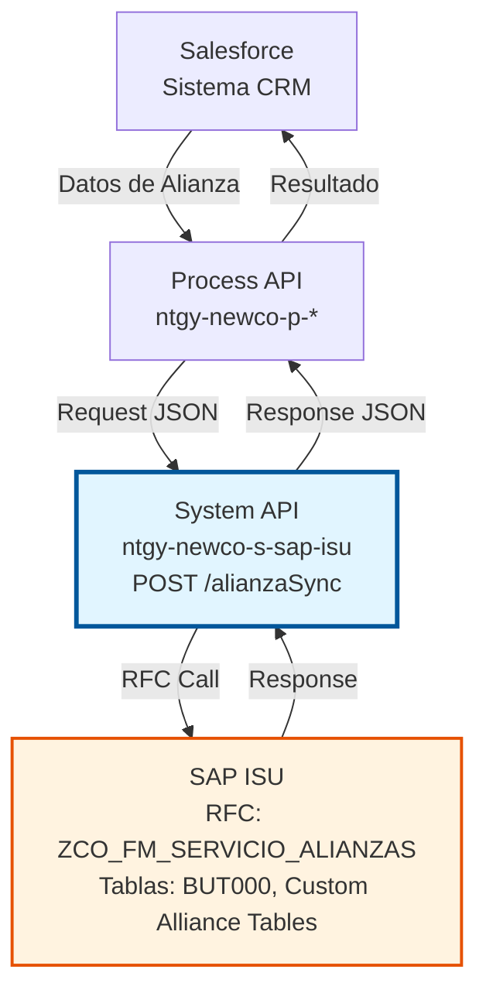
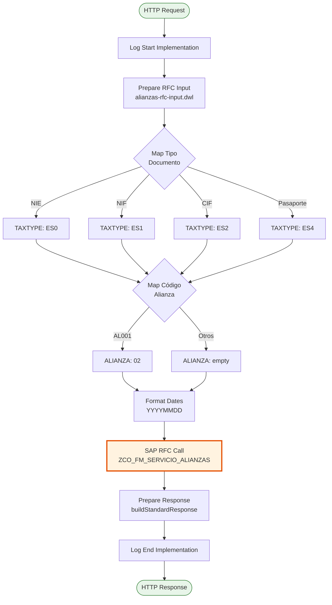
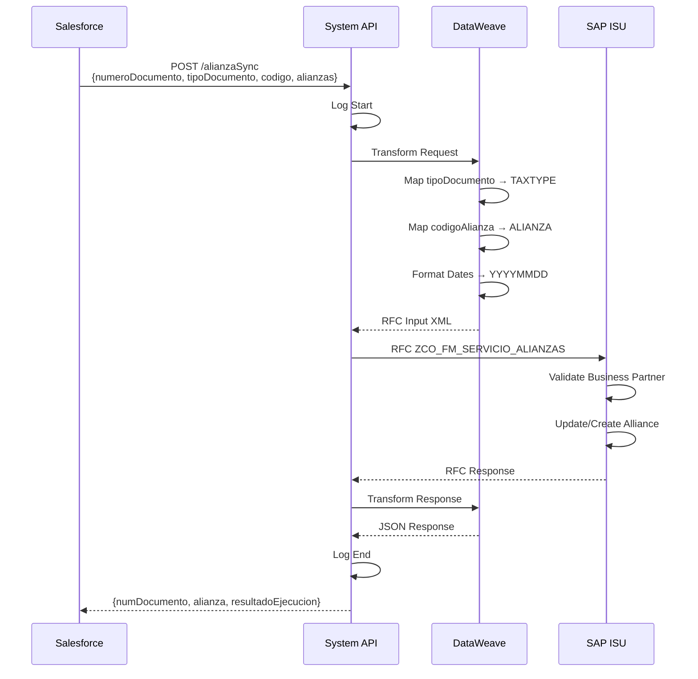
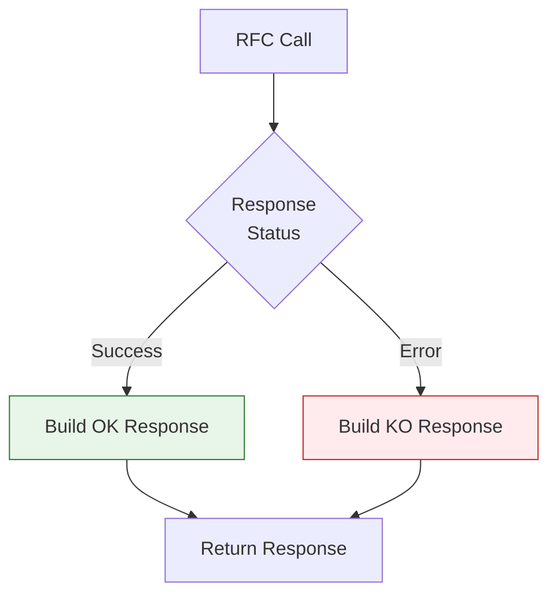

# POST /alianzaSync

## 📌 Descripción General

### Propósito del Endpoint

Sincroniza información de alianzas comerciales (partnerships, acuerdos comerciales) desde Salesforce hacia SAP ISU. Este endpoint permite gestionar la activación y desactivación de alianzas asociadas a clientes (Business Partners), facilitando el seguimiento de acuerdos comerciales especiales, programas de fidelización o partnerships estratégicos.

El endpoint soporta:
- **Activación de Alianzas**: Registro de nuevas alianzas con fecha de alta
- **Desactivación de Alianzas**: Finalización de alianzas existentes con fecha de baja
- **Múltiples Tipos de Documento**: NIF, CIF, NIE, Pasaporte
- **Mapeo de Códigos**: Traducción automática de códigos Salesforce a códigos SAP

### Tipo de API

**Capa:** System API (API-Led Connectivity)

**Función:** Integración directa con SAP ISU para sincronización de alianzas comerciales asociadas a Business Partners.

### Patrón de Integración

**Tipo:** Request-Reply Síncrono con SAP RFC

**Descripción:** Recibe datos de alianza desde Salesforce, transforma la información al formato SAP (incluyendo mapeo de códigos y conversión de fechas), invoca el RFC `ZCO_FM_SERVICIO_ALIANZAS` para actualizar/crear la alianza en SAP ISU, y retorna el resultado de la sincronización.

### Arquitectura API-Led Connectivity



---

## 💼 Propósito del Negocio

### Casos de Uso Principales

1. **Activación de Alianza Comercial**
   - Un cliente se adhiere a un programa de partnership o alianza comercial
   - Se registra la alianza en Salesforce con fecha de inicio
   - El endpoint sincroniza la información a SAP ISU para aplicar beneficios o condiciones especiales
   - **Beneficio**: Gestión centralizada de acuerdos comerciales

2. **Desactivación de Alianza**
   - Un cliente finaliza su participación en una alianza comercial
   - Se registra la fecha de baja en Salesforce
   - El endpoint actualiza SAP ISU para cesar los beneficios asociados
   - **Beneficio**: Control preciso de vigencia de acuerdos

3. **Sincronización de Alianzas Existentes**
   - Durante migraciones o actualizaciones masivas
   - Se sincronizan alianzas históricas desde Salesforce a SAP ISU
   - Garantiza consistencia de datos entre sistemas
   - **Beneficio**: Integridad de datos entre plataformas

### Contexto Empresarial

- **Dominio:** Gestión de Clientes y Alianzas Comerciales
- **Sector:** Energía - Utilities
- **División:** Naturgy España - NewCo
- **Proceso de Negocio:** Gestión de Partnerships y Acuerdos Comerciales
- **Módulo SAP:** SD (Sales & Distribution) / ISU

### Stakeholders

- **Equipo Comercial**: Gestiona alianzas y partnerships con clientes
- **Equipo de CRM (Salesforce)**: Mantiene información de alianzas en Salesforce
- **Equipo SAP ISU**: Administra datos maestros de clientes y alianzas
- **Equipo de Facturación**: Aplica condiciones especiales según alianzas activas

### Valor de Negocio

- **Automatización**: Elimina sincronización manual de alianzas entre sistemas
- **Consistencia**: Garantiza que Salesforce y SAP ISU tengan la misma información
- **Trazabilidad**: Registro completo de fechas de alta y baja de alianzas
- **Agilidad Comercial**: Activación inmediata de beneficios de alianzas

### Consumidores Potenciales

Este endpoint puede ser consumido por:
- Process APIs de gestión de clientes
- Flujos de Salesforce (Platform Events, Process Builder, Flows)
- Sistemas de integración middleware
- Aplicaciones de gestión comercial

---

## 🔧 Especificación Técnica

### URLs por Ambiente

| Ambiente | URL Base | URL Completa |
|----------|----------|--------------|
| **Local** | `http://localhost:8081` | `http://localhost:8081/api/alianzaSync` |
| **Development** | `https://ntgy-newco-s-sap-isu-dev.us-e2.cloudhub.io` | `https://ntgy-newco-s-sap-isu-dev.us-e2.cloudhub.io/api/alianzaSync` |
| **UAT** | `https://ntgy-newco-s-sap-isu-uat.us-e2.cloudhub.io` | `https://ntgy-newco-s-sap-isu-uat.us-e2.cloudhub.io/api/alianzaSync` |
| **Production** | `https://ntgy-newco-s-sap-isu-pro.us-e2.cloudhub.io` | `https://ntgy-newco-s-sap-isu-pro.us-e2.cloudhub.io/api/alianzaSync` |

### Método HTTP

```
POST /api/alianzaSync
```

### Parámetros de Entrada

#### Headers HTTP

| Header | Tipo | Requerido | Descripción | Ejemplo |
|--------|------|-----------|-------------|---------|
| `Content-Type` | string | ✅ Sí | Tipo de contenido del request | `application/json` |
| `Accept` | string | ❌ No | Tipo de contenido esperado en response | `application/json` |

#### Body Parameters

**Estructura Jerárquica del Request:**

| Campo | Tipo | Req | Validación | Descripción |
|-------|------|-----|------------|-------------|
| **detalleObjeto** | `object` | ✅ | - | Objeto raíz que contiene todos los detalles de la sincronización de alianza |
| ├─ **numeroDocumento** | `string` | ✅ | `minLength: 8`<br/>`maxLength: 20` | Número de documento fiscal del cliente (NIF, CIF, NIE, Pasaporte). Identifica de forma única al Business Partner en SAP ISU. |
| ├─ **tipoDocumento** | `string` | ✅ | `enum: [NIE, NIF, CIF, Pasaporte]` | Tipo de documento de identificación del cliente. Se mapea a códigos SAP:<br/>• `NIE` → `ES0`<br/>• `NIF` → `ES1`<br/>• `CIF` → `ES2`<br/>• `Pasaporte` → `ES4` |
| ├─ **codigo** | `string` | ✅ | `minLength: 1`<br/>`maxLength: 20` | Código externo del Business Partner en Salesforce (BPEXT). Se utiliza como identificador alternativo del cliente en el sistema origen. |
| └─ **alianzas** | `array` | ✅ | `minItems: 1` | Array de alianzas comerciales a sincronizar. **Importante**: Aunque se envía un array, actualmente **solo se procesa el primer elemento** (índice 0). |
|    └─ **[0]** | `object` | ✅ | - | Objeto que representa una alianza comercial individual |
|       ├─ **codigoAlianza** | `string` | ✅ | - | Código de la alianza en Salesforce. Se mapea a código SAP:<br/>• `AL001` → `02` (alianza principal)<br/>• Otros códigos → `""` (vacío, alianza no reconocida) |
|       ├─ **fechaAltaAlianza** | `date-only` | ✅ | Formato: `YYYY-MM-DD` | Fecha de activación de la alianza (formato ISO 8601). Se convierte automáticamente a formato SAP `YYYYMMDD`. Marca el inicio de vigencia de los beneficios asociados. |
|       └─ **fechaBajaAlianza** | `date-only` | ❌ | Formato: `YYYY-MM-DD` | Fecha de desactivación de la alianza (formato ISO 8601). **Opcional**: Si no se proporciona, se asigna automáticamente la fecha máxima SAP `9999-12-31` (vigencia indefinida). |

**Ejemplo Completo del Payload:**

```json
{
  "detalleObjeto": {
    "numeroDocumento": "12345678A",           // NIF del cliente
    "tipoDocumento": "NIF",                   // Tipo: NIE, NIF, CIF, Pasaporte
    "codigo": "BP001234",                     // Código Salesforce del BP
    "alianzas": [                             // Array de alianzas (solo se procesa [0])
      {
        "codigoAlianza": "AL001",             // Código alianza SF → SAP: 02
        "fechaAltaAlianza": "2024-01-15",     // Fecha inicio (ISO 8601)
        "fechaBajaAlianza": "2024-12-31"      // Fecha fin (opcional)
      }
    ]
  }
}
```

**Ejemplo Payload Mínimo (Solo Campos Requeridos):**

```json
{
  "detalleObjeto": {
    "numeroDocumento": "12345678A",
    "tipoDocumento": "NIF",
    "codigo": "BP001234",
    "alianzas": [
      {
        "codigoAlianza": "AL001",
        "fechaAltaAlianza": "2024-01-15"
        // fechaBajaAlianza omitida → se usa 9999-12-31
      }
    ]
  }
}
```

**Variaciones por Tipo de Documento:**

<details>
<summary><strong>Ejemplo con NIE (Número de Identidad de Extranjero)</strong></summary>

```json
{
  "detalleObjeto": {
    "numeroDocumento": "X1234567L",
    "tipoDocumento": "NIE",              // → SAP: ES0
    "codigo": "BP002345",
    "alianzas": [
      {
        "codigoAlianza": "AL001",
        "fechaAltaAlianza": "2024-02-01",
        "fechaBajaAlianza": "2025-01-31"
      }
    ]
  }
}
```
</details>

<details>
<summary><strong>Ejemplo con CIF (Código de Identificación Fiscal - Empresa)</strong></summary>

```json
{
  "detalleObjeto": {
    "numeroDocumento": "B12345678",
    "tipoDocumento": "CIF",              // → SAP: ES2
    "codigo": "BP003456",
    "alianzas": [
      {
        "codigoAlianza": "AL001",
        "fechaAltaAlianza": "2024-03-01"
      }
    ]
  }
}
```
</details>

<details>
<summary><strong>Ejemplo con Pasaporte</strong></summary>

```json
{
  "detalleObjeto": {
    "numeroDocumento": "ABC123456",
    "tipoDocumento": "Pasaporte",        // → SAP: ES4
    "codigo": "BP004567",
    "alianzas": [
      {
        "codigoAlianza": "AL001",
        "fechaAltaAlianza": "2024-04-01",
        "fechaBajaAlianza": "2024-10-31"
      }
    ]
  }
}
```
</details>

#### Validaciones del Payload

**Validaciones de Campos:**

1. **numeroDocumento**
   - ✅ Longitud mínima: 8 caracteres
   - ✅ Longitud máxima: 20 caracteres
   - ✅ Debe corresponder a un Business Partner existente en SAP ISU
   - ✅ Formato debe ser válido según el tipo de documento

2. **tipoDocumento**
   - ✅ Debe ser uno de: `NIE`, `NIF`, `CIF`, `Pasaporte`
   - ✅ Valor case-sensitive (debe coincidir exactamente)
   - ⚠️ Valores no reconocidos resultan en `TAXTYPE: null` en SAP

3. **codigo**
   - ✅ Longitud mínima: 1 carácter
   - ✅ Longitud máxima: 20 caracteres
   - ✅ Debe ser un código válido de Business Partner en Salesforce

4. **alianzas**
   - ✅ Debe contener al menos 1 elemento
   - ⚠️ Solo se procesa el primer elemento del array (índice 0)
   - ⚠️ Elementos adicionales son ignorados

5. **codigoAlianza**
   - ✅ Campo obligatorio
   - ⚠️ Solo `AL001` se mapea a código SAP `02`
   - ⚠️ Otros códigos resultan en alianza vacía `""` en SAP

6. **fechaAltaAlianza**
   - ✅ Formato ISO 8601: `YYYY-MM-DD`
   - ✅ Debe ser una fecha válida
   - ✅ Se convierte automáticamente a formato SAP `YYYYMMDD`

7. **fechaBajaAlianza**
   - ❌ Campo opcional
   - ✅ Si se proporciona, formato ISO 8601: `YYYY-MM-DD`
   - ✅ Si se omite, se asigna `9999-12-31` (vigencia indefinida)
   - ⚠️ Debe ser posterior o igual a `fechaAltaAlianza`

**Comportamiento de Valores por Defecto:**

| Campo | Si se omite | Valor asignado |
|-------|-------------|----------------|
| `fechaBajaAlianza` | ❌ Opcional | `9999-12-31` (fecha máxima SAP) |
| `codigoAlianza` diferente de `AL001` | N/A | `""` (vacío en SAP) |
| `tipoDocumento` no reconocido | N/A | `null` (puede causar error en SAP) |

**Reglas de Negocio:**

- 🔹 El Business Partner debe existir previamente en SAP ISU (identificado por `numeroDocumento`)
- 🔹 Solo se puede tener una alianza activa por cliente a la vez
- 🔹 La fecha de alta debe ser anterior o igual a la fecha actual
- 🔹 Si se proporciona fecha de baja, debe ser posterior a la fecha de alta
- 🔹 El código de alianza `AL001` es el único reconocido actualmente (mapea a `02` en SAP)

### Respuestas

#### Respuesta Exitosa (200 OK)

```json
{
  "numDocumento": "12345678A",
  "alianza": "02",
  "resultadoEjecucion": "OK",
  "descripcion": "Alianza sincronizada correctamente"
}
```

**Campos de Respuesta:**

| Campo | Tipo | Descripción |
|-------|------|-------------|
| `numDocumento` | string | Número de documento fiscal del cliente procesado |
| `alianza` | string | Código de la alianza asignado en SAP ISU |
| `resultadoEjecucion` | string | Resultado de la operación (`OK` o `KO`) |
| `descripcion` | string | Descripción del resultado de la operación |
| `idMensaje` | string | ID del mensaje de SAP (presente en caso de error) |
| `numMensaje` | string | Número del mensaje de SAP (presente en caso de error) |
| `areaFuncional` | string | Área funcional de SAP donde se produjo el error |
| `categoriaError` | string | Categoría del error SAP |

#### Respuesta de Error de Negocio (200 OK con resultadoEjecucion = "KO")

```json
{
  "numDocumento": "12345678A",
  "alianza": "",
  "resultadoEjecucion": "KO",
  "idMensaje": "E",
  "numMensaje": "001",
  "descripcion": "Business Partner no encontrado en SAP ISU",
  "areaFuncional": "SD",
  "categoriaError": "E"
}
```

#### Respuesta de Error Técnico (400/500)

```json
{
  "result": {
    "codResult": "0001",
    "msgResult": "Error interno del servidor"
  }
}
```

### Autenticación y Autorización

- **Tipo:** Client ID & Client Secret (Anypoint Platform)
- **Autorización SAP:** El usuario SAP debe tener permisos para:
  - Ejecutar RFC `ZCO_FM_SERVICIO_ALIANZAS`
  - Acceso de lectura a tabla `BUT000` (Business Partner)
  - Acceso de escritura a tablas personalizadas de alianzas
  - Autorización para modificar datos de Business Partner

### Timeouts

| Tipo | Valor | Descripción |
|------|-------|-------------|
| **Request Timeout** | 30 segundos | Tiempo máximo de espera para la respuesta |
| **SAP RFC Timeout** | 60 segundos | Tiempo máximo para ejecución del RFC |
| **Connection Timeout** | 10 segundos | Tiempo máximo para establecer conexión con SAP |

---

## 🏗️ Implementación Técnica

### Arquitectura del Flow



### Componentes del Flow

#### 1. Log Start Implementation
```xml
<module-logger:log 
    level="DEBUG" 
    flowName="#[vars.flowName]" 
    message="Start implementation flow for alianzas" />
```

#### 2. Prepare RFC Input (DataWeave)

**Archivo:** `alianzas-rfc-input.dwl`

```dataweave
%dw 2.0
output application/xml
import formatDate, SAP_CONSTANTS from modules::commonUtils

var detalleObjeto = payload.detalleObjeto
var alianz = payload.detalleObjeto.alianzas[0]
---
{
    "ZCO_FM_SERVICIO_ALIANZAS":{
        "import":{
            "PI_INPUT":{
                "TAXNUM": detalleObjeto.numeroDocumento,
                "TAXTYPE": if(payload.detalleObjeto.tipoDocumento == "NIE") "ES0"
                    else if(payload.detalleObjeto.tipoDocumento == "NIF") "ES1"
                    else if(payload.detalleObjeto.tipoDocumento == "CIF") "ES2"
                    else if(payload.detalleObjeto.tipoDocumento== "Pasaporte") "ES4"
                    else null,
                "BPEXT": detalleObjeto.codigo,
                "ALIANZA": if(alianz.codigoAlianza == "AL001") "02" else "",
                "FECHA_ALTA": formatDate(alianz.fechaAltaAlianza) default "",
                "FECHA_BAJA": formatDate(alianz.fechaBajaAlianza) default SAP_CONSTANTS.DEFAULT_DATE_TO
            }
        }
    }
}
```

**Transformaciones Aplicadas:**
- **Tipo de Documento**: Mapeo de valores Salesforce a códigos SAP (ES0, ES1, ES2, ES4)
- **Código de Alianza**: Mapeo de código Salesforce (AL001) a código SAP (02)
- **Fechas**: Conversión de formato ISO 8601 (YYYY-MM-DD) a formato SAP (YYYYMMDD)
- **Fecha de Baja**: Si no se proporciona, se usa fecha máxima SAP (99991231)

#### 3. SAP RFC Call

```xml
<sap:synchronous-remote-function-call 
    key="ZCO_FM_SERVICIO_ALIANZAS" 
    config-ref="SAP_Config" />
```

**Parámetros de Entrada del RFC:**

| Parámetro SAP | Origen | Descripción |
|---------------|--------|-------------|
| `PI_INPUT.TAXNUM` | `numeroDocumento` | Número de documento fiscal |
| `PI_INPUT.TAXTYPE` | `tipoDocumento` (mapeado) | Tipo de documento SAP (ES0/ES1/ES2/ES4) |
| `PI_INPUT.BPEXT` | `codigo` | Código externo del Business Partner |
| `PI_INPUT.ALIANZA` | `codigoAlianza` (mapeado) | Código de alianza SAP |
| `PI_INPUT.FECHA_ALTA` | `fechaAltaAlianza` (formateada) | Fecha de activación (YYYYMMDD) |
| `PI_INPUT.FECHA_BAJA` | `fechaBajaAlianza` (formateada) | Fecha de desactivación (YYYYMMDD) |

#### 4. Prepare Response (DataWeave Inline)

```dataweave
%dw 2.0
output application/json
import buildStandardResponse from modules::commonUtils
var out = payload.ZCO_FM_SERVICIO_ALIANZAS.export.PE_OUTPUT
---
buildStandardResponse(out, {
    numDocumento: out.TAXNUM,
    alianza: out.ALIANZA
})
```

**Función `buildStandardResponse`:**
- Construye respuesta estándar con campos de resultado
- Incluye `resultadoEjecucion`, `idMensaje`, `numMensaje`, `descripcion`, `areaFuncional`, `categoriaError`
- Agrega campos específicos del endpoint (`numDocumento`, `alianza`)

#### 5. Log End Implementation
```xml
<module-logger:log 
    level="DEBUG" 
    flowName="#[vars.flowName]" 
    message="Finished implementation flow for alianzas" />
```

### Diagrama de Secuencia



### Manejo de Errores



**Tipos de Error:**
- **Business Partner No Encontrado**: Cliente no existe en SAP ISU
- **Código de Alianza Inválido**: Código no reconocido por SAP
- **Error de Fechas**: Fechas inválidas o inconsistentes
- **Error de Permisos**: Usuario SAP sin autorización

---

## 💻 Ejemplos de Uso

### Ejemplo 1: Activación de Alianza Exitosa

**Request:**
```bash
curl -X POST "https://ntgy-newco-s-sap-isu-dev.us-e2.cloudhub.io/api/alianzaSync" \
  -H "Content-Type: application/json" \
  -H "client_id: YOUR_CLIENT_ID" \
  -H "client_secret: YOUR_CLIENT_SECRET" \
  -d '{
    "detalleObjeto": {
      "numeroDocumento": "12345678A",
      "tipoDocumento": "NIF",
      "codigo": "BP001234",
      "alianzas": [
        {
          "codigoAlianza": "AL001",
          "fechaAltaAlianza": "2024-01-15",
          "fechaBajaAlianza": "2024-12-31"
        }
      ]
    }
  }'
```

**Response (200 OK):**
```json
{
  "numDocumento": "12345678A",
  "alianza": "02",
  "resultadoEjecucion": "OK",
  "descripcion": "Alianza sincronizada correctamente"
}
```

### Ejemplo 2: Activación de Alianza sin Fecha de Baja

**Request:**
```json
{
  "detalleObjeto": {
    "numeroDocumento": "B12345678",
    "tipoDocumento": "CIF",
    "codigo": "BP005678",
    "alianzas": [
      {
        "codigoAlianza": "AL001",
        "fechaAltaAlianza": "2024-02-01"
      }
    ]
  }
}
```

**Response (200 OK):**
```json
{
  "numDocumento": "B12345678",
  "alianza": "02",
  "resultadoEjecucion": "OK",
  "descripcion": "Alianza activada sin fecha de baja (vigencia indefinida)"
}
```

### Ejemplo 3: Error - Business Partner No Encontrado

**Request:**
```json
{
  "detalleObjeto": {
    "numeroDocumento": "99999999Z",
    "tipoDocumento": "NIF",
    "codigo": "BP999999",
    "alianzas": [
      {
        "codigoAlianza": "AL001",
        "fechaAltaAlianza": "2024-01-15"
      }
    ]
  }
}
```

**Response (200 OK):**
```json
{
  "numDocumento": "99999999Z",
  "alianza": "",
  "resultadoEjecucion": "KO",
  "idMensaje": "E",
  "numMensaje": "001",
  "descripcion": "Business Partner no encontrado en SAP ISU",
  "areaFuncional": "SD",
  "categoriaError": "E"
}
```

### Ejemplo 4: Error de Validación (400 Bad Request)

**Request:**
```json
{
  "detalleObjeto": {
    "numeroDocumento": "12345678A",
    "tipoDocumento": "INVALID",
    "codigo": "BP001234",
    "alianzas": []
  }
}
```

**Response (400 Bad Request):**
```json
{
  "result": {
    "codResult": "0001",
    "msgResult": "Validation error: tipoDocumento must be one of [NIE, NIF, CIF, Pasaporte]"
  }
}