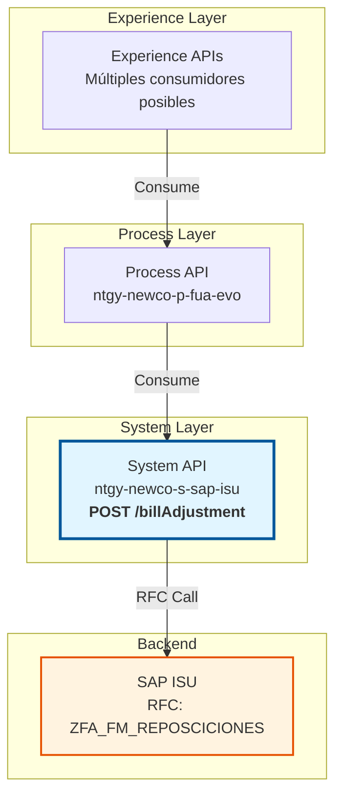
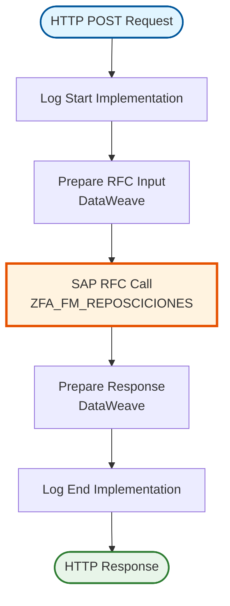
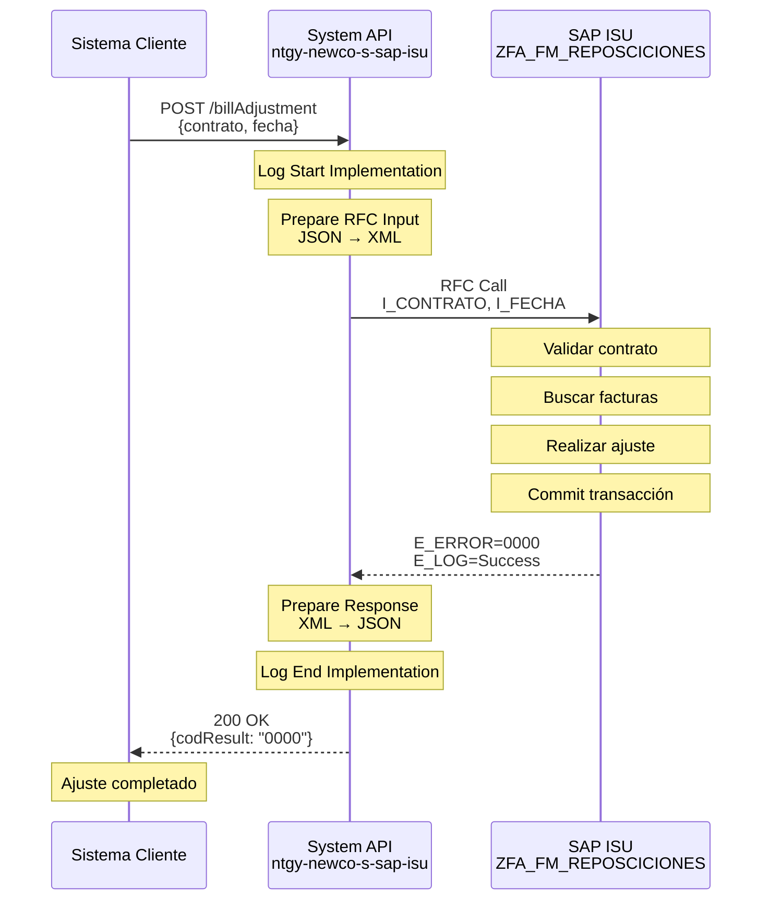
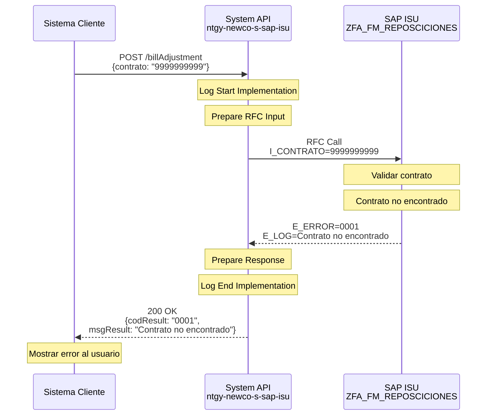
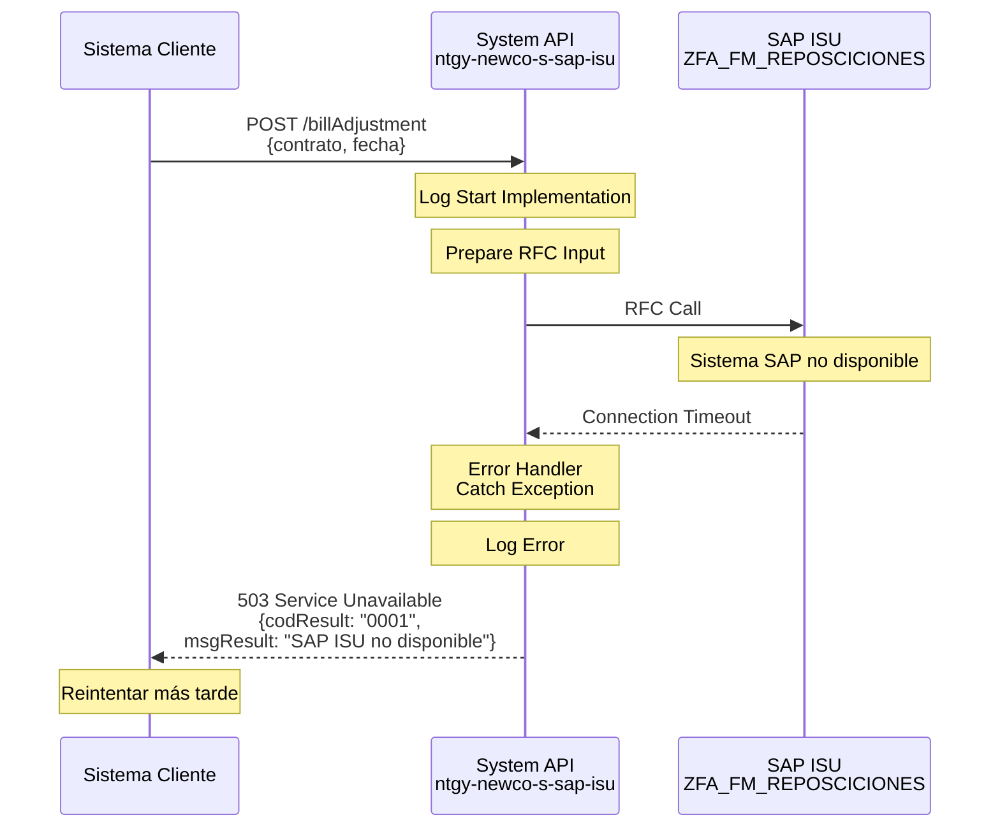

# POST /billAdjustment

## 📌 Descripción General

### Propósito del Endpoint

Este endpoint permite realizar ajustes en facturas emitidas en SAP ISU, ya sea por reposición (corrección de factura) o baja efecto (anulación de factura). Es utilizado cuando se detectan errores en facturas ya emitidas que requieren corrección o cuando una factura debe ser anulada por motivos operativos o comerciales.

### Tipo de API

**Capa:** System API (Integración directa con SAP ISU)

### Patrón de Integración

**Tipo:** Request-Reply Síncrono con SAP ISU

Este endpoint ejecuta directamente el RFC `ZFA_FM_REPOSCICIONES` en SAP ISU para procesar el ajuste de factura.

### Arquitectura API-Led Connectivity



---

## 💼 Propósito del Negocio

### Casos de Uso Principales

1. **Reposición de Factura**: Corrección de facturas con errores en importes, consumos o datos
2. **Baja Efecto de Factura**: Anulación de facturas emitidas incorrectamente
3. **Ajustes Comerciales**: Modificaciones por acuerdos comerciales o reclamaciones
4. **Corrección de Errores**: Ajustes por errores detectados en el proceso de facturación

### Contexto Empresarial

- **Dominio:** Facturación y Gestión de Deuda
- **Sector:** Energía - Utilities
- **División:** Naturgy NewCo
- **Proceso:** Gestión de Ajustes de Facturación

### Stakeholders

- **Departamento de Facturación**: Realiza ajustes por errores detectados
- **Atención al Cliente**: Procesa reclamaciones de clientes sobre facturas
- **Departamento Comercial**: Aplica ajustes por acuerdos comerciales
- **Auditoría**: Supervisa los ajustes realizados

### Valor de Negocio

- **Corrección Ágil**: Permite corregir errores de facturación rápidamente
- **Satisfacción del Cliente**: Resuelve reclamaciones de forma eficiente
- **Cumplimiento Normativo**: Asegura la correcta facturación según normativa
- **Trazabilidad**: Mantiene registro de todos los ajustes realizados

### Consumidores Potenciales

Este endpoint puede ser consumido por:
- Portales de gestión de facturación
- Sistemas de atención al cliente
- Aplicaciones de back-office
- Sistemas de gestión de reclamaciones

---

## 🔧 Especificación Técnica

### URLs por Ambiente

| Ambiente | URL Base | URL Completa |
|----------|----------|--------------|
| Local | `http://localhost:8081` | `http://localhost:8081/api/billAdjustment` |
| Desarrollo | `https://dev-ntgy-newco-s-sap-isu.cloudhub.io` | `https://dev-ntgy-newco-s-sap-isu.cloudhub.io/api/billAdjustment` |
| UAT | `https://uat-ntgy-newco-s-sap-isu.cloudhub.io` | `https://uat-ntgy-newco-s-sap-isu.cloudhub.io/api/billAdjustment` |
| Producción | `https://prod-ntgy-newco-s-sap-isu.cloudhub.io` | `https://prod-ntgy-newco-s-sap-isu.cloudhub.io/api/billAdjustment` |

### Método HTTP

```
POST /billAdjustment
```

### Parámetros de Entrada

#### Headers HTTP

| Header | Tipo | Requerido | Descripción | Ejemplo |
|--------|------|-----------|-------------|---------|
| `Content-Type` | string | Sí | Tipo de contenido | `application/json` |
| `Accept` | string | No | Tipo de respuesta esperada | `application/json` |

#### Body Parameters

| Campo | Tipo | Requerido | Descripción | Ejemplo |
|-------|------|-----------|-------------|---------|
| `acn_fld_ContractCode2__c` | string | Sí | Código del contrato a ajustar | `"1000123456"` |
| `fecha` | string | No | Fecha del ajuste (formato YYYYMMDD) | `"20240115"` |

**Estructura del Request:**

```json
{
  "acn_fld_ContractCode2__c": "1000123456",
  "fecha": "20240115"
}
```

### Respuestas

#### Respuesta Exitosa (200 OK)

**Estructura:**

```json
{
  "codResult": "0000",
  "msgResult": "Ajuste realizado correctamente"
}
```

**Campos de la Respuesta:**

| Campo | Tipo | Descripción |
|-------|------|-------------|
| `codResult` | string | Código de resultado (`0000` = éxito, otros = error) |
| `msgResult` | string | Mensaje descriptivo del resultado |

#### Respuestas de Error

**400 Bad Request** - Parámetros inválidos:

```json
{
  "result": {
    "codResult": "0001",
    "msgResult": "Parámetros de entrada inválidos"
  }
}
```

**500 Internal Server Error** - Error en SAP ISU:

```json
{
  "result": {
    "codResult": "0001",
    "msgResult": "Error al procesar ajuste en SAP: [detalle del error]"
  }
}
```

**503 Service Unavailable** - SAP ISU no disponible:

```json
{
  "result": {
    "codResult": "0001",
    "msgResult": "Sistema SAP ISU no disponible"
  }
}
```

### Códigos de Resultado

| Código | Significado | Acción Recomendada |
|--------|-------------|-------------------|
| `0000` | Ajuste realizado exitosamente | Continuar con el proceso |
| `0001` | Error en el ajuste | Revisar mensaje de error y reintentar |

### Autenticación

- **Tipo:** Client ID & Client Secret (Anypoint Platform)
- **Ubicación:** Headers HTTP
- **Flujo:** OAuth 2.0 Client Credentials

### Timeouts

| Tipo | Valor | Descripción |
|------|-------|-------------|
| Request Timeout | 30s | Tiempo máximo de espera para la respuesta |
| Connection Timeout | 10s | Tiempo máximo para establecer conexión |

### Protocolo

- **Protocolo:** HTTPS
- **TLS Version:** 1.2+
- **Método:** POST

---

## 🏗️ Implementación Técnica

### Arquitectura del Flow



### 🗄️ Base de Datos SAP ISU

#### RFC SAP Invocado

**RFC:** `ZFA_FM_REPOSCICIONES`

**Descripción:** RFC personalizado de SAP ISU para realizar ajustes de factura por reposición o baja efecto.

**Módulo SAP:** FI-CA (Financial Contract Accounting) - Billing & Invoicing

**Tablas SAP Consultadas/Modificadas:**

| Tabla | Descripción | Operación |
|-------|-------------|-----------|
| `ERCH` | Invoice Document | SELECT, UPDATE |
| `DFKKOP` | Open Items | SELECT, UPDATE |

#### Detalles de Tablas SAP

##### Tabla: `ERCH` (Invoice Document)

**Descripción:** Contiene los documentos de factura emitidos en SAP ISU.

**Campos Utilizados:**

| Campo | Tipo ABAP | Descripción | Ejemplo |
|-------|-----------|-------------|---------|
| `OPBEL` | CHAR(12) | Número de documento de factura | `100012345678` |
| `VKONT` | CHAR(12) | Cuenta contrato | `200001234567` |
| `VERTRAG` | CHAR(10) | Número de contrato | `1000123456` |
| `ERDAT` | DATS | Fecha de creación | `20240115` |
| `BETRH` | CURR(15,2) | Importe de factura | `125.50` |

**Relaciones:**
- `ERCH.VKONT` → `FKKVKP.VKONT` (Cuenta contrato)
- `ERCH.VERTRAG` → `EVER.VERTRAG` (Contrato)

##### Tabla: `DFKKOP` (Open Items)

**Descripción:** Contiene las partidas abiertas (deudas pendientes) de los clientes.

**Campos Utilizados:**

| Campo | Tipo ABAP | Descripción | Ejemplo |
|-------|-----------|-------------|---------|
| `OPBEL` | CHAR(12) | Número de partida abierta | `100012345678` |
| `OPUPW` | CURR(15,2) | Importe en moneda local | `125.50` |
| `AUGST` | CHAR(1) | Estado de compensación | `A` |
| `FAEDN` | DATS | Fecha de vencimiento | `20240215` |

**Relaciones:**
- `DFKKOP.OPBEL` → `ERCH.OPBEL` (Documento de factura)

**Notas de Performance:**
- El RFC utiliza índices primarios en ERCH y DFKKOP
- Tiempo de respuesta típico: 2-5 segundos
- Operación transaccional con commit automático

### Transformaciones DataWeave

#### Transformación de Entrada (Request → SAP RFC)

**Archivo:** `src/main/resources/dw/bill-adjustment-rfc-input.dwl`

```dataweave
%dw 2.0
output application/xml
---
{
    "ZFA_FM_REPOSCICIONES": {
        "import": {
            "I_CONTRATO": payload.acn_fld_ContractCode2__c,
            ("I_FECHA": payload.fecha) if payload.fecha != null
        }
    }
}
```

**Mapeo de Campos:**

| Campo JSON (Input) | Campo SAP RFC | Transformación |
|-------------------|---------------|----------------|
| `acn_fld_ContractCode2__c` | `I_CONTRATO` | Directo |
| `fecha` | `I_FECHA` | Condicional (solo si no es null) |

#### Transformación de Salida (SAP RFC → Response)

**Ubicación:** Inline en el flow XML

```dataweave
%dw 2.0
output application/json
---
{
    "codResult": payload.ZFA_FM_REPOSCICIONES.export.E_ERROR,
    "msgResult": payload.ZFA_FM_REPOSCICIONES.export.E_LOG
}
```

**Mapeo de Campos:**

| Campo SAP RFC | Campo JSON (Output) | Transformación |
|---------------|-------------------|----------------|
| `E_ERROR` | `codResult` | Directo |
| `E_LOG` | `msgResult` | Directo |

### Patrones de Diseño

**Patrón:** Request-Reply Síncrono

**Justificación:**
- Operación transaccional que requiere confirmación inmediata
- El ajuste de factura debe completarse antes de continuar
- No hay beneficio en procesamiento asíncrono para esta operación

**Componentes:**
1. **Logger**: Logging de inicio y fin de operación
2. **DataWeave Transformer**: Transformación de JSON a XML SAP
3. **SAP Connector**: Ejecución del RFC
4. **DataWeave Transformer**: Transformación de respuesta SAP a JSON

### Diagramas de Secuencia

#### 1. Flujo Normal de Éxito



#### 2. Flujo con Error de Negocio



#### 3. Flujo con Error Técnico



### Connection Pooling

**Configuración del SAP JCo Connector:**

```xml
<sap:config name="SAP_Config">
    <sap:jco-connection-provider>
        <sap:pool-configuration 
            maxPoolSize="10"
            minPoolSize="2"
            maxIdleTime="300000"
            maxWaitTime="10000"/>
    </sap:jco-connection-provider>
</sap:config>
```

**Optimizaciones:**
- Pool de conexiones reutilizables
- Timeout de 10 segundos para obtener conexión
- Máximo 10 conexiones concurrentes

### Manejo de Errores

**Estrategia:**

1. **Validación de Entrada**: Verificar campos requeridos antes de llamar a SAP
2. **Try-Catch en Flow**: Capturar excepciones de SAP Connector
3. **Error Handler Global**: Transformar errores a formato estándar
4. **Logging**: Registrar todos los errores para troubleshooting

**Códigos de Error Manejados:**

| Código SAP | Código API | Descripción |
|------------|------------|-------------|
| `0000` | `0000` | Éxito |
| `0001` | `0001` | Error de negocio (contrato no encontrado, etc.) |
| Connection Error | `0001` | Error de conexión con SAP |
| Timeout | `0001` | Timeout en la operación |

---

## 💻 Ejemplos de Uso

### Ejemplo 1: Ajuste de Factura Exitoso

#### cURL

```bash
curl -X POST "https://prod-ntgy-newco-s-sap-isu.cloudhub.io/api/billAdjustment" \
  -H "Content-Type: application/json" \
  -H "client_id: your-client-id" \
  -H "client_secret: your-client-secret" \
  -d '{
    "acn_fld_ContractCode2__c": "1000123456",
    "fecha": "20240115"
  }'
```

#### Respuesta

```json
{
  "codResult": "0000",
  "msgResult": "Ajuste realizado correctamente"
}
```

### Ejemplo 2: Contrato No Encontrado

#### cURL

```bash
curl -X POST "https://prod-ntgy-newco-s-sap-isu.cloudhub.io/api/billAdjustment" \
  -H "Content-Type: application/json" \
  -H "client_id: your-client-id" \
  -H "client_secret: your-client-secret" \
  -d '{
    "acn_fld_ContractCode2__c": "9999999999"
  }'
```

#### Respuesta

```json
{
  "codResult": "0001",
  "msgResult": "Contrato no encontrado en SAP ISU"
}
```

### Ejemplo 3: Ajuste con Fecha Específica

#### cURL

```bash
curl -X POST "https://prod-ntgy-newco-s-sap-isu.cloudhub.io/api/billAdjustment" \
  -H "Content-Type: application/json" \
  -H "client_id: your-client-id" \
  -H "client_secret: your-client-secret" \
  -d '{
    "acn_fld_ContractCode2__c": "1000123456",
    "fecha": "20240201"
  }'
```

#### Respuesta

```json
{
  "codResult": "0000",
  "msgResult": "Ajuste realizado correctamente para fecha 20240201"
}
```

### Ejemplo 4: JavaScript (Fetch API)

```javascript
const adjustBill = async () => {
  try {
    const response = await fetch('https://prod-ntgy-newco-s-sap-isu.cloudhub.io/api/billAdjustment', {
      method: 'POST',
      headers: {
        'Content-Type': 'application/json',
        'client_id': 'your-client-id',
        'client_secret': 'your-client-secret'
      },
      body: JSON.stringify({
        acn_fld_ContractCode2__c: '1000123456',
        fecha: '20240115'
      })
    });

    const data = await response.json();
    
    if (data.codResult === '0000') {
      console.log('Ajuste exitoso:', data.msgResult);
    } else {
      console.error('Error en ajuste:', data.msgResult);
    }
    
    return data;
  } catch (error) {
    console.error('Error de conexión:', error);
    throw error;
  }
};

// Uso
adjustBill();
```

### Ejemplo 5: Python (requests)

```python
import requests
import json

def adjust_bill(contract_code, fecha=None):
    """
    Realiza un ajuste de factura en SAP ISU
    
    Args:
        contract_code (str): Código del contrato
        fecha (str, optional): Fecha del ajuste en formato YYYYMMDD
    
    Returns:
        dict: Respuesta del API
    """
    url = 'https://prod-ntgy-newco-s-sap-isu.cloudhub.io/api/billAdjustment'
    
    headers = {
        'Content-Type': 'application/json',
        'client_id': 'your-client-id',
        'client_secret': 'your-client-secret'
    }
    
    payload = {
        'acn_fld_ContractCode2__c': contract_code
    }
    
    if fecha:
        payload['fecha'] = fecha
    
    try:
        response = requests.post(url, headers=headers, json=payload, timeout=30)
        response.raise_for_status()
        
        data = response.json()
        
        if data['codResult'] == '0000':
            print(f"✓ Ajuste exitoso: {data['msgResult']}")
        else:
            print(f"✗ Error en ajuste: {data['msgResult']}")
        
        return data
        
    except requests.exceptions.Timeout:
        print("✗ Error: Timeout en la petición")
        raise
    except requests.exceptions.RequestException as e:
        print(f"✗ Error de conexión: {e}")
        raise

# Uso
result = adjust_bill('1000123456', '20240115')
print(json.dumps(result, indent=2))
```

### Ejemplo 6: Postman Collection

```json
{
  "info": {
    "name": "POST /billAdjustment",
    "description": "Ajuste de factura en SAP ISU",
    "schema": "https://schema.getpostman.com/json/collection/v2.1.0/collection.json"
  },
  "item": [
    {
      "name": "Ajuste de Factura",
      "request": {
        "method": "POST",
        "header": [
          {
            "key": "Content-Type",
            "value": "application/json"
          },
          {
            "key": "client_id",
            "value": "{{client_id}}"
          },
          {
            "key": "client_secret",
            "value": "{{client_secret}}"
          }
        ],
        "body": {
          "mode": "raw",
          "raw": "{\n  \"acn_fld_ContractCode2__c\": \"1000123456\",\n  \"fecha\": \"20240115\"\n}"
        },
        "url": {
          "raw": "{{base_url}}/api/billAdjustment",
          "host": ["{{base_url}}"],
          "path": ["api", "billAdjustment"]
        }
      },
      "response": []
    }
  ]
}
```
