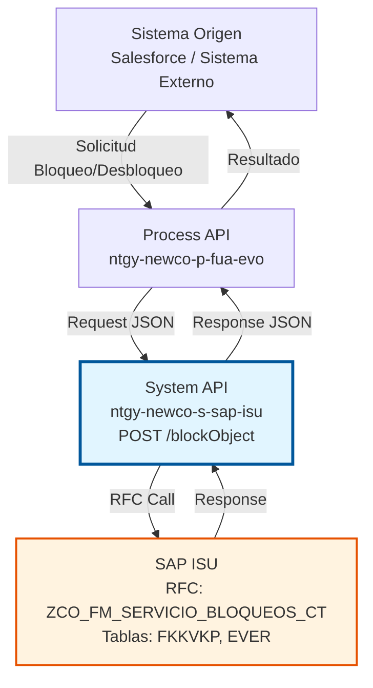
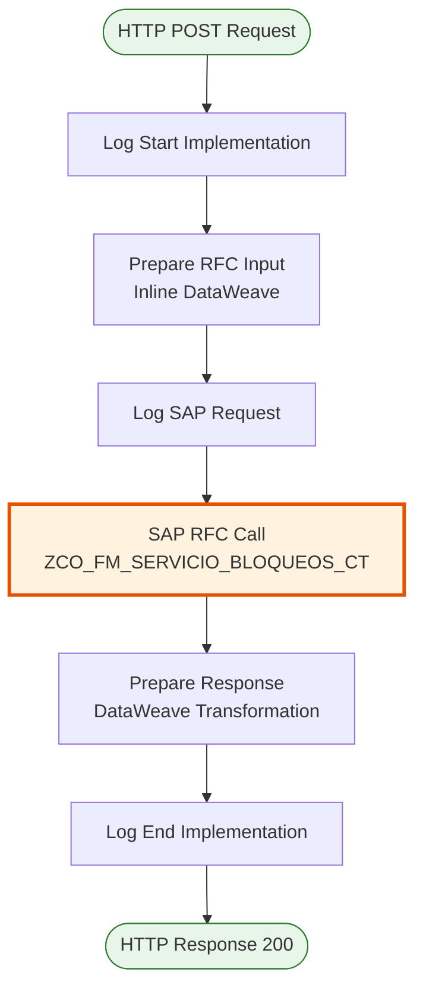
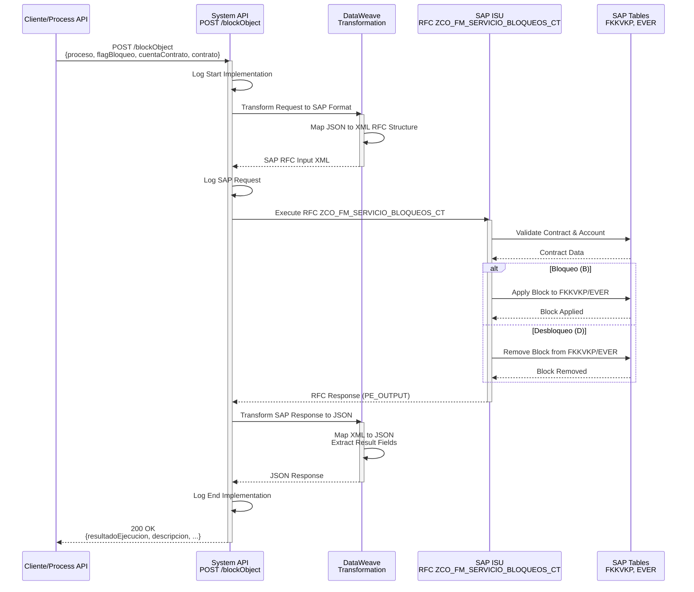

# POST /blockObject

## 📌 Descripción General

### Propósito del Endpoint

Gestiona el bloqueo y desbloqueo de contratos y cuentas contrato en SAP ISU para aplicar o eliminar restricciones operativas. Este endpoint permite controlar el acceso y las operaciones permitidas sobre contratos según diferentes escenarios de negocio como impagos, fraudes o solicitudes del cliente.

El endpoint soporta:
- **Bloqueo de Contratos**: Aplica restricciones a nivel de contrato individual
- **Bloqueo de Cuentas Contrato**: Aplica restricciones a nivel de cuenta contrato (afecta todos los contratos asociados)
- **Desbloqueo**: Elimina restricciones previamente aplicadas
- **Múltiples Tipos de Proceso**: Soporta diferentes motivos de bloqueo (impago, fraude, solicitud cliente)

### Tipo de API

**Capa:** System API (API-Led Connectivity)

**Función:** Integración directa con SAP ISU para gestión de bloqueos y desbloqueos de contratos y cuentas contrato.

### Patrón de Integración

**Tipo:** Request-Reply Síncrono con SAP RFC

**Descripción:** Recibe solicitud de bloqueo/desbloqueo, transforma los datos al formato SAP, invoca el RFC `ZCO_FM_SERVICIO_BLOQUEOS_CT`, aplica la operación en SAP ISU y retorna el resultado de la ejecución.

### Arquitectura API-Led Connectivity



---

## 💼 Propósito del Negocio

### Casos de Uso Principales

1. **Bloqueo por Impago**
   - Cliente con deuda vencida requiere bloqueo de contrato
   - Se aplica restricción para evitar nuevos consumos o servicios
   - Permite gestión de cobranza y recuperación de deuda

2. **Bloqueo por Fraude**
   - Detección de fraude o manipulación de medidores
   - Bloqueo inmediato del contrato para investigación
   - Protección de activos de la compañía

3. **Bloqueo por Solicitud del Cliente**
   - Cliente solicita suspensión temporal del servicio
   - Bloqueo controlado sin afectar la relación contractual
   - Facilita reactivación posterior

4. **Desbloqueo tras Regularización**
   - Cliente regulariza su situación (pago de deuda, resolución de fraude)
   - Eliminación de restricciones para reactivar servicios
   - Restauración de operaciones normales

### Contexto Empresarial

- **Dominio:** Gestión de Contratos y Cuentas Contrato
- **Sector:** Energía - Utilities
- **División:** Naturgy España - NewCo
- **Proceso de Negocio:** Gestión de Restricciones Operativas, Control de Riesgos, Cobranza
- **Módulos SAP:** FI-CA (Contract Account Management), SD (Sales & Distribution)

### Stakeholders

- **Departamento de Cobranza**: Necesita bloquear contratos por impago para gestionar recuperación de deuda
- **Departamento de Fraude**: Requiere bloqueo inmediato de contratos con actividad sospechosa
- **Servicio al Cliente**: Gestiona solicitudes de bloqueo/desbloqueo temporal por parte de clientes
- **Operaciones**: Monitorea y gestiona el estado de bloqueos en la cartera de contratos

### Valor de Negocio

- **Gestión de Riesgo**: Control efectivo de contratos con situaciones de riesgo (impago, fraude)
- **Protección de Ingresos**: Prevención de pérdidas por consumos no pagados
- **Automatización**: Reducción de procesos manuales de bloqueo/desbloqueo en SAP GUI
- **Trazabilidad**: Registro completo de operaciones de bloqueo para auditoría
- **Agilidad Operativa**: Respuesta rápida a situaciones que requieren restricciones

### Consumidores Potenciales

Este endpoint puede ser consumido por:
- Process APIs de gestión de cobranza
- Process APIs de gestión de fraude
- Flujos de Salesforce (Platform Events, Flows)
- Sistemas de gestión de riesgos
- Portales de autoservicio (para bloqueos voluntarios)

---

## 🔧 Especificación Técnica

### URLs por Ambiente

| Ambiente | URL Base | URL Completa |
|----------|----------|--------------|
| **Local** | `http://localhost:8081` | `http://localhost:8081/api/blockObject` |
| **Development** | `https://ntgy-newco-s-sap-isu-dev.us-e2.cloudhub.io` | `https://ntgy-newco-s-sap-isu-dev.us-e2.cloudhub.io/api/blockObject` |
| **UAT** | `https://ntgy-newco-s-sap-isu-uat.us-e2.cloudhub.io` | `https://ntgy-newco-s-sap-isu-uat.us-e2.cloudhub.io/api/blockObject` |
| **Production** | `https://ntgy-newco-s-sap-isu-pro.us-e2.cloudhub.io` | `https://ntgy-newco-s-sap-isu-pro.us-e2.cloudhub.io/api/blockObject` |

### Método HTTP

```
POST /api/blockObject
```

### Parámetros de Entrada

#### Headers HTTP

| Header | Tipo | Requerido | Descripción | Ejemplo |
|--------|------|-----------|-------------|---------|
| `Content-Type` | string | ✅ Sí | Tipo de contenido del request | `application/json` |
| `Accept` | string | ❌ No | Tipo de contenido esperado en response | `application/json` |
| `client_id` | string | ✅ Sí | Client ID de Anypoint Platform | `a1b2c3d4e5f6` |
| `client_secret` | string | ✅ Sí | Client Secret de Anypoint Platform | `A1B2C3D4E5F6` |

#### Body Parameters

| Campo | Tipo | Requerido | Descripción | Ejemplo |
|-------|------|-----------|-------------|---------|
| `proceso` | string | ✅ Sí | Tipo de proceso de bloqueo | `"BLOQUEO_CONTRATO"` |
| `flagBloqueo` | string | ✅ Sí | Flag de operación: 'B' (bloquear) o 'D' (desbloquear) | `"B"` |
| `cuentaContrato` | string | ✅ Sí | Número de cuenta contrato en SAP ISU | `"200001234567"` |
| `contrato` | string | ✅ Sí | Número de contrato en SAP ISU | `"1000123456"` |

**Valores Válidos para `proceso`:**
- `BLOQUEO_CONTRATO`: Bloqueo a nivel de contrato
- `BLOQUEO_CUENTA`: Bloqueo a nivel de cuenta contrato
- `BLOQUEO_IMPAGO`: Bloqueo por impago
- `BLOQUEO_FRAUDE`: Bloqueo por fraude detectado
- `BLOQUEO_SOLICITUD`: Bloqueo por solicitud del cliente

**Valores Válidos para `flagBloqueo`:**
- `B`: Bloquear (aplicar restricción)
- `D`: Desbloquear (eliminar restricción)

### Respuestas

#### Respuesta Exitosa (200 OK)

```json
{
  "resultadoEjecucion": "OK",
  "cuentaContrato": "200001234567",
  "contrato": "1000123456",
  "error": "",
  "categoriaError": "",
  "claseError": "",
  "codigoError": "",
  "descripcion": "Bloqueo aplicado correctamente"
}
```

**Campos de Respuesta:**

| Campo | Tipo | Descripción |
|-------|------|-------------|
| `resultadoEjecucion` | string | Resultado de la operación: "OK" o "KO" |
| `cuentaContrato` | string | Número de cuenta contrato procesada |
| `contrato` | string | Número de contrato procesado |
| `error` | string | ID del mensaje de error de SAP (vacío si OK) |
| `categoriaError` | string | Categoría del error de SAP (vacío si OK) |
| `claseError` | string | Clase de error (ARBGB) de SAP (vacío si OK) |
| `codigoError` | string | Número del mensaje de error de SAP (vacío si OK) |
| `descripcion` | string | Descripción del resultado de la operación |

#### Respuesta de Error de Negocio (200 OK con resultadoEjecucion = "KO")

```json
{
  "resultadoEjecucion": "KO",
  "cuentaContrato": "200001234567",
  "contrato": "1000123456",
  "error": "E",
  "categoriaError": "ERROR",
  "claseError": "ZCO",
  "codigoError": "001",
  "descripcion": "Contrato no encontrado en SAP ISU"
}
```

**Errores de Negocio Comunes:**
- Contrato no existe en SAP ISU
- Cuenta contrato no asociada al contrato
- Bloqueo ya aplicado (al intentar bloquear)
- No existe bloqueo para desbloquear
- Tipo de proceso no válido

#### Respuesta de Error Técnico (400 Bad Request)

```json
{
  "result": {
    "codResult": "0001",
    "msgResult": "Error de validación: campo 'flagBloqueo' debe ser 'B' o 'D'"
  }
}
```

#### Respuesta de Error Técnico (500 Internal Server Error)

```json
{
  "result": {
    "codResult": "0001",
    "msgResult": "Error al conectar con SAP ISU: Connection timeout"
  }
}
```

### Autenticación y Autorización

- **Tipo:** Client ID & Client Secret (Anypoint Platform)
- **Autorización SAP:** El usuario SAP configurado debe tener permisos para:
  - Ejecutar RFC `ZCO_FM_SERVICIO_BLOQUEOS_CT`
  - Acceso de lectura a tabla `FKKVKP` (Contract Account)
  - Acceso de lectura a tabla `EVER` (Contract Master)
  - Acceso de escritura para aplicar/eliminar bloqueos
  - Objetos de autorización: `F_FICA_BLK` (Bloqueos FI-CA)

### Timeouts

| Tipo | Valor | Descripción |
|------|-------|-------------|
| **Request Timeout** | 30 segundos | Tiempo máximo de espera para la respuesta del RFC |
| **Connection Timeout** | 10 segundos | Tiempo máximo para establecer conexión con SAP |
| **SAP RFC Timeout** | 25 segundos | Timeout configurado en el SAP Connector |

---

## 🏗️ Implementación Técnica

### Arquitectura del Flow



### 🗄️ RFC SAP Invocado

#### RFC: ZCO_FM_SERVICIO_BLOQUEOS_CT

**Descripción:** RFC personalizado de Naturgy para gestión de bloqueos y desbloqueos de contratos y cuentas contrato en SAP ISU.

**Módulo SAP:** FI-CA (Contract Account Management) / SD (Sales & Distribution)

**Tablas SAP Consultadas/Modificadas:**

| Tabla | Operaciones | Descripción | Campos Principales |
|-------|-------------|-------------|-------------------|
| **FKKVKP** | READ, UPDATE | Contract Account - Cuenta Contrato | VKONT (Número cuenta contrato), GPART (Business Partner), SPERR (Indicador bloqueo) |
| **EVER** | READ, UPDATE | Contract Master - Datos maestros de contratos | VERTRAG (Número contrato), VKONT (Cuenta contrato), SPERRE (Indicador bloqueo contrato) |

**Estructura del RFC:**

**Import Parameters:**
```xml
<PI_INPUT>
  <PROCESO>Tipo de proceso de bloqueo</PROCESO>
  <BLOQ_DESBLOQ>B (Bloquear) o D (Desbloquear)</BLOQ_DESBLOQ>
  <VKONT>Número de cuenta contrato</VKONT>
  <VERTRAG>Número de contrato</VERTRAG>
</PI_INPUT>
```

**Descripción de Parámetros de Entrada:**

| Parámetro | Tipo | Longitud | Descripción | Valores Válidos |
|-----------|------|----------|-------------|-----------------|
| `PROCESO` | CHAR | 50 | Tipo de proceso de bloqueo | BLOQUEO_CONTRATO, BLOQUEO_CUENTA, BLOQUEO_IMPAGO, BLOQUEO_FRAUDE, BLOQUEO_SOLICITUD |
| `BLOQ_DESBLOQ` | CHAR | 1 | Flag de operación | B (Bloquear), D (Desbloquear) |
| `VKONT` | CHAR | 12 | Número de cuenta contrato en SAP ISU | Formato: 200001234567 |
| `VERTRAG` | CHAR | 12 | Número de contrato en SAP ISU | Formato: 1000123456 |

**Export Parameters:**
```xml
<PE_OUTPUT>
  <EXEC_CORRECTA>S/N</EXEC_CORRECTA>
  <VKONT>Número de cuenta contrato procesada</VKONT>
  <VERTRAG>Número de contrato procesado</VERTRAG>
  <MESS_ID>ID del mensaje de error</MESS_ID>
  <CATEGORY_ID>Categoría del error</CATEGORY_ID>
  <ARBGB>Clase de error (ARBGB)</ARBGB>
  <MSGNR>Número del mensaje de error</MSGNR>
  <DESCRIPTION>Descripción del resultado</DESCRIPTION>
</PE_OUTPUT>
```

**Descripción de Parámetros de Salida:**

| Parámetro | Tipo | Descripción | Valores |
|-----------|------|-------------|---------|
| `EXEC_CORRECTA` | CHAR(1) | Indicador de ejecución correcta | S (Éxito), N (Error) |
| `VKONT` | CHAR(12) | Número de cuenta contrato procesada | Echo del input |
| `VERTRAG` | CHAR(12) | Número de contrato procesado | Echo del input |
| `MESS_ID` | CHAR(1) | ID del mensaje (E=Error, W=Warning, I=Info) | E, W, I, vacío |
| `CATEGORY_ID` | CHAR(10) | Categoría del error | ERROR, WARNING, vacío |
| `ARBGB` | CHAR(20) | Clase de error (área funcional) | ZCO, ZFI, vacío |
| `MSGNR` | CHAR(3) | Número del mensaje de error | 001-999, vacío |
| `DESCRIPTION` | CHAR(220) | Descripción detallada del resultado | Texto descriptivo |

### Flujo de Datos Detallado



### Componentes Técnicos

#### 1. Flow Principal: `blockObjectFlow`

**Ubicación:** `src/main/mule/implementation/customer-data-management-operations.xml`

**Tipo:** Sub-flow

**Componentes:**
1. **Logger Start**: Registra inicio de ejecución
2. **DataWeave Transform (Input)**: Transforma JSON a XML SAP (inline)
3. **Logger SAP Request**: Registra request SAP para debugging
4. **SAP RFC Call**: Invoca `ZCO_FM_SERVICIO_BLOQUEOS_CT`
5. **DataWeave Transform (Output)**: Transforma respuesta SAP a JSON (inline)
6. **Logger End**: Registra fin de ejecución

#### 2. Transformación de Entrada (Request → SAP)

**Tipo:** Inline DataWeave en XML

**Mapeo de Campos:**

| Campo JSON | Campo SAP RFC | Descripción |
|------------|---------------|-------------|
| `proceso` | `PI_INPUT.PROCESO` | Tipo de proceso de bloqueo |
| `flagBloqueo` | `PI_INPUT.BLOQ_DESBLOQ` | Flag B (bloquear) o D (desbloquear) |
| `cuentaContrato` | `PI_INPUT.VKONT` | Número de cuenta contrato |
| `contrato` | `PI_INPUT.VERTRAG` | Número de contrato |

**Código DataWeave:**
```dataweave
%dw 2.0
output application/xml
---
{
    "ZCO_FM_SERVICIO_BLOQUEOS_CT": {
        "import": {
            "PI_INPUT": {
                "PROCESO": payload.proceso,
                "BLOQ_DESBLOQ": payload.flagBloqueo,
                "VKONT": payload.cuentaContrato,
                "VERTRAG": payload.contrato
            }
        }
    }
}
```

#### 3. Invocación RFC SAP

**RFC:** `ZCO_FM_SERVICIO_BLOQUEOS_CT`

**Configuración:**
- **Config Reference:** `SAP_Config`
- **Connection Type:** Synchronous RFC
- **Timeout:** 25 segundos

**Estructura de Entrada (PI_INPUT):**
```xml
<PI_INPUT>
    <PROCESO>BLOQUEO_CONTRATO</PROCESO>
    <BLOQ_DESBLOQ>B</BLOQ_DESBLOQ>
    <VKONT>200001234567</VKONT>
    <VERTRAG>1000123456</VERTRAG>
</PI_INPUT>
```

**Estructura de Salida (PE_OUTPUT):**
```xml
<PE_OUTPUT>
    <EXEC_CORRECTA>S</EXEC_CORRECTA>
    <VKONT>200001234567</VKONT>
    <VERTRAG>1000123456</VERTRAG>
    <MESS_ID></MESS_ID>
    <CATEGORY_ID></CATEGORY_ID>
    <ARBGB></ARBGB>
    <MSGNR></MSGNR>
    <DESCRIPTION>Bloqueo aplicado correctamente</DESCRIPTION>
</PE_OUTPUT>
```

#### 4. Transformación de Salida (SAP → Response)

**Tipo:** Inline DataWeave en XML

**Mapeo de Campos:**

| Campo SAP RFC | Campo JSON | Transformación |
|---------------|------------|----------------|
| `PE_OUTPUT.EXEC_CORRECTA` | `resultadoEjecucion` | 'S' → "OK", otros → "KO" |
| `PE_OUTPUT.VKONT` | `cuentaContrato` | Directo |
| `PE_OUTPUT.VERTRAG` | `contrato` | Directo |
| `PE_OUTPUT.MESS_ID` | `error` | Directo |
| `PE_OUTPUT.CATEGORY_ID` | `categoriaError` | Directo |
| `PE_OUTPUT.ARBGB` | `claseError` | Directo |
| `PE_OUTPUT.MSGNR` | `codigoError` | Directo |
| `PE_OUTPUT.DESCRIPTION` | `descripcion` | Directo |

**Código DataWeave:**
```dataweave
%dw 2.0
output application/json
var out = payload.ZCO_FM_SERVICIO_BLOQUEOS_CT.export.PE_OUTPUT
---
{
    resultadoEjecucion: if (out.EXEC_CORRECTA == 'S') "OK" else "KO",
    cuentaContrato: out.VKONT,
    contrato: out.VERTRAG,
    error: out.MESS_ID,
    categoriaError: out.CATEGORY_ID,
    claseError: out.ARBGB,
    codigoError: out.MSGNR,
    descripcion: out.DESCRIPTION
}
```

### Tablas SAP Involucradas

#### FKKVKP - Contract Account

**Descripción:** Tabla maestra de cuentas contrato en SAP ISU

**Operaciones:**
- **READ**: Validación de existencia de cuenta contrato
- **UPDATE**: Aplicación/eliminación de bloqueos a nivel de cuenta

**Campos Relevantes:**
- `VKONT`: Número de cuenta contrato
- `GPART`: Business Partner asociado
- `SPERR`: Indicador de bloqueo

#### EVER - Contract Master

**Descripción:** Tabla maestra de contratos en SAP ISU

**Operaciones:**
- **READ**: Validación de existencia de contrato
- **UPDATE**: Aplicación/eliminación de bloqueos a nivel de contrato

**Campos Relevantes:**
- `VERTRAG`: Número de contrato
- `VKONT`: Cuenta contrato asociada
- `SPERRE`: Indicador de bloqueo de contrato

### Manejo de Errores

#### Errores de Validación (400 Bad Request)

```json
{
  "result": {
    "codResult": "0001",
    "msgResult": "Campo requerido faltante: flagBloqueo"
  }
}
```

**Causas Comunes:**
- Campos requeridos faltantes
- Formato de datos incorrecto
- Valores no válidos en enumeraciones

#### Errores de Negocio SAP (200 OK con KO)

```json
{
  "resultadoEjecucion": "KO",
  "cuentaContrato": "200001234567",
  "contrato": "1000123456",
  "error": "E",
  "categoriaError": "ERROR",
  "claseError": "ZCO",
  "codigoError": "001",
  "descripcion": "Contrato no encontrado en SAP ISU"
}
```

**Causas Comunes:**
- Contrato no existe en SAP ISU
- Cuenta contrato no asociada al contrato
- Bloqueo ya aplicado
- No existe bloqueo para desbloquear

#### Errores de Conexión SAP (500 Internal Server Error)

```json
{
  "result": {
    "codResult": "0001",
    "msgResult": "Error al conectar con SAP ISU: Connection timeout"
  }
}
```

**Causas Comunes:**
- SAP ISU no disponible
- Timeout de conexión
- Credenciales SAP inválidas
- Problemas de red

### Logging

El endpoint registra los siguientes eventos:

1. **Log Start Implementation**: Inicio del flow
2. **Log SAP Request**: Request enviado a SAP (nivel DEBUG)
3. **Log End Implementation**: Fin del flow

**Categorías de Log:**
- `com.naturgy.mule.logger.blockObject`: Logs del flow principal

---

## 💻 Ejemplos de Uso

### Ejemplo 1: Bloqueo de Contrato por Impago

#### Request

```bash
curl -X POST "https://ntgy-newco-s-sap-isu-dev.us-e2.cloudhub.io/api/blockObject" \
  -H "Content-Type: application/json" \
  -H "client_id: a1b2c3d4e5f6" \
  -H "client_secret: A1B2C3D4E5F6" \
  -d '{
    "proceso": "BLOQUEO_IMPAGO",
    "flagBloqueo": "B",
    "cuentaContrato": "200001234567",
    "contrato": "1000123456"
  }'
```

#### Response Exitosa (200 OK)

```json
{
  "resultadoEjecucion": "OK",
  "cuentaContrato": "200001234567",
  "contrato": "1000123456",
  "error": "",
  "categoriaError": "",
  "claseError": "",
  "codigoError": "",
  "descripcion": "Bloqueo por impago aplicado correctamente"
}
```

### Ejemplo 2: Desbloqueo de Contrato tras Pago

#### Request

```bash
curl -X POST "https://ntgy-newco-s-sap-isu-dev.us-e2.cloudhub.io/api/blockObject" \
  -H "Content-Type: application/json" \
  -H "client_id: a1b2c3d4e5f6" \
  -H "client_secret: A1B2C3D4E5F6" \
  -d '{
    "proceso": "BLOQUEO_IMPAGO",
    "flagBloqueo": "D",
    "cuentaContrato": "200001234567",
    "contrato": "1000123456"
  }'
```

#### Response Exitosa (200 OK)

```json
{
  "resultadoEjecucion": "OK",
  "cuentaContrato": "200001234567",
  "contrato": "1000123456",
  "error": "",
  "categoriaError": "",
  "claseError": "",
  "codigoError": "",
  "descripcion": "Desbloqueo aplicado correctamente"
}
```

### Ejemplo 3: Bloqueo de Cuenta Contrato por Fraude

#### Request

```bash
curl -X POST "https://ntgy-newco-s-sap-isu-pro.us-e2.cloudhub.io/api/blockObject" \
  -H "Content-Type: application/json" \
  -H "client_id: a1b2c3d4e5f6" \
  -H "client_secret: A1B2C3D4E5F6" \
  -d '{
    "proceso": "BLOQUEO_FRAUDE",
    "flagBloqueo": "B",
    "cuentaContrato": "200009876543",
    "contrato": "1000987654"
  }'
```

#### Response Exitosa (200 OK)

```json
{
  "resultadoEjecucion": "OK",
  "cuentaContrato": "200009876543",
  "contrato": "1000987654",
  "error": "",
  "categoriaError": "",
  "claseError": "",
  "codigoError": "",
  "descripcion": "Bloqueo por fraude aplicado correctamente"
}
```

### Ejemplo 4: Error - Contrato No Encontrado

#### Request

```bash
curl -X POST "https://ntgy-newco-s-sap-isu-dev.us-e2.cloudhub.io/api/blockObject" \
  -H "Content-Type: application/json" \
  -H "client_id: a1b2c3d4e5f6" \
  -H "client_secret: A1B2C3D4E5F6" \
  -d '{
    "proceso": "BLOQUEO_CONTRATO",
    "flagBloqueo": "B",
    "cuentaContrato": "200099999999",
    "contrato": "9999999999"
  }'
```

#### Response de Error (200 OK con KO)

```json
{
  "resultadoEjecucion": "KO",
  "cuentaContrato": "200099999999",
  "contrato": "9999999999",
  "error": "E",
  "categoriaError": "ERROR",
  "claseError": "ZCO",
  "codigoError": "001",
  "descripcion": "Contrato 9999999999 no encontrado en SAP ISU"
}
```

### Ejemplo 5: Bloqueo Voluntario por Solicitud del Cliente

#### Request

```bash
curl -X POST "https://ntgy-newco-s-sap-isu-uat.us-e2.cloudhub.io/api/blockObject" \
  -H "Content-Type: application/json" \
  -H "client_id: a1b2c3d4e5f6" \
  -H "client_secret: A1B2C3D4E5F6" \
  -d '{
    "proceso": "BLOQUEO_SOLICITUD",
    "flagBloqueo": "B",
    "cuentaContrato": "200005555555",
    "contrato": "1000555555"
  }'
```

#### Response Exitosa (200 OK)

```json
{
  "resultadoEjecucion": "OK",
  "cuentaContrato": "200005555555",
  "contrato": "1000555555",
  "error": "",
  "categoriaError": "",
  "claseError": "",
  "codigoError": "",
  "descripcion": "Bloqueo voluntario aplicado correctamente"
}
```

### Ejemplo 6: Request desde JavaScript/TypeScript

```typescript
const blockContract = async (
  proceso: string,
  flagBloqueo: 'B' | 'D',
  cuentaContrato: string,
  contrato: string
) => {
  const response = await fetch(
    'https://ntgy-newco-s-sap-isu-dev.us-e2.cloudhub.io/api/blockObject',
    {
      method: 'POST',
      headers: {
        'Content-Type': 'application/json',
        'client_id': 'a1b2c3d4e5f6',
        'client_secret': 'A1B2C3D4E5F6'
      },
      body: JSON.stringify({
        proceso,
        flagBloqueo,
        cuentaContrato,
        contrato
      })
    }
  );

  const data = await response.json();
  
  if (data.resultadoEjecucion === 'OK') {
    console.log('Operación exitosa:', data.descripcion);
  } else {
    console.error('Error:', data.descripcion);
  }
  
  return data;
};

// Uso
await blockContract('BLOQUEO_IMPAGO', 'B', '200001234567', '1000123456');
```

### Ejemplo 7: Request desde Python

```python
import requests
import json

def block_contract(proceso, flag_bloqueo, cuenta_contrato, contrato):
    url = "https://ntgy-newco-s-sap-isu-dev.us-e2.cloudhub.io/api/blockObject"
    
    headers = {
        "Content-Type": "application/json",
        "client_id": "a1b2c3d4e5f6",
        "client_secret": "A1B2C3D4E5F6"
    }
    
    payload = {
        "proceso": proceso,
        "flagBloqueo": flag_bloqueo,
        "cuentaContrato": cuenta_contrato,
        "contrato": contrato
    }
    
    response = requests.post(url, headers=headers, json=payload)
    data = response.json()
    
    if data.get("resultadoEjecucion") == "OK":
        print(f"Operación exitosa: {data.get('descripcion')}")
    else:
        print(f"Error: {data.get('descripcion')}")
    
    return data

# Uso
result = block_contract("BLOQUEO_IMPAGO", "B", "200001234567", "1000123456")
```

### Ejemplo 8: Integración desde Salesforce Flow

```apex
// Apex Class para invocar el endpoint
public class BlockObjectService {
    
    @InvocableMethod(label='Block/Unblock Contract' description='Bloquea o desbloquea un contrato en SAP ISU')
    public static List<BlockResult> blockContract(List<BlockRequest> requests) {
        List<BlockResult> results = new List<BlockResult>();
        
        for (BlockRequest req : requests) {
            HttpRequest httpReq = new HttpRequest();
            httpReq.setEndpoint('callout:SAP_ISU_API/blockObject');
            httpReq.setMethod('POST');
            httpReq.setHeader('Content-Type', 'application/json');
            
            Map<String, String> body = new Map<String, String>{
                'proceso' => req.proceso,
                'flagBloqueo' => req.flagBloqueo,
                'cuentaContrato' => req.cuentaContrato,
                'contrato' => req.contrato
            };
            
            httpReq.setBody(JSON.serialize(body));
            
            Http http = new Http();
            HttpResponse httpRes = http.send(httpReq);
            
            Map<String, Object> response = (Map<String, Object>) JSON.deserializeUntyped(httpRes.getBody());
            
            BlockResult result = new BlockResult();
            result.success = (String) response.get('resultadoEjecucion') == 'OK';
            result.message = (String) response.get('descripcion');
            results.add(result);
        }
        
        return results;
    }
    
    public class BlockRequest {
        @InvocableVariable(required=true)
        public String proceso;
        
        @InvocableVariable(required=true)
        public String flagBloqueo;
        
        @InvocableVariable(required=true)
        public String cuentaContrato;
        
        @InvocableVariable(required=true)
        public String contrato;
    }
    
    public class BlockResult {
        @InvocableVariable
        public Boolean success;
        
        @InvocableVariable
        public String message;
    }
}
```

---
