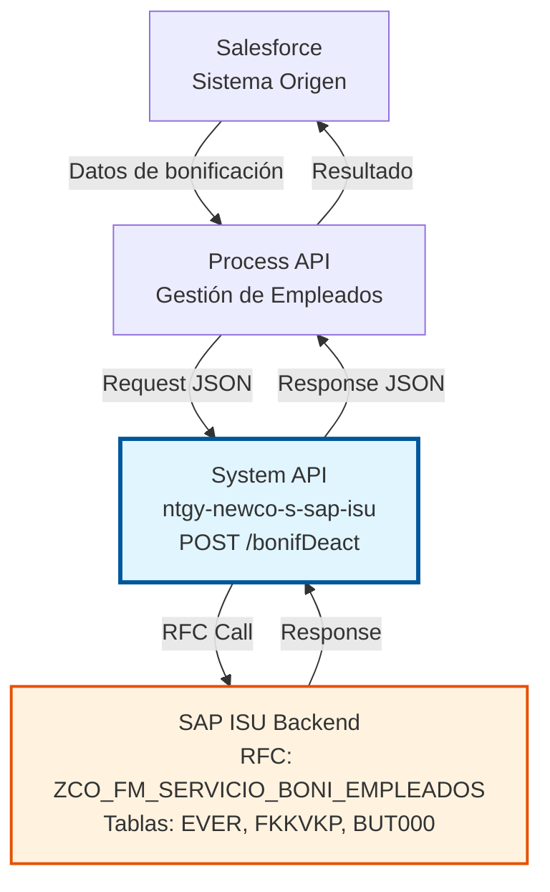
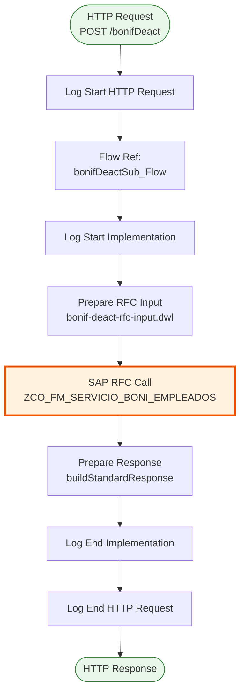
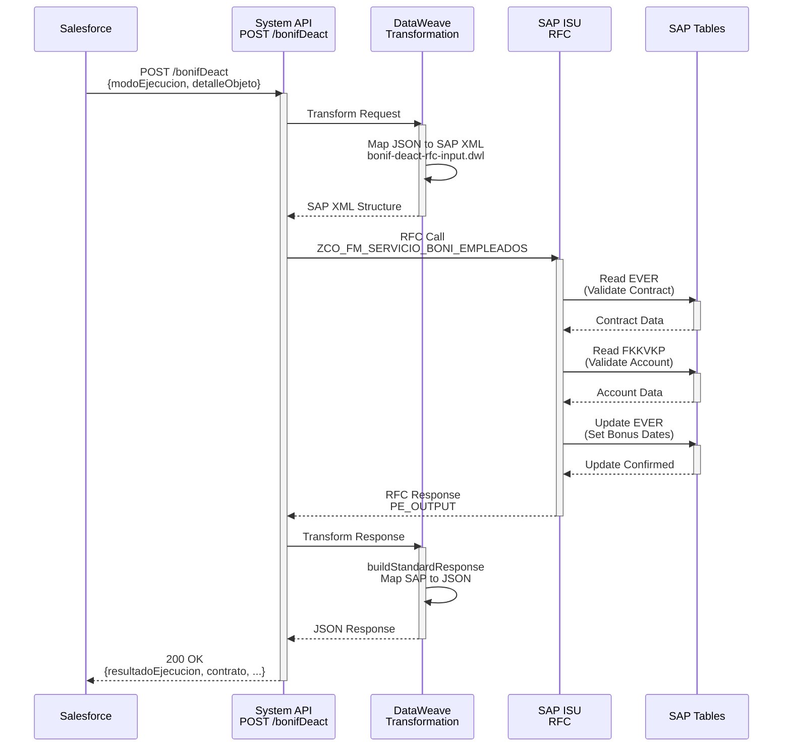
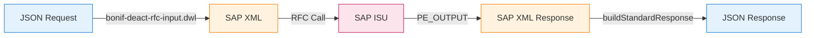

# POST /bonifDeact

## 📌 Descripción General

### Propósito del Endpoint

El endpoint **POST /bonifDeact** gestiona la activación y desactivación de bonificaciones especiales para empleados de la compañía en sus contratos de suministro en SAP ISU. Permite establecer períodos de vigencia para las bonificaciones mediante la configuración de fechas de inicio y fin.

El endpoint soporta:
- **Activación de bonificaciones**: Establece la fecha de inicio de la bonificación para empleados
- **Desactivación de bonificaciones**: Establece la fecha de fin de la bonificación
- **Gestión de períodos**: Control de fechas de vigencia de las bonificaciones
- **Validación de elegibilidad**: Verifica que el empleado tenga derecho a bonificación
- **Actualización en tiempo real**: Sincronización inmediata con SAP ISU

### Tipo de API

**Capa:** System API (API-Led Connectivity)

**Función:** Integración directa con SAP ISU para gestionar bonificaciones de empleados en contratos de suministro.

### Patrón de Integración

**Tipo:** Request-Reply Síncrono con SAP RFC

**Descripción:** Recibe datos de bonificación desde Salesforce, transforma al formato SAP, invoca el RFC `ZCO_FM_SERVICIO_BONI_EMPLEADOS` para actualizar las fechas de bonificación en el contrato, y retorna el resultado de la operación.

### Arquitectura API-Led Connectivity



---

## 💼 Propósito del Negocio

### Casos de Uso Principales

1. **Activación de Bonificación de Empleado**
   - Un empleado de la compañía solicita activar su bonificación en el contrato de suministro
   - El sistema establece la fecha de inicio de la bonificación
   - La bonificación se aplica automáticamente en las facturas posteriores

2. **Desactivación de Bonificación por Fin de Período**
   - Un empleado deja la compañía o finaliza el período de bonificación
   - El sistema establece la fecha de fin de la bonificación
   - Las facturas posteriores ya no incluyen el descuento

3. **Actualización de Período de Bonificación**
   - Modificación de las fechas de vigencia de una bonificación existente
   - Extensión o reducción del período de bonificación
   - Ajuste de fechas por cambios en la política de la compañía

### Contexto Empresarial

- **Dominio:** Gestión de Bonificaciones y Beneficios para Empleados
- **Sector:** Energía - Utilities
- **División:** Naturgy España - NewCo
- **Proceso de Negocio:** Gestión de beneficios para empleados en contratos de suministro
- **Módulo SAP:** SD (Sales & Distribution) / ISU (Industry Solution for Utilities)

### Stakeholders

- **Recursos Humanos**: Gestión de beneficios para empleados
- **Departamento de Facturación**: Aplicación correcta de bonificaciones en facturas
- **Empleados**: Beneficiarios de las bonificaciones en sus contratos
- **Administración de Contratos**: Mantenimiento de condiciones especiales

### Valor de Negocio

- **Automatización**: Eliminación de procesos manuales en la gestión de bonificaciones
- **Precisión**: Aplicación exacta de fechas de vigencia de bonificaciones
- **Trazabilidad**: Registro completo de activaciones y desactivaciones
- **Eficiencia**: Sincronización en tiempo real entre Salesforce y SAP ISU
- **Cumplimiento**: Aplicación consistente de políticas de beneficios para empleados

### Consumidores Potenciales

Este endpoint puede ser consumido por:
- Process APIs de gestión de empleados
- Flujos de Salesforce para gestión de beneficios
- Sistemas de recursos humanos
- Portales de autoservicio para empleados

---

## 🔧 Especificación Técnica

### URLs por Ambiente

| Ambiente | URL Base | URL Completa |
|----------|----------|--------------|
| **Local** | `http://localhost:8081` | `http://localhost:8081/api/bonifDeact` |
| **Development** | `https://ntgy-newco-s-sap-isu-dev.us-e2.cloudhub.io` | `https://ntgy-newco-s-sap-isu-dev.us-e2.cloudhub.io/api/bonifDeact` |
| **UAT** | `https://ntgy-newco-s-sap-isu-uat.us-e2.cloudhub.io` | `https://ntgy-newco-s-sap-isu-uat.us-e2.cloudhub.io/api/bonifDeact` |
| **Production** | `https://ntgy-newco-s-sap-isu-pro.us-e2.cloudhub.io` | `https://ntgy-newco-s-sap-isu-pro.us-e2.cloudhub.io/api/bonifDeact` |

### Método HTTP

```
POST /api/bonifDeact
```

### Parámetros de Entrada

#### Headers HTTP

| Header | Tipo | Requerido | Descripción | Ejemplo |
|--------|------|-----------|-------------|---------|
| `Content-Type` | string | ✅ Sí | Tipo de contenido del request | `application/json` |
| `Accept` | string | ❌ No | Tipo de contenido esperado en response | `application/json` |

#### Body Parameters

| Campo | Tipo | Requerido | Descripción | Ejemplo |
|-------|------|-----------|-------------|---------|
| `modoEjecucion` | string | ✅ Sí | Modo de ejecución: "ACTIVAR" o "DESACTIVAR" | `"ACTIVAR"` |
| `detalleObjeto` | object | ✅ Sí | Detalle del contrato y empleado | - |
| `detalleObjeto.codigo` | string | ✅ Sí | Número de contrato en SAP ISU (VERTRAG) | `"1000123456"` |
| `detalleObjeto.empleado` | object | ✅ Sí | Información del empleado y fechas | - |
| `detalleObjeto.empleado.fechaActivacionBono` | string | ⚠️ Condicional | Fecha de inicio (YYYY-MM-DD). Requerido si modoEjecucion="ACTIVAR" | `"2024-01-01"` |
| `detalleObjeto.empleado.fechaDesactivacionBono` | string | ⚠️ Condicional | Fecha de fin (YYYY-MM-DD). Requerido si modoEjecucion="DESACTIVAR" | `"2024-12-31"` |

### Respuestas

#### Respuesta Exitosa (200 OK)

```json
{
  "resultadoEjecucion": "OK",
  "ptoSuministro": "ES0021000000000001AA",
  "partner": "0001234567",
  "contrato": "1000123456",
  "numCtaContrato": "200001234567",
  "descripcion": "Bonificación activada exitosamente"
}
```

#### Respuesta de Error de Negocio (200 OK con resultadoEjecucion = "KO")

```json
{
  "resultadoEjecucion": "KO",
  "idMensaje": "E",
  "numMensaje": "001",
  "descripcion": "El contrato no existe en SAP ISU",
  "areaFuncional": "SD",
  "categoriaError": "VALIDATION_ERROR"
}
```

#### Respuesta de Error Técnico (400/500)

```json
{
  "result": {
    "codResult": "0001",
    "msgResult": "Error interno del servidor"
  }
}
```

### Autenticación y Autorización

- **Tipo:** Client ID & Client Secret (Anypoint Platform)
- **Autorización SAP:** El usuario debe tener permisos para:
  - Ejecutar RFC `ZCO_FM_SERVICIO_BONI_EMPLEADOS`
  - Acceso de lectura a tablas EVER, FKKVKP, BUT000
  - Acceso de escritura a tabla EVER (actualización de fechas de bonificación)

### Timeouts

| Tipo | Valor | Descripción |
|------|-------|-------------|
| **Request Timeout** | 30 segundos | Tiempo máximo de espera para la respuesta |
| **SAP RFC Timeout** | 60 segundos | Tiempo máximo para la ejecución del RFC |
| **Connection Timeout** | 10 segundos | Tiempo máximo para establecer conexión con SAP |

---

## 🏗️ Implementación Técnica

### Arquitectura del Flow



### Componentes del Flow

#### 1. Flow Principal APIKit
**Archivo:** `s-sap-isu.xml` (líneas 1038-1057)

```xml
<flow name="post:\bonifDeact:s-sap-isu-config">
    <ee:transform doc:name="Set Logger Context & Variables"/>
    <module-logger:log doc:name="Log Start HTTP Request"/>
    <flow-ref doc:name="bonifDeact" name="bonifDeactSub_Flow"/>
</flow>
```

#### 2. Sub-Flow de Implementación
**Archivo:** `payment-financial-operations.xml` (líneas 177-201)

```xml
<sub-flow name="bonifDeactSub_Flow">
    <module-logger:log message="Start implementation flow for bonif deact"/>
    <ee:transform resource="dw/bonif-deact-rfc-input.dwl"/>
    <sap:synchronous-remote-function-call key="ZCO_FM_SERVICIO_BONI_EMPLEADOS"/>
    <ee:transform><!-- buildStandardResponse --></ee:transform>
    <module-logger:log message="Finished implementation flow for bonif deact"/>
</sub-flow>
```

### Transformaciones DataWeave

#### Transformación de Entrada (bonif-deact-rfc-input.dwl)

```dataweave
%dw 2.0
output application/xml
import formatDate from modules::commonUtils

var detalleObjeto = payload.detalleObjeto
---
{
    "ZCO_FM_SERVICIO_BONI_EMPLEADOS": {
        "import": {
            "PI_INPUT": {
                "EXEC_BONI": payload.modoEjecucion,
                "VERTRAG": detalleObjeto.codigo,
                "FECHA_DESDE": formatDate(detalleObjeto.empleado.fechaDesactivacionBono) default "",
                "FECHA_HASTA": formatDate(detalleObjeto.empleado.fechaActivacionBono) default ""
            }
        }
    }
}
```

**Mapeo de Campos:**
| Campo JSON | Campo SAP | Descripción |
|------------|-----------|-------------|
| `modoEjecucion` | `EXEC_BONI` | Modo de ejecución (ACTIVAR/DESACTIVAR) |
| `detalleObjeto.codigo` | `VERTRAG` | Número de contrato |
| `detalleObjeto.empleado.fechaDesactivacionBono` | `FECHA_DESDE` | Fecha de inicio de bonificación |
| `detalleObjeto.empleado.fechaActivacionBono` | `FECHA_HASTA` | Fecha de fin de bonificación |

#### Transformación de Salida (Inline)

```dataweave
%dw 2.0
output application/json
import buildStandardResponse from modules::commonUtils
var out = payload.ZCO_FM_SERVICIO_BONI_EMPLEADOS.export.PE_OUTPUT
---
buildStandardResponse(out, {
    ptoSuministro: out.VSTELLE,
    (partner: out.PARTNER) if out.PARTNER != null,
    contrato: out.VERTRAG,
    numCtaContrato: out.VKONT
})
```

**Mapeo de Campos:**
| Campo SAP | Campo JSON | Descripción |
|-----------|------------|-------------|
| `PE_OUTPUT.EXEC_CORRECTA` | `resultadoEjecucion` | OK/KO (procesado por buildStandardResponse) |
| `PE_OUTPUT.VSTELLE` | `ptoSuministro` | Punto de suministro |
| `PE_OUTPUT.PARTNER` | `partner` | Business Partner |
| `PE_OUTPUT.VERTRAG` | `contrato` | Número de contrato |
| `PE_OUTPUT.VKONT` | `numCtaContrato` | Cuenta contrato |
| `PE_OUTPUT.MESS_ID` | `idMensaje` | ID de mensaje (si error) |
| `PE_OUTPUT.MSGNR` | `numMensaje` | Número de mensaje (si error) |
| `PE_OUTPUT.DESCRIPTION` | `descripcion` | Descripción del resultado |

### RFC SAP: ZCO_FM_SERVICIO_BONI_EMPLEADOS

#### Información del RFC

- **Nombre:** `ZCO_FM_SERVICIO_BONI_EMPLEADOS`
- **Módulo:** SD (Sales & Distribution) / ISU
- **Tipo:** Synchronous RFC
- **Función:** Gestionar activación/desactivación de bonificaciones de empleados

#### Parámetros de Entrada (IMPORT)

| Parámetro | Tipo | Descripción |
|-----------|------|-------------|
| `PI_INPUT.EXEC_BONI` | String | Modo de ejecución (ACTIVAR/DESACTIVAR) |
| `PI_INPUT.VERTRAG` | String(12) | Número de contrato |
| `PI_INPUT.FECHA_DESDE` | Date(YYYYMMDD) | Fecha de inicio de bonificación |
| `PI_INPUT.FECHA_HASTA` | Date(YYYYMMDD) | Fecha de fin de bonificación |

#### Parámetros de Salida (EXPORT)

| Parámetro | Tipo | Descripción |
|-----------|------|-------------|
| `PE_OUTPUT.EXEC_CORRECTA` | String(1) | 'S' = Éxito, otro = Error |
| `PE_OUTPUT.VSTELLE` | String(10) | Punto de suministro |
| `PE_OUTPUT.PARTNER` | String(10) | Business Partner |
| `PE_OUTPUT.VERTRAG` | String(12) | Número de contrato |
| `PE_OUTPUT.VKONT` | String(12) | Cuenta contrato |
| `PE_OUTPUT.MESS_ID` | String(1) | ID de mensaje (E=Error, W=Warning) |
| `PE_OUTPUT.MSGNR` | String(3) | Número de mensaje |
| `PE_OUTPUT.DESCRIPTION` | String(220) | Descripción del resultado |
| `PE_OUTPUT.ARBGB` | String(20) | Área funcional |
| `PE_OUTPUT.CATEGORY_ID` | String(10) | Categoría de error |

### Tablas SAP Involucradas

#### EVER - Contract Master

**Operaciones:** READ, UPDATE

**Descripción:** Tabla maestra de contratos. Se actualiza con las fechas de bonificación del empleado.

**Campos Relevantes:**
- `VERTRAG`: Número de contrato
- `VSTELLE`: Punto de suministro
- `VKONT`: Cuenta contrato
- Campos de fechas de bonificación (específicos del cliente)

#### FKKVKP - Contract Account

**Operaciones:** READ

**Descripción:** Tabla de cuentas contrato. Se consulta para validar la asociación contrato-cuenta.

**Campos Relevantes:**
- `VKONT`: Número de cuenta contrato
- `GPART`: Business Partner

#### BUT000 - Business Partner Master

**Operaciones:** READ

**Descripción:** Tabla maestra de Business Partners. Se consulta para validar el empleado.

**Campos Relevantes:**
- `PARTNER`: Número de Business Partner
- `TYPE`: Tipo de Business Partner

### Diagrama de Secuencia



### Diagrama de Transformación de Datos



### Manejo de Errores

**Estrategia de Error Handling:**

1. **Try-Catch a Nivel de Flow:**
   - Captura excepciones de SAP Connector
   - Captura errores de transformación DataWeave
   - Captura errores de validación

2. **Transformación de Errores:**
   - Errores SAP → Formato JSON estándar
   - Códigos de error SAP → Códigos de negocio
   - Mensajes técnicos → Mensajes user-friendly

3. **Logging de Errores:**
   - Log de error con stack trace completo
   - Log de contexto de la petición
   - Log de parámetros de entrada (sin datos sensibles)

4. **Respuestas de Error:**
   - 400: Errores de validación de entrada
   - 500: Errores técnicos (SAP, transformación, etc.)
   - 200 con `resultadoEjecucion: "KO"`: Errores de negocio SAP

---

## 💻 Ejemplos de Uso

### Ejemplo 1: Activación de Bonificación

#### Request

```bash
curl -X POST "https://ntgy-newco-s-sap-isu-dev.us-e2.cloudhub.io/api/bonifDeact" \
  -H "Content-Type: application/json" \
  -H "client_id: YOUR_CLIENT_ID" \
  -H "client_secret: YOUR_CLIENT_SECRET" \
  -d '{
    "modoEjecucion": "ACTIVAR",
    "detalleObjeto": {
      "codigo": "1000123456",
      "empleado": {
        "fechaActivacionBono": "2024-01-01",
        "fechaDesactivacionBono": "2024-12-31"
      }
    }
  }'
```

#### Response Exitoso (200 OK)

```json
{
  "resultadoEjecucion": "OK",
  "ptoSuministro": "ES0021000000000001AA",
  "partner": "0001234567",
  "contrato": "1000123456",
  "numCtaContrato": "200001234567",
  "descripcion": "Bonificación activada exitosamente para el período 01/01/2024 - 31/12/2024"
}
```

### Ejemplo 2: Desactivación de Bonificación

#### Request

```bash
curl -X POST "https://ntgy-newco-s-sap-isu-dev.us-e2.cloudhub.io/api/bonifDeact" \
  -H "Content-Type: application/json" \
  -H "client_id: YOUR_CLIENT_ID" \
  -H "client_secret: YOUR_CLIENT_SECRET" \
  -d '{
    "modoEjecucion": "DESACTIVAR",
    "detalleObjeto": {
      "codigo": "1000123456",
      "empleado": {
        "fechaDesactivacionBono": "2024-06-30"
      }
    }
  }'
```

#### Response Exitoso (200 OK)

```json
{
  "resultadoEjecucion": "OK",
  "ptoSuministro": "ES0021000000000001AA",
  "partner": "0001234567",
  "contrato": "1000123456",
  "numCtaContrato": "200001234567",
  "descripcion": "Bonificación desactivada exitosamente con fecha 30/06/2024"
}
```

### Ejemplo 3: Error - Contrato No Existe

#### Request

```bash
curl -X POST "https://ntgy-newco-s-sap-isu-dev.us-e2.cloudhub.io/api/bonifDeact" \
  -H "Content-Type: application/json" \
  -H "client_id: YOUR_CLIENT_ID" \
  -H "client_secret: YOUR_CLIENT_SECRET" \
  -d '{
    "modoEjecucion": "ACTIVAR",
    "detalleObjeto": {
      "codigo": "9999999999",
      "empleado": {
        "fechaActivacionBono": "2024-01-01"
      }
    }
  }'
```

#### Response Error de Negocio (200 OK)

```json
{
  "resultadoEjecucion": "KO",
  "idMensaje": "E",
  "numMensaje": "001",
  "descripcion": "El contrato 9999999999 no existe en SAP ISU",
  "areaFuncional": "SD",
  "categoriaError": "VALIDATION_ERROR"
}
```

### Ejemplo 4: Error - Empleado Sin Derecho a Bonificación

#### Request

```bash
curl -X POST "https://ntgy-newco-s-sap-isu-dev.us-e2.cloudhub.io/api/bonifDeact" \
  -H "Content-Type: application/json" \
  -H "client_id: YOUR_CLIENT_ID" \
  -H "client_secret: YOUR_CLIENT_SECRET" \
  -d '{
    "modoEjecucion": "ACTIVAR",
    "detalleObjeto": {
      "codigo": "1000123456",
      "empleado": {
        "fechaActivacionBono": "2024-01-01"
      }
    }
  }'
```

#### Response Error de Negocio (200 OK)

```json
{
  "resultadoEjecucion": "KO",
  "idMensaje": "W",
  "numMensaje": "002",
  "descripcion": "El empleado asociado al contrato no tiene derecho a bonificación",
  "areaFuncional": "SD",
  "categoriaError": "BUSINESS_RULE_ERROR"
}
```

### Ejemplo 5: JavaScript (Fetch API)

```javascript
const activarBonificacion = async () => {
  const url = 'https://ntgy-newco-s-sap-isu-dev.us-e2.cloudhub.io/api/bonifDeact';
  
  const requestData = {
    modoEjecucion: 'ACTIVAR',
    detalleObjeto: {
      codigo: '1000123456',
      empleado: {
        fechaActivacionBono: '2024-01-01',
        fechaDesactivacionBono: '2024-12-31'
      }
    }
  };

  try {
    const response = await fetch(url, {
      method: 'POST',
      headers: {
        'Content-Type': 'application/json',
        'client_id': 'YOUR_CLIENT_ID',
        'client_secret': 'YOUR_CLIENT_SECRET'
      },
      body: JSON.stringify(requestData)
    });

    const data = await response.json();
    
    if (data.resultadoEjecucion === 'OK') {
      console.log('✅ Bonificación activada exitosamente');
      console.log('Contrato:', data.contrato);
      console.log('Punto de Suministro:', data.ptoSuministro);
    } else {
      console.error('❌ Error de negocio:', data.descripcion);
    }
    
    return data;
  } catch (error) {
    console.error('❌ Error técnico:', error);
    throw error;
  }
};

// Ejecutar
activarBonificacion();
```

### Ejemplo 6: Python (Requests)

```python
import requests
import json

def activar_bonificacion():
    url = "https://ntgy-newco-s-sap-isu-dev.us-e2.cloudhub.io/api/bonifDeact"
    
    headers = {
        "Content-Type": "application/json",
        "client_id": "YOUR_CLIENT_ID",
        "client_secret": "YOUR_CLIENT_SECRET"
    }
    
    payload = {
        "modoEjecucion": "ACTIVAR",
        "detalleObjeto": {
            "codigo": "1000123456",
            "empleado": {
                "fechaActivacionBono": "2024-01-01",
                "fechaDesactivacionBono": "2024-12-31"
            }
        }
    }
    
    try:
        response = requests.post(url, headers=headers, json=payload)
        response.raise_for_status()
        
        data = response.json()
        
        if data.get("resultadoEjecucion") == "OK":
            print("✅ Bonificación activada exitosamente")
            print(f"Contrato: {data.get('contrato')}")
            print(f"Punto de Suministro: {data.get('ptoSuministro')}")
        else:
            print(f"