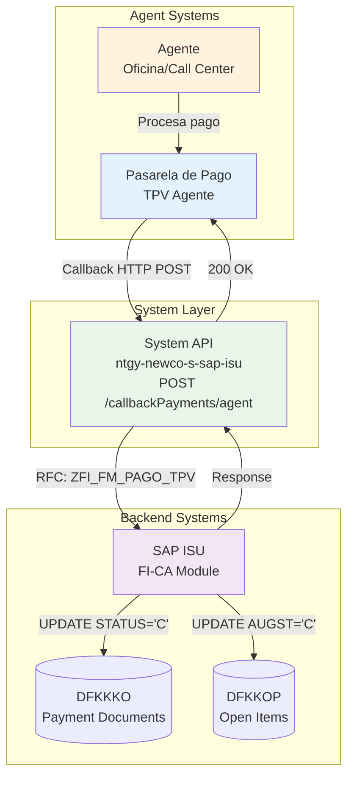
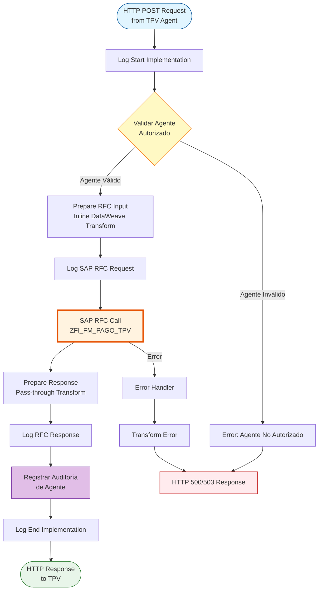
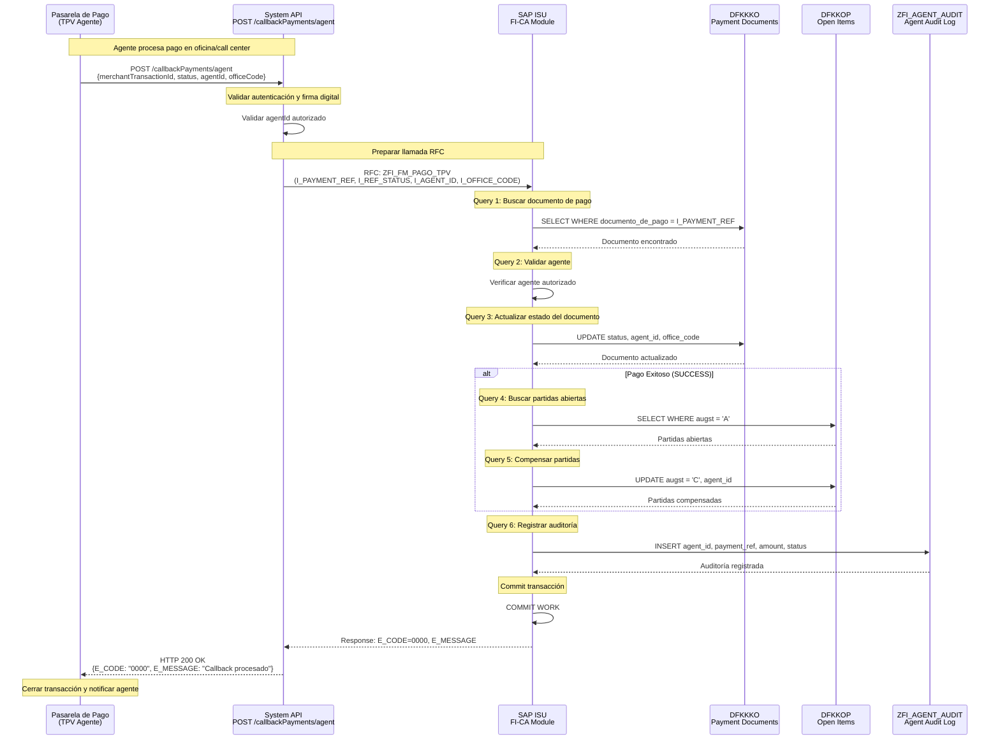

# POST /callbackPayments/agent

## 📌 Descripción General

### Propósito del Endpoint

Este endpoint recibe la respuesta de la pasarela de pago (TPV) para transacciones procesadas por agentes en oficinas o call centers. Actualiza el estado del documento de pago preliminar creado previamente en SAP ISU, confirmándolo o rechazándolo según el resultado de la transacción bancaria, e incluye información adicional del agente y oficina que procesó el pago.

### Información Técnica SAP

- **RFC SAP**: `ZFI_FM_PAGO_TPV`
- **Módulo SAP**: FI-CA (Contract Account Management) / Payment Processing
- **Tablas SAP**:
  - `DFKKKO`: Payment Document Header (actualización de estado)
  - `DFKKOP`: Open Items (compensación de partidas)
- **Tipo de API**: System API
- **Operación**: Confirmación/Rechazo de documento de pago de agente

### Características Principales

- ✅ Recibe callbacks de pagos procesados por agentes
- ✅ Registra información del agente y oficina
- ✅ Actualiza estado de documento de pago en SAP ISU
- ✅ Compensa partidas abiertas si el pago es exitoso
- ✅ Registra información de la transacción bancaria
- ✅ Maneja pagos exitosos y rechazados
- ✅ Trazabilidad completa del ciclo de pago por agente
- ✅ Soporte para diferentes tipos de operación (pago, devolución)

### Tipo de API

**Capa:** System API (Integración Directa con SAP ISU)

### Patrón de Integración

**Tipo:** Request-Reply Síncrono con SAP ISU (Callback Pattern)

Este endpoint implementa el patrón de callback para cerrar el ciclo de pago iniciado con `/paymentPreparation/agent`. La pasarela de pago invoca este endpoint para notificar el resultado de la transacción procesada por un agente, y el API actualiza inmediatamente el estado en SAP ISU.

**Características del Patrón:**
- ✅ Callback desde pasarela de pago externa
- ✅ Comunicación síncrona con SAP ISU
- ✅ Invocación de RFC `ZFI_FM_PAGO_TPV`
- ✅ Actualización de estado de documento de pago
- ✅ Compensación automática de partidas si pago exitoso
- ✅ Registro de información del agente
- ✅ Manejo de errores y reintentos
- ✅ Logging detallado para auditoría

### Arquitectura API-Led Connectivity



**Flujo de Datos:**
1. Agente procesa pago del cliente en oficina/call center
2. Pasarela de pago invoca callback con resultado y datos del agente
3. System API recibe callback con datos de transacción y agente
4. System API invoca RFC en SAP ISU
5. SAP ISU actualiza estado del documento de pago
6. Si pago exitoso: SAP ISU compensa partidas abiertas
7. System API retorna confirmación a pasarela
8. Pasarela de pago cierra transacción

### Contexto Técnico

- **Ubicación:** `src/main/mule/implementation/payment-financial-operations.xml`
- **Flow Principal:** `callbackPaymentFlow` (mismo que /customer)
- **RFC SAP:** `ZFI_FM_PAGO_TPV`
- **Módulo SAP:** FI-CA (Financial Contract Accounting)
- **Timeout:** 30 segundos (configurable)
- **Transformación Input:** Inline en flow

---

## 💼 Propósito del Negocio

### Objetivo

Cerrar el ciclo de pago iniciado con `/paymentPreparation/agent`, recibiendo la confirmación de la pasarela de pago para transacciones procesadas por agentes y actualizando el estado del documento de pago en SAP ISU. Esto permite mantener sincronizado el estado de los pagos entre la pasarela bancaria y el sistema de gestión financiera, con trazabilidad completa del agente que procesó la transacción.

### Casos de Uso Principales

#### 1. Confirmación de Pago Procesado por Agente en Oficina
**Actor:** Agente de Oficina  
**Objetivo:** Confirmar que el pago procesado por el agente se completó correctamente  
**Flujo:**
- Cliente acude a oficina para pagar facturas
- Agente procesa pago en TPV de oficina
- TPV procesa transacción bancaria
- TPV invoca callback con status SUCCESS e información del agente
- System API actualiza documento en SAP ISU
- SAP ISU compensa partidas abiertas
- Sistema registra agentId y officeCode
- Cliente recibe comprobante de pago

#### 2. Pago Procesado por Agente de Call Center
**Actor:** Agente de Call Center  
**Objetivo:** Registrar pago telefónico procesado por agente  
**Flujo:**
- Cliente llama para realizar pago telefónico
- Agente de call center procesa pago con datos de tarjeta
- TPV procesa transacción
- TPV invoca callback con información del agente
- System API actualiza documento en SAP ISU
- Sistema registra agentId para auditoría
- Cliente recibe confirmación por email/SMS

#### 3. Notificación de Pago Rechazado por Agente
**Actor:** Agente  
**Objetivo:** Notificar que el pago procesado por agente fue rechazado  
**Flujo:**
- Agente intenta procesar pago del cliente
- Banco rechaza transacción (tarjeta bloqueada, fondos insuficientes)
- TPV invoca callback con status FAILED
- System API actualiza documento en SAP ISU
- Documento queda marcado como rechazado
- Agente informa al cliente del rechazo
- Cliente puede intentar con otro método de pago

#### 4. Procesamiento de Devolución por Agente
**Actor:** Agente de Oficina  
**Objetivo:** Registrar devolución de pago procesada por agente  
**Flujo:**
- Cliente solicita devolución de pago en oficina
- Agente procesa devolución en sistema
- Sistema invoca callback con operationType REFUND
- System API registra devolución en SAP ISU
- Partidas se reabren si es necesario
- Agente entrega comprobante de devolución al cliente

### Contexto Empresarial

- **Dominio:** Gestión Financiera y Cobranza
- **Sector:** Energía - Utilities (Gas y Electricidad)
- **División:** Naturgy España - NewCo
- **Proceso de Negocio:** Payment Processing & Revenue Management (Agent Channel)
- **Sistema Backend:** SAP ISU (Industry Solution Utilities)

### Stakeholders

#### Stakeholders Primarios

**Agentes de Oficina:**
- Procesan pagos presenciales de clientes
- Necesitan confirmación inmediata de transacciones
- Requieren trazabilidad de sus operaciones

**Agentes de Call Center:**
- Procesan pagos telefónicos
- Gestionan múltiples transacciones simultáneas
- Necesitan sistema confiable y rápido

**Supervisores de Agentes:**
- Monitorean desempeño de agentes
- Analizan tasas de éxito/rechazo por agente
- Gestionan incidencias de pago

**Departamento de Cobranza:**
- Supervisan recaudación por canal de agentes
- Analizan efectividad del canal presencial
- Gestionan casos de pagos fallidos

#### Stakeholders Secundarios

**Clientes Finales:**
- Reciben atención personalizada de agentes
- Esperan confirmación inmediata de pago
- Necesitan comprobante físico o digital

**Área de Auditoría:**
- Supervisan transacciones de agentes
- Validan cumplimiento de procedimientos
- Detectan posibles fraudes o irregularidades

**Área de Recursos Humanos:**
- Evalúan desempeño de agentes
- Definen incentivos basados en métricas
- Gestionan capacitación de agentes

### Valor de Negocio

#### Beneficios Cuantitativos

- 💰 **Reducción de Tiempo de Confirmación:** 95% más rápido vs proceso manual
- ⏱️ **Actualización en Tiempo Real:** < 5 segundos desde callback a SAP
- 📊 **Mejora en Trazabilidad:** 100% de transacciones con agente identificado
- 💳 **Reducción de Disputas:** 50% menos reclamaciones por pagos de agentes
- 📈 **Mejora en Productividad:** Agentes procesan 30% más transacciones/día

#### Beneficios Cualitativos

- ✅ Sincronización automática entre TPV y SAP ISU
- ✅ Trazabilidad completa del ciclo de pago por agente
- ✅ Reducción de errores de conciliación manual
- ✅ Experiencia de cliente mejorada (atención personalizada)
- ✅ Auditoría completa de transacciones por agente
- ✅ Detección de patrones de fraude o irregularidades
- ✅ Habilitación de incentivos basados en desempeño

### Consumidores Potenciales

Este endpoint es consumido por:

- **Sistemas de TPV de Oficinas** - Terminales de pago en oficinas comerciales
- **Sistemas de Call Center** - Plataformas de pago telefónico
- **Sistemas de Gestión de Agentes** - Plataformas de supervisión
- **Sistemas de Conciliación** - Validación de pagos por canal
- **Sistemas de Auditoría** - Trazabilidad de transacciones de agentes

---

## 🔧 Especificación Técnica

### URLs por Ambiente

| Ambiente | URL Base | URL Completa |
|----------|----------|--------------|
| **Local** | `http://localhost:8081` | `http://localhost:8081/api/callbackPayments/agent` |
| **Development** | `https://ntgy-newco-s-sap-isu-dev.us-e2.cloudhub.io` | `https://ntgy-newco-s-sap-isu-dev.us-e2.cloudhub.io/api/callbackPayments/agent` |
| **UAT** | `https://ntgy-newco-s-sap-isu-uat.us-e2.cloudhub.io` | `https://ntgy-newco-s-sap-isu-uat.us-e2.cloudhub.io/api/callbackPayments/agent` |
| **Production** | `https://ntgy-newco-s-sap-isu-pro.us-e2.cloudhub.io` | `https://ntgy-newco-s-sap-isu-pro.us-e2.cloudhub.io/api/callbackPayments/agent` |

### Método HTTP

```
POST /api/callbackPayments/agent
```

### Parámetros de Entrada

#### Headers HTTP

| Header | Tipo | Requerido | Descripción | Ejemplo |
|--------|------|-----------|-------------|---------|
| `Content-Type` | string | ✅ Sí | Tipo de contenido del request | `application/json` |
| `Accept` | string | ⚠️ Recomendado | Tipo de contenido esperado en response | `application/json` |
| `X-Signature` | string | ⚠️ Recomendado | Firma digital del callback (según TPV) | `sha256=abc123...` |

#### Body Parameters

El body debe contener un objeto JSON con la información del resultado de la transacción y datos del agente:

**Estructura del Request:**

```json
{
  "amount": number,
  "paymentDate": "string",
  "merchantTransactionId": "string",
  "status": "string",
  "source": "string",
  "statusDescription": "string",
  "agentId": "string",
  "officeCode": "string",
  "operationType": "string"
}
```

**Campos Detallados:**

| Campo | Tipo | Requerido | Descripción | Ejemplo |
|-------|------|-----------|-------------|---------|
| `amount` | number | ✅ Sí | Importe de la transacción | `225.75` |
| `paymentDate` | string | ✅ Sí | Fecha y hora del pago (formato ISO 8601) | `"2024-01-15T14:30:25Z"` |
| `merchantTransactionId` | string | ✅ Sí | ID de transacción del comercio (orderId de preparación) | `"1800123456"` |
| `status` | string | ✅ Sí | Estado de la transacción | `"SUCCESS"`, `"FAILED"`, `"TIMEOUT"` |
| `source` | string | ✅ Sí | Origen del pago | `"AGENT"`, `"CALL_CENTER"` |
| `statusDescription` | string | ⚠️ Recomendado | Descripción del estado | `"Pago procesado por agente"` |
| `agentId` | string | ✅ Sí | Identificador del agente | `"AGT001234"` |
| `officeCode` | string | ❌ No | Código de la oficina | `"OFF_MAD_001"` |
| `operationType` | string | ✅ Sí | Tipo de operación | `"PAYMENT"`, `"REFUND"` |

**Valores Permitidos:**

**status:**
- `SUCCESS`: Pago procesado correctamente
- `FAILED`: Pago rechazado
- `TIMEOUT`: Timeout en procesamiento
- `PENDING`: Pago pendiente de confirmación
- `CANCELLED`: Pago cancelado

**source:**
- `AGENT`: Agente de oficina
- `CALL_CENTER`: Agente de call center

**operationType:**
- `PAYMENT`: Pago normal
- `REFUND`: Devolución de pago

**Validaciones:**
- ✅ `amount` debe ser mayor que cero
- ✅ `merchantTransactionId` debe existir en SAP ISU
- ✅ `paymentDate` debe ser fecha válida
- ✅ `status` debe ser uno de los valores permitidos
- ✅ `agentId` debe ser un agente autorizado
- ✅ `operationType` debe ser PAYMENT o REFUND

### Respuestas

#### Respuesta Exitosa (200 OK)

```json
{
  "ZFI_FM_PAGO_TPV": {
    "export": {
      "E_CODE": "0000",
      "E_MESSAGE": "Callback procesado exitosamente"
    }
  }
}
```

**Campos de la Respuesta:**

| Campo | Tipo | Descripción | Ejemplo |
|-------|------|-------------|---------|
| `ZFI_FM_PAGO_TPV.export.E_CODE` | string | Código de resultado: "0000" (éxito), "0001" (error) | `"0000"` |
| `ZFI_FM_PAGO_TPV.export.E_MESSAGE` | string | Mensaje descriptivo del resultado | `"Callback procesado exitosamente"` |

#### Respuestas de Error

**400 Bad Request - Parámetros Inválidos**

```json
{
  "result": {
    "codResult": "0001",
    "msgResult": "Error de validación: merchantTransactionId es requerido"
  }
}
```

**400 Bad Request - Documento No Encontrado**

```json
{
  "result": {
    "codResult": "0001",
    "msgResult": "Documento de pago 1800123456 no encontrado en SAP ISU"
  }
}
```

**400 Bad Request - Documento Ya Procesado**

```json
{
  "result": {
    "codResult": "0001",
    "msgResult": "Documento de pago ya fue confirmado previamente"
  }
}
```

**400 Bad Request - Agente No Autorizado**

```json
{
  "result": {
    "codResult": "0001",
    "msgResult": "Agente AGT001234 no está autorizado para procesar pagos"
  }
}
```

**500 Internal Server Error - Error SAP**

```json
{
  "result": {
    "codResult": "0001",
    "msgResult": "Error al actualizar documento de pago en SAP ISU"
  }
}
```

**503 Service Unavailable - SAP No Disponible**

```json
{
  "result": {
    "codResult": "5003",
    "msgResult": "Sistema SAP ISU no disponible temporalmente"
  }
}
```

### Códigos de Estado HTTP

| Código | Descripción | Escenario |
|--------|-------------|-----------|
| `200` | OK | Callback procesado exitosamente |
| `400` | Bad Request | Request inválido o datos faltantes |
| `500` | Internal Server Error | Error en SAP ISU o en el procesamiento |
| `503` | Service Unavailable | SAP ISU no disponible |

### Códigos de Resultado SAP

| Código | Descripción | Acción Recomendada |
|--------|-------------|-------------------|
| `0000` | Callback procesado exitosamente | Ninguna acción necesaria |
| `0001` | Error en el procesamiento | Revisar logs y reintentar |

### Autenticación y Autorización

#### Tipo de Autenticación

**Método:** Client ID & Client Secret (OAuth 2.0 Client Credentials) + Firma Digital

**Headers Requeridos:**
- `client_id`: Identificador de la aplicación cliente (pasarela de pago)
- `client_secret`: Secreto de la aplicación cliente
- `X-Signature`: Firma digital del payload (opcional pero recomendado)

**Nota:** La autenticación se gestiona a nivel de Anypoint Platform API Manager. La firma digital proporciona seguridad adicional para validar la autenticidad del callback.

#### Autorización SAP

El usuario SAP configurado en el conector debe tener los siguientes permisos:

- **Objeto de autorización:** `F_FICA_ROP` (Receivables Operations)
- **Actividad:** `02` (Change)
- **RFC:** `ZFI_FM_PAGO_TPV` (Execute permission)
- **Tablas:**
  - `DFKKKO`: Update access
  - `DFKKOP`: Update access

#### Autorización de Agentes

Adicionalmente, el sistema valida que:
- El `agentId` esté registrado en el sistema
- El agente tenga permisos activos para procesar pagos
- El `officeCode` sea válido (si se proporciona)
- El agente esté asignado a la oficina especificada

### Timeouts y Límites

| Parámetro | Valor | Descripción |
|-----------|-------|-------------|
| **Request Timeout** | 30 segundos | Tiempo máximo de espera para respuesta de SAP |
| **Connection Timeout** | 10 segundos | Tiempo máximo para establecer conexión con SAP |
| **SAP RFC Timeout** | 25 segundos | Timeout de ejecución del RFC en SAP |
| **Retry Attempts** | 3 intentos | Número de reintentos en caso de fallo transitorio |
| **Rate Limiting** | 200 req/min | Límite de peticiones por minuto por TPV |
| **Max Payload Size** | 500 KB | Tamaño máximo del request body |

**Estrategia de Retry:**
- Reintentos automáticos: 3 intentos
- Intervalo entre reintentos: 5 segundos (exponential backoff)
- Solo para errores de conexión (no para errores de negocio)
- La pasarela de pago debe implementar su propia lógica de retry

### Protocolo y Seguridad

- **Protocolo:** HTTPS (TLS 1.2+)
- **Puerto:** 443 (HTTPS), 8081 (Local)
- **Encriptación:** Datos sensibles encriptados en tránsito
- **Firma Digital:** Validación de autenticidad del callback (recomendado)
- **Logging:** Datos de transacción enmascarados en logs
- **Auditoría:** Todos los callbacks registrados en SAP con información del agente
- **Idempotencia:** Callbacks duplicados son detectados y rechazados
- **Método de Compresión:** gzip (opcional)
- **Trazabilidad de Agentes:** Registro completo de agentId y officeCode en logs

## 🏗️ Implementación Técnica

### Arquitectura del Flow



### Diagrama de Secuencia



### Diagrama de Transformación de Datos

```mermaid
flowchart LR
    subgraph "Input: TPV Callback"
        IN["{<br/>  amount: 225.75,<br/>  paymentDate: '2024-01-15T14:30:25Z',<br/>  merchantTransactionId: '1800123456',<br/>  status: 'SUCCESS',<br/>  source: 'AGENT',<br/>  agentId: 'AGT001234',<br/>  officeCode: 'OFF_MAD_001',<br/>  operationType: 'PAYMENT'<br/>}"]
    end
    
    subgraph "DataWeave Transform"
        DW["Inline Transform<br/>JSON → XML"]
    end
    
    subgraph "RFC Input: ZFI_FM_PAGO_TPV"
        RFC["&lt;ZFI_FM_PAGO_TPV&gt;<br/>  &lt;import&gt;<br/>    &lt;I_AMOUNT&gt;225.75&lt;/I_AMOUNT&gt;<br/>    &lt;I_DATE&gt;2024-01-15T14:30:25Z&lt;/I_DATE&gt;<br/>    &lt;I_PAYMENT_REF&gt;1800123456&lt;/I_PAYMENT_REF&gt;<br/>    &lt;I_REF_STATUS&gt;SUCCESS&lt;/I_REF_STATUS&gt;<br/>    &lt;I_SOURCE&gt;AGENT&lt;/I_SOURCE&gt;<br/>    &lt;I_AGENT_ID&gt;AGT001234&lt;/I_AGENT_ID&gt;<br/>    &lt;I_OFFICE_CODE&gt;OFF_MAD_001&lt;/I_OFFICE_CODE&gt;<br/>    &lt;I_TYPE&gt;PAYMENT&lt;/I_TYPE&gt;<br/>  &lt;/import&gt;<br/>&lt;/ZFI_FM_PAGO_TPV&gt;"]
    end
    
    subgraph "SAP Processing"
        SAP["SAP ISU<br/>FI-CA Module<br/>- Validar agente<br/>- Actualizar documento<br/>- Compensar partidas<br/>- Registrar auditoría"]
    end
    
    subgraph "RFC Output"
        OUT["&lt;ZFI_FM_PAGO_TPV&gt;<br/>  &lt;export&gt;<br/>    &lt;E_CODE&gt;0000&lt;/E_CODE&gt;<br/>    &lt;E_MESSAGE&gt;Callback procesado&lt;/E_MESSAGE&gt;<br/>  &lt;/export&gt;<br/>&lt;/ZFI_FM_PAGO_TPV&gt;"]
    end
    
    subgraph "Response Transform"
        RESP["Pass-through<br/>XML → JSON"]
    end
    
    subgraph "Output: HTTP Response"
        FINAL["{<br/>  'ZFI_FM_PAGO_TPV': {<br/>    'export': {<br/>      'E_CODE': '0000',<br/>      'E_MESSAGE': 'Callback procesado'<br/>    }<br/>  }<br/>}"]
    end
    
    IN --> DW
    DW --> RFC
    RFC --> SAP
    SAP --> OUT
    OUT --> RESP
    RESP --> FINAL
    
    style IN fill:#e3f2fd
    style DW fill:#fff9c4
    style RFC fill:#fff3e0
    style SAP fill:#f3e5f5
    style OUT fill:#e8f5e9
    style RESP fill:#fff9c4
    style FINAL fill:#c8e6c9
```



### 🗄️ RFC SAP Invocado

#### RFC: ZFI_FM_PAGO_TPV

**Descripción:** RFC personalizado de Naturgy para procesar callbacks de pasarelas de pago (TPV). Actualiza el estado del documento de pago preliminar y compensa las partidas abiertas si el pago fue exitoso. Para pagos de agentes, incluye validación de autorización y registro de auditoría.

**Módulo SAP:** FI-CA (Financial Contract Accounting) / Payment Processing

**Tablas SAP Consultadas/Modificadas:**

| Tabla | Operaciones | Descripción | Campos Principales |
|-------|-------------|-------------|-------------------|
| **DFKKKO** | READ, UPDATE | Payment Document Header | DOCUMENTO_DE_PAGO, STATUS, BETRW, ERDAT, AGENT_ID, OFFICE_CODE |
| **DFKKOP** | READ, UPDATE | Open Items (Partidas Abiertas) | OPBEL, AUGST, AUGDT, BETRW, AGENT_ID |
| **ZFI_AGENTES** | READ | Agentes Autorizados (Tabla Z) | AGENT_ID, STATUS, OFFICE_CODE, NAME |
| **ZFI_AGENT_AUDIT** | INSERT | Auditoría de Operaciones de Agentes | AGENT_ID, PAYMENT_REF, AMOUNT, STATUS, TIMESTAMP |

**Estructura del RFC:**

**Import Parameters:**
```xml
<ZFI_FM_PAGO_TPV>
  <import>
    <I_AMOUNT>Importe de la transacción</I_AMOUNT>
    <I_DATE>Fecha del pago</I_DATE>
    <I_PAYMENT_REF>ID de transacción (orderId)</I_PAYMENT_REF>
    <I_REF_STATUS>Estado (SUCCESS/FAILED/TIMEOUT)</I_REF_STATUS>
    <I_SOURCE>Origen (AGENT/CALL_CENTER)</I_SOURCE>
    <I_STATUS_DESCRIPTION>Descripción del estado</I_STATUS_DESCRIPTION>
    <I_AGENT_ID>ID del agente</I_AGENT_ID>
    <I_OFFICE_CODE>Código de oficina (opcional)</I_OFFICE_CODE>
    <I_TYPE>Tipo de operación (PAYMENT/REFUND)</I_TYPE>
  </import>
</ZFI_FM_PAGO_TPV>
```

**Export Parameters:**
```xml
<ZFI_FM_PAGO_TPV>
  <export>
    <E_CODE>Código de resultado (0000/0001)</E_CODE>
    <E_MESSAGE>Mensaje descriptivo</E_MESSAGE>
  </export>
</ZFI_FM_PAGO_TPV>
```

### Detalles de Tablas SAP

#### Tabla: DFKKKO

**Descripción:** Tabla de cabeceras de documentos de pago en FI-CA. Se actualiza el estado del documento de preliminar (P) a confirmado (C) o rechazado (R), incluyendo información del agente.

**Campos Utilizados:**

| Campo | Tipo ABAP | Descripción | Ejemplo |
|-------|-----------|-------------|---------|
| `DOCUMENTO_DE_PAGO` | CHAR(12) | Número de documento de pago | `1800123456` |
| `STATUS` | CHAR(1) | Estado: P (Preliminar), C (Confirmado), R (Rechazado) | `C` |
| `BETRW` | CURR(15,2) | Importe total del pago | `225.75` |
| `WAERS` | CHAR(5) | Moneda | `EUR` |
| `ERDAT` | DATS | Fecha de creación | `20240115` |
| `AUGDT` | DATS | Fecha de compensación | `20240115` |
| `TPV_REF` | CHAR(50) | Referencia de TPV | `TPV123456789` |
| `TPV_STATUS` | CHAR(20) | Estado de TPV | `SUCCESS` |
| `AGENT_ID` | CHAR(10) | ID del agente | `AGT001234` |
| `OFFICE_CODE` | CHAR(15) | Código de oficina | `OFF_MAD_001` |

**Relaciones:**
- `DFKKKO.OPBEL_REF` → `DFKKOP.OPBEL` (Open Items)
- `DFKKKO.GPART` → `BUT000.PARTNER` (Business Partner)
- `DFKKKO.AGENT_ID` → `ZFI_AGENTES.AGENT_ID` (Agent Master Data)

**Índices Conocidos:**
- Primary Key: `MANDT, DOCUMENTO_DE_PAGO`
- Secondary Index: `TPV_REF, ERDAT`
- Secondary Index: `AGENT_ID, ERDAT` (para reportes de agentes)

**Notas de Performance:**
- Acceso directo por `DOCUMENTO_DE_PAGO` es muy rápido
- Índice por `TPV_REF` permite búsqueda por referencia externa
- Índice por `AGENT_ID` optimiza reportes de desempeño de agentes

#### Tabla: DFKKOP

**Descripción:** Tabla de partidas abiertas en FI-CA. Se actualizan las partidas asociadas al documento de pago, marcándolas como compensadas si el pago fue exitoso, con trazabilidad del agente.

**Campos Utilizados:**

| Campo | Tipo ABAP | Descripción | Ejemplo |
|-------|-----------|-------------|---------|
| `OPBEL` | CHAR(12) | Número de partida abierta | `000123456789` |
| `AUGST` | CHAR(1) | Estado de compensación: A (Abierto), C (Compensado) | `C` |
| `AUGDT` | DATS | Fecha de compensación | `20240115` |
| `BETRW` | CURR(15,2) | Importe en moneda local | `150.50` |
| `WAERS` | CHAR(5) | Moneda | `EUR` |
| `HVORG` | CHAR(4) | Proceso principal | `0100` (Factura) |
| `AGENT_ID` | CHAR(10) | ID del agente (para trazabilidad) | `AGT001234` |

**Relaciones:**
- `DFKKOP.OPBEL` → `DFKKKO.OPBEL_REF` (Payment Document)
- `DFKKOP.GPART` → `BUT000.PARTNER` (Business Partner)

**Índices Conocidos:**
- Primary Key: `MANDT, OPBEL`
- Secondary Index: `GPART, AUGST, AUGDT`
- Secondary Index: `AGENT_ID, AUGDT` (para reportes de agentes)

**Notas de Performance:**
- Actualización por `OPBEL` es muy rápida
- Índice por `AUGST` optimiza búsquedas de partidas abiertas
- Índice por `AGENT_ID` permite análisis de desempeño por agente

#### Tabla: ZFI_AGENTES (Tabla Z Custom)

**Descripción:** Tabla personalizada de Naturgy que contiene el maestro de agentes autorizados para procesar pagos.

**Campos Utilizados:**

| Campo | Tipo ABAP | Descripción | Ejemplo |
|-------|-----------|-------------|---------|
| `AGENT_ID` | CHAR(10) | Identificador único del agente | `AGT001234` |
| `STATUS` | CHAR(1) | Estado: A (Activo), I (Inactivo), B (Bloqueado) | `A` |
| `NAME` | CHAR(40) | Nombre completo del agente | `Juan Pérez García` |
| `OFFICE_CODE` | CHAR(15) | Código de oficina asignada | `OFF_MAD_001` |
| `EMAIL` | CHAR(50) | Email del agente | `juan.perez@naturgy.com` |
| `PHONE` | CHAR(20) | Teléfono del agente | `+34600123456` |
| `CREATED_DATE` | DATS | Fecha de alta | `20230101` |
| `MODIFIED_DATE` | DATS | Fecha de última modificación | `20240115` |

**Relaciones:**
- `ZFI_AGENTES.AGENT_ID` → `DFKKKO.AGENT_ID` (Payment Documents)
- `ZFI_AGENTES.AGENT_ID` → `DFKKOP.AGENT_ID` (Open Items)
- `ZFI_AGENTES.OFFICE_CODE` → `ZFI_OFFICES.OFFICE_CODE` (Office Master Data)

**Índices Conocidos:**
- Primary Key: `MANDT, AGENT_ID`
- Secondary Index: `OFFICE_CODE, STATUS`

**Notas de Performance:**
- Acceso directo por `AGENT_ID` es muy rápido
- Validación de agente añade < 0.1s al proceso total

#### Tabla: ZFI_AGENT_AUDIT (Tabla Z Custom)

**Descripción:** Tabla de auditoría que registra todas las operaciones de pago procesadas por agentes.

**Campos Utilizados:**

| Campo | Tipo ABAP | Descripción | Ejemplo |
|-------|-----------|-------------|---------|
| `AUDIT_ID` | CHAR(20) | ID único de auditoría | `AUD20240115143025001` |
| `AGENT_ID` | CHAR(10) | ID del agente | `AGT001234` |
| `OFFICE_CODE` | CHAR(15) | Código de oficina | `OFF_MAD_001` |
| `PAYMENT_REF` | CHAR(50) | Referencia del pago | `1800123456` |
| `AMOUNT` | CURR(15,2) | Importe de la transacción | `225.75` |
| `STATUS` | CHAR(20) | Estado del pago | `SUCCESS` |
| `TIMESTAMP` | CHAR(14) | Fecha y hora (YYYYMMDDHHmmss) | `20240115143025` |
| `OPERATION_TYPE` | CHAR(10) | Tipo de operación | `PAYMENT` |
| `SOURCE` | CHAR(20) | Origen | `AGENT` |

**Relaciones:**
- `ZFI_AGENT_AUDIT.AGENT_ID` → `ZFI_AGENTES.AGENT_ID` (Agent Master Data)
- `ZFI_AGENT_AUDIT.PAYMENT_REF` → `DFKKKO.DOCUMENTO_DE_PAGO` (Payment Document)

**Índices Conocidos:**
- Primary Key: `MANDT, AUDIT_ID`
- Secondary Index: `AGENT_ID, TIMESTAMP`
- Secondary Index: `PAYMENT_REF`

**Notas de Performance:**
- Inserción de registro de auditoría es muy rápida (< 0.1s)
- Permite análisis histórico de desempeño de agentes
- Facilita detección de patrones de fraude

### Componentes Técnicos

#### 1. Flow Principal: `callbackPaymentFlow`

**Ubicación**: `src/main/mule/implementation/payment-financial-operations.xml`

```xml
<flow name="callbackPaymentFlow" doc:id="d19f4fad-2206-473e-bf39-d2ee6afbd6b1">
  <!-- 1. Log inicio -->
  <module-logger:log doc:name="Log Start Implementation" 
                      config-ref="Logger_Mule_Extension_Config" 
                      level="DEBUG" 
                      flowName="#[vars.flowName]" 
                      message="Start implementation flow for callback payment" 
                      content="#[vars.loggerContext]"/>
  
  <!-- 2. Preparar input RFC (inline) -->
  <ee:transform doc:name="Prepare RFC Input">
    <ee:message>
      <ee:set-payload><![CDATA[%dw 2.0
output application/xml
---
{
    "ZFI_FM_PAGO_TPV": {
        "import": {
            "I_AMOUNT": payload.amount,
            "I_DATE": payload.paymentDate,
            "I_PAYMENT_REF": payload.merchantTransactionId,
            "I_REF_STATUS": payload.status,
            "I_SOURCE": payload.source,
            "I_STATUS_DESCRIPTION": payload.statusDescription,
            "I_TELEPHONE": payload.telephone default "",
            "I_AGENT_ID": payload.agentId default "",
            "I_OFFICE_CODE": payload.officeCode default "",
            "I_TYPE": payload.operationType
        }
    }
}]]></ee:set-payload>
    </ee:message>
  </ee:transform>
  
  <!-- 3. Llamar RFC SAP -->
  <sap:synchronous-remote-function-call key="ZFI_FM_PAGO_TPV" 
                                        doc:name="Synchronous Remote Function Call" 
                                        config-ref="SAP_Config"/>
  
  <!-- 4. Preparar respuesta (pass-through) -->
  <ee:transform doc:name="Prepare Response">
    <ee:message>
      <ee:set-payload><![CDATA[%dw 2.0
output application/json
---
payload]]></ee:set-payload>
    </ee:message>
  </ee:transform>
  
  <!-- 5. Log fin -->
  <module-logger:log doc:name="Log End Implementation" 
                      config-ref="Logger_Mule_Extension_Config" 
                      level="DEBUG" 
                      flowName="#[vars.flowName]" 
                      message="Finished implementation flow for callback payment" 
                      content="#[vars.loggerContext]"/>
</flow>
```

**Nota:** Este flow es compartido entre `/callbackPayments/customer` y `/callbackPayments/agent`. La diferencia está en los campos del payload: el endpoint de agente incluye `agentId` y `officeCode`, mientras que el de customer incluye `telephone`.

#### 2. Transformación DataWeave: Request a RFC

**Ubicación**: Inline en flow (líneas 53-71 de payment-financial-operations.xml)

```dataweave
%dw 2.0
output application/xml
---
{
    "ZFI_FM_PAGO_TPV": {
        "import": {
            "I_AMOUNT": payload.amount,
            "I_DATE": payload.paymentDate,
            "I_PAYMENT_REF": payload.merchantTransactionId,
            "I_REF_STATUS": payload.status,
            "I_SOURCE": payload.source,
            "I_STATUS_DESCRIPTION": payload.statusDescription,
            "I_TELEPHONE": payload.telephone default "",
            "I_AGENT_ID": payload.agentId default "",
            "I_OFFICE_CODE": payload.officeCode default "",
            "I_TYPE": payload.operationType
        }
    }
}
```

**Mapeo de Campos:**

| Campo Input (JSON) | Campo RFC (XML) | Transformación | Ejemplo |
|-------------------|-----------------|----------------|---------|
| `amount` | `I_AMOUNT` | Directo | `225.75` |
| `paymentDate` | `I_DATE` | Directo | `"2024-01-15T14:30:25Z"` |
| `merchantTransactionId` | `I_PAYMENT_REF` | Directo | `"1800123456"` |
| `status` | `I_REF_STATUS` | Directo | `"SUCCESS"` |
| `source` | `I_SOURCE` | Directo | `"AGENT"` |
| `statusDescription` | `I_STATUS_DESCRIPTION` | Directo | `"Pago procesado por agente"` |
| `agentId` | `I_AGENT_ID` | Directo (específico de agent) | `"AGT001234"` |
| `officeCode` | `I_OFFICE_CODE` | Directo (específico de agent) | `"OFF_MAD_001"` |
| `operationType` | `I_TYPE` | Directo | `"PAYMENT"` |

**Validaciones en DataWeave:**
- Campos opcionales usan `default ""` para evitar null
- No se aplican transformaciones complejas
- El RFC en SAP realiza las validaciones de negocio

---

## 💻 Ejemplos de Uso

### Ejemplo 1: Callback de Pago Exitoso Procesado por Agente de Oficina

#### Request

```bash
curl -X POST "https://ntgy-newco-s-sap-isu-pro.us-e2.cloudhub.io/api/callbackPayments/agent" \
  -H "Content-Type: application/json" \
  -H "client_id: your-client-id" \
  -H "client_secret: your-client-secret" \
  -H "X-Signature: sha256=abc123def456..." \
  -d '{
    "amount": 225.75,
    "paymentDate": "2024-01-15T14:30:25Z",
    "merchantTransactionId": "1800123456",
    "status": "SUCCESS",
    "source": "AGENT",
    "statusDescription": "Pago procesado exitosamente por agente en oficina",
    "agentId": "AGT001234",
    "officeCode": "OFF_MAD_001",
    "operationType": "PAYMENT"
  }'
```

#### Response (200 OK)

```json
{
  "ZFI_FM_PAGO_TPV": {
    "export": {
      "E_CODE": "0000",
      "E_MESSAGE": "Callback procesado exitosamente. Documento confirmado y partidas compensadas."
    }
  }
}
```

**Resultado en SAP:**
- Documento `1800123456` actualizado a estado `C` (Confirmado)
- Partidas abiertas compensadas
- Registro de auditoría creado con `AGENT_ID = AGT001234`
- Campos `AGENT_ID` y `OFFICE_CODE` actualizados en DFKKKO

---

### Ejemplo 2: Callback de Pago Rechazado por Agente de Call Center

#### Request

```bash
curl -X POST "https://ntgy-newco-s-sap-isu-pro.us-e2.cloudhub.io/api/callbackPayments/agent" \
  -H "Content-Type: application/json" \
  -H "client_id: your-client-id" \
  -H "client_secret: your-client-secret" \
  -d '{
    "amount": 150.50,
    "paymentDate": "2024-01-15T15:45:10Z",
    "merchantTransactionId": "1800123457",
    "status": "FAILED",
    "source": "CALL_CENTER",
    "statusDescription": "Tarjeta rechazada por fondos insuficientes",
    "agentId": "AGT005678",
    "operationType": "PAYMENT"
  }'
```

**Nota:** En este caso no se incluye `officeCode` porque es un agente de call center.

#### Response (200 OK)

```json
{
  "ZFI_FM_PAGO_TPV": {
    "export": {
      "E_CODE": "0000",
      "E_MESSAGE": "Callback procesado. Documento marcado como rechazado."
    }
  }
}
```

**Resultado en SAP:**
- Documento `1800123457` actualizado a estado `R` (Rechazado)
- Partidas NO compensadas (permanecen abiertas)
- Registro de auditoría creado con `AGENT_ID = AGT005678` y `STATUS = FAILED`
- Campo `AGENT_ID` actualizado en DFKKKO

---

### Ejemplo 3: Callback de Devolución Procesada por Agente

#### Request

```bash
curl -X POST "https://ntgy-newco-s-sap-isu-uat.us-e2.cloudhub.io/api/callbackPayments/agent" \
  -H "Content-Type: application/json" \
  -H "client_id: your-client-id" \
  -H "client_secret: your-client-secret" \
  -d '{
    "amount": 75.25,
    "paymentDate": "2024-01-15T16:20:30Z",
    "merchantTransactionId": "1800123458",
    "status": "SUCCESS",
    "source": "AGENT",
    "statusDescription": "Devolución procesada por solicitud del cliente",
    "agentId": "AGT002345",
    "officeCode": "OFF_BCN_002",
    "operationType": "REFUND"
  }'
```

#### Response (200 OK)

```json
{
  "ZFI_FM_PAGO_TPV": {
    "export": {
      "E_CODE": "0000",
      "E_MESSAGE": "Devolución procesada exitosamente. Partidas reabiertas."
    }
  }
}
```

**Resultado en SAP:**
- Documento de devolución procesado
- Partidas previamente compensadas reabiertas
- Registro de auditoría con `OPERATION_TYPE = REFUND`
- Trazabilidad completa del agente que procesó la devolución

---

### Ejemplo 4: Error - Agente No Autorizado

#### Request

```bash
curl -X POST "https://ntgy-newco-s-sap-isu-pro.us-e2.cloudhub.io/api/callbackPayments/agent" \
  -H "Content-Type: application/json" \
  -H "client_id: your-client-id" \
  -H "client_secret: your-client-secret" \
  -d '{
    "amount": 100.00,
    "paymentDate": "2024-01-15T17:00:00Z",
    "merchantTransactionId": "1800123459",
    "status": "SUCCESS",
    "source": "AGENT",
    "statusDescription": "Pago procesado",
    "agentId": "AGT999999",
    "officeCode": "OFF_MAD_001",
    "operationType": "PAYMENT"
  }'
```

#### Response (400 Bad Request)

```json
{
  "result": {
    "codResult": "0001",
    "msgResult": "Agente AGT999999 no está autorizado para procesar pagos o no existe en el sistema"
  }
}
```

**Resultado en SAP:**
- Transacción rechazada en validación
- No se actualiza documento de pago
- Registro de intento fallido en logs de auditoría

---

### Ejemplo 5: Error - Documento No Encontrado

#### Request

```bash
curl -X POST "https://ntgy-newco-s-sap-isu-pro.us-e2.cloudhub.io/api/callbackPayments/agent" \
  -H "Content-Type: application/json" \
  -H "client_id: your-client-id" \
  -H "client_secret: your-client-secret" \
  -d '{
    "amount": 200.00,
    "paymentDate": "2024-01-15T18:00:00Z",
    "merchantTransactionId": "9999999999",
    "status": "SUCCESS",
    "source": "AGENT",
    "statusDescription": "Pago procesado",
    "agentId": "AGT001234",
    "officeCode": "OFF_MAD_001",
    "operationType": "PAYMENT"
  }'
```

#### Response (400 Bad Request)

```json
{
  "result": {
    "codResult": "0001",
    "msgResult": "Documento de pago 9999999999 no encontrado en SAP ISU"
  }
}
```

**Resultado en SAP:**
- Documento no existe
- No se realiza ninguna actualización
- Registro de error en logs

---

### Notas Importantes sobre los Ejemplos

#### Diferencias entre Endpoint de Customer y Agent

| Aspecto | Customer | Agent |
|---------|----------|-------|
| **Campo telephone** | ✅ Incluido | ❌ No incluido |
| **Campo agentId** | ❌ No incluido | ✅ Requerido |
| **Campo officeCode** | ❌ No incluido | ⚠️ Opcional |
| **Validación de agente** | ❌ No aplica | ✅ Validación en SAP |
| **Auditoría** | Estándar | Extendida con datos de agente |
| **Source típico** | WEB, MOBILE | AGENT, CALL_CENTER |

#### Mejores Prácticas

1. **Siempre incluir agentId**: Es obligatorio para trazabilidad
2. **Incluir officeCode cuando aplique**: Para agentes de oficina física
3. **Usar source apropiado**: AGENT para oficina, CALL_CENTER para telefónico
4. **Implementar reintentos**: En caso de errores transitorios (503, 504)
5. **Validar agente antes de enviar**: Verificar que el agente esté activo
6. **Registrar localmente**: Mantener log local antes de enviar callback
7. **Manejar idempotencia**: No reenviar callbacks ya procesados exitosamente
