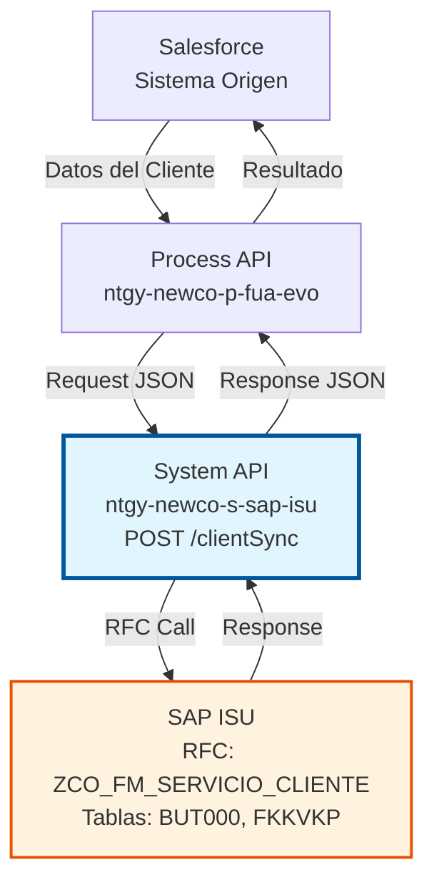
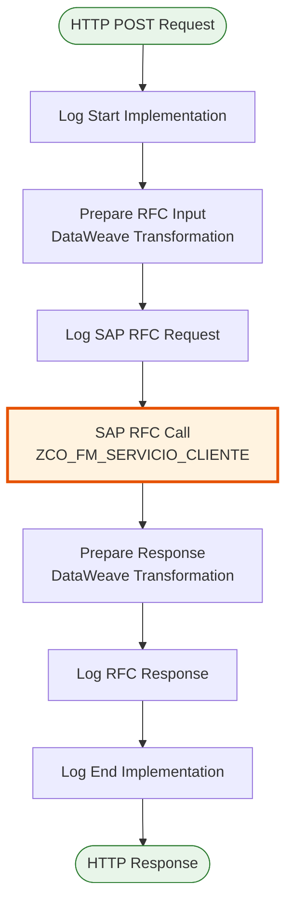
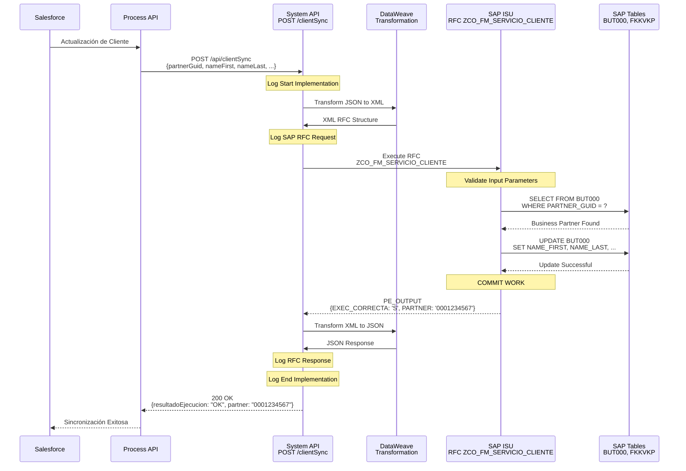
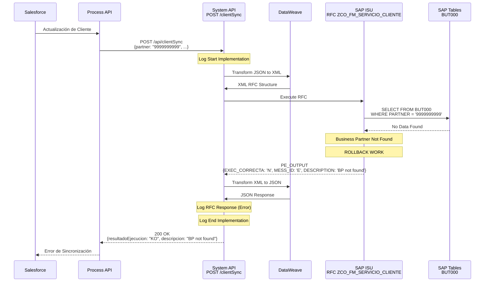
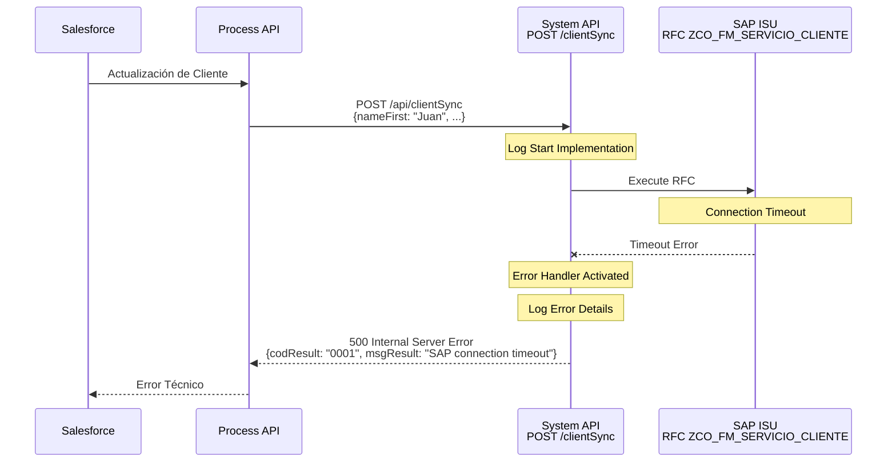

# POST /clientSync

## 📌 Descripción General

### Propósito del Endpoint

Este endpoint sincroniza información de clientes (Business Partners) desde Salesforce hacia SAP ISU. Permite mantener actualizada la información maestra de clientes en SAP ISU cuando se realizan cambios en Salesforce, asegurando la consistencia de datos entre ambos sistemas.

El endpoint soporta la sincronización de:
- **Personas físicas**: Nombre, apellidos, fecha de nacimiento, sexo, estado civil, nacionalidad
- **Personas jurídicas**: Razón social (hasta 4 líneas)
- **Datos de contacto**: Email, teléfono fijo, móvil, fax
- **Datos de identificación**: NIF/NIE/CIF, país, idioma

### Tipo de API

**Capa:** System API (API-Led Connectivity)

**Función:** Integración directa con SAP ISU para sincronización de datos maestros de clientes.

### Patrón de Integración

**Tipo:** Request-Reply Síncrono con SAP RFC

**Descripción:** El endpoint recibe los datos del cliente desde Salesforce, los transforma al formato SAP, invoca el RFC `ZCO_FM_SERVICIO_CLIENTE` y retorna el resultado de la sincronización.

### Arquitectura API-Led Connectivity



---

## 💼 Propósito del Negocio

### Casos de Uso Principales

1. **Sincronización de Cliente Nuevo**
   - Cuando se crea un cliente en Salesforce, se sincroniza automáticamente a SAP ISU
   - Crea el Business Partner en SAP con todos sus datos maestros
   - Asigna número de Business Partner (PARTNER)

2. **Actualización de Datos de Cliente Existente**
   - Cuando se modifican datos de un cliente en Salesforce
   - Actualiza la información del Business Partner en SAP ISU
   - Mantiene la consistencia entre ambos sistemas

3. **Sincronización de Datos de Contacto**
   - Actualiza email, teléfonos, fax del cliente
   - Asegura que los canales de comunicación estén actualizados

4. **Gestión de Personas Físicas y Jurídicas**
   - Soporta tanto clientes individuales como empresas
   - Maneja diferentes estructuras de datos según el tipo de cliente

### Contexto Empresarial

- **Dominio:** Gestión de Clientes (Customer Master Data Management)
- **Sector:** Energía - Utilities
- **División:** Naturgy España - NewCo
- **Proceso de Negocio:** Sincronización de datos maestros entre Salesforce y SAP ISU

### Stakeholders

- **Equipos de Salesforce:** Mantienen datos de clientes en Salesforce
- **Equipos de SAP ISU:** Gestionan Business Partners en SAP
- **Agentes de Call Center:** Necesitan datos consistentes en ambos sistemas
- **Sistemas de Facturación:** Dependen de datos correctos de Business Partners
- **Equipos de Integración:** Mantienen la sincronización entre sistemas

### Valor de Negocio

- **Consistencia de Datos:** Asegura que Salesforce y SAP ISU tengan la misma información
- **Automatización:** Elimina la necesidad de sincronización manual
- **Reducción de Errores:** Minimiza errores de transcripción manual
- **Tiempo Real:** Sincronización inmediata de cambios
- **Trazabilidad:** Registro completo de sincronizaciones realizadas

### Consumidores Potenciales

Este endpoint puede ser consumido por:
- Process APIs de gestión de clientes
- Flujos de Salesforce (Platform Events, Flows)
- Sistemas de integración middleware
- Aplicaciones de gestión de clientes

---

## 🔧 Especificación Técnica

### URLs por Ambiente

| Ambiente | URL Base | URL Completa |
|----------|----------|--------------|
| **Local** | `http://localhost:8081` | `http://localhost:8081/api/clientSync` |
| **Development** | `https://ntgy-newco-s-sap-isu-dev.us-e2.cloudhub.io` | `https://ntgy-newco-s-sap-isu-dev.us-e2.cloudhub.io/api/clientSync` |
| **UAT** | `https://ntgy-newco-s-sap-isu-uat.us-e2.cloudhub.io` | `https://ntgy-newco-s-sap-isu-uat.us-e2.cloudhub.io/api/clientSync` |
| **Production** | `https://ntgy-newco-s-sap-isu-pro.us-e2.cloudhub.io` | `https://ntgy-newco-s-sap-isu-pro.us-e2.cloudhub.io/api/clientSync` |

### Método HTTP

```
POST /api/clientSync
```

### Parámetros de Entrada

#### Headers HTTP

| Header | Tipo | Requerido | Descripción | Ejemplo |
|--------|------|-----------|-------------|---------|
| `Content-Type` | string | ✅ Sí | Tipo de contenido del request | `application/json` |
| `Accept` | string | ❌ No | Tipo de contenido esperado en response | `application/json` |

#### Body Parameters

El body debe contener un objeto JSON con la información del cliente a sincronizar:

| Campo | Tipo | Requerido | Descripción | Ejemplo |
|-------|------|-----------|-------------|---------|
| `partnerGuid` | string | ❌ No | GUID del Business Partner en SAP ISU | `"00163E038B4C1EE8B2D3F8B06D8B0C3A"` |
| `partner` | string | ❌ No | Número de Business Partner en SAP ISU | `"0001234567"` |
| `title` | string | ❌ No | Título del cliente (Sr., Sra., Dr., etc.) | `"Sr."` |
| `nameFirst` | string | ❌ No | Nombre del cliente (persona física) | `"Juan"` |
| `nameLast` | string | ❌ No | Apellidos del cliente (persona física) | `"García López"` |
| `nameOrg1` | string | ❌ No | Nombre de la organización - Línea 1 (persona jurídica) | `"EMPRESA EJEMPLO S.L."` |
| `nameOrg2` | string | ❌ No | Nombre de la organización - Línea 2 | `""` |
| `nameOrg3` | string | ❌ No | Nombre de la organización - Línea 3 | `""` |
| `nameOrg4` | string | ❌ No | Nombre de la organización - Línea 4 | `""` |
| `birthdt` | string | ❌ No | Fecha de nacimiento en formato YYYYMMDD | `"19850315"` |
| `country` | string | ❌ No | Código de país (formato SAP) | `"ES"` |
| `langu` | string | ❌ No | Código de idioma (formato SAP) | `"S"` |
| `languIso` | string | ❌ No | Código de idioma ISO 639-1 | `"ES"` |
| `persnumber` | string | ❌ No | Número de identificación personal (NIF/NIE/CIF) | `"12345678A"` |
| `xsexm` | string | ❌ No | Indicador de sexo masculino (X = masculino, vacío = no) | `"X"` |
| `xsexf` | string | ❌ No | Indicador de sexo femenino (X = femenino, vacío = no) | `""` |
| `xsexu` | string | ❌ No | Indicador de sexo no especificado | `""` |
| `marst` | string | ❌ No | Estado civil | `"1"` |
| `natio` | string | ❌ No | Nacionalidad (formato SAP) | `"ES"` |
| `natioIso` | string | ❌ No | Nacionalidad ISO 3166-1 alpha-2 | `"ES"` |
| `smtpAddr` | string | ❌ No | Dirección de correo electrónico | `"juan.garcia@example.com"` |
| `telNumber` | string | ❌ No | Número de teléfono | `"912345678"` |
| `telExtens` | string | ❌ No | Extensión telefónica | `""` |
| `faxNumber` | string | ❌ No | Número de fax | `""` |
| `faxExtens` | string | ❌ No | Extensión de fax | `""` |
| `mobNumber` | string | ❌ No | Número de teléfono móvil | `"612345678"` |

### Respuestas

#### Respuesta Exitosa (200 OK)

```json
{
  "partner": "0001234567",
  "codCliente": "12345678A",
  "resultadoEjecucion": "OK",
  "idMensaje": "",
  "numMensaje": "",
  "descripcion": "Sincronización exitosa",
  "areaFuncional": "",
  "categoriaError": ""
}
```

**Estructura de la Respuesta:**

| Campo | Tipo | Descripción |
|-------|------|-------------|
| `partner` | string | Número de Business Partner asignado en SAP ISU |
| `codCliente` | string | Código externo del cliente (NIF/CIF) |
| `resultadoEjecucion` | string | Resultado de la operación: "OK" o "KO" |
| `idMensaje` | string | ID del mensaje de SAP (vacío si éxito) |
| `numMensaje` | string | Número del mensaje de SAP (vacío si éxito) |
| `descripcion` | string | Descripción del resultado |
| `areaFuncional` | string | Área funcional de SAP (vacío si éxito) |
| `categoriaError` | string | Categoría del error (vacío si éxito) |

#### Respuesta de Error de Negocio (200 OK con resultadoEjecucion = "KO")

```json
{
  "partner": "",
  "codCliente": "",
  "resultadoEjecucion": "KO",
  "idMensaje": "E",
  "numMensaje": "001",
  "descripcion": "Business Partner no encontrado",
  "areaFuncional": "BP",
  "categoriaError": "ERROR"
}
```

#### Respuesta de Error de Validación (400 Bad Request)

```json
{
  "result": {
    "codResult": "0001",
    "msgResult": "Error de validación: datos de entrada inválidos"
  }
}
```

#### Respuesta de Error del Servidor (500 Internal Server Error)

```json
{
  "result": {
    "codResult": "0001",
    "msgResult": "Error interno del servidor: no se pudo conectar con SAP ISU"
  }
}
```

### Códigos de Resultado

| Código | Tipo | Descripción |
|--------|------|-------------|
| `OK` | Éxito | Sincronización completada exitosamente |
| `KO` | Error | Error en la sincronización (ver campos de error para detalles) |

### Autenticación y Autorización

- **Tipo:** Client ID & Client Secret (Anypoint Platform)
- **Headers Requeridos:** Configurados a nivel de API Manager
- **Autorización SAP:** El usuario SAP configurado debe tener permisos para:
  - Ejecutar RFC `ZCO_FM_SERVICIO_CLIENTE`
  - Acceso a tablas BUT000 y FKKVKP
  - Autorización para crear/modificar Business Partners

### Timeouts

| Tipo | Valor | Descripción |
|------|-------|-------------|
| **Request Timeout** | 30 segundos | Tiempo máximo de espera para la respuesta del RFC |
| **Connection Timeout** | 10 segundos | Tiempo máximo para establecer conexión con SAP |

### Protocolo

- **Protocolo:** HTTPS (Production), HTTP (Local/Development)
- **TLS Version:** TLS 1.2 o superior
- **Puerto:** 443 (HTTPS), 8081 (Local)

---

## 🏗️ Implementación Técnica

### Arquitectura del Flow



### 🗄️ RFC SAP Invocado

#### RFC: ZCO_FM_SERVICIO_CLIENTE

**Descripción:** RFC personalizado de Naturgy para sincronización de Business Partners desde Salesforce a SAP ISU.

**Módulo SAP:** BP (Business Partner Management)

**Tablas SAP Consultadas/Modificadas:**

| Tabla | Operaciones | Descripción | Campos Principales |
|-------|-------------|-------------|-------------------|
| **BUT000** | READ, INSERT, UPDATE | Business Partner Master Data | PARTNER, PARTNER_GUID, NAME_FIRST, NAME_LAST, NAME_ORG1, BIRTHDT, PERSNUMBER |
| **FKKVKP** | READ | Contract Account | VKONT, GPART (Business Partner) |

**Estructura del RFC:**

**Import Parameters:**
```xml
<PI_INPUT>
  <I_PARTNER_GUID>GUID del Business Partner</I_PARTNER_GUID>
  <I_PARTNER>Número de Business Partner</I_PARTNER>
  <I_TITLE>Título</I_TITLE>
  <I_NAME_FIRST>Nombre</I_NAME_FIRST>
  <I_NAME_LAST>Apellidos</I_NAME_LAST>
  <I_NAME_ORG1>Razón Social Línea 1</I_NAME_ORG1>
  <I_NAME_ORG2>Razón Social Línea 2</I_NAME_ORG2>
  <I_NAME_ORG3>Razón Social Línea 3</I_NAME_ORG3>
  <I_NAME_ORG4>Razón Social Línea 4</I_NAME_ORG4>
  <I_BIRTHDT>Fecha de Nacimiento</I_BIRTHDT>
  <I_COUNTRY>País</I_COUNTRY>
  <I_LANGU>Idioma SAP</I_LANGU>
  <I_LANGU_ISO>Idioma ISO</I_LANGU_ISO>
  <I_PERSNUMBER>NIF/NIE/CIF</I_PERSNUMBER>
  <I_XSEXM>Sexo Masculino</I_XSEXM>
  <I_XSEXF>Sexo Femenino</I_XSEXF>
  <I_XSEXU>Sexo No Especificado</I_XSEXU>
  <I_MARST>Estado Civil</I_MARST>
  <I_NATIO>Nacionalidad SAP</I_NATIO>
  <I_NATIO_ISO>Nacionalidad ISO</I_NATIO_ISO>
  <I_SMTP_ADDR>Email</I_SMTP_ADDR>
  <I_TEL_NUMBER>Teléfono</I_TEL_NUMBER>
  <I_TEL_EXTENS>Extensión Teléfono</I_TEL_EXTENS>
  <I_FAX_NUMBER>Fax</I_FAX_NUMBER>
  <I_FAX_EXTENS>Extensión Fax</I_FAX_EXTENS>
  <I_MOB_NUMBER>Móvil</I_MOB_NUMBER>
</PI_INPUT>
```

**Export Parameters:**
```xml
<PE_OUTPUT>
  <EXEC_CORRECTA>S/N</EXEC_CORRECTA>
  <PARTNER>Número de Business Partner</PARTNER>
  <BPEXT>Código Externo (NIF/CIF)</BPEXT>
  <MESS_ID>ID del Mensaje</MESS_ID>
  <MSGNR>Número del Mensaje</MSGNR>
  <DESCRIPTION>Descripción del Resultado</DESCRIPTION>
  <ARBGB>Área Funcional</ARBGB>
  <CATEGORY_ID>Categoría del Error</CATEGORY_ID>
</PE_OUTPUT>
```

### Transformaciones DataWeave

#### Transformación de Input (Request → RFC)

**Archivo:** `src/main/resources/dw/client-sync-rfc-input.dwl`

```dataweave
%dw 2.0
output application/xml
---
{
	"ZCO_FM_SERVICIO_CLIENTE": {
		"import": {
			"PI_INPUT": {
				// GUID y Partner Number
				I_PARTNER_GUID: payload.partnerGuid default "",
				I_PARTNER: payload.partner default "",
				
				// Título
				I_TITLE: payload.title default "",
				
				// Nombre (Persona Física)
				I_NAME_FIRST: payload.nameFirst default "",
				I_NAME_LAST: payload.nameLast default "",
				
				// Razón Social (Persona Jurídica)
				I_NAME_ORG1: payload.nameOrg1 default "",
				I_NAME_ORG2: payload.nameOrg2 default "",
				I_NAME_ORG3: payload.nameOrg3 default "",
				I_NAME_ORG4: payload.nameOrg4 default "",
				
				// Datos Personales
				I_BIRTHDT: payload.birthdt default "",
				I_COUNTRY: payload.country default "",
				I_LANGU: payload.langu default "",
				I_LANGU_ISO: payload.languIso default "",
				I_PERSNUMBER: payload.persnumber default "",
				
				// Sexo
				I_XSEXM: payload.xsexm default "",
				I_XSEXF: payload.xsexf default "",
				I_XSEXU: payload.xsexu default "",
				
				// Estado Civil y Nacionalidad
				I_MARST: payload.marst default "",
				I_NATIO: payload.natio default "",
				I_NATIO_ISO: payload.natioIso default "",
				
				// Datos de Contacto
				I_SMTP_ADDR: payload.smtpAddr default "",
				I_TEL_NUMBER: payload.telNumber default "",
				I_TEL_EXTENS: payload.telExtens default "",
				I_FAX_NUMBER: payload.faxNumber default "",
				I_FAX_EXTENS: payload.faxExtens default "",
				I_MOB_NUMBER: payload.mobNumber default ""
			}
		}
	}
}
```

**Mapeo de Campos:**

| Campo JSON | Campo SAP | Transformación |
|------------|-----------|----------------|
| `partnerGuid` | `I_PARTNER_GUID` | Directo, default "" |
| `partner` | `I_PARTNER` | Directo, default "" |
| `nameFirst` | `I_NAME_FIRST` | Directo, default "" |
| `nameLast` | `I_NAME_LAST` | Directo, default "" |
| `nameOrg1` | `I_NAME_ORG1` | Directo, default "" |
| `birthdt` | `I_BIRTHDT` | Directo (formato YYYYMMDD), default "" |
| `persnumber` | `I_PERSNUMBER` | Directo (NIF/NIE/CIF), default "" |
| `smtpAddr` | `I_SMTP_ADDR` | Directo, default "" |
| `telNumber` | `I_TEL_NUMBER` | Directo, default "" |
| `mobNumber` | `I_MOB_NUMBER` | Directo, default "" |

#### Transformación de Output (RFC → Response)

**Código DataWeave Inline:**

```dataweave
%dw 2.0
output application/json
import buildStandardResponse from modules::commonUtils
var out = payload.ZCO_FM_SERVICIO_CLIENTE.export.PE_OUTPUT
---
buildStandardResponse(out, {
    (partner: out.PARTNER) if out.PARTNER != null,
    codCliente: out.BPEXT
})
```

**Función `buildStandardResponse`:**

Esta función reutilizable del módulo `commonUtils` construye la respuesta estándar:

```dataweave
fun buildStandardResponse(out: Object, additionalFields: Object = {}) = 
    additionalFields ++ {
        resultadoEjecucion: if (out.EXEC_CORRECTA == 'S') "OK" else "KO",
        idMensaje: out.MESS_ID,
        numMensaje: out.MSGNR,
        descripcion: out.DESCRIPTION,
        areaFuncional: out.ARBGB,
        categoriaError: out.CATEGORY_ID
    }
```

### Patrones de Diseño

**Patrón Principal:** Request-Reply Síncrono

**Justificación:**
- La sincronización de clientes requiere confirmación inmediata
- El proceso es rápido (< 5 segundos típicamente)
- El consumidor necesita saber el resultado inmediatamente
- No hay necesidad de procesamiento asíncrono

**Patrones Adicionales:**
- **Transformation Pattern:** DataWeave para mapeo JSON ↔ XML
- **Error Handling Pattern:** Try-catch con respuestas estandarizadas
- **Logging Pattern:** Logging en puntos clave del flujo

### Diagramas de Secuencia

#### 1. Flujo Normal de Éxito



#### 2. Flujo con Error de Negocio



#### 3. Flujo con Error Técnico



### Connection Pooling

**Configuración del Pool de Conexiones SAP JCo:**

| Parámetro | Valor | Descripción |
|-----------|-------|-------------|
| **Pool Size** | 10 conexiones | Número máximo de conexiones simultáneas |
| **Max Wait Time** | 30 segundos | Tiempo máximo de espera por una conexión |
| **Connection Timeout** | 10 segundos | Timeout para establecer conexión |
| **Peak Limit** | 15 conexiones | Límite máximo en picos de carga |

**Estrategia de Reconexión:**
- **Retry Interval:** Configurable vía `${sap.reconnection.retryInterval}`
- **Retry Attempts:** Configurable vía `${sap.reconnection.retryAttempts}`
- **Behavior:** Reconexión automática en caso de pérdida de conexión

### Manejo de Errores

**Estrategia de Error Handling:**

1. **Try-Catch a Nivel de Flow:**
   - Captura excepciones de SAP Connector
   - Captura errores de transformación DataWeave
   - Captura errores de validación

2. **Transformación de Errores:**
   - Errores SAP → Formato JSON estándar
   - Códigos de error SAP → Códigos de negocio
   - Mensajes técnicos → Mensajes user-friendly

3. **Logging de Errores:**
   - Log de error con stack trace completo
   - Log de contexto de la petición
   - Log de parámetros de entrada (sin datos sensibles)

4. **Respuestas de Error:**
   - 400: Errores de validación de entrada
   - 500: Errores técnicos (SAP, transformación, etc.)
   - 200 con `resultadoEjecucion: "KO"`: Errores de negocio SAP

---

## 💻 Ejemplos de Uso

### Ejemplo 1: Sincronización de Cliente Persona Física (Éxito)

#### cURL

```bash
curl -X POST "https://ntgy-newco-s-sap-isu-dev.us-e2.cloudhub.io/api/clientSync" \
  -H "Content-Type: application/json" \
  -H "client_id: YOUR_CLIENT_ID" \
  -H "client_secret: YOUR_CLIENT_SECRET" \
  -d '{
    "partner": "0001234567",
    "nameFirst": "Juan",
    "nameLast": "García López",
    "birthdt": "19850315",
    "country": "ES",
    "langu": "S",
    "languIso": "ES",
    "persnumber": "12345678A",
    "xsexm": "X",
    "xsexf": "",
    "xsexu": "",
    "marst": "1",
    "natio": "ES",
    "natioIso": "ES",
    "smtpAddr": "juan.garcia@example.com",
    "telNumber": "912345678",
    "mobNumber": "612345678"
  }'
```

#### Respuesta (200 OK)

```json
{
  "partner": "0001234567",
  "codCliente": "12345678A",
  "resultadoEjecucion": "OK",
  "idMensaje": "",
  "numMensaje": "",
  "descripcion": "Sincronización exitosa",
  "areaFuncional": "",
  "categoriaError": ""
}
```

---

### Ejemplo 2: Sincronización de Cliente Persona Jurídica (Éxito)

#### cURL

```bash
curl -X POST "https://ntgy-newco-s-sap-isu-dev.us-e2.cloudhub.io/api/clientSync" \
  -H "Content-Type: application/json" \
  -H "client_id: YOUR_CLIENT_ID" \
  -H "client_secret: YOUR_CLIENT_SECRET" \
  -d '{
    "partner": "0009876543",
    "nameOrg1": "EMPRESA EJEMPLO S.L.",
    "nameOrg2": "",
    "nameOrg3": "",
    "nameOrg4": "",
    "country": "ES",
    "langu": "S",
    "languIso": "ES",
    "persnumber": "B12345678",
    "smtpAddr": "contacto@empresa-ejemplo.com",
    "telNumber": "913456789"
  }'
```

#### Respuesta (200 OK)

```json
{
  "partner": "0009876543",
  "codCliente": "B12345678",
  "resultadoEjecucion": "OK",
  "idMensaje": "",
  "numMensaje": "",
  "descripcion": "Sincronización exitosa",
  "areaFuncional": "",
  "categoriaError": ""
}
```

---

### Ejemplo 3: Error - Business Partner No Encontrado

#### cURL

```bash
curl -X POST "https://ntgy-newco-s-sap-isu-dev.us-e2.cloudhub.io/api/clientSync" \
  -H "Content-Type: application/json" \
  -H "client_id: YOUR_CLIENT_ID" \
  -H "client_secret: YOUR_CLIENT_SECRET" \
  -d '{
    "partner": "9999999999",
    "nameFirst": "Test",
    "nameLast": "Usuario"
  }'
```

#### Respuesta (200 OK con Error de Negocio)

```json
{
  "partner": "",
  "codCliente": "",
  "resultadoEjecucion": "KO",
  "idMensaje": "E",
  "numMensaje": "001",
  "descripcion": "Business Partner no encontrado en SAP ISU",
  "areaFuncional": "BP",
  "categoriaError": "ERROR"
}
```

---

### Ejemplo 4: JavaScript (Fetch API)

```javascript
const syncClient = async () => {
  const url = 'https://ntgy-newco-s-sap-isu-dev.us-e2.cloudhub.io/api/clientSync';
  
  const clientData = {
    partner: '0001234567',
    nameFirst: 'Juan',
    nameLast: 'García López',
    birthdt: '19850315',
    country: 'ES',
    langu: 'S',
    languIso: 'ES',
    persnumber: '12345678A',
    xsexm: 'X',
    smtpAddr: 'juan.garcia@example.com',
    telNumber: '912345678',
    mobNumber: '612345678'
  };

  try {
    const response = await fetch(url, {
      method: 'POST',
      headers: {
        'Content-Type': 'application/json',
        'client_id': 'YOUR_CLIENT_ID',
        'client_secret': 'YOUR_CLIENT_SECRET'
      },
      body: JSON.stringify(clientData)
    });

    const data = await response.json();
    
    if (data.resultadoEjecucion === 'OK') {
      console.log('✅ Sincronización exitosa');
      console.log('Business Partner:', data.partner);
      console.log('Código Cliente:', data.codCliente);
    } else {
      console.error('❌ Error de negocio:', data.descripcion);
    }
    
    return data;
  } catch (error) {
    console.error('❌ Error técnico:', error);
    throw error;
  }
};

// Ejecutar
syncClient();
```

---

### Ejemplo 5: JavaScript (Axios)

```javascript
const axios = require('axios');

const syncClient = async () => {
  const url = 'https://ntgy-newco-s-sap-isu-dev.us-e2.cloudhub.io/api/clientSync';
  
  const clientData = {
    partner: '0001234567',
    nameFirst: 'Juan',
    nameLast: 'García López',
    birthdt: '19850315',
    country: 'ES',
    langu: 'S',
    languIso: 'ES',
    persnumber: '12345678A',
    xsexm: 'X',
    smtpAddr: 'juan.garcia@example.com',
    telNumber: '912345678',
    mobNumber: '612345678'
  };

  try {
    const response = await axios.post(url, clientData, {
      headers: {
        'Content-Type': 'application/json',
        'client_id': 'YOUR_CLIENT_ID',
        'client_secret': 'YOUR_CLIENT_SECRET'
      }
    });

    if (response.data.resultadoEjecucion === 'OK') {
      console.log('✅ Sincronización exitosa');
      console.log('Business Partner:', response.data.partner);
      console.log('Código Cliente:', response.data.codCliente);
    } else {
      console.error('❌ Error de negocio:', response.data.descripcion);
    }
    
    return response.data;
  } catch (error) {
    if (error.response) {
      console.error('❌ Error del servidor:', error.response.status);
      console.error('Mensaje:', error.response.data);
    } else {
      console.error('❌ Error de red:', error.message);
    }
    throw error;
  }
};

// Ejecutar
syncClient();
```

---

### Ejemplo 6: Python (requests)

```python
import requests
import json

def sync_client():
    url = 'https://ntgy-newco-s-sap-isu-dev.us-e2.cloudhub.io/api/clientSync'
    
    headers = {
        'Content-Type': 'application/json',
        'client_id': 'YOUR_CLIENT_ID',
        'client_secret': 'YOUR_CLIENT_SECRET'
    }
    
    client_data = {
        'partner': '0001234567',
        'nameFirst': 'Juan',
        'nameLast': 'García López',
        'birthdt': '19850315',
        'country': 'ES',
        'langu': 'S',
        'languIso': 'ES',
        'persnumber': '12345678A',
        'xsexm': 'X',
        'smtpAddr': 'juan.garcia@example.com',
        'telNumber': '912345678',
        'mobNumber': '612345678'
    }
    
    try:
        response = requests.post(url, headers=headers, json=client_data)
        response.raise_for_status()
        
        data = response.json()
        
        if data.get('resultadoEjecucion') == 'OK':
            print('✅ Sincronización exitosa')
            print(f"Business Partner: {data.get('partner')}")
            print(f"Código Cliente: {data.get('codCliente')}")
        else:
            print(f"❌ Error de negocio: {data.get('descripcion')}")
        
        return data
        
    except requests.exceptions.HTTPError as http_err:
        print(f'❌ Error HTTP: {http_err}')
        print(f'Respuesta: {response.text}')
        raise
    except Exception as err:
        print(f'❌ Error: {err}')
        raise

# Ejecutar
if __name__ == '__main__':
    sync_client()
```

---

### Ejemplo 7: Postman Collection

```json
{
  "info": {
    "name": "SAP ISU - Client Sync",
    "schema": "https://schema.getpostman.com/json/collection/v2.1.0/collection.json"
  },
  "item": [
    {
      "name": "Sync Client - Success",
      "request": {
        "method": "POST",
        "header": [
          {
            "key": "Content-Type",
            "value": "application/json"
          },
          {
            "key": "client_id",
            "value": "{{client_id}}"
          },
          {
            "key": "client_secret",
            "value": "{{client_secret}}"
          }
        ],
        "body": {
          "mode": "raw",
          "raw": "{\n  \"partner\": \"0001234567\",\n  \"nameFirst\": \"Juan\",\n  \"nameLast\": \"García López\",\n  \"birthdt\": \"19850315\",\n  \"country\": \"ES\",\n  \"langu\": \"S\",\n  \"languIso\": \"ES\",\n  \"persnumber\": \"12345678A\",\n  \"xsexm\": \"X\",\n  \"smtpAddr\": \"juan.garcia@example.com\",\n  \"telNumber\": \"912345678\",\n  \"mobNumber\": \"612345678\"\n}"
        },
        "url": {
          "raw": "{{base_url}}/api/clientSync",
          "host": ["{{base_url}}"],
          "path": ["api", "clientSync"]
        }
      }
    }
  ]
}
```
