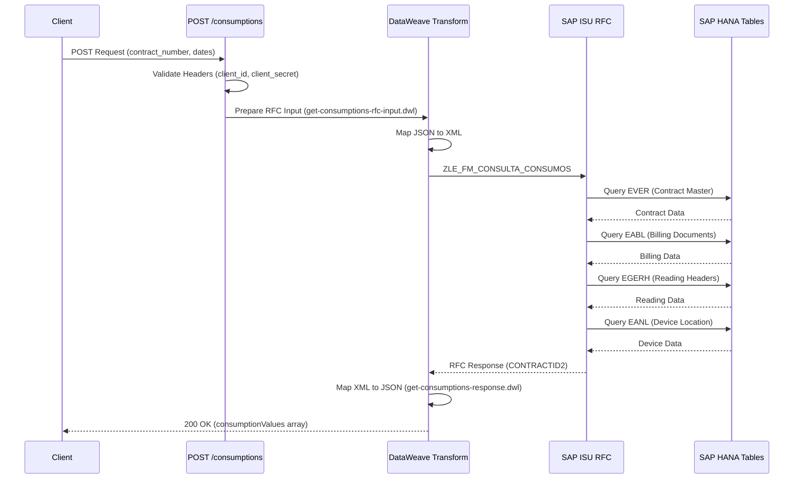
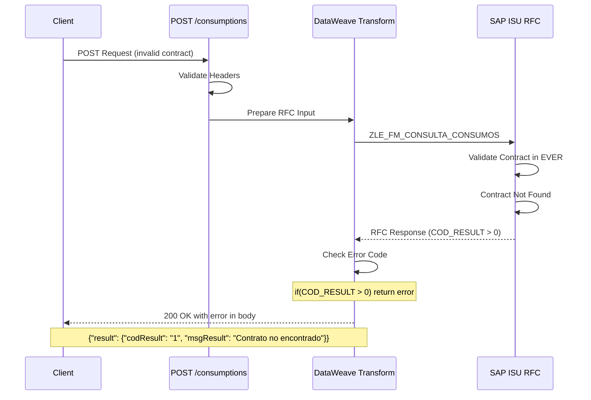
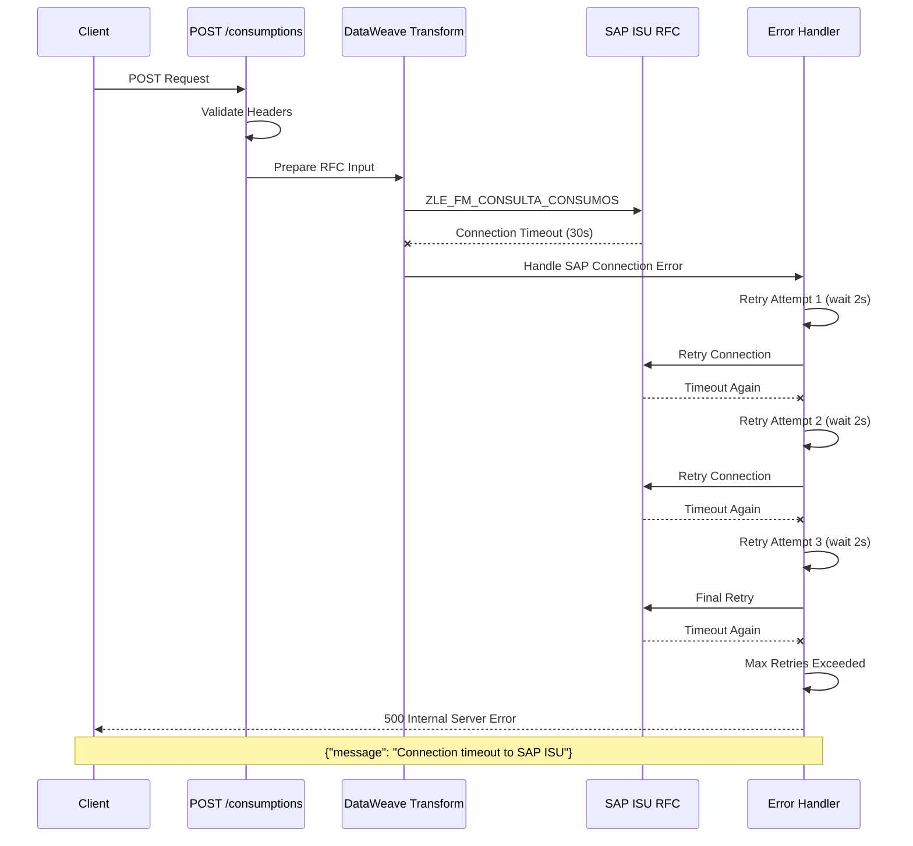

# POST /consumptions

## 📌 Descripción General

### Propósito del Endpoint

Este endpoint consulta los consumos detallados de un contrato en SAP ISU mediante una petición POST. Proporciona información sobre consumos por período, magnitud y tipo de energía (luz/gas), permitiendo análisis detallado del consumo energético.

### Tipo de API

**Capa:** System API (Integración Directa con SAP ISU)

### Patrón de Integración

**Tipo:** Request-Reply Síncrono con SAP ISU - Consulta de Consumos

**Características del Patrón:**
- ✅ Comunicación síncrona con SAP ISU
- ✅ Invocación de RFC `ZLE_FM_CONSULTA_CONSUMOS`
- ✅ Método POST para consulta (permite body complejo)
- ✅ Respuesta con consumos por período
- ✅ Tiempo de respuesta < 5 segundos

---

## 💼 Propósito del Negocio

### Casos de Uso Principales

#### 1. Análisis de Consumo Energético
**Actor:** Cliente o sistema de análisis  
**Objetivo:** Analizar patrones de consumo por período  
**Flujo:**
- Cliente solicita detalle de consumos
- Sistema consulta consumos en SAP ISU
- Muestra consumos por magnitud y período
- Cliente analiza su consumo energético

#### 2. Comparativa de Consumos
**Actor:** Sistema de BI o reporting  
**Objetivo:** Comparar consumos entre períodos  
**Flujo:**
- Sistema solicita consumos históricos
- Compara consumos entre períodos
- Identifica tendencias y anomalías
- Genera reportes comparativos

#### 3. Validación de Facturación
**Actor:** Departamento de facturación  
**Objetivo:** Validar consumos facturados  
**Flujo:**
- Sistema compara consumos con facturas
- Verifica cálculos de consumo
- Identifica discrepancias
- Corrige errores

---

## 🔧 Especificación Técnica

### URLs por Ambiente

| Ambiente | URL Base | URL Completa |
|----------|----------|--------------|
| **Local** | `http://localhost:8081` | `http://localhost:8081/api/consumptions` |
| **Development** | `https://ntgy-newco-s-sap-isu-dev.cloudhub.io` | `https://ntgy-newco-s-sap-isu-dev.cloudhub.io/api/consumptions` |
| **UAT** | `https://ntgy-newco-s-sap-isu-uat.cloudhub.io` | `https://ntgy-newco-s-sap-isu-uat.cloudhub.io/api/consumptions` |
| **Production** | `https://ntgy-newco-s-sap-isu.cloudhub.io` | `https://ntgy-newco-s-sap-isu.cloudhub.io/api/consumptions` |

### Método HTTP

```
POST /api/consumptions
```

### Autenticación

Este endpoint requiere autenticación mediante **Client Credentials** (OAuth 2.0).

#### Headers Requeridos

| Header | Tipo | Descripción | Ejemplo |
|--------|------|-------------|---------|
| `client_id` | String | ID del cliente OAuth | `a1b2c3d4e5f6` |
| `client_secret` | String | Secret del cliente OAuth | `secret123456` |
| `Content-Type` | String | Tipo de contenido | `application/json` |

#### Ejemplo de Headers

```bash
-H "client_id: your-client-id" \
-H "client_secret: your-client-secret" \
-H "Content-Type: application/json"
```

**Nota:** Las credenciales deben solicitarse al equipo de integración de MuleSoft.

### Timeouts y SLAs

| Métrica | Valor | Descripción |
|---------|-------|-------------|
| **Timeout de conexión** | 5 segundos | Tiempo máximo para establecer conexión con SAP ISU |
| **Timeout de lectura** | 30 segundos | Tiempo máximo para recibir respuesta del RFC |
| **Tiempo de respuesta esperado** | < 5 segundos | SLA para respuesta exitosa (P95) |
| **Reintentos automáticos** | 3 intentos | Configurado en SAP connector |
| **Intervalo entre reintentos** | 2 segundos | Tiempo de espera entre reintentos |

**Recomendaciones:**
- Para consultas de períodos largos (> 12 meses), el tiempo de respuesta puede ser mayor
- Si el timeout se excede, el sistema reintentará automáticamente hasta 3 veces
- Después de 3 intentos fallidos, se retorna error 500

### Parámetros de Entrada

#### Request Body (JSON)

```json
{
  "contract_number": "1000123456",
  "cups": "ES0021000000000001JN",
  "fecha_desde": "01/01/2024",
  "fecha_hasta": "31/12/2024",
  "frecuencia": "M",
  "sector": "01",
  "clientCode": "12345678A"
}
```

| Campo | Tipo | Requerido | Descripción |
|-------|------|-----------|-------------|
| `contract_number` | String | ✅ Sí | Número de contrato SAP ISU |
| `cups` | String | ⚠️ Opcional | Código CUPS del punto de suministro |
| `fecha_desde` | String | ⚠️ Opcional | Fecha inicio (dd/MM/yyyy) |
| `fecha_hasta` | String | ⚠️ Opcional | Fecha fin (dd/MM/yyyy) |
| `frecuencia` | String | ⚠️ Opcional | Frecuencia de lectura (M=Mensual, B=Bimestral) |
| `sector` | String | ⚠️ Opcional | Sector (01=Electricidad, 02=Gas) |
| `clientCode` | String | ⚠️ Opcional | NIF/CIF del cliente |

**Notas:**
- Si no se especifican fechas, se retornan todos los consumos disponibles
- La frecuencia determina la granularidad de los datos retornados
- El formato de fecha debe ser dd/MM/yyyy (día/mes/año)

### Respuestas

#### Respuesta Exitosa (200 OK)

```json
{
  "contractId": "1000123456",
  "productTypeFamily": "luz",
  "productGraphicResume": {
    "anualSelfConsumption": 0,
    "anualEstimatedProduction": 0,
    "anualPowerGridContribution": 0,
    "anualClearedAmount": 0,
    "anualTotalConsumption": 3250.5,
    "anualPointConsumption": 1200.0,
    "anualValleyConsumption": 2050.5,
    "anualComparative": 5.2
  },
  "consumptionValues": [
    {
      "date": "2024-01-15",
      "invoiceRef": "100012345678",
      "valueTotal": 250.5,
      "P1": 100.2,
      "P2": 80.3,
      "P3": 70.0,
      "P4": 0,
      "P5": 0,
      "P6": 0,
      "aported": 0,
      "consumed": 250.5
    }
  ],
  "result": {
    "codResult": "0",
    "msgResult": "Consulta exitosa"
  }
}
```

#### Respuesta de Error de Validación (400 Bad Request)

**Causas comunes:**
- Formato de fecha incorrecto
- Parámetros requeridos faltantes
- Tipo de dato incorrecto

```json
{
  "message": "Bad request",
  "errors": [
    {
      "field": "contract_number",
      "message": "Field is required"
    }
  ]
}
```

#### Respuesta de Error de Negocio (200 OK con error en body)

**Nota:** SAP ISU retorna errores de negocio con HTTP 200, pero con código de error en el body.

```json
{
  "result": {
    "codResult": "1",
    "msgResult": "Contrato no encontrado en SAP ISU"
  }
}
```

**Códigos de error comunes:**
- `1`: Contrato no encontrado
- `2`: Sin consumos en el período especificado
- `3`: Error de autorización en SAP
- `4`: CUPS no válido
- `5`: Período de consulta no válido

#### Respuesta de Error del Sistema (500 Internal Server Error)

**Causas comunes:**
- Timeout de conexión con SAP ISU
- Error en la transformación DataWeave
- RFC no disponible

```json
{
  "message": "Internal server error",
  "error": "Connection timeout to SAP ISU",
  "timestamp": "2024-01-15T10:30:00Z"
}
```

---

## 🏗️ Implementación Técnica

### RFC SAP Invocado

#### RFC: `ZLE_FM_CONSULTA_CONSUMOS`

**Descripción:** Función RFC personalizada de SAP ISU para consultar consumos detallados de un contrato por período, magnitud y tipo de energía.

**Módulo SAP:** Meter Reading (EL-MD)

**Tablas SAP Consultadas:**
- `EVER`: Contract Master Data (Datos Maestros de Contrato)
- `EABL`: Billing Document (Documento de Facturación)
- `EGERH`: Meter Reading Header (Cabecera de Lectura)
- `EANL`: Device Location (Ubicación del Dispositivo)

**Parámetros de Entrada:**

| Parámetro | Tipo ABAP | Descripción | Ejemplo |
|-----------|-----------|-------------|---------|
| `I_VERTRAG` | CHAR(10) | Número de contrato | `1000123456` |
| `I_FECHA_DESDE` | DATS | Fecha inicio (opcional) | `20240101` |
| `I_FECHA_HASTA` | DATS | Fecha fin (opcional) | `20241231` |

**Parámetros de Salida:**

| Parámetro | Tipo ABAP | Descripción |
|-----------|-----------|-------------|
| `T_CONSUMOS` | TABLE | Tabla con consumos por período |

**Estructura de `T_CONSUMOS`:**

| Campo | Tipo | Descripción |
|-------|------|-------------|
| `PERIODO` | CHAR(6) | Período (YYYYMM) |
| `MAGNITUD` | CHAR(3) | Magnitud (AE, R1, R2, etc.) |
| `CONSUMO` | CURR(15,3) | Consumo en kWh |
| `UNIDAD` | CHAR(3) | Unidad de medida |
| `TIPO_PRODUCTO` | CHAR(10) | Tipo: luz o gas |

### Diagramas de Secuencia

#### Flujo Normal (Éxito)



#### Flujo con Error de Negocio



#### Flujo con Error Técnico



---

## �️ Base de Datos SAP ISU

### Detalles de Tablas SAP

#### Tabla: `EVER`

**Descripción:** Tabla maestra de contratos en SAP ISU. Contiene información principal de cada contrato de suministro.

**Campos Utilizados:**

| Campo | Tipo ABAP | Descripción | Ejemplo |
|-------|-----------|-------------|---------|
| `VERTRAG` | CHAR(10) | Número de contrato | `1000123456` |
| `ANLAGE` | CHAR(10) | Punto de suministro | `1000567890` |
| `VKONT` | CHAR(12) | Cuenta contrato | `200001234567` |
| `SPARTE` | CHAR(2) | División (01=Electricidad, 02=Gas) | `01` |

**Relaciones:**
- `EVER.ANLAGE` → `EANL.ANLAGE` (Relación con ubicación del dispositivo)
- `EVER.VERTRAG` → `EABL.VERTRAG` (Relación con documentos de facturación)

**Índices Conocidos:**
- Primary Key: `VERTRAG`
- Secondary Index: `ANLAGE`, `VKONT`

**Notas de Performance:**
- Tabla de alto volumen (millones de registros)
- Búsqueda por `VERTRAG` es muy eficiente (PK)

#### Tabla: `EABL`

**Descripción:** Documentos de facturación. Almacena información de cada período de facturación con consumos calculados.

**Campos Utilizados:**

| Campo | Tipo ABAP | Descripción | Ejemplo |
|-------|-----------|-------------|---------|
| `ABLBELNR` | CHAR(12) | Número de documento de facturación | `100012345678` |
| `VERTRAG` | CHAR(10) | Número de contrato | `1000123456` |
| `ABRPE_VON` | DATS | Fecha inicio período | `20240201` |
| `ABRPE_BIS` | DATS | Fecha fin período | `20240229` |
| `VERBRAUCH` | CURR(15,3) | Consumo total | `250.500` |
| `MENGENEINH` | CHAR(3) | Unidad de medida | `KWH` |

**Relaciones:**
- `EABL.VERTRAG` → `EVER.VERTRAG` (Relación N:1 con contrato)
- `EABL.ABLBELNR` → `EGERH.ABLBELNR` (Relación 1:1 con cabecera de lectura)

**Índices Conocidos:**
- Primary Key: `ABLBELNR`
- Secondary Index: `VERTRAG`, `ABRPE_VON`

**Notas de Performance:**
- Tabla de alto volumen (millones de registros)
- Búsqueda por `VERTRAG` es eficiente con índice secundario
- Filtrar por rango de fechas usa índice `ABRPE_VON`

#### Tabla: `EGERH`

**Descripción:** Cabecera de documentos de lectura. Contiene información adicional sobre el proceso de lectura y magnitudes.

**Campos Utilizados:**

| Campo | Tipo ABAP | Descripción | Ejemplo |
|-------|-----------|-------------|---------|
| `ABLBELNR` | CHAR(12) | Número de documento de lectura | `100012345678` |
| `ABLESGR` | CHAR(2) | Motivo de lectura | `01` |
| `ABLSTAT` | CHAR(1) | Estado de lectura | `A` (Activo) |
| `MAGNITUD` | CHAR(3) | Magnitud de lectura | `AE` |

**Relaciones:**
- `EGERH.ABLBELNR` → `EABL.ABLBELNR` (Relación 1:1 con documento de facturación)

**Índices Conocidos:**
- Primary Key: `ABLBELNR`

**Notas de Performance:**
- Tabla de cabecera, acceso directo por `ABLBELNR`
- Usualmente se consulta en JOIN con `EABL`

---

## 💻 Ejemplos de Uso

### Ejemplo 1: cURL - Consulta Exitosa

```bash
curl -X POST "https://ntgy-newco-s-sap-isu.cloudhub.io/api/consumptions" \
  -H "Content-Type: application/json" \
  -H "client_id: your-client-id" \
  -H "client_secret: your-client-secret" \
  -d '{
    "contract_number": "1000123456",
    "cups": "ES0021000000000001JN",
    "fecha_desde": "01/01/2024",
    "fecha_hasta": "31/12/2024",
    "frecuencia": "M",
    "sector": "01",
    "clientCode": "12345678A"
  }'
```

### Ejemplo 1b: cURL - Error de Validación

```bash
# Ejemplo con contrato inválido
curl -X POST "https://ntgy-newco-s-sap-isu.cloudhub.io/api/consumptions" \
  -H "Content-Type: application/json" \
  -H "client_id: your-client-id" \
  -H "client_secret: your-client-secret" \
  -d '{
    "contract_number": "INVALID",
    "fecha_desde": "01/01/2024",
    "fecha_hasta": "31/12/2024"
  }'

# Respuesta esperada (200 OK con error en body):
# {
#   "result": {
#     "codResult": "1",
#     "msgResult": "Contrato no encontrado en SAP ISU"
#   }
# }
```

### Ejemplo 2: JavaScript (Fetch API)

```javascript
async function getConsumptions(contractNumber, startDate, endDate) {
  const url = 'https://ntgy-newco-s-sap-isu.cloudhub.io/api/consumptions';
  
  const response = await fetch(url, {
    method: 'POST',
    headers: {
      'Content-Type': 'application/json',
      'client_id': 'your-client-id',
      'client_secret': 'your-client-secret'
    },
    body: JSON.stringify({
      contract_number: contractNumber,
      fecha_desde: startDate,
      fecha_hasta: endDate,
      frecuencia: 'M',
      sector: '01'
    })
  });
  
  const data = await response.json();
  
  // Verificar si hay error de negocio
  if (data.result && parseInt(data.result.codResult) > 0) {
    console.error(`Error de negocio: ${data.result.msgResult}`);
    return null;
  }
  
  // Procesar consumos exitosos
  if (data.consumptionValues) {
    let totalConsumption = 0;
    data.consumptionValues.forEach(c => {
      console.log(`Fecha: ${c.date}, Consumo: ${c.valueTotal} kWh`);
      totalConsumption += parseFloat(c.valueTotal);
    });
    
    console.log(`Consumo total: ${totalConsumption} kWh`);
    console.log(`Consumo anual: ${data.productGraphicResume.anualTotalConsumption} kWh`);
  }
  
  return data;
}

// Ejemplo de uso
getConsumptions('1000123456', '01/01/2024', '31/12/2024')
  .then(data => console.log('Consulta completada'))
  .catch(error => console.error('Error:', error));
```

### Ejemplo 3: Python (requests)

```python
import requests
from datetime import datetime, timedelta

def get_consumptions(contract_number, start_date=None, end_date=None):
    """
    Consulta consumos de un contrato en SAP ISU
    
    Args:
        contract_number (str): Número de contrato
        start_date (str, optional): Fecha inicio (dd/MM/yyyy)
        end_date (str, optional): Fecha fin (dd/MM/yyyy)
    
    Returns:
        dict: Respuesta con consumos o None si hay error
    """
    url = 'https://ntgy-newco-s-sap-isu.cloudhub.io/api/consumptions'
    
    headers = {
        'Content-Type': 'application/json',
        'client_id': 'your-client-id',
        'client_secret': 'your-client-secret'
    }
    
    # Si no se especifican fechas, usar últimos 12 meses
    if not start_date:
        start_date = (datetime.now() - timedelta(days=365)).strftime('%d/%m/%Y')
    if not end_date:
        end_date = datetime.now().strftime('%d/%m/%Y')
    
    payload = {
        'contract_number': contract_number,
        'fecha_desde': start_date,
        'fecha_hasta': end_date,
        'frecuencia': 'M',
        'sector': '01'
    }
    
    try:
        response = requests.post(url, json=payload, headers=headers, timeout=30)
        response.raise_for_status()
        
        data = response.json()
        
        # Verificar si hay error de negocio
        if 'result' in data and int(data['result'].get('codResult', 0)) > 0:
            print(f"Error de negocio: {data['result']['msgResult']}")
            return None
        
        # Procesar consumos
        if 'consumptionValues' in data:
            total_consumption = sum(
                float(c.get('valueTotal', 0)) 
                for c in data['consumptionValues']
            )
            print(f"Consumo total: {total_consumption} kWh")
            print(f"Número de períodos: {len(data['consumptionValues'])}")
            
            # Mostrar resumen anual
            if 'productGraphicResume' in data:
                resume = data['productGraphicResume']
                print(f"Consumo anual total: {resume.get('anualTotalConsumption', 0)} kWh")
                print(f"Consumo punta: {resume.get('anualPointConsumption', 0)} kWh")
                print(f"Consumo valle: {resume.get('anualValleyConsumption', 0)} kWh")
        
        return data
        
    except requests.exceptions.Timeout:
        print("Error: Timeout al conectar con SAP ISU")
        return None
    except requests.exceptions.HTTPError as e:
        print(f"Error HTTP: {e.response.status_code} - {e.response.text}")
        return None
    except Exception as e:
        print(f"Error inesperado: {str(e)}")
        return None

# Ejemplo de uso
if __name__ == "__main__":
    consumptions = get_consumptions(
        contract_number="1000123456",
        start_date="01/01/2024",
        end_date="31/12/2024"
    )
    
    if consumptions:
        print("✅ Consulta exitosa")
        print(f"Tipo de producto: {consumptions.get('productTypeFamily', 'N/A')}")
    else:
        print("❌ Error en la consulta")
```
