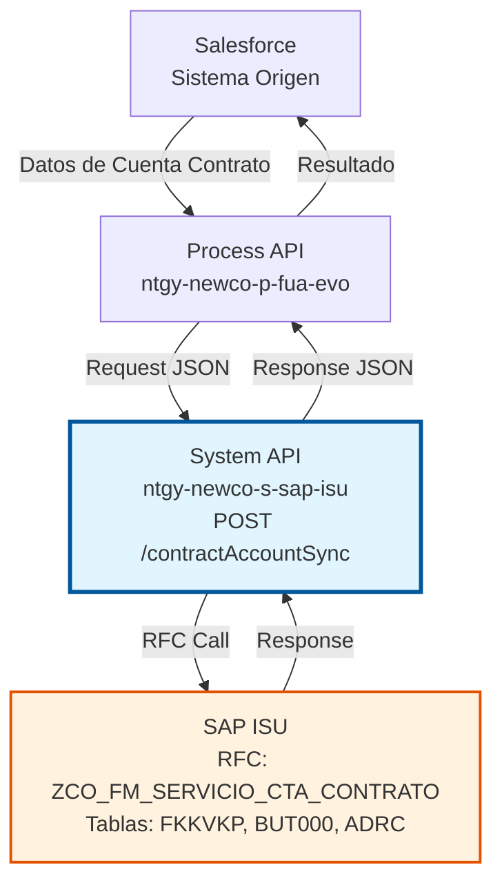
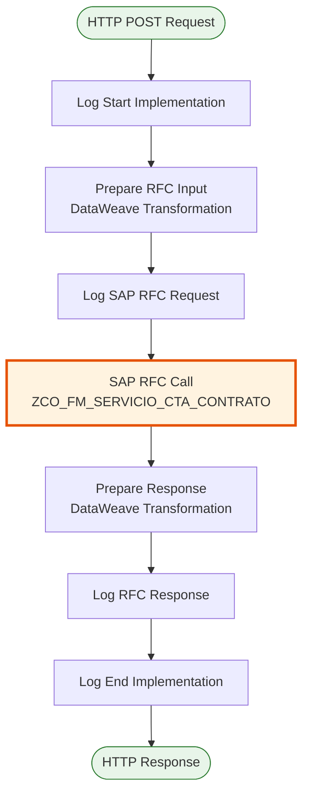
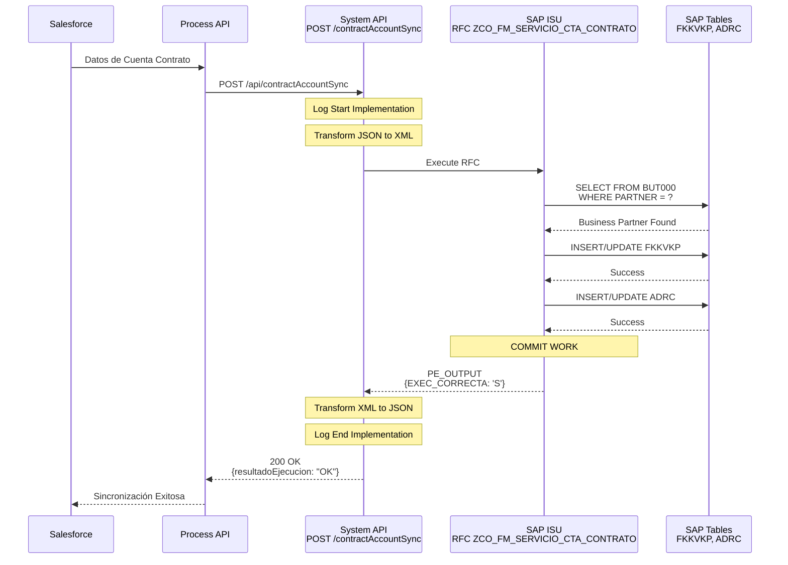
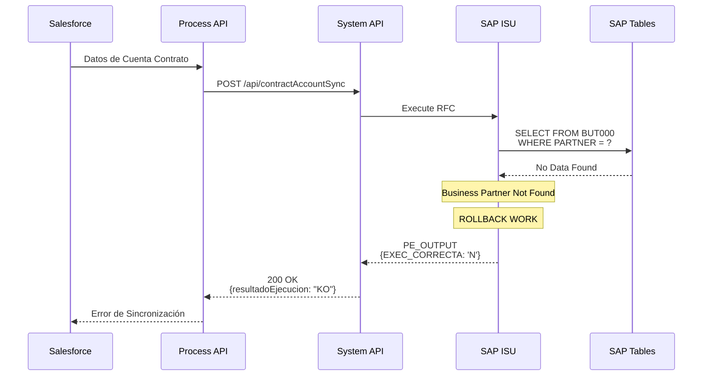
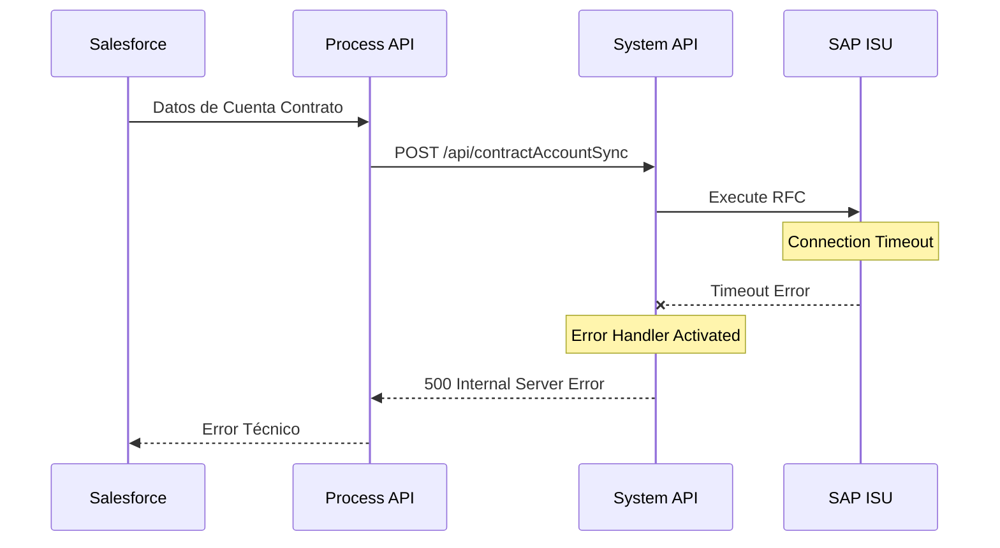

# POST /contractAccountSync

## 📌 Descripción General

### Propósito del Endpoint

Este endpoint sincroniza información de cuentas contrato desde Salesforce hacia SAP ISU. Permite mantener actualizada la información de cuentas contrato en SAP ISU cuando se realizan cambios en Salesforce, asegurando la consistencia de datos entre ambos sistemas.

El endpoint soporta la sincronización de:
- **Datos de cuenta contrato**: Número, descripción, método de pago, día de pago
- **Dirección de correspondencia**: Dirección completa para envío de facturas
- **Datos bancarios**: IBAN, mandato SEPA para domiciliación
- **Pagador alternativo**: Datos de un pagador diferente al titular (opcional)
- **Vulnerabilidad**: Indicadores y fechas de cliente vulnerable
- **Configuración de facturación**: Método de envío, idioma, zona geográfica

### Tipo de API

**Capa:** System API (API-Led Connectivity)

**Función:** Integración directa con SAP ISU para sincronización de datos maestros de cuentas contrato.

### Patrón de Integración

**Tipo:** Request-Reply Síncrono con SAP RFC

**Descripción:** El endpoint recibe los datos de la cuenta contrato desde Salesforce, los transforma al formato SAP, invoca el RFC `ZCO_FM_SERVICIO_CTA_CONTRATO` y retorna el resultado de la sincronización.

### Arquitectura API-Led Connectivity



---

## 💼 Propósito del Negocio

### Casos de Uso Principales

1. **Sincronización de Cuenta Contrato Nueva**
   - Cuando se crea una cuenta contrato en Salesforce, se sincroniza automáticamente a SAP ISU
   - Crea la cuenta contrato en SAP con todos sus datos maestros
   - Asigna número de cuenta contrato (VKONT)
   - Asocia la cuenta al Business Partner existente

2. **Actualización de Datos de Cuenta Contrato Existente**
   - Cuando se modifican datos de una cuenta contrato en Salesforce
   - Actualiza la información de la cuenta contrato en SAP ISU
   - Mantiene la consistencia entre ambos sistemas

3. **Sincronización de Dirección de Correspondencia**
   - Actualiza la dirección para envío de facturas
   - Asegura que las comunicaciones lleguen al lugar correcto

4. **Gestión de Pagador Alternativo**
   - Permite configurar un pagador diferente al titular de la cuenta
   - Sincroniza datos bancarios del pagador alternativo
   - Gestiona mandatos SEPA para domiciliación

5. **Configuración de Vulnerabilidad**
   - Marca cuentas de clientes vulnerables
   - Establece períodos de vulnerabilidad
   - Aplica protecciones especiales en SAP ISU

### Contexto Empresarial

- **Dominio:** Gestión de Cuentas Contrato (Contract Account Management)
- **Sector:** Energía - Utilities
- **División:** Naturgy España - NewCo
- **Proceso de Negocio:** Sincronización de datos maestros entre Salesforce y SAP ISU
- **Módulo SAP:** FI-CA (Financial Contract Accounting)

### Stakeholders

- **Equipos de Salesforce:** Mantienen datos de cuentas contrato en Salesforce
- **Equipos de SAP FI-CA:** Gestionan cuentas contrato en SAP ISU
- **Departamento de Facturación:** Dependen de datos correctos de cuentas contrato
- **Departamento de Cobros:** Necesitan datos bancarios actualizados
- **Atención al Cliente:** Requieren direcciones de correspondencia correctas
- **Equipos de Integración:** Mantienen la sincronización entre sistemas

### Valor de Negocio

- **Consistencia de Datos:** Asegura que Salesforce y SAP ISU tengan la misma información
- **Automatización:** Elimina la necesidad de sincronización manual
- **Reducción de Errores:** Minimiza errores en facturación y cobros
- **Tiempo Real:** Sincronización inmediata de cambios
- **Trazabilidad:** Registro completo de sincronizaciones realizadas
- **Protección de Vulnerables:** Gestión adecuada de clientes vulnerables

### Consumidores Potenciales

Este endpoint puede ser consumido por:
- Process APIs de gestión de cuentas contrato
- Flujos de Salesforce (Platform Events, Flows)
- Sistemas de integración middleware
- Aplicaciones de gestión de clientes y contratos

---

## 🔧 Especificación Técnica

### URLs por Ambiente

| Ambiente | URL Base | URL Completa |
|----------|----------|--------------|
| **Local** | `http://localhost:8081` | `http://localhost:8081/api/contractAccountSync` |
| **Development** | `https://ntgy-newco-s-sap-isu-dev.us-e2.cloudhub.io` | `https://ntgy-newco-s-sap-isu-dev.us-e2.cloudhub.io/api/contractAccountSync` |
| **UAT** | `https://ntgy-newco-s-sap-isu-uat.us-e2.cloudhub.io` | `https://ntgy-newco-s-sap-isu-uat.us-e2.cloudhub.io/api/contractAccountSync` |
| **Production** | `https://ntgy-newco-s-sap-isu-pro.us-e2.cloudhub.io` | `https://ntgy-newco-s-sap-isu-pro.us-e2.cloudhub.io/api/contractAccountSync` |

### Método HTTP

```
POST /api/contractAccountSync
```

### Parámetros de Entrada

#### Headers HTTP

| Header | Tipo | Requerido | Descripción | Ejemplo |
|--------|------|-----------|-------------|---------|
| `Content-Type` | string | ✅ Sí | Tipo de contenido del request | `application/json` |
| `Accept` | string | ❌ No | Tipo de contenido esperado en response | `application/json` |

#### Body Parameters

El body debe contener un objeto JSON con la información de la cuenta contrato a sincronizar. Debido a la complejidad del objeto, se muestran los campos principales:

**Estructura Principal:**

| Campo | Tipo | Requerido | Descripción |
|-------|------|-----------|-------------|
| `modoEjecucion` | string | ❌ No | Modo de ejecución (CREATE, UPDATE) |
| `partner` | string | ❌ No | Número de Business Partner en SAP ISU |
| `subtipoCliente` | string | ❌ No | Subtipo de cliente |
| `detalleObjeto` | object | ✅ Sí | Detalle de la cuenta contrato |
| `pagadorAlter` | object | ❌ No | Datos del pagador alternativo (opcional) |
| `cuentaBancaria` | object | ❌ No | Datos bancarios para domiciliación |

**Objeto `detalleObjeto` (Campos Principales):**

| Campo | Tipo | Requerido | Descripción | Ejemplo |
|-------|------|-----------|-------------|---------|
| `codigoCliente` | string | ✅ Sí | Código externo del cliente (NIF/CIF) | `"12345678A"` |
| `codigo` | string | ✅ Sí | Número de cuenta contrato | `"200001234567"` |
| `descripcion` | string | ❌ No | Descripción de la cuenta | `"Cuenta principal"` |
| `metodoPago` | string | ❌ No | Método de pago ("01"=Domiciliación, "02"=Transferencia) | `"01"` |
| `metodoEnvioFactura` | string | ❌ No | Método de envío ("01"=Carta, "02"=Internet, "03"=FAE) | `"02"` |
| `diaPago` | string | ❌ No | Día de pago preferido | `"Z007"` |
| `vulnerable` | boolean | ❌ No | Indicador de cliente vulnerable | `false` |
| `direccionCorrespondencia` | object | ✅ Sí | Dirección de correspondencia | Ver detalle abajo |

**Objeto `direccionCorrespondencia`:**

| Campo | Tipo | Requerido | Descripción | Ejemplo |
|-------|------|-----------|-------------|---------|
| `calle` | string | ✅ Sí | Nombre de la calle | `"Gran Vía"` |
| `numero` | string | ❌ No | Número de la dirección | `"123"` |
| `piso` | string | ❌ No | Piso | `"3"` |
| `puerta` | string | ❌ No | Puerta | `"B"` |
| `codigoPostal` | string | ✅ Sí | Código postal | `"28013"` |
| `ciudad` | string | ✅ Sí | Ciudad | `"Madrid"` |
| `pais` | string | ✅ Sí | Código de país | `"ES"` |

**Objeto `cuentaBancaria` (para domiciliación):**

| Campo | Tipo | Requerido | Descripción | Ejemplo |
|-------|------|-----------|-------------|---------|
| `IBAN` | string | ❌ No | Código IBAN completo | `"ES7921000813610123456789"` |
| `mandatoSEPA` | string | ❌ No | Referencia del mandato SEPA | `"SEPA123456"` |
| `fechaFirmaSEPA` | string | ❌ No | Fecha de firma del mandato (YYYY-MM-DD) | `"2024-01-01"` |

**Objeto `pagadorAlter` (pagador alternativo - opcional):**

| Campo | Tipo | Requerido | Descripción | Ejemplo |
|-------|------|-----------|-------------|---------|
| `numeroDocumento` | string | ✅ Sí | Número de documento del pagador | `"87654321B"` |
| `nombre` | string | ❌ No | Nombre del pagador alternativo | `"María"` |
| `apellido1` | string | ❌ No | Primer apellido | `"Rodríguez"` |
| `email` | string | ❌ No | Correo electrónico | `"maria@example.com"` |
| `telefono` | string | ❌ No | Número de teléfono | `"611223344"` |

**Nota:** Para ver la especificación completa de todos los campos, consultar el archivo RAML: `src/main/resources/api/dataTypes/contractAccountSync/ContractAccountSyncRequest.raml`

### Respuestas

#### Respuesta Exitosa (200 OK)

```json
{
  "vkont": "200001234567",
  "codCliente": "12345678A",
  "resultadoEjecucion": "OK",
  "idMensaje": "",
  "numMensaje": "",
  "descripcion": "Sincronización exitosa",
  "areaFuncional": "",
  "categoriaError": ""
}
```

**Estructura de la Respuesta:**

| Campo | Tipo | Descripción |
|-------|------|-------------|
| `vkont` | string | Número de cuenta contrato asignado en SAP ISU |
| `codCliente` | string | Código externo del cliente (NIF/CIF) |
| `resultadoEjecucion` | string | Resultado: "OK" o "KO" |
| `idMensaje` | string | ID del mensaje de SAP (vacío si éxito) |
| `numMensaje` | string | Número del mensaje de SAP (vacío si éxito) |
| `descripcion` | string | Descripción del resultado |
| `areaFuncional` | string | Área funcional de SAP (vacío si éxito) |
| `categoriaError` | string | Categoría del error (vacío si éxito) |

#### Respuesta de Error de Negocio (200 OK con resultadoEjecucion = "KO")

```json
{
  "vkont": "",
  "codCliente": "",
  "resultadoEjecucion": "KO",
  "idMensaje": "E",
  "numMensaje": "001",
  "descripcion": "Business Partner no encontrado",
  "areaFuncional": "FI",
  "categoriaError": "ERROR"
}
```

#### Respuesta de Error Técnico (400/500)

```json
{
  "result": {
    "codResult": "0001",
    "msgResult": "Error interno del servidor"
  }
}
```

### Códigos de Resultado

| Código | Tipo | Descripción |
|--------|------|-------------|
| `OK` | Éxito | Sincronización completada exitosamente |
| `KO` | Error | Error en la sincronización |

### Autenticación y Autorización

- **Tipo:** Client ID & Client Secret (Anypoint Platform)
- **Autorización SAP:** El usuario SAP debe tener permisos para:
  - Ejecutar RFC `ZCO_FM_SERVICIO_CTA_CONTRATO`
  - Acceso a tablas FKKVKP, BUT000, ADRC
  - Autorización para crear/modificar cuentas contrato

### Timeouts

| Tipo | Valor | Descripción |
|------|-------|-------------|
| **Request Timeout** | 30 segundos | Tiempo máximo de espera para la respuesta del RFC |
| **Connection Timeout** | 10 segundos | Tiempo máximo para establecer conexión con SAP |

### Protocolo

- **Protocolo:** HTTPS (Production), HTTP (Local/Development)
- **TLS Version:** TLS 1.2 o superior
- **Puerto:** 443 (HTTPS), 8081 (Local)

---

## 🏗️ Implementación Técnica

### Arquitectura del Flow



### 🗄️ RFC SAP Invocado

#### RFC: ZCO_FM_SERVICIO_CTA_CONTRATO

**Descripción:** RFC personalizado de Naturgy para sincronización de cuentas contrato desde Salesforce a SAP ISU.

**Módulo SAP:** FI-CA (Financial Contract Accounting)

**Tablas SAP Consultadas/Modificadas:**

| Tabla | Operaciones | Descripción | Campos Principales |
|-------|-------------|-------------|-------------------|
| **FKKVKP** | READ, INSERT, UPDATE | Contract Account Master Data | VKONT, GPART, VKBEZ, TOGRU, EZAWE |
| **BUT000** | READ | Business Partner Master Data | PARTNER, PARTNER_GUID |
| **ADRC** | INSERT, UPDATE | Address Data | ADDRNUMBER, STREET, CITY1, POST_CODE1 |

### Transformaciones DataWeave

#### Transformación de Input (Request → RFC)

**Archivo:** `src/main/resources/dw/contract-account-sync-rfc-input.dwl`

La transformación mapea el JSON de entrada al formato XML requerido por el RFC SAP, incluyendo:
- Cabecera con datos del Business Partner
- Datos de la cuenta contrato
- Dirección de correspondencia
- Datos bancarios (si aplica)
- Pagador alternativo (si aplica)
- Configuración de vulnerabilidad

#### Transformación de Output (RFC → Response)

```dataweave
%dw 2.0
output application/json
import buildStandardResponse from modules::commonUtils
var out = payload.ZCO_FM_SERVICIO_CTA_CONTRATO.export.PE_OUTPUT
---
buildStandardResponse(out, {
    (vkont: out.VKONT) if out.VKONT != null,
    codCliente: out.BPEXT
})
```

### Patrones de Diseño

**Patrón Principal:** Request-Reply Síncrono

**Justificación:**
- La sincronización requiere confirmación inmediata
- El proceso es relativamente rápido (< 10 segundos)
- El consumidor necesita saber el resultado inmediatamente

### Diagramas de Secuencia

#### 1. Flujo Normal de Éxito



#### 2. Flujo con Error de Negocio



#### 3. Flujo con Error Técnico



### Connection Pooling

**Configuración del Pool de Conexiones SAP JCo:**

| Parámetro | Valor | Descripción |
|-----------|-------|-------------|
| **Pool Size** | 10 conexiones | Número máximo de conexiones simultáneas |
| **Max Wait Time** | 30 segundos | Tiempo máximo de espera por una conexión |
| **Connection Timeout** | 10 segundos | Timeout para establecer conexión |

### Manejo de Errores

**Estrategia de Error Handling:**

1. **Try-Catch a Nivel de Flow**
2. **Transformación de Errores SAP → JSON**
3. **Logging Completo**
4. **Respuestas Estandarizadas**

---

## 💻 Ejemplos de Uso

### Ejemplo 1: Sincronización de Cuenta Contrato (Éxito)

#### cURL

```bash
curl -X POST "https://ntgy-newco-s-sap-isu-dev.us-e2.cloudhub.io/api/contractAccountSync" \
  -H "Content-Type: application/json" \
  -H "client_id: YOUR_CLIENT_ID" \
  -H "client_secret: YOUR_CLIENT_SECRET" \
  -d '{
    "modoEjecucion": "UPDATE",
    "partner": "0001234567",
    "detalleObjeto": {
      "codigoCliente": "12345678A",
      "codigo": "200001234567",
      "descripcion": "Cuenta principal",
      "metodoPago": "01",
      "metodoEnvioFactura": "02",
      "vulnerable": false,
      "direccionCorrespondencia": {
        "calle": "Gran Vía",
        "numero": "123",
        "piso": "3",
        "puerta": "B",
        "codigoPostal": "28013",
        "ciudad": "Madrid",
        "pais": "ES"
      }
    },
    "cuentaBancaria": {
      "IBAN": "ES7921000813610123456789",
      "mandatoSEPA": "SEPA123456",
      "fechaFirmaSEPA": "2024-01-01"
    }
  }'
```

#### Respuesta (200 OK)

```json
{
  "vkont": "200001234567",
  "codCliente": "12345678A",
  "resultadoEjecucion": "OK",
  "idMensaje": "",
  "numMensaje": "",
  "descripcion": "Sincronización exitosa",
  "areaFuncional": "",
  "categoriaError": ""
}
```

---

### Ejemplo 2: Error - Business Partner No Encontrado

#### cURL

```bash
curl -X POST "https://ntgy-newco-s-sap-isu-dev.us-e2.cloudhub.io/api/contractAccountSync" \
  -H "Content-Type: application/json" \
  -d '{
    "partner": "9999999999",
    "detalleObjeto": {
      "codigoCliente": "12345678A",
      "codigo": "200001234567",
      "direccionCorrespondencia": {
        "calle": "Test",
        "codigoPostal": "28013",
        "ciudad": "Madrid",
        "pais": "ES"
      }
    }
  }'
```

#### Respuesta (200 OK con Error)

```json
{
  "vkont": "",
  "codCliente": "",
  "resultadoEjecucion": "KO",
  "idMensaje": "E",
  "numMensaje": "001",
  "descripcion": "Business Partner no encontrado en SAP ISU",
  "areaFuncional": "FI",
  "categoriaError": "ERROR"
}
```

---

### Ejemplo 3: JavaScript (Fetch API)

```javascript
const syncContractAccount = async () => {
  const url = 'https://ntgy-newco-s-sap-isu-dev.us-e2.cloudhub.io/api/contractAccountSync';
  
  const data = {
    partner: '0001234567',
    detalleObjeto: {
      codigoCliente: '12345678A',
      codigo: '200001234567',
      metodoPago: '01',
      direccionCorrespondencia: {
        calle: 'Gran Vía',
        numero: '123',
        codigoPostal: '28013',
        ciudad: 'Madrid',
        pais: 'ES'
      }
    }
  };

  try {
    const response = await fetch(url, {
      method: 'POST',
      headers: {
        'Content-Type': 'application/json',
        'client_id': 'YOUR_CLIENT_ID',
        'client_secret': 'YOUR_CLIENT_SECRET'
      },
      body: JSON.stringify(data)
    });

    const result = await response.json();
    
    if (result.resultadoEjecucion === 'OK') {
      console.log('✅ Sincronización exitosa');
      console.log('Cuenta Contrato:', result.vkont);
    } else {
      console.error('❌ Error:', result.descripcion);
    }
    
    return result;
  } catch (error) {
    console.error('❌ Error técnico:', error);
    throw error;
  }
};
```

---

### Ejemplo 4: Python (requests)

```python
import requests

def sync_contract_account():
    url = 'https://ntgy-newco-s-sap-isu-dev.us-e2.cloudhub.io/api/contractAccountSync'
    
    headers = {
        'Content-Type': 'application/json',
        'client_id': 'YOUR_CLIENT_ID',
        'client_secret': 'YOUR_CLIENT_SECRET'
    }
    
    data = {
        'partner': '0001234567',
        'detalleObjeto': {
            'codigoCliente': '12345678A',
            'codigo': '200001234567',
            'metodoPago': '01',
            'direccionCorrespondencia': {
                'calle': 'Gran Vía',
                'numero': '123',
                'codigoPostal': '28013',
                'ciudad': 'Madrid',
                'pais': 'ES'
            }
        }
    }
    
    try:
        response = requests.post(url, headers=headers, json=data)
        response.raise_for_status()
        
        result = response.json()
        
        if result.get('resultadoEjecucion') == 'OK':
            print(f'✅ Sincronización exitosa')
            print(f"Cuenta Contrato: {result.get('vkont')}")
        else:
            print(f"❌ Error: {result.get('descripcion')}")
        
        return result
        
    except requests.exceptions.HTTPError as http_err:
        print(f'❌ Error HTTP: {http_err}')
        raise
    except Exception as err:
        print(f'❌ Error: {err}')
        raise

if __name__ == '__main__':
    sync_contract_account()
```
