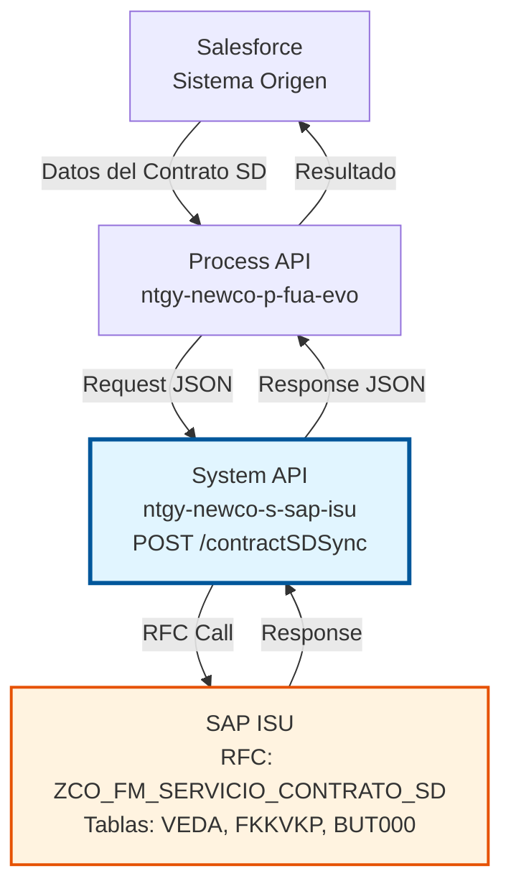
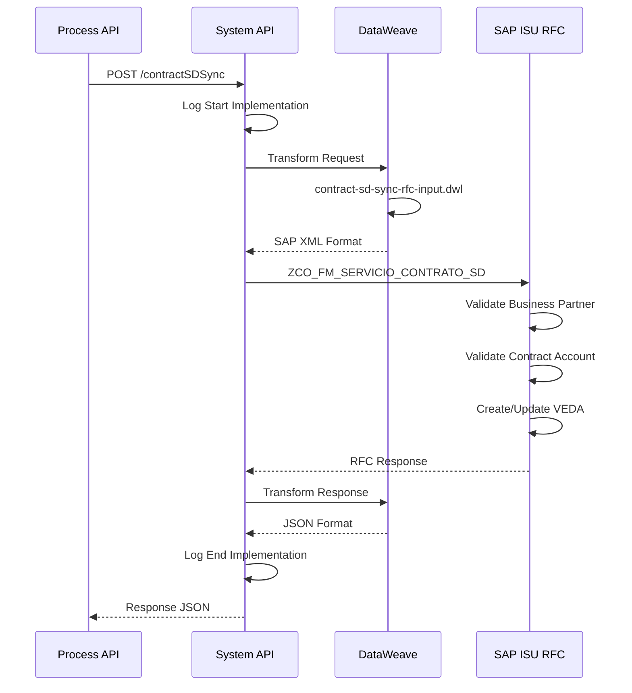
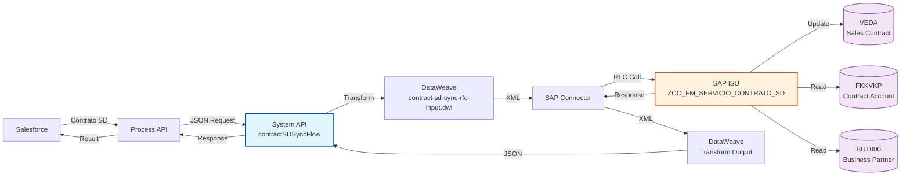
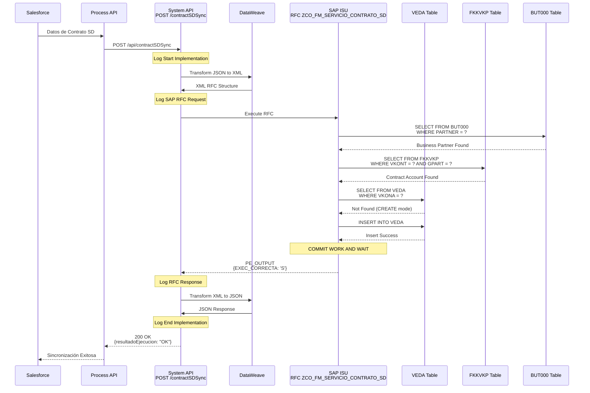
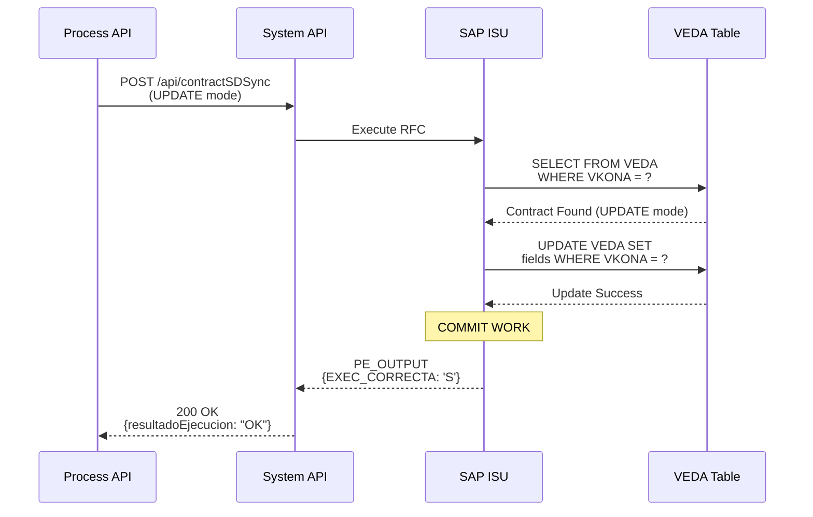
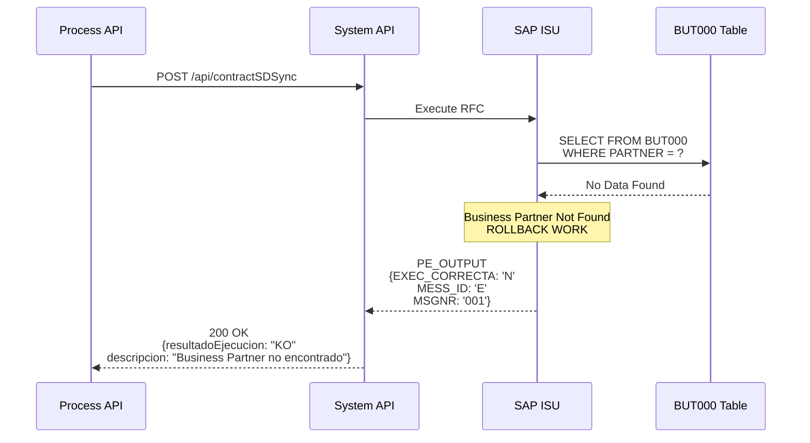
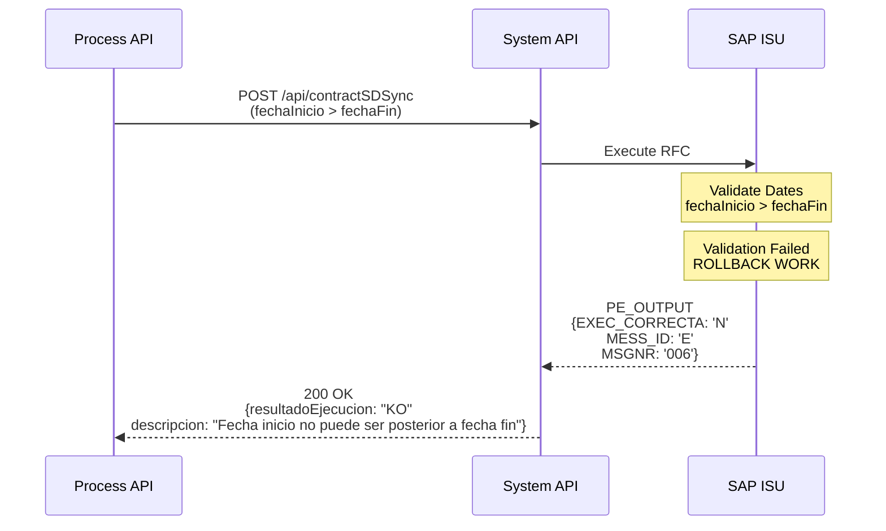

# POST /contractSDSync

## 📌 Descripción General

### Propósito del Endpoint

Este endpoint sincroniza información de contratos SD (Sales & Distribution) desde Salesforce hacia SAP ISU. Los contratos SD representan acuerdos comerciales de venta de energía y servicios, diferenciándose de los contratos ISU estándar por su enfoque en la gestión comercial y de ventas.

El endpoint soporta la sincronización de:
- **Datos del contrato SD**: Número, tipo, división de negocio (Electricidad/Gas)
- **Información comercial**: Condiciones de venta, precios, descuentos
- **Asociación con cuenta contrato**: Vinculación con Business Partner
- **Fechas de vigencia**: Inicio y fin del contrato SD
- **Estados del contrato**: ACTIVO, INACTIVO, BAJA
- **Gestión de bajas**: Motivos de cancelación y fechas

### Tipo de API

**Capa:** System API (API-Led Connectivity)

**Función:** Integración directa con SAP ISU para sincronización de datos maestros de contratos SD.

### Patrón de Integración

**Tipo:** Request-Reply Síncrono con SAP RFC

**Descripción:** El endpoint recibe los datos del contrato SD desde Salesforce, determina el tipo de energía (Electricidad o Gas), transforma al formato SAP SD, invoca el RFC `ZCO_FM_SERVICIO_CONTRATO_SD` y retorna el resultado de la sincronización.

### Arquitectura API-Led Connectivity



---

## 💼 Propósito del Negocio

### Casos de Uso Principales

1. **Sincronización de Contrato SD Nuevo**
   - Cuando se crea un contrato de venta en Salesforce
   - Crea el contrato SD en SAP con todos sus datos comerciales
   - Asigna número de contrato SD (VEDA)
   - Asocia el contrato al Business Partner y cuenta contrato

2. **Actualización de Datos de Contrato SD Existente**
   - Cuando se modifican condiciones comerciales en Salesforce
   - Actualiza la información del contrato SD en SAP ISU
   - Mantiene la consistencia entre ambos sistemas

3. **Gestión de Bajas de Contratos SD**
   - Procesa cancelaciones de contratos de venta
   - Registra motivos de baja (cambio de comercializadora, etc.)
   - Actualiza fechas de fin de contrato

4. **Sincronización por División de Negocio**
   - Aplica configuraciones específicas para Electricidad
   - Aplica configuraciones específicas para Gas
   - Gestiona condiciones comerciales diferenciadas

### Stakeholders

- **Departamento Comercial**: Gestión de contratos de venta
- **Atención al Cliente**: Consulta de contratos activos
- **Facturación**: Base para generación de facturas
- **Administración SAP ISU**: Mantenimiento de datos maestros

### Valor de Negocio

- **Automatización**: Elimina sincronización manual de contratos SD
- **Consistencia**: Datos únicos entre Salesforce y SAP ISU
- **Trazabilidad**: Registro completo de cambios en contratos
- **Eficiencia**: Reducción de errores en datos comerciales

---

## 🔧 Especificación Técnica

### Endpoint

```
POST /api/contractSDSync
```

### Headers

| Header | Valor | Requerido | Descripción |
|--------|-------|-----------|-------------|
| `Content-Type` | `application/json` | Sí | Formato del body |
| `Accept` | `application/json` | Sí | Formato de respuesta |

### Request Body

```json
{
  "modoEjecucion": "CREATE",
  "partner": "0001234567",
  "vkont": "200001234567",
  "detalleObjeto": {
    "codigo": "5000123456",
    "divisionNegocio": "Electricidad",
    "fechaInicio": "2024-01-15",
    "fechaFin": "2025-12-31",
    "estado": "ACTIVO",
    "motivoBaja": null
  }
}
```

#### Parámetros del Request

| Campo | Tipo | Requerido | Descripción | Ejemplo |
|-------|------|-----------|-------------|---------|
| `modoEjecucion` | string | No | Modo de ejecución (CREATE/UPDATE) | "CREATE" |
| `partner` | string | No | Número de Business Partner | "0001234567" |
| `vkont` | string | Sí | Número de cuenta contrato | "200001234567" |
| `detalleObjeto` | object | Sí | Detalle del contrato SD | - |
| `detalleObjeto.codigo` | string | Sí | Número de contrato SD | "5000123456" |
| `detalleObjeto.divisionNegocio` | string | Sí | División (Electricidad/Gas) | "Electricidad" |
| `detalleObjeto.fechaInicio` | string | Sí | Fecha inicio (YYYY-MM-DD) | "2024-01-15" |
| `detalleObjeto.fechaFin` | string | No | Fecha fin (YYYY-MM-DD) | "2025-12-31" |
| `detalleObjeto.estado` | string | Sí | Estado del contrato | "ACTIVO" |
| `detalleObjeto.motivoBaja` | string | No | Motivo de baja | "CAMBIO_COMERCIALIZADORA" |

### Response

#### Response Exitoso (200 OK)

```json
{
  "contratoSD": "5000123456",
  "partner": "0001234567",
  "numCtaContrato": "200001234567",
  "resultadoEjecucion": "OK",
  "idMensaje": "00",
  "numMensaje": "000",
  "descripcion": "Contrato SD sincronizado correctamente",
  "areaFuncional": "SD",
  "categoriaError": null
}
```

#### Response con Error (400 Bad Request)

```json
{
  "contratoSD": null,
  "partner": "0001234567",
  "numCtaContrato": "200001234567",
  "resultadoEjecucion": "KO",
  "idMensaje": "E001",
  "numMensaje": "001",
  "descripcion": "Business Partner no existe en SAP ISU",
  "areaFuncional": "SD",
  "categoriaError": "E"
}
```

#### Códigos de Estado HTTP

| Código | Descripción | Cuándo se usa |
|--------|-------------|---------------|
| 200 | OK | Sincronización exitosa |
| 400 | Bad Request | Datos inválidos o faltantes |
| 500 | Internal Server Error | Error en SAP ISU o sistema |

---

## 🏗️ Implementación Técnica

### RFC SAP

**Nombre:** `ZCO_FM_SERVICIO_CONTRATO_SD`

**Módulo:** SD (Sales & Distribution)

**Descripción:** Function module personalizado para sincronización de contratos SD desde sistemas externos hacia SAP ISU.

### Tablas SAP Involucradas

| Tabla | Operaciones | Descripción | Campos Principales |
|-------|-------------|-------------|-------------------|
| `VEDA` | READ, INSERT, UPDATE | Sales Contract Master Data - Datos maestros de contratos de venta | VKONA, VKONT, VERTRAG, AB, BIS, SPARTE |
| `FKKVKP` | READ | Contract Account - Cuenta contrato asociada | VKONT, GPART |
| `BUT000` | READ | Business Partner Master Data - Datos del Business Partner | PARTNER, PARTNER_GUID |

### Flow de MuleSoft

**Nombre del Flow:** `contractSDSyncFlow`

**Ubicación:** `src/main/mule/implementation/customer-data-management-operations.xml`



### Transformación DataWeave (Input)

**Archivo:** `contract-sd-sync-rfc-input.dwl`

**Propósito:** Transforma el request JSON al formato XML requerido por el RFC SAP.

**Transformaciones Clave:**
- Mapeo de división de negocio a código SAP (01=Electricidad, 02=Gas)
- Conversión de fechas a formato SAP (YYYYMMDD)
- Construcción de estructura CABECERA con datos del contrato
- Preparación de parámetros específicos de contrato SD

### Transformación DataWeave (Output)

**Ubicación:** Inline en el flow XML

**Propósito:** Transforma la respuesta del RFC SAP a formato JSON estándar.

**Transformaciones Clave:**
- Extracción de resultado de ejecución (OK/KO)
- Mapeo de mensajes de error SAP
- Construcción de response JSON con datos del contrato SD creado/actualizado

### Diagrama de Arquitectura



### Diagramas de Secuencia Detallados

#### 1. Flujo Normal de Éxito - Crear Contrato SD



#### 2. Flujo Normal de Éxito - Actualizar Contrato SD



#### 3. Flujo con Error - Business Partner No Existe



#### 4. Flujo con Error - Fechas Inconsistentes



### Manejo de Errores

**Estrategia:** Error handling global con transformación de errores SAP a formato estándar.

**Tipos de Errores:**
- **Validación**: Business Partner no existe, cuenta contrato inválida
- **Datos**: División de negocio inválida, fechas inconsistentes
- **SAP**: RFC no disponible, timeout, errores de conexión
- **Sistema**: Errores de transformación DataWeave

---

## 💻 Ejemplos de Uso

### Ejemplo 1: Crear Contrato SD de Electricidad

**Request:**

```bash
curl -X POST "https://api.naturgy.com/s-sap-isu/api/contractSDSync" \
  -H "Content-Type: application/json" \
  -H "Accept: application/json" \
  -d '{
    "modoEjecucion": "CREATE",
    "partner": "0001234567",
    "vkont": "200001234567",
    "detalleObjeto": {
      "codigo": "5000123456",
      "divisionNegocio": "Electricidad",
      "fechaInicio": "2024-01-15",
      "fechaFin": "2025-12-31",
      "estado": "ACTIVO"
    }
  }'
```

**Response:**

```json
{
  "contratoSD": "5000123456",
  "partner": "0001234567",
  "numCtaContrato": "200001234567",
  "resultadoEjecucion": "OK",
  "idMensaje": "00",
  "numMensaje": "000",
  "descripcion": "Contrato SD de Electricidad creado correctamente",
  "areaFuncional": "SD",
  "categoriaError": null
}
```

### Ejemplo 2: Actualizar Contrato SD de Gas

**Request:**

```json
{
  "modoEjecucion": "UPDATE",
  "partner": "0001234568",
  "vkont": "200001234568",
  "detalleObjeto": {
    "codigo": "5000123457",
    "divisionNegocio": "Gas",
    "fechaInicio": "2024-02-01",
    "fechaFin": "2026-01-31",
    "estado": "ACTIVO"
  }
}
```

**Response:**

```json
{
  "contratoSD": "5000123457",
  "partner": "0001234568",
  "numCtaContrato": "200001234568",
  "resultadoEjecucion": "OK",
  "idMensaje": "00",
  "numMensaje": "000",
  "descripcion": "Contrato SD de Gas actualizado correctamente",
  "areaFuncional": "SD",
  "categoriaError": null
}
```

### Ejemplo 3: Dar de Baja Contrato SD

**Request:**

```json
{
  "modoEjecucion": "UPDATE",
  "partner": "0001234569",
  "vkont": "200001234569",
  "detalleObjeto": {
    "codigo": "5000123458",
    "divisionNegocio": "Electricidad",
    "fechaInicio": "2023-01-01",
    "fechaFin": "2024-06-30",
    "estado": "BAJA",
    "motivoBaja": "CAMBIO_COMERCIALIZADORA"
  }
}
```

**Response:**

```json
{
  "contratoSD": "5000123458",
  "partner": "0001234569",
  "numCtaContrato": "200001234569",
  "resultadoEjecucion": "OK",
  "idMensaje": "00",
  "numMensaje": "000",
  "descripcion": "Contrato SD dado de baja correctamente",
  "areaFuncional": "SD",
  "categoriaError": null
}
```

### Ejemplo 4: Error - Business Partner No Existe

**Request:**

```json
{
  "modoEjecucion": "CREATE",
  "partner": "9999999999",
  "vkont": "200001234570",
  "detalleObjeto": {
    "codigo": "5000123459",
    "divisionNegocio": "Electricidad",
    "fechaInicio": "2024-01-01",
    "estado": "ACTIVO"
  }
}
```

**Response:**

```json
{
  "contratoSD": null,
  "partner": "9999999999",
  "numCtaContrato": "200001234570",
  "resultadoEjecucion": "KO",
  "idMensaje": "E001",
  "numMensaje": "001",
  "descripcion": "Business Partner 9999999999 no existe en SAP ISU",
  "areaFuncional": "SD",
  "categoriaError": "E"
}