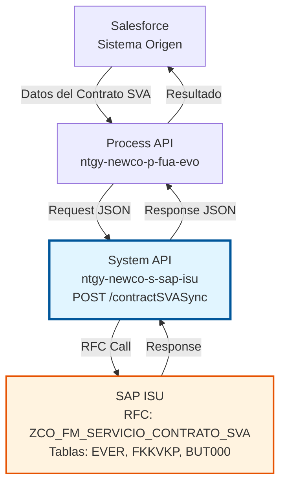
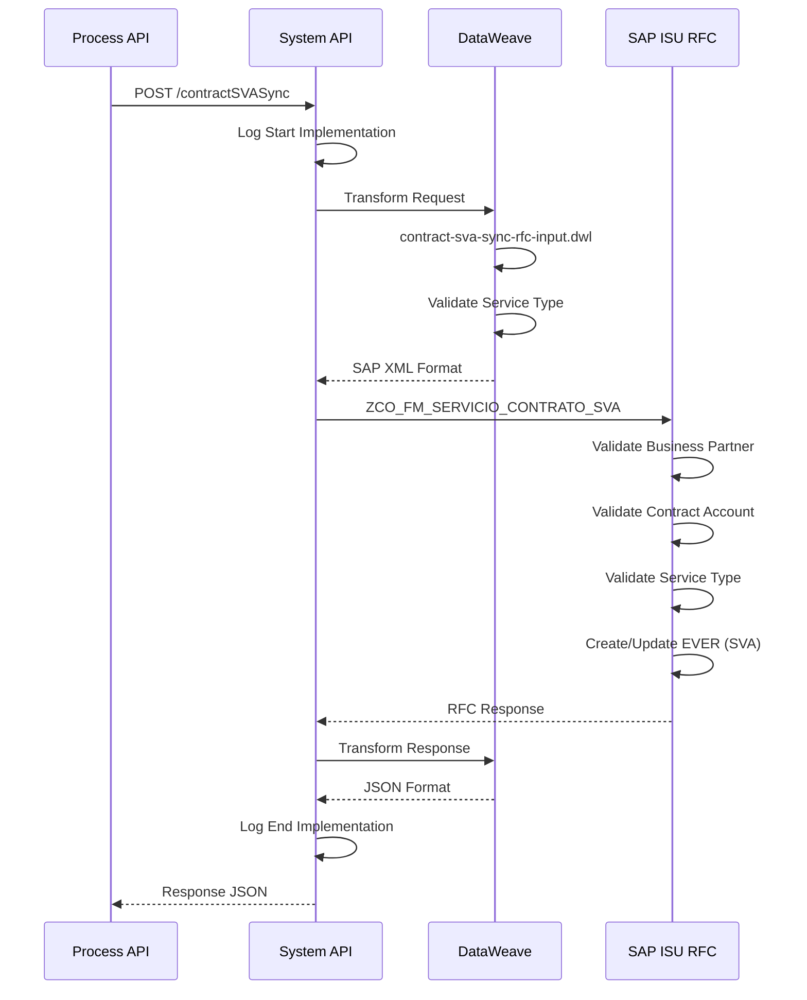
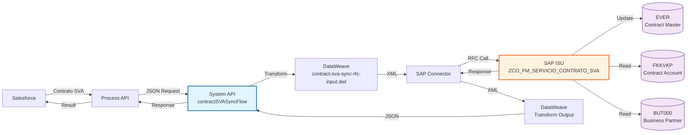
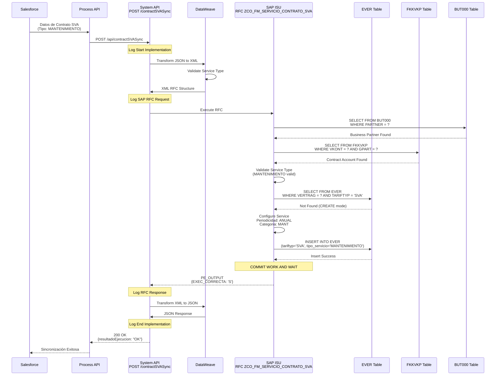
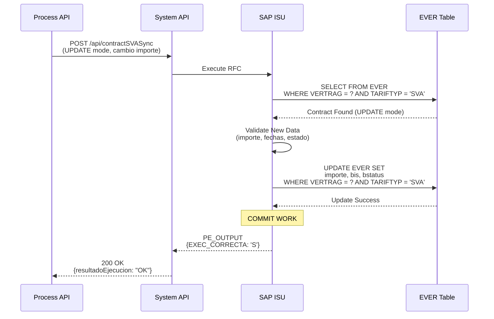
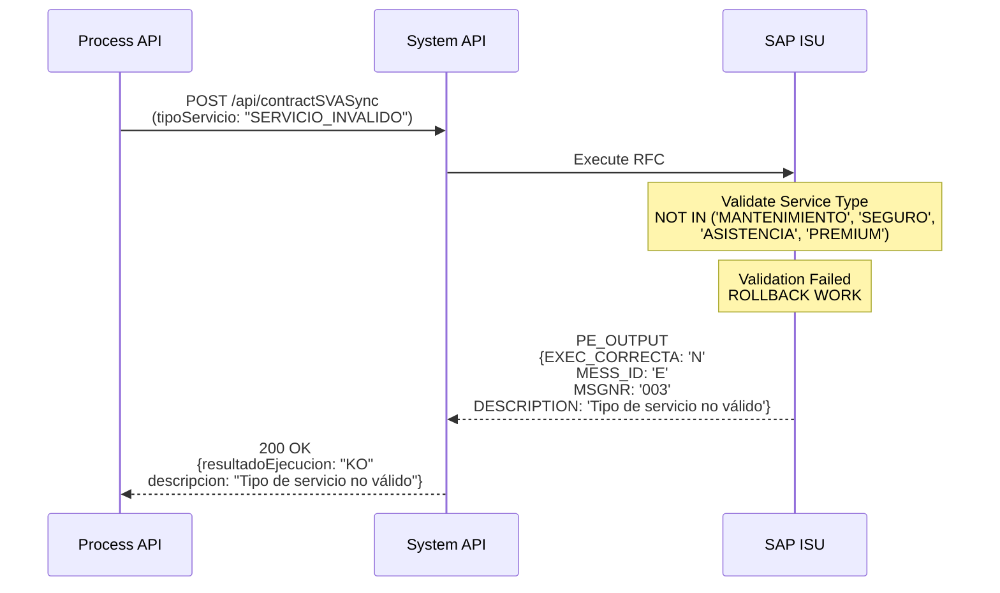
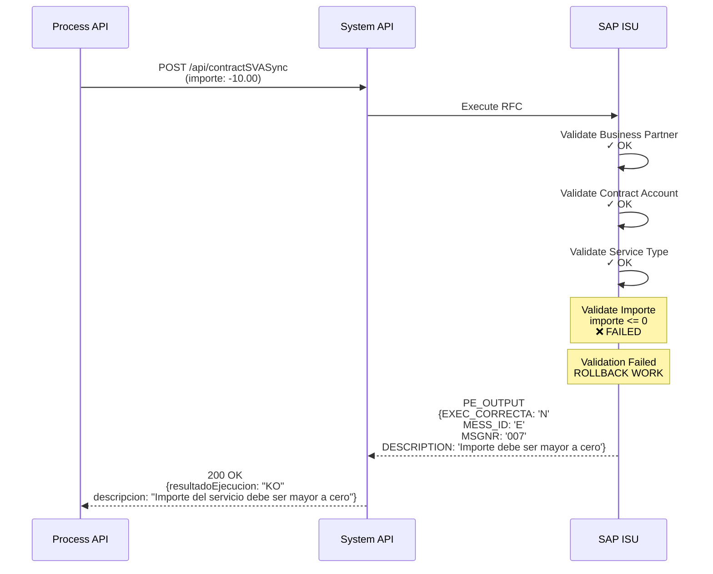

# POST /contractSVASync

## 📌 Descripción General

### Propósito del Endpoint

Este endpoint sincroniza información de contratos SVA (Servicios de Valor Añadido) desde Salesforce hacia SAP ISU. Los contratos SVA representan servicios adicionales contratados por los clientes, como mantenimiento de instalaciones, seguros, asistencia técnica, y otros servicios complementarios a la venta de energía.

El endpoint soporta la sincronización de:
- **Datos del contrato SVA**: Número, tipo de servicio, división de negocio
- **Tipos de servicio**: Mantenimiento, Seguros, Asistencia técnica, Servicios premium
- **Información comercial**: Importes, condiciones, periodicidad
- **Asociación con cuenta contrato**: Vinculación con Business Partner
- **Fechas de vigencia**: Inicio y fin del servicio
- **Estados del servicio**: ACTIVO, INACTIVO, BAJA
- **Gestión de cancelaciones**: Motivos de baja y fechas

### Tipo de API

**Capa:** System API (API-Led Connectivity)

**Función:** Integración directa con SAP ISU para sincronización de datos maestros de contratos de servicios de valor añadido.

### Patrón de Integración

**Tipo:** Request-Reply Síncrono con SAP RFC

**Descripción:** El endpoint recibe los datos del contrato SVA desde Salesforce, determina el tipo de servicio y división de negocio, transforma al formato SAP, invoca el RFC `ZCO_FM_SERVICIO_CONTRATO_SVA` y retorna el resultado de la sincronización.

### Arquitectura API-Led Connectivity



---

## 💼 Propósito del Negocio

### Casos de Uso Principales

1. **Contratación de Servicio de Mantenimiento**
   - Cliente contrata mantenimiento de caldera o instalación eléctrica
   - Se crea contrato SVA en SAP con datos del servicio
   - Asigna número de contrato SVA
   - Asocia al Business Partner y cuenta contrato del cliente

2. **Contratación de Seguro de Hogar**
   - Cliente añade seguro de hogar a su contrato de energía
   - Sincroniza datos del seguro como contrato SVA
   - Configura importe y periodicidad de pago
   - Vincula con contrato principal de energía

3. **Servicios de Asistencia Técnica**
   - Cliente contrata servicio de asistencia 24/7
   - Crea contrato SVA con condiciones del servicio
   - Establece fechas de vigencia y renovación
   - Configura facturación del servicio

4. **Actualización de Servicios Existentes**
   - Modificación de condiciones de servicios contratados
   - Actualización de importes o periodicidad
   - Cambio de estado (activación/desactivación)
   - Gestión de bajas y cancelaciones

5. **Gestión de Cancelaciones**
   - Procesa bajas de servicios de valor añadido
   - Registra motivos de cancelación
   - Actualiza fechas de fin de servicio
   - Mantiene histórico de servicios contratados

### Stakeholders

- **Departamento Comercial**: Venta de servicios adicionales
- **Atención al Cliente**: Gestión de servicios contratados
- **Facturación**: Facturación de servicios SVA
- **Administración SAP ISU**: Mantenimiento de contratos SVA

### Valor de Negocio

- **Diversificación de Ingresos**: Servicios adicionales a la venta de energía
- **Fidelización**: Servicios de valor que retienen clientes
- **Automatización**: Sincronización automática de servicios
- **Trazabilidad**: Registro completo de servicios contratados
- **Eficiencia**: Reducción de errores en gestión de servicios

---

## 🔧 Especificación Técnica

### Endpoint

```
POST /api/contractSVASync
```

### Headers

| Header | Valor | Requerido | Descripción |
|--------|-------|-----------|-------------|
| `Content-Type` | `application/json` | Sí | Formato del body |
| `Accept` | `application/json` | Sí | Formato de respuesta |

### Request Body

```json
{
  "modoEjecucion": "CREATE",
  "partner": "0001234567",
  "vkont": "200001234567",
  "detalleObjeto": {
    "codigo": "6000123456",
    "tipoServicio": "MANTENIMIENTO",
    "divisionNegocio": "Electricidad",
    "fechaInicio": "2024-01-15",
    "fechaFin": "2025-01-14",
    "estado": "ACTIVO",
    "importe": 29.99
  }
}
```

#### Parámetros del Request

| Campo | Tipo | Requerido | Descripción | Ejemplo |
|-------|------|-----------|-------------|---------|
| `modoEjecucion` | string | No | Modo de ejecución (CREATE/UPDATE) | "CREATE" |
| `partner` | string | No | Número de Business Partner | "0001234567" |
| `vkont` | string | Sí | Número de cuenta contrato | "200001234567" |
| `detalleObjeto` | object | Sí | Detalle del contrato SVA | - |
| `detalleObjeto.codigo` | string | Sí | Número de contrato SVA | "6000123456" |
| `detalleObjeto.tipoServicio` | string | Sí | Tipo de servicio | "MANTENIMIENTO" |
| `detalleObjeto.divisionNegocio` | string | Sí | División (Electricidad/Gas) | "Electricidad" |
| `detalleObjeto.fechaInicio` | string | Sí | Fecha inicio (YYYY-MM-DD) | "2024-01-15" |
| `detalleObjeto.fechaFin` | string | No | Fecha fin (YYYY-MM-DD) | "2025-01-14" |
| `detalleObjeto.estado` | string | Sí | Estado del servicio | "ACTIVO" |
| `detalleObjeto.motivoBaja` | string | No | Motivo de baja | "CANCELACION_CLIENTE" |
| `detalleObjeto.importe` | number | No | Importe del servicio | 29.99 |

#### Tipos de Servicio Soportados

| Código | Descripción | Ejemplo |
|--------|-------------|---------|
| `MANTENIMIENTO` | Mantenimiento de instalaciones | Revisión anual de caldera |
| `SEGURO` | Seguros de hogar o instalaciones | Seguro de hogar completo |
| `ASISTENCIA` | Asistencia técnica 24/7 | Servicio de urgencias |
| `PREMIUM` | Servicios premium | Atención prioritaria |

### Response

#### Response Exitoso (200 OK)

```json
{
  "contratoSVA": "6000123456",
  "partner": "0001234567",
  "numCtaContrato": "200001234567",
  "resultadoEjecucion": "OK",
  "idMensaje": "00",
  "numMensaje": "000",
  "descripcion": "Contrato SVA sincronizado correctamente",
  "areaFuncional": "SD",
  "categoriaError": null
}
```

#### Response con Error (400 Bad Request)

```json
{
  "contratoSVA": null,
  "partner": "0001234567",
  "numCtaContrato": "200001234567",
  "resultadoEjecucion": "KO",
  "idMensaje": "E002",
  "numMensaje": "002",
  "descripcion": "Tipo de servicio no válido",
  "areaFuncional": "SD",
  "categoriaError": "E"
}
```

#### Códigos de Estado HTTP

| Código | Descripción | Cuándo se usa |
|--------|-------------|---------------|
| 200 | OK | Sincronización exitosa |
| 400 | Bad Request | Datos inválidos o tipo de servicio no soportado |
| 500 | Internal Server Error | Error en SAP ISU o sistema |

---

## 🏗️ Implementación Técnica

### RFC SAP

**Nombre:** `ZCO_FM_SERVICIO_CONTRATO_SVA`

**Módulo:** SD (Sales & Distribution) / ISU

**Descripción:** Function module personalizado para sincronización de contratos de servicios de valor añadido desde sistemas externos hacia SAP ISU.

### Tablas SAP Involucradas

| Tabla | Operaciones | Descripción | Campos Principales |
|-------|-------------|-------------|-------------------|
| `EVER` | READ, INSERT, UPDATE | Contract Master Data - Datos maestros de contratos (incluye SVA) | VERTRAG, VKONT, ANLAGE, AB, BIS, SPARTE, TARIFTYP |
| `FKKVKP` | READ | Contract Account - Cuenta contrato asociada | VKONT, GPART |
| `BUT000` | READ | Business Partner Master Data - Datos del Business Partner | PARTNER, PARTNER_GUID |

### Flow de MuleSoft

**Nombre del Flow:** `contractSVASyncFlow`

**Ubicación:** `src/main/mule/implementation/customer-data-management-operations.xml`



### Transformación DataWeave (Input)

**Archivo:** `contract-sva-sync-rfc-input.dwl`

**Propósito:** Transforma el request JSON al formato XML requerido por el RFC SAP.

**Transformaciones Clave:**
- Mapeo de tipo de servicio a código SAP
- Mapeo de división de negocio a código SAP (01=Electricidad, 02=Gas)
- Conversión de fechas a formato SAP (YYYYMMDD)
- Construcción de estructura CABECERA con datos del contrato SVA
- Preparación de parámetros específicos de servicios

### Transformación DataWeave (Output)

**Ubicación:** Inline en el flow XML

**Propósito:** Transforma la respuesta del RFC SAP a formato JSON estándar.

**Transformaciones Clave:**
- Extracción de resultado de ejecución (OK/KO)
- Mapeo de mensajes de error SAP
- Construcción de response JSON con datos del contrato SVA creado/actualizado

### Diagrama de Arquitectura



### Diagramas de Secuencia Detallados

#### 1. Flujo Normal de Éxito - Crear Contrato SVA



#### 2. Flujo Normal de Éxito - Actualizar Contrato SVA



#### 3. Flujo con Error - Tipo de Servicio No Válido



#### 4. Flujo con Error - Importe Inválido



### Manejo de Errores

**Estrategia:** Error handling global con transformación de errores SAP a formato estándar.

**Tipos de Errores:**
- **Validación**: Business Partner no existe, cuenta contrato inválida, tipo de servicio no válido
- **Datos**: División de negocio inválida, fechas inconsistentes, importe inválido
- **SAP**: RFC no disponible, timeout, errores de conexión
- **Sistema**: Errores de transformación DataWeave

---

## 💻 Ejemplos de Uso

### Ejemplo 1: Crear Servicio de Mantenimiento

**Request:**

```bash
curl -X POST "https://api.naturgy.com/s-sap-isu/api/contractSVASync" \
  -H "Content-Type: application/json" \
  -H "Accept: application/json" \
  -d '{
    "modoEjecucion": "CREATE",
    "partner": "0001234567",
    "vkont": "200001234567",
    "detalleObjeto": {
      "codigo": "6000123456",
      "tipoServicio": "MANTENIMIENTO",
      "divisionNegocio": "Electricidad",
      "fechaInicio": "2024-01-15",
      "fechaFin": "2025-01-14",
      "estado": "ACTIVO",
      "importe": 29.99
    }
  }'
```

**Response:**

```json
{
  "contratoSVA": "6000123456",
  "partner": "0001234567",
  "numCtaContrato": "200001234567",
  "resultadoEjecucion": "OK",
  "idMensaje": "00",
  "numMensaje": "000",
  "descripcion": "Servicio de mantenimiento creado correctamente",
  "areaFuncional": "SD",
  "categoriaError": null
}
```

### Ejemplo 2: Crear Seguro de Hogar

**Request:**

```json
{
  "modoEjecucion": "CREATE",
  "partner": "0001234568",
  "vkont": "200001234568",
  "detalleObjeto": {
    "codigo": "6000123457",
    "tipoServicio": "SEGURO",
    "divisionNegocio": "Gas",
    "fechaInicio": "2024-02-01",
    "fechaFin": "2025-01-31",
    "estado": "ACTIVO",
    "importe": 49.99
  }
}
```

**Response:**

```json
{
  "contratoSVA": "6000123457",
  "partner": "0001234568",
  "numCtaContrato": "200001234568",
  "resultadoEjecucion": "OK",
  "idMensaje": "00",
  "numMensaje": "000",
  "descripcion": "Seguro de hogar creado correctamente",
  "areaFuncional": "SD",
  "categoriaError": null
}
```

### Ejemplo 3: Cancelar Servicio de Asistencia

**Request:**

```json
{
  "modoEjecucion": "UPDATE",
  "partner": "0001234569",
  "vkont": "200001234569",
  "detalleObjeto": {
    "codigo": "6000123458",
    "tipoServicio": "ASISTENCIA",
    "divisionNegocio": "Electricidad",
    "fechaInicio": "2023-06-01",
    "fechaFin": "2024-06-30",
    "estado": "BAJA",
    "motivoBaja": "CANCELACION_CLIENTE",
    "importe": 19.99
  }
}
```

**Response:**

```json
{
  "contratoSVA": "6000123458",
  "partner": "0001234569",
  "numCtaContrato": "200001234569",
  "resultadoEjecucion": "OK",
  "idMensaje": "00",
  "numMensaje": "000",
  "descripcion": "Servicio de asistencia cancelado correctamente",
  "areaFuncional": "SD",
  "categoriaError": null
}
```

### Ejemplo 4: Error - Tipo de Servicio No Válido

**Request:**

```json
{
  "modoEjecucion": "CREATE",
  "partner": "0001234570",
  "vkont": "200001234570",
  "detalleObjeto": {
    "codigo": "6000123459",
    "tipoServicio": "SERVICIO_INVALIDO",
    "divisionNegocio": "Electricidad",
    "fechaInicio": "2024-01-01",
    "estado": "ACTIVO",
    "importe": 39.99
  }
}
```

**Response:**

```json
{
  "contratoSVA": null,
  "partner": "0001234570",
  "numCtaContrato": "200001234570",
  "resultadoEjecucion": "KO",
  "idMensaje": "E002",
  "numMensaje": "002",
  "descripcion": "Tipo de servicio SERVICIO_INVALIDO no es válido. Tipos permitidos: MANTENIMIENTO, SEGURO, ASISTENCIA, PREMIUM",
  "areaFuncional": "SD",
  "categoriaError": "E"
}
```
