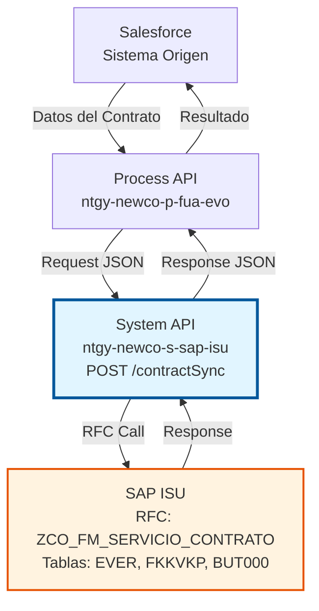
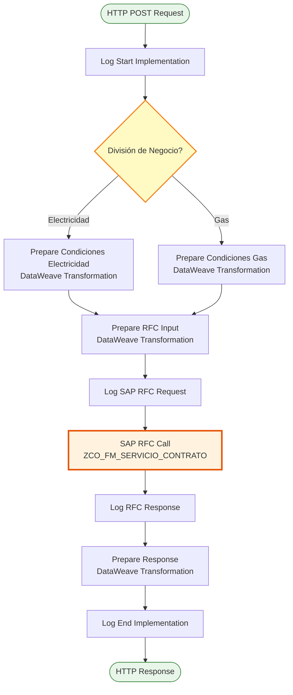
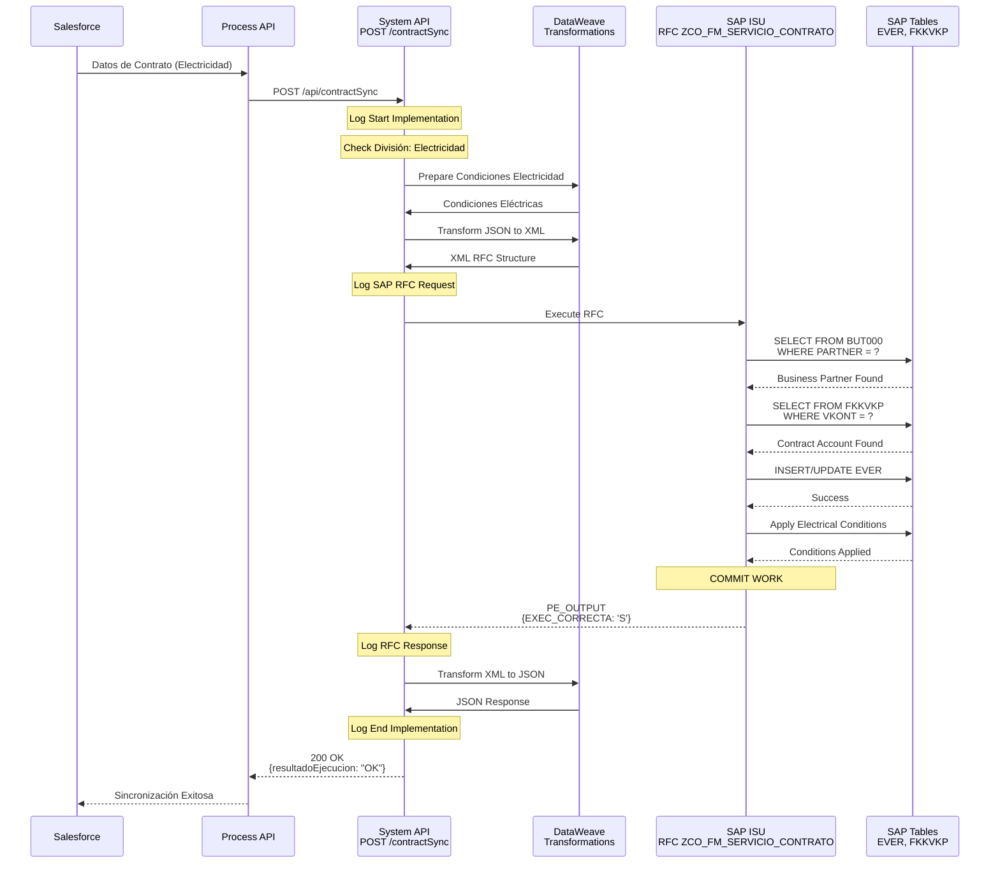
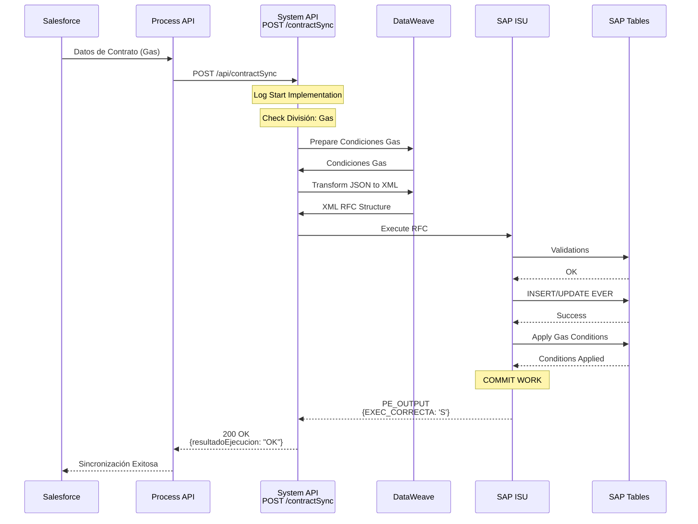
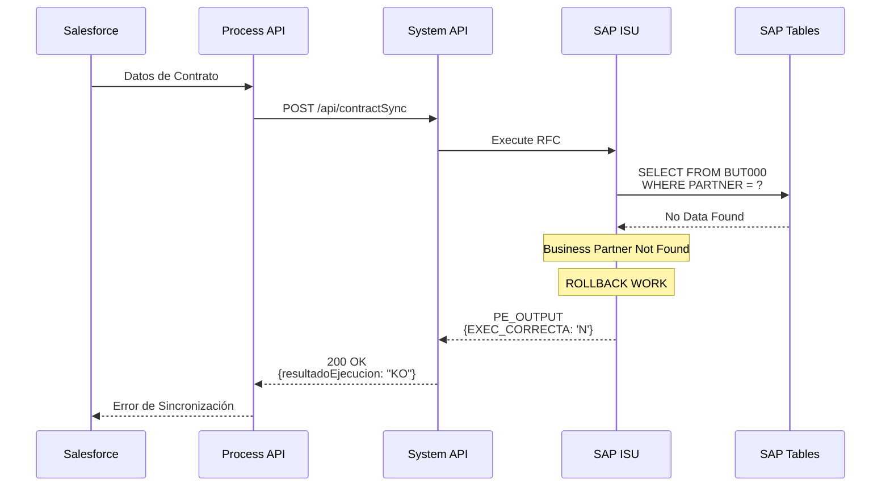

# POST /contractSync

## 📌 Descripción General

### Propósito del Endpoint

Este endpoint sincroniza información de contratos desde Salesforce hacia SAP ISU. Permite mantener actualizada la información de contratos en SAP ISU cuando se realizan cambios en Salesforce, asegurando la consistencia de datos entre ambos sistemas.

El endpoint soporta la sincronización de:
- **Datos del contrato**: Número, tipo, división de negocio (Electricidad/Gas)
- **Punto de suministro**: Asociación con instalación y ubicación técnica
- **Condiciones comerciales**: Tarifas, precios, descuentos según tipo de energía
- **Datos del titular**: Asociación con Business Partner y cuenta contrato
- **Fechas de vigencia**: Inicio y fin del contrato
- **Configuración específica**: Parámetros diferenciados para Electricidad y Gas

### Tipo de API

**Capa:** System API (API-Led Connectivity)

**Función:** Integración directa con SAP ISU para sincronización de datos maestros de contratos.

### Patrón de Integración

**Tipo:** Request-Reply Síncrono con SAP RFC

**Descripción:** El endpoint recibe los datos del contrato desde Salesforce, determina el tipo de energía (Electricidad o Gas), aplica las condiciones comerciales correspondientes, transforma al formato SAP, invoca el RFC `ZCO_FM_SERVICIO_CONTRATO` y retorna el resultado de la sincronización.

### Arquitectura API-Led Connectivity



---

## 💼 Propósito del Negocio

### Casos de Uso Principales

1. **Sincronización de Contrato Nuevo**
   - Cuando se crea un contrato en Salesforce, se sincroniza automáticamente a SAP ISU
   - Crea el contrato en SAP con todos sus datos maestros
   - Asigna número de contrato (VERTRAG)
   - Asocia el contrato al Business Partner y cuenta contrato existentes

2. **Actualización de Datos de Contrato Existente**
   - Cuando se modifican datos de un contrato en Salesforce
   - Actualiza la información del contrato en SAP ISU
   - Mantiene la consistencia entre ambos sistemas

3. **Sincronización de Condiciones Comerciales**
   - Aplica tarifas y precios según división de negocio (Electricidad o Gas)
   - Configura descuentos y bonificaciones
   - Establece condiciones específicas por tipo de energía

4. **Gestión de Punto de Suministro**
   - Asocia el contrato con el punto de suministro correspondiente
   - Vincula con instalación y ubicación técnica
   - Configura parámetros de medición

### Contexto Empresarial

- **Dominio:** Gestión de Contratos (Contract Management)
- **Sector:** Energía - Utilities
- **División:** Naturgy España - NewCo
- **Proceso de Negocio:** Sincronización de datos maestros entre Salesforce y SAP ISU
- **Módulo SAP:** SD (Sales & Distribution) / ISU (Industry Solution Utilities)

### Stakeholders

- **Equipos de Salesforce:** Mantienen datos de contratos en Salesforce
- **Equipos de SAP ISU:** Gestionan contratos en SAP
- **Departamento Comercial:** Necesitan contratos actualizados para ventas
- **Departamento de Facturación:** Dependen de datos correctos de contratos
- **Atención al Cliente:** Requieren información actualizada de contratos
- **Equipos de Integración:** Mantienen la sincronización entre sistemas

### Valor de Negocio

- **Consistencia de Datos:** Asegura que Salesforce y SAP ISU tengan la misma información
- **Automatización:** Elimina la necesidad de sincronización manual
- **Reducción de Errores:** Minimiza errores en facturación y gestión comercial
- **Tiempo Real:** Sincronización inmediata de cambios
- **Trazabilidad:** Registro completo de sincronizaciones realizadas
- **Flexibilidad:** Soporta diferentes tipos de energía con configuraciones específicas

### Consumidores Potenciales

Este endpoint puede ser consumido por:
- Process APIs de gestión de contratos
- Flujos de Salesforce (Platform Events, Flows)
- Sistemas de integración middleware
- Aplicaciones de gestión comercial

---

## 🔧 Especificación Técnica

### URLs por Ambiente

| Ambiente | URL Base | URL Completa |
|----------|----------|--------------|
| **Local** | `http://localhost:8081` | `http://localhost:8081/api/contractSync` |
| **Development** | `https://ntgy-newco-s-sap-isu-dev.us-e2.cloudhub.io` | `https://ntgy-newco-s-sap-isu-dev.us-e2.cloudhub.io/api/contractSync` |
| **UAT** | `https://ntgy-newco-s-sap-isu-uat.us-e2.cloudhub.io` | `https://ntgy-newco-s-sap-isu-uat.us-e2.cloudhub.io/api/contractSync` |
| **Production** | `https://ntgy-newco-s-sap-isu-pro.us-e2.cloudhub.io` | `https://ntgy-newco-s-sap-isu-pro.us-e2.cloudhub.io/api/contractSync` |

### Método HTTP

```
POST /api/contractSync
```

### Parámetros de Entrada

#### Headers HTTP

| Header | Tipo | Requerido | Descripción | Ejemplo |
|--------|------|-----------|-------------|---------|
| `Content-Type` | string | ✅ Sí | Tipo de contenido del request | `application/json` |
| `Accept` | string | ❌ No | Tipo de contenido esperado en response | `application/json` |

#### Body Parameters

El body debe contener un objeto JSON con la información del contrato a sincronizar:

**Estructura Principal:**

| Campo | Tipo | Requerido | Descripción |
|-------|------|-----------|-------------|
| `modoEjecucion` | string | ❌ No | Modo de ejecución (CREATE, UPDATE) |
| `partner` | string | ✅ Sí | Número de Business Partner en SAP ISU |
| `vkont` | string | ✅ Sí | Número de cuenta contrato |
| `detalleObjeto` | object | ✅ Sí | Detalle del contrato |

**Objeto `detalleObjeto` (Campos Principales):**

| Campo | Tipo | Requerido | Descripción | Ejemplo |
|-------|------|-----------|-------------|---------|
| `codigo` | string | ✅ Sí | Número de contrato | `"1000123456"` |
| `divisionNegocio` | string | ✅ Sí | División de negocio | `"Electricidad"` o `"Gas"` |
| `tipoContrato` | string | ❌ No | Tipo de contrato | `"ZCON"` |
| `fechaInicio` | string | ✅ Sí | Fecha de inicio del contrato (YYYY-MM-DD) | `"2024-01-01"` |
| `fechaFin` | string | ❌ No | Fecha de fin del contrato (YYYY-MM-DD) | `"2025-12-31"` |
| `ptoSuministro` | string | ✅ Sí | Punto de suministro | `"ES0021000000000001AA"` |
| `instalacion` | string | ❌ No | Número de instalación | `"100000001"` |
| `tarifa` | string | ❌ No | Código de tarifa | `"2.0TD"` |
| `potenciaContratada` | number | ❌ No | Potencia contratada en kW | `4.6` |

**Nota:** La estructura completa varía según la división de negocio (Electricidad o Gas). El sistema aplica automáticamente las condiciones comerciales correspondientes.

### Respuestas

#### Respuesta Exitosa (200 OK)

```json
{
  "ptoSuministro": "ES0021000000000001AA",
  "partner": "0001234567",
  "contrato": "1000123456",
  "numCtaContrato": "200001234567",
  "resultadoEjecucion": "OK",
  "idMensaje": "",
  "numMensaje": "",
  "descripcion": "Sincronización exitosa",
  "areaFuncional": "",
  "categoriaError": ""
}
```

**Estructura de la Respuesta:**

| Campo | Tipo | Descripción |
|-------|------|-------------|
| `ptoSuministro` | string | Punto de suministro asociado |
| `partner` | string | Número de Business Partner |
| `contrato` | string | Número de contrato asignado en SAP ISU |
| `numCtaContrato` | string | Número de cuenta contrato |
| `resultadoEjecucion` | string | Resultado: "OK" o "KO" |
| `idMensaje` | string | ID del mensaje de SAP (vacío si éxito) |
| `numMensaje` | string | Número del mensaje de SAP (vacío si éxito) |
| `descripcion` | string | Descripción del resultado |
| `areaFuncional` | string | Área funcional de SAP (vacío si éxito) |
| `categoriaError` | string | Categoría del error (vacío si éxito) |

#### Respuesta de Error de Negocio (200 OK con resultadoEjecucion = "KO")

```json
{
  "ptoSuministro": "",
  "partner": "",
  "contrato": "",
  "numCtaContrato": "",
  "resultadoEjecucion": "KO",
  "idMensaje": "E",
  "numMensaje": "001",
  "descripcion": "Business Partner no encontrado",
  "areaFuncional": "SD",
  "categoriaError": "ERROR"
}
```

#### Respuesta de Error Técnico (400/500)

```json
{
  "result": {
    "codResult": "0001",
    "msgResult": "Error interno del servidor"
  }
}
```

### Códigos de Resultado

| Código | Tipo | Descripción |
|--------|------|-------------|
| `OK` | Éxito | Sincronización completada exitosamente |
| `KO` | Error | Error en la sincronización |

### Autenticación y Autorización

- **Tipo:** Client ID & Client Secret (Anypoint Platform)
- **Autorización SAP:** El usuario SAP debe tener permisos para:
  - Ejecutar RFC `ZCO_FM_SERVICIO_CONTRATO`
  - Acceso a tablas EVER, FKKVKP, BUT000, EUIINSTLN
  - Autorización para crear/modificar contratos

### Timeouts

| Tipo | Valor | Descripción |
|------|-------|-------------|
| **Request Timeout** | 30 segundos | Tiempo máximo de espera para la respuesta del RFC |
| **Connection Timeout** | 10 segundos | Tiempo máximo para establecer conexión con SAP |

### Protocolo

- **Protocolo:** HTTPS (Production), HTTP (Local/Development)
- **TLS Version:** TLS 1.2 o superior
- **Puerto:** 443 (HTTPS), 8081 (Local)

---

## 🏗️ Implementación Técnica

### Arquitectura del Flow



### 🗄️ RFC SAP Invocado

#### RFC: ZCO_FM_SERVICIO_CONTRATO

**Descripción:** RFC personalizado de Naturgy para sincronización de contratos desde Salesforce a SAP ISU.

**Módulo SAP:** SD (Sales & Distribution) / ISU (Industry Solution Utilities)

**Tablas SAP Consultadas/Modificadas:**

| Tabla | Operaciones | Descripción | Campos Principales |
|-------|-------------|-------------|-------------------|
| **EVER** | READ, INSERT, UPDATE | Contract Master Data | VERTRAG, VKONT, ANLAGE, VSTELLE, AB, BIS |
| **FKKVKP** | READ | Contract Account | VKONT, GPART |
| **BUT000** | READ | Business Partner Master Data | PARTNER, PARTNER_GUID |
| **EUIINSTLN** | INSERT, UPDATE | Installation Data | ANLAGE, VSTELLE |

### Transformaciones DataWeave

#### Transformación de Condiciones (Electricidad)

**Archivo:** `src/main/resources/dw/condiciones-energia-input.dwl`

Esta transformación prepara las condiciones comerciales específicas para contratos de electricidad, incluyendo tarifas, precios y descuentos aplicables.

#### Transformación de Condiciones (Gas)

**Archivo:** `src/main/resources/dw/condiciones-gas-input.dwl`

Esta transformación prepara las condiciones comerciales específicas para contratos de gas, con parámetros diferenciados según el tipo de suministro.

#### Transformación de Input (Request → RFC)

**Archivo:** `src/main/resources/dw/contract-sync-rfc-input.dwl`

La transformación mapea el JSON de entrada al formato XML requerido por el RFC SAP, incluyendo:
- Datos del contrato
- Asociación con Business Partner y cuenta contrato
- Punto de suministro e instalación
- Condiciones comerciales (previamente preparadas)
- Fechas de vigencia

#### Transformación de Output (RFC → Response)

```dataweave
%dw 2.0
output application/json
import buildStandardResponse from modules::commonUtils
var out = payload.ZCO_FM_SERVICIO_CONTRATO.export.PE_OUTPUT
---
buildStandardResponse(out, {
    ptoSuministro: out.VSTELLE,
    (partner: out.PARTNER) if out.PARTNER != null,
    contrato: out.VERTRAG,
    numCtaContrato: out.VKONT
})
```

### Patrones de Diseño

**Patrón Principal:** Request-Reply Síncrono con Lógica Condicional

**Justificación:**
- La sincronización requiere confirmación inmediata
- El proceso incluye lógica de negocio (selección de condiciones por tipo de energía)
- El consumidor necesita saber el resultado inmediatamente
- Soporta diferentes configuraciones según división de negocio

**Patrones Adicionales:**
- **Strategy Pattern:** Selección de condiciones según división de negocio
- **Transformation Pattern:** DataWeave para mapeo JSON ↔ XML
- **Error Handling Pattern:** Try-catch con respuestas estandarizadas

### Diagramas de Secuencia

#### 1. Flujo Normal de Éxito (Electricidad)



#### 2. Flujo Normal de Éxito (Gas)



#### 3. Flujo con Error de Negocio



### Connection Pooling

**Configuración del Pool de Conexiones SAP JCo:**

| Parámetro | Valor | Descripción |
|-----------|-------|-------------|
| **Pool Size** | 10 conexiones | Número máximo de conexiones simultáneas |
| **Max Wait Time** | 30 segundos | Tiempo máximo de espera por una conexión |
| **Connection Timeout** | 10 segundos | Timeout para establecer conexión |

### Manejo de Errores

**Estrategia de Error Handling:**

1. **Try-Catch a Nivel de Flow**
2. **Validación de División de Negocio**
3. **Transformación de Errores SAP → JSON**
4. **Logging Completo**
5. **Respuestas Estandarizadas**

---

## 💻 Ejemplos de Uso

### Ejemplo 1: Sincronización de Contrato de Electricidad (Éxito)

#### cURL

```bash
curl -X POST "https://ntgy-newco-s-sap-isu-dev.us-e2.cloudhub.io/api/contractSync" \
  -H "Content-Type: application/json" \
  -H "client_id: YOUR_CLIENT_ID" \
  -H "client_secret: YOUR_CLIENT_SECRET" \
  -d '{
    "modoEjecucion": "CREATE",
    "partner": "0001234567",
    "vkont": "200001234567",
    "detalleObjeto": {
      "codigo": "1000123456",
      "divisionNegocio": "Electricidad",
      "codigoCliente": "12345678A",
      "codigoCuentaContrato": "200001234567",
      "fechaActivacion": "2024-01-01",
      "fechaFinSF": "2025-12-31",
      "estado": "ACTIVO",
      "suministro": {
        "CUPS": "ES0021000000000001AA",
        "codigoDistribuidora": "0021",
        "tarifa": "2.0TD",
        "CNAE": "9820"
      },
      "versionContrato": {
        "versionContrato": "001",
        "fechaInicio": "2024-01-01",
        "fechaFin": "2025-12-31",
        "codigoProducto": "PROD_ELEC_001",
        "tarifa": "2.0TD",
        "potenciaP1": "4.6"
      },
      "installationAddress": {
        "zonaGeografica": "ZONA1"
      }
    }
  }'
```

#### Respuesta (200 OK)

```json
{
  "ptoSuministro": "ES0021000000000001AA",
  "partner": "0001234567",
  "contrato": "1000123456",
  "numCtaContrato": "200001234567",
  "resultadoEjecucion": "OK",
  "idMensaje": "",
  "numMensaje": "",
  "descripcion": "Sincronización exitosa",
  "areaFuncional": "",
  "categoriaError": ""
}
```

---

### Ejemplo 2: Sincronización de Contrato de Gas (Éxito)

#### cURL

```bash
curl -X POST "https://ntgy-newco-s-sap-isu-dev.us-e2.cloudhub.io/api/contractSync" \
  -H "Content-Type: application/json" \
  -H "client_id: YOUR_CLIENT_ID" \
  -H "client_secret: YOUR_CLIENT_SECRET" \
  -d '{
    "modoEjecucion": "CREATE",
    "partner": "0001234567",
    "vkont": "200001234567",
    "detalleObjeto": {
      "codigo": "1000789012",
      "divisionNegocio": "Gas",
      "codigoCliente": "12345678A",
      "codigoCuentaContrato": "200001234567",
      "fechaActivacion": "2024-01-01",
      "fechaFinSF": "2025-12-31",
      "estado": "ACTIVO",
      "suministro": {
        "CUPS": "ES0021000000000002BB",
        "codigoDistribuidora": "0021",
        "tarifa": "RL.1",
        "CNAE": "9820",
        "nivelPresion": "4"
      },
      "versionContrato": {
        "versionContrato": "001",
        "fechaInicio": "2024-01-01",
        "fechaFin": "2025-12-31",
        "codigoProducto": "PROD_GAS_001",
        "tarifa": "RL.1",
        "consumoAnual": "5000"
      },
      "installationAddress": {
        "zonaGeografica": "ZONA2"
      }
    }
  }'
```

#### Respuesta (200 OK)

```json
{
  "ptoSuministro": "ES0021000000000002BB",
  "partner": "0001234567",
  "contrato": "1000789012",
  "numCtaContrato": "200001234567",
  "resultadoEjecucion": "OK",
  "idMensaje": "",
  "numMensaje": "",
  "descripcion": "Sincronización exitosa",
  "areaFuncional": "",
  "categoriaError": ""
}
```

---

### Ejemplo 3: Error - Business Partner No Encontrado

#### cURL

```bash
curl -X POST "https://ntgy-newco-s-sap-isu-dev.us-e2.cloudhub.io/api/contractSync" \
  -H "Content-Type: application/json" \
  -H "client_id: YOUR_CLIENT_ID" \
  -H "client_secret: YOUR_CLIENT_SECRET" \
  -d '{
    "partner": "9999999999",
    "vkont": "200001234567",
    "detalleObjeto": {
      "codigo": "1000123456",
      "divisionNegocio": "Electricidad",
      "codigoCliente": "12345678A"
    }
  }'
```

#### Respuesta (200 OK con Error)

```json
{
  "ptoSuministro": "",
  "partner": "",
  "contrato": "",
  "numCtaContrato": "",
  "resultadoEjecucion": "KO",
  "idMensaje": "E",
  "numMensaje": "001",
  "descripcion": "Business Partner no encontrado en SAP ISU",
  "areaFuncional": "SD",
  "categoriaError": "ERROR"
}
```

---

### Ejemplo 4: JavaScript (Fetch API)

```javascript
const syncContract = async () => {
  const url = 'https://ntgy-newco-s-sap-isu-dev.us-e2.cloudhub.io/api/contractSync';
  
  const contractData = {
    modoEjecucion: 'CREATE',
    partner: '0001234567',
    vkont: '200001234567',
    detalleObjeto: {
      codigo: '1000123456',
      divisionNegocio: 'Electricidad',
      codigoCliente: '12345678A',
      codigoCuentaContrato: '200001234567',
      fechaActivacion: '2024-01-01',
      fechaFinSF: '2025-12-31',
      estado: 'ACTIVO',
      suministro: {
        CUPS: 'ES0021000000000001AA',
        codigoDistribuidora: '0021',
        tarifa: '2.0TD',
        CNAE: '9820'
      },
      versionContrato: {
        versionContrato: '001',
        fechaInicio: '2024-01-01',
        fechaFin: '2025-12-31',
        codigoProducto: 'PROD_ELEC_001',
        tarifa: '2.0TD',
        potenciaP1: '4.6'
      },
      installationAddress: {
        zonaGeografica: 'ZONA1'
      }
    }
  };

  try {
    const response = await fetch(url, {
      method: 'POST',
      headers: {
        'Content-Type': 'application/json',
        'client_id': 'YOUR_CLIENT_ID',
        'client_secret': 'YOUR_CLIENT_SECRET'
      },
      body: JSON.stringify(contractData)
    });

    const data = await response.json();
    
    if (data.resultadoEjecucion === 'OK') {
      console.log('✅ Sincronización exitosa');
      console.log('Contrato:', data.contrato);
      console.log('Punto de Suministro:', data.ptoSuministro);
    } else {
      console.error('❌ Error de negocio:', data.descripcion);
    }
    
    return data;
  } catch (error) {
    console.error('❌ Error técnico:', error);
    throw error;
  }
};

// Ejecutar
syncContract();
```

---

### Ejemplo 5: Python (requests)

```python
import requests

def sync_contract():
    url = 'https://ntgy-newco-s-sap-isu-dev.us-e2.cloudhub.io/api/contractSync'
    
    headers = {
        'Content-Type': 'application/json',
        'client_id': 'YOUR_CLIENT_ID',
        'client_secret': 'YOUR_CLIENT_SECRET'
    }
    
    data = {
        'modoEjecucion': 'CREATE',
        'partner': '0001234567',
        'vkont': '200001234567',
        'detalleObjeto': {
            'codigo': '1000123456',
            'divisionNegocio': 'Electricidad',
            'codigoCliente': '12345678A',
            'codigoCuentaContrato': '200001234567',
            'fechaActivacion': '2024-01-01',
            'fechaFinSF': '2025-12-31',
            'estado': 'ACTIVO',
            'suministro': {
                'CUPS': 'ES0021000000000001AA',
                'codigoDistribuidora': '0021',
                'tarifa': '2.0TD',
                'CNAE': '9820'
            },
            'versionContrato': {
                'versionContrato': '001',
                'fechaInicio': '2024-01-01',
                'fechaFin': '2025-12-31',
                'codigoProducto': 'PROD_ELEC_001',
                'tarifa': '2.0TD',
                'potenciaP1': '4.6'
            },
            'installationAddress': {
                'zonaGeografica': 'ZONA1'
            }
        }
    }
    
    try:
        response = requests.post(url, headers=headers, json=data)
        response.raise_for_status()
        
        result = response.json()
        
        if result.get('resultadoEjecucion') == 'OK':
            print(f'✅ Sincronización exitosa')
            print(f"Contrato: {result.get('contrato')}")
            print(f"Punto de Suministro: {result.get('ptoSuministro')}")
        else:
            print(f"❌ Error: {result.get('descripcion')}")
        
        return result
        
    except requests.exceptions.HTTPError as http_err:
        print(f'❌ Error HTTP: {http_err}')
        raise
    except Exception as err:
        print(f'❌ Error: {err}')
        raise

if __name__ == '__main__':
    sync_contract()
```

---

### Ejemplo 6: Java (Spring RestTemplate)

```java
import org.springframework.http.*;
import org.springframework.web.client.RestTemplate;
import java.util.HashMap;
import java.util.Map;

public class ContractSyncClient {
    
    public static void main(String[] args) {
        String url = "https://ntgy-newco-s-sap-isu-dev.us-e2.cloudhub.io/api/contractSync";
        
        RestTemplate restTemplate = new RestTemplate();
        
        // Preparar headers
        HttpHeaders headers = new HttpHeaders();
        headers.setContentType(MediaType.APPLICATION_JSON);
        headers.set("client_id", "YOUR_CLIENT_ID");
        headers.set("client_secret", "YOUR_CLIENT_SECRET");
        
        // Preparar body
        Map<String, Object> contractData = new HashMap<>();
        contractData.put("modoEjecucion", "CREATE");
        contractData.put("partner", "0001234567");
        contractData.put("vkont", "200001234567");
        
        Map<String, Object> detalleObjeto = new HashMap<>();
        detalleObjeto.put("codigo", "1000123456");
        detalleObjeto.put("divisionNegocio", "Electricidad");
        detalleObjeto.put("codigoCliente", "12345678A");
        detalleObjeto.put("codigoCuentaContrato", "200001234567");
        detalleObjeto.put("fechaActivacion", "2024-01-01");
        detalleObjeto.put("estado", "ACTIVO");
        
        contractData.put("detalleObjeto", detalleObjeto);
        
        HttpEntity<Map<String, Object>> request = new HttpEntity<>(contractData, headers);
        
        try {
            ResponseEntity<Map> response = restTemplate.exchange(
                url,
                HttpMethod.POST,
                request,
                Map.class
            );
            
            Map<String, Object> result = response.getBody();
            
            if ("OK".equals(result.get("resultadoEjecucion"))) {
                System.out.println("✅ Sincronización exitosa");
                System.out.println("Contrato: " + result.get("contrato"));
                System.out.println("Punto de Suministro: " + result.get("ptoSuministro"));
            } else {
                System.err.println("❌ Error: " + result.get("descripcion"));
            }
            
        } catch (Exception e) {
            System.err.println("❌ Error técnico: " + e.getMessage());
            e.printStackTrace();
        }
    }
}
```
