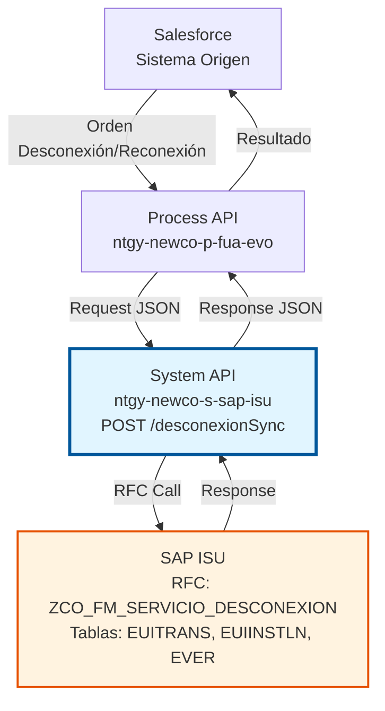
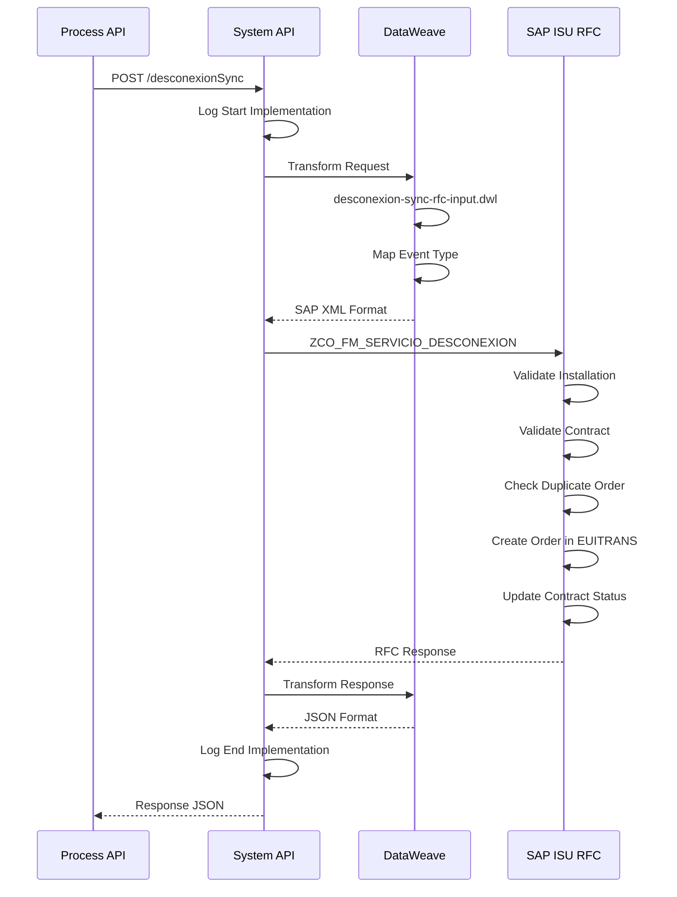
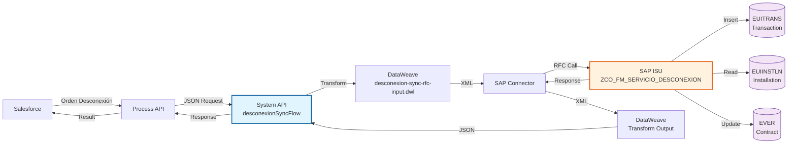
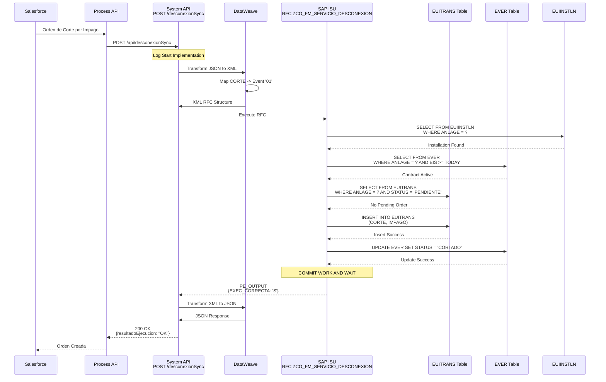
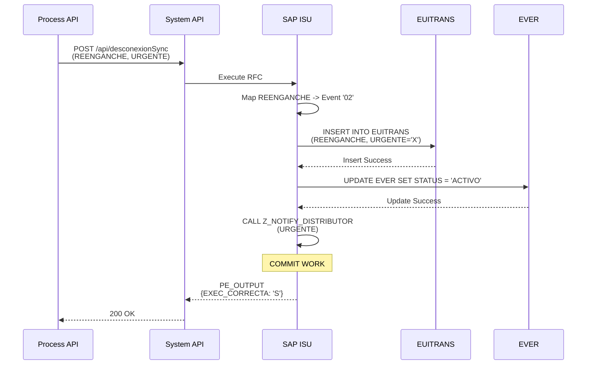
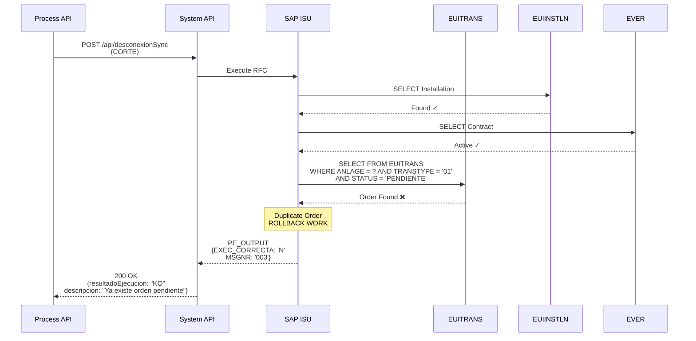
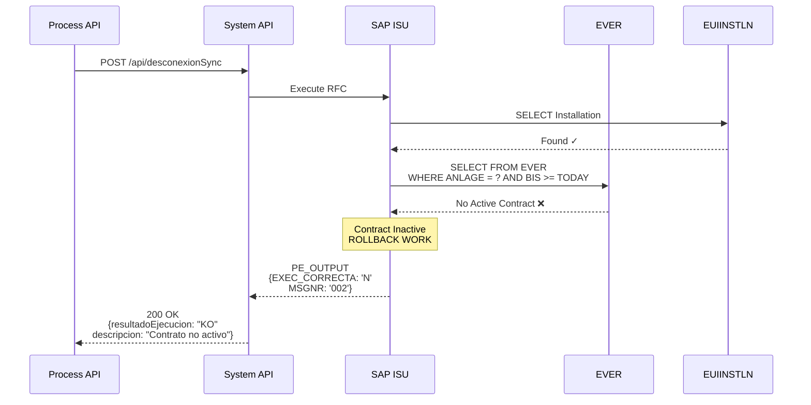

# POST /desconexionSync

## 📌 Descripción General

### Propósito del Endpoint

Este endpoint sincroniza información de órdenes de desconexión y reconexión (cortes y reenganches) desde Salesforce hacia SAP ISU. Gestiona el ciclo completo de operaciones sobre puntos de suministro, desde la solicitud hasta la ejecución de cortes por impago, reenganches tras regularización, suspensiones temporales y reactivaciones.

El endpoint soporta la sincronización de:
- **Tipos de operación**: CORTE, REENGANCHE, SUSPENSION, REACTIVACION
- **Motivos de operación**: IMPAGO, SOLICITUD_CLIENTE, MANTENIMIENTO, FRAUDE
- **Gestión de fechas**: Solicitud y ejecución de la operación
- **Estados de orden**: PENDIENTE, EN_PROCESO, EJECUTADA, CANCELADA
- **Priorización**: Operaciones urgentes y normales
- **Asociación con suministro**: Vinculación con CUPS y contrato

### Tipo de API

**Capa:** System API (API-Led Connectivity)

**Función:** Integración directa con SAP ISU para sincronización de órdenes de desconexión y reconexión de suministros.

### Patrón de Integración

**Tipo:** Request-Reply Síncrono con SAP RFC

**Descripción:** El endpoint recibe los datos de la orden desde Salesforce, valida el punto de suministro y contrato, determina el tipo de operación, transforma al formato SAP ISU, invoca el RFC `ZCO_FM_SERVICIO_DESCONEXION` y retorna el resultado.

### Arquitectura API-Led Connectivity



---

## 💼 Propósito del Negocio

### Casos de Uso Principales

1. **Corte por Impago**
   - Cliente con deuda impagada tras notificaciones
   - Crea orden de corte en SAP ISU
   - Programa fecha de ejecución
   - Notifica a distribuidora para ejecución física

2. **Reenganche tras Regularización**
   - Cliente regulariza deuda pendiente
   - Crea orden de reenganche
   - Coordina con distribuidora
   - Restaura suministro

3. **Suspensión Temporal**
   - Cliente solicita suspensión temporal del suministro
   - Mantiene contrato activo
   - Suspende facturación
   - Permite reactivación posterior

4. **Reactivación de Suministro**
   - Cliente solicita reactivación tras suspensión
   - Reactiva suministro y facturación
   - Coordina con distribuidora

5. **Operaciones Urgentes**
   - Situaciones de emergencia o fraude
   - Priorización de ejecución
   - Notificación inmediata a distribuidora

### Stakeholders

- **Departamento de Cobros**: Gestión de impagos y cortes
- **Atención al Cliente**: Solicitudes de suspensión/reactivación
- **Operaciones**: Coordinación con distribuidoras
- **Legal/Compliance**: Cumplimiento normativo de cortes
- **Administración SAP ISU**: Mantenimiento de órdenes

### Valor de Negocio

- **Automatización**: Elimina gestión manual de órdenes
- **Trazabilidad**: Registro completo del ciclo de vida
- **Compliance**: Cumplimiento de plazos normativos
- **Eficiencia**: Coordinación automática con distribuidoras
- **Reducción de Morosidad**: Gestión efectiva de impagos

---

## 🔧 Especificación Técnica

### Endpoint

```
POST /api/desconexionSync
```

### Headers

| Header | Valor | Requerido | Descripción |
|--------|-------|-----------|-------------|
| `Content-Type` | `application/json` | Sí | Formato del body |
| `Accept` | `application/json` | Sí | Formato de respuesta |

### Request Body

```json
{
  "modoEjecucion": "CREATE",
  "partner": "0001234567",
  "vkont": "200001234567",
  "detalleObjeto": {
    "codigo": "4000123456",
    "ptoSuministro": "ES0021000000000001AA",
    "tipoOperacion": "CORTE",
    "motivoOperacion": "IMPAGO",
    "fechaSolicitud": "2024-01-15",
    "fechaEjecucion": "2024-01-20",
    "estado": "PENDIENTE",
    "observaciones": "Cliente notificado",
    "urgente": false
  }
}
```

#### Parámetros del Request

| Campo | Tipo | Requerido | Descripción | Ejemplo |
|-------|------|-----------|-------------|---------|
| `modoEjecucion` | string | No | Modo de ejecución (CREATE/UPDATE) | "CREATE" |
| `partner` | string | No | Número de Business Partner | "0001234567" |
| `vkont` | string | Sí | Número de cuenta contrato | "200001234567" |
| `detalleObjeto` | object | Sí | Detalle de la orden | - |
| `detalleObjeto.codigo` | string | Sí | Número de orden | "4000123456" |
| `detalleObjeto.ptoSuministro` | string | Sí | CUPS | "ES0021000000000001AA" |
| `detalleObjeto.tipoOperacion` | string | Sí | Tipo (CORTE/REENGANCHE/SUSPENSION/REACTIVACION) | "CORTE" |
| `detalleObjeto.motivoOperacion` | string | Sí | Motivo | "IMPAGO" |
| `detalleObjeto.fechaSolicitud` | string | Sí | Fecha solicitud (YYYY-MM-DD) | "2024-01-15" |
| `detalleObjeto.fechaEjecucion` | string | No | Fecha ejecución (YYYY-MM-DD) | "2024-01-20" |
| `detalleObjeto.estado` | string | Sí | Estado | "PENDIENTE" |
| `detalleObjeto.observaciones` | string | No | Observaciones | "Cliente notificado" |
| `detalleObjeto.urgente` | boolean | No | Operación urgente | false |

### Response

#### Response Exitoso (200 OK)

```json
{
  "ordenDesconexion": "4000123456",
  "ptoSuministro": "ES0021000000000001AA",
  "partner": "0001234567",
  "numCtaContrato": "200001234567",
  "tipoOperacion": "CORTE",
  "resultadoEjecucion": "OK",
  "idMensaje": "00",
  "numMensaje": "000",
  "descripcion": "Orden de corte creada correctamente",
  "areaFuncional": "ISU",
  "categoriaError": null
}
```

#### Response con Error (400 Bad Request)

```json
{
  "ordenDesconexion": null,
  "ptoSuministro": "ES0021000000000001AA",
  "partner": "0001234567",
  "numCtaContrato": "200001234567",
  "tipoOperacion": "CORTE",
  "resultadoEjecucion": "KO",
  "idMensaje": "E001",
  "numMensaje": "001",
  "descripcion": "Ya existe orden de corte pendiente para este suministro",
  "areaFuncional": "ISU",
  "categoriaError": "E"
}
```

#### Códigos de Estado HTTP

| Código | Descripción | Cuándo se usa |
|--------|-------------|---------------|
| 200 | OK | Sincronización exitosa |
| 400 | Bad Request | Datos inválidos, orden duplicada |
| 500 | Internal Server Error | Error en SAP ISU o sistema |

---

## 🏗️ Implementación Técnica

### RFC SAP

**Nombre:** `ZCO_FM_SERVICIO_DESCONEXION`

**Módulo:** ISU (Industry Solution Utilities) / Device Management

**Descripción:** Function module personalizado para sincronización de órdenes de desconexión y reconexión desde sistemas externos hacia SAP ISU.

### Tablas SAP Involucradas

| Tabla | Operaciones | Descripción | Campos Principales |
|-------|-------------|-------------|-------------------|
| `EUITRANS` | READ, INSERT, UPDATE | Installation Transaction - Transacciones de instalación | TRANSNUM, ANLAGE, TRANSTYPE, AB, BIS, STATUS |
| `EUIINSTLN` | READ | Installation Master Data - Datos de instalación | ANLAGE, VSTELLE, SPARTE |
| `EVER` | READ | Contract Master Data - Datos del contrato | VERTRAG, VKONT, ANLAGE |

### Flow de MuleSoft

**Nombre del Flow:** `desconexionSyncFlow`

**Ubicación:** `src/main/mule/implementation/customer-data-management-operations.xml`



### Transformación DataWeave (Input)

**Archivo:** `desconexion-sync-rfc-input.dwl`

**Propósito:** Transforma el request JSON al formato XML requerido por el RFC SAP.

**Transformaciones Clave:**
- Mapeo de tipo de operación a código de evento SAP
- Mapeo de estado a código SAP
- Conversión de fechas a formato SAP (YYYYMMDD + HHMMSS)
- Construcción de estructura PI_INPUT con datos de la orden

### Transformación DataWeave (Output)

**Ubicación:** Inline en el flow XML

**Propósito:** Transforma la respuesta del RFC SAP a formato JSON estándar.

**Transformaciones Clave:**
- Extracción de resultado de ejecución (OK/KO)
- Mapeo de mensajes de error SAP
- Construcción de response JSON con datos de la orden creada

### Diagrama de Arquitectura



### Diagramas de Secuencia Detallados

#### 1. Flujo Normal de Éxito - Crear Orden de Corte



#### 2. Flujo Normal - Crear Orden de Reenganche



#### 3. Flujo con Error - Orden Duplicada



#### 4. Flujo con Error - Contrato Inactivo



### Manejo de Errores

**Estrategia:** Error handling global con transformación de errores SAP a formato estándar.

**Tipos de Errores:**
- **Validación**: Punto de suministro no existe, contrato inactivo, orden duplicada, tipo operación inválido
- **Datos**: Fechas inconsistentes, estado inválido
- **SAP**: RFC no disponible, timeout, errores de conexión
- **Sistema**: Errores de transformación DataWeave

---

## 💻 Ejemplos de Uso

### Ejemplo 1: Crear Orden de Corte por Impago

**Request:**

```bash
curl -X POST "https://api.naturgy.com/s-sap-isu/api/desconexionSync" \
  -H "Content-Type: application/json" \
  -H "Accept: application/json" \
  -d '{
    "vkont": "200001234567",
    "detalleObjeto": {
      "codigo": "4000123456",
      "ptoSuministro": "ES0021000000000001AA",
      "tipoOperacion": "CORTE",
      "motivoOperacion": "IMPAGO",
      "fechaSolicitud": "2024-01-15",
      "fechaEjecucion": "2024-01-20",
      "estado": "PENDIENTE",
      "observaciones": "Cliente notificado 3 veces"
    }
  }'
```

**Response:**

```json
{
  "ordenDesconexion": "4000123456",
  "ptoSuministro": "ES0021000000000001AA",
  "tipoOperacion": "CORTE",
  "resultadoEjecucion": "OK",
  "idMensaje": "00",
  "numMensaje": "000",
  "descripcion": "Orden de corte creada correctamente",
  "areaFuncional": "ISU"
}
```

### Ejemplo 2: Crear Orden de Reenganche Urgente

**Request:**

```json
{
  "vkont": "200001234567",
  "detalleObjeto": {
    "codigo": "4000123457",
    "ptoSuministro": "ES0021000000000001AA",
    "tipoOperacion": "REENGANCHE",
    "motivoOperacion": "REGULARIZACION_DEUDA",
    "fechaSolicitud": "2024-02-01",
    "fechaEjecucion": "2024-02-01",
    "estado": "PENDIENTE",
    "urgente": true,
    "observaciones": "Cliente regularizó deuda completa"
  }
}
```

**Response:**

```json
{
  "ordenDesconexion": "4000123457",
  "ptoSuministro": "ES0021000000000001AA",
  "tipoOperacion": "REENGANCHE",
  "resultadoEjecucion": "OK",
  "idMensaje": "00",
  "numMensaje": "000",
  "descripcion": "Orden de reenganche urgente creada correctamente",
  "areaFuncional": "ISU"
}
```

### Ejemplo 3: Suspensión Temporal

**Request:**

```json
{
  "vkont": "200001234568",
  "detalleObjeto": {
    "codigo": "4000123458",
    "ptoSuministro": "ES0021000000000002BB",
    "tipoOperacion": "SUSPENSION",
    "motivoOperacion": "SOLICITUD_CLIENTE",
    "fechaSolicitud": "2024-03-01",
    "fechaEjecucion": "2024-03-15",
    "estado": "PENDIENTE",
    "observaciones": "Cliente solicita suspensión temporal por viaje"
  }
}
```

**Response:**

```json
{
  "ordenDesconexion": "4000123458",
  "ptoSuministro": "ES0021000000000002BB",
  "tipoOperacion": "SUSPENSION",
  "resultadoEjecucion": "OK",
  "descripcion": "Orden de suspensión temporal creada correctamente"
}
```

### Ejemplo 4: Error - Orden Duplicada

**Request:**

```json
{
  "vkont": "200001234567",
  "detalleObjeto": {
    "codigo": "4000123459",
    "ptoSuministro": "ES0021000000000001AA",
    "tipoOperacion": "CORTE",
    "motivoOperacion": "IMPAGO",
    "fechaSolicitud": "2024-01-16",
    "estado": "PENDIENTE"
  }
}
```

**Response:**

```json
{
  "ordenDesconexion": null,
  "ptoSuministro": "ES0021000000000001AA",
  "tipoOperacion": "CORTE",
  "resultadoEjecucion": "KO",
  "idMensaje": "E003",
  "numMensaje": "003",
  "descripcion": "Ya existe orden de corte pendiente para este suministro",
  "areaFuncional": "ISU",
  "categoriaError": "E"
}
```
