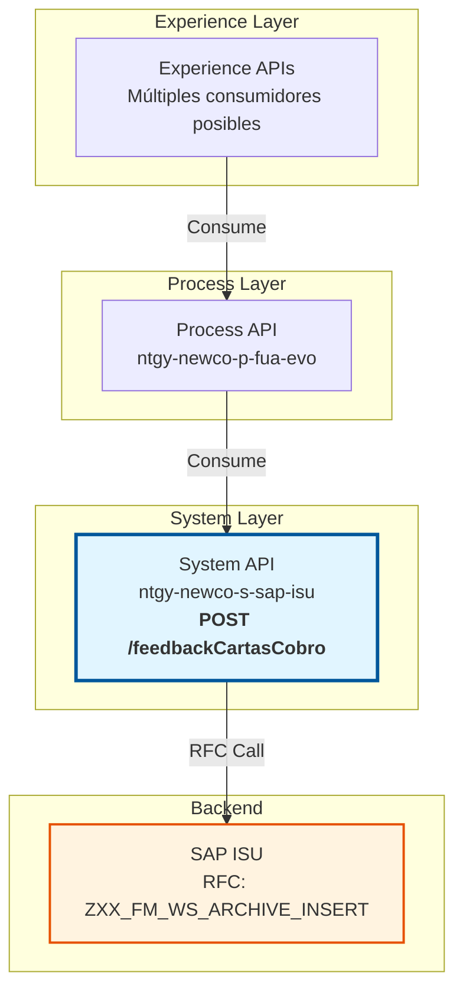
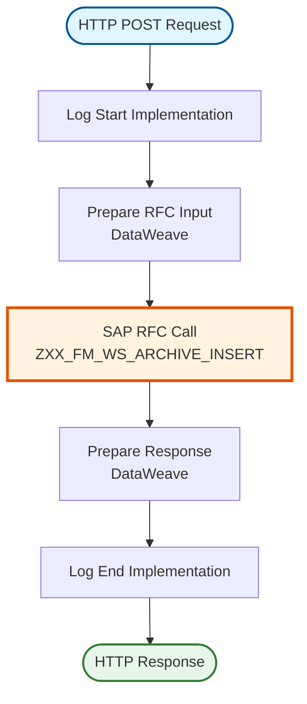
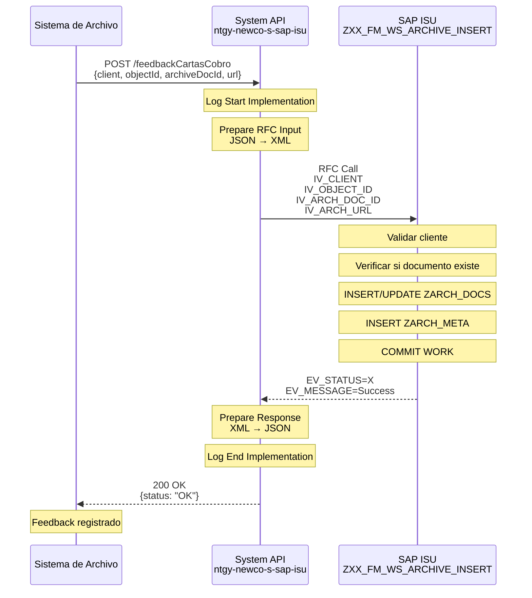
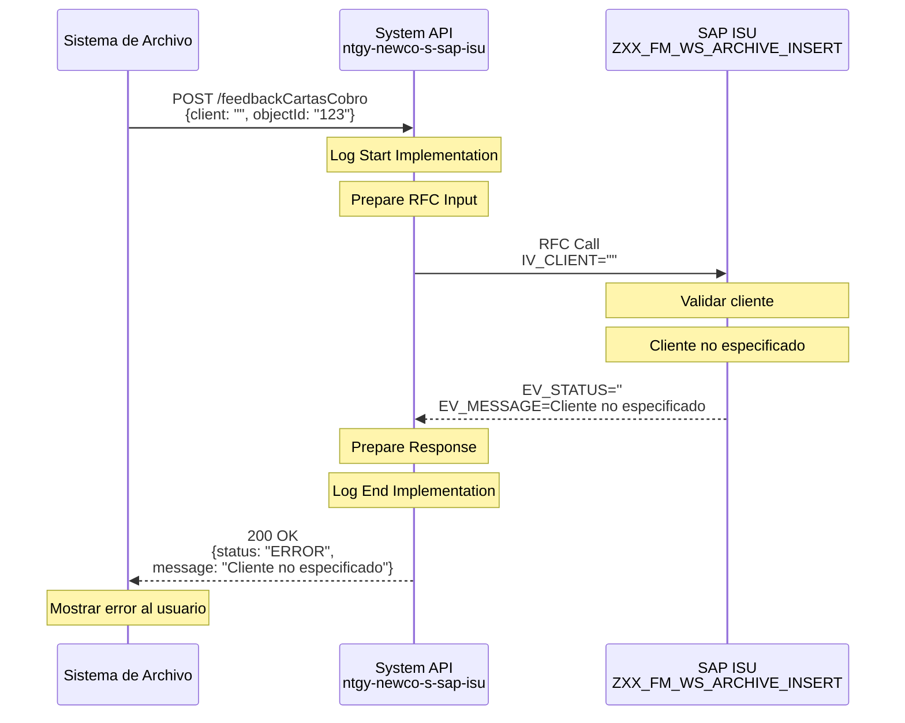
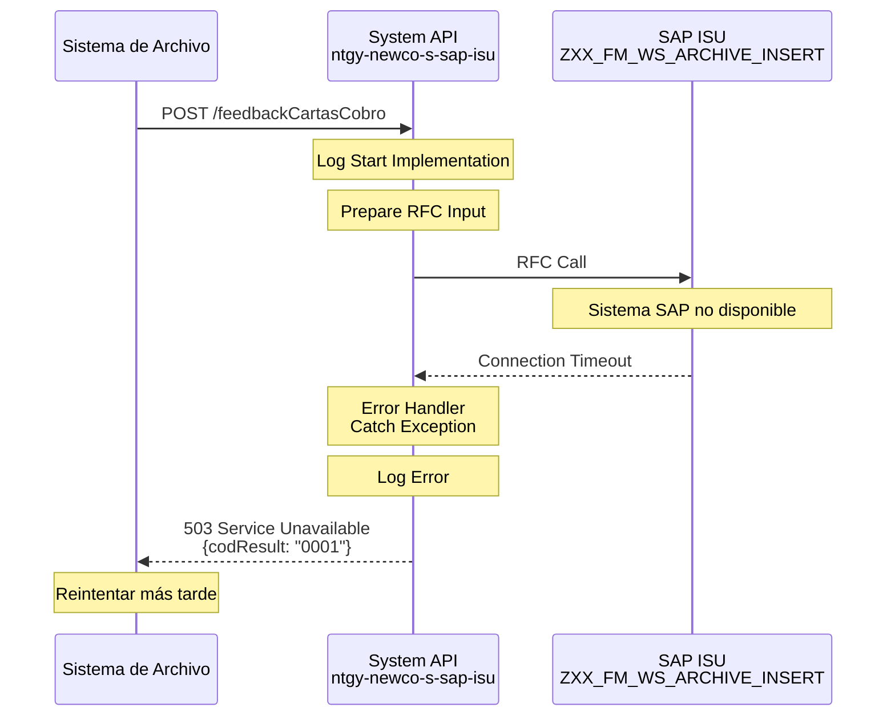

# POST /feedbackCartasCobro

## 📌 Descripción General

### Propósito del Endpoint

Este endpoint envía feedback del estado de procesamiento y archivado de cartas de cobro desde sistemas externos hacia SAP ISU. Actualiza el estado de archivado de documentos en el sistema de gestión documental de SAP, permitiendo mantener trazabilidad completa del ciclo de vida de las cartas de cobro.

### Tipo de API

**Capa:** System API (Integración directa con SAP ISU)

### Patrón de Integración

**Tipo:** Request-Reply Síncrono con SAP ISU

Este endpoint ejecuta directamente el RFC `ZXX_FM_WS_ARCHIVE_INSERT` en SAP ISU para actualizar el estado de archivado.

### Arquitectura API-Led Connectivity



---

## 💼 Propósito del Negocio

### Casos de Uso Principales

1. **Confirmación de Archivado**: Confirmar que cartas fueron archivadas correctamente en sistemas externos
2. **Trazabilidad Documental**: Mantener registro completo de documentos archivados
3. **Integración con DMS**: Sincronizar con sistemas de gestión documental (Document Management Systems)
4. **Auditoría**: Registrar estado de documentos para auditoría y cumplimiento normativo
5. **Gestión de URLs**: Almacenar enlaces a documentos archivados en sistemas externos

### Contexto Empresarial

- **Dominio:** Gestión Documental y Archivado
- **Sector:** Energía - Utilities
- **División:** Naturgy NewCo
- **Proceso:** Gestión de Documentos y Archivado

### Stakeholders

- **Departamento de Cobros**: Verifica archivado de cartas enviadas
- **Gestión Documental**: Administra el archivo de documentos
- **Auditoría**: Supervisa trazabilidad documental
- **IT**: Mantiene integración con sistemas de archivo
- **Cumplimiento Normativo**: Asegura conservación de documentos

### Valor de Negocio

- **Trazabilidad Completa**: Registro de todos los documentos archivados con URLs y metadatos
- **Cumplimiento Normativo**: Asegura conservación de documentos según normativa
- **Eficiencia Operativa**: Automatiza confirmación de archivado
- **Auditoría**: Facilita auditorías documentales
- **Recuperación de Documentos**: Permite localizar documentos archivados rápidamente

### Consumidores Potenciales

Este endpoint puede ser consumido por:
- Sistemas de gestión documental (DMS)
- Plataformas de archivo digital
- Sistemas de impresión y distribución de cartas
- Aplicaciones de back-office
- Sistemas de auditoría

---

## 🔧 Especificación Técnica

### URLs por Ambiente

| Ambiente | URL Base | URL Completa |
|----------|----------|--------------|
| Local | `http://localhost:8081` | `http://localhost:8081/api/feedbackCartasCobro` |
| Desarrollo | `https://dev-ntgy-newco-s-sap-isu.cloudhub.io` | `https://dev-ntgy-newco-s-sap-isu.cloudhub.io/api/feedbackCartasCobro` |
| UAT | `https://uat-ntgy-newco-s-sap-isu.cloudhub.io` | `https://uat-ntgy-newco-s-sap-isu.cloudhub.io/api/feedbackCartasCobro` |
| Producción | `https://prod-ntgy-newco-s-sap-isu.cloudhub.io` | `https://prod-ntgy-newco-s-sap-isu.cloudhub.io/api/feedbackCartasCobro` |

### Método HTTP

```
POST /feedbackCartasCobro
```

### Parámetros de Entrada

#### Headers HTTP

| Header | Tipo | Requerido | Descripción | Ejemplo |
|--------|------|-----------|-------------|---------|
| `Content-Type` | string | Sí | Tipo de contenido | `application/json` |
| `Accept` | string | No | Tipo de respuesta esperada | `application/json` |

#### Body Parameters

| Campo | Tipo | Requerido | Descripción | Ejemplo |
|-------|------|-----------|-------------|---------|
| `client` | string | Sí | Cliente SAP (mandante) | `"100"` |
| `destination` | string | No | Destino del documento | `"ARCHIVE"` |
| `sapObject` | string | No | Objeto SAP | `"BKPF"` |
| `archiveObject` | string | No | Objeto de archivo | `"FI_BELNR"` |
| `objectId` | string | No | ID del objeto en SAP | `"1000123456"` |
| `archiveDocId` | string | No | ID del documento archivado | `"DOC123456"` |
| `cokey` | string | No | Clave de contenido | `"KEY123"` |
| `url` | string | No | URL del documento archivado | `"https://archive.example.com/doc123"` |
| `codSicer` | string | No | Código SICER | `"SICER001"` |

**Estructura del Request:**

```json
{
  "client": "100",
  "destination": "ARCHIVE",
  "sapObject": "BKPF",
  "archiveObject": "FI_BELNR",
  "objectId": "1000123456",
  "archiveDocId": "DOC123456",
  "cokey": "KEY123",
  "url": "https://archive.example.com/doc123",
  "codSicer": "SICER001"
}
```

### Respuestas

#### Respuesta Exitosa (200 OK)

```json
{
  "status": "OK",
  "message": "Feedback registrado correctamente"
}
```

**Campos de la Respuesta:**

| Campo | Tipo | Descripción |
|-------|------|-------------|
| `status` | string | Estado de la operación (`OK` = éxito) |
| `message` | string | Mensaje descriptivo del resultado |

#### Respuestas de Error

**400 Bad Request** - Parámetros inválidos:

```json
{
  "result": {
    "codResult": "0001",
    "msgResult": "Parámetros inválidos o cliente no especificado"
  }
}
```

**500 Internal Server Error** - Error en SAP ISU:

```json
{
  "result": {
    "codResult": "0001",
    "msgResult": "Error al registrar feedback en SAP"
  }
}
```

**503 Service Unavailable** - SAP ISU no disponible:

```json
{
  "result": {
    "codResult": "0001",
    "msgResult": "Sistema SAP ISU no disponible"
  }
}
```

### Autenticación

- **Tipo:** Client ID & Client Secret (Anypoint Platform)
- **Ubicación:** Headers HTTP
- **Flujo:** OAuth 2.0 Client Credentials

### Timeouts

| Tipo | Valor | Descripción |
|------|-------|-------------|
| Request Timeout | 30s | Tiempo máximo de espera para la respuesta |
| Connection Timeout | 10s | Tiempo máximo para establecer conexión |

### Protocolo

- **Protocolo:** HTTPS
- **TLS Version:** 1.2+
- **Método:** POST

---

## 🏗️ Implementación Técnica

### Arquitectura del Flow



### 🗄️ Base de Datos SAP ISU

#### RFC SAP Invocado

**RFC:** `ZXX_FM_WS_ARCHIVE_INSERT`

**Descripción:** RFC personalizado de SAP ISU para insertar información de archivado de documentos en tablas personalizadas. Permite registrar metadatos de documentos archivados en sistemas externos.

**Módulo SAP:** Document Management / Custom Archive Module

**Tablas SAP Consultadas/Modificadas:**

| Tabla | Descripción | Operación |
|-------|-------------|-----------|
| `ZARCH_DOCS` | Custom Archive Documents | INSERT, UPDATE |
| `ZARCH_META` | Custom Archive Metadata | INSERT |

#### Detalles de Tablas SAP

##### Tabla: `ZARCH_DOCS` (Custom Archive Documents)

**Descripción:** Tabla personalizada que contiene información de documentos archivados en sistemas externos.

**Campos Utilizados:**

| Campo | Tipo ABAP | Descripción | Ejemplo |
|-------|-----------|-------------|---------|
| `MANDT` | CLNT(3) | Cliente (mandante) | `100` |
| `OBJECT_ID` | CHAR(30) | ID del objeto en SAP | `1000123456` |
| `SAP_OBJECT` | CHAR(10) | Tipo de objeto SAP | `BKPF` |
| `ARCH_DOC_ID` | CHAR(40) | ID del documento archivado | `DOC123456` |
| `ARCH_URL` | CHAR(255) | URL del documento archivado | `https://archive.example.com/doc123` |
| `ARCH_DATE` | DATS | Fecha de archivado | `20240115` |
| `ARCH_TIME` | TIMS | Hora de archivado | `103000` |
| `STATUS` | CHAR(1) | Estado (`A`=Activo, `I`=Inactivo) | `A` |

**Relaciones:**
- `ZARCH_DOCS.OBJECT_ID` → Objetos SAP (BKPF, ERCH, etc.)
- `ZARCH_DOCS.ARCH_DOC_ID` → `ZARCH_META.ARCH_DOC_ID`

##### Tabla: `ZARCH_META` (Custom Archive Metadata)

**Descripción:** Tabla personalizada que contiene metadatos adicionales de documentos archivados.

**Campos Utilizados:**

| Campo | Tipo ABAP | Descripción | Ejemplo |
|-------|-----------|-------------|---------|
| `MANDT` | CLNT(3) | Cliente (mandante) | `100` |
| `ARCH_DOC_ID` | CHAR(40) | ID del documento archivado | `DOC123456` |
| `DESTINATION` | CHAR(20) | Destino del archivo | `ARCHIVE` |
| `ARCH_OBJECT` | CHAR(20) | Objeto de archivo | `FI_BELNR` |
| `COKEY` | CHAR(50) | Clave de contenido | `KEY123` |
| `COD_SICER` | CHAR(20) | Código SICER | `SICER001` |
| `CREATED_BY` | CHAR(12) | Usuario creador | `SYSTEM` |
| `CREATED_AT` | TIMESTAMPL | Timestamp de creación | `20240115103000` |

**Relaciones:**
- `ZARCH_META.ARCH_DOC_ID` → `ZARCH_DOCS.ARCH_DOC_ID`

**Notas de Performance:**
- El RFC utiliza índices primarios en ZARCH_DOCS y ZARCH_META
- Tiempo de respuesta típico: 1-2 segundos
- Operación de escritura (INSERT/UPDATE)
- Commit automático al finalizar

### Transformaciones DataWeave

#### Transformación de Entrada (Request → SAP RFC)

**Ubicación:** Inline en el flow XML

```dataweave
%dw 2.0
output application/xml
---
{
    "ZXX_FM_WS_ARCHIVE_INSERT": {
        "import": {
            IV_CLIENT: payload.client,
            IV_OBJECT_ID: payload.objectId,
            IV_SAP_OBJECT: payload.sapObject,
            IV_ARCH_DOC_ID: payload.archiveDocId,
            IV_ARCH_URL: payload.url,
            IV_DESTINATION: payload.destination,
            IV_ARCH_OBJECT: payload.archiveObject,
            IV_COKEY: payload.cokey,
            IV_COD_SICER: payload.codSicer
        }
    }
}
```

**Mapeo de Campos:**

| Campo JSON (Input) | Campo SAP RFC | Transformación |
|-------------------|---------------|----------------|
| `client` | `IV_CLIENT` | Directo |
| `objectId` | `IV_OBJECT_ID` | Directo |
| `sapObject` | `IV_SAP_OBJECT` | Directo |
| `archiveDocId` | `IV_ARCH_DOC_ID` | Directo |
| `url` | `IV_ARCH_URL` | Directo |
| `destination` | `IV_DESTINATION` | Directo |
| `archiveObject` | `IV_ARCH_OBJECT` | Directo |
| `cokey` | `IV_COKEY` | Directo |
| `codSicer` | `IV_COD_SICER` | Directo |

#### Transformación de Salida (SAP RFC → Response)

**Ubicación:** Inline en el flow XML

```dataweave
%dw 2.0
output application/json
---
{
    "status": if(payload.ZXX_FM_WS_ARCHIVE_INSERT.export.EV_STATUS == "X") "OK" else "ERROR",
    "message": payload.ZXX_FM_WS_ARCHIVE_INSERT.export.EV_MESSAGE
}
```

**Mapeo de Campos:**

| Campo SAP RFC | Campo JSON (Output) | Transformación |
|---------------|-------------------|----------------|
| `EV_STATUS` | `status` | Condicional: "X" → "OK", "" → "ERROR" |
| `EV_MESSAGE` | `message` | Directo |

### Patrones de Diseño

**Patrón:** Request-Reply Síncrono

**Justificación:**
- Operación de escritura que requiere confirmación inmediata
- El feedback debe registrarse antes de continuar
- Necesidad de validar que el registro fue exitoso

**Componentes:**
1. **Logger**: Logging de inicio y fin de operación
2. **DataWeave Transformer**: Transformación de JSON a XML SAP
3. **SAP Connector**: Ejecución del RFC
4. **DataWeave Transformer**: Transformación de respuesta SAP a JSON

### Diagramas de Secuencia

#### 1. Flujo Normal de Éxito



#### 2. Flujo con Error de Negocio



#### 3. Flujo con Error Técnico



### Connection Pooling

**Configuración del SAP JCo Connector:**

```xml
<sap:config name="SAP_Config">
    <sap:jco-connection-provider>
        <sap:pool-configuration 
            maxPoolSize="10"
            minPoolSize="2"
            maxIdleTime="300000"
            maxWaitTime="10000"/>
    </sap:jco-connection-provider>
</sap:config>
```

**Optimizaciones:**
- Pool de conexiones reutilizables
- Timeout de 10 segundos para obtener conexión
- Máximo 10 conexiones concurrentes

### Manejo de Errores

**Estrategia:**

1. **Validación de Entrada**: Verificar campos requeridos antes de llamar a SAP
2. **Try-Catch en Flow**: Capturar excepciones de SAP Connector
3. **Error Handler Global**: Transformar errores a formato estándar
4. **Logging**: Registrar todos los errores para troubleshooting

**Códigos de Error Manejados:**

| Código SAP | Código API | Descripción |
|------------|------------|-------------|
| `X` | `OK` | Feedback registrado exitosamente |
| `''` | `ERROR` | Error de negocio (cliente no especificado, etc.) |
| Connection Error | `0001` | Error de conexión con SAP |
| Timeout | `0001` | Timeout en la operación |

---

## 💻 Ejemplos de Uso

### Ejemplo 1: Feedback de Archivado Exitoso

#### cURL

```bash
curl -X POST "https://prod-ntgy-newco-s-sap-isu.cloudhub.io/api/feedbackCartasCobro" \
  -H "Content-Type: application/json" \
  -H "client_id: your-client-id" \
  -H "client_secret: your-client-secret" \
  -d '{
    "client": "100",
    "destination": "ARCHIVE",
    "sapObject": "BKPF",
    "archiveObject": "FI_BELNR",
    "objectId": "1000123456",
    "archiveDocId": "DOC123456",
    "cokey": "KEY123",
    "url": "https://archive.example.com/doc123",
    "codSicer": "SICER001"
  }'
```

#### Respuesta

```json
{
  "status": "OK",
  "message": "Feedback registrado correctamente"
}
```

### Ejemplo 2: Feedback Mínimo

#### cURL

```bash
curl -X POST "https://prod-ntgy-newco-s-sap-isu.cloudhub.io/api/feedbackCartasCobro" \
  -H "Content-Type: application/json" \
  -H "client_id: your-client-id" \
  -H "client_secret: your-client-secret" \
  -d '{
    "client": "100",
    "objectId": "1000123456",
    "archiveDocId": "DOC123456",
    "url": "https://archive.example.com/doc123"
  }'
```

#### Respuesta

```json
{
  "status": "OK",
  "message": "Feedback registrado correctamente"
}
```

### Ejemplo 3: JavaScript (Fetch API)

```javascript
const sendArchiveFeedback = async (archiveData) => {
  try {
    const response = await fetch('https://prod-ntgy-newco-s-sap-isu.cloudhub.io/api/feedbackCartasCobro', {
      method: 'POST',
      headers: {
        'Content-Type': 'application/json',
        'client_id': 'your-client-id',
        'client_secret': 'your-client-secret'
      },
      body: JSON.stringify(archiveData)
    });

    const data = await response.json();
    
    if (data.status === 'OK') {
      console.log('✓ Feedback registrado:', data.message);
      return true;
    } else {
      console.error('✗ Error al registrar feedback:', data.message);
      return false;
    }
  } catch (error) {
    console.error('Error de conexión:', error);
    throw error;
  }
};

// Uso
const success = await sendArchiveFeedback({
  client: '100',
  destination: 'ARCHIVE',
  sapObject: 'BKPF',
  archiveObject: 'FI_BELNR',
  objectId: '1000123456',
  archiveDocId: 'DOC123456',
  cokey: 'KEY123',
  url: 'https://archive.example.com/doc123',
  codSicer: 'SICER001'
});
```

### Ejemplo 4: Python (requests)

```python
import requests
import json

def send_archive_feedback(client, object_id, archive_doc_id, url, **kwargs):
    """
    Envía feedback de archivado a SAP ISU
    
    Args:
        client (str): Cliente SAP
        object_id (str): ID del objeto
        archive_doc_id (str): ID del documento archivado
        url (str): URL del documento
        **kwargs: Parámetros opcionales (destination, sapObject, etc.)
    
    Returns:
        dict: Respuesta del API
    """
    api_url = 'https://prod-ntgy-newco-s-sap-isu.cloudhub.io/api/feedbackCartasCobro'
    
    headers = {
        'Content-Type': 'application/json',
        'client_id': 'your-client-id',
        'client_secret': 'your-client-secret'
    }
    
    payload = {
        'client': client,
        'objectId': object_id,
        'archiveDocId': archive_doc_id,
        'url': url
    }
    
    # Añadir parámetros opcionales
    if 'destination' in kwargs:
        payload['destination'] = kwargs['destination']
    if 'sapObject' in kwargs:
        payload['sapObject'] = kwargs['sapObject']
    if 'archiveObject' in kwargs:
        payload['archiveObject'] = kwargs['archiveObject']
    if 'cokey' in kwargs:
        payload['cokey'] = kwargs['cokey']
    if 'codSicer' in kwargs:
        payload['codSicer'] = kwargs['codSicer']
    
    try:
        response = requests.post(api_url, headers=headers, json=payload, timeout=30)
        response.raise_for_status()
        
        data = response.json()
        
        if data['status'] == 'OK':
            print(f"✓ Feedback registrado: {data['message']}")
        else:
            print(f"✗ Error: {data