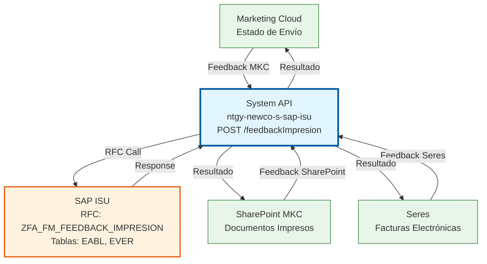
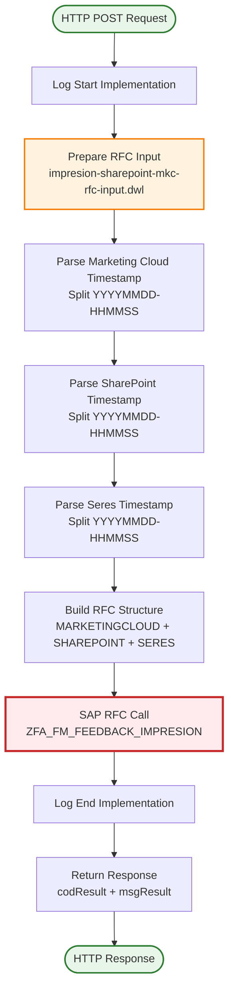
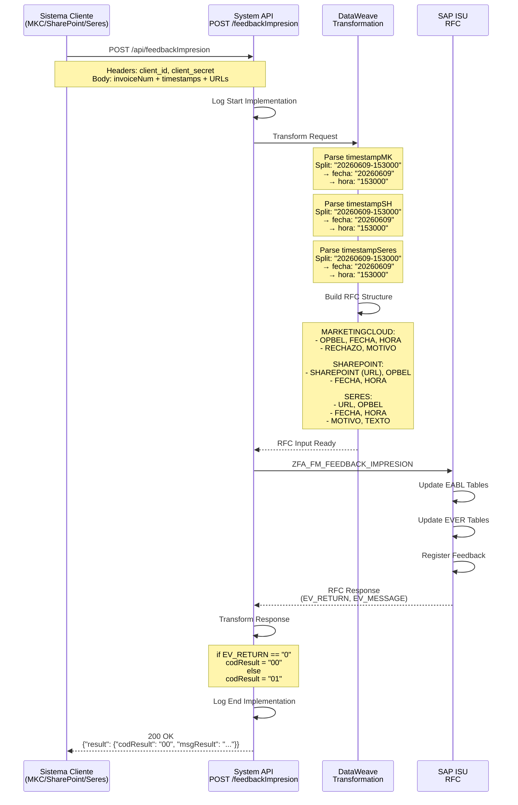

# POST /feedbackImpresion

## 📌 Descripción General

### Propósito del Endpoint

El endpoint **POST /feedbackImpresion** actualiza el estado de impresión de documentos (facturas, cartas, notificaciones) desde SharePoint MKC hacia SAP ISU. Este endpoint actúa como punto de integración centralizado para registrar el feedback de tres sistemas diferentes: Marketing Cloud, SharePoint y Seres.

El endpoint soporta:
- **Feedback de Marketing Cloud**: Registro de estado de envío de comunicaciones digitales
- **Feedback de SharePoint**: Almacenamiento y trazabilidad de documentos impresos
- **Feedback de Seres**: Estado de generación de facturas electrónicas
- **Sincronización Multi-Sistema**: Actualización consolidada en SAP ISU desde múltiples fuentes
- **Trazabilidad Completa**: Registro de timestamps y URLs de cada sistema

### Tipo de API

**Capa:** System API (API-Led Connectivity)

**Función:** Integración directa con SAP ISU para registrar feedback de impresión de documentos desde múltiples sistemas externos (Marketing Cloud, SharePoint, Seres).

### Patrón de Integración

**Tipo:** Request-Reply Síncrono con SAP RFC

**Descripción:** Recibe información de impresión de tres sistemas, transforma los datos al formato SAP (separando timestamps en fecha y hora), invoca el RFC `ZFA_FM_FEEDBACK_IMPRESION` y retorna el resultado de la actualización en SAP ISU.

### Arquitectura API-Led Connectivity



---

## 💼 Propósito del Negocio

### Casos de Uso Principales

1. **Trazabilidad de Impresión de Facturas**
   - SharePoint MKC almacena facturas impresas y notifica a SAP ISU
   - Se registra la URL del documento, fecha y hora de impresión
   - Permite auditoría completa del proceso de impresión

2. **Seguimiento de Comunicaciones Digitales**
   - Marketing Cloud envía comunicaciones a clientes (emails, SMS)
   - Se registra el resultado del envío (éxito/rechazo) y motivo
   - Permite análisis de efectividad de comunicaciones

3. **Gestión de Facturas Electrónicas**
   - Seres genera facturas electrónicas (FacturaE)
   - Se registra la URL de la factura electrónica y estado de generación
   - Cumplimiento normativo de facturación electrónica

### Contexto Empresarial

- **Dominio:** Gestión Documental y Facturación
- **Sector:** Energía - Utilities
- **División:** Naturgy España - NewCo
- **Proceso de Negocio:** Impresión y distribución de documentos de facturación
- **Módulo SAP:** FI-CA (Financial Contract Accounting)

### Stakeholders

- **Operaciones de Facturación**: Necesitan trazabilidad completa del proceso de impresión
- **Atención al Cliente**: Requieren información sobre estado de envío de documentos
- **Auditoría y Cumplimiento**: Necesitan registro de todas las operaciones de impresión
- **Sistemas Externos**: Marketing Cloud, SharePoint MKC, Seres

### Valor de Negocio

- **Trazabilidad Completa**: Registro centralizado de impresión desde múltiples sistemas
- **Auditoría**: Cumplimiento de requisitos regulatorios de trazabilidad documental
- **Eficiencia Operativa**: Automatización del registro de feedback de impresión
- **Visibilidad**: Estado en tiempo real de documentos enviados a clientes

### Consumidores Potenciales

Este endpoint puede ser consumido por:
- SharePoint MKC (sistema de gestión documental)
- Marketing Cloud (plataforma de comunicaciones)
- Seres (sistema de facturación electrónica)
- Process APIs de gestión documental
- Sistemas de integración middleware

---

## 🔧 Especificación Técnica

### URLs por Ambiente

| Ambiente | URL Base | URL Completa |
|----------|----------|--------------|
| **Local** | `http://localhost:8081` | `http://localhost:8081/api/feedbackImpresion` |
| **Development** | `https://ntgy-newco-s-sap-isu-dev.us-e2.cloudhub.io` | `https://ntgy-newco-s-sap-isu-dev.us-e2.cloudhub.io/api/feedbackImpresion` |
| **UAT** | `https://ntgy-newco-s-sap-isu-uat.us-e2.cloudhub.io` | `https://ntgy-newco-s-sap-isu-uat.us-e2.cloudhub.io/api/feedbackImpresion` |
| **Production** | `https://ntgy-newco-s-sap-isu-pro.us-e2.cloudhub.io` | `https://ntgy-newco-s-sap-isu-pro.us-e2.cloudhub.io/api/feedbackImpresion` |

### Método HTTP

```
POST /api/feedbackImpresion
```

### Parámetros de Entrada

#### Headers HTTP

| Header | Tipo | Requerido | Descripción | Ejemplo |
|--------|------|-----------|-------------|---------|
| `Content-Type` | string | ✅ Sí | Tipo de contenido del request | `application/json` |
| `Accept` | string | ❌ No | Tipo de contenido esperado en response | `application/json` |
| `client_id` | string | ✅ Sí | Client ID de Anypoint Platform | `a1b2c3d4e5f6` |
| `client_secret` | string | ✅ Sí | Client Secret de Anypoint Platform | `A1B2C3D4E5F6` |

#### Body Parameters

| Campo | Tipo | Requerido | Descripción | Ejemplo |
|-------|------|-----------|-------------|---------|
| `invoiceNum` | string | ✅ Sí | Número de documento/factura (OPBEL) | `"3000123456"` |
| `timestampMK` | string | ❌ No | Timestamp Marketing Cloud (YYYYMMDD-HHMMSS) | `"20260609-153000"` |
| `mktcResult` | string | ❌ No | Código resultado Marketing Cloud ("0000" = éxito) | `"0000"` |
| `mktcResultDesc` | string | ❌ No | Descripción resultado Marketing Cloud | `"Envío exitoso"` |
| `timestampSH` | string | ❌ No | Timestamp SharePoint (YYYYMMDD-HHMMSS) | `"20260609-153000"` |
| `s3Url` | string | ❌ No | URL del documento en SharePoint/S3 | `"https://sharepoint.naturgy.com/..."` |
| `timestampSeres` | string | ❌ No | Timestamp Seres (YYYYMMDD-HHMMSS) | `"20260609-153000"` |
| `faeUrl` | string | ❌ No | URL de la factura electrónica en Seres | `"https://seres.naturgy.com/..."` |
| `seresResult` | string | ❌ No | Código resultado Seres | `"0000"` |
| `seresResultDesc` | string | ❌ No | Descripción resultado Seres | `"Factura electrónica generada"` |

**Nota:** Al menos uno de los tres sistemas (Marketing Cloud, SharePoint, Seres) debe proporcionar información.

### Respuestas

#### Respuesta Exitosa (200 OK)

```json
{
  "result": {
    "codResult": "00",
    "msgResult": "Feedback de impresión registrado correctamente en SAP ISU"
  }
}
```

#### Respuesta de Error de Negocio (200 OK con codResult = "01")

```json
{
  "result": {
    "codResult": "01",
    "msgResult": "Error: Documento no encontrado en SAP ISU"
  }
}
```

#### Respuesta de Error Técnico (400/500)

```json
{
  "result": {
    "codResult": "01",
    "msgResult": "Error interno del servidor"
  }
}
```

### Códigos de Estado HTTP

| Código | Descripción | Escenario |
|--------|-------------|-----------|
| **200** | OK | Operación procesada (verificar codResult en body) |
| **400** | Bad Request | Request malformado o parámetros inválidos |
| **401** | Unauthorized | Credenciales inválidas o ausentes |
| **500** | Internal Server Error | Error en SAP ISU o error técnico interno |

### Autenticación y Autorización

- **Tipo:** Client ID & Client Secret (Anypoint Platform)
- **Autorización SAP:** El usuario debe tener permisos para:
  - Ejecutar RFC `ZFA_FM_FEEDBACK_IMPRESION`
  - Acceso a tablas EABL (Billing Documents) y EVER (Contract Data)
  - Actualización de estado de documentos

### Timeouts

| Tipo | Valor | Descripción |
|------|-------|-------------|
| **Request Timeout** | 30 segundos | Tiempo máximo de espera para la respuesta |
| **SAP RFC Timeout** | 60 segundos | Tiempo máximo para ejecución del RFC |
| **Connection Timeout** | 10 segundos | Tiempo máximo para establecer conexión con SAP |

---

## 🏗️ Implementación Técnica

### Arquitectura del Flow



### Diagrama de Secuencia



### Transformación de Datos

```mermaid
graph LR
    subgraph Input["Request JSON"]
        I1[invoiceNum: 3000123456]
        I2[timestampMK: 20260609-153000]
        I3[mktcResult: 0000]
        I4[mktcResultDesc: Envío exitoso]
        I5[timestampSH: 20260609-153000]
        I6[s3Url: https://...]
        I7[timestampSeres: 20260609-153000]
        I8[faeUrl: https://...]
        I9[seresResult: 0000]
        I10[seresResultDesc: Generada]
    end
    
    subgraph Transform["DataWeave Transformation"]
        T1[Split Timestamps]
        T2[Map Fields]
        T3[Build RFC Structure]
    end
    
    subgraph Output["RFC XML"]
        O1[MARKETINGCLOUD:<br/>OPBEL, FECHA: 20260609<br/>HORA: 153000<br/>RECHAZO: NO, MOTIVO]
        O2[OPBEL: 3000123456]
        O3[SHAREPOINT:<br/>SHAREPOINT URL<br/>OPBEL, FECHA, HORA]
        O4[SERES:<br/>URL, OPBEL<br/>FECHA, HORA<br/>MOTIVO, TEXTO]
    end
    
    Input --> Transform
    Transform --> Output
    
    style Input fill:#e3f2fd,stroke:#1976d2
    style Transform fill:#fff3e0,stroke:#f57c00
    style Output fill:#ffebee,stroke:#c62828
```



### Código DataWeave

**Archivo:** `src/main/resources/dw/impresion-sharepoint-mkc-rfc-input.dwl`

```dataweave
%dw 2.0
output application/xml

var timestampMK = payload.timestampMK
var fechaMK = (timestampMK splitBy  "-")[0]
var horaMK = (timestampMK splitBy  "-")[1]

var timestampSH = payload.timestampSH
var fechaSH = (timestampSH splitBy  "-")[0]
var horaSH = (timestampSH splitBy  "-")[1]

var timestampSeres = payload.timestampSeres
var fechaSeres = (timestampSeres splitBy  "-")[0]
var horaSeres = (timestampSeres splitBy  "-")[1]
---
{
	ZFA_FM_FEEDBACK_IMPRESION: {
		"import": {
			MARKETINGCLOUD: {
                OPBEL: payload.invoiceNum,
                FECHA: fechaMK,
                HORA: horaMK,
                RECHAZO: if(!isEmpty(payload.mktcResult)) 
                           if(payload.mktcResult == "0000") "NO" 
                           else "SI" 
                         else "",
                MOTIVO: payload.mktcResultDesc                
		    },
			OPBEL: payload.invoiceNum,
			SHAREPOINT: {
                SHAREPOINT: payload.s3Url,
                OPBEL: payload.invoiceNum,
                FECHA: fechaSH,
                HORA: horaSH
            },
            SERES: {
                URL: payload.faeUrl,
                OPBEL: payload.invoiceNum,
                FECHA: fechaSeres,
                HORA: horaSeres,
                MOTIVO: payload.seresResult,
                TEXTO: payload.seresResultDesc
            }
		}
	}
}
```

**Explicación del Código:**

1. **Parsing de Timestamps**: Cada timestamp en formato "YYYYMMDD-HHMMSS" se divide en fecha y hora
2. **Estructura MARKETINGCLOUD**: Incluye lógica para determinar si hubo rechazo (RECHAZO = "SI" si mktcResult != "0000")
3. **Estructura SHAREPOINT**: Mapea URL de S3 y datos de impresión
4. **Estructura SERES**: Mapea URL de factura electrónica y resultado de generación
5. **OPBEL Global**: Número de documento que se repite en cada sección

### Configuración SAP

**RFC:** `ZFA_FM_FEEDBACK_IMPRESION`

**Parámetros de Importación:**
- `MARKETINGCLOUD` (estructura): Datos de Marketing Cloud
- `OPBEL` (string): Número de documento
- `SHAREPOINT` (estructura): Datos de SharePoint
- `SERES` (estructura): Datos de Seres

**Parámetros de Exportación:**
- `EV_RETURN` (string): Código de retorno ("0" = éxito)
- `EV_MESSAGE` (string): Mensaje descriptivo

**Tablas Actualizadas:**
- `EABL`: Billing Documents - Se actualiza el estado de impresión
- `EVER`: Contract Data - Se registra la trazabilidad

### Manejo de Errores

| Escenario | Código | Mensaje | Acción |
|-----------|--------|---------|--------|
| Documento no encontrado | 01 | "Documento no encontrado en SAP ISU" | Verificar invoiceNum |
| RFC timeout | 01 | "Timeout en conexión SAP" | Reintentar operación |
| Error de conexión SAP | 01 | "Error de conexión con SAP ISU" | Verificar conectividad |
| Datos inválidos | 01 | "Formato de timestamp inválido" | Verificar formato YYYYMMDD-HHMMSS |
| Operación exitosa | 00 | "Feedback registrado correctamente" | Continuar flujo |

---

## 💻 Ejemplos de Uso

### Ejemplo 1: Request Completo (Todos los Sistemas)

```json
{
  "invoiceNum": "3000123456",
  "timestampMK": "20260609-153000",
  "mktcResult": "0000",
  "mktcResultDesc": "Comunicación enviada exitosamente al cliente",
  "timestampSH": "20260609-153015",
  "s3Url": "https://sharepoint.naturgy.com/documents/invoices/2026/06/3000123456.pdf",
  "timestampSeres": "20260609-153030",
  "faeUrl": "https://seres.naturgy.com/facturae/2026/06/3000123456.xml",
  "seresResult": "0000",
  "seresResultDesc": "Factura electrónica generada y firmada correctamente"
}
```

### Ejemplo 2: Response Exitoso

```json
{
  "result": {
    "codResult": "00",
    "msgResult": "Feedback de impresión registrado correctamente en SAP ISU para documento 3000123456"
  }
}
```

### Ejemplo 3: Comando cURL

```bash
curl -X POST "https://ntgy-newco-s-sap-isu-dev.us-e2.cloudhub.io/api/feedbackImpresion" \
  -H "Content-Type: application/json" \
  -H "client_id: a1b2c3d4e5f6g7h8i9j0" \
  -H "client_secret: A1B2C3D4E5F6G7H8I9J0K1L2M3N4O5P6" \
  -d '{
    "invoiceNum": "3000123456",
    "timestampMK": "20260609-153000",
    "mktcResult": "0000",
    "mktcResultDesc": "Envío exitoso",
    "timestampSH": "20260609-153015",
    "s3Url": "https://sharepoint.naturgy.com/documents/invoices/2026/06/3000123456.pdf",
    "timestampSeres": "20260609-153030",
    "faeUrl": "https://seres.naturgy.com/facturae/2026/06/3000123456.xml",
    "seresResult": "0000",
    "seresResultDesc": "Factura electrónica generada correctamente"
  }'
```

### Ejemplo 4: Request Solo Marketing Cloud

```json
{
  "invoiceNum": "3000123456",
  "timestampMK": "20260609-153000",
  "mktcResult": "0001",
  "mktcResultDesc": "Error en envío: dirección de email inválida"
}
```

### Ejemplo 5: Response de Error

```json
{
  "result": {
    "codResult": "01",
    "msgResult": "Error: Documento 3000123456 no encontrado en SAP ISU. Verificar número de factura."
  }
}
```

### Ejemplo 6: Request Solo SharePoint

```json
{
  "invoiceNum": "3000123456",
  "timestampSH": "20260609-153015",
  "s3Url": "https://sharepoint.naturgy.com/documents/invoices/2026/06/3000123456.pdf"
}
```

### Ejemplo 7: Request Solo Seres

```json
{
  "invoiceNum": "3000123456",
  "timestampSeres": "20260609-153030",
  "faeUrl": "https://seres.naturgy.com/facturae/2026/06/3000123456.xml",
  "seresResult": "0000",
  "seresResultDesc": "Factura electrónica generada y firmada digitalmente"
}