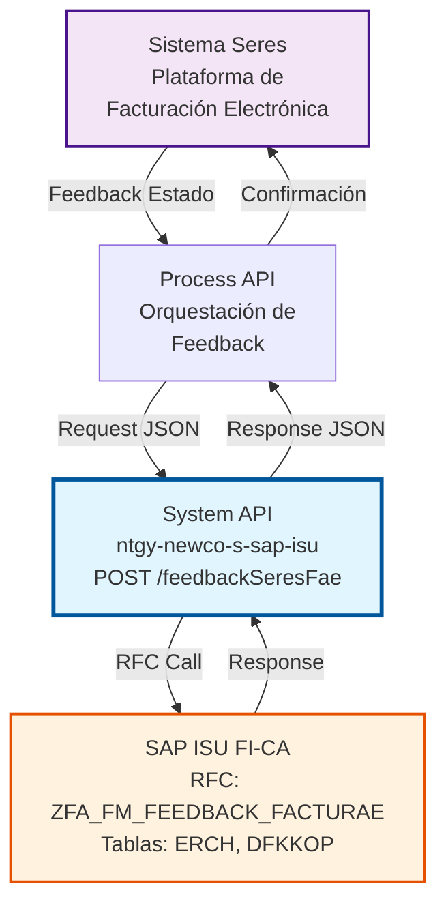
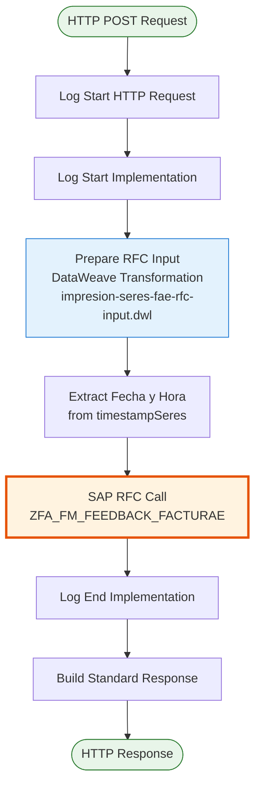
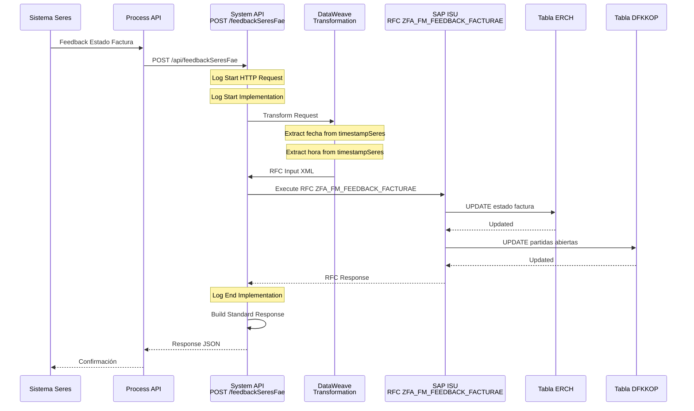
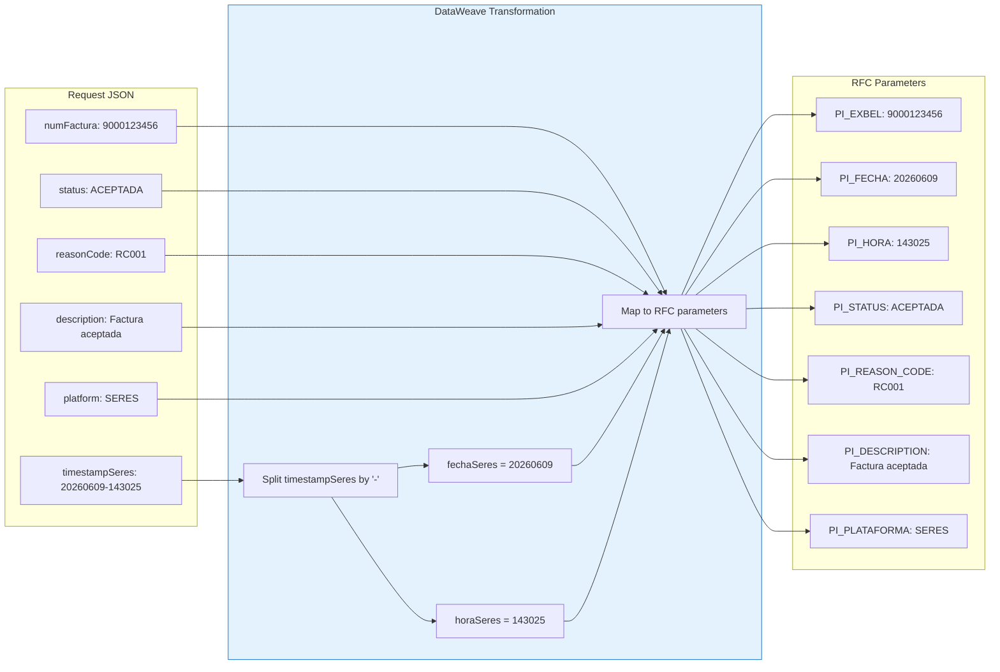

# POST /feedbackSeresFae

## 📌 Descripción General

### Propósito del Endpoint

Este endpoint actualiza el estado de facturas electrónicas (FacturaE) en SAP ISU basándose en el feedback recibido desde la plataforma **Seres**. Permite mantener sincronizado el estado de las facturas electrónicas entre el sistema de facturación electrónica externo (Seres) y SAP ISU, proporcionando trazabilidad completa del ciclo de vida de las facturas.

El endpoint soporta:
- **Actualización de Estados**: Registra estados como ACEPTADA, RECHAZADA, PROCESADA o ERROR
- **Trazabilidad Temporal**: Captura fecha y hora exacta del feedback de Seres
- **Códigos de Razón**: Almacena códigos y descripciones de errores o rechazos
- **Multi-Plataforma**: Soporta feedback de múltiples plataformas (SERES, SERVINFORM, MKC)

### Tipo de API

**Capa:** System API (API-Led Connectivity)

**Función:** Integración directa con SAP ISU para actualizar el estado de facturas electrónicas basándose en feedback de sistemas externos de facturación electrónica.

### Patrón de Integración

**Tipo:** Request-Reply Síncrono con SAP RFC

**Descripción:** El endpoint recibe el feedback de Seres con el estado de la factura electrónica, extrae y transforma la información temporal (fecha y hora), invoca el RFC de SAP para actualizar las tablas correspondientes, y retorna el resultado de la operación.

### Arquitectura API-Led Connectivity



---

## 💼 Propósito del Negocio

### Casos de Uso Principales

1. **Confirmación de Aceptación de Factura**
   - Seres notifica que el cliente ha aceptado la factura electrónica
   - SAP ISU actualiza el estado a "ACEPTADA"
   - Se registra la fecha y hora de aceptación
   - **Beneficio**: Trazabilidad completa del proceso de facturación electrónica

2. **Registro de Rechazo de Factura**
   - Seres notifica que el cliente ha rechazado la factura electrónica
   - SAP ISU actualiza el estado a "RECHAZADA" con código de razón
   - Se almacena la descripción del motivo de rechazo
   - **Beneficio**: Permite tomar acciones correctivas sobre facturas rechazadas

3. **Notificación de Errores de Procesamiento**
   - Seres reporta errores en el procesamiento de la factura electrónica
   - SAP ISU registra el error con código y descripción detallada
   - Se mantiene histórico de intentos y errores
   - **Beneficio**: Facilita la resolución de problemas y auditoría

### Contexto Empresarial

- **Dominio:** Facturación y Cobros - Facturación Electrónica
- **Sector:** Energía - Utilities
- **División:** Naturgy España - NewCo
- **Proceso de Negocio:** Gestión del ciclo de vida de facturas electrónicas (FacturaE)
- **Módulo SAP:** FI-CA (Financial Accounting - Contract Accounts)

### Stakeholders

- **Departamento de Facturación**: Necesita visibilidad del estado de facturas electrónicas
- **Equipo de Cobros**: Requiere saber qué facturas han sido aceptadas o rechazadas
- **Soporte Técnico**: Necesita información de errores para resolución de incidencias
- **Auditoría**: Requiere trazabilidad completa del proceso de facturación electrónica

### Valor de Negocio

- **Trazabilidad Completa**: Registro detallado de todos los estados de facturas electrónicas
- **Reducción de Errores**: Identificación temprana de problemas en facturación electrónica
- **Cumplimiento Normativo**: Cumplimiento de requisitos legales de facturación electrónica
- **Mejora de Procesos**: Datos para análisis y optimización del proceso de facturación

### Consumidores Potenciales

Este endpoint puede ser consumido por:
- Process APIs de gestión de facturación electrónica
- Sistemas de integración con plataformas de facturación electrónica (Seres, Servinform, MKC)
- Flujos de sincronización de estados de documentos
- Sistemas de monitoreo y auditoría de facturación

---

## 🔧 Especificación Técnica

### URLs por Ambiente

| Ambiente | URL Base | URL Completa |
|----------|----------|--------------|
| **Local** | `http://localhost:8081` | `http://localhost:8081/api/feedbackSeresFae` |
| **Development** | `https://ntgy-newco-s-sap-isu-dev.us-e2.cloudhub.io` | `https://ntgy-newco-s-sap-isu-dev.us-e2.cloudhub.io/api/feedbackSeresFae` |
| **UAT** | `https://ntgy-newco-s-sap-isu-uat.us-e2.cloudhub.io` | `https://ntgy-newco-s-sap-isu-uat.us-e2.cloudhub.io/api/feedbackSeresFae` |
| **Production** | `https://ntgy-newco-s-sap-isu-pro.us-e2.cloudhub.io` | `https://ntgy-newco-s-sap-isu-pro.us-e2.cloudhub.io/api/feedbackSeresFae` |

### Método HTTP

```
POST /api/feedbackSeresFae
```

### Parámetros de Entrada

#### Headers HTTP

| Header | Tipo | Requerido | Descripción | Ejemplo |
|--------|------|-----------|-------------|---------|
| `Content-Type` | string | ✅ Sí | Tipo de contenido del request | `application/json` |
| `Accept` | string | ❌ No | Tipo de contenido esperado en response | `application/json` |

#### Body Parameters

| Campo | Tipo | Requerido | Descripción | Ejemplo |
|-------|------|-----------|-------------|---------|
| `numFactura` | string | ✅ Sí | Número de factura electrónica en SAP ISU (EXBEL) | `"9000123456"` |
| `timestampSeres` | string | ✅ Sí | Timestamp del feedback en formato "YYYYMMDD-HHMMSS" | `"20260609-143025"` |
| `status` | string | ✅ Sí | Estado de la factura (ACEPTADA, RECHAZADA, PROCESADA, ERROR) | `"ACEPTADA"` |
| `reasonCode` | string | ❌ No | Código de razón del estado (usado en rechazos/errores) | `"RC001"` |
| `description` | string | ❌ No | Descripción detallada del estado | `"Factura aceptada correctamente"` |
| `platform` | string | ✅ Sí | Plataforma origen del feedback (SERES, SERVINFORM, MKC) | `"SERES"` |

**Estructura del Request:**

```json
{
  "numFactura": "string",
  "timestampSeres": "string (YYYYMMDD-HHMMSS)",
  "status": "string",
  "reasonCode": "string",
  "description": "string",
  "platform": "string"
}
```

### Respuestas

#### Respuesta Exitosa (200 OK)

```json
{
  "result": {
    "codResult": "0000",
    "msgResult": "Feedback de factura electrónica actualizado correctamente en SAP ISU"
  }
}
```

#### Respuesta de Error de Negocio (200 OK con codResult = "0001")

```json
{
  "result": {
    "codResult": "0001",
    "msgResult": "Error al actualizar feedback: Factura no encontrada en SAP ISU"
  }
}
```

#### Respuesta de Error Técnico (400 Bad Request)

```json
{
  "result": {
    "codResult": "0001",
    "msgResult": "Error de validación: Formato de timestamp inválido"
  }
}
```

#### Respuesta de Error Técnico (500 Internal Server Error)

```json
{
  "result": {
    "codResult": "0001",
    "msgResult": "Error interno del servidor: Timeout en conexión con SAP ISU"
  }
}
```

### Códigos de Estado HTTP

| Código | Descripción | Cuándo Ocurre |
|--------|-------------|---------------|
| **200** | OK | Operación procesada (verificar codResult para éxito/error de negocio) |
| **400** | Bad Request | Request malformado o validación fallida |
| **500** | Internal Server Error | Error técnico en el servidor o SAP ISU |

### Autenticación y Autorización

- **Tipo:** Client ID & Client Secret (Anypoint Platform)
- **Autorización SAP:** El usuario técnico debe tener permisos para:
  - Ejecutar RFC `ZFA_FM_FEEDBACK_FACTURAE`
  - Acceso de escritura a tabla ERCH (Document Header)
  - Acceso de lectura/escritura a tabla DFKKOP (Open Items)

### Timeouts

| Tipo | Valor | Descripción |
|------|-------|-------------|
| **Request Timeout** | 30 segundos | Tiempo máximo de espera para la respuesta |
| **SAP RFC Timeout** | 60 segundos | Tiempo máximo para ejecución del RFC |
| **Connection Timeout** | 10 segundos | Tiempo máximo para establecer conexión con SAP |

---

## 🏗️ Implementación Técnica

### Arquitectura del Flow



### RFC SAP: ZFA_FM_FEEDBACK_FACTURAE

**Módulo SAP:** FI-CA (Financial Accounting - Contract Accounts)

**Propósito:** Actualizar el estado de facturas electrónicas en SAP ISU basándose en feedback de plataformas externas.

**Parámetros de Entrada:**

| Parámetro SAP | Tipo | Descripción | Origen |
|---------------|------|-------------|--------|
| `PI_EXBEL` | String(35) | Número de factura electrónica | `payload.numFactura` |
| `PI_FECHA` | String(8) | Fecha del feedback (YYYYMMDD) | Extraído de `timestampSeres` (antes del guión) |
| `PI_HORA` | String(6) | Hora del feedback (HHMMSS) | Extraído de `timestampSeres` (después del guión) |
| `PI_STATUS` | String(50) | Estado de la factura | `payload.status` |
| `PI_REASON_CODE` | String(10) | Código de razón | `payload.reasonCode` |
| `PI_DESCRIPTION` | String(255) | Descripción del estado | `payload.description` |
| `PI_PLATAFORMA` | String(20) | Plataforma origen | `payload.platform` |

**Tablas SAP Actualizadas:**

1. **ERCH (Document Header)**
   - Actualiza estado de factura electrónica
   - Registra fecha y hora de feedback
   - Almacena código de razón y descripción

2. **DFKKOP (Open Items)**
   - Actualiza estado de partidas abiertas relacionadas
   - Marca facturas como procesadas o con error

### Transformación DataWeave

**Archivo:** `src/main/resources/dw/impresion-seres-fae-rfc-input.dwl`

```dataweave
%dw 2.0
output application/xml

var timestampSeres = payload.timestampSeres
var fechaSeres = (timestampSeres splitBy  "-")[0]
var horaSeres = (timestampSeres splitBy  "-")[1]

---
{
	ZFA_FM_FEEDBACK_FACTURAE: {
		"import": {
			PI_EXBEL: payload.numFactura,
			PI_FECHA: fechaSeres,
			PI_HORA: horaSeres,
			PI_STATUS: payload.status,
			PI_REASON_CODE: payload.reasonCode,
			PI_DESCRIPTION: payload.description,
			PI_PLATAFORMA: payload.platform
		}
	}
}
```

**Lógica de Transformación:**

1. **Extracción de Timestamp:**
   - Divide `timestampSeres` por el carácter "-"
   - Primer elemento: Fecha (YYYYMMDD)
   - Segundo elemento: Hora (HHMMSS)

2. **Mapeo de Campos:**
   - Mapeo directo de campos JSON a parámetros RFC
   - Conversión de formato JSON a XML para SAP

### Diagrama de Secuencia Completo



### Diagrama de Transformación de Datos



### Manejo de Errores

**Errores de Validación:**
- Formato de `timestampSeres` inválido → 400 Bad Request
- Campo requerido faltante → 400 Bad Request
- Plataforma no válida → 400 Bad Request

**Errores de Negocio:**
- Factura no encontrada en SAP ISU → 200 OK con codResult="0001"
- Factura ya procesada → 200 OK con codResult="0001"
- Estado inválido → 200 OK con codResult="0001"

**Errores Técnicos:**
- Timeout en conexión SAP → 500 Internal Server Error
- Error en RFC → 500 Internal Server Error
- Error en transformación DataWeave → 500 Internal Server Error

---

## 💻 Ejemplos de Uso

### Ejemplo 1: Factura Aceptada

**Request:**

```bash
curl -X POST "https://ntgy-newco-s-sap-isu-dev.us-e2.cloudhub.io/api/feedbackSeresFae" \
  -H "Content-Type: application/json" \
  -H "client_id: YOUR_CLIENT_ID" \
  -H "client_secret: YOUR_CLIENT_SECRET" \
  -d '{
    "numFactura": "9000123456",
    "timestampSeres": "20260609-143025",
    "status": "ACEPTADA",
    "reasonCode": "",
    "description": "Factura aceptada correctamente por el cliente",
    "platform": "SERES"
  }'
```

**Response (200 OK):**

```json
{
  "result": {
    "codResult": "0000",
    "msgResult": "Feedback de factura electrónica actualizado correctamente en SAP ISU"
  }
}
```

### Ejemplo 2: Factura Rechazada

**Request:**

```json
{
  "numFactura": "9000123457",
  "timestampSeres": "20260609-144530",
  "status": "RECHAZADA",
  "reasonCode": "RC002",
  "description": "Factura rechazada: datos incorrectos del receptor",
  "platform": "SERES"
}
```

**Response (200 OK):**

```json
{
  "result": {
    "codResult": "0000",
    "msgResult": "Feedback de factura electrónica actualizado correctamente en SAP ISU"
  }
}
```

### Ejemplo 3: Error de Procesamiento

**Request:**

```json
{
  "numFactura": "9000123458",
  "timestampSeres": "20260609-145000",
  "status": "ERROR",
  "reasonCode": "ERR001",
  "description": "Error en el procesamiento: timeout en sistema receptor",
  "platform": "SERES"
}
```

**Response (200 OK):**

```json
{
  "result": {
    "codResult": "0000",
    "msgResult": "Feedback de factura electrónica actualizado correctamente en SAP ISU"
  }
}
```

### Ejemplo 4: Factura No Encontrada (Error de Negocio)

**Request:**

```json
{
  "numFactura": "9999999999",
  "timestampSeres": "20260609-150000",
  "status": "ACEPTADA",
  "reasonCode": "",
  "description": "Factura aceptada",
  "platform": "SERES"
}
```

**Response (200 OK con error):**

```json
{
  "result": {
    "codResult": "0001",
    "msgResult": "Error al actualizar feedback: Factura no encontrada en SAP ISU"
  }
}
```

### Ejemplo 5: Error de Validación

**Request (timestamp inválido):**

```json
{
  "numFactura": "9000123456",
  "timestampSeres": "20260609143025",
  "status": "ACEPTADA",
  "reasonCode": "",
  "description": "Factura aceptada",
  "platform": "SERES"
}
```

**Response (400 Bad Request):**

```json
{
  "result": {
    "codResult": "0001",
    "msgResult": "Error de validación: Formato de timestamp inválido. Debe ser YYYYMMDD-HHMMSS"
  }
}
```

### Ejemplo 6: Feedback desde Servinform

**Request:**

```json
{
  "numFactura": "9000123459",
  "timestampSeres": "20260609-151500",
  "status": "PROCESADA",
  "reasonCode": "",
  "description": "Factura procesada correctamente en Servinform",
  "platform": "SERVINFORM"
}
```

**Response (200 OK):**

```json
{
  "result": {
    "codResult": "0000",
    "msgResult": "Feedback de factura electrónica actualizado correctamente en SAP ISU"
  }
}
```

### Ejemplo 7: Comando curl Completo con Autenticación

```bash
#!/bin/bash

# Variables de configuración
API_URL="https://ntgy-newco-s-sap-isu-dev.us-e2.cloudhub.io/api/feedbackSeresFae"
CLIENT_ID="your-client-id-here"
CLIENT_SECRET="your-client-secret-here"

# Request body
REQUEST_BODY='{
  "numFactura": "9000123456",
  "timestampSeres": "20260609-143025",
  "status": "ACEPTADA",
  "reasonCode": "",
  "description": "Factura aceptada correctamente por el cliente",
  "platform": "SERES"
}'

# Ejecutar request
curl -X POST "$API_URL" \
  -H "Content-Type: application/json" \
  -H "client_id: $CLIENT_ID" \
  -H "client_secret: $CLIENT_SECRET" \
  -d "$REQUEST_BODY" \
  -w "\nHTTP Status: %{http_code}\n" \
  -s | jq '.'
```

### Casos de Uso por Estado

| Estado | Descripción | Cuándo Usar | Campos Requeridos |
|--------|-------------|-------------|-------------------|
| **ACEPTADA** | Factura aceptada por el receptor | Cliente acepta factura en Seres | numFactura, timestampSeres, status, platform |
| **RECHAZADA** | Factura rechazada por el receptor | Cliente rechaza factura | numFactura, timestampSeres, status, reasonCode, description, platform |
| **PROCESADA** | Factura procesada correctamente | Procesamiento exitoso en plataforma | numFactura, timestampSeres, status, platform |
| **ERROR** | Error en el procesamiento | Fallo técnico en plataforma | numFactura, timestampSeres, status, reasonCode, description, platform |