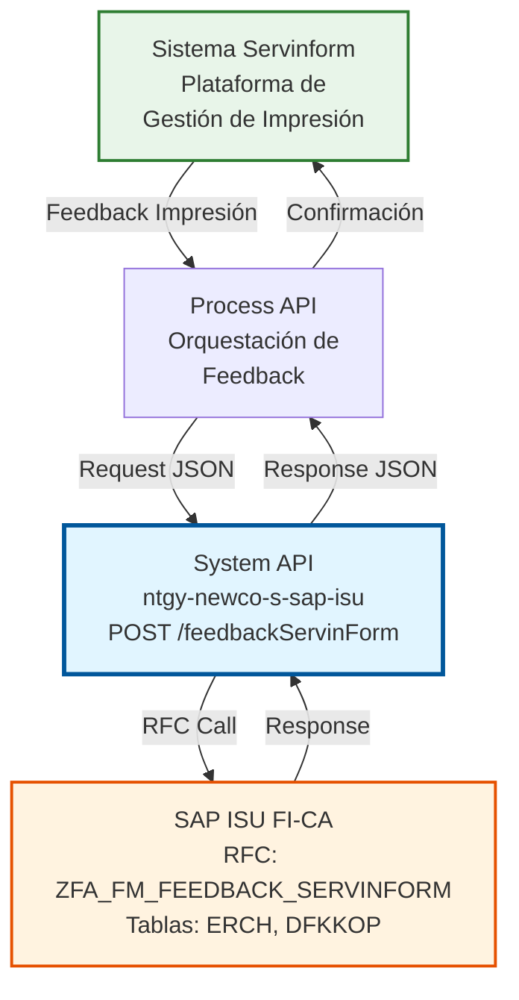
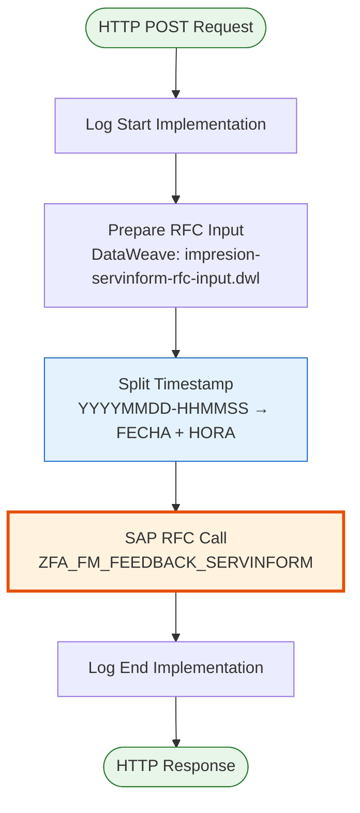
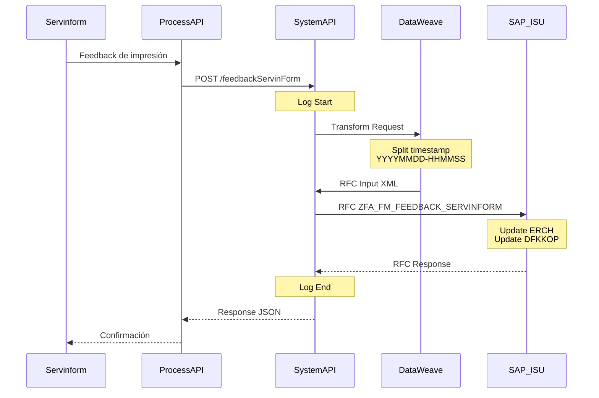
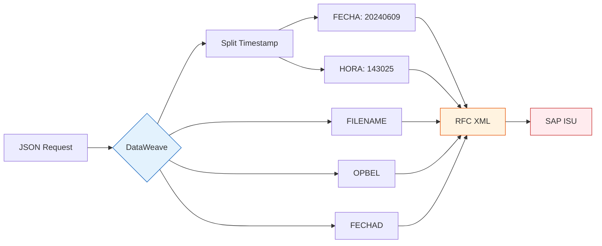

# POST /feedbackServinForm

## 📌 Descripción General

### Propósito del Endpoint

Este endpoint actualiza el estado de impresión de documentos (facturas, cartas, notificaciones) en SAP ISU basándose en el feedback recibido desde la plataforma **Servinform**. Permite mantener sincronizado el estado de los documentos impresos entre el sistema de gestión de impresión externo (Servinform) y SAP ISU, proporcionando trazabilidad completa del proceso de impresión y distribución.

El endpoint soporta:
- **Registro de Impresión**: Captura fecha y hora exacta de impresión del documento
- **Trazabilidad de Distribución**: Registra fecha de distribución del documento (opcional)
- **Asociación con Facturas**: Vincula el documento impreso con su factura en SAP (OPBEL)
- **Gestión de Archivos**: Almacena el nombre del archivo procesado por Servinform

### Tipo de API

**Capa:** System API (API-Led Connectivity)

**Función:** Integración directa con SAP ISU para actualizar el estado de impresión de documentos basándose en feedback de sistemas externos de gestión de impresión.

### Patrón de Integración

**Tipo:** Request-Reply Síncrono con SAP RFC

**Descripción:** El endpoint recibe el feedback de Servinform con los datos de impresión, extrae y transforma la información temporal (separando fecha y hora del timestamp), invoca el RFC de SAP para actualizar las tablas correspondientes, y retorna el resultado de la operación.

### Arquitectura API-Led Connectivity



---

## 💼 Propósito del Negocio

### Casos de Uso Principales

1. **Confirmación de Impresión de Factura**
   - Servinform notifica que una factura ha sido impresa exitosamente
   - SAP ISU registra la fecha y hora exacta de impresión
   - Se almacena el nombre del archivo PDF generado
   - **Beneficio**: Trazabilidad completa del proceso de impresión de facturas

2. **Registro de Distribución de Documentos**
   - Servinform informa la fecha en que el documento fue distribuido
   - SAP ISU actualiza el estado de distribución del documento
   - Se mantiene histórico de fechas de impresión y distribución
   - **Beneficio**: Control del ciclo completo de gestión documental

3. **Auditoría de Procesos de Impresión**
   - Cada documento impreso queda registrado en SAP ISU
   - Se almacena información del archivo, factura, y timestamps
   - Permite auditorías y seguimiento de SLAs de impresión
   - **Beneficio**: Cumplimiento normativo y control de calidad

### Contexto Empresarial

- **Dominio:** Facturación y Cobros - Gestión Documental
- **Sector:** Energía - Utilities
- **División:** Naturgy España - NewCo
- **Proceso de Negocio:** Gestión del ciclo de vida de documentos impresos (facturas, cartas, notificaciones)
- **Módulo SAP:** FI-CA (Financial Accounting - Contract Accounts)

### Stakeholders

- **Departamento de Facturación**: Necesita confirmar que las facturas han sido impresas y enviadas
- **Servicio al Cliente**: Requiere información sobre el estado de envío de documentos
- **Auditoría y Compliance**: Necesita trazabilidad completa del proceso de impresión
- **Operaciones de Impresión**: Gestiona el proceso de impresión y distribución con Servinform

### Valor de Negocio

- **Trazabilidad Completa**: Registro detallado de cada documento impreso con timestamps precisos
- **Cumplimiento Normativo**: Evidencia de envío de facturas y notificaciones a clientes
- **Optimización de Procesos**: Identificación de cuellos de botella en el proceso de impresión
- **Mejora de Servicio**: Información precisa sobre el estado de documentos para atención al cliente

### Consumidores Potenciales

Este endpoint puede ser consumido por:
- Process APIs de gestión documental
- Sistemas de integración con Servinform
- Plataformas de orquestación de procesos de facturación
- Sistemas de monitoreo y auditoría

---

## 🔧 Especificación Técnica

### URLs por Ambiente

| Ambiente | URL Base | URL Completa |
|----------|----------|--------------|
| **Local** | `http://localhost:8081` | `http://localhost:8081/api/feedbackServinForm` |
| **Development** | `https://ntgy-newco-s-sap-isu-dev.us-e2.cloudhub.io` | `https://ntgy-newco-s-sap-isu-dev.us-e2.cloudhub.io/api/feedbackServinForm` |
| **UAT** | `https://ntgy-newco-s-sap-isu-uat.us-e2.cloudhub.io` | `https://ntgy-newco-s-sap-isu-uat.us-e2.cloudhub.io/api/feedbackServinForm` |
| **Production** | `https://ntgy-newco-s-sap-isu-pro.us-e2.cloudhub.io` | `https://ntgy-newco-s-sap-isu-pro.us-e2.cloudhub.io/api/feedbackServinForm` |

### Método HTTP

```
POST /api/feedbackServinForm
```

### Parámetros de Entrada

#### Headers HTTP

| Header | Tipo | Requerido | Descripción | Ejemplo |
|--------|------|-----------|-------------|---------|
| `Content-Type` | string | ✅ Sí | Tipo de contenido del request | `application/json` |
| `Accept` | string | ❌ No | Tipo de contenido esperado en response | `application/json` |
| `client_id` | string | ✅ Sí | Client ID de Anypoint Platform | `a1b2c3d4e5f6` |
| `client_secret` | string | ✅ Sí | Client Secret de Anypoint Platform | `A1B2C3D4E5F6` |

#### Body Parameters

| Campo | Tipo | Requerido | Descripción | Ejemplo | Validación |
|-------|------|-----------|-------------|---------|------------|
| `filename` | string | ✅ Sí | Nombre del archivo procesado por Servinform | `"FAC_2024_001234.pdf"` | No vacío |
| `invoiceNum` | string | ✅ Sí | Número de factura (OPBEL) en SAP ISU | `"300012345678"` | 12 dígitos numéricos |
| `timestampImpresion` | string | ✅ Sí | Timestamp de impresión formato "YYYYMMDD-HHMMSS" | `"20240609-143025"` | Formato válido |
| `timestampDistribucion` | string | ❌ No | Fecha de distribución formato "YYYYMMDD" | `"20240610"` | 8 dígitos si presente |

**Estructura del Request:**

```json
{
  "filename": "FAC_2024_001234.pdf",
  "invoiceNum": "300012345678",
  "timestampImpresion": "20240609-143025",
  "timestampDistribucion": "20240610"
}
```

### Respuestas

#### Respuesta Exitosa (200 OK)

```json
{
  "resultadoEjecucion": "OK",
  "idMensaje": "S",
  "numMensaje": "001",
  "descripcion": "Feedback de impresión registrado correctamente",
  "areaFuncional": "FI-CA"
}
```

**Campos de la Respuesta:**

| Campo | Tipo | Descripción |
|-------|------|-------------|
| `resultadoEjecucion` | string | Resultado de la operación: "OK" o "KO" |
| `idMensaje` | string | ID del mensaje de SAP (S=Success, E=Error, W=Warning) |
| `numMensaje` | string | Número del mensaje de SAP |
| `descripcion` | string | Descripción del resultado |
| `areaFuncional` | string | Área funcional de SAP (FI-CA) |
| `categoriaError` | string | Categoría del error (solo si KO) |

#### Respuesta de Error de Negocio (200 OK con resultadoEjecucion = "KO")

```json
{
  "resultadoEjecucion": "KO",
  "idMensaje": "E",
  "numMensaje": "002",
  "descripcion": "Número de factura no encontrado en SAP ISU",
  "areaFuncional": "FI-CA",
  "categoriaError": "VALIDATION_ERROR"
}
```

#### Respuesta de Error Técnico (400 Bad Request)

```json
{
  "result": {
    "codResult": "0001",
    "msgResult": "Formato de timestamp inválido. Debe ser YYYYMMDD-HHMMSS"
  }
}
```

#### Respuesta de Error Técnico (500 Internal Server Error)

```json
{
  "result": {
    "codResult": "0002",
    "msgResult": "Error al conectar con SAP ISU"
  }
}
```

### Códigos de Estado HTTP

| Código | Descripción | Cuándo Ocurre |
|--------|-------------|---------------|
| **200** | OK | Operación procesada (revisar resultadoEjecucion) |
| **400** | Bad Request | Formato de request inválido o campos faltantes |
| **401** | Unauthorized | Credenciales de autenticación inválidas |
| **500** | Internal Server Error | Error en SAP ISU o error interno del sistema |
| **503** | Service Unavailable | SAP ISU no disponible |

### Autenticación y Autorización

- **Tipo:** Client ID & Client Secret (Anypoint Platform)
- **Headers Requeridos:** `client_id`, `client_secret`
- **Autorización SAP:** El usuario técnico debe tener permisos para:
  - Ejecutar RFC `ZFA_FM_FEEDBACK_SERVINFORM`
  - Acceso de escritura a tabla `ERCH` (Document Header)
  - Acceso de lectura/escritura a tabla `DFKKOP` (Open Items)
  - Autorización en módulo FI-CA

### Timeouts

| Tipo | Valor | Descripción |
|------|-------|-------------|
| **Request Timeout** | 30 segundos | Tiempo máximo de espera para la respuesta |
| **SAP RFC Timeout** | 60 segundos | Tiempo máximo para ejecución del RFC en SAP |
| **Connection Timeout** | 10 segundos | Tiempo máximo para establecer conexión con SAP |

---

## 🏗️ Implementación Técnica

### Arquitectura del Flow



### Detalle de Componentes

#### 1. HTTP Listener
- **Puerto:** 8081 (local), 8081 (CloudHub)
- **Path:** `/api/feedbackServinForm`
- **Método:** POST
- **Content-Type:** application/json

#### 2. Logger - Start Implementation
```xml
<module-logger:log 
    config-ref="Logger_Mule_Extension_Config" 
    level="DEBUG" 
    message="Start implementation flow for impresion servinform" />
```

#### 3. DataWeave Transformation - Prepare RFC Input

**Archivo:** `src/main/resources/dw/impresion-servinform-rfc-input.dwl`

```dataweave
%dw 2.0
output application/xml

var timestampImpresion = payload.timestampImpresion
var fechaImpresion = (timestampImpresion splitBy  "-")[0]
var horaImpresion = (timestampImpresion splitBy  "-")[1]

---
{
	ZFA_FM_FEEDBACK_SERVINFORM: {
		"import": {
			FILENAME: payload.filename,
			OPBEL: payload.invoiceNum,
			FECHA: fechaImpresion,
			HORA: horaImpresion,
			FECHAD: payload.timestampDistribucion
		}
	}
}
```

**Transformación de Datos:**

| Campo JSON | Transformación | Campo SAP | Descripción |
|------------|----------------|-----------|-------------|
| `filename` | Directo | `FILENAME` | Nombre del archivo procesado |
| `invoiceNum` | Directo | `OPBEL` | Número de factura (12 dígitos) |
| `timestampImpresion` | Split por "-" → [0] | `FECHA` | Fecha de impresión (YYYYMMDD) |
| `timestampImpresion` | Split por "-" → [1] | `HORA` | Hora de impresión (HHMMSS) |
| `timestampDistribucion` | Directo (opcional) | `FECHAD` | Fecha de distribución (YYYYMMDD) |

**Lógica de Transformación:**
1. El campo `timestampImpresion` se divide en dos partes usando "-" como separador
2. La primera parte (YYYYMMDD) se asigna a `FECHA`
3. La segunda parte (HHMMSS) se asigna a `HORA`
4. El campo `timestampDistribucion` se pasa directamente si está presente

#### 4. SAP RFC Call

```xml
<sap:synchronous-remote-function-call 
    key="ZFA_FM_FEEDBACK_SERVINFORM" 
    config-ref="SAP_Config" />
```

**Parámetros del RFC:**
- **FILENAME**: Nombre del archivo impreso
- **OPBEL**: Número de documento de factura
- **FECHA**: Fecha de impresión (YYYYMMDD)
- **HORA**: Hora de impresión (HHMMSS)
- **FECHAD**: Fecha de distribución (YYYYMMDD) - opcional

#### 5. Logger - End Implementation
```xml
<module-logger:log 
    config-ref="Logger_Mule_Extension_Config" 
    level="DEBUG" 
    message="Finished implementation flow for impresion servinform" />
```

### Diagrama de Secuencia



### Diagrama de Transformación de Datos



### Manejo de Errores

#### Errores de Validación (400)

| Código | Mensaje | Causa |
|--------|---------|-------|
| `0001` | Formato de timestamp inválido | timestampImpresion no cumple formato YYYYMMDD-HHMMSS |
| `0002` | Campo filename requerido | filename vacío o no presente |
| `0003` | Campo invoiceNum requerido | invoiceNum vacío o no presente |
| `0004` | invoiceNum debe tener 12 dígitos | invoiceNum no cumple formato |

#### Errores de Negocio (200 OK con KO)

| Código | Mensaje | Causa |
|--------|---------|-------|
| `E002` | Factura no encontrada | invoiceNum no existe en SAP ISU |
| `E003` | Factura ya procesada | El feedback ya fue registrado previamente |
| `E004` | Estado de factura inválido | La factura no está en estado válido para feedback |

#### Errores Técnicos (500)

| Código | Mensaje | Causa |
|--------|---------|-------|
| `SAP_CONN_ERROR` | Error de conexión con SAP | SAP ISU no disponible |
| `SAP_TIMEOUT` | Timeout en RFC | RFC excedió tiempo de espera |
| `SAP_AUTH_ERROR` | Error de autenticación SAP | Credenciales SAP inválidas |

### Logging

**Nivel DEBUG:**
```
Start implementation flow for impresion servinform
Context: {method: POST, requestPath: /api/feedbackServinForm}
```

**Nivel DEBUG:**
```
Finished implementation flow for impresion servinform
```

---

## 💻 Ejemplos de Uso

### Ejemplo 1: Request Exitoso Completo

**Request:**
```bash
curl -X POST "https://ntgy-newco-s-sap-isu-dev.us-e2.cloudhub.io/api/feedbackServinForm" \
  -H "Content-Type: application/json" \
  -H "client_id: a1b2c3d4e5f6" \
  -H "client_secret: A1B2C3D4E5F6" \
  -d '{
    "filename": "FAC_2024_001234.pdf",
    "invoiceNum": "300012345678",
    "timestampImpresion": "20240609-143025",
    "timestampDistribucion": "20240610"
  }'
```

**Response (200 OK):**
```json
{
  "resultadoEjecucion": "OK",
  "idMensaje": "S",
  "numMensaje": "001",
  "descripcion": "Feedback de impresión registrado correctamente en SAP ISU",
  "areaFuncional": "FI-CA"
}
```

### Ejemplo 2: Request Sin Fecha de Distribución

**Request:**
```json
{
  "filename": "CARTA_COBRO_2024_005678.pdf",
  "invoiceNum": "300098765432",
  "timestampImpresion": "20240609-091530"
}
```

**Response (200 OK):**
```json
{
  "resultadoEjecucion": "OK",
  "idMensaje": "S",
  "numMensaje": "001",
  "descripcion": "Feedback de impresión registrado correctamente",
  "areaFuncional": "FI-CA"
}
```

### Ejemplo 3: Error - Factura No Encontrada

**Request:**
```json
{
  "filename": "FAC_2024_999999.pdf",
  "invoiceNum": "300099999999",
  "timestampImpresion": "20240609-143025",
  "timestampDistribucion": "20240610"
}
```

**Response (200 OK con KO):**
```json
{
  "resultadoEjecucion": "KO",
  "idMensaje": "E",
  "numMensaje": "002",
  "descripcion": "Número de factura 300099999999 no encontrado en SAP ISU",
  "areaFuncional": "FI-CA",
  "categoriaError": "VALIDATION_ERROR"
}
```

### Ejemplo 4: Error - Formato de Timestamp Inválido

**Request:**
```json
{
  "filename": "FAC_2024_001234.pdf",
  "invoiceNum": "300012345678",
  "timestampImpresion": "2024-06-09 14:30:25"
}
```

**Response (400 Bad Request):**
```json
{
  "result": {
    "codResult": "0001",
    "msgResult": "Formato de timestamp inválido. Debe ser YYYYMMDD-HHMMSS. Recibido: 2024-06-09 14:30:25"
  }
}
```

### Ejemplo 5: Request con Postman

**Configuración:**
- **Method:** POST
- **URL:** `https://ntgy-newco-s-sap-isu-dev.us-e2.cloudhub.io/api/feedbackServinForm`
- **Headers:**
  - `Content-Type: application/json`
  - `client_id: a1b2c3d4e5f6`
  - `client_secret: A1B2C3D4E5F6`
- **Body (raw JSON):**
```json
{
  "filename": "NOTIF_2024_123456.pdf",
  "invoiceNum": "300011111111",
  "timestampImpresion": "20240609-160000",
  "timestampDistribucion": "20240611"
}
```

### Ejemplo 6: Request con Python

```python
import requests
import json
from datetime import datetime

# Configuración
url = "https://ntgy-newco-s-sap-isu-dev.us-e2.cloudhub.io/api/feedbackServinForm"
headers = {
    "Content-Type": "application/json",
    "client_id": "a1b2c3d4e5f6",
    "client_secret": "A1B2C3D4E5F6"
}

# Generar timestamp actual en formato requerido
now = datetime.now()
timestamp_impresion = now.strftime("%Y%m%d-%H%M%S")
timestamp_distribucion = now.strftime("%Y%m%d")

# Payload
payload = {
    "filename": "FAC_2024_001234.pdf",
    "invoiceNum": "300012345678",
    "timestampImpresion": timestamp_impresion,
    "timestampDistribucion": timestamp_distribucion
}

# Realizar request
response = requests.post(url, headers=headers, json=payload)

# Procesar respuesta
if response.status_code == 200:
    result = response.json()
    if result.get("resultadoEjecucion") == "OK":
        print(f"✓ Feedback registrado: {result.get('descripcion')}")
    else:
        print(f"✗ Error de negocio: {result.get('descripcion')}")
else:
    print(f"✗ Error HTTP {response.status_code}: {response.text}")
```

### Ejemplo 7: Request con Node.js

```javascript
const axios = require('axios');

const feedbackServinform = async () => {
  const url = 'https://ntgy-newco-s-sap-isu-dev.us-e2.cloudhub.io/api/feedbackServinForm';
  
  // Generar timestamp actual
  const now = new Date();
  const timestampImpresion = now.toISOString()
    .replace(/[-:T]/g, '')
    .slice(0, 15)
    .replace(/(\d{8})(\d{6}).*/, '$1-$2');
  
  const payload = {
    filename: 'FAC_2024_001234.pdf',
    invoiceNum: '300012345678',
    timestampImpresion: timestampImpresion,
    timestampDistribucion: now.toISOString().slice(0, 10).replace(/-/g, '')
  };
  
  try {
    const response = await axios.post(url, payload, {
      headers: {
        'Content-Type': 'application/json',
        'client_id': 'a1b2c3d4e5f6',
        'client_secret': 'A1B2C3D4E5F6'
      }
    });
    
    if (response.data.resultadoEjecucion === 'OK') {
      console.log('✓ Feedback registrado:', response.data.descripcion);
    } else {
      console.log('✗ Error de negocio:', response.data.descripcion);
    }
  } catch (error) {
    console.error('✗ Error:', error.response?.data || error.message);
  }
};

feedbackServinform();
```

