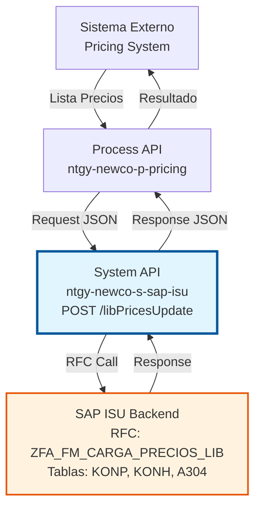
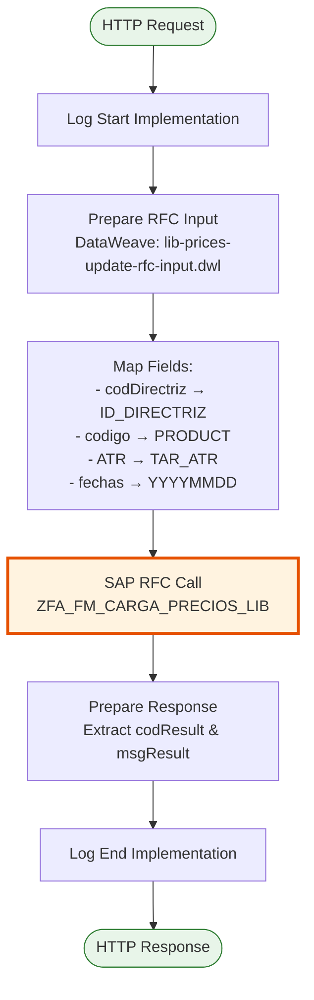
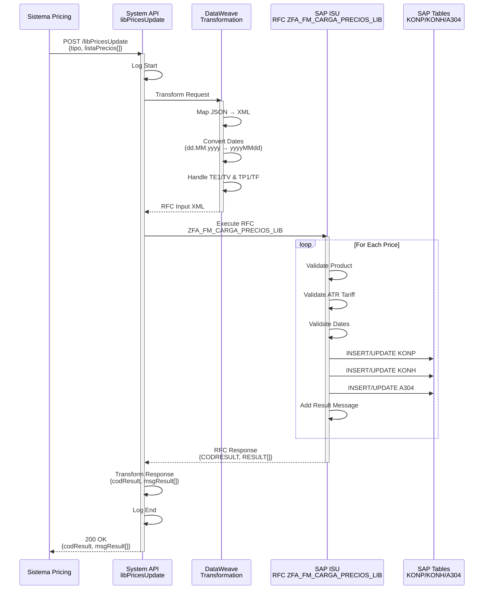
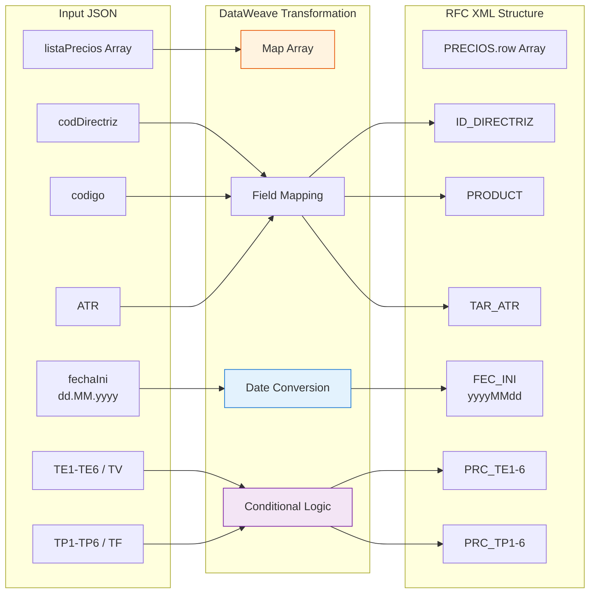

# POST /libPricesUpdate

## 📌 Descripción General

### Propósito del Endpoint

Actualiza precios liberalizados en SAP ISU mediante carga masiva de tarifas del mercado libre de electricidad y gas. Este endpoint permite sincronizar precios desde sistemas externos de pricing hacia SAP ISU, incluyendo términos de energía (TE), términos de potencia (TP) y cuotas de servicio.

El endpoint soporta:
- **Carga Masiva**: Procesamiento de múltiples precios en una sola operación
- **Términos de Energía**: Hasta 6 periodos horarios (TE1-TE6) o término variable (TV)
- **Términos de Potencia**: Hasta 6 periodos (TP1-TP6) o término fijo (TF)
- **Gestión de Vigencias**: Fechas de inicio y fin de aplicación de precios
- **Tarifas ATR**: Soporte para todas las tarifas de Acceso de Terceros a la Red
- **Niveles de Precio**: Configuración de niveles de precio (1-9)

### Tipo de API

**Capa:** System API (API-Led Connectivity)

**Función:** Integración directa con SAP ISU para gestión de precios liberalizados del mercado energético.

### Patrón de Integración

**Tipo:** Request-Reply Síncrono con SAP RFC

**Descripción:** Recibe lista de precios liberalizados, transforma datos al formato SAP (conversión de fechas, mapeo de campos), invoca RFC de carga masiva, procesa respuesta con mensajes por cada precio, y retorna resultado consolidado.

### Arquitectura API-Led Connectivity



---

## 💼 Propósito del Negocio

### Casos de Uso Principales

1. **Actualización Masiva de Precios de Mercado**
   - Sincronización diaria/horaria de precios del mercado mayorista
   - Actualización de términos de energía según pool eléctrico
   - Ajuste de precios por cambios en costes de suministro
   - **Beneficio**: Precios actualizados en tiempo real para facturación precisa

2. **Lanzamiento de Nuevas Ofertas Comerciales**
   - Carga de precios para nuevas campañas comerciales
   - Configuración de ofertas promocionales con vigencias específicas
   - Gestión de precios diferenciados por segmento de cliente
   - **Beneficio**: Agilidad en lanzamiento de productos al mercado

3. **Actualización por Cambios Regulatorios**
   - Ajuste de precios tras cambios en tarifas ATR
   - Actualización de términos de potencia por modificaciones regulatorias
   - Sincronización con publicaciones oficiales de CNMC
   - **Beneficio**: Cumplimiento normativo automático

### Contexto Empresarial

- **Dominio:** Pricing & Billing - Gestión de Tarifas Liberalizadas
- **Sector:** Energía - Utilities (Electricidad y Gas)
- **División:** Naturgy España - NewCo
- **Proceso de Negocio:** Gestión de Precios del Mercado Libre
- **Módulo SAP:** FI-CA (Financial Contract Accounting) / Pricing

### Stakeholders

- **Departamento de Pricing**: Define y actualiza precios de mercado libre
- **Sistemas de Pricing Externos**: Calculan precios basados en mercado mayorista
- **Departamento de Facturación**: Consume precios para generación de facturas
- **Área Comercial**: Gestiona ofertas y campañas con precios específicos
- **Compliance**: Valida cumplimiento de precios regulados vs. liberalizados

### Valor de Negocio

- **Automatización**: Eliminación de carga manual de precios en SAP GUI
- **Precisión**: Reducción de errores en facturación por precios incorrectos
- **Agilidad**: Respuesta rápida a cambios de mercado (minutos vs. horas)
- **Trazabilidad**: Registro completo de cambios de precios con vigencias
- **Escalabilidad**: Capacidad de procesar miles de precios en una operación

### Consumidores Potenciales

Este endpoint puede ser consumido por:
- Process APIs de gestión de pricing
- Sistemas externos de cálculo de precios (pricing engines)
- Plataformas de integración middleware
- Flujos automatizados de actualización de tarifas
- Sistemas de gestión comercial (CRM)

---

## 🔧 Especificación Técnica

### URLs por Ambiente

| Ambiente | URL Base | URL Completa |
|----------|----------|--------------|
| **Local** | `http://localhost:8081` | `http://localhost:8081/api/libPricesUpdate` |
| **Development** | `https://ntgy-newco-s-sap-isu-dev.us-e2.cloudhub.io` | `https://ntgy-newco-s-sap-isu-dev.us-e2.cloudhub.io/api/libPricesUpdate` |
| **UAT** | `https://ntgy-newco-s-sap-isu-uat.us-e2.cloudhub.io` | `https://ntgy-newco-s-sap-isu-uat.us-e2.cloudhub.io/api/libPricesUpdate` |
| **Production** | `https://ntgy-newco-s-sap-isu-pro.us-e2.cloudhub.io` | `https://ntgy-newco-s-sap-isu-pro.us-e2.cloudhub.io/api/libPricesUpdate` |

### Método HTTP

```
POST /api/libPricesUpdate
```

### Parámetros de Entrada

#### Headers HTTP

| Header | Tipo | Requerido | Descripción | Ejemplo |
|--------|------|-----------|-------------|---------|
| `Content-Type` | string | ✅ Sí | Tipo de contenido del request | `application/json` |
| `Accept` | string | ❌ No | Tipo de contenido esperado en response | `application/json` |
| `client_id` | string | ✅ Sí | Client ID de Anypoint Platform | `a1b2c3d4e5f6` |
| `client_secret` | string | ✅ Sí | Client Secret de Anypoint Platform | `A1B2C3D4E5F6` |

#### Body Parameters

**Estructura del Request:**

| Campo | Tipo | Requerido | Descripción | Ejemplo |
|-------|------|-----------|-------------|---------|
| `tipo` | string | ✅ Sí | Tipo de operación (CREATE, UPDATE, DELETE) | `"CREATE"` |
| `listaPrecios` | array | ✅ Sí | Lista de precios a cargar (mínimo 1) | Ver estructura detallada abajo |

**Estructura de cada elemento en listaPrecios:**

| Campo | Tipo | Requerido | Descripción | Ejemplo |
|-------|------|-----------|-------------|---------|
| `codDirectriz` | string | ✅ Sí | Código de directriz de precios | `"DIR001"` |
| `codigo` | string | ✅ Sí | Código de producto/servicio (max 18 chars) | `"PROD001"` |
| `ATR` | string | ✅ Sí | Tarifa ATR (2.0TD, 3.0TD, 6.1TD, etc.) | `"2.0TD"` |
| `oferta` | string | ✅ Sí | Tipo de oferta comercial | `"OFERTA01"` |
| `fechaIni` | string | ✅ Sí | Fecha inicio vigencia (dd.MM.yyyy) | `"01.01.2024"` |
| `fechaFin` | string | ✅ Sí | Fecha fin vigencia (dd.MM.yyyy) | `"31.12.2024"` |
| `TE1` | number | ❌ No | Precio término energía P1 (€/kWh) | `0.12345` |
| `TE2` | number | ❌ No | Precio término energía P2 (€/kWh) | `0.11234` |
| `TE3` | number | ❌ No | Precio término energía P3 (€/kWh) | `0.10123` |
| `TE4` | number | ❌ No | Precio término energía P4 (€/kWh) | `0.09012` |
| `TE5` | number | ❌ No | Precio término energía P5 (€/kWh) | `0.08901` |
| `TE6` | number | ❌ No | Precio término energía P6 (€/kWh) | `0.07890` |
| `TV` | number | ❌ No | Precio término variable (alternativo a TE1) | `0.12000` |
| `TP1` | number | ❌ No | Precio término potencia P1 (€/kW/día) | `0.05678` |
| `TP2` | number | ❌ No | Precio término potencia P2 (€/kW/día) | `0.04567` |
| `TP3` | number | ❌ No | Precio término potencia P3 (€/kW/día) | `0.03456` |
| `TP4` | number | ❌ No | Precio término potencia P4 (€/kW/día) | `0.02345` |
| `TP5` | number | ❌ No | Precio término potencia P5 (€/kW/día) | `0.01234` |
| `TP6` | number | ❌ No | Precio término potencia P6 (€/kW/día) | `0.00123` |
| `TF` | number | ❌ No | Precio término fijo (alternativo a TP1) | `0.05000` |
| `precio` | number | ✅ Sí | Precio cuota de servicio (€/mes) | `5.50` |
| `fechaClave` | string | ✅ Sí | Fecha clave aplicación (dd.MM.yyyy) | `"01.01.2024"` |
| `nivPre` | string | ✅ Sí | Nivel de precio (1-9) | `"1"` |

**Nota:** Al menos uno de los términos de energía (TE1 o TV) y uno de los términos de potencia (TP1 o TF) debe estar informado.

### Respuestas

#### Respuesta Exitosa (200 OK)

```json
{
  "codResult": "0000",
  "msgResult": [
    {
      "id": "1",
      "mensaje": "Precio cargado correctamente para producto PROD001"
    },
    {
      "id": "2",
      "mensaje": "Precio cargado correctamente para producto PROD002"
    }
  ]
}
```

**Descripción de Campos:**
- `codResult`: Código de resultado global (`"0000"` = éxito, `"0001"` = error)
- `msgResult`: Array de mensajes con resultado por cada precio procesado
  - `id`: Identificador secuencial del mensaje
  - `mensaje`: Descripción del resultado del procesamiento

#### Respuesta de Error de Negocio (200 OK con codResult = "0001")

```json
{
  "codResult": "0001",
  "msgResult": [
    {
      "id": "1",
      "mensaje": "Error: Producto PROD001 no existe en maestro de productos"
    },
    {
      "id": "2",
      "mensaje": "Error: Tarifa ATR 9.9ZZ no es válida"
    }
  ]
}
```

#### Respuesta de Error Técnico (400/500)

```json
{
  "result": {
    "codResult": "0001",
    "msgResult": "Error interno del servidor al procesar la carga de precios"
  }
}
```

### Autenticación y Autorización

- **Tipo:** Client ID & Client Secret (Anypoint Platform)
- **Autorización SAP:** El usuario debe tener permisos para:
  - Ejecutar RFC `ZFA_FM_CARGA_PRECIOS_LIB`
  - Acceso a tablas KONP, KONH, A304
  - Crear/modificar condiciones de precio
  - Gestionar directrices de precios

### Timeouts

| Tipo | Valor | Descripción |
|------|-------|-------------|
| **Request Timeout** | 60 segundos | Tiempo máximo de espera para la respuesta |
| **Connection Timeout** | 10 segundos | Tiempo máximo para establecer conexión |
| **SAP RFC Timeout** | 60 segundos | Timeout específico para llamada RFC |

---

## 🏗️ Implementación Técnica

### Arquitectura del Flow



### Componentes del Flow

**Ubicación:** `src/main/mule/implementation/payment-financial-operations.xml`

**Flow Principal:** `libPricesUpdateFlow` (líneas 269-293)

```xml
<flow name="libPricesUpdateFlow">
    <!-- 1. Log inicio -->
    <module-logger:log message="Start implementation flow for lib prices update"/>
    
    <!-- 2. Transformación de entrada -->
    <ee:transform>
        <ee:set-payload resource="dw/lib-prices-update-rfc-input.dwl"/>
    </ee:transform>
    
    <!-- 3. Llamada RFC SAP -->
    <sap:synchronous-remote-function-call key="ZFA_FM_CARGA_PRECIOS_LIB"/>
    
    <!-- 4. Transformación de salida -->
    <ee:transform>
        <ee:set-payload>
            {
                "codResult": payload.ZFA_FM_CARGA_PRECIOS_LIB.export.CODRESULT,
                "msgResult": payload.ZFA_FM_CARGA_PRECIOS_LIB.tables.RESULT.*row map {
                    "id": $.@id,
                    "mensaje": $.MENSAJE
                }
            }
        </ee:set-payload>
    </ee:transform>
    
    <!-- 5. Log fin -->
    <module-logger:log message="Finished implementation flow for lib prices update"/>
</flow>
```

### Transformación DataWeave de Entrada

**Archivo:** `src/main/resources/dw/lib-prices-update-rfc-input.dwl`

```dataweave
%dw 2.0
output application/xml
---
{
    "ZFA_FM_CARGA_PRECIOS_LIB": {
        "import": {
            "PRECIOS": {
                "row": payload.listaPrecios map {
                    ID_DIRECTRIZ: $.codDirectriz,
                    "PRODUCT": $.codigo,
                    "TAR_ATR": $.ATR,
                    "TIP_OFE": $.oferta,
                    "FEC_INI": ($.fechaIni as Date {format: "dd.MM.yyyy"}) 
                               as String {format: "yyyyMMdd"} default "",
                    "FEC_FIN": ($.fechaFin as Date {format: "dd.MM.yyyy"}) 
                               as String {format: "yyyyMMdd"} default "",
                    "PRC_TE1": if ($.TE1 != null) $.TE1 else $.TV default "",
                    "PRC_TE2": $.TE2,
                    "PRC_TE3": $.TE3,
                    "PRC_TE4": $.TE4,
                    "PRC_TE5": $.TE5,
                    "PRC_TE6": $.TE6,
                    "PRC_TP1": if ($.TP1 != null) $.TP1 else $.TF default "",
                    "PRC_TP2": $.TP2,
                    "PRC_TP3": $.TP3,
                    "PRC_TP4": $.TP4,
                    "PRC_TP5": $.TP5,
                    "PRC_TP6": $.TP6,
                    "CUO_SER": $.precio,
                    "FEC_CLA": ($.fechaClave as Date {format: "dd.MM.yyyy"}) 
                               as String {format: "yyyyMMdd"} default "",
                    "NIV_PRE": $.nivPre
                }
            },
            TIPO: payload.tipo
        }
    }
}
```

**Mapeo de Campos:**

| Campo JSON | Campo SAP RFC | Transformación | Descripción |
|------------|---------------|----------------|-------------|
| `codDirectriz` | `ID_DIRECTRIZ` | Directo | Código de directriz |
| `codigo` | `PRODUCT` | Directo | Código de producto |
| `ATR` | `TAR_ATR` | Directo | Tarifa ATR |
| `oferta` | `TIP_OFE` | Directo | Tipo de oferta |
| `fechaIni` | `FEC_INI` | dd.MM.yyyy → yyyyMMdd | Fecha inicio |
| `fechaFin` | `FEC_FIN` | dd.MM.yyyy → yyyyMMdd | Fecha fin |
| `TE1` o `TV` | `PRC_TE1` | Condicional | Término energía P1 |
| `TE2-TE6` | `PRC_TE2-6` | Directo | Términos energía P2-P6 |
| `TP1` o `TF` | `PRC_TP1` | Condicional | Término potencia P1 |
| `TP2-TP6` | `PRC_TP2-6` | Directo | Términos potencia P2-P6 |
| `precio` | `CUO_SER` | Directo | Cuota de servicio |
| `fechaClave` | `FEC_CLA` | dd.MM.yyyy → yyyyMMdd | Fecha clave |
| `nivPre` | `NIV_PRE` | Directo | Nivel de precio |
| `tipo` | `TIPO` | Directo | Tipo de operación |

### Diagrama de Secuencia



### Diagrama de Transformación de Datos



### Manejo de Errores

**Estrategia de Error Handling:**

1. **Errores de Validación (400 Bad Request)**
   - Formato de fecha inválido
   - Campos requeridos faltantes
   - Valores fuera de rango

2. **Errores de Negocio (200 OK con codResult="0001")**
   - Producto no existe
   - Tarifa ATR inválida
   - Directriz de precios no encontrada
   - Fechas inconsistentes

3. **Errores Técnicos (500 Internal Server Error)**
   - Timeout de SAP RFC
   - Error de conexión con SAP
   - Error en transformación DataWeave

**Códigos de Error SAP:**

| Código | Tipo | Descripción | Acción Recomendada |
|--------|------|-------------|-------------------|
| `0000` | Success | Carga exitosa | Ninguna |
| `0001` | Business Error | Error de validación | Revisar msgResult para detalles |
| `E001` | Technical Error | Producto no existe | Verificar código de producto |
| `E002` | Technical Error | Tarifa ATR inválida | Verificar catálogo de tarifas |
| `E003` | Technical Error | Directriz no encontrada | Crear directriz en SAP |
| `E004` | Technical Error | Fechas inconsistentes | Verificar fechaIni < fechaFin |

---

## 💻 Ejemplos de Uso

### Ejemplo 1: Carga de Precio Simple (Tarifa 2.0TD)

**Request:**

```bash
curl -X POST "https://ntgy-newco-s-sap-isu-pro.us-e2.cloudhub.io/api/libPricesUpdate" \
  -H "Content-Type: application/json" \
  -H "client_id: a1b2c3d4e5f6" \
  -H "client_secret: A1B2C3D4E5F6" \
  -d '{
    "tipo": "CREATE",
    "listaPrecios": [
      {
        "codDirectriz": "DIR2024",
        "codigo": "ELEC_2.0TD",
        "ATR": "2.0TD",
        "oferta": "STANDARD",
        "fechaIni": "01.01.2024",
        "fechaFin": "31.12.2024",
        "TE1": 0.12500,
        "TP1": 0.05000,
        "precio": 3.50,
        "fechaClave": "01.01.2024",
        "nivPre": "1"
      }
    ]
  }'
```

**Response (200 OK):**

```json
{
  "codResult": "0000",
  "msgResult": [
    {
      "id": "1",
      "mensaje": "Precio cargado correctamente para producto ELEC_2.0TD"
    }
  ]
}
```

### Ejemplo 2: Carga Masiva de Precios (Tarifa 3.0TD con 6 Periodos)

**Request:**

```json
{
  "tipo": "CREATE",
  "listaPrecios": [
    {
      "codDirectriz": "DIR2024",
      "codigo": "ELEC_3.0TD_P1",
      "ATR": "3.0TD",
      "oferta": "PREMIUM",
      "fechaIni": "01.01.2024",
      "fechaFin": "31.12.2024",
      "TE1": 0.15000,
      "TE2": 0.14000,
      "TE3": 0.13000,
      "TE4": 0.12000,
      "TE5": 0.11000,
      "TE6": 0.10000,
      "TP1": 0.08000,
      "TP2": 0.07000,
      "TP3": 0.06000,
      "TP4": 0.05000,
      "TP5": 0.04000,
      "TP6": 0.03000,
      "precio": 5.00,
      "fechaClave": "01.01.2024",
      "nivPre": "1"
    },
    {
      "codDirectriz": "DIR2024",
      "codigo": "ELEC_3.0TD_P2",
      "ATR": "3.0TD",
      "oferta": "BASIC",
      "fechaIni": "01.01.2024",
      "fechaFin": "31.12.2024",
      "TE1": 0.13000,
      "TE2": 0.12000,
      "TE3": 0.11000,
      "TE4": 0.10000,
      "TE5": 0.09000,
      "TE6": 0.08000,
      "TP1": 0.06000,
      "TP2": 0.05000,
      "TP3": 0.04000,
      "TP4": 0.03000,
      "TP5": 0.02000,
      "TP6": 0.01000,
      "precio": 3.00,
      "fechaClave": "01.01.2024",
      "nivPre": "2"
    }
  ]
}
```

**Response (200 OK):**

```json
{
  "codResult": "0000",
  "msgResult": [
    {
      "id": "1",
      "mensaje": "Precio cargado correctamente para producto ELEC_3.0TD_P1"
    },
    {
      "id": "2",
      "mensaje": "Precio cargado correctamente para producto ELEC_3.0TD_P2"
    }
  ]
}
```

### Ejemplo 3: Precio con Término Variable (TV) y Término Fijo (TF)

**Request:**

```json
{
  "tipo": "CREATE",
  "listaPrecios": [
    {
      "codDirectriz": "DIR2024",
      "codigo": "GAS_SIMPLE",
      "ATR": "RL.1",
      "oferta": "FLAT_RATE",
      "fechaIni": "01.01.2024",
      "fechaFin": "31.12.2024",
      "TV": 0.11000,
      "TF": 0.04500,
      "precio": 2.50,
      "fechaClave": "01.01.2024",
      "nivPre": "1"
    }
  ]
}
```

**Response (200 OK):**

```json
{
  "codResult": "0000",
  "msgResult": [
    {
      "id": "1",
      "mensaje": "Precio cargado correctamente para producto GAS_SIMPLE"
    }
  ]
}
```

### Ejemplo 4: Error de Validación (Producto No Existe)

**Request:**

```json
{
  "tipo": "CREATE",
  "listaPrecios": [
    {
      "codDirectriz": "DIR2024",
      "codigo": "PRODUCTO_INEXISTENTE",
      "ATR": "2.0TD",
      "oferta": "STANDARD",
      "fechaIni": "01.01.2024",
      "fechaFin": "31.12.2024",
      "TE1": 0.12000,
      "TP1": 0.05000,
      "precio": 3.00,
      "fechaClave": "01.01.2024",
      "nivPre": "1"
    }
  ]
}
```

**Response (200 OK con Error de Negocio):**

```json
{
  "codResult": "0001",
  "msgResult": [
    {
      "id": "1",
      "mensaje": "Error E001: Producto PRODUCTO_INEXISTENTE no existe en maestro de productos SAP"
    }
  ]
}
```

### Ejemplo 5: Actualización de Precios Existentes

**Request:**

```json
{
  "tipo": "UPDATE",
  "listaPrecios": [
    {
      "codDirectriz": "DIR2024",
      "codigo": "ELEC_2.0TD",
      "ATR": "2.0TD",
      "oferta": "STANDARD",
      "fechaIni": "01.07.2024",
      "fechaFin": "31.12.2024",
      "TE1": 0.13500,
      "TP1": 0.05500,
      "precio": 3.75,
      "fechaClave": "01.07.2024",
      "nivPre": "1"
    }
  ]
}
```

**Response (200 OK):**

```json
{
  "codResult": "0000",
  "msgResult": [
    {
      "id": "1",
      "mensaje": "Precio actualizado correctamente para producto ELEC_2.0TD con vigencia desde 01.07.2024"
    }
  ]
}
```

### Ejemplo 6: Código Python para Integración

```python
import requests
import json
from datetime import datetime

def cargar_precios_liberalizados(precios):
    """
    Carga precios liberalizados en SAP ISU
    
    Args:
        precios: Lista de diccionarios con datos de precios
    
    Returns:
        dict: Respuesta del API con resultado de la carga
    """
    url = "https://ntgy-newco-s-sap-isu-pro.us-e2.cloudhub.io/api/libPricesUpdate"
    
    headers = {
        "Content-Type": "application/json",
        "client_id": "a1b2c3d4e5f6",
        "client_secret": "A1B2C3D4E5F6"
    }
    
    payload = {
        "tipo": "CREATE",
        "listaPrecios": precios
    }
    
    try:
        response = requests.post(url, headers=headers, json=payload, timeout=60)
        response.raise_for_status()
        
        result = response.json()
        
        if result["codResult"] == "0000":
            print(f"✅ Carga exitosa: {len(result['msgResult'])} precios procesados")
            for msg in result["msgResult"]:
                print(f"   - {msg['mensaje']}")
        else:
            print(f"❌ Error en carga:")
            for msg in result["msgResult"]:
                print(f"   - {msg['mensaje']}")
        
        return result
        
    except requests.exceptions.Timeout:
        print("⏱️ Timeout: La carga de precios tardó más de 60 segundos")
        return None
    except requests.exceptions.RequestException as e:
        print(f"❌ Error de conexión: {str(e)}")
        return None

# Ejemplo de uso
precios_ejemplo = [
    {
        "codDirectriz": "DIR2024",
        "codigo": "ELEC_2.0TD",
        "ATR": "2.0TD",
        "oferta": "STANDARD",
        "fechaIni": "01.01.2024",
        "fechaFin": "31.12.2024",
        "TE1": 0.12500,
        "TP1": 0.05000,
        "precio": 3.50,
        "fechaClave": "01.01.2024",
        "nivPre": "1"
    }
]

resultado = cargar_precios_liberalizados(precios_ejemplo)
```

### Ejemplo 7: Validación de Respuesta

```javascript
// Función para validar y procesar respuesta
function procesarRespuestaCargaPrecios(response) {
    if (!response || !response.codResult) {
        console.error('❌ Respuesta inválida del API');
        return false;
    }
    
    if (response.codResult === '0000') {
        console.log('✅ Carga de precios exitosa');
        
        // Procesar mensajes de éxito
        response.msgResult.forEach((msg, index) => {
            console.log(`   ${index + 1}. ${msg.mensaje}`);
        });
        
        return true;
    } else {
        console.error('❌ Error en carga de precios');
        
        // Procesar mensajes de error
        response.msgResult.forEach((msg, index) => {
            console.error(`   ${index + 1}. ${msg.mensaje}`);
        });
        
        return false;
    }
}

// Ejemplo de uso
const response = {
    "codResult": "0000",
    "msgResult": [
        {
            "id": "1",
            "mensaje": "Precio cargado correctamente para producto ELEC_2.0TD"
        }
    ]
};

procesarRespuestaCargaPrecios(response);
```
